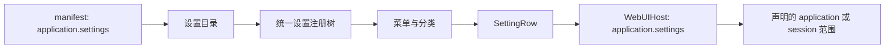

# application.settings 的 location 扩展设计

建档日期：2026-11-04。状态：统一入口源码、定向验证与本地真实服务迁移验收完成。本文件维护进度及验收记录；公共契约主责见 [S_18](../specs/S_18_settings-location.md)。

## 目标与责任

直接改造原 application.settings，插件可以声明菜单、分类和配置项，也可以将完整 WebUI 组件树定位到既有分类。宿主复用原生设置注册表、访问策略、SettingsSection 和 SettingRow；插件负责控件树和业务读写。所有节点使用稳定 ID，定位不依赖中文名称或数组下标。



## 声明与位置

所有声明使用 type=web.slot.contribution、slot=application.settings。kind 支持 menu/section/item，省略为 item。菜单和分类提供中英文标题；配置项提供标题时宿主生成标签/描述/控件行，省略标题时完整组件树放入共享设置行的 content 区域。location 为必填，支持既有或插件提供的父级、before/after 和默认追加；算法及失败语义沿用 S_18。

```yaml
- type: web.slot.contribution
  slot: application.settings
  kind: item
  id: show-weather
  scope: application
  location: {menu: general, section: display}
  title: {zh: 显示 Token Weather, en: Show Token Weather}
  renderer: {kind: webui-tree}
```

同一槽位按声明 scope 区分生命周期，默认 session 保留原语义；全客户端配置项显式使用 application。只有 application.settings 允许这两个范围，其他槽位保持固定范围。instanceKey 默认为声明 id，可对应已有插件实例；包、范围和实例共同参与准入。同包同范围不得重复声明相同渲染实例。

## 设置树与生命周期

目录通过既有 webui.settings.catalog 请求返回。前端在进入设置、重连和窗口 focus 时刷新，旧查询不能覆盖新结果，相同 revision 不重建控件。所有菜单、分类和配置项统一合成，不在当前菜单底部再挂一个全局设置宿主。

菜单、分类不创建渲染实例。配置项在所属菜单可见时挂载，ui.ready 使用声明的包、实例和 scope。session 项需要真实活动会话，无会话时不显示；application 项不携带会话，使用可信 Web 连接。切换会话只重建对应 session 控件；清理会话不清理 application 控件。隐藏和只读继续由原生策略逐级约束。

## 兼容与迁移

统一入口迁移为现有工作台补 location={menu:general,section:display} 和 instanceKey=workbench，保留 session 默认值及原有控件。全客户端配置项显式使用 application 范围；通用的 session 配置项能力保留。其他旧的无 location 声明需补齐位置；非法父级不会被放入其他分类。

本次早期实现曾新增独立声明类型 web.settings.contribution 和承载槽位 application.settings.content。用户明确要求改造原入口，现已移除这两项公开能力，不保留别名、分流或页底独立挂载。webui.settings.catalog 只是读取同一槽位声明的目录，不构成另一套设置入口。

## 验证与边界

统一入口迁移后的后端定向测试 385 项通过，组件测试 147 项通过。新增回归覆盖工作台实际 ui.change、应用/会话范围准入、会话清理隔离、控件身份、菜单卸载与关闭后重开、重复渲染目标和菜单/分类禁止 renderer。位置及偏好测试 19 项、协议 14 项、运行时 17 项、契约 134 项通过。Vite 生产打包通过（16.54s）。

真实服务已安装 Token Weather 1.1.0，并为既有工作台补齐 manifest 元数据。更新常驻 Worker 后，Chrome 确认两项设置均使用 application.settings，在“常规 → 显示设置”中各占一个共享设置行。“浏览器”菜单没有这两个配置项；无会话时保留应用范围的 Token Weather 设置，不显示工作台会话配置。

两项开关均验证了关闭后仍在、可重新开启；Token Weather 关闭状态在切换菜单、刷新和无会话刷新后保留，重新打开后输入框上方状态条恢复。验收结束两个开关均恢复开启。截图为本次输出目录中的 settings-both-off.png 和 settings-unified-on.png。此前用户截图中开关消失的现象仍未复现，不能据此宣称已定位其根因。

Gateway 域插件目录仍未接入本目录查询，不将两个运行域合并。遵守本地约束，未运行格式化或静态检查，生产打包使用 Vite。真实服务验证不调用模型，不把工作台固定演示用量作为事实。

## 错误帧作用域回归修复（2026-11-04）

双范围支持引入了错误帧路由回归：请求 scope 已被槽位校验拒绝，错误处理仍使用该非法值选择会话或连接。
错误目标现在保留槽位允许的实际 scope；请求 scope 不被允许时按槽位定义的默认范围确定错误目标。
application.settings 的 session/application 支持继续保留，应用范围错误帧按可信连接投递。

新增回归覆盖设置槽位的非法 scope、两种合法 scope 的正常渲染与拒绝路径，以及应用范围连接不匹配时的可信连接投递。
修复前生命周期文件为 8 项失败、12 项通过；修复后以下后端定向测试全部 477 项通过：

```bash
.venv/bin/python -m pytest \
  tests/unit_tests/extensions_v2/webui/test_slot_lifecycle.py \
  tests/unit_tests/extensions_v2/webui/test_application_slots.py \
  tests/unit_tests/extensions_v2/webui/test_webui_adapter.py \
  tests/unit_tests/extensions_v2/webui/test_webui_events.py \
  tests/unit_tests/extensions_v2/webui/test_webui_runtime.py \
  tests/unit_tests/extensions_v2/webui/test_settings_location.py \
  --no-cov -q -o log_cli=false
```

前端 test:plugin-settings 19 项、test:webui-protocol 14 项、test:webui-runtime 17 项全部通过。
本轮验证为单元与协议测试，设置目录 revision 与控件重建逻辑未修改。

Error frames preserve a scope allowed by the slot; a disallowed scope uses the slot's declared default for error routing.
Settings retain both session and application scopes, and application errors target the trusted connection.
The targeted regression passed 477 backend and 50 frontend tests; catalog revision and remount behavior is unchanged.
