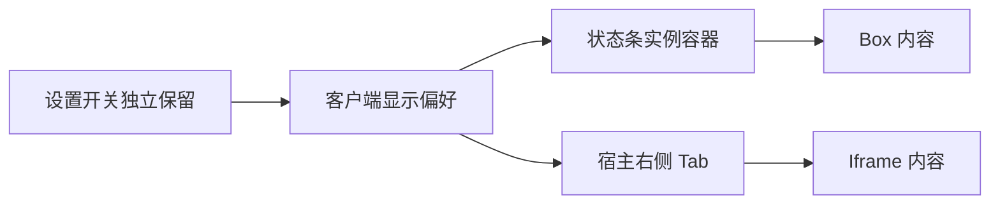
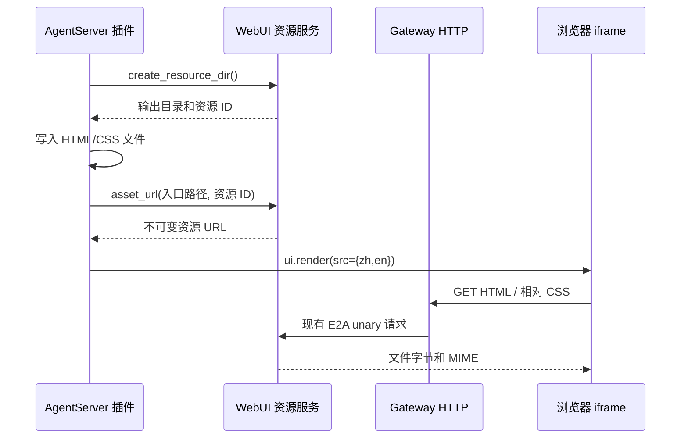

# 独立 TokenWeather 状态条设计

建档日期：2026-11-04。最近修订：2026-11-05。状态：当前源码已取消状态条自定义背景，本次验证与部署边界见文末。本文件维护本项进度与验证记录。

## 范围与边界

新包 `webui.token-weather-glass` 参考已有 Token Weather，在 `conversation.input.above` 展示平台真实上下文用量，状态条复用宿主公共组件和主题样式，1.2.0 起点击“打开详情”在右侧打开独立 iframe Tab。原 token_weather 不修改；按后续用户要求，工作台中固定用量的天气演示及其设置项已移除，保留独立插件。移除记录见文末。

插件可在常规显示设置中声明持久化的显示开关。开关默认开启，作用于当前客户端所有会话，不做跨设备同步。
2026-11-05 按用户决定取消新增的自定义背景能力；下文早期玻璃背景、材质及配色验收属于历史记录。

## 接口方案

复用 Box、Text、Button、Switch 与既有 ui.ready / ui.change / ui.click，不新增外观或配置专用组件。

| 接口 | 插件声明 | 宿主责任 |
| --- | --- | --- |
| UiRenderInput.visible_when | 与 root 同级的 `{key, default}` | 按可信包身份读取客户端偏好；false 时由槽位宿主隐藏实例容器或详情 Tab |
| Switch.preference | `{key, default}` | 使用相同的包级偏好读取/写入 checked；持久化成功后更新所有会话展示，失败不假称保存成功 |
| application.settings | `type: web.slot.contribution`、`kind: item`、`scope: application`、`location: {menu: general, section: display}` | 按统一设置树定位，以原槽位承载配置项，无需真实会话 |

preference.key 为非空稳定字符串，UTF-8 最长 128 字节，不携带 package_id。包身份由宿主的可信 frame.target 提供，插件不能读写其他包的偏好。既有 Box/Switch 未声明新增属性时保持原行为。契约主责见 [S_17](../specs/S_17_webui-component-props.md)。

输入框上方槽位统一使用宿主既有背景、内边距和圆角，不按插件内容或包身份改变外观。

## 数据与生命周期

插件调用 `ops.session.usage()` 读取公开 context/rateLimits/cost，监听 `context.usage.updated` 刷新已挂载会话；ready 重新查询。只显示已提供字段，未知与真实零值区分，不以通知累计数冒充平台总账。费用和额度无读数时不显示。

插件会话锁保护用量快照与详情状态。状态条不声明自定义背景或配色。用量处理继续事件链，不阻断其他插件。

客户端偏好以包身份与 key 命名空间保存；关闭只隐藏 UI，不卸载插件、不停止统计。重新开启使用最近已接收快照。跨标签页的 storage 事件同步同源偏好；卸载不删除偏好。非法存储与存储失败明确呈现错误。

## 取舍

- 复用宿主公共组件和主题样式，不增加自定义背景属性或插件皮肤。
- 设置位置通过 location 声明，保留 application.settings 原来的位置和会话语义，避免影响工作台等既有插件；位置契约见 [S_18](../specs/S_18_settings-location.md)。
- 偏好绑定复用普通 Switch，不要求插件自己访问 localStorage 或修改宿主配置文件。

## 验证与当前记录

后端 `test_token_weather_glass.py` 30 项通过，覆盖真实 ExtensionManager/EventBus/Ops 装配中的公开用量读取、应用范围设置、匹配前端的背景拒绝案例、未知与零值、随机不重复、目录和路由。与旧 WebUI 事件、适配器、Token Weather 及应用槽位一起执行的上一轮定向测试 344 项通过；其后新增的目录用例已在该文件单独验证。

前端组件测试最新一轮 128 项通过，其中新增测试确认：关闭只移除各会话状态条，设置 Switch 保留；合法 replace、storage 事件、目录刷新与重新挂载保持关闭态，随后仍可打开。`test:plugin-settings` 验证位置解析、共享外观案例、包级偏好与保存失败。协议、运行时、契约测试通过。Vite 生产打包通过；遵循本地约束，未运行格式化、静态检查或包含 tsc 的完整 npm build。

Chrome 生产组件联调预览验证了中英文菜单/设置文字、切换风格、关闭与重开、刷新恢复、跨标签同步及新菜单下工具/技能分类。预览使用受控观测，不是当前真实服务的用量。用户报告一次关闭后开关消失；在原页及新页复查、刷新、菜单切换和新增生命周期回归中未复现，不能将其记为已定位修复。深色与完整窄屏设置页尚未验收。

### 真实服务集成（2026-11-04）

通过正式 `/extension install` 安装到当前服务，查询确认生效版本 1.0.0。发现同槽位的工作台 ui.ready 提前返回，阻断了新插件初始化；受控真实管理器案例证实广播只渲染工作台、定向新包可以渲染。根据用户对现有 list 语义的确认，修正适配器按声明逐包初始化，不改工作台。新增覆盖包去重、稳定顺序、保留实例身份、单包拒绝/异常不阻断其他包的测试；与应用槽位、新插件用量测试共 59 项通过。

运行更新必须包含常驻 Runtime Worker：只重启 Front/Gateway 会重连旧 Worker，不能加载这次后端修改。更新 Worker 后真实页面已同时显示两个插件。旧工作台仍显示其自身固定演示文字，新插件仅显示公开查询已知字段。

真实页面验收通过：关闭后设置 Switch 仍可见；两个不同会话同步隐藏新插件；关闭状态刷新页面、重新进入设置仍保留且可操作；重新开启后两个会话恢复显示；恢复后的换风格按钮确实改变背景。此前关闭后开关消失的截图现象仍未复现，不能将 list 初始化缺陷认定为该截图现象的根因。

本地服务公开查询当前仅提供 context.window=262144，新插件显示“窗口 / Window 262.1k tokens”，没有填充未知 tokens、percent、费用。旧 Worker 的两次模型请求报 reasoning_level 参数错误；新运行时的免费模型请求报服务/权限错误，没有成功模型响应。用户明确要求停止模型调用，不新增或修改模型配置，也不继续推断 pool_0024；本轮未验证成功请求后的实时 Token 数及费用更新。工作台固定 91k/1.0M、$1.06 不是本轮真实用量证据。

验收结束保留插件开启，恢复验证前的模型选择；没有新增或修改模型配置。真实关闭态与重新显示截图保存在本次会话可视化输出目录的 token-weather-live-off.jpg、token-weather-live-restored.jpg。

## 文案国际化修订（2026-11-04）

将插件树内拼接的中英文短标签改为独立 zh/en 文案。Text.value、Button.value、Switch.ariaLabel 接受普通字符串或完整 `{zh, en}` 文本值，两个宿主的校验与前端协议保持一致；前端按宿主当前界面语言选取，并订阅语言切换。普通字符串保持逐字显示。插件持有文案，不向宿主内置 Token Weather 业务翻译。切换语言不重建组件实例，不改变偏好、用量或背景选择；缺少语言或语言值类型不合法时拒绝该帧。范围为源码、契约和定向验证，不在侧边对话重启或更新主线程正在测试的服务。

本轮验证：前端组件 146 项、契约 134 项、协议 14 项，后端新插件与 Gateway 渲染 94 项通过。新增共享多语言合法/拒绝案例及 React 语言切换回归，确认普通字面量保持原样，关闭态 Switch 不重新挂载，切换语言不派发业务事件，之后仍能开启并点击按钮。Chrome 独立来源 localhost:5198 的生产组件预览验证中文/英文切换及关闭态切换后重新开启，未调用真实模型；真实服务安装副本与 Worker 未在本轮更新。

Vite 生产打包通过（15.32s）；按仓库约束未运行格式化、静态检查或包含 tsc 的完整构建。

## 统一设置入口迁移（2026-11-04）

按用户确认直接扩展原 application.settings，移除早期独立声明类型与设置承载槽位。新插件升至 1.1.0，通过正式安装入口更新到真实服务；工作台只在源 manifest 与安装副本补 location、instanceKey，处理器和组件树保持原样。更新常驻 Worker 后，真实页面已使用统一设置树。完整接口与验收记录见 [F_32](F_32_settings-location.md)。

本轮定向后端 385 项、前端组件 147 项、位置与偏好 19 项通过，Vite 生产打包通过。Chrome 验证两项开关关闭后仍在、可重新开启；Token Weather 关闭态经过菜单切换、会话页面刷新及无会话页面刷新后保留；无会话页面仍可操作客户端级开关。设置未再追加到浏览器菜单底部。开关消失现象未复现，成功模型用量更新仍未验收。本轮没有调用模型或修改模型配置，插件树中的中文已随当前界面语言显示。

## 详情与逐轮趋势修订（2026-11-04）

方案已确认，已实现并部署 1.2.0，真实页面交互验证完成；成功模型产生的新逐轮用量仍未验收。本次将状态条按钮改为“打开详情”，保留插件持有的玻璃背景和客户端显示偏好。插件在右侧 list 槽位贡献独立详情实例，以 iframe 展示当前上下文、最近 12 个已观测轮次的上下文趋势及输入/输出/总 Token、缓存命中计数。上下文差值与本轮消耗分别命名，未知上下文不补零，不把缓存命中数重复加入总量。

经用户许可补充两处通用能力：Iframe 的 srcDoc 与 src 二选一，文档和标题支持现有完整 zh/en 文本值，继续使用宿主固定沙箱；Button.openPanel 指定同包的右侧实例 key，既有 ui.click 获得明确成功回执后由当前客户端打开/选中目标。普通 render 帧不产生导航，关闭的页签只有明确点击才重新打开。宿主不识别 Token Weather 包身份、不持有图表或详情业务。

插件监听现有 context.usage.updated，在会话锁内按 request_id 更新观测，独立保存每个会话最近 12 轮的明细；请求编号映射保留至插件重载以实现重复事件幂等，不写磁盘。已移出窗口的旧请求不重新入图；旧轮次修订不覆盖最新用量。ui.ready、关闭重开、换语言与数据重绘不新增轮次；页面刷新不清除当前插件进程的历史，插件卸载、重载及进程重启清空。公开查询不提供历史逐轮列表，不读取宿主私有日志补历史。详情文档由插件生成，不加载外部脚本或资源，动态文字转义；空态说明开始采集的边界。

验证计划：前后端与 Gateway 共同校验 src/srcDoc 互斥、完整双语及面板目标；测试成功/拒绝回执、同包会话隔离、关 Tab 后重开及更新不抢焦点；插件覆盖 12 轮截断、重复事件、未知与零、负增量和语言隔离。真实服务不调用模型，仅验证空态、开关、面板生命周期与语言切换；趋势使用受控事件验证，不冒充成功模型调用。

### 详情交付验证

当前分支合入 PR #124 并恢复本地改动后，插件迁移至 Button.value / Text.type / Text.strong 等权威字段，保留原生与插件页签同排布局，没有恢复已删除的双层面板 hook。显式打开可以重新显示本客户端关闭的插件页签；后台帧不改变选择。属性方案已同步 S_17_webui-component-props。

通过正式管理 API 卸载 1.1.0、安装 1.2.0 并查询确认活动版本。工作台安装视图和处理器已与合并源码一致；保留了迁移前安装包备份。刷新时发现登录示例安装视图残留 Text.weight 等旧字段，导致入口显示 schema 错误；只同步其视图字段并备份原文件，重载 Front/Gateway 后页面恢复，账号数据、鉴权逻辑、模型配置及当前常驻 Worker 保留。

Chrome 真实服务验证：打开详情后自动选中右侧 iframe；关闭卸载、再次点击可恢复；开关关闭后仍可见，刷新和服务重连后保留关闭态，再次开启恢复；切换已有会话不携带另一个会话的选择；中英文按钮、Tab 标题、iframe 文案正确，最终恢复中文及开启状态。真实详情当前显示 0 个已观测轮次和已知窗口容量，未填充未知上下文或费用。没有调用模型，没有向真实会话注入受控数字。

后端插件与 Gateway 渲染 342 项、前端组件/设置 217 项、合并后面板用例通过；Vite 生产打包通过。图表的 12 轮截断、真实零值、缺口、负增量、缓存不重复计入总量、请求去重及中英文文档通过受控事件和组件测试，不能等同于真实成功模型调用的用量验收。受控 HTML 浏览器视觉预览未完成；真实服务已验证 iframe 空态。截图保存为本轮可视化目录的 token-weather-details-live-zh.png、token-weather-details-live-en.png 和 token-weather-details-switch-off.png。

### 固定暖黄色背景

按用户补充要求，保留原暖黄渐变，删除多配色表、随机入口与文案、会话风格字段及预览中的随机分支；背景构造不再接受风格索引。普通 Box 材质协议保持不变，不改宿主主题。历史章节中的随机风格测试只描述旧版验证。

## 移除工作台重复天气演示（2026-11-04）

按用户要求删除工作台的 conversation.input.above、application.settings 两项声明，以及对应视图、显隐动作和 weather_visible 状态；同步中英文使用说明。独立 Token Weather 及其显示偏好保留，本轮不修改宿主或模型配置。安装副本的六个相关文件已备份到 /tmp/workbench-before-weather-removal-20261104.zip，再同步本次变更并通过正式 /extension reload 热重载。

真实 Chrome 页面确认输入框上方仅剩独立玻璃状态条，常规显示设置仅剩“显示 Token Weather”开关；工作台头部与下方快捷按钮仍可见。截图为本次输出目录中的 workbench-weather-removed-chat.png、workbench-weather-removed-settings.png。定向测试 91 项通过，覆盖移除后目录、准入拒绝、独立插件渲染和工作台其他交互。原有工作台每轮用量安装集成用例因未注册 session.usage 事件失败；补齐事件装配后又暴露新查询结果不含旧 turn 字段，属于另一个查询接口适配问题，未改业务实现或测试语义，最终定向命令排除此一用例。未调用模型。

固定暖色版已更新至真实服务 1.2.0，安装副本、ZIP 与源码逐文件一致。暖色修改后后端 342 项通过；预览组件树、详情 iframe 和设置树均通过前端协议验证，Vite 开发服务转换预览模块成功。真实页面刷新后保持暖色，打开详情正常；最终保留中文、显示开启。截图为 token-weather-fixed-warm.png。

### 单一面板宽度

先前按内联文档来源决定是否显示宽度切换，被用户否决。最终改为通用 Iframe.minWidth：插件声明最小像素宽度，默认 0；宿主在可用宽度不足时提供外层横向滚动，URL 和内联文档规则一致，均移除适应/桌面宽度切换。容器尺寸变化不重建浏览上下文，replace 沿用整树重建契约；刷新和 URL 外链操作保留。Token Weather 详情声明 minWidth: 360，暖色背景保持不变。此变更同步前后端校验、插件声明、测试与安装包。

### 与宿主保持相同的数值显示（2026-11-04）

按用户要求仅修改插件的格式化：已用 Token 以 1000 为 K，上限以 1024 为 K、1024² 为 M，最多一位小数并去掉末尾零，沿用宿主现有规则。Token 和上限均已知时，用两者的比值计算一位小数的百分比，避免公开查询中的整数 percent 丢失精度；只有 percent 可用时保留该观测的精度。缺失读数不补值，真实零值保留。状态条与详情页共用占比格式化，详情表格保留完整 Token 数。宿主及公开查询协议不变。

定向 test_token_weather_glass.py 共 76 项通过；另将宿主真实格式化函数打包后与插件进行 154 组对照，覆盖截图读数、半值舍入、单位边界、零值及 JavaScript 安全整数上界，结果一致。本次仅修改仓库中的插件源码、对应测试和文档，未更新运行中安装副本或重载服务。

2026-11-04 后续修订：上述工作台每轮用量适配问题已改为直接消费真实通知并通过既有 ops.store 持久化，不新增宿主接口。原失败安装用例按当前契约更新后通过；完整方案和验证见 [F_07 §4.5](F_07_ui-contributions.md#45-workbench-本轮用量展示2026-11-03)。

先前按来源判断的版本曾通过 199 项前端组件用例及 Vite 打包（14.81s），真实页面截图为 token-weather-fixed-fit.png。该证据仅针对已被否决的旧方案；最终 minWidth 方案另行验证。

最终 minWidth 方案：前端组件与 React 回归 214 项、插件与 Gateway 渲染回归 367 项通过，Vite 打包通过（15.75s）。Chrome 组件预览实测容器 306px、iframe 保持 360px，横向滚动 54px；恢复宽容器后均为 758px、无水平溢出。组件预览容器补齐与生产右侧面板一致的伸展布局，截图为 token-weather-min-width-narrow.png。预览数据为受控观测，未调用模型。安装包已重新构建；共享真实服务未重载，安装副本留待统一更新。

### 关闭显示时同步隐藏详情页签（2026-11-04）

用户反馈关闭显示开关后，用量详情页签仍存在。早期方案曾补充 Iframe.visibleWhen，通过根组件属性控制文档和页签发现；用户指出控制应属于外层 Tab，该方案已由下述实例级条件取代，其新增属性和适配器判断已移除。

后端插件与 Gateway 渲染 367 项、前端组件 214 项、实际面板容器 7 项通过，Vite 生产打包通过（15.24s）。回归覆盖两个会话同步隐藏、后台 replace 不重新显示、运行时帧保留、重新开启取得最近数据、包隔离、storage 事件，以及不产生自动选中请求。共享正反用例覆盖绑定形态、空 key 和不可信包命名空间。本次为源码与组件验证，尚未更新真实服务的安装副本或重启宿主进程。

#### 修订为实例级显示条件

采用与 root 同级的 UiRenderInput.visible_when，随 replace 下发至具体实例；宿主控制实例外层容器，right 表现为 Tab，Iframe 只负责文档。不存在按包名、标题猜测实例的规则。Token Weather 的 ready、用量更新和详情渲染均声明同一偏好，设置项不绑定。初次修订仍保留 Box.visibleWhen 子树能力，本插件已不再使用；该能力随后在下述 2026-11-05 修订中移除。公共规约见 [S_17 §2.4](../specs/S_17_webui-component-props.md#24-渲染实例的显示条件)。

两端后端均校验绑定并纳入不可变快照、预算及失败回滚；缺省条件不沿用前帧，表示始终可见。前端保存实例元信息并订阅客户端偏好，隐藏时不丢弃运行时帧，显式打开面板拒绝隐藏的源或目标。无新组件、无插件 ID 特例；既有精度、minWidth 和工作台改动保留。

验证：后端 428 项、前端组件 226 项、运行时 17 项、协议 14 项、面板容器 7 项通过，Vite 打包通过（23.13s）。Chrome 独立来源预览确认关闭后状态条、Tab、iframe 同时消失，开关仍在；重新开启恢复 Tab 且不选中，手动选择后原有 12 轮受控历史仍在。截图 instance-visibility-off.png 为受控预览，不代表真实模型用量。共享真实服务和安装副本未在本轮重载，需配套更新宿主与插件。

### 品牌名称统一（2026-11-04）

按用户要求，状态条标题、插件显示名称及设置项中的品牌统一为 TokenWeather，中文和英文使用相同拼写；包 ID、客户端偏好键和用量数据不变。状态条固定标题已由下述天气状态修订替代，插件名称及设置项仍保留品牌。已更新相关安装文件并热重载，Chrome 中英文界面均验证品牌与设置标签；界面语言恢复中文。本次同步仅涉及本轮消耗文案和品牌，不部署其他尚待宿主接入的详情页属性。统计口径与回归见 [F_07 §4.5](F_07_ui-contributions.md#45-workbench-本轮用量展示2026-11-03)。

### 天气状态替代固定标题（2026-11-04）

用户确认参考 Claude Code token-weather：状态条开头以天气符号和本地化状态替代 TokenWeather 固定标题，保留现有占比、Token 数、趋势、增减和详情入口。按未舍入的窗口占用率分为：低于 25% 为 ☀ 晴朗 / Clear，25%～不足 50% 为 ☁ 多云 / Cloudy，50%～不足 75% 为 ☂ 阵雨 / Showers，75%～不足 90% 为 ☇ 风暴 / Storm，90% 及以上为 ↯ 即将压缩 / Compact soon。最后一档表示高窗口占用，不保证宿主的实际压缩时点。

分级与数字格式化共用占比来源：Token 和窗口均已知时取其精确比值，否则使用公开 percent 观测；占比未知时不显示天气，不将未知当作晴朗。沿用通用 Text.value/type/strong/size，完整提供中英文状态，不修改宿主接口。验证覆盖五档边界、舍入前分级、已知零值、未知占比、语言与组件树校验，并用生产组件预览核对紧凑布局。

验证：`.venv/bin/python -m pytest tests/unit_tests/extensions_v2/webui/test_token_weather_glass.py -q --no-cov` 共 114 项通过。Chrome 生产组件预览确认中英文切换、天气状态与用量在同一紧凑横条显示；截图为 `token-weather-forecast-bar.png`（受控观测），保留输入框作为位置参照。人工核对 Text 的 success/secondary/warning/danger 经现有主题提供器映射到已声明的语义色，未新增 CSS token；按仓库约束未运行静态检查或格式化工具。

活动版本仍为 1.2.0，只向已安装副本同步本次天气视图、共享占比读取与翻译三个文件，并备份于 `/tmp/token-weather-forecast-20261104/installed-before/`；保留安装副本原有显隐契约，不一并发布其他在途修改。正式单 Agent `/extension reload webui.token-weather-glass` 返回热重载成功，刷新真实会话后固定品牌标题已移除。该会话公开查询仅提供窗口上限，状态条显示“上下文上限 256K Token”；五档天气的验证来自受控数据，不能认定为成功模型实时用量验收。首次误在集群模式发送查询命令，被当作普通对话触发模型请求，全部因权限失败结束；随后使用独立单 Agent 管理页完成查询与重载。验证结束已恢复中文预览、原集群模式与原模型选择。

### 逐轮上下文组成堆叠柱（2026-11-04）

用单张堆叠柱替换两张折线图，保留原逐轮消耗表格。通过既有 usage(breakdown="summary") 获取每轮分类快照，按系统提示词、工具及连接器、技能、对话消息的固定次序和浮层同色展示；其他真实分类保留名称与中性色。分类合计与权威上下文总量分别表达，不按比例修正分类来凑总数。缺失分类不补零，不用当前分类倒填历史。分类快照复制为不可变值，随既有 12 轮缓存一起去重与截断。

仅修改插件生成的 HTML 文档、用量查询参数及内部观测；保留既有 Iframe 属性和事件契约，不改宿主、工作台或已安装副本。中文、英文分别提供标题、说明及悬停明细，保持可键盘聚焦的分类提示。验证计划覆盖分类快照、未知/零、重复通知、特殊字符、12 轮文档预算与窄屏预览。

本轮验收：图表及分类快照专项 14 项通过，当前插件文件全量 114 项通过。12 轮四分类、实际规模的双语文档分别为 15597 / 15561 字节，均满足每语言 16 KiB 限制。Chrome 检查中文多轮、单轮、英文、键盘聚焦提示及 360px iframe；图表和表格只在自身容器横向滚动，页面宽度保持 360px，末轮提示位于可见范围。分类颜色与默认浮层值一致，样式变量均在文档根或图表节点显式声明；按本地约束未运行静态检查或格式化工具。

截图 stacked-composition.png、stacked-composition-narrow.png 和独立 HTML 预览位于本次侧边对话输出目录，使用受控观测，不是模型实测。本次未修改宿主或工作台，也未操作真实服务的安装副本；并存的实例显示条件迁移保留。

### 最小宽度部署与来源栏（2026-11-04）

工作台网页预览声明 minWidth: 1280 并提供中英文标题，TokenWeather 详情声明 minWidth: 360。
两个包在备份后同步安装副本，保留版本 1.0.9 / 1.2.0，通过正式 extensions.v2.reload 均收到
SUCCESS。共享服务后续重载期间发现旧安装副本的 Iframe.visibleWhen 已不符合当前契约；
再次按当前源码同步并重载，详情恢复正常。最终包、更新前备份和完整真实页面截图保存于
本次输出目录的 plugin-update-200820/。

宿主 Iframe 通用工具栏展示只读来源地址，内联文档显示“插件页面 / Plugin page”，不新增包协议字段。
前端 226 项、后端定向 786 项回归通过，Vite 打包通过（21.65s）。真实网页预览确认 URL 与
1280px 最小宽度；详情确认来源标签与 360px 最小宽度。此前已验证显示开关关闭后仍保留、
刷新后可重新开启，最终保留开启。本次工具操作未发起模型请求；用量显示读取既有会话公开观测，
不将既有用量快照解释为插件重载后采集的逐轮记录。

## 显示控制统一为实例级（2026-11-05）

TokenWeather 已通过 UiRenderInput.visible_when 控制状态条容器和详情 Tab，当前没有业务插件使用 Box.visibleWhen。
本次移除 Box 的偏好属性、渲染订阅、宿主根节点特判及运行时组件属性比较；组件级 visibleWhen 按未知属性拒绝，
不保留兼容别名。Switch.preference 继续读写包级客户端偏好，实例显示条件统一由宿主管理。
Box.visibleFrom 的响应式断点及子树活动状态保持不变。权威契约见 [S_17 §2.4](../specs/S_17_webui-component-props.md#24-渲染实例的显示条件)。

验证基于当前集成工作区，使用现有 Python 3.11 环境与 Node 测试入口：

- 仓库根目录执行 `.venv/bin/python -m pytest -o addopts= --asyncio-mode=auto -o log_cli=false --tb=short -q tests/unit_tests/extensions_v2/webui tests/unit_tests/gateway/extensions_v2/test_gateway_ui_render.py`，937 项通过，包含 AgentServer / Gateway 对根及嵌套 Box 旧属性的拒绝验证。
- 前端目录执行 `node scripts/build-webui-components.mjs && node --test tests/webuiComponents.test.mjs tests/webuiComponentsReact.test.mjs tests/pluginSettings.test.mjs`，246 项通过；执行 `npm run test:webui-runtime`，17 项通过。覆盖实例元信息替换、跨会话与 Tab 隐藏恢复、偏好同步及设置开关保留。
- 前端目录执行 `./node_modules/.bin/vite build --outDir /tmp/jiuwenswarm-box-visibility-dist --emptyOutDir`，生产打包通过（15.10s）。

本次未更新安装副本、重载共享服务或执行真实浏览器验收；没有新增用户可见文案。未运行格式化、静态检查或 tsc。

## 取消状态条自定义背景（2026-11-05）

按用户决定移除本次新增的 Box.background 结构化背景能力，包含颜色、渐变、模糊、圆角及强制阴影。
先修订权威 S_17，再同步前端目录、Box 适配器与 AgentServer 校验；Gateway 原本没有开放该属性，继续拒绝。
背景描述类型、校验函数、CSS 映射和 data-background 标记均已移除，旧声明按未知属性拒绝。
客户端偏好绑定保留；输入区恢复原有公共背景、内边距和圆角，移除按插件背景切换外观的 CSS 分支。
TokenWeather 状态条及预览不再声明 background 或额外 padding，中英文说明与产品定义同步更新。

验证基于当前集成工作区：

- 后端沿用上述 WebUI 定向命令，934 项通过；共享案例同时覆盖 AgentServer 与 Gateway 的 Box 属性校验。
- 前端沿用上述组件与插件设置命令，243 项通过；覆盖标准 Box 渲染、自定义背景/样式拒绝及偏好生命周期。
- Vite 打包到 `/tmp/jiuwenswarm-no-custom-background-dist`，生产打包通过（16.25s）。
- 已跟踪和本次涉及的未跟踪文件差异空白检查通过。

本次仅更新源码、预览、测试和文档，未更新安装副本、重载服务或执行真实浏览器验收；未运行格式化、静态检查或 tsc。

## 详情页配色兼容 Chrome 107（2026-11-05）

将详情 HTML 内浅色、深色及提示框阴影的 oklch 颜色转换为 sRGB 十六进制颜色和 rgba，
不再依赖 Chrome 111 才启用的颜色语法。转换使用现有 CSS 颜色库，未新增运行依赖；阴影透明度保留 0.12。
源码差异仅涉及 CSS 字面量，不改变布局、数据、交互或中英文文案，WebUI 文本和整帧预算保持原值。

定向验证 `test_token_weather_glass.py` 共 111 项通过；生成的中英文详情文档均已移除 oklch。
本次未更新安装副本、重载服务或在 Chrome 107 中实测；未运行格式化、静态检查或 tsc。

## 2026-11-05 文件资源改造（开发中）

本节维护这次改造的方案、进度和验证记录。原完整 HTML 在 12 轮、多分类时超过 srcDoc 的单文本 16 KiB 限制。目标是让 WebUI 帧只携带本地化资源 URL，不扩大帧或文本限制。

关键决策：HTML 模板和 CSS 文件随插件打包，插件生成两种语言的页面；宿主不理解天气业务。复用 `/extension-assets/` 的前端代理入口和 `fetch_agent_unary`，新增保留命名空间 `_agent`，不复用 Gateway 插件激活表读取 AgentServer 文件，也不把插件数据写进用户工作区。

公共接口、路径规则、预算、URL 授权和错误语义统一由 [S_19](../specs/S_19_webui-resources.md) 维护。插件先发布新文件，成功投递新帧后再释放旧集；失败或取消时释放新集。这样后台用量更新不会覆盖浏览器正在读取的文件，也不会把旧 URL 复用为新内容。

资源使用宿主管理的临时目录和不可变快照，使用前核对包激活、路由归属和文件摘要。`previous` 保留最初 UI 请求的用户路由，解决后台 usage 事件不携带用户元数据的问题。HTML 响应的 CSP sandbox 与 Iframe 一致，不包含 allow-same-origin；相对 CSS 经同一资源集地址读取。跨进程二进制编码仅存在于内部 JSON RPC，不进入 WebUI 渲染帧。

替代方案：提高 srcDoc 上限仍把整页塞进消息；Base64 增加体积；file:// 无法覆盖远程浏览器、独立 AgentServer 和 Electron/Web 的统一访问，因此均不采用。沿用页面服务端生成与整树 replace 生命周期，本次不增加天气专用 JS 桥。Iframe.src 增加完整中英地址映射，原字符串调用兼容。

影响：S_17、两端 Iframe 校验、前端地址语言选择、AgentServer Ops/资源服务及生命周期、内部资源读取请求、Gateway HTTP 挂载、插件模板/CSS/打包和双语说明。验证覆盖大于 16 KiB 页面、CSS 相对路径、中英切换、授权/路径拒绝、失败清理、激活撤销、HTTP 与 E2A 协作。验证结果见下节。

### 文件资源改造验证

- 后端定向回归：`pytest --asyncio-mode=auto -o addopts='' -o log_cli=false tests/unit_tests/extensions_v2/webui tests/unit_tests/gateway/extensions_v2/test_gateway_ui_render.py tests/unit_tests/gateway/extensions_v2/test_gateway_browser_bridge.py -q`，993 项通过。覆盖完整中英 Iframe URL 校验、真实管理器安装及 usage 更新、超过 16 KiB 的详情文件、资源配额/归属/路径拒绝、取消/写入失败清理和作用域撤销。Gateway 的既有 async 用例需 auto 模式；首次默认模式的 26 项是测试模式错误，修正调用参数后全部通过。
- 前端：`npm run test:webui-components` 233 项、`npm run test:webui-client` 25 项通过。覆盖语言切换时替换文档、沙箱/隐藏生命周期和 Agent 资源不被误判为 Gateway 客户端包资源。
- 直接运行 Vite 生产打包通过，输出到独立 `/tmp/jiuwenswarm-plugin-resources-dist`；未执行格式化、静态检查或 tsc。
- 无界面 Chrome 157：通过真实 HTTP 路由加载插件生成的 12 轮 / 5 分类页面，验证中英、外部 CSS、深色、悬浮提示、父页面访问被沙箱拒绝，以及释放后的 404。浏览器测试的 E2A 边界使用适配器接线，不作为完整 AgentServer 部署证据。

- 两个独立进程：资源服务通过生产 `WebSocketAgentServerClient`、`fetch_agent_unary` 和 E2A 编解码读取，覆盖有用户会话、匿名会话和应用连接三个作用域；每个作用域均成功传输 20,030 字节 HTML、独立 CSS 和 1 MiB 二进制，HEAD 长度正确。未启动完整产品 AgentServer/模型服务或 AgentOS Router 多用户部署。

本次实现只在 `codex/webui-plugin-resources` 独立 worktree 中进行，保留主工作区原有 104 个文件作为基线，未提交或合回。真实完整产品启动、Chrome 107、Windows/Linux 和与独立主题引擎分支合并尚未验证。

### Electron FrontendOnly 资源地址修复（2026-11-05）

FrontendOnly 从 file:// 加载宿主页面，原生 iframe 无法将 `/extension-assets/` 解释为 Gateway HTTP 请求。宿主现在使用已有 `getApiBase()` 解析这类资源，支持桌面注入地址及配置的 Gateway 路径前缀；iframe、来源展示和外链使用相同 HTTP(S) 地址。普通相对网页与外部绝对 URL 保持原语义。插件仍只声明资源地址，无需读取客户端配置或适配 Electron。

本次仅修复前端资源地址解析，并同步 S_17、S_19 与中英文说明。本次不涉及 generation 清理或会话删除接线。新增组件回归覆盖 macOS / Windows 形式的 file:// 页面及带路径前缀的独立 Gateway，包含 HTML、相对 CSS、外链、沙箱与普通网页地址。

验证：新增 3 项回归修复前全部失败、修复后全部通过；组件测试共 236 项通过，Vite 生产打包通过（16.97s）。本轮是 JSDOM 组件与地址解析验证，未启动真实 Electron / Windows 环境，也未在 Chrome 107 中实测；未运行格式化、静态检查或 tsc。

## 2026-11-05 插件自行写文件的后续改造

范围：AgentServer 新增受管输出目录和 asset_url，天气插件自行写中英 HTML/CSS，替换内容字典发布接口；Gateway 保留静态文件接口，HTTP/E2A 读取链路复用。契约统一维护在 S_19。目录写入上下文防止关闭/清理与正在进行的插件写入竞争。
前端把插件文件 URL 解析和加载与 Gateway 浏览器能力声明分离；清单继续检查浏览器操作、请求绑定和 Gateway 客户端界面所属激活。文件按原 URL 访问，由各自后端验证；页面卸载时前端取消请求，携带旧凭据的业务请求仍随登录上下文退出。本轮验证记录见下。

### 插件自行写文件：验证结果

- 后端：`pytest --asyncio-mode=auto -o addopts='' -o log_cli=false tests/unit_tests/extensions_v2/webui tests/unit_tests/gateway/extensions_v2/test_gateway_ui_render.py tests/unit_tests/gateway/extensions_v2/test_gateway_browser_bridge.py -q`，1016 项通过。覆盖安装/Ops 绑定、静态文件原地读取、生成目录登记、跨会话/用户拒绝、相对 CSS、文件预算、符号链接拒绝、写入失败/取消、关闭等待写入结束及撤销清理。
- 前端：组件 237 项、客户端 25 项、协议 14 项、运行时 17 项通过。保留受保护图片/附件凭据处理；公开插件文件不因凭据变化重新加载；Gateway 客户端旧界面按帧所属激活退出，普通 AgentServer 帧不依赖 Gateway 客户端声明。
- Vite 直接生产打包通过；没有运行 tsc、格式化或静态检查。
- 无界面 Chrome 157 通过真实 HTTP 加载插件自行写出的 12 轮 / 5 分类页面，验证中英、相对 CSS、深色、悬浮提示、sandbox 和释放后 404。浏览器检查通过 HTTP 到适配器接线，不代表完整模型端到端。
- 两个独立进程使用生产 WebSocketAgentServerClient/E2A 编解码读取生成文件，覆盖有用户会话、匿名会话、应用连接，每种均成功读取 20,030 字节 HTML、独立 CSS、1 MiB 二进制和 HEAD。

本轮实现位于主工作区，未修改 Gateway 静态 asset_url 的实现，也未增加 Gateway 生成目录能力。原内容字典发布 Ops、宿主代写文件函数、文件 URL 对客户端插件清单的依赖已移除；没有保留旧接口兼容入口。完整产品启动、AgentOS Router 多用户部署、Chrome 107、Windows/Linux 实机仍未验证。

### 2026-11-05 资源跨源读取与取消收尾修复

本节记录后续修复，不替代前述改造的历史验证结果。原问题有两项：固定沙箱产生不透明源，文件响应缺少 CORS 时 ES module 与相对 JSON 请求失败；首次取消后直接等待任务，连续取消会提前结束写入上下文，使目录在线程仍写入时被删除。检查还发现释放/作用域关闭等待资源锁，以及停机删除临时根目录未被完整保护。

本轮按已确认方案修改四个实现文件。Gateway 的两条文件路由为自身的成功及错误响应添加 CORS，保留策略拦截和沙箱。Server 将取消等待方法公开为 `complete_before_cancel`，写入、释放、作用域关闭及停机共用；完整操作结束后才传播取消，同时保留 I/O 失败。删除失败保留已撤销登记，以便后续显式清理。天气插件复用该方法，不再自行实现另一份等待逻辑；取消后的清理也失败时保留两项错误。Web Client、Agent Harness、Team 无本轮实现修改。接口规则统一见 [S_19](../specs/S_19_webui-resources.md)，中英文 WebUI README 同步说明用法。

验证用例使用事件和事件循环回调安排取消次序，不依赖 sleep。覆盖单次/连续取消、等待资源锁、线程写入结束、子目录及根目录删除、操作自身取消、写入/删除失败和原取消的异常原因。HTTP 用例覆盖 GET/HEAD、错误响应和普通接口/策略响应不受影响。

新增 `tests/integration/test_webui_resource_browser.py` 使用无界面 Chromium 加载两类文件路由，验证模块及其相对 import、相对 JSON、父页面/Cookie/localStorage 隔离，以及释放资源和切换包代次后的 404。它使用真实 HTTP、读取服务和适配器，但替换 E2A 传输，不代表完整产品部署。运行环境须安装 Playwright Chromium，或显式设置 `CHROMIUM_EXECUTABLE_PATH`；本机使用隔离的无界面 Chrome，不操作用户桌面浏览器。

当前进度：实现及验证完成。结果如下：

- `pytest --asyncio-mode=auto -o addopts='' -o log_cli=false tests/unit_tests/extensions_v2/webui tests/unit_tests/gateway/extensions_v2 -q`：1111 项通过，包含本轮取消边界及两条文件路由的回归。
- 显式指定本机 Chrome 执行 `tests/integration/test_webui_resource_browser.py`：1 项通过；两类路由的模块、相对 import、JSON、沙箱隔离和撤销检查均通过。
- 扩大到整个 AgentServer/Gateway Extensions V2 单测时，6 项既有会话用例失败：测试使用的 Windows `D:/project` 路径不满足当前 macOS 的绝对路径检查；随后并发启动用例等待无法到达的事件，运行在 529 项通过后主动中止。通过只读导入本轮修改前备份的四个实现文件，6 项失败均复现，未覆盖主工作区代码。
- 排除上述会话启动和生命周期两个测试文件后，1685 项通过，1 项失败。失败项为 `test_usage_notifier_runs_both_packages_and_preserves_render_deduplication[True]`，旧天气包先注册时 Store Probe 未收到用量链。对该测试文件分别使用修复前后实现运行，均为 5 项通过、同一项失败；本轮不改动该业务问题。
- 核对修改前文件摘要：本轮仅修改四个实现文件、五个文档和三个单测文件，新增一个浏览器集成测试。其余原有本地修改未变化。`git diff --check`、暂存区检查及本轮未跟踪文件的独立差异检查通过；未运行格式化或静态检查。

本轮没有 Web Client、Agent Harness、Team 实现修改，也没有新增面向用户的界面文案或组件属性。验证没有覆盖完整产品启动、AgentOS Router 多用户部署、Chrome 107 或 Windows/Linux 实机。
