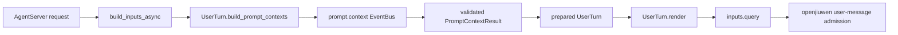

# `prompt.context` 用户消息上下文事件设计方案

## 1. 元信息

| 项 | 值 |
| --- | --- |
| 建档日期 | 2026-11-04 |
| 范围 | JiuwenSwarm Extensions V2 的 `prompt.context` 事件、AgentServer 用户消息接入和 UserTurn 投影 |
| 方案成熟度 | 已确认；当前 worktree 已实现，当前范围与专项验证结果见第 7 节 |
| 计划条目 | [EXTV2-33 / 用户消息 prompt.context 事件接入](../designs/extensions-v2-development-plan.md#extv2-33-用户消息-prompt-context-事件接入) |
| 设计依据 | [内置事件开发指南](../designs/builtin-event-development-guide.md)、[S_20 prompt.context 规约](../specs/S_20_prompt-context.md)、`D:/wiki/extension/2026-11-03-jiuwenswarm-prompt-context-event-design.md` |
| 关联 feature | 无；本特性把外部设计稿落到当前 UserTurn 和 AgentServer 调用链 |
| 验证摘要 | 当前实现接入有非空 session 的外部用户 `CHAT_SEND` 请求（unary/stream），包括 team/team mode/group chat；补充、control 等旁路矩阵与专项结果见第 7 节 |
| Refs | Obsidian 文档：`obsidian://open?vault=wiki&file=extension%2F2026-11-03-jiuwenswarm-prompt-context-event-design` |

## 2. 背景、目标与范围

### 2.1 背景与问题

当前 `UserTurn.render()` 同步生成用户消息 envelope。`currentDate` 和可选的
`interactionContext` 直接在渲染阶段产生，没有统一的扩展处理点；如果在 renderer 内部调用异步
EventBus，会引入嵌套事件循环、重复渲染和生命周期不一致的问题。

外部设计稿要求事件在用户消息提交前处理完整 context blocks 集合，并将最终结果回投到当前
JiuwenSwarm 的 user-message 载体，而不是修改 openjiuwen 的 system section、attachment 或
ContextEngine。

### 2.2 目标与关键场景

| 场景 / 触发条件 | 当前行为 | 目标行为 / 可观察变化 |
| --- | --- | --- |
| 有非空 session 的外部 `CHAT_SEND` 用户请求（含 team/team mode/group chat）进入 AgentServer | 同步构造并渲染 `UserTurn` | 在 `UserTurn.render()` 前等待一次 `prompt.context`，再渲染最终 prompt |
| 扩展 Handler 修改 `currentDate` 或 `interactionContext` | 没有事件入口 | 修改结果分别进入 envelope 的 `timestamp` 或文本前缀 |
| Handler 增删或重排未知 blocks / instruction files | 没有统一承载位置 | 通过 `prompt_context` user-message carrier 保留，不静默丢失 |
| EventBus 不可用、事件失败或输出非法 | 不存在该阶段 | fail-open，使用完整原始 context 继续原有渲染 |
| 补充、control、retry、`auto_harness`、A2UI、InteractiveInput、内部/跨 session | 由专用路径处理 | 旁路，不错误套用本事件 |

### 2.3 本次范围与非目标

- 本次包含：事件类型、输入输出模型、matcher、validator、恒等 CORE、bootstrap 登记、
  AgentServer 异步输入构造、UserTurn prepared context 绑定、完整结果投影、外部用户 session
  `CHAT_SEND`（含 team/team mode/group chat）入口，以及其它路径的显式旁路和回归测试。
- 本次不包含：openjiuwen 源码修改、`context_block` 到 system/attachment 的路由、SystemPromptBuilder、
  PromptAttachmentManager、ContextEngine、session 级缓存/invalidate、instruction files 的独立系统级
  消费能力，以及补充、control、retry、`auto_harness`、A2UI、内部/跨
  session 路径的事件接入和用户原始 content、channel、权限、session 身份的修改。

## 3. 设计约束、假设与待决问题

- 事件归属 JiuwenSwarm AgentServer；复用进程内已装配的唯一 `ExtensionEventBus`，不创建第二套 Bus。
- `prompt.context` 不需要 Ops。Handler 只处理内存中的 typed context，不访问文件、工具、模型、历史或渠道。
- 事件按完整 blocks 集合触发一次，而不是为每个 block 单独触发；Handler 通过名称筛选自己关心的 block。
- `UserTurn.render()` 保持同步和纯渲染；异步等待放在 `_build_inputs_async()`。
- 当前未知 blocks 和 `instructionFiles` 进入 user-message carrier。它们仍属于当前用户消息，不被提升为
  openjiuwen system section 或 attachment。
- 同步 `build_inputs()` 保留为 legacy / 测试构造入口；真实 AgentServer 入口使用异步 canonical path。
- 当前 gate 只放行 unary/stream、非空 `session_id`、`ReqMethod.CHAT_SEND`、`external_user_authored`
  来源的 session 用户请求；team/team mode/group chat 也在此范围，其它入口先保持原有行为。
- session-level cache、动态刷新和 instruction files 的后续原生消费仍是后续特性，不作为本次保证。

## 4. 总体方案与设计取舍

### 4.1 方案概览



`_build_inputs()` 在异步模式下先返回内部 `_DEFERRED_PROMPT` 标记，避免事件完成前提前序列化。
`prepare_prompt_context()` 构造可信 `SessionContext`，触发事件并校验结果；成功后使用
`dataclasses.replace()` 把结果绑定到新的 `UserTurn`，最后只渲染一次。

### 4.2 关键决策

#### D-01：一次事件处理完整 blocks 集合

- 选择与依据：直接保持设计稿和 Claude Code Mods 的 payload 粒度，输入输出均为
  `PromptContextInput` / `PromptContextResult`。
- 代价与成立条件：宿主需要负责完整结果的投影；不能只消费两个已知 block。
- 实现体现：`event_types/prompt_context.py` 的模型、validator 和 AgentServer 集成测试。

#### D-02：增加异步 canonical 输入构造

- 选择与依据：EventBus 是异步接口，不能在同步 renderer 中调用 `asyncio.run()` 或另开线程。
- 代价与成立条件：适用的 `CHAT_SEND`（unary/stream）入口需要使用 `build_inputs_async()`；同步入口只保留兼容
  用途。其它入口即使共用异步 helper，也必须先经过范围 gate。
- 实现体现：`interface.py` 的 `build_inputs_async()` / `_build_inputs_async()` 与
  `prompt_context.py` 的集中式 applicability gate。

#### D-03：失败采用 fail-open，取消继续传播

- 选择与依据：prompt context 没有业务副作用，扩展故障不应丢失用户原消息。
- 代价与成立条件：事件框架失败或非法结果会放弃本次扩展修改，保留原始 blocks；请求取消不被吞掉。
- 实现体现：`prepare_prompt_context()` 的异常与输出校验分支。

#### D-04：未知结果进入统一 user-message carrier

- 选择与依据：设计稿明确禁止宿主静默丢弃新增 block 或 `instructionFiles`。
- 代价与成立条件：当前 carrier 只保证随 UserTurn envelope 发送，不宣称已接入 openjiuwen 的独立文件消费链。
- 实现体现：`UserTurn._add_prepared_context_carrier()`。

#### D-05：集中 gate 区分可接入与专用请求

- 选择与依据：team/team mode/group-chat 与普通用户消息共享本事件；补充、control、retry、
  `auto_harness`、A2UI 和内部/跨 session payload 仍由各自专用路径负责。
- 代价与成立条件：未来若要扩大入口，必须先为各路径定义独立 context scope、SessionContext 和验收。
- 实现体现：`prompt_context.py` 的集中式 applicability gate 及集成测试中的生效/旁路矩阵。

### 4.3 替代方案与排除理由

| 候选 | 排除理由 |
| --- | --- |
| 在 `UserTurn.render()` 中直接触发异步事件 | renderer 无法安全嵌套事件循环，会重复触发并混淆纯渲染职责 |
| 为每个 block 创建一个事件 | 与完整集合契约不一致，无法自然表达重排、整体删除和 instruction files 变更 |
| 在 Handler 中直接修改 `UserTurn` 或 `inputs["query"]` | 扩展会依赖宿主私有字符串格式，破坏事件契约与结果统一消费 |
| 同步入口内部另开线程等待 EventBus | 改变 Handler 的事件循环、ContextVar 和资源生命周期；不作为生产路径 |

## 5. 详细设计

### 5.1 模块责任与关键不变量

| 模块 | 责任 |
| --- | --- |
| `extensions_v2/event_types/prompt_context.py` | 定义事件常量、模型、instruction file kind、matcher、validator、恒等 CORE 和登记函数 |
| `extensions_v2/bootstrap.py` | 在现有事件登记流程中调用 `register_prompt_context_events(bus)` |
| `server/runtime/agent_adapter/prompt_context.py` | 集中负责 applicability gate、收集 blocks、构造 SessionContext、触发事件、校验结果和 fail-open |
| `server/runtime/agent_adapter/user_turn.py` | 保存 prepared contexts，将已知 block 映射到旧 envelope，并承载未知结果 |
| `server/runtime/agent_adapter/interface.py` | 提供异步 builder；适用的 `CHAT_SEND`（unary/stream）进入事件准备，其它入口保留原有渲染/处理行为 |
| `server/runtime/agent_adapter/prompt_context.py` | 集中负责 applicability gate、事件触发、结果校验、fail-open 和范围旁路 |

关键不变量：

1. 对一个适用的文本/字典 `UserTurn`，`prompt.context` 最多触发一次；同一 turn 的后续 `with_text()` 和
   `render()` 复用已绑定结果。
2. CORE 不添加默认文本、不访问业务服务、不调用 `next_handler()`，只返回字段等价的结果。
3. `currentDate` 缺失时不在事件外隐式恢复；`interactionContext` 缺失时不生成前缀。
4. 输出校验失败时整份结果丢弃，不能混用部分新结果和部分原始结果。
5. `source`、`type`、`content`、语言、channel、权限、session 身份等非 context 字段不由事件修改。

### 5.2 数据模型与事件契约

事件名称为 `prompt.context`，输入和输出字段如下：

```python
PromptContextInput(
    blocks=list[PromptContextBlock],
    instructionFiles=list[InstructionFile] | None = None,
)
PromptContextResult(
    blocks=list[PromptContextBlock],
    instructionFiles=list[InstructionFile] | None = None,
)
```

`PromptContextBlock` 包含非空 `name: str` 和 `text: str`；同一集合中的名称必须唯一。
`InstructionFile` 保留协议字段 `path`、`kind`、`content`、`parent` 和 `isUnverified`，其中 `kind`
只能是 `managed`、`user`、`project`、`local` 或 `memory`。

Python 适配层提供 `instruction_files` 只读别名，但事件协议继续使用 `instructionFiles`。省略或
`None` 与空数组的语义不同：前者表示未提供，后者表示明确清空。

### 5.3 事件链与 host 投影

事件链仍遵循当前 EventBus 的 USER → BUILTIN → CORE 顺序；本期没有 JiuwenSwarm 自带 BUILTIN Handler。
CORE 将输入的两个字段复制为 `PromptContextResult`。宿主投影规则为：

| block / 字段 | UserTurn 载体 |
| --- | --- |
| `currentDate` | envelope `timestamp` |
| `interactionContext` | JSON envelope 前的纯文本前缀 |
| 其他 blocks | `envelope["prompt_context"]["blocks"]` |
| `instructionFiles` | `envelope["prompt_context"]["instructionFiles"]` |

事件结果删除已知 block 时，旧值不恢复；返回新 block 或文件数组时，carrier 必须保留结果顺序和字段。

### 5.4 SessionContext 与敏感信息边界

宿主使用请求可信事实构造：

```text
session_id=request.session_id
cwd=resolved request cwd
metadata={request_id, channel_id, prompt_channel, mode,
          context_names, context_count, instruction_file_count,
          is_stream, origin_kind}
```

metadata 不放用户全文、block 文本、文件内容、完整 `request.params` 或凭据；事件输入本身只在当前
调用链中承载 context 文本。

### 5.5 异步入口与特殊路径

以下 AgentServer 异步路径使用 `_build_inputs_async()`：普通 unary、streaming、补充输入、control input、
skill rebuild / silent rebuild、A2UI retry 以及原来直接调用 `_build_inputs()` 的处理入口；但只有通过集中式
applicability gate 的外部用户 session `CHAT_SEND` 请求（含 team/team mode/group chat）通过 preparation gate，
其他路径保留原有行为。

`InteractiveInput`、A2UI 专用 prompt、补充、control、retry、`auto_harness` 和内部/跨 session 请求均不触发
本事件；team leader/member 和 group-chat payload 只要满足集中式 gate 就会触发。

### 5.6 失败、取消和兼容

- 扩展装配不可用：跳过事件阶段，沿原同步 `UserTurn.render()` 路径继续。
- `bus.trigger()` 框架失败：记录事件名、request id、block 名称、数量和异常类型，不记录异常消息、block 文本或文件内容，恢复原始 blocks。
- 输出非法：整份结果视为无效，恢复原始 blocks。
- `CancelledError`：不捕获为普通失败，继续向上取消当前请求。
- 旧的单参数 `_build_inputs` 替身或子类覆盖：异步 helper 兼容调用已渲染结果；真实生产入口使用新签名。

## 6. 影响面与实施设计

本次实现修改或新增：

- `jiuwenswarm/extensions_v2/event_types/prompt_context.py`
- `jiuwenswarm/extensions_v2/bootstrap.py`
- `jiuwenswarm/server/runtime/agent_adapter/prompt_context.py`
- `jiuwenswarm/server/runtime/agent_adapter/user_turn.py`
- `jiuwenswarm/server/runtime/agent_adapter/interface.py`
- `jiuwenswarm/server/runtime/agent_adapter/team_helpers.py`
- `tests/unit_tests/extensions_v2/test_prompt_context.py`
- `tests/unit_tests/agentserver/test_prompt_context_integration.py`

未修改 `.venv` 中的 openjiuwen 源码、Events 内部实现、ReAct admission、ON_USER_MESSAGE、ContextEngine
和 PromptAttachmentManager。当前依赖环境使用 agent-core `rsi_native_agent_os` 提交
`31fee3a86783f04cca0d3ff8b5dd83c273156850` 进行 API 验证；该依赖源码不属于本次提交。

## 7. 验证设计、执行记录与结论

### 7.1 验证入口

- 事件契约和 Handler 链：`tests/unit_tests/extensions_v2/test_prompt_context.py`
- AgentServer 真实输入构造、投影、范围旁路和 fail-open：
  `tests/unit_tests/agentserver/test_prompt_context_integration.py`
- UserTurn 基线：`tests/unit_tests/server/test_user_turn.py`
- 相关回归：`tests/unit_tests/agentserver/test_agentserver_modes.py`、
  `test_context_usage.py`、`tests/unit_tests/extensions_v2/test_context_usage.py`、
  `tests/unit_tests/agentserver/test_team_helpers.py`

### 7.2 实际执行结果

| 检查 | 结果 |
| --- | --- |
| prompt.context 事件模型 + AgentServer 集成 | **24 passed**；覆盖普通、team/group chat unary/stream 正向路径、结果投影、范围旁路和 fail-open（新增 4 个 team/group chat 生效用例）；命令使用 `-o addopts='' --asyncio-mode=auto` |
| UserTurn 兼容性专项 | **17 passed**；命令使用 `-o addopts='' --asyncio-mode=auto` |
| 相关 AgentServer / Extensions V2 / team helper 回归 | **333 passed, 1 warning**；覆盖 mode、context usage、team helper 和 Extensions V2 assembly 回归 |
| 事件 bus 注册与 Extensions V2 assembly 回归 | **4 passed**；包含 `test_assembly.py` 的安装、空 store、reload 和失败可用性场景 |
| Python 编译检查 | 本次变更的实现/测试文件 `py_compile` 通过 |
| 差异检查 | 本次 `git diff --check` 通过；未创建暂存差异 |

上述测试不启动真实模型，不宣称 openjiuwen system section、attachment 或 ContextEngine 已消费
`instructionFiles`。仓库约束禁止本次协作运行格式化和静态检查工具，因此未执行 Ruff、mypy 或 formatter。

## 8. 风险与已知遗留

1. `instructionFiles` 当前以 user-message carrier 传递，尚未形成独立文件加载、权限核对和 provider projection 链。
2. 当前接入有非空 session 的外部用户 `CHAT_SEND`（unary/stream），包括 team/team mode/group chat；补充、
   control、retry、`auto_harness`、A2UI、内部/跨 session 路径有意旁路，后续扩展不能默认复用本期 SessionContext 假设。
3. 同步 `build_inputs()` 为兼容入口，调用方若绕过 AgentServer 异步入口不会触发事件。
4. 当前只准备 `currentDate` 和 `interactionContext` 两类宿主 block；session cache/invalidate 和更多动态事实需单独设计。
5. agent-core 版本/API 变化时，需要重新核对 EventBus validator、Handler signature 和 `SessionContext` 构造；本次不修改 Core。

## 9. 设计演进与修订

- 2026-11-04：将外部设计稿落地为当前 AgentServer 事件、异步输入构造和 UserTurn 投影；补充完整结果 carrier 和 fail-open 语义。
- 2026-11-07：按实际业务要求将 team/team mode/group chat 纳入生效范围，并将所有 admission/bypass 条件收敛到集中式 `is_prompt_context_applicable()` gate；补充、control、retry、`auto_harness`、A2UI、内部/跨 session 继续旁路。
