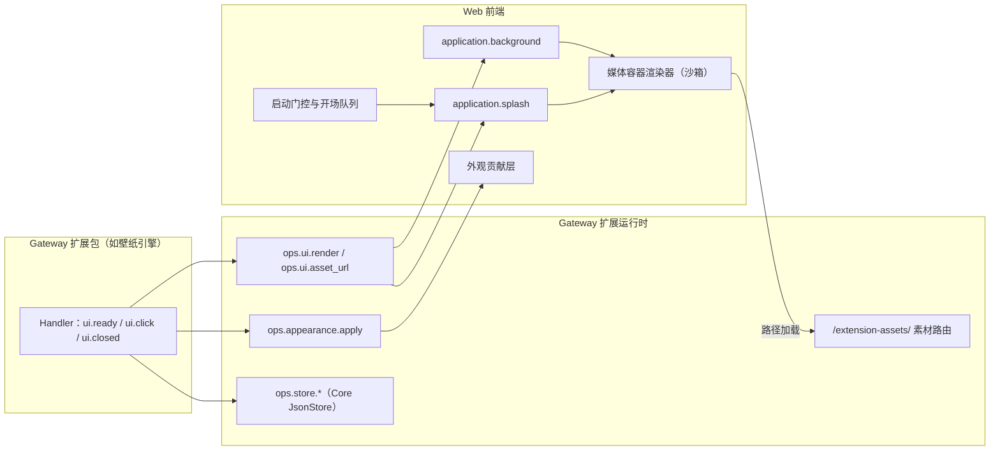
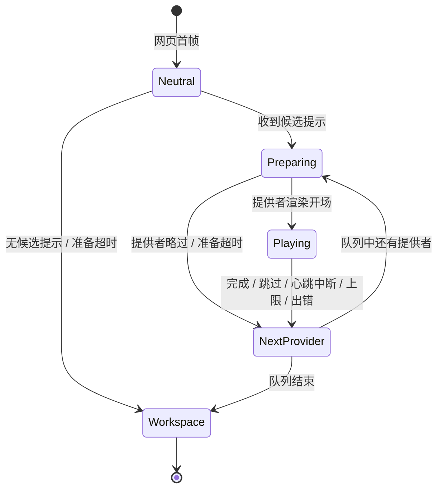

# 应用级界面能力设计概览

## 文档状态与阅读说明

| 项 | 说明 |
| --- | --- |
| 类型 | 目标设计；产品决策已确认，宿主能力部分实现，现状见第 5 节 |
| 最近一次修订日期 | 2026-11-05 |
| 责任人 | Song Haoran |
| 所属模块 | `jiuwenswarm/gateway/extensions_v2/`，并涉及 `jiuwenswarm/channels/web/`（`app_web.py` 与前端 `features/webui/`）及 `jiuwenswarm/channels/desktop/electron/` |
| 详细设计 | 各条目的 feature；已建立：[F_08 应用级 UI 包与素材交付](../features/F_08_application-packages-and-assets.md)、[F_09 包存储与数据目录](../features/F_09_package-store-and-data.md)、[F_10 媒体容器与应用背景](../features/F_10_media-surface-and-background.md)、[F_11 受控外观](../features/F_11_controlled-appearance.md)、[F_12 启动门控与开场](../features/F_12_startup-gate-and-splash.md)、[F_13 应用级设置页](../features/F_13_application-settings-page.md) |
| 开发安排 | [Gateway 特性开发计划](extensions-v2-development-plan.md) 中的 `EXTV2-GW-07`～`EXTV2-GW-12` |
| 关联文档 | [运行时规约](../specs/S_01_gateway-extension-runtime.md)、[渲染规约](../specs/S_02_ui-render.md)、[浏览器桥接规约](../specs/S_06_local-browser-bridge.md)、[S_17 组件 Props 规约](../../../../extensions_v2/docs/specs/S_17_webui-component-props.md) |
| 关键假设与待确认项 | 见第 1.3 节及各 feature；agent-core 锁定版本与当前导入不一致的问题记录在开发计划第 6 节 |

| 阅读目的 | 阅读位置 |
| --- | --- |
| 了解目标与范围 | 第 1 节 |
| 确认职责与核心对象 | 第 2 节 |
| 理解启动与界面流程 | 第 3 节 |
| 理解持续状态及关键约束 | 第 4 节 |
| 查找实施依据与落地条件 | 第 5 节及各 feature |

## 1. 目标与范围

### 1.1 定位与目标

为 Gateway 扩展包提供一组**通用的应用级界面能力**，使外观类插件（例如壁纸与主题引擎）以 V2 插件形式交付，
而不依赖隐藏注入或访问宿主 DOM：

- **应用背景**：在工作界面最底层显示图片、视频或沙箱 HTML。
- **启动开场**：应用启动时由宿主等待开场插件就绪，再依次播放各插件的开场，结束后进入登录入口或工作界面。
- **受控外观**：插件提交白名单内的主题变量与宿主预设的半透明模式，可读性由宿主保证。
- **应用级设置页**：不依赖聊天会话的插件设置位置。
- **素材与数据**：插件素材及经插件校验的用户导入内容可被安全访问；插件偏好可持久化。

宿主负责位置、时机、权限、超时、退出与清理；插件负责内容、业务校验、业务状态及用户偏好。
宿主不包含任何具体主题的时间线、动画或素材。

### 1.2 职责与范围边界

| 范围 | 包含 | 不包含 |
| --- | --- | --- |
| 宿主（本设计） | 槽位、媒体容器渲染器、启动门控与开场队列、外观贡献的应用与撤销、素材路由与边界、Gateway 存储接入与包数据目录 | 主题格式、主题校验、播放策略判断、壁纸业务状态 |
| 插件 | 主题内容、播放器页面、播放策略（每次启动、每天首次等）、偏好、导出与备份 | 直接修改宿主页面、样式或输入焦点 |

### 1.3 当前范围与后续扩展

本期目标平台为 Windows 与 macOS 桌面版（Electron）及其内嵌的 Web 前端；浏览器模式提供降级行为。

已确认推迟：

- 首帧即显示主题动画（需在扩展运行前执行插件内容，与 V2 的安全模型冲突）。本期只保证主页不先于开场露出。
- 独立的全局音频 Ops：声音随媒体容器播放和结束。
- 客户端上下文变化事件、远程浏览器通用文件上传、暗色模式外观变量。插件设置页经 `FileImport` 的导入与
  `ops.ui.download` 的导出不在此列，本机与远程浏览器都可使用（2026-11-05 确认，见 [S_10](../specs/S_10_application-settings.md)）。

## 2. 核心模型与职责

### 2.1 总体关系

| 参与方 | 负责的行为 | 责任边界 |
| --- | --- | --- |
| Gateway 扩展运行时 | 校验并投递渲染树与外观贡献；登记包的激活代次；提供素材与存储 | 不判断主题内容是否合适，不决定播放策略 |
| Web 前端 | 挂载槽位；创建并约束媒体容器；运行启动门控、开场队列、跳过与超时；应用与撤销外观 | 不执行插件代码，只与沙箱内容按受限消息通信 |
| `app_web.py` | 转发 `/api`、`/ws` 与 `/extension-assets/`；提供开场候选提示 | 提示只表示“可能有候选”，不代表包已激活 |
| Electron 主进程 | 为每次应用启动生成启动标识 | 不感知插件 |
| 扩展包 | 提交内容与外观；按自身策略回答是否播放开场；保存偏好 | 不访问宿主 DOM、存储或其他包的数据 |

### 2.2 对象及事实权威

| 对象或事实 | 含义 | 权威来源 | 不能据此推断的事实 |
| --- | --- | --- | --- |
| 应用级 UI 包 | 在 Gateway 应用级槽位声明贡献的包 | Gateway 运行时的活动包与其 manifest `ui` 段 | 不代表包具有浏览器请求绑定或客户端操作能力 |
| 激活代次 | 一次发布对应的随机标识 | Gateway 运行时 | 不同代次之间的迟到消息与素材互不通用 |
| 开场提供者顺序 | 依次播放的开场列表 | Gateway 保存的宿主设置（[S_10](../specs/S_10_application-settings.md)）；用户未调整时当前外观提供者排在首位 | 不代表各提供者本次一定播放 |
| 启动标识 | 一次应用启动的标识 | Electron 主进程；浏览器模式使用会话存储 | 刷新、重连与新窗口不产生新的启动 |
| 插件偏好与数据 | 插件自身的业务状态 | Core `JsonStore` 与包数据目录 | 卸载后不保留 |

### 2.3 贯穿设计的原则

1. 宿主决定位置、时机与生命周期；插件只描述内容。
2. 显示权来自宿主的选择与调用上下文中的包身份，不依赖消息先后或 Handler 返回值。
3. 沙箱内容不具备同源权限；直接打开素材中的 HTML 也处于沙箱中。
4. 超时只用于防止卡死，不截断正常播放。
5. 结束先在前端本地完成，再通知插件，不等待插件确认。

## 3. 关键流程与完成语义

### 3.1 启动与开场

1. 网页首帧显示与 Electron 加载页一致的宿主中性层。WebSocket、Gateway 与 WebUI 运行时照常初始化；门控只阻止主界面的显示与交互。
2. 没有开场候选提示时不等待，直接显示工作界面。
3. 有候选时，宿主按开场顺序依次向每个提供者发送定向的 `ui.ready`，附带启动标识、是否首次访问与是否减少动态。
4. 提供者以 `ops.ui.render` 渲染 `application.splash` 表示播放，以清除模式表示略过；宿主以调用上下文中的包身份判断回答是否有效。被其他 Handler 截获或短路时按准备超时处理。
5. 播放期间宿主负责跳过、心跳与上限；结束后关闭容器、停止声音，再向该提供者发送 `ui.closed` 及原因。
6. 队列结束后显示登录入口或工作界面。开场结束不解除认证要求；登录插件可提前准备，但显示与焦点由宿主协调。

### 3.2 时长、跳过与结束

| 规则 | 内容 |
| --- | --- |
| 准备阶段 | 等待提供者回答及播放器就绪，超时即视为本提供者略过 |
| 播放阶段 | 播放器定期发送心跳；连续中断判定为卡死并结束 |
| 上限 | 插件可声明自身最长时长；宿主对单个开场的绝对上限为 60 秒，声明超过时安装校验给出提示并按 60 秒执行；不设整个队列的总上限 |
| 跳过 | 长按空格约 0.8 秒，或用鼠标按住屏幕上的提示；显示进度环；只跳过当前开场；壁纸开场可跳过，其他插件逐个声明是否可跳过，不可跳过时不显示提示 |
| 结束通知 | `ui.closed`，原因为 `complete`、`skip`、`timeout`、`error`、`disabled` 或 `removed`；同一实例只通知一次，迟到消息按激活代次与版本丢弃 |

### 3.3 切换外观与恢复默认

插件在设置页收到交互后写入偏好，用媒体容器渲染 `application.background`，并调用 `ops.appearance.apply` 提交外观；
恢复默认时清除背景并以空值撤销外观。插件停用、卸载、断线或外观提供者切换时由宿主自动撤销；
撤销只移除贡献层，不恢复旧快照，不覆盖用户之后切换的明暗主题。

## 4. 持续状态与关键约束

- **插件数据**：Gateway 接入 Core `JsonStore`。重载与升级保留，卸载删除；插件通过导出与备份弥补。
  用户导入的主题存放在与存储同一生命周期的包数据目录，只发布经插件校验的子目录，路径包含版本以避免旧缓存。
- **素材边界**：素材路由只读暴露活动包的 `assets` 目录及已发布的数据子目录，禁止路径穿越与符号链接；
  响应携带沙箱内容安全策略，使直接打开的 HTML 同样处于沙箱。
- **媒体容器**：无操作栏、不接收点击和焦点、允许自动播放；与沙箱内容的消息须同时匹配容器窗口与每次播放的随机令牌。
- **开场队列**：同一启动标识只走一次；刷新、重连与新窗口不重新进入开场。

## 5. 落地条件与当前状态

| 条目 | 能力 | 状态 |
| --- | --- | --- |
| EXTV2-GW-07 | 应用级 UI 包与素材交付 | 已实现，单元验证通过 |
| EXTV2-GW-08 | Gateway 存储与包数据目录 | 已实现，单元验证通过 |
| EXTV2-GW-09 | 媒体容器、沙箱通信与应用背景槽位（[F_10](../features/F_10_media-surface-and-background.md)） | 已实现，单元与浏览器验证通过 |
| EXTV2-GW-10 | 受控外观（[F_11](../features/F_11_controlled-appearance.md)、[S_08](../specs/S_08_appearance.md)） | 已实现，单元与浏览器验证通过 |
| EXTV2-GW-11 | 启动门控与开场队列（[F_12](../features/F_12_startup-gate-and-splash.md)、[S_09](../specs/S_09_startup-splash.md)） | 已实现，单元与浏览器验证通过 |
| EXTV2-GW-12 | 应用级设置页、开场顺序与停用、文件导入与导出（[F_13](../features/F_13_application-settings-page.md)、[S_10](../specs/S_10_application-settings.md)） | 已实现，单元与浏览器验证通过 |

负责人、进度与验证证据以[开发计划](extensions-v2-development-plan.md)为唯一维护位置。
