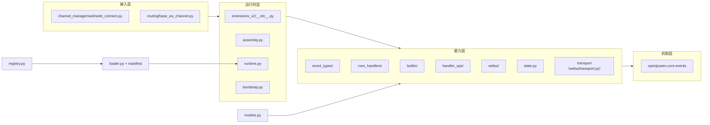
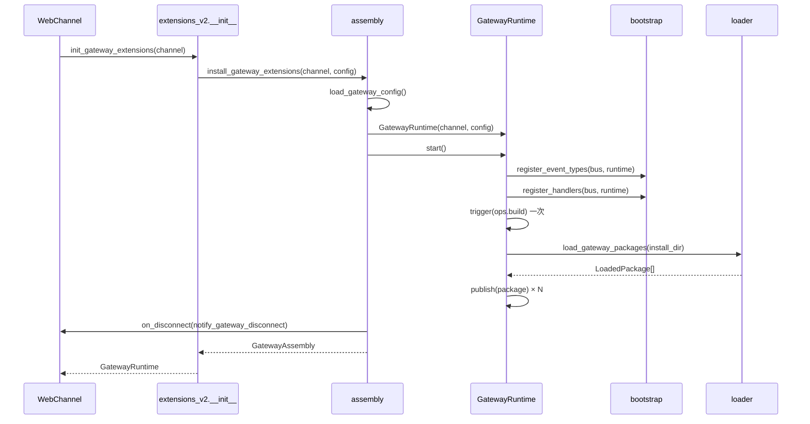

# JiuwenSwarm Gateway Extensions V2 详细架构

## 文档状态

| 项 | 说明 |
| --- | --- |
| 类型 | 设计基线 |
| 最近一次修订日期 | 2026-11-04 |
| 所属模块 | `jiuwenswarm/gateway/extensions_v2/` |
| 上游依据 | agent-core `openjiuwen.core.events`；AgentServer [详细架构](../../../../extensions_v2/docs/designs/extensions-v2-architecture.md) |
| 关联文档 | [设计概览](extensions-v2-overview.md)、[开发模板](builtin-event-development-guide.md)、[运行时规约](../specs/S_01_gateway-extension-runtime.md) |

本文说明 Gateway 扩展运行时的分层、模块职责、装配与生命周期、事件与 Ops 的接入方式、WebUI 链路、状态归属、故障处理和约束。与 AgentServer 一致的部分直接沿用其契约；仅在 Gateway 语境下成立的差异单独标注。

## 1. 与 AgentServer 的一致性与差异

### 1.1 一致的契约

| 契约 | 说明 |
| --- | --- |
| 事件类型注册 | `ExtensionEventBus.register_event_type(event_type, matcher, core_handler)`，事件名满足 `^[a-z][a-z0-9_]*(\.[a-z][a-z0-9_]*)+$` |
| Handler 层级 | `HandlerLevel.USER`（200）/ `BUILTIN`（100）/ CORE（链尾）；扩展包只能登记 USER |
| 执行语义 | Handler 调用 `next_handler(event)` 向内传递，不调用即短路内层 |
| `ops.build` | 装配期只触发一次，BUILTIN Handler 向 `EventHandlerOpsBuilder` 添加命名空间与方法，之后能力目录冻结 |
| 匹配规则 | `match_pattern_subset` 支持点路径，事件输入不匹配时跳过该 Handler |
| 包契约 | `manifest.yaml` 的 `schemaVersion/package/domain/modules`，`create_extension()` 接收 registrar |
| 失败语义 | 单个包或单条声明失败只记录告警，不影响其他包与宿主启动 |

### 1.2 Gateway 特有的差异

| 差异 | 原因 |
| --- | --- |
| 共享包目录 `extension_pkgs`，按 `domain` 过滤 | 两侧各取自己归属的包，互不扫描对方的 Handler |
| `domain` 过滤为 `gateway` | 同一目录可同时容纳两侧包，由 manifest 声明归属 |
| `gateway.request` 是帧准入事件而非业务事件 | Gateway 只出现在接入路径上 |
| 鉴权由 USER 请求策略负责 | 扩展包在原生分发和 UI 动作执行前校验凭据并决定是否拒绝 |
| `local` 路由可完全在 Gateway 应答 | 宿主登记的本地方法无需 AgentServer 参与 |
| 包管理门面按 `domain` 本地分流 | Gateway 自有的包不经过 AgentServer 安装与激活 |
| `ui.render`/`ui.store`/`ui.click` 子集 | 只实现登录鉴权用例需要的三个事件，其余上行事件不注册 |

## 2. 分层与依赖



依赖方向是单向的：接入层只调用 `extensions_v2` 的公开入口，能力层只依赖 `openjiuwen.core.events`、`models.py` 与同层模块。`extensions_v2` 不 import `jiuwenswarm.extensions_v2`，也不 import AgentServer 的业务模块。

## 3. 模块职责

| 模块 | 职责 |
| --- | --- |
| `__init__.py` | 面向渠道的稳定入口：`init_gateway_extensions` / `intercept_gateway_frame` / `notify_gateway_disconnect` |
| `assembly.py` | 进程内单例装配、配置读取、启动失败降级、停机编排、断线回调订阅 |
| `runtime.py` | 持有总线与各子系统；发布包；实现 `gateway.request` 与断线触发点，委托浏览器分派器处理应用交互 |
| `bootstrap.py` | 汇总事件类型、CORE Handler 与 BUILTIN Handler 的注册；返回需注销的 handler id |
| `config.py` | `extensions.gateway` 配置与 `HttpPolicy` |
| `loader.py` | 扫描安装目录、解析 manifest、执行入口文件、产出 `LoadedPackage` |
| `registry.py` | 包侧 registrar 与 `HandlerDeclaration` |
| `models.py` | 所有事件的输入输出数据类与路由枚举 |
| `state.py` | `ui.store` 的作用域 KV 存储 |
| `event_types/` | 每个事件类型一个注册函数，绑定匹配函数与 CORE Handler |
| `core_handlers/` | CORE Handler 实现；`gateway.request` 在 `request_core.py` |
| `builtin/` | `router.py` 宿主本地方法表 |
| `handler_ops/` | `ops.build` 的 BUILTIN Handler，向 Builder 添加能力 |
| `webui/` | 渲染协议模型、校验、实例登记、下行传输、上行适配 |
| `examples/` | 示例扩展包，不作为产品内置包 |

## 4. 装配与生命周期

### 4.1 装配顺序



顺序约束：

1. 事件类型与其 CORE Handler 必须在任何 BUILTIN/USER Handler 之前注册，否则登记被拒。
2. BUILTIN Handler 必须在 `ops.build` 之前注册，否则能力目录缺少平台方法。
3. `ops.build` 只触发一次；`Registry.init` 式的外部触发在 Gateway 侧不存在，由运行时自身完成。
4. 包发布必须在 `ops.build` 之后，保证包 Handler 拿到的 Ops 目录完整。

### 4.2 启动降级

| 阶段 | 失败处理 |
| --- | --- |
| 读取配置 | 读取异常返回空配置，使用默认值；`enabled=false` 直接不装配 |
| 注册事件/CORE | 异常向上传播到 `install_gateway_extensions`，`runtime.shutdown()` 后返回 `None` |
| `ops.build` | 同上 |
| 单包加载 | 记录告警并跳过该包 |
| 单条 Handler 声明 | 记录告警并跳过该声明 |
| 订阅断线回调 | 渠道未提供 `on_disconnect` 时静默跳过 |

装配失败不阻断 Gateway 启动，后续帧按无扩展路径处理。

### 4.3 停机

`shutdown_gateway_extensions()` 先清空单例再调用 `runtime.shutdown()`：注销 USER 与 BUILTIN handler、清空包注册、清空 `UiStateStore`。`WebChannel.shutdown()` 中调用该入口。

## 5. 事件体系

### 5.1 事件清单

| 事件 | 触发点 | 层级使用者 | CORE 默认动作 |
| --- | --- | --- | --- |
| `gateway.request` | `WebChannel` 原生分发前 | USER 请求策略、BUILTIN 浏览器分派器 | 校验 method，默认 `forward` |
| `ui.render` | `ops.ui.render` 或运行时 | USER 包、BUILTIN 渲染归属校验 | 校验渲染树并下发 |
| `ui.store` | `ops.ui.store` | USER 包 | 写入存储并立即下发 |
| `ui.click` | `webui.dispatch` 上行帧 | USER 包 | 校验实例登记并回执 |
| `ops.build` | 装配期一次 | BUILTIN | 无 CORE，由 Events 内置定义 |

### 5.2 匹配函数

`event_types/matching.py` 提供 `match_pattern_subset`：按点路径在事件输入的映射或对象属性上取子值比较。例如包声明 `{"method": "auth.login"}` 时，只接收该方法名下的帧。

### 5.3 `gateway.request` 的输入输出

```python
@dataclass(frozen=True, slots=True)
class GatewayRequestInput:
    method: str
    params: Mapping[str, Any] = ...
    session_id: str | None = None
    connection_id: str = ""
    user_id: str | None = None
    channel_id: str = "web"

@dataclass(frozen=True, slots=True)
class GatewayRequestOutput:
    handled: bool = False
    route: str = "forward"      # local / forward / consume / deny
    params: Mapping[str, Any] | None = None
    response: Mapping[str, Any] | None = None
    error: Mapping[str, Any] | None = None
    meta: Mapping[str, Any] | None = None
```

路由语义：

| 路由 | 运行时动作 |
| --- | --- |
| `forward` | 使用返回的 `params`（缺省为原 params）继续原生分发 |
| `local` | 调用 `GatewayLocalRouter` 应答，跳过原生分发 |
| `consume` | 以 `response` 成功应答，跳过原生分发 |
| `deny` | 以 `error` 失败应答，跳过原生分发 |
| 未知值 | 等同于 `forward` |

### 5.4 扩展鉴权

登录、凭据校验与撤销、匿名访问范围和拒绝应答由扩展包的 `gateway.request` USER handler 实现。
宿主不再提供 BUILTIN 认证门禁，也不根据包标记维护登录要求；headers 仅是提供给包的请求上下文。
USER handler 在允许请求后调用 `next_handler`，独立浏览器分派器才会处理 application 槽位交互。
具体职责和迁移边界见 [S_01](../specs/S_01_gateway-extension-runtime.md#6-扩展鉴权职责) 与 [F_02](../features/F_02_gateway-request-and-auth-gate.md)。

### 5.5 本地路由

`builtin/router.py` 维护宿主登记的本地方法表，初始为空。未登记的方法返回 `ROUTE_UNSUPPORTED`，不静默转发。
原内置 `auth.status` 已移除；请求头存在不能代表凭据有效。

## 6. Ops 能力

### 6.1 能力目录

| 命名空间.方法 | 所属 | 语义 |
| --- | --- | --- |
| `ops.gateway.request` | `handler_ops/gateway_ops.py` | 用当前 `session_context` 再触发一次 `gateway.request` |
| `ops.ui.render` | `handler_ops/ui.py` | 触发一次 `ui.render` |
| `ops.ui.store` | `handler_ops/ui.py` | 触发一次 `ui.store` |
| `ops.ui.click` | `handler_ops/ui.py` | 触发一次 `ui.click` |
| `ops.http.fetch` | `handler_ops/http_ops.py` | 受白名单约束的出站 HTTP |

`ops.build` 的 BUILTIN Handler 在装配期注册进 Builder；普通事件只为实际进入的 Handler 创建独立 Ops 实例，包身份由总线从注册记录注入。

### 6.2 `ops.http.fetch`

`config.HttpPolicy` 控制：

| 配置键 | 默认 | 上限 |
| --- | --- | --- |
| `allowed_hosts` | 空（拒绝一切） | — |
| `timeout_ms` | 3000 | 5000 |
| `max_body_bytes` | 1 MiB | 4 MiB |
| `follow_redirects` | `false` | — |

`allowed_hosts` 条目支持 `host` 与 `host:port`；scheme 只允许 `http`/`https`。拒绝时返回 `HttpFetchOutput(code=...)` 而不是抛异常，便于包在业务层处理。

## 7. WebUI 子系统

### 7.1 渲染协议

| 对象 | 含义 |
| --- | --- |
| `RenderTarget` | 目标描述：`slot_id`、`package_id`、`instance_key`，可选 `session_id` |
| `RenderNode` | 组件树节点：`type`、`props`、`children` |
| `RenderFrame` | 一次渲染：target + node + revision |
| `ClearFrame` | 清除指定 target 的实例 |

槽位白名单当前只含 `application.gate`：登录界面挂载在应用入口的整屏遮罩位。其余槽位在 Gateway 侧不开放，避免与 AgentServer 的槽位目录冲突。

### 7.2 校验与登记

`webui/schema.py` 与 `webui/component_rules.py` 负责：节点深度、子节点数量、字符串长度、组件类型白名单、属性类型与取值范围、帧大小上限。校验失败返回 `route` 无关的渲染错误，不发送下行帧。

`webui/registry.py` 的 `ActiveRenderRegistry` 按 target 记录当前 revision 与实例活跃状态；`ui.click` 的 CORE 用登记判断实例是否仍活跃，实例已清除时回执 `inactive` 且不产生副作用。

### 7.3 传输

`webui/transport.py` 的 `GatewayTransport` 通过 `channel.ws_by_id(connection_id)` 取回 socket，再调用 `channel.send_event`：

| 方法 | 帧 |
| --- | --- |
| `send_frame` | `webui.render` |
| `send_clear` | `webui.render`（clear 形态） |
| `send_store` | `webui.store` |
| `send_error` | `webui.error` |

发送失败不影响调用方业务，CORE 返回 `delivery_failed` 供包决定是否重试。

### 7.4 上行适配

浏览器发送 `method=webui.dispatch`，`params` 携带 `event`、`target`、`payload`。`webui/adapter.py` 的 `WebUIDispatchAdapter` 校验：

1. 连接存在且槽位在白名单；
2. target 与 package 与当前登记的实例匹配；
3. payload 大小与字段类型符合 `action_validation.py`。

校验通过后转成 `ui.click` 事件，`session_context` 沿用连接合成的 session。

### 7.5 扩展鉴权与登录视图

包自行在 `gateway.request` 中校验凭据，必要时调用 `ops.ui.render` 提交登录树并返回 `deny`。
宿主不预置登录视图，也不通过认证回调渲染；允许匿名的登录交互由包继续内传给浏览器分派器。

## 8. 状态与资源归属

| 状态 | 作用域 | 创建 | 释放 |
| --- | --- | --- | --- |
| 包注册与 handler | 进程 | `runtime.start()` | `runtime.shutdown()` |
| 其他 store 键 | connection / session / global | 包 Handler 写入 | TTL 到期 / 显式撤销 / 停机 |
| 渲染登记 | connection | `ui.render` CORE | `ui.render` 清除 / 断线 / 停机 |
| Ops 实例 | 单次 Handler 调用 | 总线 | Handler 退出即失效 |

断线时 `notify_gateway_disconnect` 只清除 connection 作用域；session 与 global 由写入方或停机负责。

## 9. 故障处理

| 现象 | 处理 |
| --- | --- |
| 事件链超时（5s） | 记录告警，帧按 `forward` 继续原生分发 |
| 事件链抛异常 | 记录告警，帧按 `forward` 继续 |
| 传输发送失败 | CORE 返回 `delivery_failed`，不回滚存储写入 |
| 包入口文件异常 | 跳过该包，其他包继续加载 |
| 配置读取异常 | 使用默认配置 |

## 10. 约束与开放问题

- 只依赖 `openjiuwen.core.events`；禁止 import `jiuwenswarm.extensions_v2`。
- 不得修改 AgentServer 的 `jiuwenswarm/extensions_v2/event_handlers/__init__.py`。
- `ops.build` 的能力目录不按事件物理拆分：同一命名空间重复注册会触发 `EVENTS_OPS_INVALID`。
- 未决定：Gateway 侧是否需要会话级 store 的会话删除联动；当前只做断线与停机清理。
- 未决定：`ui.render` 是否重连重发最近一帧；当前由包在 `ui.ready` 语义缺失的情况下自行重绘。
- 未决定：`webui.dispatch` 之外的上行事件（`ui.change`、`ui.search` 等）是否需要 Gateway 侧支持。
