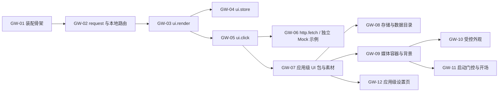

# Gateway Extensions V2 特性开发计划

## 元信息

| 项 | 内容 |
| --- | --- |
| 类型 | 开发计划 |
| 编号作用域 | `EXTV2-GW-NN` |
| 所属模块 | `jiuwenswarm/gateway/extensions_v2/` |
| 最近一次修订日期 | 2026-11-05 |
| 维护责任 | Gateway Extensions V2 模块维护者 |

## 1. 计划说明

本计划与 AgentServer 的 `EXTV2-NN` 分别编号，互不占用。每个条目对应一个可独立提交、可独立验证的能力单元；条目与其 feature 文档、spec 文档、测试位置一一对应。

进度记为：`未开始` / `进行中` / `已实现（单测通过）` / `已验证（联调用例通过）`。负责人一栏登记认领人；本栏建立前的条目未登记负责人。

## 2. 条目清单

| 编号 | 条目 | 交付内容 | Feature | Spec | 测试 | 负责人 | 进度 |
| --- | --- | --- | --- | --- | --- | --- | --- |
| EXTV2-GW-01 | 装配与运行时骨架 | `assembly` / `bootstrap` / `runtime` / `config` / `loader` / `registry` / 渠道钩子 | [F_01](../features/F_01_assembly-and-runtime.md) | [S_01](../specs/S_01_gateway-extension-runtime.md) | `test_gateway_request.py` | 未登记 | 已实现（单测通过） |
| EXTV2-GW-02 | `gateway.request` 与本地路由 | 事件类型、CORE Handler、USER 鉴权职责、宿主本地方法表 | [F_02](../features/F_02_gateway-request-and-auth-gate.md) | [S_01](../specs/S_01_gateway-extension-runtime.md) | `test_gateway_request.py`、`test_gateway_package_management.py` | 未登记 | 已实现（单测通过） |
| EXTV2-GW-03 | `ui.render` | 渲染协议、校验、登记、传输、`ops.ui.render` | [F_03](../features/F_03_render-service.md) | [S_02](../specs/S_02_ui-render.md) | `test_gateway_ui_render.py` | 未登记 | 已实现（单测通过） |
| EXTV2-GW-04 | `ui.store` | 作用域存储、写即下发、`ops.ui.store` | `F_04_ui-store.md` | `S_03_ui-store.md` | `test_gateway_ui_store.py` | 未登记 | 未开始 |
| EXTV2-GW-05 | `ui.click` | entry/footer 上行分派与动作校验 | [F_07](../features/F_07_local-login-integration.md) | [S_06](../specs/S_06_local-browser-bridge.md) | `test_gateway_browser_bridge.py` | 未登记 | 已实现（单测通过） |
| EXTV2-GW-06 | `ops.http.fetch` 与示例包 | 出站 HTTP、白名单策略、[auth_login_demo](../../../../extensions_v2/examples/auth_login_demo/) | [F_06](../features/F_06_http-fetch.md) | [S_05](../specs/S_05_http-fetch.md) | `test_gateway_http_fetch.py` | 未登记 | 已实现（单测通过） |
| EXTV2-GW-07 | 应用级 UI 包与素材交付 | 应用级槽位贡献包统一取得激活代次、交互分派、`ops.ui.asset_url` 与素材；素材路由加沙箱策略；`app_web` 流式转发素材 | [F_08](../features/F_08_application-packages-and-assets.md) | [S_06](../specs/S_06_local-browser-bridge.md)、[S_01](../specs/S_01_gateway-extension-runtime.md) | `test_gateway_browser_bridge.py`、`test_gateway_application_assets.py`、`tests/unit_tests/channels/web/test_app_web_extension_assets.py` | Song Haoran | 已实现（单测通过） |
| EXTV2-GW-08 | Gateway 存储与包数据目录 | 接入 Core `JsonStore` 与 `ops.store.*`；`ops.data.root()`；数据素材；卸载清理 | [F_09](../features/F_09_package-store-and-data.md) | [S_01](../specs/S_01_gateway-extension-runtime.md)、[S_06](../specs/S_06_local-browser-bridge.md) | `test_gateway_package_data.py` | Song Haoran | 已实现（单测通过） |
| EXTV2-GW-09 | 媒体容器与应用背景 | `MediaSurface` 根组件（图片、视频、沙箱页面）、令牌与来源校验的消息协议、`application.background` 槽位与前端背景宿主 | [F_10](../features/F_10_media-surface-and-background.md) | [S_07](../specs/S_07_media-surface.md)、[S_17](../../../../extensions_v2/docs/specs/S_17_webui-component-props.md)、[S_02](../specs/S_02_ui-render.md) | `test_gateway_ui_render.py`、`test_gateway_application_assets.py`；前端 `test:webui-components`、`test:webui-protocol`、`test:webui-contracts` | Song Haoran | 已实现（单测与浏览器验证通过；桌面打包版联调随 GW-11） |
| EXTV2-GW-10 | 受控外观 | `ops.appearance.apply`、宿主半透明模式与外观撤销 | 待建档 | 待建档 | 待定 | Song Haoran | 未开始 |
| EXTV2-GW-11 | 启动门控与开场队列 | 中性层、候选提示、启动标识、定向 `ui.ready`、开场槽位（复用 `MediaSurface` 的心跳与完成）、开场顺序、跳过与时长、`ui.closed` | 待建档 | 待建档 | 待定 | Song Haoran | 未开始 |
| EXTV2-GW-12 | 应用级设置页 | 不依赖会话的应用级设置槽位与桌面路径选择 | 待建档 | [S_02](../specs/S_02_ui-render.md) | 待定 | Song Haoran | 未开始 |

## 3. 依赖与开工条件

- GW-01 是其余条目的前置：事件类型必须在装配阶段先注册。
- GW-03 必须在 GW-04/GW-05 之前：`ui.store` 的下行帧与 `ui.click` 的实例判断都依赖渲染登记。
- GW-02 的鉴权由 USER 包通过 gateway.request 完成，包通过 ui.render 提交自身视图；宿主只负责协议接入。
- 当前 Mock 登录示例依赖渲染与浏览器桥接，安装激活后无需额外浏览器能力授权，不依赖未实现的 ui.store 或出站 HTTP。
- GW-07～GW-12 的整体设计见[应用级界面能力设计概览](application-surfaces-overview.md)；GW-07 是其余条目的前置，使不带浏览器请求绑定的应用级 UI 包也能取得交互、素材与激活代次。

## 4. 验证要求

| 编号 | 验证重点 |
| --- | --- |
| GW-01 | 单例装配、重复装配、`enabled=false`、装配失败降级、停机注销、零扩展快路径 |
| GW-02 | forward/consume/deny/local 四路由、未知路由降级、普通请求无内置登录要求、USER 鉴权拒绝、`ROUTE_UNSUPPORTED` 错误 |
| GW-03 | 渲染树校验边界、revision 递增、槽位白名单、传输失败返回 `delivery_failed`、包渲染登录树 |
| GW-04 | 三种作用域隔离、TTL 过期、`value=None` 撤销、写即下发帧内容、断线只清 connection |
| GW-05 | 槽位/包/实例不匹配拒绝、payload 越界拒绝、实例清除后回执 `inactive` |
| GW-06 | 白名单空拒绝一切、`host:port` 匹配、超时与响应体上限、示例包登录成功/失败两条路径 |
| GW-07 | 无请求绑定的应用级 UI 包可收到 ready/click 与素材；请求绑定与客户端操作仍限于声明 client 的包；素材越界与失活代次被拒绝，USER 请求策略可拒绝或接管素材；沙箱策略头；`app_web` 转发、Range 与流式输出 |
| GW-08 | 存储按包隔离并跨重载与重启保留；数据目录与数据素材越界、符号链接拒绝；卸载删除且失败可重试；重载保留 |
| GW-09 | 两端字段、根节点与槽位结论一致（共享用例）；图片、视频、页面渲染与宿主策略；消息的来源、令牌与事件校验；就绪超时、错误与减少动态回退；背景层不接收输入、根元素标记；声明背景槽位的包收到 `ui.ready`；真实浏览器显示 |
| GW-10～GW-12 | 在各自 feature 建档时补充 |

单元测试统一位于 `tests/unit_tests/gateway/extensions_v2/`。

## 5. 进度台账

| 日期 | 条目 | 变更 |
| --- | --- | --- |
| 2026-11-01 | GW-01、GW-02 | 装配骨架、`gateway.request`、认证门禁、本地路由与对应单测落地 |
| 2026-11-01 | GW-03～GW-05 | 待实现 |
| 2026-11-01 | GW-06 | `ops.http.fetch`、出站白名单、超时与体积预算落地；`auth_login_demo` 示例包待实现 |

| 2026-11-04 | GW-03、GW-05、GW-06 | 渲染、浏览器桥接及可安装 Mock 示例落地；验证记录见 F_03、F_07 |
| 2026-11-04 | GW-05、GW-06 | 移除额外授权、无消费者协议字段及同链路重复判断；Gateway 138 项、前端客户端/组件/上下文 163 项测试通过，范围与限制见 F_07 |

| 2026-11-04 | GW-02 | 移除旧 BUILTIN 认证门禁及 auth.status，统一由 USER handler 完成鉴权；更新回归后 Gateway 130 项测试通过，范围与迁移见 F_02 |
| 2026-11-05 | GW-07～GW-12 | 建立应用级界面能力条目，负责人 Song Haoran；GW-07 开工，方案见 F_08 |
| 2026-11-05 | GW-07 | 应用级 UI 包与素材交付实现，单测通过（Gateway 扩展 325 项、Web 渠道相关 155 项）；打包版联调待 GW-09，证据见 F_08 |
| 2026-11-05 | GW-08 | 包存储与数据目录实现，单测通过（Gateway 扩展 331 项），证据见 F_09 |
| 2026-11-05 | GW-09～GW-11 | 调整拆分：`application.background` 随媒体容器在 GW-09 交付，GW-10 只做受控外观，开场槽位归 GW-11；GW-09 开工，方案见 F_10 |
| 2026-11-05 | GW-09 | 媒体容器与应用背景实现，单测通过（Gateway 扩展 370 项、前端 WebUI 各套件全部通过、构建成功）；内置浏览器验证图片、视频、超时回退与素材响应头，页面消息往返的浏览器验证待补，证据见 F_10 |
| 2026-11-05 | GW-09 | Chromium 157 无头模式补充验证：页面双向消息、错误回退、减少动态、就绪超时与清除通过；隐藏 iframe 被暂停渲染的推测未得到证实，证据见 F_10 |

## 6. 风险与待确认

- Gateway 当前只接入 application.entry、application.sidebar.footer 与 application.background；其他槽位沿用所属宿主的链路。
- 鉴权由 USER 包负责，旧内置门禁已移除。平台数据路由不因示例账号变化而隔离。
- Gateway 与 AgentServer 的同名事件语义不同（`ui.click` 在两侧各自注册）；一个包只能归属一侧（manifest `domain`），需要两侧能力时拆成两个包。
- 前端协议桩浏览器验证与真实 Gateway/示例接入分别记录在前端 F_02 和本模块 F_07，不将 Mock 验证解释为真实身份服务验收。
- `uv.lock` 将 agent-core 锁定在 `86990bd`，该提交缺少当前代码导入的 `openjiuwen.core.events.ops_impl.store` 与 `openjiuwen.core.extension.data`；按锁文件安装会导入失败。对齐需同时处理 `intelli-router` 来源冲突，由依赖维护者决定，GW-07 开发环境使用 agent-core `31fee3a` 验证。
- `application.sidebar.footer` 的容量在本模块为 `list`，在前端槽位表与 AgentServer 常量中为 `single`，三处待统一；GW-07 不改变该槽位。
