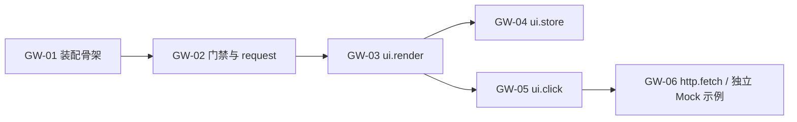

# Gateway Extensions V2 特性开发计划

## 元信息

| 项 | 内容 |
| --- | --- |
| 类型 | 开发计划 |
| 编号作用域 | `EXTV2-GW-NN` |
| 所属模块 | `jiuwenswarm/gateway/extensions_v2/` |
| 最近一次修订日期 | 2026-11-04 |
| 维护责任 | Gateway Extensions V2 模块维护者 |

## 1. 计划说明

本计划与 AgentServer 的 `EXTV2-NN` 分别编号，互不占用。每个条目对应一个可独立提交、可独立验证的能力单元；条目与其 feature 文档、spec 文档、测试位置一一对应。

进度记为：`未开始` / `进行中` / `已实现（单测通过）` / `已验证（联调用例通过）`。

## 2. 条目清单

| 编号 | 条目 | 交付内容 | Feature | Spec | 测试 | 进度 |
| --- | --- | --- | --- | --- | --- | --- |
| EXTV2-GW-01 | 装配与运行时骨架 | `assembly` / `bootstrap` / `runtime` / `config` / `loader` / `registry` / 渠道钩子 | [F_01](../features/F_01_assembly-and-runtime.md) | [S_01](../specs/S_01_gateway-extension-runtime.md) | `test_gateway_request.py` | 已实现（单测通过） |
| EXTV2-GW-02 | `gateway.request` 与认证门禁 | 事件类型、CORE Handler、BUILTIN 门禁、本地路由 `auth.status` | [F_02](../features/F_02_gateway-request-and-auth-gate.md) | [S_01](../specs/S_01_gateway-extension-runtime.md) | `test_gateway_request.py`、`test_gateway_auth_gate.py` | 已实现（单测通过） |
| EXTV2-GW-03 | `ui.render` | 渲染协议、校验、登记、传输、`ops.ui.render` | [F_03](../features/F_03_render-service.md) | [S_02](../specs/S_02_ui-render.md) | `test_gateway_ui_render.py` | 已实现（单测通过） |
| EXTV2-GW-04 | `ui.store` | 作用域存储、写即下发、`ops.ui.store` | `F_04_ui-store.md` | `S_03_ui-store.md` | `test_gateway_ui_store.py` | 未开始 |
| EXTV2-GW-05 | `ui.click` | entry/footer 上行分派与动作校验 | [F_07](../features/F_07_local-login-integration.md) | [S_06](../specs/S_06_local-browser-bridge.md) | `test_gateway_browser_bridge.py` | 已实现（单测通过） |
| EXTV2-GW-06 | `ops.http.fetch` 与示例包 | 出站 HTTP、白名单策略、[auth_login_demo](../../../../extensions_v2/examples/auth_login_demo/) | [F_06](../features/F_06_http-fetch.md) | [S_05](../specs/S_05_http-fetch.md) | `test_gateway_http_fetch.py` | 已实现（单测通过） |

## 3. 依赖与开工条件

- GW-01 是其余条目的前置：事件类型必须在装配阶段先注册。
- GW-03 必须在 GW-04/GW-05 之前：`ui.store` 的下行帧与 `ui.click` 的实例判断都依赖渲染登记。
- GW-02 沿用现有认证门禁；包通过 gateway.request 与 ui.render 决定自己的视图，不由门禁构造登录树。
- 当前 Mock 登录示例依赖渲染、浏览器桥接和部署 grants，不依赖未实现的 ui.store 或出站 HTTP。

## 4. 验证要求

| 编号 | 验证重点 |
| --- | --- |
| GW-01 | 单例装配、重复装配、`enabled=false`、装配失败降级、停机注销、零扩展快路径 |
| GW-02 | forward/consume/deny/local 四路由、未知路由降级、门禁四条放行条件、`AUTH_REQUIRED` 错误、`ROUTE_UNSUPPORTED` 错误 |
| GW-03 | 渲染树校验边界、revision 递增、槽位白名单、传输失败返回 `delivery_failed`、门禁渲染登录框 |
| GW-04 | 三种作用域隔离、TTL 过期、`value=None` 撤销、写即下发帧内容、断线只清 connection |
| GW-05 | 槽位/包/实例不匹配拒绝、payload 越界拒绝、实例清除后回执 `inactive` |
| GW-06 | 白名单空拒绝一切、`host:port` 匹配、超时与响应体上限、示例包登录成功/失败两条路径 |

单元测试统一位于 `tests/unit_tests/gateway/extensions_v2/`。

## 5. 进度台账

| 日期 | 条目 | 变更 |
| --- | --- | --- |
| 2026-11-01 | GW-01、GW-02 | 装配骨架、`gateway.request`、认证门禁、本地路由与对应单测落地 |
| 2026-11-01 | GW-03～GW-05 | 待实现 |
| 2026-11-01 | GW-06 | `ops.http.fetch`、出站白名单、超时与体积预算落地；`auth_login_demo` 示例包待实现 |

| 2026-11-04 | GW-03、GW-05、GW-06 | 渲染、浏览器桥接及可安装 Mock 示例落地；验证记录见 F_03、F_07 |

## 6. 风险与待确认

- Gateway 当前只接入 application.entry 与 application.sidebar.footer；其他槽位沿用所属宿主的链路。
- 内置认证门禁沿用已有 header 判定；Token 校验由示例包负责。平台数据路由不因示例账号变化而隔离。
- Gateway 与 AgentServer 的同名事件语义不同（`ui.click` 在两侧各自注册）；一个包只能归属一侧（manifest `domain`），需要两侧能力时拆成两个包。
- 前端协议桩浏览器验证与真实 Gateway/示例接入分别记录在前端 F_02 和本模块 F_07，不将 Mock 验证解释为真实身份服务验收。
