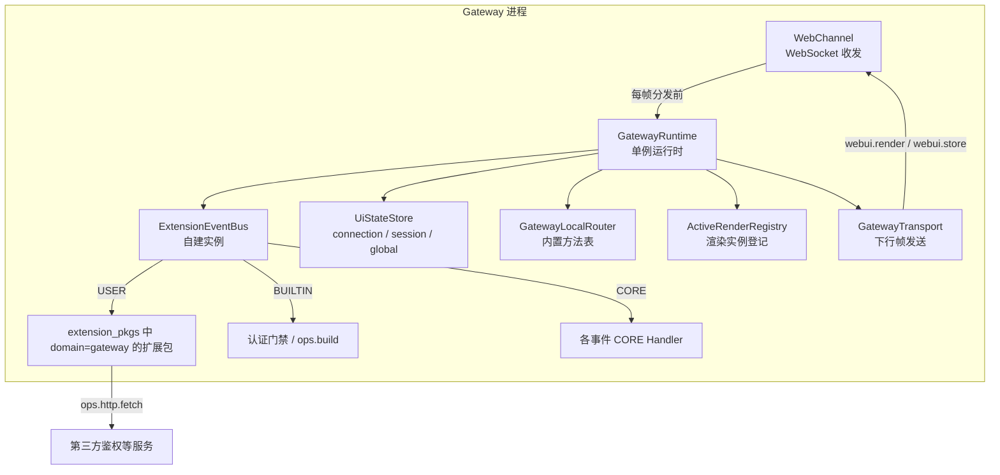
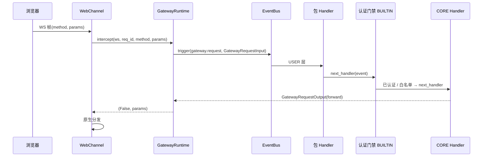

# JiuwenSwarm Gateway Extensions V2 设计概览

## 文档状态与阅读说明

| 项 | 说明 |
| --- | --- |
| 类型 | 设计基线；Gateway 装配、`gateway.request`、认证门禁、本地路由、`ops.http.fetch` 已实现；`ui.render`、entry/footer 浏览器交互与 [auth_login_demo](../../../../extensions_v2/examples/auth_login_demo/) 已实现；`ui.store` 尚未接入浏览器 |
| 最近一次修订日期 | 2026-11-04 |
| 维护责任 | Gateway Extensions V2 模块维护者；与 AgentServer `extensions_v2` 的契约差异由两侧维护者共同确认 |
| 所属模块 | `jiuwenswarm/gateway/extensions_v2/` |
| 详细设计 | [详细架构](extensions-v2-architecture.md)、[特性开发计划](extensions-v2-development-plan.md) |
| 公共机制依据 | agent-core [Events 架构](../../../../../agent-core/openjiuwen/core/events/docs/designs/events-architecture.md)、AgentServer [设计概览](../../../../extensions_v2/docs/designs/extensions-v2-overview.md) |
| 模块维护规范 | [模块规范](../AGENTS.md) |
| 关键前提 | agent-core Events 已提供 EventBus、Builder、Ops 与执行链；AgentServer 的 `extensions_v2` 已提供可镜像的装配、WebUI 与文档结构；Gateway 侧自建一套独立运行时，不复用 AgentServer 进程内实例 |

本文说明 Gateway 侧扩展运行时的定位、组成和落地边界。第 1～5 节依次介绍目标与范围、核心模型、关键流程、持续状态与约束、落地条件。

## 1. 目标与范围

### 1.1 定位与目标

Gateway 是浏览器与外部渠道的接入层。部分扩展能力只有在 Gateway 进程内执行才有意义：连接建立前的准入判断、WebSocket 帧的原生分发前拦截、以及在 AgentServer 尚未参与时就把登录界面推到浏览器。

Gateway Extensions V2 因此在 Gateway 进程内建立**一套独立的扩展运行时**：与 AgentServer 共用 agent-core `ExtensionEventBus` 的编程模型（事件类型、三层 Handler、`ops.build`），但拥有自己的事件总线、包目录和状态存储。

### 1.2 与 AgentServer 的关系

两者不是同一套运行时的两个入口，而是两个独立宿主：

| 维度 | AgentServer `extensions_v2` | Gateway `extensions_v2` |
| --- | --- | --- |
| 包目录 | `~/.jiuwenswarm/extension_pkgs` | `~/.jiuwenswarm/extension_pkgs`（共享，按 `domain` 过滤） |
| 事件用途 | 业务参与点（会话、用量、渲染、上行交互） | 接入层参与点（帧准入、登录门禁、本地应答） |
| Handler 执行位置 | AgentServer 业务进程 | Gateway 接入进程 |
| 依赖方向 | → `openjiuwen.core.events` | → `openjiuwen.core.events`（不依赖 `jiuwenswarm.extensions_v2`） |
| 代码复用 | 不引用 Gateway 模块 | 复用 `openjiuwen.core.events` 与自身 models，不 import AgentServer 适配层 |

同一个扩展包只能归属一侧：manifest 顶层 `domain` 声明 `agent`（缺省）或 `gateway`，两侧各自只加载与激活自己归属的包。

### 1.3 本期范围

- Gateway 装配单例、事件总线、运行时与停机。
- `gateway.request` 事件：WebSocket 上行帧在原生分发前的拦截点。
- 认证门禁：BUILTIN 层，未登录连接只允许登录与保活方法。
- `local` 路由与 Gateway 内置方法表（当前为 `auth.status`）。
- `ui.render` / `ui.store` / `ui.click` 三个 WebUI 事件与对应 `ops`。
- `ops.http.fetch`：受白名单约束的出站 HTTP。
- 共享 `extension_pkgs` 下的包管理：`domain: gateway` 包本地安装/卸载/热重载，`/extension` 指令按归属分流。
- [auth_login_demo](../../../../extensions_v2/examples/auth_login_demo/) 示例包。

### 1.4 非目标

- 不实现 AgentServer 的会话、工具、文件、模型等业务事件。
- 不引入 Gateway → AgentServer 的反向 RPC；跨进程事件总线不在本期范围。
- 不支持一个包同时归属两侧；`domain` 只能是 `agent` 或 `gateway`。
- 不替代 Gateway 现有的认证与路由实现，只提供可插入的扩展点。
- 不在 Gateway 侧实现扩展包的 Python 沙箱。

## 2. 核心模型与职责

### 2.1 总体关系

| 参与方 | 主要职责 |
| --- | --- |
| `WebChannel` | 收发帧、分配连接标识、在原生分发前调用 `gateway.request` |
| `GatewayRuntime` | 持有总线、存储、路由、渲染登记与传输；执行 `gateway.request` 并落实处置结果 |
| `ExtensionEventBus` | 保存事件类型与 Handler 注册，按 USER → BUILTIN → CORE 执行链 |
| `UiStateStore` | 承载 `ui.store` 写入与认证事实，按作用域隔离 |
| `GatewayLocalRouter` | `local` 路由的闭合方法表，未知方法返回 `ROUTE_UNSUPPORTED` |
| 扩展包 | 注册 Handler、调用 Ops、维护自身业务状态 |
| 第三方服务 | 由扩展包通过 `ops.http.fetch` 访问，Gateway 不感知其协议 |

### 2.2 三层 Handler 与门禁位置

`ExtensionEventBus` 的 USER（200）在最外层，BUILTIN（100）在中国，CORE 在链尾。每个 Handler 决定是否调用 `next_handler(event)`：

- USER 层包 Handler 可观察、改写或直接短路整帧；不调用 next 即绕过门禁与 CORE。
- BUILTIN 层承载平台规则（认证门禁、`ops.build`），在包之后、CORE 之前执行。
- CORE 层给出该事件不干预时的默认动作。

认证门禁放在 BUILTIN，与 AgentServer 的层级契约一致：包可以替换平台行为，平台规则只约束真正继续内传的帧。

### 2.3 零扩展快路径

`GatewayRuntime.active` 只统计 USER handler。没有安装任何 Gateway 包时，`intercept_gateway_frame` 直接返回未访问，帧沿原生路径继续，不产生事件总线开销；BUILTIN handler 虽然已注册，但不计入该判断。

## 3. 关键流程

### 3.1 装配链路

`WebChannel` 启动 uvicorn 前调用 `init_gateway_extensions(channel)`：

1. `assembly.install_gateway_extensions` 读取 `extensions.gateway` 配置；`enabled=false` 时返回 `None`，能力整体不可用。
2. 创建 `GatewayRuntime`（总线 + 存储 + 路由 + 传输 + 渲染登记）。
3. `bootstrap.register_event_types` 注册事件类型与 CORE Handler；`bootstrap.register_handlers` 注册 BUILTIN Handler 并返回 id 供停机注销。
4. 触发一次 `ops.build`，冻结能力目录。
5. `loader.load_gateway_packages` 扫描安装目录，逐包发布 USER handler。
6. 订阅渠道断线回调；任一步异常则 `runtime.shutdown()` 并降级为不可用，Gateway 继续启动。

### 3.2 帧拦截链路

未登录且方法不在白名单时，门禁在 BUILTIN 层返回 `route=deny` 与 `AUTH_REQUIRED`，`GatewayRuntime` 直接回错误帧，原生分发被跳过。

### 3.3 WebUI 链路

- **下行**：包 Handler 调用 `ops.ui.render(request)`，CORE 校验渲染树、分配 revision、登记实例并经 `GatewayTransport` 发送 `webui.render` 帧。
- **状态**：UiStateStore 持有 Gateway 进程内状态；浏览器存储通过客户端能力命令写删。ui.store 的浏览器订阅仍是目标设计，当前示例不依赖它。
- **上行**：浏览器发送 webui.dispatch，BrowserBridge 在 USER 请求策略继续后校验 entry/footer 的当前实例与动作，再触发对应 ui.* 事件；其他目标沿用已有路径。

### 3.4 完成语义

| 结果 | 确认方 | 含义 |
| --- | --- | --- |
| Gateway 装配成功 | `install_gateway_extensions` 返回 assembly | 事件类型、BUILTIN handler 与能力目录就绪 |
| 包可用 | `load_gateway_packages` 返回的 `LoadedPackage` | 该包 Handler 已发布为 USER 层 |
| 帧被处置 | `gateway.request` 返回 `GatewayRequestOutput` | 路由决定帧去往原生分发、本地应答或直接拒绝 |
| 界面交付 | `GatewayTransport` 发送成功 | 帧已交给渠道，浏览器是否应用另计 |
| 门禁放行 | 已有门禁检查当前帧 authorization header | Token 有效性仍由 USER 包判定，不以 header 存在代替 Token 校验 |

## 4. 持续状态与约束

- 包注册、`UiStateStore`、渲染登记均属于当前 Gateway 进程；停机时全部释放。
- connection 作用域状态在 socket 关闭时清除；session 与 global 作用域由写入方与停机清理。
- WebSocket 帧拦截沿用已有 5 秒超时与异常转发行为；HTTP 接入的失败语义见 [S_06](../specs/S_06_local-browser-bridge.md)。
- 门禁不实现登录逻辑，沿用既有 header 判定。登录、Token 校验与撤销由 USER 示例包完成，不新增 auth.session 协议。
- 扩展包不得被信任为沙箱代码；`ops.http.fetch` 的白名单为空时拒绝一切出站请求。

## 5. 落地边界与文档索引

| 阅读目的 | 入口 |
| --- | --- |
| 理解运行时组成与内部工作方式 | [详细架构](extensions-v2-architecture.md) |
| 按模板新增事件、CORE Handler 与 Ops | [内置事件开发模板](builtin-event-development-guide.md) |
| 查阅特性拆分、进度与验收要求 | [特性开发计划](extensions-v2-development-plan.md) |
| 查阅当前对外契约与错误码 | [运行时规约](../specs/S_01_gateway-extension-runtime.md) |
| 查阅装配与门禁实现记录 | [F_01](../features/F_01_assembly-and-runtime.md)、[F_02](../features/F_02_gateway-request-and-auth-gate.md) |
