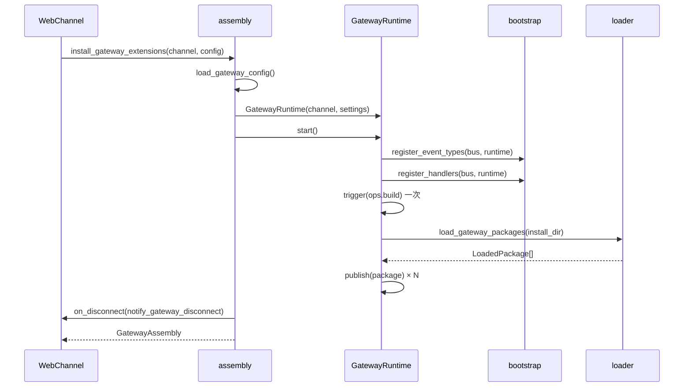

# Gateway 启动装配与运行时设计方案

## 元信息

| 项 | 内容 |
| --- | --- |
| 类型 | feature |
| 编号 / slug | `F_01 / assembly-and-runtime` |
| 关联计划 | EXTV2-GW-01 装配与运行时骨架 |
| 所属模块 | `jiuwenswarm/gateway/extensions_v2/{assembly,bootstrap,runtime,config,loader,registry}.py`、`channel_manager/web/web_connect.py`、`routing/base_ws_channel.py` |
| 设计依据 | [详细架构](../designs/extensions-v2-architecture.md)、[运行时规约](../specs/S_01_gateway-extension-runtime.md)、AgentServer [F_01](../../../../extensions_v2/docs/features/F_01_assembly-and-source.md) |
| 最近一次修订日期 | 2026-11-01 |
| 方案状态 | 已实现，单元验证通过 |

## 1. 问题与目标

Gateway 在一次进程启动中只应创建一套扩展运行时。装配必须保证事件总线、内置 Handler、包注册与状态存储彼此引用同一实例，并在任一步失败时不影响 Gateway 原有转发能力。

一句话概括：**装配入口创建单例组件，注册事件类型与 BUILTIN Handler，完成一次 `ops.build`，再激活配置安装目录中的包。**

## 2. 范围

### 2.1 本次范围

- `install_gateway_extensions(channel, config)` 单例装配与 `shutdown_gateway_extensions()`。
- 事件总线创建、`bootstrap.register_event_types` / `register_handlers`。
- 安装目录解析与共享 `extension_pkgs` 中 `domain: gateway` 包的加载。
- 装配失败时扩展能力降级，不阻断 Gateway。
- 渠道侧两个钩子：启动装配/停机、断线通知。

### 2.2 非目标

- 不定义事件语义与渲染协议，分别归 F_02～F_06。
- 在线安装、卸载与热重载由 `management/` 模块承担，不在本章范围。
- 不加载共享目录中 `domain: agent` 的包。

## 3. 总体设计

### 3.1 装配顺序

### 3.2 组件职责

| 组件 | 负责 |
| --- | --- |
| `assembly` | 单例、锁、创建顺序、失败降级、停机编排、断线回调订阅 |
| `bootstrap` | 汇总事件类型、CORE Handler 与 BUILTIN Handler 注册，返回需注销的 handler id |
| `GatewayRuntime` | 持有总线与子系统；发布包；实现触发点 |
| `config` | `extensions.gateway` 配置与 `HttpPolicy` |
| `loader` | 扫描目录、解析 manifest、执行入口、产出 `LoadedPackage` |
| `registry` | 包侧 registrar 与 `HandlerDeclaration` |
| `management` | 共享目录中 `domain: gateway` 包的安装、卸载、热重载与 `/extension` 本地分流 |

### 3.3 顺序约束

1. 事件类型与 CORE Handler 必须先注册：未注册的事件类型拒绝登记 Handler。
2. BUILTIN Handler 必须在 `ops.build` 之前登记，否则能力目录缺少平台方法。
3. `ops.build` 只触发一次，由 `runtime.start()` 内部完成。
4. 包发布必须晚于 `ops.build`，否则包 Handler 的 Ops 不完整。

## 4. 包来源与激活

### 4.1 安装目录

`load_gateway_config` 解析 `extensions.gateway.install_dir`，缺省为与 AgentServer 共享的 `extension_pkgs`，相对路径基于用户工作目录，最终 `resolve()` 为绝对路径。目录不存在时 `discover_package_roots` 返回空列表，不创建目录。

### 4.2 domain 过滤

manifest 的 `domain` 字段决定归属：只有 `gateway` 由 Gateway 加载，缺省与 `agent` 均跳过；`domain` 不是 `agent`/`gateway` 之一时该包解析失败并跳过。AgentServer 侧对称地只加载 `agent`（含缺省）包，并在显式安装时拒绝 `gateway` 包且不写入共享目录。

### 4.3 版本选择

`discover_package_roots` 对每个 package id 取最高版本目录；单包解析失败记录告警并跳过，其余包继续加载。

### 4.4 发布

`GatewayRuntime.publish` 把每条 `HandlerDeclaration` 登记为 USER handler，包身份通过 `PackageMetadata` 注入。登记按包整体事务化：任一声明失败即撤销本次已登记的 handler 并抛出异常，调用方（安装 / 重载）据此返回 `FAILED` 并回滚落盘副本；失败的包不计入 `auth_provider`。启动扫描阶段对单个包做兜底，`publish` 抛异常只告警跳过，不阻塞通道启动。

## 5. 零扩展快路径

`runtime.active` 的计算为：已启动 且 配置启用 且 USER handler 数大于 0。BUILTIN handler（门禁、`ops.build`）不计入。因此：

- 未安装任何 Gateway 包时，`intercept_gateway_frame` 立即返回 `(False, params)`，不触发事件链；
- 新增 BUILTIN 规则不会破坏该快路径；
- `user_handler_count` 是可观测指标，用于日志核对。

## 6. 渠道接入

| 位置 | 改动 |
| --- | --- |
| `web_connect._start_uvicorn_server` | 启动 uvicorn 前后调用 `init_gateway_extensions(self)` / `shutdown_gateway_extensions()` |
| `web_connect.shutdown` | 停机时调用 `shutdown_gateway_extensions()` |
| `web_connect` 帧处理 | 原生分发前调用 `intercept_gateway_frame(ws, req_id, method, params)`，返回 `visited=True` 时不再分发 |
| `web_connect.ws_by_id` | 按连接标识取回 socket，供下行帧发送 |
| `base_ws_channel.ensure_ws_id` | 为连接分配稳定 id，维护 id 与 socket 双向映射及发送队列 |

## 7. 失败与停机

| 阶段 | 失败处理 |
| --- | --- |
| 配置读取 | 读取异常返回空配置，使用默认值 |
| `enabled=false` | 不装配，返回 `None` |
| 事件/Handler 注册或 `ops.build` | `runtime.shutdown()` 后返回 `None`，Gateway 继续启动 |
| 单包加载 | 告警并跳过 |
| 装配后异常 | `intercept_gateway_frame` 捕获并 fail-open |

停机顺序：`shutdown_gateway_extensions` 先摘除单例，再注销 USER 与 BUILTIN handler、清空包注册与状态存储。重复调用幂等。

## 8. 实施影响

- 新增 `extensions_v2` 包与 `extensions.gateway.*` 配置键，与 AgentServer 的 `extensions.install_dir` 隔离。
- `WebChannel` 增加三个调用点，均为失败降级路径，不改变原有分发语义。
- 新增 `tests/unit_tests/gateway/extensions_v2/` 测试目录。

## 9. 验证

验证入口：`tests/unit_tests/gateway/extensions_v2/test_gateway_request.py`、`test_gateway_auth_gate.py`。

| 场景 | 结果 |
| --- | --- |
| 重复装配返回同一 runtime | 通过 |
| 空安装目录不加载任何包，`active` 为 False | 通过 |
| 注册 `gateway.request` 后 YAML 声明的 USER handler 可被触发 | 通过 |
| `ops.build` 在包发布前完成 | 通过 |
| 停机后 handler 注销，再次触发不执行 | 通过 |

当前执行结果：`python -m pytest tests/unit_tests/gateway/extensions_v2 -q` 通过；端到端浏览器验证待 GW-06 完成后补充。

## 10. 风险与遗留

- 单例按进程持有；测试需自行构造 `GatewayRuntime` 或显式调用停机，避免用例间状态串扰。
- 无管理门面，安装新包必须重启 Gateway。
- 断线回调依赖渠道实现 `on_disconnect`；未实现的渠道不会清理 connection 作用域状态。
