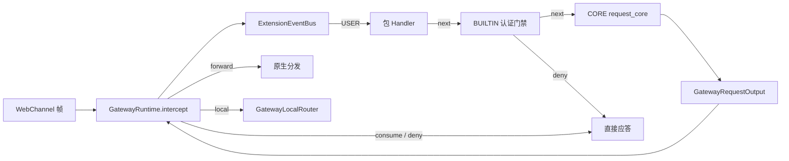
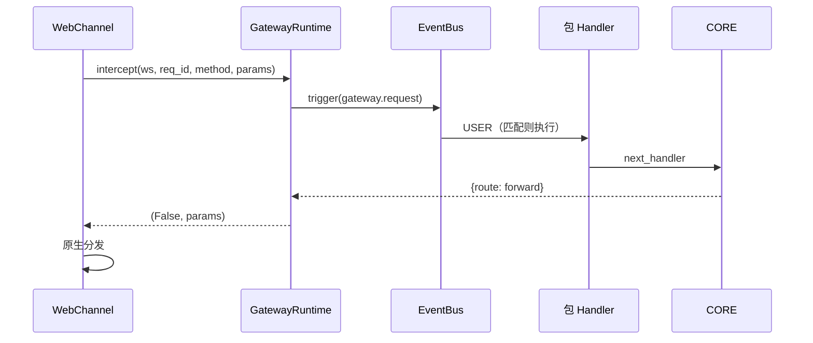
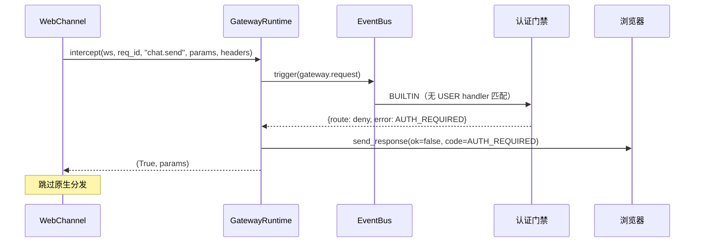

# gateway.request 与认证门禁设计方案

## 元信息

| 项 | 内容 |
| --- | --- |
| 类型 | feature |
| 编号 / slug | `F_02 / gateway-request-and-auth-gate` |
| 关联计划 | EXTV2-GW-02 `gateway.request` 与认证门禁 |
| 所属模块 | `jiuwenswarm/gateway/extensions_v2/{models,event_types/gateway,core_handlers/request_core,builtin/auth_gate,builtin/router}.py` |
| 设计依据 | [详细架构第 5 节](../designs/extensions-v2-architecture.md#5-事件体系)、[运行时规约](../specs/S_01_gateway-extension-runtime.md) |
| 最近一次修订日期 | 2026-11-01 |
| 方案状态 | 已实现，单元验证通过 |

## 1. 问题与目标

Gateway 的 WebSocket 帧原本直接进入原生分发：方法名决定路由，未识别的帧返回错误。若要在分发给 AgentServer 之前做准入判断（例如未登录连接不得发送任何业务请求），需要一个统一的、可被扩展包参与的拦截点。

一句话概括：**每个上行帧在原生分发前经过 `gateway.request` 事件链，链的处置结果决定帧是继续转发、本地应答、直接消费还是被拒绝；认证门禁是该事件的 BUILTIN 层平台规则。**

## 2. 范围

### 2.1 本次范围

- 定义 `gateway.request` 事件类型与 `match_pattern_subset` 匹配。
- `GatewayRequestInput` / `GatewayRequestOutput` 与四路由语义。
- CORE Handler：校验 method，默认 `forward`。
- BUILTIN 认证门禁：策略驱动，未携带 `authorization` 头的帧只放行 `ping` 与 Gateway 自有 application 槽位帧。
- `local` 路由的内置方法表与 `auth.status`。
- 运行时把处置结果落实到渠道应答或原生分发；`request_context.headers` 随帧透传。

### 2.2 非目标

- 不实现登录本身，登录由 USER 包 Handler 完成。
- 不渲染任何界面；平台不预置视图，登录等界面由扩展包通过 F_03 的 `ui.render` 自行提交。
- 不覆盖 IM 渠道与 TUI 流量，只覆盖 Web 渠道 WebSocket 帧。
- 不改变 Gateway 原有方法路由表。

## 3. 总体设计

### 3.1 组件关系



### 3.2 输入输出

```python
@dataclass(frozen=True, slots=True)
class GatewayRequestInput:
    method: str
    params: Mapping[str, Any] = ...
    session_id: str | None = None
    connection_id: str = ""
    user_id: str | None = None
    channel_id: str = "web"
    headers: Mapping[str, str] = ...   # request_context.headers（键小写）

@dataclass(frozen=True, slots=True)
class GatewayRequestOutput:
    handled: bool = False
    route: str = "forward"
    params: Mapping[str, Any] | None = None
    response: Mapping[str, Any] | None = None
    error: Mapping[str, Any] | None = None
    meta: Mapping[str, Any] | None = None
```

`params` 使用 `MappingProxyType` 冻结，避免包 Handler 无意修改原帧。`headers` 来自浏览器帧的 `request_context.headers`，键统一小写；当前只有 `authorization` 参与门禁判断。

### 3.3 路由落实

| 路由 | 运行时动作 | 原生分发 |
| --- | --- | --- |
| `forward` | 使用返回的 `params`（缺省回退原 params） | 执行 |
| `local` | `GatewayLocalRouter.execute` 后应答 | 跳过 |
| `consume` | 以 `response` 成功应答 | 跳过 |
| `deny` | 以 `error` 失败应答 | 跳过 |
| 未知/缺省 | 等同 `forward` | 执行 |

应答统一经 `channel.send_response(ws, req_id, ok=..., payload=..., error=..., code=...)`，兼容渠道已有的响应格式。

### 3.4 认证门禁

门禁是 BUILTIN 层的平台规则，行为由 `AuthPolicy`（`extensions.gateway.auth`）驱动。`enabled=false` 时整条规则不生效；无 `connection_id` 的宿主帧与空 method 不进入门禁，后者交给 CORE 返回 `BAD_REQUEST`。

**认证事实由前端持有**：扩展包可以（但不强制）通过 `ops.client_local_storage.set` 让浏览器保存凭据，之后每一帧在 `request_context.headers.authorization` 携带它。Gateway 不保存、不解析、不校验该值——门禁只判断该头是否存在且非空，内容是否有效由 USER 包 Handler 决定。

生效时按顺序判断：

| 顺序 | 条件 | 结果 |
| --- | --- | --- |
| 1 | `webui.dispatch` 命中 Gateway 自有 application 槽位且 `event="ui.ready"` | `consume`，回 `{"event": "ui.ready", "accepted": true}` |
| 2 | 同上但 `event="ui.change"` | `consume`，回 `{}`（表单纯前端草稿，字段值随点击上行） |
| 3 | `headers.authorization` 存在且非空 | 内传 |
| 4 | `method ∈ {"ping"}` | 内传（保活） |
| 5 | 其余命中 application 槽位的 `webui.dispatch`（含未被包接管的 `ui.click`） | `consume`，回 `{}` |
| 6 | 其他 | `deny` |

application 槽位由 `SLOT_SPECS` 判定，当前为 `application.entry` 与 `application.sidebar.footer`。这些槽位只存在于前端，AgentServer 没有对应视图，所以 `ui.ready` / `ui.change` 与未被包接管的事件都在此本地应答，避免落到原生分发的未知方法错误。门禁不判断槽位里画的是什么，也不触发渲染。

拒绝时返回 `GatewayRequestOutput(handled=True, route="deny", error={"code": "AUTH_REQUIRED", "message": "login required"})`。

门禁不读写任何服务端会话，也不维护按连接的渲染标记；浏览器删除本地凭据后，下一帧自然回到锁定态。

### 3.5 层级后果

`ExtensionEventBus` 的 USER 层在最外层。包 Handler 若不调用 `next_handler`，门禁与 CORE 都不会执行。这是有意保留的契约：包可以替换平台行为（例如自定义准入），平台规则只约束继续内传的帧。该契约必须在包文档中说明。

### 3.6 本地路由

| 方法 | 行为 |
| --- | --- |
| `auth.status` | `{"authenticated": bool}`，判断本帧 `headers.authorization` 是否存在 |
| 其他 | `ok=false`，`code=ROUTE_UNSUPPORTED`，`message="no gateway builtin for method: <method>"` |

未知方法显式失败而不是回退转发，避免包误以为本地已处理而漏掉真实请求。

## 4. 处理流程

### 4.1 正常帧



### 4.2 未登录帧



扩展包若需要让浏览器显示登录界面，由包自行监听可用的上行时机并调用 `ops.ui.render`；门禁不代劳。

### 4.3 本地应答

声明 `local` 的 USER handler（例如查询登录态的包装）让运行时调用 `GatewayLocalRouter`。`auth.status` 的返回直接来自本帧的 `headers`，不经过 AgentServer，也不读取服务端会话。

## 5. 异常与边界

| 情况 | 行为 |
| --- | --- |
| 事件链超时（5s） | 告警，按 `forward` 继续 |
| Handler 抛异常 | 告警，按 `forward` 继续 |
| `params` 非 Mapping | 入口直接返回未访问 |
| 未注册事件类型 | 不可能：装配阶段先注册，异常会被降级处理 |
| `send_response` 不可用 | 静默跳过，帧仍视为已处置 |

## 6. 实施影响

- 新增 `models.py` 的路由枚举与两个数据类，`event_types/gateway.py`、`core_handlers/request_core.py`、`builtin/auth_gate.py`、`builtin/router.py`。
- `WebChannel` 原生分发前增加一次拦截调用，并把 `request_context.headers` 传入；`visited=True` 时不再分发。
- 认证事实不保存在 Gateway：凭据由前端持有并随每帧上报，服务端只读取 `authorization`。
- 门禁不含任何渲染逻辑；所有界面由扩展包通过 `ops.ui.render` 提交。
- 包管理帧同样经过门禁；`extension_package_handlers` 不再单独维护认证判断。
- 与 AgentServer 的 `ui.click` 等事件无耦合；Gateway 侧事件只在 Gateway 注册。

## 7. 验证

验证入口：`tests/unit_tests/gateway/extensions_v2/test_gateway_request.py`、`test_gateway_auth_gate.py`、`test_gateway_ui_render.py`。

| 场景 | 结果 |
| --- | --- |
| 无 USER handler 时 CORE 默认 `forward` | 通过 |
| USER handler 返回 `consume` 时直接应答且不分发 | 通过 |
| USER handler 返回 `deny` 时返回错误码 | 通过 |
| `local` 路由由内置 router 应答 `auth.status` | 通过 |
| 未知本地方法返回 `ROUTE_UNSUPPORTED` | 通过 |
| 未携带 `authorization` 的帧被 `AUTH_REQUIRED` 拒绝且不渲染任何视图 | 通过 |
| 携带 `authorization` 的帧到达 CORE | 通过 |
| 空值 / 无该头 / 其他头名仍然拒绝 | 通过 |
| `ping` 在锁定态放行 | 通过 |
| 空 method 交给 CORE 返回 `BAD_REQUEST` | 通过 |
| 无 connection 的宿主帧不拦截 | 通过 |
| application 槽位 `ui.ready` 本地接受、`ui.change` 本地消费、未处理的点击本地回执 | 通过 |
| 非 application 槽位的 `webui.dispatch` 在锁定态被拒绝 | 通过 |
| 每帧独立判断，不存在按连接的一次性渲染标记 | 通过 |
| 包管理帧同样被门禁保护 | 通过 |
| `ops.gateway.request` 可嵌套触发（headers 需显式透传） | 通过 |

## 8. 风险与遗留

- 门禁不覆盖 IM 渠道与 TUI；这些入口需要各自的准入方案。
- application 槽位上的按钮点击若包未处理，会得到空载荷回执而不是错误；包必须声明 `ui.click` 匹配才能接管。
- 只有"头存在即放行"的语义：凭据过期或伪造的拦截责任在 USER handler；包应在每次需要鉴权的操作前校验凭据。
- 拒绝应答的字段名依赖渠道 `send_response` 的实现；更换渠道需核对 `code`/`error` 字段。
- application 槽位豁免只在 `method="webui.dispatch"` 且 `params.target.slot_id` 命中 `SLOT_SPECS` 时生效；前端若改用其他上行方法，需要同步扩展识别条件。
