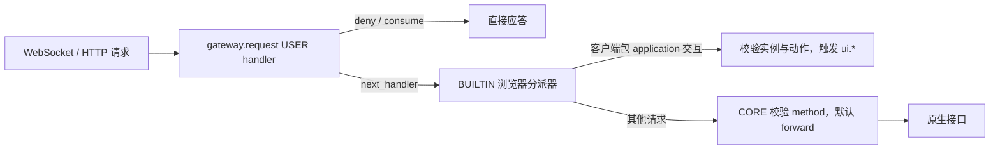

# gateway.request 与扩展鉴权设计方案

## 元信息

| 项 | 内容 |
| --- | --- |
| 类型 | feature |
| 编号 / slug | `F_02 / gateway-request-and-auth-gate`（保留原编号与文件名） |
| 关联计划 | EXTV2-GW-02 `gateway.request` 与本地路由 |
| 所属模块 | `jiuwenswarm/gateway/extensions_v2/{models,event_types/gateway,core_handlers/request_core,builtin/router}.py` |
| 设计依据 | [详细架构](../designs/extensions-v2-architecture.md)、[运行时规约](../specs/S_01_gateway-extension-runtime.md) |
| 最近一次修订日期 | 2026-11-04 |
| 方案状态 | 已实现；本次 130 项单元测试通过 |

## 1. 问题与目标

每个上行请求在原生分发前经过 `gateway.request`。扩展包的 USER handler 决定请求继续、在本地应答、被消费或被拒绝。
原 BUILTIN 认证门禁只检查 Authorization 头是否非空，不能判断 token 是否有效；USER handler 仍须先完成真正的凭据校验。
当前登录示例未声明 `auth_provider`，自行校验并返回 `deny`，因此不依赖旧门禁。

本次将鉴权职责统一交给扩展包，移除旧门禁及其专属配置、包标记、运行时状态和仅检查请求头的 `auth.status`。
保留通用事件、四路由、请求上下文和浏览器 UI 分派器。

## 2. 范围与约束

- 删除 `builtin/auth_gate.py` 及其启动注册。
- 删除 `AuthPolicy`、`extensions.gateway.auth`、`LoadedPackage.auth_provider` 和运行时对应计数。
- 删除无调用的 `runtime.auth_required`、`runtime.is_authenticated`。
- 删除内置 `auth.status`；保留本地方法表及未知方法的 `ROUTE_UNSUPPORTED` 语义。
- 保留 USER → BUILTIN → CORE 的执行顺序、HTTP 接入与原有异常处理语义。
- 不修改平台其他认证机制、登录示例的校验逻辑或账号间数据隔离能力。

## 3. 总体方案与取舍

### 关键决策

鉴权包自行选择凭据格式、校验、豁免范围、登录界面和错误应答。宿主只向其提供规范化 headers 与完整 request_context。
没有鉴权扩展时，继续原生访问流程；普通扩展的安装、卸载和重载不再切换平台登录要求。
UI 分派器负责协议和活动实例校验，不承担身份校验；USER 请求策略先于 UI 动作执行。

### 替代方案与排除理由

保留旧门禁会维持两套准入判断，但任意非空 Authorization 仍可通过这层检查，不能替代包内校验。
仅删除启动注册会遗留无消费者的开关、包字段、计数与状态接口；本次一并清理。

## 4. 请求与路由契约

`GatewayRequestInput.params` 为只读映射。`headers` 是请求头的小写键视图，完整 request_context 独立保留，不合并进 params。
事件数据类、错误码和 HTTP/WebSocket 接入范围以 [S_01](../specs/S_01_gateway-extension-runtime.md) 与
[S_06](../specs/S_06_local-browser-bridge.md) 为准。

| 路由 | 运行时动作 |
| --- | --- |
| `forward` | 使用返回的 params 继续原生分发 |
| `local` | 交给宿主本地方法表；未登记的方法返回 `ROUTE_UNSUPPORTED` |
| `consume` | 以 response 成功应答，跳过原生分发 |
| `deny` | 以 error 失败应答，跳过原生分发 |
| 未知值 | 沿用现有 forward 语义 |

本地方法表初始为空，宿主可登记内置方法。扩展包自己的应答可直接返回 consume，无需注册为宿主方法。
`auth.status` 不再内置；请求头存在不代表认证成功。

## 5. 兼容与迁移

原 `auth_provider` 与 `extensions.gateway.auth` 不再参与包加载、配置或请求处理，不提供兼容门禁。
之前仅声明该标记而未实现校验的包，必须在 gateway.request USER handler 中完成校验和拒绝。
当前登录示例已实现此职责，无需修改其业务代码；示例的中英文说明同步标明该边界。
未被客户端 UI 分派器接管的请求按现有事件链继续处理，不再由旧门禁产生 application 槽位空回执。

## 6. 验证设计与结果

执行入口：`.venv/bin/python -m pytest tests/unit_tests/gateway/extensions_v2/ -q -o addopts= --asyncio-mode=auto -o log_cli=false`。

| 场景 | 本次结果 |
| --- | --- |
| 普通 USER handler 内传时，有无 Authorization 均按 CORE 继续 | 通过 |
| USER handler 可校验凭据并拒绝未登录请求，拒绝不触发 UI 动作 | 通过 |
| local 仍可执行宿主登记的方法；已删除的 auth.status 返回不支持 | 通过 |
| 包管理继续经过 USER 请求策略，普通扩展不触发内置登录要求 | 通过 |
| application UI 动作的实例/包/版本校验保持有效 | 通过 |
| 登录示例 ZIP 安装、注册、登录、退出、HTTP 与中英文树 | 通过 |

变更前基线为 138 项单元测试通过；删除旧门禁专属用例、替换本地路由用例并新增职责边界回归后，当前 130 项全部通过。
本次不新增用户可见文案；鉴权错误继续由扩展包定义。

## 7. 已知遗留与验证边界

WebSocket 事件链现有超时和异常处理仍按 forward 继续，本次不改变该语义。
登录示例使用 Mock 身份数据，不据此承诺生产身份服务或账号间数据隔离。
本次回归以单元测试为准，不将既往 Chrome 或本地工程联调结果视作本次完整浏览器验收。

## 8. 设计演进

2026-11-01 的原方案在 BUILTIN 层提供认证门禁，由 auth_provider 与 AuthPolicy 开关控制，
仅检查非空 Authorization，并为 application 槽位提供本地消费；同时内置 auth.status。
USER handler 可以通过不调用 next_handler 提前结束该链，因此真正的凭据校验一直由包负责。
2026-11-04 确认移除这套门禁，统一由 USER handler 负责鉴权；UI 协议分派继续由独立 BrowserBridge 承担。
