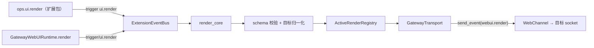
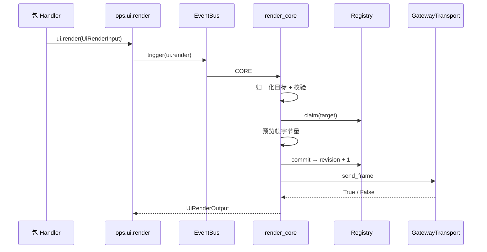
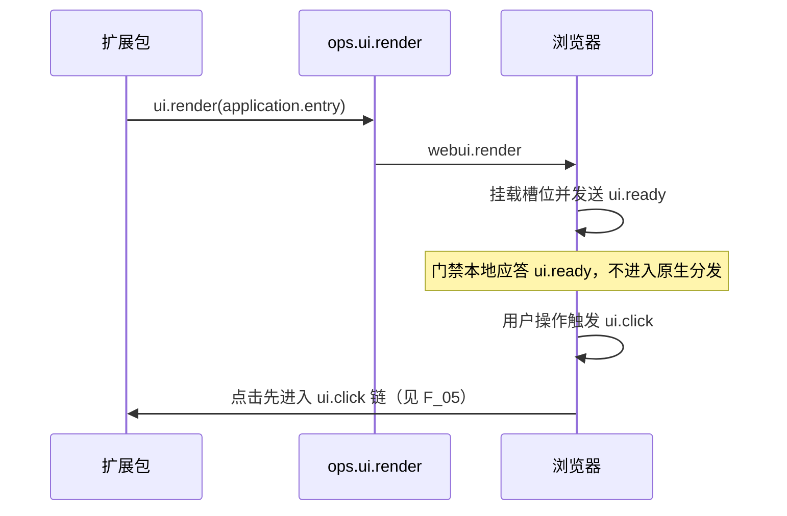

# ui.render 渲染服务设计方案

## 元信息

| 项 | 内容 |
| --- | --- |
| 类型 | feature |
| 编号 / slug | `F_03 / render-service` |
| 关联计划 | EXTV2-GW-03 `ui.render` |
| 所属模块 | `jiuwenswarm/gateway/extensions_v2/webui/`、`event_types/webui.py`、`handler_ops/ui.py` |
| 设计依据 | [详细架构第 7 节](../designs/extensions-v2-architecture.md)、[渲染规约](../specs/S_02_ui-render.md)、AgentServer [F_06](../../../../extensions_v2/docs/features/F_06_render-service.md) |
| 最近一次修订日期 | 2026-11-04 |
| 方案状态 | 已实现，单元验证通过 |

## 1. 问题与目标

Gateway 自有的 application 槽位在 AgentServer 里没有对应视图：未登录连接被门禁拒绝时 AgentServer 尚未参与，浏览器上也没有任何可操作内容。Gateway 因此需要一条自己的下行渲染通道，让扩展包能把受控组件树直接推到浏览器 socket。

一句话概括：**Gateway 在自己的运行时里镜像 AgentServer 的渲染服务，把 `ui.render` 校验成受控帧后按 socket 直接下发；平台不预置任何视图，所有树都由扩展包提交。**

## 2. 范围

### 2.1 本次范围

- 复制渲染协议层：`webui/{constants,models,schema,registry,component_rules}.py`。
- 新增 `GatewayWebUIRuntime`：注册 `ui.render`、发布 `ops.ui.render`、提供 `render` / `drop_connection` / `shutdown`。
- `webui/transport.py`：按 `ws_id` 经 `WebChannel.send_event` 下发 `webui.render`、`webui.render.clear`、`webui.render.error`。
- application 槽位表：`application.entry`（single）与 `application.sidebar.footer`（list）。
- 组件目录补齐前端已登记的 `Form` / `Form.Item` / `Dropdown`，并为 `Button` 增加 `form` 引用。
- 认证门禁对 Gateway 自有 application 槽位帧的通用豁免（`ui.ready` / `ui.change` / 未接管的其他事件）。

### 2.2 非目标

- 不提供任何内置业务视图；登录、设置面板等界面由包通过 `ops.ui.render` 自行提交。
- 应用级交互分派由 [浏览器桥接规约](../specs/S_06_local-browser-bridge.md) 维护。
- 不渲染会话槽位，不实现重连重发与离线补帧。
- 不实现前端槽位宿主与表单取值，前端改动不在本批。

## 3. 总体设计

### 3.1 组件关系

| 参与方 | 职责 |
| --- | --- |
| `GatewayWebUIRuntime` | 持有传输、实例登记，注册 `ui.*` 事件与 `ops.ui` |
| `render_core` | 校验、分配 revision、登记实例、下发帧、投递失败回滚 |
| `ActiveRenderRegistry` | 实例键、revision、同实例串行、按连接限容与清理 |
| `GatewayTransport` | 按 `ws_id` 找 socket 并发送帧；失败返回 `False` 而不抛异常 |
| 认证门禁 | 只对 application 槽位帧做通用本地应答，不构造渲染帧 |

### 3.2 运行时接线

`GatewayRuntime` 构造时创建 `GatewayWebUIRuntime(bus=..., transport=GatewayTransport(channel))`：

- `bootstrap.register_event_types` 先调用 `runtime.webui.register_event_types(bus)`，再注册 `gateway.request`；
- `bootstrap.register_handlers` 收集 `ops.build`、`ui` 命名空间与认证门禁等 BUILTIN handler 的 id；
- `GatewayRuntime.registry` 是 `webui.registry` 的只读别名，供断线清理与测试使用；
- `shutdown` 先注销 handler，再让 WebUI 运行时对每个活跃实例下发清除帧。

### 3.3 槽位与组件目录

槽位是通用能力，任何 Gateway 包都可以使用：

| 槽位 | 容量 | 说明 |
| --- | --- | --- |
| `application.entry` | `single` | 首屏整页宿主，适合登录页、全屏设置等 |
| `application.sidebar.footer` | `list` | 侧边栏底部列表，多个包可并存 |

`package_id` 由可信调用包归属注入，包不得指定其他包；`instance_key` 由包决定，同一 `(slot_id, package_id, instance_key)` 只对应一个实例，重复渲染只增加 revision。

组件目录在本批次补齐前端已登记的 `Form`、`Form.Item`、`Dropdown`，并给 `Button` 增加 `form`：

| 组件 | 约束 |
| --- | --- |
| `Form` | 必须有唯一 `name` 和非空字段；同表单字段名唯一 |
| `Form.Item` | 必须有合法 `name`；只有一个不声明远程事件的 `Input`；`rules` 支持 `required` / `min` / `max` / `pattern` / `message` |
| `Button` | `form` 必须引用同一棵树中的 `Form.name`；点击时前端按该表单组装 `ui.click.data` |
| `Input` | 不再接受 `name`，字段名由所属 `Form.Item.name` 表达 |
| `Dropdown` | `items` 通过 key/label 定义菜单项，点击时把选中 `key` 放进 `ui.select.data` |

AgentServer 副本暂不引入表单三件套规则，两份 `component_rules.py` 在表单契约上有意分歧。

### 3.4 门禁与 application 槽位

门禁不渲染任何东西，只保证锁定态下 application 槽位的前端交互仍可到达包：

| 帧 | 处理 |
| --- | --- |
| application 槽位 `ui.ready` | 本地 `consume`，回 `{"event":"ui.ready","accepted":true}` |
| application 槽位 `ui.change` | 本地 `consume`，回空载荷 |
| application 槽位其他事件（含未被包接管的 `ui.click`） | 本地 `consume`，回空载荷 |
| `ping` | 继续内传 |
| 其他方法 | 无 `authorization` 头时 `deny` + `AUTH_REQUIRED` |

这些槽位没有 AgentServer 视图，本地应答可以避免"前端已挂载槽位却收到未知方法错误"。门禁不认识具体业务，也不区分是哪一种视图。

## 4. 处理流程

### 4.1 渲染一帧

投递失败时 `restore` 旧 revision 与旧树；新建实例直接移除。容量淘汰在投递成功之后执行。

### 4.2 锁定态下的包界面

包在需要展示界面时主动渲染；平台不会在拒绝帧时替包渲染。登出等状态变化由包按需重绘或清空实例。

### 4.3 客户端能力包的上行接入

浏览器接入复用已合入的 `gateway.request` 和 `ui.render`，不建立第二套请求策略或活动渲染树。
`webui.dispatch` 先经过 USER 请求策略，继续后由 BUILTIN 浏览器分派器校验目标和动作，触发对应 `ui.*` 事件。
插件可以拒绝请求或自行应答；允许哪些匿名交互同样属于插件策略。原认证门禁和非接入目标的处理保持原有行为。
浏览器操作、请求绑定、资源及生命周期的通用契约见 [S_06](../specs/S_06_local-browser-bridge.md)。

## 5. 异常与边界

| 情况 | 行为 |
| --- | --- |
| 槽位不在 Gateway 槽位表 | `SCHEMA_ERROR`，下发错误帧，`rejected` |
| 组件或 props 未声明 | 整棵树拒绝 |
| `Button.form` 指向树外或不存在的 Form | 整棵树拒绝 |
| 帧超过 256 KiB | 拒绝，不提交 revision |
| 目标 socket 已关闭或找不到 | 投递失败，回滚实例，`delivery_failed` |
| 连接断开 | 清除该连接的实例，不向已关闭 socket 发帧 |

## 6. 关键决策

- **镜像而非复用**：Gateway 不 import `jiuwenswarm.extensions_v2`，渲染协议以复制方式维护；`models`、`schema`、`registry` 与 AgentServer 同构。
- **平台零预置视图**：任何界面都来自包；平台缺省安装时浏览器看不到额外内容，行为与未启用渲染一致。
- **只保留可寻址槽位**：槽位表只含 application 槽位，从源头杜绝 Gateway 与 AgentServer 双写同一会话实例。
- **传输按 socket 直发**：Gateway 拥有 WebSocket，不需要 AgentServer 的推送通道与 `ws_id` 元数据转换。
- **表单契约跟着前端走**：用 `Form.name` + `Form.Item.name` + `Button.form` 表达"点击时带上哪些字段"，`Input` 不再重复声明字段名。
- **门禁只做通用豁免**：application 槽位帧本地应答，不判断槽位里画的是什么，也不触发任何渲染。

## 7. 实施影响

- 新增 `webui/runtime.py`、`webui/transport.py`、`webui/core_handlers/render_core.py`、`webui/call_context.py`。
- `models.py` 增加 `EVENT_UI_RENDER`；`config.py` 增加 `AuthPolicy`。
- `bootstrap.py` 改为委托 `GatewayWebUIRuntime` 注册 `ui.*`，与 AgentServer 的装配形状一致。
- `auth_gate.py` 由固定白名单改为策略驱动，并按 application 槽位做通用豁免。
- `GatewayRuntime.on_disconnect` 同时清理状态存储与渲染实例。
- 删除 C1 预留的 `core_handlers/context.py`，连接事实统一由 `webui/call_context.py` 读取。
- Gateway 副本 `component_rules.py` 增加 `Form` / `Form.Item` / `Dropdown` 与 `Button.form` 校验。

## 8. 验证

验证入口：`tests/unit_tests/gateway/extensions_v2/test_gateway_ui_render.py`、`test_gateway_auth_gate.py`。

| 场景 | 结果 |
| --- | --- |
| `ops.ui.render` 下发 `webui.render` 且 revision 从 1 开始 | 通过 |
| 同一实例连续渲染 revision 递增 | 通过 |
| 未知组件被拒绝并下发错误帧 | 通过 |
| 非 Gateway 槽位被拒绝 | 通过 |
| `clear` 模式下发清除帧并移除实例 | 通过 |
| 只有目标连接收到帧 | 通过 |
| 断线清除 application 实例 | 通过 |
| 组件目录接受 `Form` / `Form.Item` / `Dropdown` | 通过 |
| `Button.form` 指向树外 Form 时整树拒绝 | 通过 |
| 拒绝帧不渲染任何平台视图 | 通过 |
| application 槽位 `ui.ready` 本地接受 | 通过 |
| application 槽位 `ui.change` 本地消费且不触发渲染 | 通过 |

## 9. 风险与遗留

- 前端需要常驻挂载 `application.entry` 与 `application.sidebar.footer` 两个宿主槽位。
- 表单取值依赖前端实现 `Form.name` / `Form.Item.name` / `Button.form` 与 `Dropdown.items`；未适配前 `ui.click.data` 为空。
- 包自行决定凭据存放方式；若使用浏览器本地存储，应通过 `ops.client_local_storage` 下发（见 F_05）。
- 活跃实例只在进程内保存，重连后需包重新渲染。
- `webui.render` 帧格式需与 AgentServer 前端运行时保持一致，协议变更需两侧同步。

## 2026-11-04 契约对齐验证

Box 数值 gap、Dropdown 展示触发器、重复表单字段及本地输入事件约束与前端统一。
Gateway 不开放 Dropdown.icon，不生成图标白名单；前端与 AgentServer 原有图标能力保持不变。
前端与 Gateway 共同执行 28 组契约向量；Gateway 另验证 icon 属性被拒绝。精简后 Gateway extensions_v2 的 108 项测试通过，包含 10 项登录示例安装测试。
认证门禁实现未修改；异常处理回归测试补充有效 header，避免把门禁拒绝与异常处理混为一项断言。
