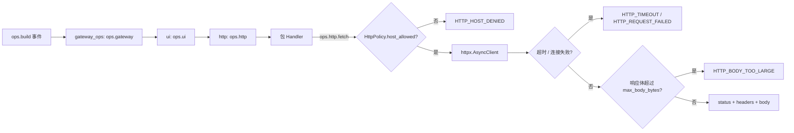
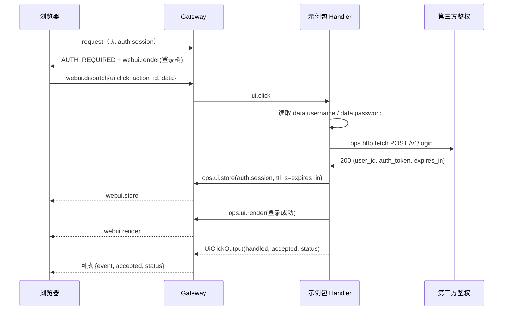

# ops.http.fetch 与登录示例包设计方案

## 元信息

| 项 | 内容 |
| --- | --- |
| 类型 | feature |
| 编号 / slug | `F_06 / http-fetch` |
| 关联计划 | EXTV2-GW-06 `ops.http.fetch` 与示例包 |
| 所属模块 | `jiuwenswarm/gateway/extensions_v2/handler_ops/http_ops.py`、`bootstrap.py`、`config.py`、`examples/auth_login_demo/` |
| 设计依据 | [详细架构第 6.2 节](../designs/extensions-v2-architecture.md)、[HTTP 规约](../specs/S_05_http-fetch.md) |
| 最近一次修订日期 | 2026-11-01 |
| 方案状态 | 已实现（单测通过）；浏览器端到端未验证 |

## 1. 问题与目标

登录包要访问第三方鉴权服务，但扩展包不能直接持有 `httpx` 客户端：出站目标必须由部署方决定、请求必须有时限与体积上限、失败必须变成可处理的值而不是抛进事件链。平台上没有小模型也没有沙箱可以替包完成这件事，因此 `ops.http.fetch` 是 Gateway 侧唯一允许的出站入口。

一句话概括：**包通过 `ops.http.fetch` 发一次受白名单约束的请求；平台把网络失败翻译成错误码，把成功翻译成状态码 + 解析后的响应体。**

`examples/auth_login_demo` 是这条能力的第一个使用方，也是 `ui.click` → `ui.store` → `ui.render` 全链路的可运行样例。

## 2. 范围

### 2.1 本次范围

- `ops.build` 上的 `http` 命名空间与 `fetch` 方法。
- 主机白名单（`host` 或 `host:port`）、超时、响应体上限、重定向逐跳校验。
- 失败码 `HTTP_HOST_DENIED`、`HTTP_TIMEOUT`、`HTTP_BODY_TOO_LARGE`、`HTTP_REQUEST_FAILED`。
- `examples/auth_login_demo` 示例包（`domain: gateway`）与配套 `mock_auth_service.py`。
- `docs/features/F_06`、`docs/specs/S_05` 与对应单元验证。

### 2.2 非目标

- 不做通用 HTTP 客户端封装：没有重试、连接池共享、mTLS、代理或凭证管理。
- 不解析业务语义，`ops.http.fetch` 只负责一次请求的传输结果。
- 不提供平台内置登录，也不改认证门禁的判定逻辑。
- 不包含前端实现；`application.gate` 宿主、`Button.submit` 取值与 `webui.store` 订阅仍属后续工作。

## 3. 总体设计

### 3.1 组件关系

`ops.build` 只触发一次，三个 BUILTIN handler 依次调用 `next_handler` 并各自 `add_namespace`，因此命名空间互不覆盖，也不会重复注册同一个名字。

### 3.2 数据模型

| 类型 | 字段 | 说明 |
| --- | --- | --- |
| `HttpFetchInput` | `url`、`method`、`headers`、`body`、`timeout_ms`、`follow_redirects` | `body` 支持 str/bytes/映射，GET 与 HEAD 不发送 body |
| `HttpFetchOutput` | `status`、`headers`、`body`、`elapsed_ms`、`code` | `code` 非空表示平台层失败，此时 `body` 为空 |
| `HttpPolicy` | `allowed_hosts`、`timeout_ms`、`max_body_bytes`、`follow_redirects` | 配置键 `extensions.gateway.http.*` |

`body` 在 `content-type` 含 `json` 时解析为 JSON，否则按 UTF-8 文本返回；解析失败退化为文本而不是报错。

### 3.3 策略默认值

| 项 | 默认 | 说明 |
| --- | --- | --- |
| `allowed_hosts` | `()` | 空表拒绝一切出站请求；条目形如 `host`、`host:port` 或 `[::1]:8080`，`host:port` 也匹配省略默认端口的 URL |
| `timeout_ms` | 3000 | 请求值优先，但不超过 `MAX_HTTP_TIMEOUT_MS`（5000），且是整次调用（含重定向）的总预算 |
| `max_body_bytes` | 1 MiB | 上限 4 MiB，响应体流式读取，超限立即中断并替换为错误码而不是截断 |
| `follow_redirects` | false | 请求或策略任一开启才跟随，且逐跳校验白名单，最多 3 跳；301/302/303 降级 GET 并丢 body，跨主机剔除凭据头 |

## 4. 处理流程

### 4.1 登录示例的完整链路

### 4.2 示例包的两条动作

| 步骤 | `auth.create` | `auth.login` |
| --- | --- | --- |
| 出站 | `POST /v1/users` | `POST /v1/login` |
| 成功 | 写入 `auth.session`，渲染成功视图 | 同左 |
| 409 | 渲染"用户已存在，请直接登录" | — |
| 401 | — | 渲染"用户名或密码错误" |
| 平台失败码 | 渲染对应文案并保留表单 | 同左 |
| 字段为空 | 不回源，直接渲染"请输入用户名和密码" | 同左 |

成功后只写一次 `auth.session`，浏览器只收到一条 `webui.store`；门禁在下一帧读到该键即放行。

## 5. 异常与边界

| 情况 | 结果 |
| --- | --- |
| 白名单为空或主机不匹配 | `HTTP_HOST_DENIED`，`status=0`，不发请求 |
| 请求超过生效超时 | `HTTP_TIMEOUT`，带 `elapsed_ms` |
| 响应体超过上限 | `HTTP_BODY_TOO_LARGE`，保留 `status` 与 `headers`，`body` 为空 |
| DNS/连接/TLS 等异常 | `HTTP_REQUEST_FAILED`，告警日志只记录主机名 |
| 重定向跳到白名单外 | `HTTP_HOST_DENIED`，保留 3xx 状态码，不再发下一跳 |
| 重定向到另一台白名单主机 | 按 301/302/303 语义降级为无 body 的 `GET`，并剔除 `authorization` / `cookie` 等凭据头 |
| 代理环境变量 | 不读取 `HTTP(S)_PROXY`，白名单主机即实际连接主机 |
| 未开启跟随重定向 | 原样返回 3xx 响应 |
| 请求 `timeout_ms` 非法 | 回退到策略默认值，再按上限截断 |
| 包传入非 `HttpFetchInput` | `TypeError`，由事件链的异常兜底记录 |

`ops.http.fetch` 自身不抛业务异常：除类型错误外，一切失败都是 `HttpFetchOutput.code`。

## 6. 关键决策

- **默认关闭**：空白名单是最安全的部署默认值，也让"忘记配置"表现为可读文案而不是静默出站。
- **失败即值**：包必须能渲染失败原因，所以超时与连接失败都翻译成码，而不是让点击链抛异常触发 fail-open。
- **逐跳校验重定向**：只校验首个 URL 会被 302 绕过白名单；每次 `urljoin` 后都要重新判定。
- **超限不截断**：截断后的 JSON 会解析失败并误导包，直接返回错误码让包显式提示。
- **示例包不 import 平台内部模块**：`auth.session` 键名在包内重复声明，避免包依赖 `builtin/auth_gate.py`。
- **示例只覆盖两个动作**：`auth.create` / `auth.login` 足以验证整条链路；退出登录等扩展留给使用方。

## 7. 实施影响

- 新增 `handler_ops/http_ops.py`；`bootstrap.register_handlers` 追加一个 `ops.build` 的 BUILTIN handler。
- 复用 `config.HttpPolicy` 与 `HttpFetchInput` / `HttpFetchOutput`，未新增事件类型。
- 新增 `examples/auth_login_demo/`（manifest、包模块、双语 README、mock 服务）；示例不参与运行时导入，只有安装到 `gateway_pkgs` 后才生效。
- 新增 `tests/unit_tests/gateway/extensions_v2/test_gateway_http_fetch.py` 与 `test_auth_login_demo.py`。

## 8. 验证

验证入口：`tests/unit_tests/gateway/extensions_v2/test_gateway_http_fetch.py`（11 项）与 `test_auth_login_demo.py`（6 项）。

| 场景 | 结果 |
| --- | --- |
| 空白名单拒绝一切且不发请求 | 通过 |
| `host:port` 只匹配指定端口 | 通过 |
| IPv6 条目与省略默认端口的 URL 命中 | 通过 |
| 允许主机返回解析后的 JSON | 通过 |
| 响应体超限返回错误码且不截断 | 通过 |
| 超时映射为 `HTTP_TIMEOUT` | 通过 |
| 重定向跳到白名单外被拒绝 | 通过 |
| 跨主机重定向剔除凭据并降级 GET | 通过 |
| 不读取代理环境变量 | 通过 |
| 默认不跟随重定向 | 通过 |
| 连接失败映射为 `HTTP_REQUEST_FAILED` | 通过 |
| 示例包登录成功写入会话并重绘 | 通过 |
| 示例包创建重复用户保留表单 | 通过 |
| 示例包口令错误不写会话 | 通过 |
| 示例包遇到白名单拒绝渲染不可用 | 通过 |
| 示例包字段为空不回源 | 通过 |
| 非本包动作回落事件链 | 通过 |

## 9. 风险与遗留

- 前端尚未实现 `Button.submit`，真实浏览器点击前 `data` 为空，只能走 `missing_fields` 分支。
- 门禁与示例包的 `auth.session` 结构没有编译期约束；键名或值类型不一致会表现为"登录成功但仍被拒绝"。
- 没有凭证刷新：`ttl_s` 到期后 `auth.session` 被清理，用户需要重新登录。
- 没有端到端联调用例；`mock_auth_service.py` 只用于本地手工验证。
