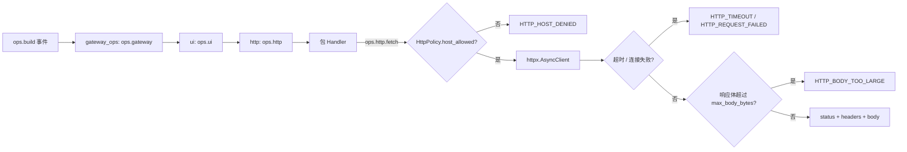

# ops.http.fetch 设计方案

## 元信息

| 项 | 内容 |
| --- | --- |
| 类型 | feature |
| 编号 / slug | `F_06 / http-fetch` |
| 关联计划 | EXTV2-GW-06 `ops.http.fetch` |
| 所属模块 | `jiuwenswarm/gateway/extensions_v2/handler_ops/http_ops.py`、`bootstrap.py`、`config.py` |
| 设计依据 | [详细架构第 6.2 节](../designs/extensions-v2-architecture.md)、[HTTP 规约](../specs/S_05_http-fetch.md) |
| 最近一次修订日期 | 2026-11-04 |
| 方案状态 | 已实现（单测通过）；浏览器端到端未验证 |

## 1. 问题与目标

扩展包需要访问外部 HTTP 服务，出站能力由 Gateway 的 `ops.http.fetch` 提供：出站目标必须由部署方决定、请求必须有时限与体积上限、失败必须变成可处理的值而不是抛进事件链。平台上没有小模型也没有沙箱可以替包完成这件事，因此 `ops.http.fetch` 是 Gateway 侧唯一允许的出站入口。

一句话概括：**包通过 `ops.http.fetch` 发一次受白名单约束的请求；平台把网络失败翻译成错误码，把成功翻译成状态码 + 解析后的响应体。**

早期设计将登录示例作为外部 HTTP 使用场景。当前 [auth_login_demo](../../../../extensions_v2/examples/auth_login_demo/) 使用包内 SQLite Mock，不调用 `ops.http.fetch`；其行为与验证由 [F_07](F_07_local-login-integration.md) 维护。

## 2. 范围

### 2.1 本次范围

- `ops.build` 上的 `http` 命名空间与 `fetch` 方法。
- 主机白名单（`host` 或 `host:port`）、超时、响应体上限、重定向逐跳校验。
- 失败码 `HTTP_HOST_DENIED`、`HTTP_TIMEOUT`、`HTTP_BODY_TOO_LARGE`、`HTTP_REQUEST_FAILED`。
- `docs/features/F_06`、`docs/specs/S_05` 与对应单元验证。

### 2.2 非目标

- 不做通用 HTTP 客户端封装：没有重试、连接池共享、mTLS、代理或凭证管理。
- 不解析业务语义，`ops.http.fetch` 只负责一次请求的传输结果。
- 不提供平台内置登录或入站鉴权，凭据校验由调用包负责。
- 登录页面、浏览器存储及请求绑定由独立的 WebUI 接入与示例特性维护，不属于出站 HTTP 契约。

## 3. 总体设计

### 3.1 组件关系

`ops.build` 只触发一次，三个 BUILTIN handler 依次调用 `next_handler` 并各自 `add_namespace`，因此命名空间互不覆盖，也不会重复注册同一个名字。

### 3.2 数据模型

| 类型 | 字段 | 说明 |
| --- | --- | --- |
| `HttpFetchInput` | `url`、`method`、`headers`、`body`、`timeout_ms`、`follow_redirects` | `body` 支持 str/bytes/映射，GET 与 HEAD 不发送 body |
| `HttpFetchOutput` | `status`、`headers`、`body`、`elapsed_ms`、`code` | `code` 非空表示平台层失败，此时 `body` 为空 |
| `HttpPolicy` | `allowed_hosts`、`timeout_ms`、`max_body_bytes`、`follow_redirects` | 配置键 `extensions.gateway.http.*` |

`body` 在 `content-type` 含 `json` 时解析为 JSON，否则按 UTF-8 文本返回；解析失败退化为文本而不是报错。

### 3.3 策略默认值

| 项 | 默认 | 说明 |
| --- | --- | --- |
| `allowed_hosts` | `()` | 空表拒绝一切出站请求；条目形如 `host`、`host:port` 或 `[::1]:8080`，`host:port` 也匹配省略默认端口的 URL |
| `timeout_ms` | 3000 | 请求值优先，但不超过 `MAX_HTTP_TIMEOUT_MS`（5000），且是整次调用（含重定向）的总预算 |
| `max_body_bytes` | 1 MiB | 上限 4 MiB，响应体流式读取，超限立即中断并替换为错误码而不是截断 |
| `follow_redirects` | false | 请求或策略任一开启才跟随，且逐跳校验白名单，最多 3 跳；301/302/303 降级 GET 并丢 body，跨主机剔除凭据头 |

## 4. 处理流程

包构造 HttpFetchInput 并调用 ops.http.fetch。平台校验目标、计算整次调用的 deadline，
按白名单执行请求与可选重定向，流式读取有界响应，返回 HttpFetchOutput。
调用方解释业务状态码和响应体；该能力不写入浏览器存储、不签发 Token，也不代替调用包完成入站鉴权。

旧设计中的远程 Mock 登录链路没有成为当前示例的接口；当前示例流程见 [F_07](F_07_local-login-integration.md)。

## 5. 异常与边界

| 情况 | 结果 |
| --- | --- |
| 白名单为空或主机不匹配 | `HTTP_HOST_DENIED`，`status=0`，不发请求 |
| 请求超过生效超时 | `HTTP_TIMEOUT`，带 `elapsed_ms` |
| 响应体超过上限 | `HTTP_BODY_TOO_LARGE`，保留 `status` 与 `headers`，`body` 为空 |
| DNS/连接/TLS 等异常 | `HTTP_REQUEST_FAILED`，告警日志只记录主机名 |
| 重定向跳到白名单外 | `HTTP_HOST_DENIED`，保留 3xx 状态码，不再发下一跳 |
| 重定向到另一台白名单主机 | 按 301/302/303 语义降级为无 body 的 `GET`，并剔除 `authorization` / `cookie` 等凭据头 |
| 代理环境变量 | 不读取 `HTTP(S)_PROXY`，白名单主机即实际连接主机 |
| 未开启跟随重定向 | 原样返回 3xx 响应 |
| 请求 `timeout_ms` 非法 | 回退到策略默认值，再按上限截断 |
| 包传入非 `HttpFetchInput` | `TypeError`，由事件链的异常兜底记录 |

`ops.http.fetch` 自身不抛业务异常：除类型错误外，一切失败都是 `HttpFetchOutput.code`。

## 6. 关键决策

- **默认关闭**：空白名单是最安全的部署默认值，也让"忘记配置"表现为可读文案而不是静默出站。
- **失败即值**：包必须能渲染失败原因，所以超时与连接失败都翻译成码，而不是让点击链抛异常触发 fail-open。
- **逐跳校验重定向**：只校验首个 URL 会被 302 绕过白名单；每次 `urljoin` 后都要重新判定。
- **超限不截断**：截断后的 JSON 会解析失败并误导包，直接返回错误码让包显式提示。

## 7. 实施影响

- 新增 `handler_ops/http_ops.py`；`bootstrap.register_handlers` 追加一个 `ops.build` 的 BUILTIN handler。
- 复用 `config.HttpPolicy` 与 `HttpFetchInput` / `HttpFetchOutput`，未新增事件类型。
- 验证入口为 `tests/unit_tests/gateway/extensions_v2/test_gateway_http_fetch.py`。登录示例有独立的安装测试。

## 8. 验证

验证入口：`tests/unit_tests/gateway/extensions_v2/test_gateway_http_fetch.py`。以下为出站 HTTP 已有定向验证；登录示例的验证不作为该能力的验收证据。

| 场景 | 结果 |
| --- | --- |
| 空白名单拒绝一切且不发请求 | 通过 |
| `host:port` 只匹配指定端口 | 通过 |
| IPv6 条目与省略默认端口的 URL 命中 | 通过 |
| 允许主机返回解析后的 JSON | 通过 |
| 响应体超限返回错误码且不截断 | 通过 |
| 超时映射为 `HTTP_TIMEOUT` | 通过 |
| 重定向跳到白名单外被拒绝 | 通过 |
| 跨主机重定向剔除凭据并降级 GET | 通过 |
| 不读取代理环境变量 | 通过 |
| 默认不跟随重定向 | 通过 |
| 连接失败映射为 `HTTP_REQUEST_FAILED` | 通过 |

## 9. 边界与后续验证

本能力的单元验证使用受控 HTTP 传输，不证明真实身份服务可用。
当前登录示例通过本地 Mock 验证浏览器接入，未引入远程鉴权服务、auth.session 存储协议或 Token 自动刷新。
本次仅纠正文档与当前示例的关系，不修改出站 HTTP 行为和认证策略。

## English summary

ops.http.fetch provides bounded, allowlisted outbound HTTP requests. The current login example uses an installed-copy
SQLite mock and does not call this API. Its browser integration and verification belong to F_07. The earlier remote
mock-service sketch is not the current example contract. No authentication policy changes are introduced here.
