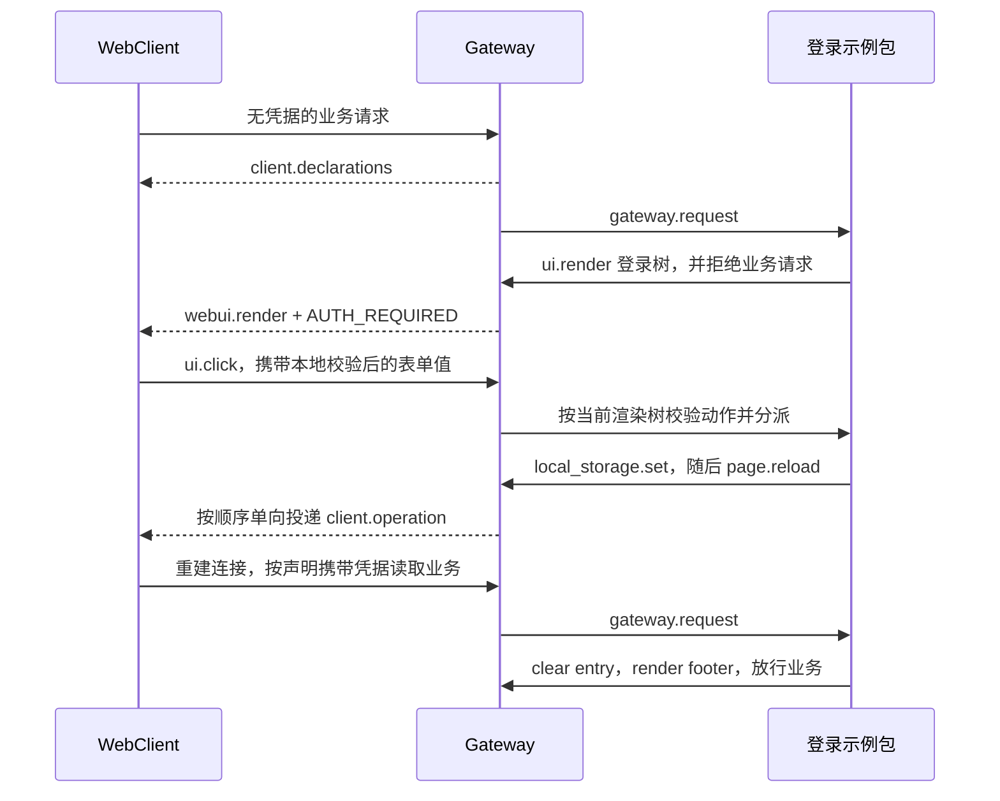
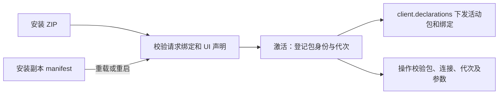

# 登录示例与本地浏览器接入

建档日期：2026-11-03。最近修订：2026-11-04。状态：已适配合入的 Gateway WebUI 接口，完成过本地工程联调；前端、Gateway 接入及示例分别提交。

## 范围与职责

[auth_login_demo](../../../../extensions_v2/examples/auth_login_demo/) 是可通过 GatewayPackageManager 安装的示例包。
示例与其他 V2 插件统一归档在 `jiuwenswarm/extensions_v2/examples/`，由 manifest 的 `domain: gateway` 选择 Gateway 宿主。
多账号注册、Mock token 签发与校验、退出登录、双语渲染树、页面布局和素材由插件提供。
Gateway 提供通用的声明下发、客户端操作、资源服务与应用级交互接入，不解释登录字段。
鉴权统一由插件的 gateway.request USER handler 负责，Gateway 不提供内置认证门禁；请求异常语义仍沿用现有逻辑。职责演进见 [F_02](F_02_gateway-request-and-auth-gate.md)。

前端保持通用组件与请求绑定能力，不识别 auth、accessToken、username 或 logout。
使用独立测试配置与安装目录，复用现有 AgentServer；Gateway 接入和 Mock 包独立于前端提交，使用独立测试配置和安装目录验证。

## 渲染与组件契约

渲染统一调用 `ops.ui.render(UiRenderInput(...))`，使用 RenderTarget、RenderNode 和正式 GatewayWebUIRuntime。
浏览器接入不注册第二套 ui.render，不保存第二份活动树。交互校验读取同一 ActiveRenderRegistry。
clear 移除活动树，但保留目标的渲染版本；连接或会话结束、Runtime 停止时释放相应版本记录。
包重载不重用同一连接中的旧版本，旧点击不得重新生效。客户端能力包的渲染帧携带与声明一致的包激活归属。

表单使用 `Form`、`Form.Item`。字段规则只支持字符串 required/min/max/pattern/message，
由 AntD Form 在失焦和确认时本地校验。Button.form 关联实例内的表单，字段通过 ui.click.data 传输。
内部适配器函数名 WebUIFormItem 不属于插件协议。
头像菜单沿用已合入的 ui.select：data.key 标识所选项；禁用项与分隔线不分派动作。

标题、背景、透明宣传图、头像、宽度、留白和菜单位置均由插件声明。
用户名行组合 Box、Avatar、Text，并声明 disabled=true；分隔线使用原生 type=divider。
2026-11-04：示例在插件中计算首字素与稳定配色，通过 Avatar.props.children 和原生 style 下发；宿主只做通用 AntD 渲染。
属性白名单见[通用组件契约](../../../../channels/web/frontend/src/features/webui/docs/specs/S_01_components.md)，自定义图片仍由插件显式声明 url。
菜单宽度、placement、align、autoFocus 和 destroyOnHidden 直接映射 AntD 属性。
Form.requiredMark=false 隐藏必填星号而保留校验；Input.autoComplete=off 是浏览器偏好提示，
不保证禁止浏览器保存密码或显示已保存账号。

## 客户端接入

安装并激活的客户端插件直接具备请求绑定、浏览器存储写删和页面刷新能力。
无需额外权限声明、授权配置或确认；连接和包激活归属仍由宿主校验。
requestBindings 决定哪类请求携带哪些参数；WebSocket 保留完整 request_context，
GatewayRequestInput.headers 是其中 headers 的规范化视图；HTTP 使用实际请求 header。
浏览器存储按 Gateway 和包隔离，Gateway 不保存其副本。

SDK 当前只支持两层 Ops，with_client_ops 组合公开 API，提供
ops.client.local_storage.set/delete 和 ops.client.page.reload()，不访问 Core 私有实现。
这些方法只单向投递，不等待浏览器执行回执；操作归属来自可信包、连接和当前请求上下文。
存储变化不自动重建业务页面，是否刷新由插件显式决定。

## Mock 账号行为

没有预置账号；用户名唯一，长度 4–64 个字符。密码为 8–128 个字符，包含英文字母、数字和特殊字符。
密码只保存随机盐和摘要。账号及会话位于安装副本的 data/accounts.sqlite3，不打入 ZIP。
“注册并登录”在同一个 SQLite 事务中创建账号和初始会话，再下发存储写入与显式刷新。
字段不合法或用户名重复时不创建会话，不写入浏览器凭据。

token 不自动过期。退出登录撤销当前 token，成功后按顺序下发 delete 与 page.reload，不在刷新前渲染一份临时登录页；新页面的业务请求触发登录树。
退出不删除账号，可使用已注册账号重新登录或继续注册其他账号。
所有账号访问现有相同的平台数据，本例不实现账号间项目、会话和文件隔离。

## 验证结果

2026-11-04 本轮范围回归：

- `.venv/bin/python -m pytest tests/unit_tests/gateway/extensions_v2/ -o addopts='' -o log_cli=false --asyncio-mode=auto -q`：精简后 108 项通过。
  其中 28 组组件契约向量由前端和 Gateway 共同消费；Gateway 的 Dropdown 只支持展示子节点触发器，另验证 icon 属性被拒绝。
  精简前使用仓库锁定 Core 86990bd16a 的源码隔离运行过 110 项用例并全部通过；精简后未重复该隔离验证，uv.lock 保持原有本地修改。
- 示例 10 项测试覆盖实际 ZIP 安装、账号持久化、注册即登录、退出重登录、伪造或过时动作、HTTP header、资源路径边界、
  缺失授权、重载隔离及中英文表单与菜单。打包只包含明确列出的源码、说明与素材，不包含数据库、日志或缓存。
- 精简后重新执行前端 contracts 119 项与 components 115 项，全部通过；图标及别名的正向用例留在前端验证。
  精简前已完成前端 418 项 Node 测试、Chrome 157.0.8103.38 协议浏览器测试与 Vite 生产构建，详细入口见前端 F_02；本次未重复浏览器测试与构建。
- 隔离网络联调使用临时安装目录和真实示例 ZIP，由临时 HTTP/WebSocket 适配器承载 GatewayRuntime、浏览器桥接及 HTTP 中间件。
  真实 Chrome 验证匿名业务请求拒绝、注册直接登录、错误密码、两个账号切换、旧账号重登录、HTTP 凭据绑定和刷新恢复，页面脚本错误为零。
  测试账号只写入临时目录；该适配器不包含生产 WebChannel 原生业务分发或完整 AgentServer。
- 上述先前接入验证曾用认证 header 隔离门禁拒绝与扩展异常处理。后续旧门禁已移除，当前测试不再依赖该 header；本次清理仍未改变异常放行策略。

此前本地工程联调曾验证真实项目和会话历史读取，模型调用存在 reasoning_level 参数兼容问题。
该记录属于先前工程环境，本轮隔离验证不重新证明模型推理、生产身份服务或账号数据隔离。
本轮未运行 tsc、格式化或静态检查；Chrome 107 和其他平台未验证。

## English verification summary

After removing Gateway Dropdown icon triggers, the regression passed 108 Gateway tests, including 10 installed-example
cases and 28 component vectors shared with the browser. Frontend contract tests (119) and component tests (115) passed;
existing frontend and AgentServer icon support is unchanged. Before this reduction, frontend tests (418), Chrome 157
protocol testing and the Vite build passed; browser testing and the build were not repeated for this reduction. An isolated real
HTTP/WebSocket adapter hosted GatewayRuntime and the actual ZIP; Chrome verified registration, sign-in/out, invalid
passwords, account switching, HTTP bindings and refresh restoration without page errors. This does not establish
production WebChannel/AgentServer behavior, model inference, real identity-service acceptance or account data isolation.

## 接入边界

应用级交互接入覆盖 entry/footer；AgentServer 的已有插件仍走原路径。
请求策略覆盖主 WebSocket RPC 和 Gateway HTTP，辅助通道及跨宿主声明合并未在本次验收范围内。
页面初始化保留工作台提前展示的行为，不新增等待配置完成的登录专用加载屏。
修改插件 Python 模块后需重启测试 Gateway；settings.json 可通过 reload 生效。

运行、打包和安装授权方式见示例的 [中文说明](../../../../extensions_v2/examples/auth_login_demo/README.md) 与
[English README](../../../../extensions_v2/examples/auth_login_demo/README_EN.md)。本文件维护该本地接入的验证状态。

## 安装后直接使用浏览器能力（2026-11-04）

本次需求已确认：移除请求绑定、存储写删和页面刷新三项能力的额外授权要求，安装后直接可用。
当前目标与兼容契约由 [S_06](../specs/S_06_local-browser-bridge.md) 维护；本节记录方案与验证。
此前只允许部署配置授权的规则由本节替代；原规则旨在让部署方控制浏览器操作，但导致 ZIP 无法独立交付使用。

采用已安装且激活的客户端包作为能力使用边界，不按 login 包 ID 特判，也不在安装时改写 Gateway 配置。
取消 client_grants 的读取和三项能力的前后端授权检查；旧配置残留不影响加载，已安装的旧 ZIP 无需改写。
浏览器协议同步删除 grants 字段及相关能力名常量、类型声明和校验，不保留无消费者的兼容分支。
client.operation 删除未被回执、去重或关联逻辑使用的 operation_id；保留用于原请求结束等待的 invocation_id。
本次同步更新 Gateway、前端和协议样例，旧客户端不作为兼容目标；登录包本身无需修改 manifest。
不引入新的权限声明或数据库。未知命令、绑定冲突、非法参数和跨包、跨连接、旧激活调用继续拒绝。

包与连接生命周期沿用现有机制，重载和重启从安装副本重建活动包；原有激活代次检查继续拒绝旧调用。
page.reload 是宿主提供的能力，浏览器自身没有要求该安装授权。
无新增界面文案；中英文安装说明同步取消手改配置步骤。

实施范围：Gateway 配置和浏览器桥接、前端客户端能力执行器、相关规约与中英文说明；登录包 manifest 不变。
验证计划覆盖空配置安装后的完整登录流程、重启恢复、重载撤销、未知命令和错误归属拒绝，以及精简后的协议字段。
本次执行验证（2026-11-04，本地 macOS、Python 3.11.4）：

- `.venv/bin/python -m pytest tests/unit_tests/gateway/extensions_v2/ -o addopts='' -o log_cli=false --asyncio-mode=auto -q`：138 项通过。
  所有登录示例用例均不再提供授权配置，覆盖真实 ZIP 安装、注册、登录、退出、重载及 Gateway 重启后的账号和 token 恢复。
  通用包另验证存储写入、删除和刷新直接可用，禁用按钮及非法事件数据仍不能进入业务 Handler。
- 前端目录执行 `npm run test:webui-client`：25 项通过；`npm run test:webui-components`：134 项通过；
  `npm run test:app-request-context`：4 项通过。
  声明和操作不携带已删除字段，未知包、旧连接、旧代次、非法参数及过期命令继续拒绝。
- 本机真实 Gateway 的 WebSocket 只读验证通过：登录包处于 active，已有 token 可完成包查询，
  下发包声明精确包含 packageId、activationGeneration 和 requestBindings 三个字段。
- 本次未重跑浏览器登录全流程或模型执行；前面的历史验证不作为本次改动的证据。

本次能力契约已实现并通过上述单元与本地协议验证，无额外权限声明或授权配置的实现遗留。
需运行包含本次改动的 Gateway；旧插件 ZIP 可原样使用，重新打包仅为同步安装说明。
Gateway 与前端使用同一精简协议，不要求接收插件的同事手改配置。

Active installed client packages now use storage, request bindings and page reload without separate grants or
permission declarations. All 138 Gateway tests and 163 frontend client/component/request-context tests passed,
including ZIP installation and restart restoration. A live Gateway check verified the active login package, an
authenticated query and declarations without grant fields. Browser login flows and model execution were not repeated.

### 冗余校验审查

审查以 PR !118 的引入记录、当前生产者与消费者、已有边界和回归测试为依据，不把不同入口的同类检查视为重复。

| 清理项 | 删除依据 |
| --- | --- |
| grants 字段、能力名常量及兼容分支 | 额外授权策略已取消，字段无业务消费者；前后端与协议样例同步删除 |
| operation_id 的生成、类型与非空检查 | 没有回执、去重、重试或关联消费者；不能提供与名称相称的语义 |
| local_storage.delete 的第二次方法判断 | 前面的分支已限定为 set/delete；排除 set 后只能为 delete |
| 分派器重复检查 disabled 与事件数据对象类型 | 同一调用链中的 validate_event_data 已检查组件事件结构及禁用状态；统一由该入口判断 |

保留连接归属、活动包和激活代次、命令时限、绑定冲突、有限 JSON 与容量、资源路径边界及表单字段检查。
invocation_id 仍供上下文变更等待原请求结束，不能与无消费者的逐操作标识一起删除。
资源根路径判断不与 is_file 合并：畸形包可把 assets 声明为文件，仍须拒绝把根自身作为素材返回。

## 插件共存与资源生命周期

Gateway 只为参与客户端能力的包生成激活标记。渲染始终使用发起调用的激活归属；包重载后，旧调用不得修改当前活动树。
AgentServer 等普通插件的帧继续走既有 WebUI 协议，无需为展示 UI 声明浏览器存储能力。
登录和退出时的存储变化会使依赖凭据的资源上下文更新，前端在该类资源未就绪期间不挂载图片。
插件静态素材按 Gateway、包 ID 和激活代次管理，不随凭据变化失效；具体契约及本轮宿主验证见
[前端资源作用域](../../../../channels/web/frontend/src/features/webui/docs/specs/S_02_client-capabilities.md#资源作用域)和
[实现记录](../../../../channels/web/frontend/src/features/webui/docs/features/F_02_client-capabilities.md#插件静态素材的生命周期)。

Plugin static assets follow Gateway and package activation lifetimes rather than credentials. Credential-protected
resources retain request-context invalidation; the frontend contract and implementation record above own this behavior.

新请求上下文就绪后，已挂载的非 entry 插槽重新上报 ui.ready，恢复此前被失效处理的贡献。
真实 Chrome 回归已验证登录后自动恢复侧栏菜单、任务入口、标题、操作按钮和输入区贡献，
展开右侧区域可打开工作区文件及网页预览页签；工作台刷新动作正常返回更新结果。
再次退出后登录树的宣传图正常加载，再用第二个已注册账号登录，头像菜单显示对应用户名。
慢资源与上下文切换通过受控延迟资源测试覆盖；浏览器结果不扩大为对每一个动画帧的录像验证。
退出由插件只下发存储删除与显式刷新，新页面再由 Gateway 请求链触发登录树。

## 断连回调与静态服务素材接入修复（2026-11-04）

旧接入的断连入口只接收 ws，但 WebChannel 既有回调约定为 (ws, session_ids)，导致回调在进入运行时前失败。
入口现在接收并转交会话集合，沿用运行时的 gateway.disconnect 通知及 finally 清理；释放连接映射、连接状态和
application 视图，其他浏览器连接与聊天会话保持独立。单参数调用仍可省略集合，异常继续遵守入口不外抛的契约。

all 模式使用的 Python 静态服务此前只代理 /api 和 /ws，插件素材路径会落入 SPA HTML。
静态服务现在复用既有 HTTP 代理，将 /extension-assets/ 转发到同一个 WebChannel HTTP 目标。
不引入绝对素材地址或额外 CORS 配置；后端继续校验包、激活代次和 assets 目录边界，404 原样传回。
Vite 已有同一路径代理，不需重复修改。旧激活的素材 URL 在重载后仍应失效，不能把后端 404 改写成成功。

本轮验证（2026-11-04，本地 macOS、Python 3.11.4）：

- 修复前新增回归有 9 项失败，分别复现断连入口 TypeError、图片请求返回 HTML 和后端 404 被 SPA 页面替代。
- 本次改动的独立源码快照执行 Gateway 扩展测试，以及静态素材、已有 WS 隧道和 raw-file HTTP 测试：146 项通过。
  提交前基于最新分支再次验证：153 项通过。
  覆盖连接隔离与重连、禁用运行时、清理异常、GET/HEAD 内容与响应头、真实安装 ZIP 的三种素材，以及重载后旧 URL 失效。
- 独立真实 WebChannel 和 Python 静态服务使用临时安装的正式示例 ZIP，连续两次 WS 连接均渲染登录树，断连后连接映射
  和 application 视图清理完成；日志未出现本次报告的断连或投递错误。HTTP 直连和同源代理均返回正确图片字节，
  缺失文件及错误激活代次返回 JSON 404。Chrome 中头像、背景、宣传图均完成解码，naturalWidth 大于零。

以上服务验证未连接 AgentServer 或执行模型；同事环境的原始 404 请求及响应体未提供，不能判定其具体失效条件。
本次未改变未登录 401、真实投递失败的错误及回滚语义。

The disconnect entry now accepts the existing WebChannel callback arguments and forwards them to runtime cleanup.
The built frontend server proxies extension assets through the existing same-origin HTTP path. Regression tests passed
in isolated source snapshots: 146 initially and 153 on the final branch baseline. Real HTTP/WS services verified disconnect cleanup and asset delivery; Chrome
decoded all three images. AgentServer/model execution and the colleague's original 404 conditions were not reproduced.
Backend asset checks and delivery-failure rollback remain authoritative.

## 2026-11-04 旧认证门禁清理

移除 BUILTIN 认证门禁、auth_provider 标记、专属配置、运行时鉴权状态与内置 auth.status。
登录示例原已通过 USER handler 校验 token 并拒绝未登录请求，无需修改业务实现；UI 分派器继续在请求策略允许后执行。
Gateway 扩展回归更新后 130 项通过，包含 10 项登录示例测试；本次未重复 Chrome 或完整工程联调。

The legacy built-in authentication gate, provider flag, dedicated configuration, runtime authentication helpers and
built-in auth.status method have been removed. The example continues to validate tokens and reject requests in its
USER handler. All 130 Gateway extension tests passed, including the 10 installed-example cases; Chrome and full
application integration were not rerun for this cleanup. See [F_02](F_02_gateway-request-and-auth-gate.md).
