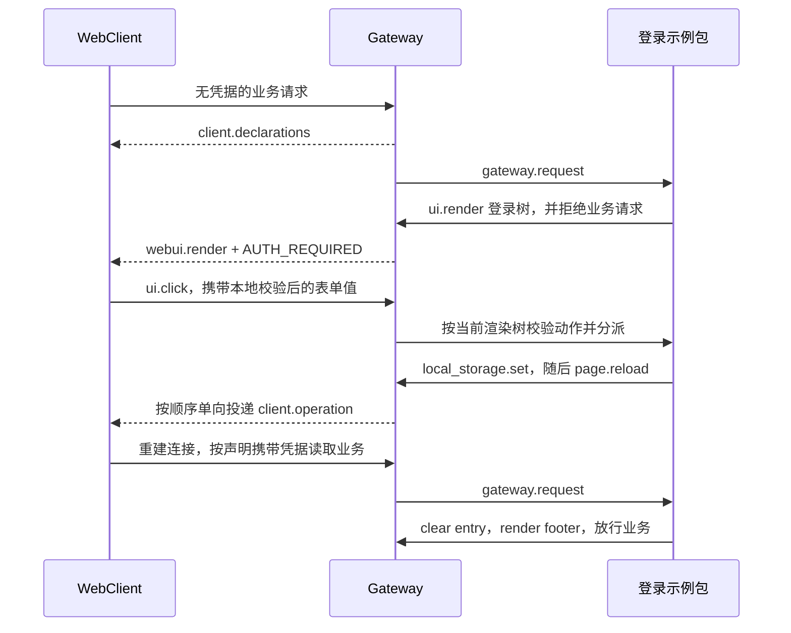

# 登录示例与本地浏览器接入

建档日期：2026-11-03。最近修订：2026-11-04。状态：已适配合入的 Gateway WebUI 接口，完成过本地工程联调；前端、Gateway 接入及示例分别提交。

## 范围与职责

[auth_login_demo](../../../../extensions_v2/examples/auth_login_demo/) 是可通过 GatewayPackageManager 安装的示例包。
示例与其他 V2 插件统一归档在 `jiuwenswarm/extensions_v2/examples/`，由 manifest 的 `domain: gateway` 选择 Gateway 宿主。
多账号注册、Mock token 签发与校验、退出登录、双语渲染树、页面布局和素材由插件提供。
Gateway 提供通用的声明下发、客户端操作、资源服务与应用级交互接入，不解释登录字段。
认证门禁和请求异常语义沿用已合入的 Gateway 逻辑，本次不修改其鉴权判定。

前端保持通用组件与请求绑定能力，不识别 auth、accessToken、username 或 logout。
使用独立测试配置与安装目录，复用现有 AgentServer；Gateway 接入和 Mock 包独立于前端提交，使用独立测试配置和安装目录验证。

## 渲染与组件契约

渲染统一调用 `ops.ui.render(UiRenderInput(...))`，使用 RenderTarget、RenderNode 和正式 GatewayWebUIRuntime。
浏览器接入不注册第二套 ui.render，不保存第二份活动树。交互校验读取同一 ActiveRenderRegistry。
clear 移除活动树，但保留目标的渲染版本；连接或会话结束、Runtime 停止时释放相应版本记录。
包重载不重用同一连接中的旧版本，旧点击不得重新生效。客户端能力包的渲染帧携带与声明一致的包激活归属。

表单使用 `Form`、`Form.Item`。字段规则只支持字符串 required/min/max/pattern/message，
由 AntD Form 在失焦和确认时本地校验。Button.form 关联实例内的表单，字段通过 ui.click.data 传输。
内部适配器函数名 WebUIFormItem 不属于插件协议。
头像菜单沿用已合入的 ui.select：data.key 标识所选项；禁用项与分隔线不分派动作。

标题、背景、透明宣传图、头像、宽度、留白和菜单位置均由插件声明。
用户名行组合 Box、Avatar、Text，并声明 disabled=true；分隔线使用原生 type=divider。
菜单宽度、placement、align、autoFocus 和 destroyOnHidden 直接映射 AntD 属性。
Form.requiredMark=false 隐藏必填星号而保留校验；Input.autoComplete=off 是浏览器偏好提示，
不保证禁止浏览器保存密码或显示已保存账号。

## 客户端接入

部署配置按包授予 request.bind.gateway、local_storage.write 和 page.reload。
requestBindings 决定哪类请求携带哪些参数；WebSocket 保留完整 request_context，
GatewayRequestInput.headers 是其中 headers 的规范化视图；HTTP 使用实际请求 header。
浏览器存储按 Gateway 和包隔离，Gateway 不保存其副本。

SDK 当前只支持两层 Ops，with_client_ops 组合公开 API，提供
ops.client.local_storage.set/delete 和 ops.client.page.reload()，不访问 Core 私有实现。
这些方法只单向投递，不等待浏览器执行回执；操作归属来自可信包、连接和当前请求上下文。
存储变化不自动重建业务页面，是否刷新由插件显式决定。

## Mock 账号行为

没有预置账号；用户名唯一，长度 4–64 个字符。密码为 8–128 个字符，包含英文字母、数字和特殊字符。
密码只保存随机盐和摘要。账号及会话位于安装副本的 data/accounts.sqlite3，不打入 ZIP。
“注册并登录”在同一个 SQLite 事务中创建账号和初始会话，再下发存储写入与显式刷新。
字段不合法或用户名重复时不创建会话，不写入浏览器凭据。

token 不自动过期。退出登录撤销当前 token，成功后按顺序下发 delete 与 page.reload，不在刷新前渲染一份临时登录页；新页面的业务请求触发登录树。
退出不删除账号，可使用已注册账号重新登录或继续注册其他账号。
所有账号访问现有相同的平台数据，本例不实现账号间项目、会话和文件隔离。

## 验证结果

2026-11-04 本轮范围回归：

- `.venv/bin/python -m pytest tests/unit_tests/gateway/extensions_v2/ -o addopts='' -o log_cli=false --asyncio-mode=auto -q`：精简后 108 项通过。
  其中 28 组组件契约向量由前端和 Gateway 共同消费；Gateway 的 Dropdown 只支持展示子节点触发器，另验证 icon 属性被拒绝。
  精简前使用仓库锁定 Core 86990bd16a 的源码隔离运行过 110 项用例并全部通过；精简后未重复该隔离验证，uv.lock 保持原有本地修改。
- 示例 10 项测试覆盖实际 ZIP 安装、账号持久化、注册即登录、退出重登录、伪造或过时动作、HTTP header、资源路径边界、
  缺失授权、重载隔离及中英文表单与菜单。打包只包含明确列出的源码、说明与素材，不包含数据库、日志或缓存。
- 精简后重新执行前端 contracts 119 项与 components 115 项，全部通过；图标及别名的正向用例留在前端验证。
  精简前已完成前端 418 项 Node 测试、Chrome 157.0.8103.38 协议浏览器测试与 Vite 生产构建，详细入口见前端 F_02；本次未重复浏览器测试与构建。
- 隔离网络联调使用临时安装目录和真实示例 ZIP，由临时 HTTP/WebSocket 适配器承载 GatewayRuntime、浏览器桥接及 HTTP 中间件。
  真实 Chrome 验证匿名业务请求拒绝、注册直接登录、错误密码、两个账号切换、旧账号重登录、HTTP 凭据绑定和刷新恢复，页面脚本错误为零。
  测试账号只写入临时目录；该适配器不包含生产 WebChannel 原生业务分发或完整 AgentServer。
- 异常处理测试补充有效认证 header，隔离门禁拒绝与扩展异常处理，认证门禁实现和异常放行策略未修改。

此前本地工程联调曾验证真实项目和会话历史读取，模型调用存在 reasoning_level 参数兼容问题。
该记录属于先前工程环境，本轮隔离验证不重新证明模型推理、生产身份服务或账号数据隔离。
本轮未运行 tsc、格式化或静态检查；Chrome 107 和其他平台未验证。

## English verification summary

After removing Gateway Dropdown icon triggers, the regression passed 108 Gateway tests, including 10 installed-example
cases and 28 component vectors shared with the browser. Frontend contract tests (119) and component tests (115) passed;
existing frontend and AgentServer icon support is unchanged. Before this reduction, frontend tests (418), Chrome 157
protocol testing and the Vite build passed; browser testing and the build were not repeated for this reduction. An isolated real
HTTP/WebSocket adapter hosted GatewayRuntime and the actual ZIP; Chrome verified registration, sign-in/out, invalid
passwords, account switching, HTTP bindings and refresh restoration without page errors. This does not establish
production WebChannel/AgentServer behavior, model inference, real identity-service acceptance or account data isolation.

## 接入边界

应用级交互接入覆盖 entry/footer；AgentServer 的已有插件仍走原路径。
请求策略覆盖主 WebSocket RPC 和 Gateway HTTP，辅助通道及跨宿主声明合并未在本次验收范围内。
页面初始化保留工作台提前展示的行为，不新增等待配置完成的登录专用加载屏。
修改插件 Python 模块后需重启测试 Gateway；settings.json 可通过 reload 生效。

运行、打包和部署授权方式见示例的 [中文说明](../../../../extensions_v2/examples/auth_login_demo/README.md) 与
[English README](../../../../extensions_v2/examples/auth_login_demo/README_EN.md)。本文件维护该本地接入的验证状态。

## 插件共存与资源生命周期

Gateway 只为参与客户端能力的包生成激活标记。渲染始终使用发起调用的激活归属；包重载后，旧调用不得修改当前活动树。
AgentServer 等普通插件的帧继续走既有 WebUI 协议，无需为展示 UI 声明浏览器存储能力。
登录和退出时的存储变化会使资源上下文更新，前端在资源未就绪期间不挂载图片。
新请求上下文就绪后，已挂载的非 entry 插槽重新上报 ui.ready，恢复此前被失效处理的贡献。
真实 Chrome 回归已验证登录后自动恢复侧栏菜单、任务入口、标题、操作按钮和输入区贡献，
展开右侧区域可打开工作区文件及网页预览页签；工作台刷新动作正常返回更新结果。
再次退出后登录树的宣传图正常加载，再用第二个已注册账号登录，头像菜单显示对应用户名。
慢资源与上下文切换通过受控延迟资源测试覆盖；浏览器结果不扩大为对每一个动画帧的录像验证。
退出由插件只下发存储删除与显式刷新，新页面再由 Gateway 请求链触发登录树。
