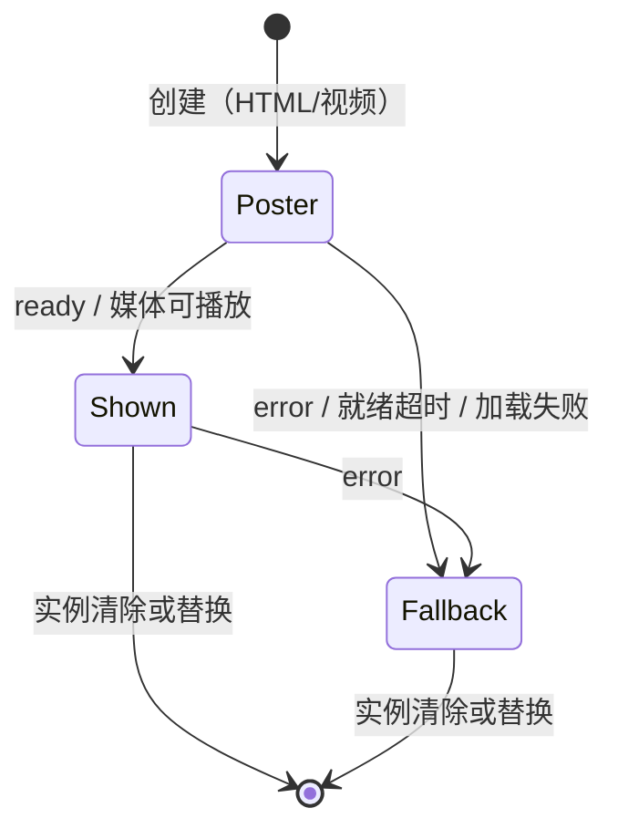

# 媒体容器与应用背景设计方案

## 1. 元信息

| 项 | 内容 |
| --- | --- |
| 类型 | feature |
| 编号 / slug | `F_10 / media-surface-and-background` |
| 建档日期 | 2026-11-05 |
| 计划条目 | [EXTV2-GW-09](../designs/extensions-v2-development-plan.md) |
| 整体设计 | [应用级界面能力设计概览](../designs/application-surfaces-overview.md) |
| 方案成熟度 | 已确认，已实现 |
| 关联规约 | [S_07 媒体容器](../specs/S_07_media-surface.md)、[S_17 组件 Props](../../../../extensions_v2/docs/specs/S_17_webui-component-props.md)、[S_02 渲染](../specs/S_02_ui-render.md) |
| 验证摘要 | 单元验证通过；内置浏览器与 Chromium 157 无头模式验证通过（2026-11-05）；桌面打包版联调随 GW-11 |

## 2. 背景、目标与范围

### 2.1 背景与问题

外观类插件需要在应用最底层显示图片、视频或动态页面。现有组件不满足：`Image` 与 `Box.backgroundImage`
只作用于组件自身；`Iframe` 是带操作栏的网页查看器，15 秒后提示慢加载，隐藏时卸载，且只能用于会话级页面槽位；
没有任何应用级的全窗口底层位置。开场（EXTV2-GW-11）同样需要一个受宿主约束的媒体容器。

### 2.2 目标与关键场景

| 场景 | 预期行为 |
| --- | --- |
| 插件向 `application.background` 渲染 `MediaSurface` | 全窗口底层显示图片、视频或沙箱页面，位于全部界面之下 |
| 页面内容就绪或失败 | 按 S_07 的消息协议显示内容或回退到 `poster` |
| 窗口隐藏、减少动态 | 视频暂停、页面收到上下文，减少动态时使用 `poster` |
| 插件清除实例或断线 | 背景移除，根元素标记撤销 |

### 2.3 本次范围与非目标

范围：`MediaSurface` 组件（S_17 字段）、`application.background` 槽位、前端背景宿主、消息协议与宿主策略、
Gateway 校验与参与分派。

非目标：让宿主界面变为半透明以显示背景（EXTV2-GW-10 受控外观）；开场槽位、心跳与完成（EXTV2-GW-11）。
在 GW-10 之前，背景位于不透明界面之下，仅在界面透明的区域可见。

## 3. 设计约束、假设与待决问题

- 组件字段以 S_17 为唯一维护位置，先改 S_17 再改三端。
- `MediaSurface` 只在 Gateway 应用级槽位使用；AgentServer 不登记该组件与槽位。
- 内容只能来自包素材或数据素材（`/extension-assets/`），以便统一获得 S_06 的沙箱响应头与激活代次校验。
- 无待决问题。

## 4. 总体方案与设计取舍

### 4.1 方案概览

新增根组件 `MediaSurface` 与槽位 `application.background`。前端在应用根部挂载背景宿主：一个位于全部界面之下、
不接收输入的全窗口层，内部是该槽位的 `WebUIHost`。`MediaSurface` 按 `kind` 渲染图片、视频或沙箱 iframe；
iframe 与宿主之间使用带令牌的 `postMessage` 协议。宿主策略（静音、输入、焦点、超时）由背景宿主提供，
插件 props 不能改变。

### 4.2 关键决策

#### D-01 以根组件而非新渲染器类型表达

沿用 `Panel` / `Iframe` 已有的“专用根组件 + 槽位根白名单”机制，复用协议校验、实例版本与 `ops.ui.render`，
不需要扩展 `renderer.kind` 或下行帧格式。

#### D-02 首个承载槽位为应用背景

媒体容器没有承载位置就无法端到端验证；背景不依赖启动门控，是最简单的使用方。开场槽位在 GW-11 复用同一组件，
补充心跳与完成处理。

#### D-03 宿主策略由宿主组件注入

背景宿主通过 React 上下文向适配器提供角色与策略（静音、就绪超时等）；插件 props 中的 `muted` 在背景中被忽略。
同一组件在不同槽位行为不同，但都由宿主决定。

#### D-04 来源与令牌双重校验

只接受来自该 iframe `contentWindow` 且携带当前令牌的消息。令牌经 URL 片段传入，防止 iframe 被导航到其他文档后
仍以同一窗口身份发送消息。

### 4.3 替代方案与排除理由

| 方案 | 排除理由 |
| --- | --- |
| R-01 扩展现有 `Iframe` | 现有 Iframe 带操作栏、慢加载提示和卸载语义，属于网页查看器，与底层媒体的语义冲突 |
| R-02 新增 `renderer.kind: surface` | 需要改动 manifest、下行帧与前端运行时，收益不及沿用根组件机制 |
| R-03 允许任意 HTTPS 地址 | 外部页面不受素材沙箱响应头与激活代次约束，背景可能长期加载第三方内容 |
| R-04 背景也允许普通组件树 | 背景层不接收输入，普通组件没有意义且可能遮挡 |

## 5. 详细设计

### 5.1 模块责任

| 模块 | 修改 |
| --- | --- |
| S_17 | 新增第 4.24 节 `MediaSurface`；子节点与槽位、页面宿主表 |
| Gateway `webui/constants.py`、`webui/bridge.py` | 槽位 `application.background`（application、single），加入应用级 UI 包参与范围 |
| Gateway `webui/component_rules.py`、`webui/schema.py` | 组件规则；根专用组件；`application.background` 只接受 `MediaSurface` |
| 前端 `catalog/` | 组件规则、槽位规则（含“严格根”标记） |
| 前端 `protocol/` | 根专用组件与严格根槽位校验 |
| 前端 `renderer/adapters/webuiMediaSurface/` | 适配器、消息协议、样式 |
| 前端 `react/WebUIBackgroundHost.tsx`、`WebUIAppRoot.tsx` | 背景宿主与挂载 |

### 5.2 状态与生命周期

图片没有 `Poster` 阶段，直接显示，失败进入 `Fallback`。

## 6. 影响面与实施设计

修改点见第 5.1 节；同步 S_02 槽位表、S_06 参与槽位、S_07 与前端 F_01 的验证记录。没有新增用户可见文字。

## 7. 兼容与迁移

纯新增：既有组件、槽位与插件不受影响。

## 8. 验证设计、执行记录与结论

### 8.1 验证设计与通过条件

| 编号 | 场景 | 通过条件 |
| --- | --- | --- |
| F_10-V-01 | Gateway 校验 | 合法字段通过；非法 `kind`、外部 `src`、缺少 `title`、嵌套使用、用于其他槽位、背景使用其他根被拒绝 |
| F_10-V-02 | 前端协议 | 同上，前后端结论一致（共享用例） |
| F_10-V-03 | 图片、视频、HTML 渲染 | 对应元素、样式参数；视频静音自动播放；iframe 的 sandbox、allow、令牌片段 |
| F_10-V-04 | 消息协议 | 正确来源与令牌的 `ready` 生效；错误令牌、其他来源、未知事件被忽略；`error` 回退到 `poster` |
| F_10-V-05 | 就绪超时与减少动态 | 超时回退；减少动态时显示 `poster` |
| F_10-V-06 | 背景宿主 | 渲染到全窗口底层、不接收输入；根元素标记随实例出现与消失 |
| F_10-V-07 | Gateway 分派 | 声明背景槽位的包收到 `ui.ready` |
| F_10-V-08 | 回归与构建 | Gateway 扩展用例、前端 WebUI 用例全部通过；`npm run build` 成功 |
| F_10-V-09 | 浏览器实际显示 | 在真实浏览器中显示背景并确认消息往返 |

### 8.2 实际执行与证据

环境同 [F_08](F_08_application-packages-and-assets.md) 第 8.2 节；前端使用 Node 22，命令在前端目录执行。

| 编号 | 用例或命令 | 结果 |
| --- | --- | --- |
| F_10-V-01、V-02 | `webuiGatewayCases.json` 新增 38 条 `MediaSurface` 与槽位用例（带 `slot` 字段的用例按 `validate_request` / 应用级目标校验）；`test_gateway_ui_render.py` 与前端 `test:webui-components` 同时执行 | 两侧结论一致，全部通过 |
| F_10-V-03～V-06 | `webuiComponentsReact.test.mjs` 中 `MediaSurface` 渲染、消息协议、超时与隐藏暂停、减少动态、`WebUIBackgroundHost` 共 5 项 | 通过 |
| F_10-V-07 | `test_background_package_renders_a_media_surface_from_its_assets` | 通过 |
| F_10-V-08 | `tests/unit_tests/gateway/extensions_v2/` | 370 通过 |
| F_10-V-08 | `test_app_web_extension_assets.py`、`test_trajectory_http.py` | 42 通过 |
| F_10-V-08 | `test:webui-contracts` 150、`test:webui-protocol` 14、`test:webui-components` 193、`test:webui-renderer` 17、`test:webui-runtime` 19、`test:webui-client` 22、`test:webui-events` 93、`test:webui-transport` 9 | 全部通过 |
| F_10-V-08 | `npm run build`（`tsc` 与 `vite build`） | 成功；仅有既有的分包与体积提示 |

新增的 5 条合法共享用例与 V-07 在恢复修改前的 Gateway 源码后失败。将令牌校验、来源校验或强制静音
分别改坏后，V-03、V-04 对应用例失败。

F_10-V-09：在会话临时目录搭建本地验证页，用真实 Gateway 运行时与素材路由
（`attach_browser_routes`）发布仅声明 `application.background` 的测试包，页面挂载真实的
`WebUIBackgroundHost` 与 `MediaSurface`，渲染帧经 Mock 传输注入。在 Claude 桌面应用内置浏览器中：

| 场景 | 结果 |
| --- | --- |
| 图片背景 | 显示在应用界面之下；`data-webui-background="active"`；背景宿主带 `inert`；界面空白处命中应用层而非背景层；`ui.ready` 目标为 `application.background` |
| 视频背景（浏览器录制的 WebM 上传为包素材，`muted=false`、`blur=6`） | 自动播放，`muted` 为 true，循环，模糊生效 |
| 素材响应 | `Range` 返回 206；`Content-Type: video/webm`、`Content-Security-Policy: sandbox allow-scripts`、`X-Content-Type-Options: nosniff`、`Cache-Control: no-store` |
| 外部 `src` | 协议拒绝，保留上一帧视频 |
| HTML 页面未加载成功 | 15 秒后卸载 iframe 并显示 `poster` |
| 清除 | 背景移除，根元素标记撤销 |

内置浏览器拦截所有 iframe 文档请求（`net::ERR_BLOCKED_BY_CLIENT`，属于浏览器面板限制，与素材响应头无关），
HTML 页面未能在其中验证。当时据推测将就绪前的 iframe 由隐藏改为完全透明，以免浏览器暂停隐藏的跨源 iframe 渲染、
页面因等待首帧而无法发出 `ready`；该推测随后未得到证实，见下文。

本机未安装 Chrome，经用户同意下载 Chrome for Testing 157.0.8103.38 的 `chrome-headless-shell`（mac-arm64），
以临时用户目录启动，通过 CDP 驱动同一验证页。验证页中的内容页在收到宿主消息后，把原消息放入 `heartbeat` 的
`detail` 回传，以便在沙箱外确认宿主到页面方向：

| 场景 | 结果 |
| --- | --- |
| HTML 页面（带 `poster`） | 约 15 ms 内页面收到 `start` 并回传，约 35 ms 时 `ready` 到达；iframe 变为不透明，`poster` 移除。页面消息的 `event.origin` 为 `null` 且来自当前 iframe；页面内本地存储与父页面 DOM 访问被拒绝 |
| 宿主到页面 | 回传的 `start` 上下文为 `{role: "background", visible: true, reducedMotion: false, locale}` |
| 页面报告 `error` | 卸载 iframe，显示 `poster` |
| 减少动态（CDP 模拟） | 有 `poster` 时不创建 iframe；无 `poster` 时页面照常加载，`start` 上下文中 `reducedMotion` 为 true |
| 页面不报告 `ready` | 1 秒时为透明加载态并显示 `poster`；16 秒时已卸载并显示 `poster` |
| 清除 | 背景移除，根元素标记撤销 |
| 不经适配器的沙箱 iframe，页面在首个动画帧后发 `ready` | 隐藏、透明、可见三种情况均在约 15～25 ms 内收到；被不透明 `poster` 覆盖时同样 |

最后一项说明 Chromium 157 不会因隐藏而暂停沙箱 iframe 的渲染，前述推测不成立。透明方案行为相同，
且不依赖各引擎对隐藏跨源 iframe 的节流策略，予以保留。

首次启动刚下载的浏览器时，第一次渲染的页面收到并回传了 `start`，3 秒内却未发出依赖首个动画帧的 `ready`；
此后重复同一流程 9 次均就绪（其中 6 次计时，均约 110 ms），未能复现，推测为冷启动时合成帧尚未就绪。15 秒就绪超时覆盖这一情况；
内容页的写法建议见 [S_07 第 3.2 节](../specs/S_07_media-surface.md)。

### 8.3 验证结论

单元范围内第 2.2 节场景全部成立。真实浏览器中，图片、视频、超时回退、清除与素材响应头在内置浏览器中成立，
HTML 页面的双向消息、错误回退与减少动态在 Chromium 157 无头模式中成立。桌面打包版（Electron）尚未联调。

2026-11-07 修订（PR #10763 检视）：背景 HTML 的 iframe 原先一律 `allow="autoplay"`，`forceMuted` 只作用于视频，
用户与宿主页面交互后背景页面可以播放未静音的声音。现在背景 HTML 不委派 autoplay，开场保持委派。
实测（沙箱 iframe 中的页面分别尝试有声 `<audio>`、WebAudio 与静音视频，宿主页面交互前后各一次）：

| 环境 | `allow="autoplay"`（修订前） | 不委派（修订后） |
| --- | --- | --- |
| Chromium 157，Chrome 默认 autoplay 策略 | 交互前拦截；交互后有声播放、WebAudio 运行 | 交互前后都拦截有声播放，WebAudio 保持暂停；静音视频照常播放 |
| Electron 43.5.1，应用当前默认策略（无需手势） | 交互前即可有声播放 | **仍可有声播放**：该策略下 Electron 不按 iframe 权限策略拦截 |
| Electron 43.5.1，改为 `document-user-activation-required` | 真实点击后有声播放 | 真实点击后仍拦截；但用 `executeJavaScript(…, true)` 授予激活后新建的帧不受限 |

桌面端的处理方式：2026-11-07 决定维持应用当前的 autoplay 策略，写明限制，见第 9.2 节。

## 9. 风险与已知遗留

### 9.2 已知遗留

- 桌面应用（Electron）当前的 autoplay 策略不要求用户手势，且不按 iframe 权限策略拦截，背景 HTML 在桌面端仍可能发声。
  2026-11-07 决定维持现状并写入 S_07 不变量 4：背景页面不得发声由插件遵守，宿主在浏览器中拦截，在桌面端不拦截。理由：
  - 改用 Chrome 标准策略（`document-user-activation-required`）能拦住背景，但冷启动无交互时开场音乐也无法自动播放，
    应用内其他依赖自动播放的声音还需逐一排查；用 `executeJavaScript(…, true)` 授予激活又会放开之后新建的帧，不可靠。
  - 由主进程向背景帧注入静音脚本只能拦住常见写法，属于尽力而为，且增加主进程对插件页面的介入。
  - 用户可控的声音只在开场：主题插件设置页提供“开场音乐”开关与音量，宿主“扩展”页可停用某个插件的开场；
    内置主题的背景页面均不使用音频接口。
  若之后出现在背景中发声的第三方插件，再评估上述两种做法。

- 背景在宿主界面不透明时不可见，待 GW-10。
- 桌面应用内的打包版联调随 GW-11 进行。
