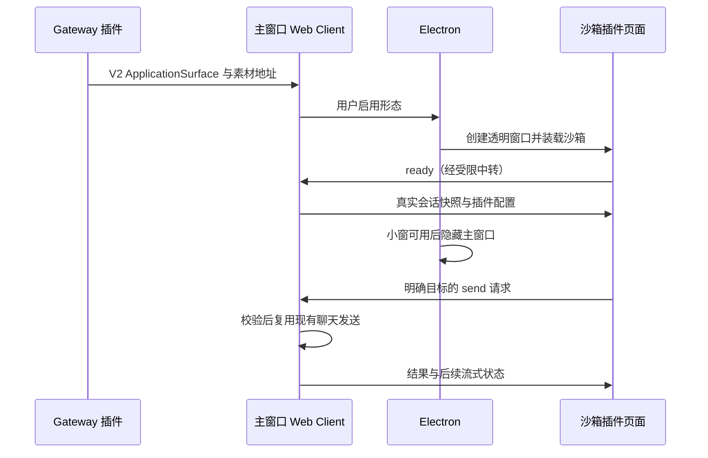

# 应用形态插件设计方案

| 项目 | 内容 |
| --- | --- |
| 建档日期 | 2026-11-09 |
| 状态 | 见[开发计划 GW-15](../designs/extensions-v2-development-plan.md)；尚未通过 DMG 原生交互和录屏验收 |
| 契约 | [应用形态](../specs/S_11_application-presentation.md)、[组件 Props](../../../../extensions_v2/docs/specs/S_17_webui-component-props.md) |
| 验收证据 | 本文集中维护本特性的详细验证记录；开发计划维护进度 |

## 背景、目标与范围

用户可以把工作台收进插件提供的桌面形态，在蜜蜂、胶囊卡片或会话终端中查看真实进度、选择会话并回复，再展开原工作台。
插件安装后通过显式入口启用形态；禁用、卸载、断开或窗口失败时，恢复仍在运行的工作台。
蜜蜂资源沿用已认可的七个透明姿态；用户可以导入自己的形象。胶囊收起时不显示输入框，多条运行会话可轮播，展开后才选择回复目标。
终端接收对话命令和消息，不执行系统 Shell。

2026-11-09 后续确认：插件默认只有蜜蜂。胶囊和终端分别交付完整资源 ZIP，显式导入后才显示设置卡片和标题栏菜单项。偏好 schema 3 迁移保留导入资源及其设置，撤去旧版两项内置资源和默认蜜蜂的图片、动态设置；不自动导入。默认蜜蜂形象与动态固定，无设置项。消息、标题、卡片和输入区 hover 均不改变任务姿态；真实输入焦点覆盖注视，失焦后恢复原任务姿态，思考任务保留托腮形象。鼠标跟随限定在蜜蜂自身区域。

## 约束与职责

2026-11-09 范围收回：完整历史和面板内问题回答、工具授权暂缓，草稿实现已单独保存。第一版保留状态、最后完整 `chat.final`、输入、发送、停止和模型切换。折叠行显示用户最后一条消息；点击正文打开应用并定位会话，箭头展开最后回复与快捷输入。Web Client 从既有 Store 读取；模型保存与工作台共用入口，停止复用现有取消流程。大回复只顺序读取当前最后正文，不维护第二套历史游标或聊天连接。形态未激活时解除 Store 订阅。Gateway / Server / Harness / Team 不增加会话业务分支。

| 模块 | 职责 |
| --- | --- |
| Gateway | 安装 Gateway 域插件，校验 `application.presentation` 与 `ApplicationSurface`，按可信连接投递声明及受管素材地址；沿用包生命周期与文件导入。 |
| Web Client | 从已有会话运行态生成可见会话快照；保留独立草稿；校验插件消息；通过现有聊天入口执行发送、选择、停止和打开工作台。 |
| Electron | 提供独立透明小窗、尺寸与位置管理、受限 IPC。小窗确认可用后才隐藏主窗口；恢复时保留原主窗口与会话运行态。 |
| 插件 | 提供 HTML/CSS/JS、蜜蜂姿态、叠卡布局、胶囊轮播、会话终端、交互方式及素材设置。 |
| Server / Agent Harness / Team | 沿用现有会话与团队路由、工具执行、问题确认；不增加桌宠分支。 |

## 关键决策与替代方案

D-01：使用专用 `ApplicationSurface` 根组件承载插件的沙箱 HTML，复用 V2 的声明、渲染和素材分发。
宿主向沙箱发布版本化的受控数据与动作协议。插件对每条提醒的布局和动画拥有完整控制，不在宿主增加固定样式的提醒列表。
原讨论中的节点级 `bindings` 是尚未交付的建议；直接扩展全部 JSON 节点会同时引入模板循环、布局、动画和客户端状态语言。
现有插件素材机制与沙箱已能承载这些展示职责，因此本方案不引入另一套表达式或模板语言。

D-02：主工作台保持挂载并继续拥有 WS、会话运行态与发送入口。小窗只承载视图，通过 Electron 中转快照和动作。
不在小窗创建第二个 Gateway 会话连接，不复制聊天实现，不让插件直接访问预加载 API、令牌、文件系统或 Node。

D-03：会话目标使用宿主发出的完整视图键，包含适用的 Team 身份。新提醒不改变选中目标，发送携带明确目标和请求标识。
宿主重新核对目标可见性和可操作性；失效目标拒绝发送，不能转发到其他会话。

## 实施与验证

### 通用窗口过渡（2026-11-09）

起始交接修正：用户在普通/最大化窗口复现收起先露底、展开先跳尺寸。
来源画面现在在插件准备前由现有原生交接面保持，反向准备先覆盖再隐藏形态窗口；
动画窗口在遮盖下调整尺寸，恢复可见后另等绘制回执，随后才隐藏工作台并开始播放。
插件动画艺术参数和无动画资源的直接切换保持原样。系统全屏入口先在来源画面遮盖下退出全屏，
再通过只读 `initialWorkArea` 和过渡 `workArea` 传递正常桌面可用区域，防止系统 Dock 显隐改变末帧位置。
原生回归 24 项、前端回归 58 项和 Vite 构建通过；原生集成夹具 10 个场景通过，
覆盖普通窗口五个拖动位置、最大化、系统全屏往返、减少动态效果及无动画胶囊。
证据位于 `dist/recall-start-verification/attempt-3/`，包含原生交接断言及连续录像，尚不记为实际安装版已验收。
随后仅将胶囊初始位置调整为当前桌面可用区域上方水平居中、距顶部 32 个逻辑像素，位置定向回归 1 项通过；
按用户要求未重新执行完整验证，最终 DMG 的安装和交互验收交给录制对话进行。

已确认按完整双向窗口收纳实现。Electron 提供当前工作台截图、实际窗口坐标、透明覆盖区域，
并在插件首帧及末帧确认后完成原生窗口交接。Web Client 仅校验和传递过渡消息，沿用原会话选择入口。
插件拥有弧形扇状流光、轨迹、拖尾、闪光与蜜蜂显现，不向宿主传递角色或光效参数。
截图仅为当前本地过渡持有，既有真实工作台保持挂载。采用显式首帧 / 完成握手，避免固定等待时间猜测动画完成。
准备、播放、关闭与过期代次统一清理，减少动态偏好直接使用原有交接路径。
接口定义见 S_11 的 AP-08；不改变 ApplicationSurface props、Gateway 校验或 Server / Harness / Team。
源码验证覆盖过渡身份、实际绘制回执、延迟布局、超时、取消、减少动态、各方向坐标和系统全屏事件往返。
收尾使用独立的原生像素交接面保持完整末帧；尺寸、移动和命中更新先在其下方结算并确认绘制，随后移除。
临时鼠标穿透在结束时恢复宿主记住的最新命中意图，不依赖指针再次移动。系统全屏在覆盖期间退出，
工作台仍可见时保留完整内容视口再隐藏，避免隐藏后改尺寸导致 macOS 截图一直等待；展开恢复原系统全屏，随后退出全屏也保持原普通窗口尺寸。
源码验证：前端 50 项、原生窗口 19 项通过；隔离 Vite 生产构建通过，未运行格式化或静态检查。
真实 Electron 夹具的 9 个场景通过：普通截图收纳/展开、四角和中央、最大化、系统全屏与减少动态。
检查透明区域、目标屏幕坐标、末帧位置、隐藏视口尺寸与全屏退出后的原尺寸。帧时序的 p95 为 9.0–9.3 ms，
一次普通窗口样本含 150 ms 间隔，其余场景最大约 9.4 ms；该记录不代表任意设备都能保持固定帧率。
完整安装实例 `dist/recall-final/WorkSwarm.app` 中实际安装 1.7.3 后，普通/系统全屏双向切换、物理点击新建按钮、
输入框 focus 和退出全屏后的原生窗口按钮均通过 CUA 复验。验证保留原真实工作台与会话，没有发送新的模型任务。
原生夹具记录位于 `dist/recall-transition-verification/native-integration.json`。Windows/Linux 未做原生操作验收。

先维护 S_17 和形态契约，再同步 Gateway 校验、前端目录、原生窗口、示例包与中英文说明。
检查正常、非法消息、跨窗口身份、并行工具、Team 目标、草稿隔离、重复发送、失效会话、断线、卸载、渲染失败及恢复。
在真实构建的 DMG 中安装插件并操作真实模型与工具，录制安装、三形态切换、回复、恢复工作台及卸载过程。
录屏保留原片、无字幕底片、SRT、独立样式和成片，不以原型或模拟响应代替产品验收。

## 验证记录与已知遗留

- 2026-11-09：读取原对话，核对当前分支为 `feat/webui-extensions-6047`，工作区起始无未提交修改。
- 2026-11-09：Gateway 渲染与形态定向测试 347 项、WebUI 组件 374 项、契约 167 项、基础协议 14 项、形态协议及宿主 8 项、窗口管理 5 项通过。
- Gateway 扩展完整模块 668 项通过；Electron 全套 85 项通过、4 项因平台条件跳过。
- Team 会话套件 84 项通过、5 项失败。失败均为既有 `fetchSessionMetadata` 提取测试未注入 `browserClientCapabilities`；该生产回调与 HEAD 完全相同。本次新增的明确 Team 发送及 Owner / Team 停止路由用例通过，不能把整套记为通过。
- 形态宿主回归覆盖：小窗就绪前消息等待原生回执、过期代次拒绝、重复写入去重、发送等待期间的新草稿保留、未确认发送保留草稿、目标删除后不切换到其他会话。
- 已实现槽位、窗口、受控桥接、会话视图定向与插件三种页面；生产前端使用 `ELECTRON=true npm exec vite build` 构建通过。按本地约束未运行格式化、静态检查或 `tsc`。
- 完整 DMG 已构建并从只读镜像启动，使用冻结后端，不是前端壳。真实后端 API 验证通过：导入 ZIP、`ui.ready`、受管 HTML 与七张 PNG 返回 200、卸载成功、旧代次素材返回 404。此记录只证明后端集成，不能替代原生操作、模型工具交互与视频。
- 原生操作工具报告 Mac 锁屏且无法自动解锁；文件选择、浮窗操作及录屏尚未完成。交付目录为 `~/Desktop/应用形态插件验证-20261109`，其中测试包尚不代表完整验收。
- DMG 使用独立 `JIUWENSWARM_DATA_DIR`、桌面 profile 与明确指定的 `JIUWENSWARM_RUNTIME_SOCKET` 验证；窗口启动预检同步采用该已存在的工作区配置，避免读取其他工作区的 Gateway 锁。

### 完整 DMG 的构建前置修正

本机 Swift 6.1.2 在原有 Computer Use 原生代码中拒绝局部函数跨隔离域的推断。
将这些局部校验函数写为显式 `@MainActor` 类型的闭包，并给调用它们的回调参数标明同一 actor；
对象比较改为等价的显式遍历。未关闭并发检查，未增加 `unchecked Sendable`。
`swift build -c release` 通过；随后完整构建中的冻结资源验证（含 Computer Use）通过。
这些改动属于构建前置修正，不承载插件视觉、会话动作或桌面形态逻辑。

最早的 Gateway API 冒烟验证使用独立数据与 profile，但 Runtime Worker 仍采用默认公共地址；未发送模型对话。录制实例已改为明确的独立套接字，避免与原有常驻 Worker 混用。

### 原生 DMG 首轮发现与修正

- 原生文件选择器成功导入 ZIP，扩展中心显示导入成功及应用形态卡片；安装后入口未自动出现。核实 Web 管理入口遗漏 `extensions.v2.installed` 通知，已与本机 CLI 共用释放完成后的通知函数，覆盖 import、install、reload；新增四项回归修复前均失败，修复后 Gateway 扩展 672 项通过。通知失败以 `ui_notified=false` 返回，保留已确认安装结果。
- 形态窗口从应用入口启动，不继承当前会话的深层路径，避免 Electron 相对资源在会话路由下解析错误；原生窗口用例明确覆盖当前工作台位于 `/chat/session/...` 的情况。
- 首轮安装原片保留为交付目录 `video/evidence/initial-install-before-fix.mov`，仅供问题追溯；最终验收与演示须使用修正后重新构建的 DMG。

- 追加窗口代次回归：旧窗口的 workspace 请求等待会话恢复期间，新窗口已启用时，旧请求不再关闭新窗口；异步选择和新建发送的界面选中状态也受原代次限制。形态协议及宿主 8 项通过。

- 真实浮窗可打开及展开回复卡片；在浮窗启用期间，通过当前隔离实例的正式本机 CLI 卸载包，工作台自动恢复且入口消失（`video/evidence/uninstall-active.json`）。
- 原生复验发现工作台富文本输入框未随形态草稿更新而显示文字：形态桥接复用既有 `chat-input-sync` 接口，同时同步草稿写入和已确认发送后的清空，不在插件复制编辑器。
- 完整 Electron 构建由 HTTP SPA 服务承载，资源基址改为 `/`；显式 `--frontend-only` / `-FrontendOnly` 文件模式构建继续使用 `./`。两种构建由部署模式明确区分，修复深层会话路由刷新时的相对资源解析问题；两端构建脚本同步传递模式。原生入口对 HTTP 和 file 部署分别定位应用根与实际索引文件，新增文件模式窗口回归。Windows 脚本未在 Windows 上执行。

- 真实模型 GLM-5.3 从蜜蜂卡片发送新会话，读取 monthly.csv、实际执行计算并生成 monthly-report.md；界面回报收入 250860、成本 139440、利润 111420，与独立计算一致。任务用时 54.44 秒。工作台与卡片之间的草稿保留、成功发送后清空已在原生界面复验。
- 流式更新下，原示例重建 select 选项和通知按钮会干扰点击与下拉选择。改为按完整会话键进行 DOM 节点协调，保留身份、只更新变化内容、准确处理增删与重排；新增两项插件页面回归，形态协议 / 宿主 / 插件共 10 项通过。修正前录制保留在 video/evidence/before-interaction-reconciliation.mov，最终演示将使用修正后的 ZIP。

### 2026-11-09 用户确认的设置与资源交互

- 形态切换和资源导入放进应用设置页，参照主题插件的设置贡献。保存只更新资源与偏好，不立即收起工作台。
- 进入入口放在 WorkSwarm 原生窗口标题栏所在位置。Electron 用保留原生窗口控制的自定义标题栏，Web Client 提供统一“切换应用形态”菜单；插件通过列表槽位发布候选，不按插件名称或资源类型写宿主分支。
- 导入对象为完整前端形态包：界面、交互、素材及设置定义，格式由应用形态插件维护（RESOURCE_FORMAT.md）。支持每个资源独立设置，例如胶囊深色/浅色。Gateway、Server、Harness 和 Team 不解释该资源格式。
- 胶囊采用视觉对话 `01a1befd-c7c2-7030-8552-a49e1922412a` 中的风琴稿：三条一页、单项展开、滚动翻页，替换早期白色单卡方案。
- 单元验证：Gateway 676 项通过；新增完整包导入、独立改色、重新挂载、移除候选的真实运行时链路；资源路径、符号链接、重复 ID、完整素材和设置隔离边界 11 项通过。组件 373 项、契约 167 项通过；新增输入、选项及导入按钮随语言变化的验证。
- 新版完整 DMG 已构建；冻结包内 Gateway/AgentServer 组件规则和槽位常量与当前源代码的编译结果一致。最新前端通过直接 Vite 构建。标题栏与资源管理的原生验收、最终视频仍在进行中，旧录屏不代表这个新交互已验收。

### 胶囊位置与项目会话复测修正

- 旧版胶囊切换 132/330/650 高度时，原生窗口右下角定位与插件内容顶部定位混用，导致点击展开后整体跳动。1.0.1 将胶囊声明为固定 400×650 的透明画布，总胶囊和首条会话胶囊在相同位置展开；普通展开、收起不再改变原生窗口尺寸，透明空白继续点击穿透。原生截图验证总胶囊、列表和内容展开保持同一坐标。
- 统一设置卡片的素材展示高度；素材保持原图并通过既有 Image.fit 呈现。
- 小窗会话目录同时订阅已有普通会话、工作区项目会话、置顶会话和当前会话；项目内选择复用其真实元数据进入已有恢复流程。新增用例覆盖项目／置顶会话可见、独立草稿和目标移除后拒绝发送，形态用例共 13 项通过。
- 修正后的源码和插件 ZIP 为 1.0.1；旧版问题录屏保留为证据，不用于最终交付演示。

### 原图蜜蜂动效与并行分支变化

- 按设计对话同步原七姿态的连续网格与注视优先级，使用显式控制点网和标准薄板样条插值；没有重新生成或拼装身体部件。卡片／输入焦点按实际 DOM 位置选择抬头姿态；焦点保留时不会改看移走的鼠标，离开后恢复真实任务姿态。内置动作可暂停并遵守减少动态偏好。
- 形态前端 15 项通过，包括所有网格控制点的插值残差、形变参数范围内三角形方向检查与实际控制器的注意力优先级。资源偏好采用 schemaVersion=1，对此前仅有 image 的内置蜜蜂设置作明确版本迁移。
- 当前工作分支在本任务期间新增了其他对话的提交 443343df4（插件启停）及 68f4da1d0（设置菜单调整）。保留这些变更。新增启停代码读取 Core Manifest.enable，而当前环境的 Core Manifest 没有此属性，导致源码包安装测试在插件加载前失败。之前的 Gateway 676 项结果和冻结 DMG 属于该并行提交之前的验证状态；不得当作当前分支全绿。真实 DMG 使用已核对的冻结代码与依赖继续验收，当前源码依赖差异单独记录。

### 2026-11-09 交付范围收敛为应用形态能力

- 按用户要求，插件交付不包含既有打包问题的修复。Swift 编译兼容提交 0dd509bee 已由 399a66a4c 撤销，十个 Swift 文件恢复为修复前内容。
- 撤出 Electron 配置、日志及诊断目录的隔离调整，撤出 Vite 资源基址及对应构建模式环境变量调整。保留形态窗口模块的打包复制与必需文件登记，这是新增能力的安装接入。
- 此前使用上述通用修复构建的 DMG 仅保留为历史验证证据；不表示收敛后的当前源码已完成完整打包验收。既有构建问题单独记录，不在本插件任务中修改或迁移 CUA。
- 收敛后定向运行 `node --test tests/electron/application_presentation.test.cjs`：六项通过；未重新执行完整 DMG 构建。

### 最终默认资源与姿态修正

- 插件 1.3.1 默认只有固定蜜蜂，无图片或动态设置；胶囊与终端分别提供完整 ZIP，通过设置页显式导入后才发布候选。偏好 schema 3 明确迁移旧版默认项，保留导入资源及其设置。资源与迁移边界 17 项通过。
- 输入焦点使用原 idle 图的连续瞳孔变形，双手自然放下；思考保留原 thinking 托腮图、轻微歪头及游离视线。所有 hover 都不触发输入关注，失焦恢复任务。新的输入网格包络覆盖 -10.7～-5.3 的纵向瞳孔位移，全部三角形保持方向。
- 原生复测发现当前会话优先合并会导致被点击胶囊跳到列表首位。合并改为保留规范列表的原位置，再以当前元数据更新同 ID 项；新增真实 Host 回归，选择会话不改变列表顺序。形态宿主、插件和网格 17 项通过；生产 Vite 构建通过。
- 两个同时运行的真实 GLM-5.3 任务分别生成 inventory-report.md 和 milestone-report.md，结果与独立计算一致：48 件、2830；计划 20 天、实际 24 天、超期 4 天和 20%。
- 打包中发现只更新 Electron 目录不足以更新 HTTP 提供的页面。最终包同时同步 app/dist 与 backend/_internal/jiuwenswarm/channels/web/frontend/dist；对挂载镜像逐文件比对两份各 254 个资源。早期录制均保留在 video/evidence，最终录制使用修正后的镜像。
- 上述阶段精简卡片尚在审阅；用户随后明确确认 compact-bee-card.html，最终产品按该稿替换，见后续记录。

### 已确认精简卡片与最终素材

- 用户确认最新 compact-bee-card.html。插件 1.4.0 卡片仅保留标题、可选的三行最近回复、单行输入；标题 details 菜单提供真实会话、工作台和运行时停止操作，支持方向键、Home/End、Escape。没有回复时不显示空白内容占位，常态状态与重复目标均隐藏。
- 输入关注使用独立 bee-looking-up-v1.png 及专属控制网；保留原七姿态素材，不使用 idle 别名或额外纵向瞳孔位移代替抬头图。原图字节未重绘，思考保持托腮和轻微歪头。八组控制网均通过完整形变包络方向检查。
- 会话恢复会更新按活动排序的宿主项目数据。因此胶囊相对顺序作为插件窗口内的明确视图状态，以完整会话键维护：现有条目保留位置，新条目追加，删除移除；每个新窗口重新初始化。没有改写宿主任务排序、状态或发送目标。回归覆盖宿主数据反向重排时卡片、焦点与草稿身份仍保持。
- 最新形态、插件和网格 18 项通过；资源及迁移边界 17 项通过。真实 DMG 的最终界面与视频验收仍在进行。

### 用户最终简化分页交互

- 按用户确认取消滚动翻页，移除“滚动翻页”中英文提示。上一页、下一页按钮同步切换当前页，其他页 hidden/inert，不参与布局。
- 移除展开列表的装饰叠层、固定滚动视口、滚动坐标、布局测量与观察器；列表高度由当前页内容自然决定。仅收起成单个胶囊时保留叠层，回复内容仍可独立滚动。
- 保留选择请求的视图修订号校验：等待响应期间翻页、总收起或 Escape 后，迟到结果只更新会话选择，不恢复旧展开动作。

最近一轮显示：展开后显示最近用户消息与最后公开回复全文，共用可滚动区域。发送按钮运行时切换为方形停止按钮。蜜蜂箭头展开或折叠为单行消息与状态；独立关闭按钮只隐藏面板，点击蜜蜂重新打开。窗口画布不随展开/折叠改变尺寸。

最新范围（取代前文三形态描述）：终端实验已暂存，不再发布资源包。第一版保留默认蜜蜂与导入的胶囊。胶囊会话行复用应用会话标题，点击只展开/收起；展开面板标题只切换桌面会话，独立工作台按钮才打开应用。正文展示带角色头像和颜色的最近用户消息与最终回复。蜜蜂采用下述三层入口交互。

### 蜜蜂三层会话入口（当前交互）

- 完全收起只显示蜜蜂和右侧操作：新建固定在右侧，运行数量固定在右上方；空闲时仅隐藏数量，不移动新建按钮。角色及操作按钮共同构成插件的可见拖动锚点。
- 点击蜜蜂或数量显示列表：运行会话三条一页，按钮翻页；无运行时显示最近三条及查看全部入口。行内容为应用保存的会话标题与真实状态；点击行在桌宠中打开对应面板，标题选择器选中该会话。完成任务不会收起或切换正在查看的面板。
- 新建入口选择既有 `new` 会话目标，只在第一次发送时复用宿主原有创建流程。收起箭头回到列表，关闭按钮完全收起；Escape 逐层收起，标题菜单自行处理 Escape。
- 布局、计数、分页、排序和面板交互都在插件内。用户明确同意宿主仅新增 `lastUserMessageAt` 只读元数据；按 S_11 归一化来源时间，宿主不决定最近三条。未知时间不参与最近排序，不用置顶顺序或当前时间猜测。
- `applicationFormsPlugin.test.mjs` 覆盖三层展开、计数、相邻按钮位置、运行分页、最近排序、新建后目标绑定、延迟选择、失败可见及中英文。会话元数据投影测试验证时间透传与宿主原有目录顺序保留。
- 使用实际插件资产进行 Chrome 源码验证，提供明确标记的测试会话及固定原生窗口几何适配；确认九条分页、选中目标、完成后保持面板、最近三条、新建面板及独立长回复滚动。该验证不等同于真实 DMG 或真实模型交互验收。
- 本轮执行 `npm run test:application-presentation`：50 项通过。包含宿主投影、插件交互、原图网格和受控过渡回归；新增选择失败可见、关闭后迟到失败不能重新打开列表的检查。插件 ZIP 已核对关键资产与源码一致。最近会话能力需要同步包含只读时间字段的宿主前端；本侧对话没有更新运行中的 DMG。

## 2026-11-09 入口与空会话高度调整

用户撤回自定义标题栏入口：桌面程序恢复原生窗口标题栏，Web Client 在工作台右下角用悬浮按钮提供形态菜单。移除 DesktopChrome 及其 preload 标题栏描述，不改窗口控制和过渡协议。插件设置页与中英文说明同步入口位置。

胶囊空会话按实际固定控件高度计算展开空间，并满足会话行的 CSS 最小高度；有消息时继续使用受限的回复阅读区。避免新建时按有回复的高度预留空白。源码和布局验证通过后，使用更新的前端、原生壳和资源包进行实机验收。

## 2026-11-09 完成表情回到待命

默认蜜蜂只在当前选中会话的同一轮输入由运行转为完成时庆祝 3 秒，然后恢复待命表情。历史会话首次加载、切换到已完成会话和重复状态刷新不触发或延长庆祝；切换会话、新一轮运行、停止及页面退出清理原计时器。会话的已完成状态文字和最终回复不随表情计时改变。

该逻辑完全属于插件展示状态，不增加宿主协议或设置项。回归验证覆盖工具动作、3 秒边界、重复刷新、历史切换、输入身份变化、停止及销毁清理；真实安装版验收与录屏另记在交付目录。

实机发现胶囊会话内部仍被旧的独立卡片 `max-height` 规则限制，导致回复被压缩、外层预留空间空置。移除该过时规则，由风琴容器统一分配阅读区高度；空会话仍按固定控件自然高度展开。

本版每次进入时，插件依据当前屏幕可用区域初始化可见锚点：蜜蜂在右下角（右侧留 24px、底部留 32px），胶囊在正中间。展开、折叠和状态刷新保留本次拖动位置；新视图重新初始化，不保存跨次位置。复用既有 `move`、`resize`，宿主不加入形态专属坐标策略。

胶囊展开会替换收起锚点，因此整张卡片使用完整屏幕可用高度，并在屏幕内平移容纳；不以锚点上、下半屏之一限制阅读区。蜜蜂面板仍避开可见角色。几何回归覆盖居中胶囊、超过屏幕高度的内容和负坐标显示器。
