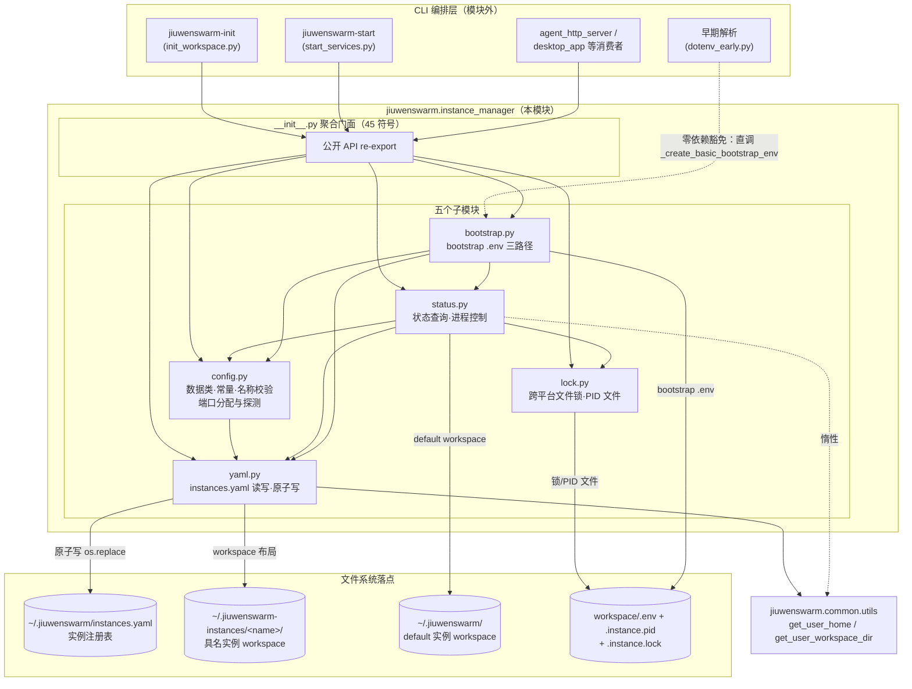
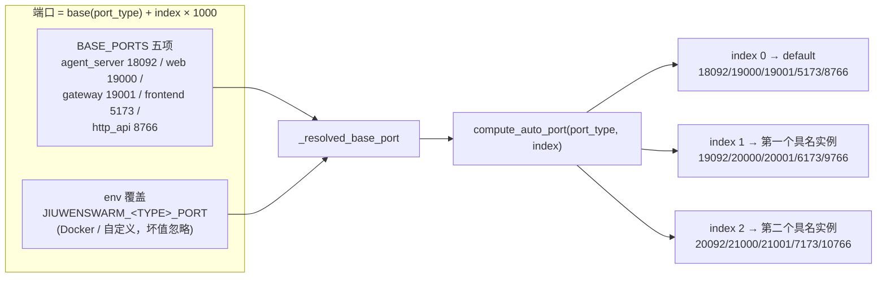
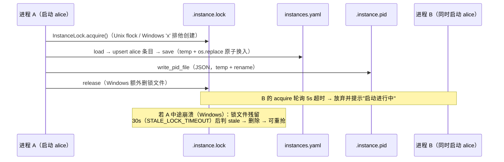
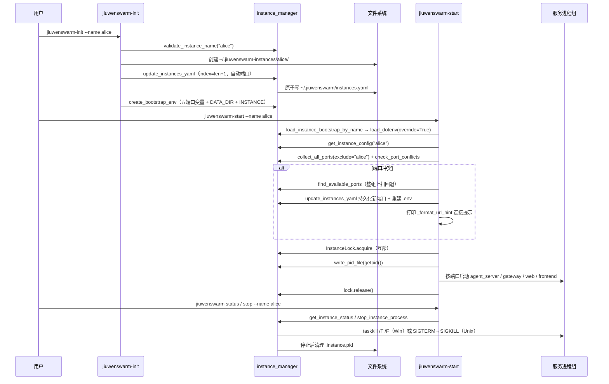

# instance_manager 架构文档

> 面向**理解系统**的架构叙事：模块为什么这样设计、整体如何运转。改代码前必读的
> 契约 / 不变量 / 检查单在 `../specs/`（S_01–S_07）。本文与 specs 双向同步：契约变化
> 影响叙事准确性时一并刷新。

## 1. 设计目标

多实例隔离（multi-instance isolation）——让一台机器上可以并存多个 jiuwenswarm 实例
（一个无名的 default + N 个具名实例），互不串端口、互不串数据目录、互不串进程身份：

1. **端口不撞**：每个实例一组独占端口；启动前探测 + 冲突回退，宁可换端口不可崩服务。
2. **数据不串**：每个实例独立 workspace（数据根），进程环境变量（bootstrap .env）钉死
   数据目录与端口。
3. **并发安全**：两个进程同时启动 / 停止同一实例时不产生双属主或损坏的注册表。
4. **跨平台**：Windows 与 Unix 双路径等价（锁、进程探测、进程停止）。
5. **向后兼容**：default 实例（无 --name 的历史用法）行为不变；环境变量覆盖可选。

本模块是**纯工具层**：不启动服务、不监听端口、不持有常驻状态。编排者是
`jiuwenswarm-start`（start_services.py），本包向它输出原子能力。

## 2. 架构总览

分层要点：

- **调用方向单向向下**：CLI 层 → 聚合门面 → 五子模块 → （仅）common.utils 两个路径
  函数。五子模块内部依赖也保持偏序：config 是叶子（yaml/status/bootstrap 都依赖它），
  lock 只依赖 config，status 聚合前三者，bootstrap 最上层。
- **唯一反向豁免**：早期解析（dotenv_early）绕过门面直调 bootstrap 的私有早期函数——
  因为它运行在任何 jiuwenswarm import 之前（[[S_01]] N2 / [[S_07]] N3）。

## 3. 核心机制

### 3.1 端口分配：千位段平移

index 来自 instances.yaml 的**声明顺序**（从 1 起）。千位段平移保证同 index 五端口
整体搬移、跨实例零交叠。冲突时 `find_available_ports` 向上扫连续 index 做**整组**
回退（5 端口全可用才换组），避免只回退一半端口造成新的撕裂冲突。

### 3.2 端口探测：bind+listen，而非 connect

探测复刻真实服务获取端口的方式：`bind()` + `listen(1)` 后立刻关闭，**不设
SO_REUSEADDR**。两起历史事故决定了这个选择：

- connect 探测把"活着但不 accept 的僵死监听"判成可用 → 回退选中死端口 → 真服务
  bind 时崩 `OSError 10048`；
- SO_REUSEADDR 在 Windows 允许多 socket 绑同一端口 → 探测形同虚设。

另外：IPv4 回环探测通过后补探 `[::1]`（Vite 常只听 IPv6 回环）；地址族不可用
（IPv6 被禁等）不误判为占用。

### 3.3 并发安全：锁 + 原子写双层防线

两层防线分工：**锁**消灭"读-改-写交错丢更新"（每实例串行化）；**原子写**消灭"读到
半写文件"（即使锁被绕过，文件也永不损坏）。PID 文件同样原子写，且读取宽容（损坏 =
无凭证，不抛错）。

### 3.4 状态判定：两条路径

- **具名实例**：只认 PID 文件 + 进程存活（[[S_06]] N1）。端口曾被整组回退，端口占用
  不能证明"是它在跑"。
- **default 实例**：PID 文件优先；没有 PID 文件时（兼容历史启动方式）按
  agent_server / gateway / frontend 三端口占用反推 running，并经 netstat/lsof 反查
  PID。代价是可能误报（无关进程占了 default 端口），换来对无 PID 管理历史进程的
  可见性。

## 4. 端到端时序：具名实例的一生

## 5. 关键设计决策表

| # | 决策 | 备选方案（被拒绝原因） | 依据 |
|---|---|---|---|
| D1 | 端口 = base + index×1000，index 取 yaml 声明顺序 | 随机端口（不可复现、防火墙不友好）；哈希映射（易撞需二次探测） | [[S_03]] N1/N2 |
| D2 | 端口探测用 bind+listen、不设 SO_REUSEADDR | connect 探测（漏判僵死监听，10048 事故根因）；SO_REUSEADDR（Windows 掩盖占用） | [[S_03]] N4 |
| D3 | IPv4 回环探测后补探 ::1 | 只探 IPv4（Vite 仅听 [::1] 时误报可用） | [[S_03]] N5 |
| D4 | 冲突回退按整组（5 端口）扫描 | 逐端口独立回退（撕裂：同实例端口散落不同千位段，反查/防火墙/心智负担） | [[S_03]] N7 |
| D5 | instances.yaml 原子写（temp + os.replace） | 直接 write（并发读者会看到半写 YAML） | [[S_04]] N3 |
| D6 | 每实例文件锁（flock / 'x' 创建 + 30s stale 回收） | 无锁（并发启动丢 yaml 更新、双 PID 属主）；中央锁服务（过度设计） | [[S_05]] N2/N7 |
| D7 | PID 文件 JSON 三字段，读取宽容 | 纯文本单行 PID（无 started_at/name 佐证）；损坏即抛错（凭证不是账本，fail-open） | [[S_05]] N5 |
| D8 | default 实例不进 yaml，状态按端口探测兜底 | 把 default 也写进 yaml（破坏"无 --name 一切照旧"的兼容承诺） | [[S_02]] N3 / [[S_06]] N2 |
| D9 | 具名实例状态只认 PID 文件 | 端口探测（整组回退后端口≠身份，会误判） | [[S_06]] N1 |
| D10 | bootstrap .env 用 load_dotenv(override=True) | 默认不覆盖（父 shell 同名变量会让实例串端口/数据目录） | [[S_07]] N6 |
| D11 | 早期兜底路径零 jiuwenswarm 依赖、静态 base、四变量 | 复用 config 计算（早期阶段任何 import 都会拉起完整依赖树，破坏启动性能与隔离） | [[S_07]] N3/N4 |
| D12 | base 端口支持 env 覆盖但坏值静默忽略 | 覆盖即校验报错（一个 typo 弄坏启动，得不偿失） | [[S_03]] N3 |
| D13 | http_api 端口参与分配且必须下发 .env | 只分配不下发（实例预留了端口却收不到，开 HTTP 时回落 8766 隐性撞车） | [[S_03]] N8 |
| D14 | 聚合门面 `__init__` 导出 45 符号（本包特例） | common 式空 `__init__`（instance_manager 是终端工具包、无重初始化副作用，聚合降低消费方摩擦） | [[S_01]] N3 |

## 6. 公开 API 面

`__init__.py` 聚合导出 45 个符号，按域分组（完整清单见
[`../AGENTS.md`](../../AGENTS.md) 的「公开入口」）：

| 域 | 数量 | 代表符号 |
|---|---|---|
| 数据类 | 3 | InstanceConfig / InstanceStatus / InstancesYamlError |
| 常量 | 7 | BASE_PORTS / PORT_TYPES / RESERVED_NAMES / LOCK_FILENAME / STALE_LOCK_TIMEOUT … |
| 名称校验 | 2 | validate_instance_name / is_valid_instance_name |
| 端口管理 | 8 | compute_auto_port / is_port_available / find_available_ports / PORT_ENV_NAMES … |
| yaml 管理 | 8 | load_instances_yaml / save_instances_yaml / update_instances_yaml / get_instance_index … |
| 锁与 PID | 6 | InstanceLock / write_pid_file / read_pid_file / is_process_alive … |
| 状态查询 | 6 | get_instance_status / get_default_instance_status / list_all_instances … |
| 进程控制 | 2 | stop_process_by_pid / stop_instance_process |
| bootstrap | 3 | create_bootstrap_env / load_instance_bootstrap_by_name … |

受控私有豁免（包外/跨模块消费，登记于 [[S_01]] N4）：`_upsert_env_ports`（default 实例
端口持久化进 `~/.jiuwenswarm/config/.env`）、`_create_basic_bootstrap_env`（早期零依赖
兜底）、`_get_system_executable`（System32 优先的可执行文件解析）。

## 7. 与外部的关系

- **向上**：start_services（编排） / init_workspace（创建） / dotenv_early（早期解析）/
  agent_http_server / desktop_app 五个消费面（[[S_01]] 消费者全景）。
- **向下**：仅 common.utils 的 `get_user_home` / `get_user_workspace_dir`；三方依赖
  PyYAML / python-dotenv。
- **同级**：与 server / gateway / channels 无任何 import 关系——它们只通过环境变量
  （bootstrap .env 注入的 DATA_DIR / 端口变量）间接受益于本模块。

## 8. 维护指引

- 修改任何契约（端口公式 / yaml 形状 / 锁语义 / .env 形状）→ 先改对应 spec 再动代码，
  并同步本文的图与决策表（见模块 `AGENTS.md`「设计文档归档与双向同步」）。
- 新增机制先问：它属于哪个子模块的职责边界？放不进任何一个 = 先扩 spec 再落码。
