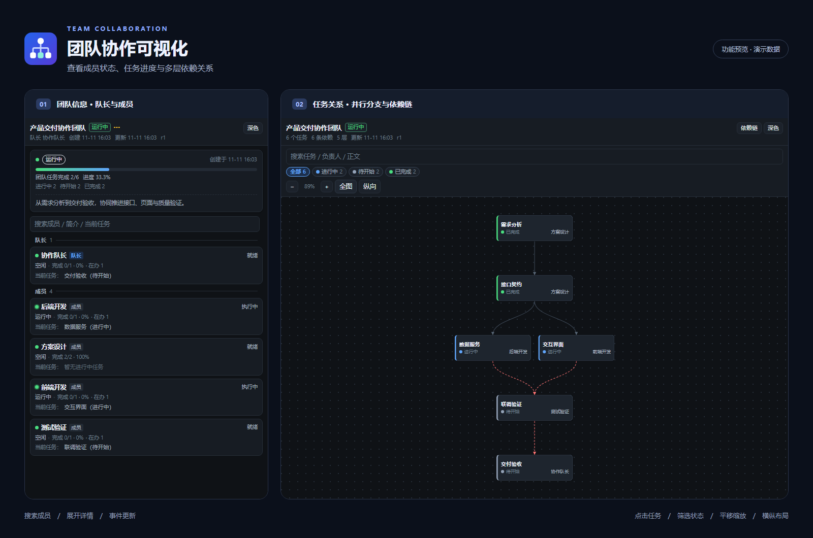

# 团队协作可视化

在当前会话的右侧面板查看团队成员、任务进度与依赖关系，跟踪多智能体协作过程。

## 功能

- **团队信息** — 查看团队简介、整体进度，以及分区展示的队长和成员。
- **成员详情** — 搜索成员，展开查看角色、状态、简介和关联任务。
- **任务关系** — 以带箭头的依赖图展示任务先后关系和并行分支，点击任务查看内容、负责人及前后置任务。
- **画布交互** — 按任务状态筛选，聚焦依赖链，拖动画布、缩放、显示全图，并切换横向或纵向布局。
- **事件更新** — 收到团队、成员或任务事件后刷新数据，已打开的页面同步更新。

## 生效机制

- 启用后进入已有团队的会话，在右侧打开「团队信息」和「任务关系」。如果页签尚未出现，可在扩展详情中点击「重新加载」。
- 插件响应 `ui.ready` 构建页面，订阅 `team.monitor_event`，通过公开的 `ops.team` 读取团队、成员、任务和依赖。
- 默认命名的历史团队可以根据当前会话恢复；自定义队名需要已经记录的会话绑定。没有团队的会话显示空态。
- 读取失败时保留上次成功的数据，并提示数据过期。成员状态和任务进度以宿主提供的数据为准，缺少生命周期事件时团队状态可能为推导值。
- 页面资源随插件交付，由本机服务承载。展开项、搜索和画布位置暂存在进程内，重启后恢复默认视图。

## 优势

- 在会话旁边定位负责人与当前任务，减少在消息记录中反复查找。
- 通过依赖图识别前置任务、并行分支和阻塞位置。
- 在团队结束后回看默认命名会话的成员与任务记录。

## 预览

预览使用演示数据，展示插件现有的两个页面及其交互入口。

安装、数据口径、已知限制及开发验证见 [开发说明](docs/development.md)。
