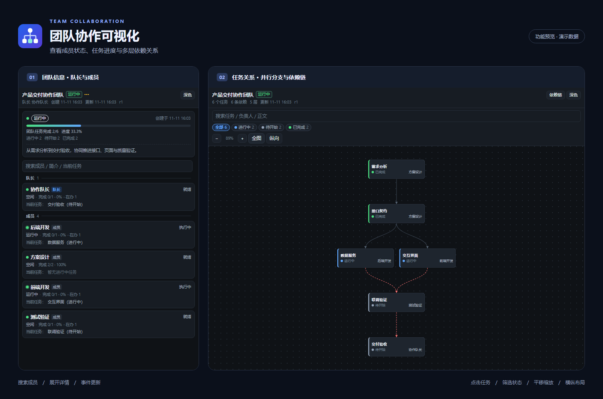

# Team Collaboration

Inspect team members, task progress and dependencies in the current session's right panel to follow multi-agent collaboration.

## Features

- **Team Info** — View the team description, overall progress, and separate leader and member sections.
- **Member details** — Search and expand members to inspect their roles, statuses, descriptions and assigned tasks.
- **Task Graph** — Follow arrowed dependencies and parallel branches. Select a task to inspect its content, assignee, upstream and downstream tasks.
- **Canvas controls** — Filter task statuses, focus dependency chains, pan, zoom, fit the graph, and switch between horizontal and vertical layouts.
- **Event updates** — Team, member and task events refresh the data in open views.

## How it works

- Enable the extension, open a session with an existing team, and select Team Info or Task Graph in the right panel. If the tabs are missing, click Reload in the extension details.
- The extension responds to `ui.ready`, subscribes to `team.monitor_event`, and reads teams, members, tasks and dependencies through public `ops.team` methods.
- Historical teams with default names can be restored using the current session. Custom names require a previously recorded session binding. Sessions without a team display an empty state.
- Read failures retain the last successful data and show a stale-data notice. Member status and progress follow host-provided data; team status may be derived when lifecycle events are unavailable.
- Page resources are bundled and served locally. Expansion, search and canvas settings are held in process memory and reset after a restart.

## Benefits

- Find assignees and their current tasks beside the conversation.
- Identify prerequisites, parallel branches and blockers in the dependency graph.
- Review member and task records in historical sessions with default team names.

## Preview

The preview uses demo data to show the extension's existing views and controls.

See the [development notes](docs/development.md) (Chinese) for installation, data semantics, limitations and verification.
