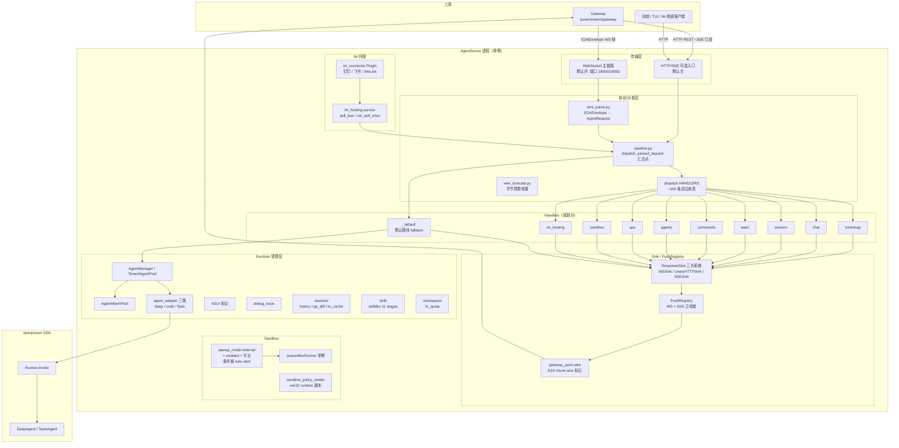
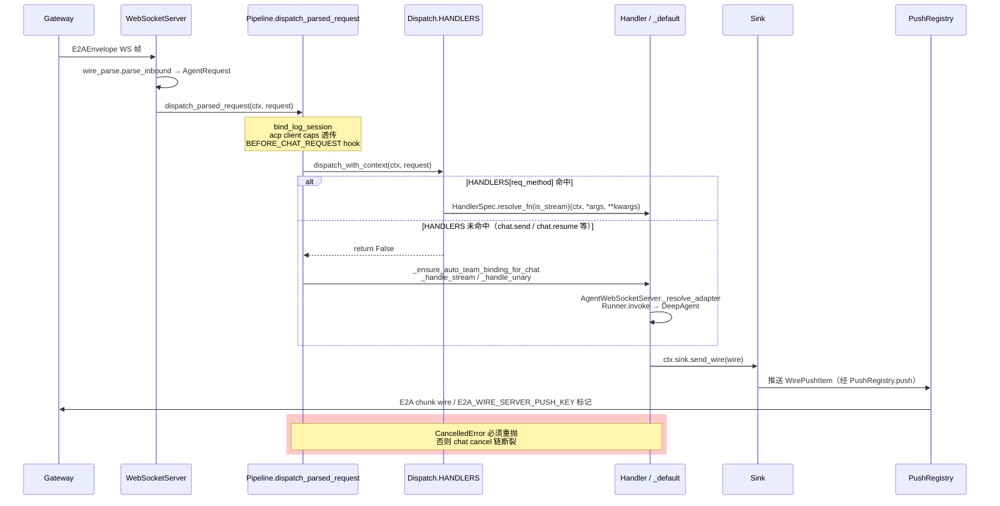
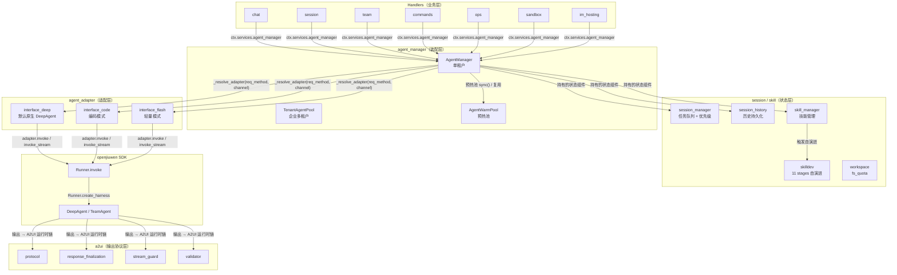
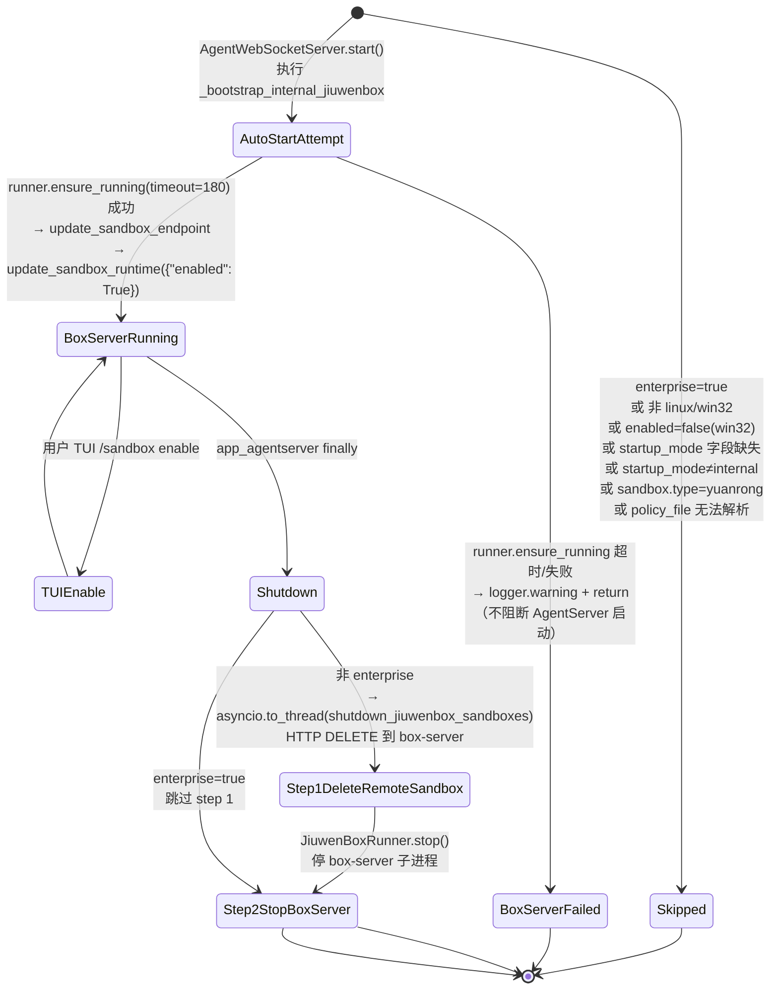
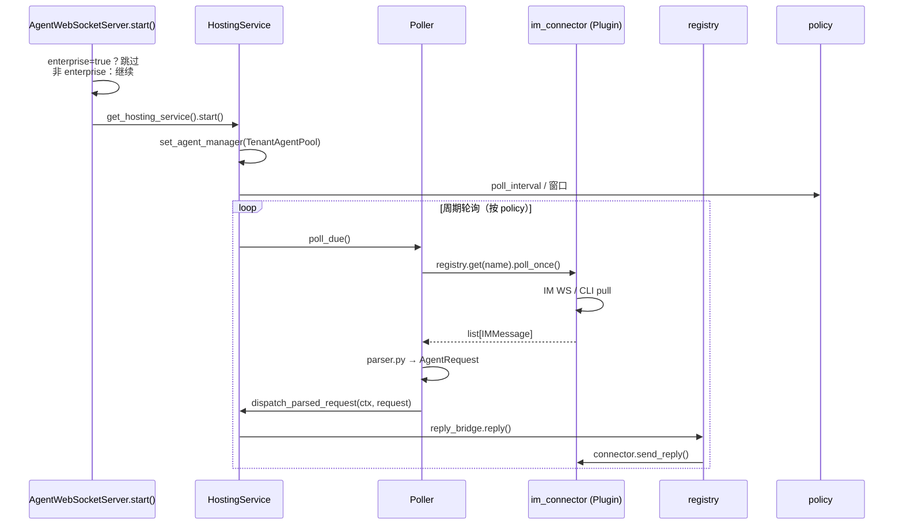
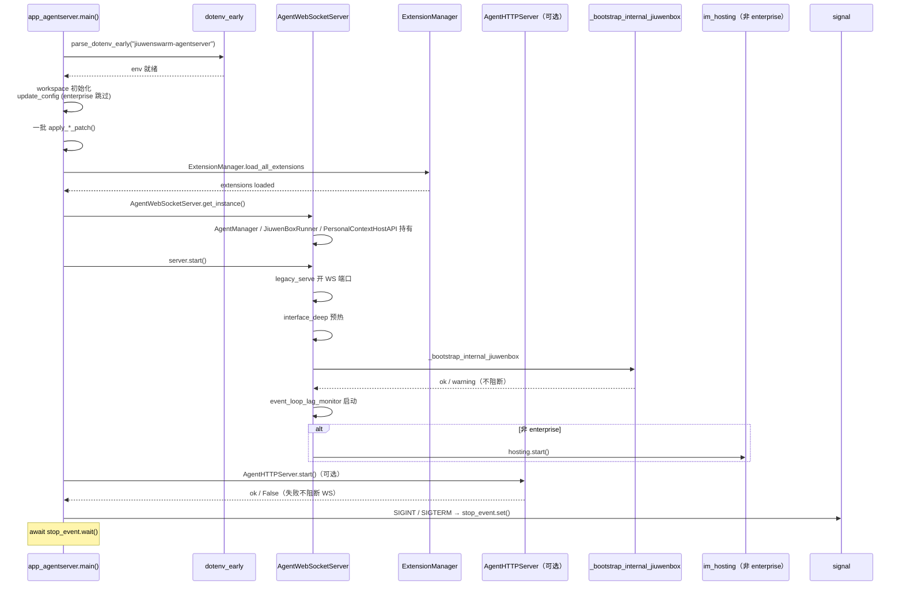

# AgentServer 架构文档

## 概述

本文档用 mermaid 图与设计决策表描述 `jiuwenswarm.server` 的整体架构、请求处理流、runtime 分层与 sandbox 生命周期。与 `server_overview.md`（特性/功能叙事）互补，本文聚焦**分层关系、数据流方向、不变量**。

---

## 架构总览

---

## 请求处理数据流

### WS / HTTP 汇合点

---

## Runtime 分层

**分层方向**：Handler（业务）→ agent_manager（装配）→ agent_adapter（适配）→ openjiuwen SDK（底层）。状态层（session / skill）由 agent_manager 持有，不被 handler 直接触碰（handler 经 `ctx.services.agent_manager` 间接访问）。a2ui 是输出协议层，插在 openjiuwen SDK 的 invoke 输出与 sink 之间。

---

## Sandbox 生命周期

---

## IM 托管生命周期

---

## 进程启动序（AgentServer.main → _run）

---

## 设计决策表

| # | 决策 | 方案 | 拒绝的方案 | 理由 |
|---|---|---|---|---|
| D1 | AgentServer 进程定位 | Gateway 的下游 Agent 运行时，独立进程 | 与 Gateway 同进程合并 | **保持进程级隔离**：AgentServer 崩溃不拖垮 Gateway；Gateway 可独立扩展为多 AgentServer 后端（负载均衡 / 冷热备）。 |
| D2 | HANDLERS 注册表静态构建 | `dispatch.py` import 时一次性构建 ~100 条目 | 动态 registry + decorator 注册 | **确定性**：进程启动时就能 grep 全量注册表，IDE 跳转直接可见；动态注册会让 HANDLERS 条目分散全仓，重构时漏改。 |
| D3 | Handler 传输无关（不碰 WS/HTTP） | 统一 `async def (ctx: RequestContext) -> None` | handler 直接拿到 ws / http request 对象 | **同一份 handler 同时服务 WS 与 HTTP**：违反 = 新增传输时重写 handler。 |
| D4 | ResponseSink 三大家族 | WSSink / UnaryHTTPSink / SSESink 继承同一个基类 | 平行实现（各 sink 独写一套） | **统一契约 + 统一测试**。新增传输只需新增一个 sink 子类。 |
| D5 | Gateway WS 推送异常吞噬 | `_GatewayWSPushSink` 包装 WSSink，异常吃内返回 False | 让 PushRegistry 按默认语义（异常即注销） | Gateway WS 是**控制面**：瞬时 send 失败不应让整个 Gateway 掉线等重连。普通订阅者（用户 SSE / 普通 WS）默认注销语义正确（坏连接尽早踢掉）。 |
| D6 | Connection ID 跨请求稳定 | WS = `str(id(ws))`，HTTP = 常量 | 每请求唯一 uuid | **ACP 客户端能力、session.switch 切换锁靠分槽**；取每请求唯一值会让它们退化成零互斥（静默错，不报错）。 |
| D7 | Sandbox auto-start best-effort | 失败一律 warning，绝不阻断 AgentServer 启动 | 失败即 SystemExit | **运维误配不能让整个产品起不来**。`/sandbox enable` 是显性入口，比启动时隐式拉起更可控。 |
| D8 | startup_mode 必须显式配置 | `get_sandbox_startup_mode_explicit()` 字段缺失返回 None，**不走默认回落** | `get_sandbox_startup_mode()` 字段缺失回落 internal | **避免开箱即拉起 jiuwenbox**：用户升级后突然多出 box-server 进程是破坏性行为。 opt-in。 |
| D9 | shutdown 两步顺序固定 | 先 DELETE 远端沙箱，再停 box-server 子进程 | 反过来停 box-server 再 DELETE | DELETE 需要 box-server 活着才能响应；反过来 DELETE 必败、沙箱没清。box-server 进程退出时 FastAPI lifespan shutdown 兜底调 shutdown_all_sandboxes。 |
| D10 | enterprise 并发写防竞 | AgentServer 进程内 `update_config()` 仅 `not is_enterprise()` 调用 | 企业版也在 AgentServer 启动时 merge 写 config.yaml | K8s 多 Pod 共享 PVC：并发 Pod 同时写 config.yaml 会导致写竞态。配置由部署侧/init 写入 PVC，运行时经 Gateway reload_config 热更新。 |
| D11 | prewarm 阶段 3 独立 fire-and-forget | 阶段 3（临时 DeepAgent + query）不被阶段 1/2 的兜底 await 阻塞 | 阶段 3 也放进兜底 await | 避免首请求被 LLM 真实调用（最长 120s）阻塞；mock_model 默认 True 零成本预热。 |
| D12 | AgentWarmPool 排除 acp/a2a | WarmKey.channel ∈ {acp, a2a} 不走预热池 | 全通道统一预热 | acp/a2a 是外部 agent control plane，自身管理生命周期；预热池为 jiuwenswarm 内部通道设计。 |
| D13 | enterprise 冷加载序列 | 每个 `reload_*_from_gateway_db` 调用失败只记 warning | 冷加载失败即 SystemExit | PVC 缺表或缺字段时 AgentServer 仍能起来，不阻断 Gateway 侧正常启动；字段补齐后经 reload_config 热更新。 |
| D14 | Patch 模块刻意后置 | `app_agentserver.py` 里 `apply_*_patch()` 放在 Runner/ExtensionManager import 之后 | 随手插到文件开头 | Runner 是被 patch 覆盖的目标之一；patch 必须在 import Runner 之后、Runner 首次使用之前执行。顺序错 = patch 不生效。 |
| D15 | sandbox runner Python 必须是标准 CPython | `_is_std_cpython()` 判定 `python.exe` 父目录有 `python3*.dll` 且不在 Scripts/ 子目录 | 接受 uv trampoline / venv launcher | jbx-sandbox 跑不了 uv trampoline/venv launcher（WinError 5）；runner 必须是标准 CPython 根目录。 |
| D16 | wire_truncate 常量集中定义 | 所有 history/workflow_snapshot 字节预算集中在 wire_truncate.py | handler 里各写各的常量 | **字节预算单一真相源**。改预算先改这里，不要硬编码。 |

---

## 与其它模块的关系

| 模块 | 关系 |
|---|---|
| `openjiuwen.core` / `openjiuwen.harness` | AgentServer 的底层运行时：`Runner.invoke` → DeepAgent |
| `openjiuwen.agent_teams` | AgentServer 通过 `handlers/team.py` 暴露 team API，不实现 team 逻辑 |
| `jiuwenswarm.common.e2a` | E2A wire 协议（E2AEnvelope / wire_codec），**Gateway ↔ AgentServer 的消息编码统一来源** |
| `jiuwenswarm.common.schema` | AgentRequest / AgentResponse / AgentResponseChunk / ReqMethod 枚举 |
| `jiuwenswarm.gateway` | 上游网关（AgentServer 的 Gateway 客户端部署在 Gateway 进程内） |
| `jiuwenswarm.instance_manager` | 多实例启动编排；AgentServer 进程启动由 `start_services.py` 编排 |
| `jiuwenswarm.server.runtime.skill_turbo` | Server 子树内部的 Turbo 执行框架（有自己的 AGENTS.md 与 docs/specs/），AgentServer 装配它但不侵入 |

---

## 能力边界

**已实现的** / **暂不支持的** 完整列表见 `server_overview.md` 「能力边界」节。
