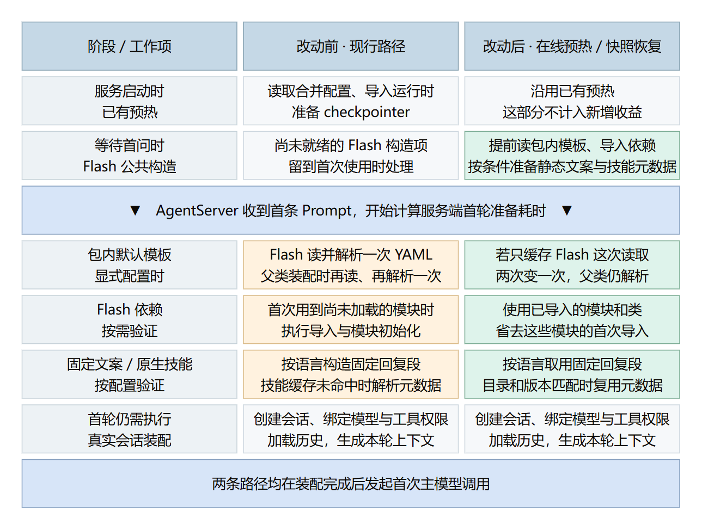
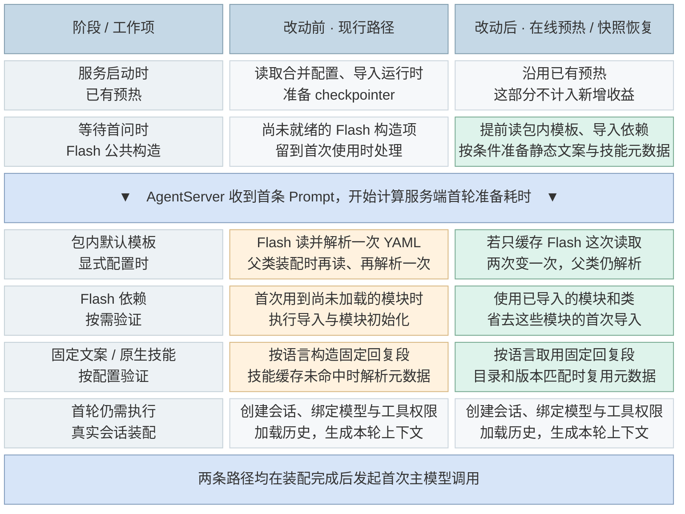
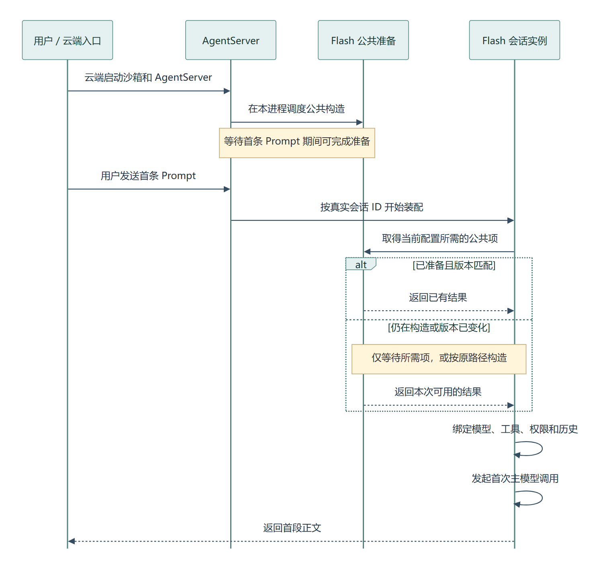
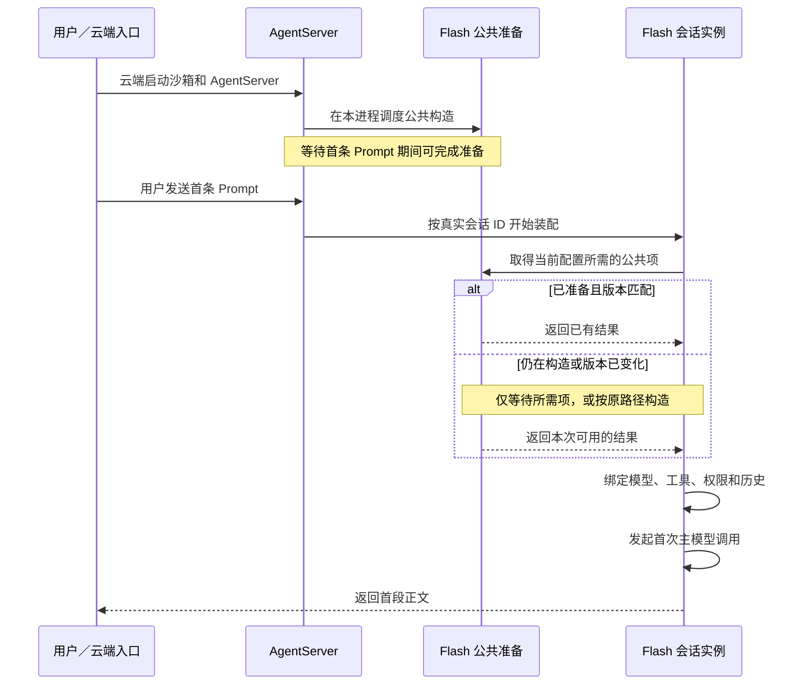
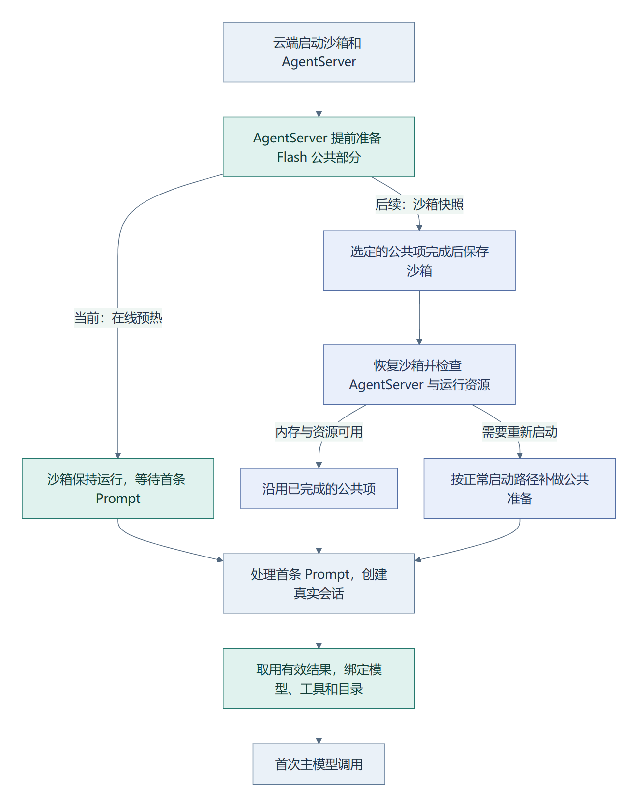
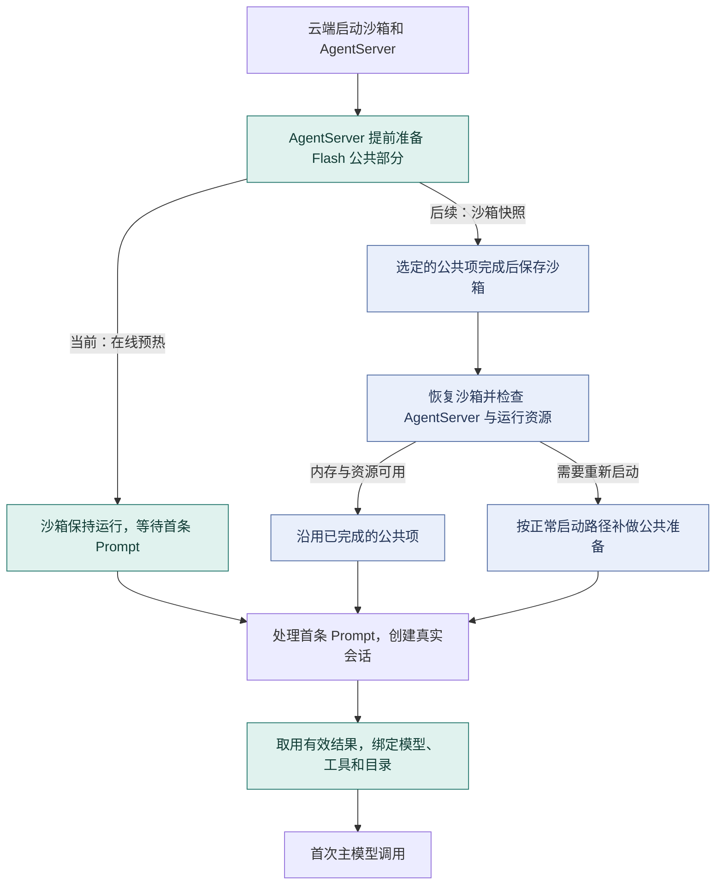

# 云端 FlashAgent 冷启动加速设计方案

| 项 | 值 |
| --- | --- |
| 建立 / 修订日期 | 2026-11-24 / 2026-11-27 |
| 状态 | checkpoint 初始化并行化已实现，其他候选改动待评审 |
| 范围 | 云端 Flash 模式下的 AgentServer 启动与首轮会话装配。技能检索关闭，DeepAgent 沿用现有实现。 |
| 验证状态 | 已核对会话构造调用链，并在本机测量包内模板加载。云端首轮耗时、在线预热收益和快照恢复耗时待实测。 |
| 关联 spec | [运行时与会话管理](../specs/S_03_runtime-agent-management.md) · [AgentServer 架构](../designs/architecture_cn.md) |

## 1. 场景与设计目标

云端先启动沙箱和 AgentServer。用户发来首条 Prompt 后，才创建真实会话并通过 AgentServer 拉起 FlashAgent。**两种部署方式共用一个启动点：AgentServer 启动时，就在实际处理请求的进程内执行与会话无关的 Flash 初始化。** 首条 Prompt 到达后，会话构造直接使用已准备的结果，补齐真实身份、工作目录、工具权限和本轮输入，随后发出第一次主模型调用。

| 运行方式 | 首问前发生什么 | 首问处理时使用什么 |
| --- | --- | --- |
| 当前：在线预热 | 沙箱和 AgentServer 提前运行，在等待 Prompt 期间完成公共准备 | 直接使用仍在内存中的结果。首问来得早时允许按需补齐 |
| 后续：沙箱快照 | 沿用相同启动流程。平台可以在公共准备完成、尚未接入业务会话时保存沙箱 | 若恢复了 AgentServer 内存，校验后沿用已有结果；若平台重新启动 AgentServer，重新走正常的启动预热 |

**图 1　首问路径上可以移走哪些工作。** 蓝色分界线表示 AgentServer 收到首条 Prompt。橙色表示现行首轮可能执行的工作，绿色表示候选改动命中后可复用的部分。模板一行按同一次会话实例构造传入显式配置计算。实施顺序取决于各项在云端首问中实际占用的时间。

查看可编辑图源

**模板到底要解析几次。** 以一次 Flash 会话实例构造为单位。传入显式 `config_base` 时，Flash 先读取包内 YAML 补默认值，应用 Flash 覆盖，再将字典传给父类。父类绑定请求环境后又读取同一份 YAML。若只把 Flash 自己的读取前移，预热命中后，这两处合计从两次降到一次。若传入 `None`，Flash 取 `get_config()` 的副本，父类仍收到字典，这个局部改动在 Flash 入口没有显式模板读取可省。即使文件内容已经解析，会话仍须按实参补缺、处理环境变量和租户覆盖。[Flash 调用入口](../../runtime/agent_adapter/interface_flash.py) · [配置补缺](../../runtime/agent_adapter/deep/agent_config_helpers.py) · [父类装配](../../runtime/agent_adapter/interface_deep.py)

**这一步值多少钱。** 本机 Windows、Python 3.12.0、PyYAML 6.0.3（C 解析器），对仓内 92,905 字节的包内模板先预读一次，再计时 60 次 `load_yaml_dict(resolve_shipped_template_config_path())`，中位数为 **48 ms**。计时包括路径定位、打开文件和解析，只覆盖一次调用。该结果说明局部优化的量级；云端 CPU、文件系统和真实请求中的净收益需单独测量。

## 2. 当前在线预热如何接入

**图 2　从服务启动到首条 Prompt。** 公共构造与监听可以重叠。首问只依赖自己需要的准备项。

查看可编辑图源

**启动端。** 复用 `AgentWebSocketServer.start()` 安排预热的时机。云端 Flash 部署启动后就调度 Flash 公共准备，无需等待 `session_id`。现有快速预热已涉及合并配置、运行时导入和 checkpointer，能复用的部分继续由原模块负责。现有 `startup.warmup.mode` 配置的是临时测试对话；该对话完成后实例会被清理，企业版还会跳过此步骤。Flash 公共准备应能独立于测试对话执行。[启动调度](../../agent_ws_server.py) · [现有预热](../../runtime/prewarm.py)

**请求端。** 首条 Prompt 触发现有会话创建和 Flash 装配。命中有效结果时直接使用；所需项已经在运行时等待该项；未开始、可重试失败或内容已变化时走原有加载路径。失败的任务不发布半成品。若公共准备和请求同时读取同一版本的资源，合并在途工作。取消本次请求仅结束请求自己的等待，后台任务仍由服务负责收尾。适用的 OfficeClaw 请求可以在真实会话身份到齐后沿用 `session.prepare`。[Flash 会话构造](../../runtime/agent_adapter/interface_flash.py) · [会话准备](../../handlers/session_prepare.py)

## 3. 哪些工作放在 Prompt 前

| 对象 | AgentServer 启动时 | Prompt 到达后 |
| --- | --- | --- |
| Flash 运行依赖、静态工具与 Rail 定义 | 导入实际装配使用的模块和构建类 | 按真实工作目录和权限创建文件操作对象、注册工具 owner、挂载 Rail。已绑定实例的方法和对象保留在会话内 |
| 配置模板 | 提前读取包内默认模板，复用允许共享的部署配置缓存，保留未解析环境变量的只读数据 | 会话在独立副本上补齐默认值，解析当前环境、模型凭证和 Flash 覆盖项。配置热更新时校验文件版本 |
| 静态提示文案 | 若云端启用了对应的 Flash composer 路径，可按语言准备只依赖语言的回复段 | 实际渲染路径取用该段。结合安全规则、可见工具和本轮输入组装最终提示词 |
| 原生技能元数据 | 公共技能目录已经挂载且路径明确时，复用 SDK 的 `warmup_process_skill_index()` 预读名称和描述 | 核对目录和文件修改时间，再按真实配置执行启停、授权及加载。命中仍可能检查目录 |
| 会话与运行资源 | 沿用当前部署已有的进程级基础设施预热 | 创建会话 ID 与 SDK 会话实例，绑定模型客户端、工作目录、权限、历史与本轮上下文 |

### 3.1 首版只衡量真实 FlashAgent 的构造

主指标采用新会话子适配器的 `create_instance_ms`，从调用其 `create_instance()` 开始，到返回已初始化的 SDK Agent 为止。取现有服务启动预热完成后的第一个真实 Flash 会话，按同一镜像、配置及资源比较改造前后。首次导入若发生在这段计时之前，只能计入首问收益。交互启动 `start_interaction_ms`、用户输入装配和模型推理单列。[会话构造与计时](../../runtime/agent_adapter/interface_deep.py)

| 构造中的步骤 | 预热或快照可以带走的工作 | 取用条件和首轮余项 |
| --- | --- | --- |
| Flash Rail 构建与 SDK 初始化 | 从 `agent rails built` 找出构造慢的 Rail，从 `[RailInit]` 找出挂载慢的 Rail。优先前移这些 Rail 首次使用的模块和读取的固定资源 | Flash 白名单已经是类常量。实际 Rail 仍要挂载到新实例，例如审计 Rail 的回调引用当前适配器，SDK 初始化还设置工作目录并注册回调 |
| Flash 工具构建 | `web_flash` 的说明和参数结构取决于语言及内置 provider 清单，`cron_flash` 的对应部分取决于语言和 schema 风格。真正无租户依赖的模块级共享工具可沿用进程注册表 | Web 执行函数使用当前缓存，Cron 使用实际租户的 backend 与 context，工具 owner 在会话内绑定。已有共享注册是幂等的，收益只计算原先仍会发生的构造 |
| 模型及 A2X 客户端 | 可加载实际 provider 的代码。若启用 A2X 且构造遇到 TLS 冷加载，可复用进程已有的 SSLContext 缓存 | 按当前模型路由、地址和凭据建客户端。证书配置、文件版本及缓存有效期匹配时才能命中。快照恢复后重新验证外部连接 |
| 企业预置技能同步（部署启用时） | 若服务在首问前已拿到租户、技能版本清单和目标工作区，可提前完成同一工作区的安装或同步。主要产物在挂载目录 | 首问核对租户、挂载和实际安装状态。身份在首问才给出时，这段保留到会话构造。此项不依赖技能检索 |

本机隔离测量了两张工具卡的中文说明和参数生成函数。取 31 批、每批 200 次的单次均值中位数，`web_flash` 约 0.009 ms，`cron_flash` 默认风格约 0.21 ms。两者深拷贝预制结果都更慢。该测量未包含导入、后端创建、ToolCard 校验和注册，因此首版不单独为这两份参数结构建缓存。包内模板的局部测量见第 1 节。[Web 工具构造](../../../agents/harness/flash/tools/web_flash.py) · [Cron 工具构造](../../../agents/harness/flash/tools/cron_flash.py) · [共享工具注册](../../runtime/agent_adapter/deep/adapter_statics.py) · [A2X 传输](../../../agents/harness/team/a2x/client/transport.py) · [预置技能同步](../../runtime/skill/skill_prebuilt.py)

后续按启动耗时选取提示词或原生技能的实际消费点。每前移一项，记录启动时形成的结果、会话取用的位置及缓存失效条件。提前创建一个空适配器不能证明完成了这项工作，普通聊天路径的根适配器可以跳过完整实例构建。[适配器构造](../../runtime/agent_adapter/interface_deep.py) · [Flash 提示词渲染](../../../agents/harness/flash/prompt/composer.py)

## 4. 后续沙箱快照如何接入

**图 3　在线预热与快照恢复如何接入同一条首问路径。** 图中的“处理首条 Prompt”指 AgentServer 开始处理请求的时刻。若用户的 Prompt 触发沙箱恢复，用户等待时间还包含此前的恢复阶段。

查看可编辑图源

1. **保存时机。** 在正常启动的沙箱里，平台选择合适时机保存快照。若期望快照包含某项 Flash 准备成果，应等该项成功、结果可供会话读取，且当前尚未绑定业务凭证或写入会话状态。部分现有预热函数失败只记告警，tiktoken 还会另启线程；端口可连接或外层任务返回不能作为所有准备项成功的证据。优先沿用现有任务结果和平台已有的等待机制。具体通知方式留到平台联调确定。
2. **恢复校验。** 确认同一版本镜像与依赖、包内配置文件版本，以及公共技能目录的实际路径和挂载内容。匹配的项直接取用，变化的项单独失效并重新加载。对已恢复的进程，不假定服务启动钩子会重跑，校验可在平台恢复回调或首轮首次取用时完成。若存在已建立的连接，必须验证真实可用性。例如 checkpointer 的内存 ready 标志可能保留，首次会话的读写仍须指向正确存储。[checkpointer 初始化](../../runtime/agent_adapter/deep/checkpoint_db.py)
3. **失败处理。** 缺少某份静态缓存时按普通 Flash 路径加载。若平台未恢复 AgentServer 内存，启动 AgentServer 后仍会触发同一份公共准备。若进程已恢复但关键连接或挂载无法安全重建，则由云端退回可用的普通启动路径。首问由可用实例继续，避免在状态不明时执行模型或工具调用。

快照接入前需由平台侧确认 AgentServer 进程是否在快照范围内、何时可以保存、恢复后哪些挂载和连接需要重建。当前在线预热的实现与验收可以先行。

## 5. 验证与交付

先在现有在线预热部署验证 Flash 提前初始化，再在平台具备快照能力时验证恢复路径。以下均为待执行用例。

| 场景 | 操作 | 通过条件 |
| --- | --- | --- |
| F_04-V-01 无 Prompt 启动 | 启动沙箱和 AgentServer，暂不发送 Prompt | 已选公共项在服务进程内完成，有可读取的结果。准备过程不创建业务会话或发送模型请求 |
| F_04-V-02 在线预热后首问 | 等公共准备完成，再发送固定首问 | 真实 Flash 装配命中选定结果，至少一项原先位于首问路径的构造或文件解析被省掉。最终模型配置、提示词和工具集合与对照一致 |
| F_04-V-03 首问业务行为 | 为真实会话指定工作目录和权限，分别执行允许与受限的工具操作，并检查历史 | 文件写入正确目录，受限操作被拒绝，持久化历史归属正确。预热阶段的公共结果不含业务凭证及历史 |
| F_04-V-04 提前到达或准备失败 | 首问在公共项仍在执行时到达；另一次令可选项预热失败 | 首问只等所需项或按原路径补齐。失败可观测，无挂起或重复注册；必要资源重试仍失败时按原错误语义返回 |
| F_04-V-05 在线预热收益 | 固定资源、镜像、模型、输入及启动到首问的间隔，交替采集现状与改造后每个新进程的首问 | 报告首轮准备耗时、首正文耗时、样本量和失败数。用分段记录解释端到端差异；若差异处于对照组正常波动范围，只记录局部命中，暂不认定首问加速 |
| F_04-V-08 从快照恢复后首问 | 对完成公共准备的沙箱拍摄并恢复，发送与在线预热相同的首问，检查命中记录、首次 checkpoint 读写和工具结果 | 证明恢复进程实际读到了拍摄前的有效结果。首问功能与在线预热等价，单独记录恢复等待 |
| F_04-V-09 快照内容变化或进程重启 | 更换公共资源版本或挂载路径；另测 AgentServer 重新启动、外部连接失效 | 失效项重新准备，进程重启能走正常预热，关键资源不可用时能安全回退。首问不使用旧凭证、错误目录或失效连接 |

**计时口径。** 服务端记录收到首轮请求至发出首次主模型请求的墙钟时间。客户端记录发送 Prompt 至收到首段可见正文的时间。如果 Prompt 触发了沙箱恢复，客户端数据包含完整恢复等待。单列服务启动至公共项可用、沙箱恢复至服务可用、首轮会话装配三段；后台任务与首问重叠时按时间线核算。固定镜像和模型，保留现有预热策略作为对照，报告 P50，样本允许时再报告 P95。[模型调用用途](F_02_before-model-http-purpose.md)

可复用现有的[启动预热降级测试](../../../../tests/unit_tests/agentserver/test_prewarm.py)和[会话构建等价测试](../../../../tests/integration/test_session_prepare_equivalence.py)。首版灰度若出现首轮行为差异，或等待公共准备使首问明显变慢，可停用 Flash 提前初始化，恢复现有按需构造。快照恢复和实际加速幅度以云端实测为准。

## 6. 已实现的 checkpoint 并行初始化

2026-11-27 根据云端反馈，第一项改动选定 checkpoint 后端初始化。以下两处可以分别生效。

**图 4　checkpoint 初始化改动前后的启动流程。** 上半图从 AgentServer 启动读起，下半图从真实会话触发 Flash 实例构造读起。紫色节点表示初始化存储后端，分支汇合处表示两项工作都结束后才能继续。下半图展示尚无租户句柄的情况；已继承句柄的会话直接复用。箭头表示执行依赖，图中未标注耗时。

| 入口 | 同时执行的工作 | 等待位置 |
| --- | --- | --- |
| AgentServer 启动，预热已启用且 `flash.enabled=true` | 初始化进程级 checkpointer，同时预热合并配置和导入运行时。后端直接从 `checkpoint_db` 加载 | 快速预热结束时汇合。首问若提前到达，可以等待已有任务。单个请求取消时，服务继续预热 |
| Flash 实例构造，适配器尚无 checkpointer | 初始化租户 checkpointer，同时在线程池按当前租户上下文读取基础配置、补默认值并应用 Flash 覆盖 | 进入后续实例装配前汇合。会话子实例已经继承父适配器句柄时，直接复用 |

同一部署只对单个请求显式指定 Flash 时，实例构造仍适用第二行。真实会话的 checkpoint 内容在会话恢复时读取。本机回归覆盖了任务重叠、失败、取消和 SQLite 状态写入后恢复。云端需要分别记录启动预热完成时间、首轮实例构造时间和首问到首次主模型调用的时间，确认重叠的工作给用户节省了多少等待。[预热回归](../../../../tests/unit_tests/agentserver/test_prewarm.py) · [Flash 并行与 SQLite 读写回归](../../../../tests/unit_tests/agentserver/test_flash_checkpoint_startup.py)
