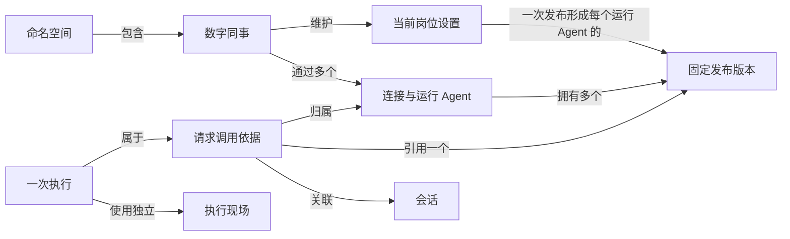
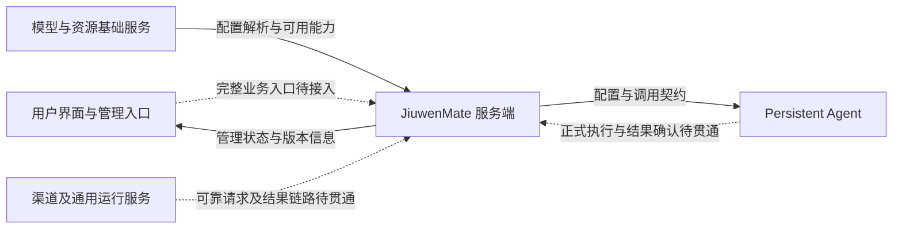
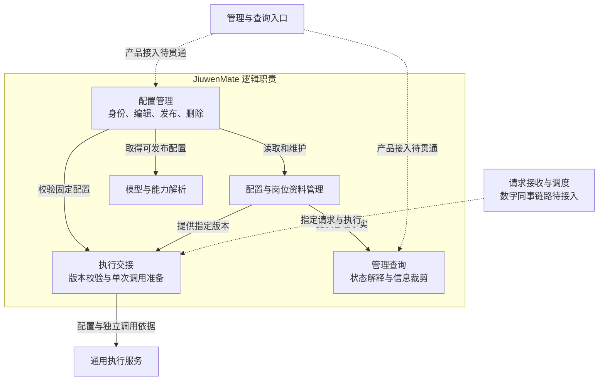
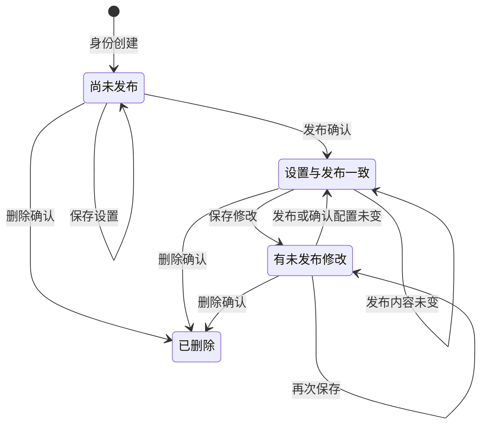
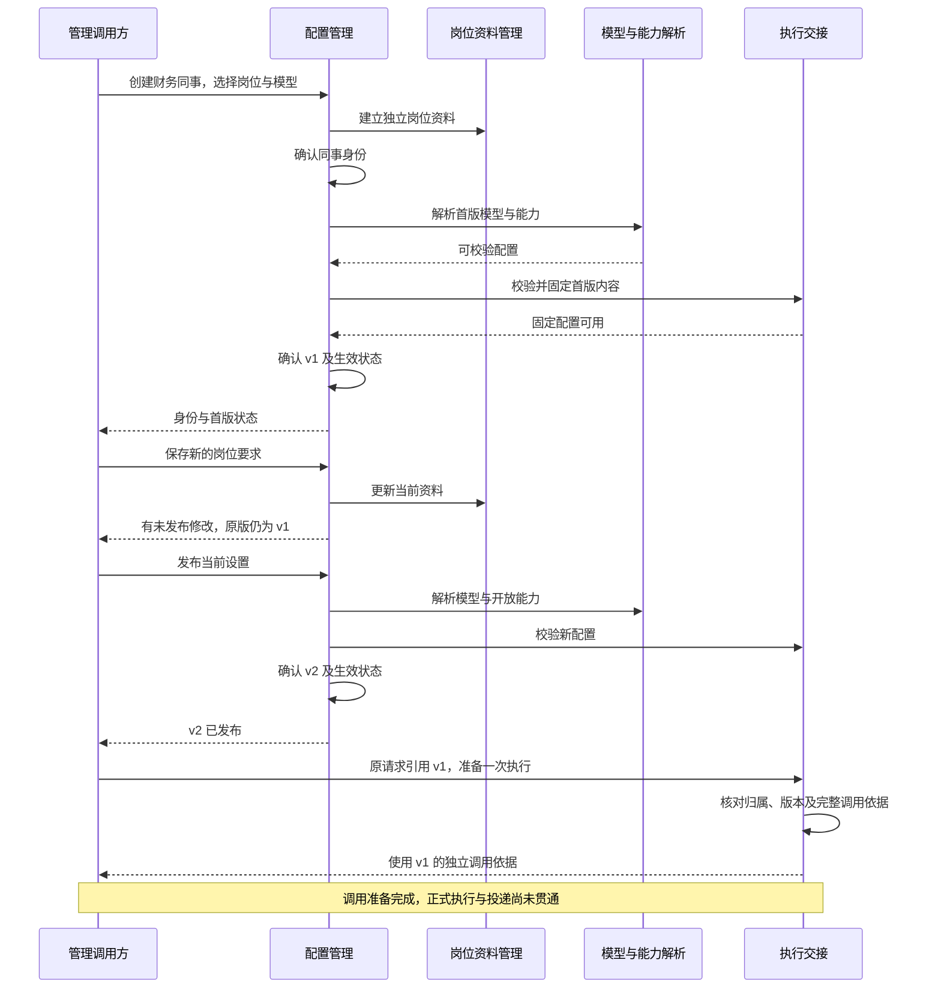

# JiuwenMate 服务端详细架构设计

| 项 | 内容 |
| --- | --- |
| 文档类型 | 逻辑架构设计；以实际能力为边界，未贯通的交接单独标明 |
| 最近一次修订日期 | 2026-10-26（第 2.1、4.1、9.2 节：同事通过连接工作，每个连接一个运行 Agent，依据 [F_02_02](../features/F_02_02_colleague-connections.md)） |
| 责任人 | henry hu |
| 所属模块 | JiuwenMate 数字同事服务 |
| 编写依据 | [架构模板](../templates/architecture-template.md)、[文档约定](../AGENTS.md)，以及实际能力与组件验证结论 |
| 配套文档 | [设计概览](jiuwenmate-overview.md)、[开发计划](jiuwenmate-development-plan.md) |
| 协作模块设计 | [Persistent Agent 架构设计](../../../../../../agent-core/openjiuwen/harness/persistent_agent/docs/designs/persistent-agent-architecture.md) |

本文说明数字同事服务负责什么、怎样组织配置与调用、模块如何交接，以及状态、数据和故障由谁管理。全文采用逻辑模块与业务对象，不规定类名、代码组织、物理存储、接口字段和算法步骤。

**设计与实现边界：** 数字同事的创建、配置管理、版本发布和单次调用准备已有基础。正式请求的可靠接收、持久调度、执行结果确认及渠道投递尚未贯通。通用对话、渠道和智能体执行能力可以复用，但其存在不表示数字同事业务链路已经开放；当前页面交互也不能替代后台确认。

**验证边界：** 已有配置及调用契约的组件验证，不等于用户入口、真实执行和渠道投递的联合验收。凭据保护、跨资料一致性以及正式任务生命周期仍有接入前提，统一列在第 12.2 节；本文不维护测试台账或第二份开发进度。

全文沿用“财务同事”这个例子，围绕 **创建身份 → 保存岗位设置 → 发布工作配置 → 准备指定版本的调用** 展开。读者应能够区分“资料已保存”“配置已发布”“调用已准备”“工作已完成”和“平台已送达”各自的确认依据。

| 阅读目的 | 章节入口 |
| --- | --- |
| 了解定位、概念、共同规则和组成 | [第 1～3 节](#architecture-scope) |
| 理解模块工作方式、主流程和完成条件 | [第 4～6 节](#architecture-modules) |
| 理解数据、故障、权限及运行保障 | [第 7～10 节](#architecture-data) |
| 检查场景、设计选择及接入前提 | [第 11～12 节](#architecture-scenarios) |

正文按模板的十二节组织。旧章节锚点作为主题兼容入口保留，章节编号以本次正文为准。尚未贯通的能力只说明必要责任和开放条件，不预建高级接管、群协作、统一预算及长期学习的详细方案。

## 1. 定位、目标与范围

### 1.1 定位与目标

**JiuwenMate 是数字同事的业务宿主：为每位同事维护独立身份和岗位配置，为每项工作提供明确、可解释的执行依据。** 用户管理的是一位持续存在的同事，活动执行则按需要开始和结束，二者不能混为一谈。

服务端主要承担四类责任：维护同事与岗位资料；发布并提供固定配置；准备身份、版本和来源一致的调用；向管理与后续业务入口提供可核验状态。实际模型循环、上下文组织和工具执行由协作执行服务承担。

例如，用户从财务岗位模板创建“财务同事”，将岗位要求改为“先核对金额，再生成摘要”，并选择可用模型。保存只是记录编辑内容；发布后形成版本 v1。为“整理本月费用”准备调用时，引用 v1；以后发布 v2，不改变这项工作原来的依据。

设计目标是让用户和维护者能回答：这位同事按什么配置工作，某次操作完成到了哪一步，以及失败时应查询或处理什么。配置可解释性优先于静默换版，阶段事实优先于把整个流程压成一个成功或失败提示。

### 1.2 范围与外部责任

| 领域 | JiuwenMate 负责什么 | 当前支持范围 | 外部责任 |
| --- | --- | --- | --- |
| 同事管理 | 身份、岗位设置、默认初始化、查询与删除 | 已有业务管理基础，完整用户入口仍需接入 | 用户入口提供调用者与业务范围 |
| 配置发布 | 固定执行配置、发布状态及指定版本读取 | 已有发布和版本一致性检查 | 模型服务提供实际可用的访问能力 |
| 调用准备 | 请求归属、执行关联、来源与指定版本核对 | 已有调用依据准备，不等于正式执行 | Persistent Agent 校验并使用通用调用契约 |
| 正式任务 | 可靠接收、业务顺序、执行结果确认 | 尚未贯通，不承诺端到端工作完成 | 通用运行服务提供会话和执行基础 |
| 渠道交付 | 业务结果与投递之间的交接 | 数字同事结果保存及投递尚未贯通 | 渠道服务操作平台，平台确认真实效果 |
| 查询与展示 | 同事及版本信息、后续工作查询 | 配置查询已有基础，任务统计与轨迹尚未接入 | 页面展示服务确认的结果 |

数字同事的业务数据与个人版资源分别管理。选择已有岗位模板只用于获得初始资料，创建后的同事独立编辑；复用模型和通用执行能力也不自动共享业务状态。

数字同事启停、飞书业务绑定、群公开协作、统一预算、定时计划和学习作业尚未形成完整服务，本期架构仅保留必要边界。自然语言管理写入和原生群聊继续排除在当前支持范围外。完整需求及交付安排见设计概览和开发计划。

### 1.3 关键要求与对应设计

以下要求取自[设计概览的产品定位与服务端职责](jiuwenmate-overview.md#1-目标与范围)，仅列影响整体架构的部分。

| 关键要求 | 对应设计 | 当前支持与限制 |
| --- | --- | --- |
| 同事具有稳定身份与独立岗位设定 | 第 2.1、4.1、7.1 节 | 身份与资料已有管理；不能据此推断长期任务已经可运行 |
| 编辑与实际生效可区分 | 第 4.1、5.2.1、6.1 节 | 保存和发布分别确认，原版本内容不随编辑变化 |
| 一项工作使用明确的配置依据 | 第 4.3、5.2.2、7.3 节 | 调用准备核对指定版本；请求可靠保存尚待接入 |
| 共享基础能力时保持业务边界 | 第 3、9.2 节 | 通用服务可复用，业务数据和可变调用状态分别管理 |
| 工作状态、投递结果和页面展示可解释 | 第 6.3、8、11 节 | 已有阶段性确认，正式业务终态和投递账本尚未贯通 |
| 查询不泄露内部配置与访问凭据 | 第 4.4、9.1 节 | 管理视图排除内部执行配置，存储访问保护仍需环境验证 |

### 1.4 影响架构选择的因素

配置会持续编辑，调用却需要稳定依据，因此岗位资料与发布版本分开；模型凭据及服务能力还可能变化，因此“保留原版本”与“外部依赖仍可用”分别判断。

管理操作跨越同事定义、岗位资料和发布状态，不能假定它们全部一次完成。设计保留阶段确认和失败核对责任，避免首次发布失败后重复创建，或把保存结果不明当作没有保存。

通用对话采用自己的优先级和控制规则。数字同事接入必须明确业务顺序，不能将“会话内串行”自动解释为所有输入严格先进先出。

当前没有经测量的数字同事并发、容量或恢复时间目标。运行服务可用性、资料一致性和访问资格无法确认时，只能限制依赖它们的操作；具体资源阈值及测量责任见第 9.3、12.2 节。

## 2. 核心概念与共同规则

### 2.1 核心对象、关系与生命周期

| 对象 | 含义与例子 | 归属与关联 | 生命周期和共享范围 |
| --- | --- | --- | --- |
| 命名空间 | 一组同事所属的业务数据范围 | 定位同事及版本，不直接证明主体有访问权 | 不因页面切换而改变；完整用户和组织映射尚待接入 |
| 数字同事 | 用户创建的“财务同事”业务身份，即一份配置 | 拥有岗位资料、设置与发布记录；通过若干连接工作 | 创建后持续存在，删除结束管理生命周期；不是活动执行实例 |
| 连接与运行 Agent | 同事工作的一处地方：Web 页面，或一个飞书、钉钉应用；每个连接由各自的运行 Agent 服务 | 运行 Agent 属于一位同事、只服务一个连接，拥有自己的发布版本、办公目录、会话与渠道身份；Web 连接的运行 Agent 与同事共用标识 | 添加连接时建立；换一个平台应用就是新连接；解除连接不删除其数据 |
| 当前设置与岗位资料 | 用户正在维护的工作要求和资源选择 | 属于指定同事，可来源于模板 | 可编辑，不能覆盖来源模板或旧发布版本 |
| 发布版本 | 某次确认可供调用引用的固定配置 | 属于一个运行 Agent，关联当时的岗位要求、模型配置及开放能力；同一次发布为同事的每个运行 Agent 各形成一个版本 | 按版本读取；保留到运行 Agent 删除，尚无在途引用保留协议 |
| 会话 | 组织相关输入及工作背景的范围 | 关联请求和通用执行背景 | 通用对话已有管理；数字同事持久业务会话尚待接入 |
| 请求 | “整理本月费用”这项工作意图 | 关联运行 Agent、会话、来源、主体及固定版本 | 当前可表达调用依据，尚无可靠业务接收闭环 |
| 执行 | 原请求的一次处理尝试 | 属于原请求，具有独立执行现场 | 准备、执行和释放分别确认；数字同事续做未开放 |
| 管理视图 | 查询得到的同事及发布信息 | 来源于管理事实，不包含内部执行配置 | 可以重新查询，不反向成为保存或发布的权威 |

图表达业务关系，不表示对象必须分别持久保存。隔离单位是连接：不同连接的运行 Agent 不共享办公目录、会话和渠道身份，一位同事的设置只编辑一份。请求和执行当前具有交接依据，可靠保存仍待接入。岗位设置是可编辑资料，版本是固定配置，执行现场是单次活动状态；三者不能互相替代。

### 2.2 共同规则索引

| 规则 | 范围与成立条件 | 责任方 | 不满足时的处理 | 主要说明 |
| --- | --- | --- | --- | --- |
| 保存不改变原发布版本 | 同事已有发布版本，用户编辑设置 | 配置管理 | 原版本继续有效，修改标为未发布 | 第 4.1、6.1 节 |
| 版本与生效状态一致 | 配置发布成功确认 | 配置管理 | 发布不确认成功，查询实际生效版本 | 第 7.2 节 |
| 调用归属与版本一致 | 准备一次执行 | 执行交接 | 拒绝，不改用其他同事或当前新版本 | 第 4.3、5.2.2 节 |
| 仅使用实际开放的能力 | 配置发布与调用准备 | 配置管理、执行交接及执行服务 | 拒绝未支持或未接入能力 | 第 4.2、4.3 节 |
| 单次可变现场独立 | 不同执行或不同会话 | 执行交接与执行服务 | 不复用其他工作的可变状态 | 第 4.3.3、9.2 节 |
| 各阶段单独确认 | 管理、调用、执行和渠道交接 | 相应事实的管理者 | 返回真实阶段，不根据前项成功推断后项 | 第 6.3 节 |
| 业务范围标识不代替访问资格 | 多主体管理和查询入口 | 入口与授权职责，完整接入尚待完成 | 未确认资格不开放对应产品访问 | 第 9.1 节 |
| 未知结果不等于未发生 | 操作中断、确认丢失及外部发送 | 实际操作责任方 | 先查询核对，不直接重做整个流程 | 第 8 节 |

这些规则有各自范围。配置发布的确认不提供渠道送达保证，通用会话串行不提供跨进程执行权，已有主体信息也不表示动态撤权机制已经接通。

## 3. 架构总览与模块分工

### 3.1 系统与外部的关系

JiuwenMate 接收同事管理与调用准备所需的业务输入，向用户入口提供管理信息，向 Persistent Agent 提供一致的配置与宿主调用依据。通用运行服务和渠道服务仍是独立责任方。

实线表示已有职责和能力交接，虚线表示数字同事产品链路尚未贯通。固定配置中的模型选择由模型服务解释；平台消息的真实效果由平台确认；身份、发布状态及业务调用依据由 JiuwenMate 管理，不能互相代替。

对端模块位于 agent-core。服务端使用双方公开契约，通用执行服务不承担同事管理，也不依赖 JiuwenMate 的代码组织。外部模型、渠道和执行能力发生变化时，影响实际依赖它们的操作，不自动修改已经发布的业务配置。

### 3.2 内部组成与依赖

连线表示调用或资料交接，不表示跨资料原子提交，也不规定模块是否独立部署。配置管理掌握修改和发布，查询只解释已有事实，执行交接只使用指定版本；查询和执行不能绕过配置管理修改发布内容。

### 3.3 各模块负责什么

| 逻辑模块 | 管理的工作与数据 | 交付对象及内容 | 相邻责任边界 |
| --- | --- | --- | --- |
| 配置管理 | 同事身份、可编辑设置、默认初始化、发布及删除 | 管理入口获得同事状态；执行交接获得固定版本 | 管理成功不证明业务任务执行或渠道授权完成 |
| 配置与岗位资料管理 | 同事定义、当前岗位资料、历史版本和初始化事实 | 配置管理按用途读取，查询使用确认事实 | 多类资料分别管理，跨资料一致性有限制 |
| 模型与能力解析 | 模型选择与访问配置，以及配置能力是否支持 | 发布流程获得可校验的执行配置 | 资源选择不等于授权或执行开放 |
| 执行交接 | 请求、执行、来源、配置及主体依据的一致性 | 执行服务获得单次调用所需的完整依据 | 不替代可靠请求接收、业务终态提交或恢复接管 |
| 管理查询 | 同事和版本状态的解释、敏感信息裁剪 | 管理入口获得可公开管理信息 | 页面不能反向改写事实，内部配置不作为公开视图 |
| 通用运行与渠道服务 | 对话调度、控制、资源释放、消息路由和平台操作 | 提供通用执行基础及渠道结果 | 不自动拥有数字同事的业务顺序、完成条件与权限 |

正式请求、执行结果及投递的责任虽已划定边界，完整交接尚未接入。长时间未确认的操作由对应事实责任方核对；当前没有统一后台扫描和自动补齐服务。

### 3.4 已有基础与需要补齐的部分

| 已有基础 | 可复用内容 | 需要补齐，由谁负责 | 补齐前的限制 |
| --- | --- | --- | --- |
| 数字同事配置管理 | 身份、编辑、发布、管理查询 | 用户入口及业务授权，由入口负责人接入 | 页面操作不能视为后台已执行 |
| 固定配置与调用契约 | 指定版本和独立调用准备 | 可靠请求保存与实际执行交接，由请求执行负责人接入 | 不宣称正式任务已经接收或开始 |
| 通用运行服务 | 会话、对话执行、控制及资源管理 | 明确数字同事输入分类和业务顺序 | 不把通用聊天策略写成业务严格先进先出 |
| Persistent Agent | 配置契约与单轮执行基础 | 宿主能力、上下文保存及结果确认，与对端联合接入 | 不根据对端能力存在开放未贯通执行 |
| 渠道服务 | 输入适配、输出路由和平台发送 | 业务结果到原目标的交接与确认 | 不承诺数字同事自动补发或投递对账 |

能力开放还依赖可信主体、可用模型、完整发布配置及真实宿主交接。缺少任一依据时，应限制对应操作，而不是用页面状态或临时信息补齐。未验证前提集中在第 12.2 节。

## 4. 关键模块设计

### 4.1 配置管理

#### 4.1.1 工作方式与职责组成

**配置管理把“这位同事是谁”“用户正在编辑什么”和“调用可以使用什么”分别管理。** 身份在创建时确定，岗位设置可持续编辑，发布版本按一次确认固定。这样的分工避免正在编辑的资料直接进入已有调用。

创建时校验岗位、来源模板和模型选择，形成独立身份及岗位资料，再发布首版。默认同事允许在没有可用模型时保持未发布；普通创建要求有可用模型。默认初始化事实持续保留，用户删除默认同事后不自动再建。

编辑只保存当前设置。发布再读取岗位要求和解析后的模型配置，验证开放范围，为同事的每个运行 Agent 形成固定内容，并在一次确认中切换全部运行 Agent 的生效状态；任一运行 Agent 不能发布或同事已变化时，全部保持原版本。没有实质执行配置变化时可以沿用原版本；某项设置已保存，不表示它必然参与当前执行配置。

添加连接时为该平台应用建立专属的运行 Agent，并以最近一次发布的设置形成首个版本，不使用未发布的草稿；同一同事再次添加同一应用时沿用原运行 Agent。渠道接入只受理绑定到、且专属于本平台应用的运行 Agent。

#### 4.1.2 管理接口约定

| 接口能力 | 提供方与调用方 | 输入及前提 | 结果与确认依据 | 失败处理 |
| --- | --- | --- | --- | --- |
| 创建同事 | 配置管理提供，管理入口调用 | 业务范围、有效岗位设置、可用模型，可选来源模板 | 身份及首版发布状态分别可查询 | 前置校验失败则拒绝；创建后发布失败则查询已完成阶段 |
| 初始化默认同事 | 配置管理提供，业务入口调用 | 明确业务范围 | 首次建立默认身份，后续读取已有初始化结果 | 无模型可保持未发布，删除后不自动重建 |
| 保存设置 | 配置管理提供，管理入口调用 | 指定同事、有效设置和未过时修改依据 | 当前资料已保存，原发布版本保持不变 | 冲突拒绝旧修改；结果不明先查询核对 |
| 发布配置 | 配置管理提供，管理入口调用 | 当前资料、可解析模型及双方支持的能力 | 同事全部运行 Agent 的固定版本及生效状态已确认 | 无效、冲突或不可用时不确认发布成功，全部运行 Agent 保持原版本 |
| 添加连接 | 配置管理提供，渠道绑定入口调用 | 指定同事与平台应用 | 返回该应用专属的运行 Agent，同事已发布时其首个版本已确认 | 同事不存在或冲突时拒绝，渠道绑定不保存 |
| 删除同事 | 配置管理提供，管理入口调用 | 业务范围、指定同事及删除方式 | 先移除绑定的平台应用；仅解除连接时同事从管理范围隐藏、数据保留，全部删除时各运行 Agent 与同事一并移除 | 删除结果和残余资料分别核对，规则见第 10.3 节 |

这些是业务接口，不规定传输形式和字段。修改依据由配置管理在本次处理过程中核对，当前冲突保护不能扩展为完整的多人编辑协调保证。接口成功的含义以第 6 节为准，完整用户身份与访问资格检查仍需接入，不因接口已有基础就默认向所有主体开放。

#### 4.1.3 配置生效与资源生命周期

同事身份、当前设置、发布版本和活动执行分别存在。保存改变当前设置；发布才改变新调用所选的当前版本；已经引用旧版本的调用仍核对旧版本。旧版本损坏、缺失或外部依赖不可用时，拒绝或停止依赖它的操作，不静默改用新版本。

模型及岗位要求参与当前执行配置。技能、连接器、插件，以及已选择的个人上下文页面，在发布后进入该员工的执行配置。未选择的页面不复制。配置发布不提供启停、渠道绑定、即时撤权或长期学习保证。

当前删除会移除同事及其版本，尚无在途请求引用保留协议。释放活动资源不等于删除同事，删除同事也不意味着撤销已经发生的外部效果。

### 4.2 模型与能力解析

**发布使用明确的模型选择和实际开放能力，而不是把所有可选资源都当作执行能力。** 模型解析接收用户选择，确认能否转成实际访问配置；能力检查同时考虑通用执行服务支持什么，以及宿主已经接通什么。

模型不可解析时发布拒绝。默认同事可以先留在未发布状态，普通创建需提供或选择可用模型。模型访问配置可能含凭据，只用于内部执行配置；查询提供可理解的选择及版本信息，不交出完整内部配置。

能力解析只形成可校验配置，不替代资源授权、实际模型调用或预算管理。对端支持单轮执行基础，不代表宿主已完成正式任务接入；任务循环、子智能体及未接通资源不能因被选择而开放。

### 4.3 执行交接

#### 4.3.1 工作方式与边界

**执行交接负责把一次工作意图变成身份和配置一致的调用依据。** 它接收指定版本、原请求和执行关联，检查这些信息能否共同描述同一项工作，再为这次调用准备独立现场。

配置管理拥有版本，后续请求接收模块应拥有请求归属与指定版本，执行交接校验二者一致。当前已有调用依据准备，可靠请求保存和正式调度尚未贯通；本节不把“输入被接受”解释为“业务请求已持久接收”。

#### 4.3.2 调用接口与依赖约定

| 交接能力 | 提供与使用关系 | 前提及输入 | 产出与结束条件 | 拒绝或等待条件 |
| --- | --- | --- | --- | --- |
| 获取指定版本 | 配置管理提供，执行交接使用 | 同事归属与明确版本 | 获得原发布内容及一致性依据 | 版本缺失、损坏或不匹配时拒绝，不换版 |
| 准备单次调用 | 执行交接提供，后续请求调度使用 | 原请求、执行关联、来源、主体依据及指定版本 | 交出独立且完整的配置和调用上下文 | 归属、版本或能力不一致时拒绝 |
| 使用宿主能力 | 业务宿主提供，通用执行服务使用 | 真实访问、上下文和结果交接能力已接入 | 执行服务在指定范围内工作 | 目前真实业务链路尚未贯通，不直接开放正式执行 |
| 继续原执行 | 当前不开放 | 原请求及前次执行关联不能单独证明可继续 | 无可用的数字同事续做保证 | 拒绝，恢复条件另行设计和验证 |

主体及范围信息属于调用依据，其可信性需要入口保证。当前不会从这些值本身推导完整业务授权；实际访问与动态权限规则见第 9 节。

#### 4.3.3 执行现场与资源隔离

每次调用准备独立现场，不能借用其他执行的可变状态。固定配置可以引用同一发布内容，但交互等待、活动上下文和结果状态不能因此共享。

通用执行服务管理上下文与模型工具活动，业务宿主管理请求和结果依据。这两个保存责任分别确认，不能用通用上下文存在推断业务进度已经提交。资源释放需以相关活动结束为依据，控制和关闭规则见第 5.2.3 节。

### 4.4 管理查询与状态解释

管理查询接收业务范围及对象，返回同事信息、当前设置、发布状态或版本信息。公开管理信息与内部执行配置分开，尤其不能暴露模型访问凭据。

查询解释已经确认的事实，而不是替业务模块决定状态。身份存在、首版已发布、有未发布修改以及指定版本可用，需要分别表达；查询不可用时，不以空列表、默认值或旧页面内容冒充当前事实。

当前已有同事及配置查询，尚无完整任务统计、资产汇总和渠道轨迹服务。普通登录、页面切换和详情链接都不能替代数字同事访问资格；产品查询接入要求见第 9.1 节。

## 5. 模块协作与处理流程

### 5.1 当前主流程：从同事创建到调用准备

下面沿用“财务同事”。调用方表示管理或业务调用者，产品入口与后台仍未完整贯通；当前主流程结束于调用准备。

| 步骤 | 谁负责 | 本步确认什么 | 下一步或失败处理 |
| --- | --- | --- | --- |
| 确定业务范围和岗位输入 | 调用入口与配置管理 | 对象范围明确，岗位和模型有效 | 前置不满足则拒绝，尚不建立可执行配置 |
| 建立同事及独立岗位资料 | 配置管理、岗位资料管理 | 同事身份存在，岗位资料归属清楚 | 首次发布独立进行；失败后查询已完成阶段 |
| 解析并校验首版配置 | 模型与能力解析、执行交接 | 配置可解释，未超出双方开放范围 | 无效时保持真实创建状态，不伪装已发布 |
| 确认发布版本与生效状态 | 配置管理 | 首版可供内部调用引用 | 管理查询返回版本信息，内部凭据不公开 |
| 编辑后保存与重新发布 | 配置管理及协作模块 | 保存与新版本分别确认 | 原版保持有效，新发布遵守第 5.2.1 节 |
| 提供原请求和指定版本 | 调用方，后续接收与调度待接入 | 明确该调用属于谁、使用哪个版本 | 当前不宣称请求已可靠保存 |
| 核对并交出独立调用依据 | 执行交接 | 身份、配置、来源及执行关联一致 | 准备完成；正式执行和结果链路仍待接入 |

实线表示当前管理和准备流程，虚线表示后续业务链路。箭头不表示前一阶段与后一阶段整体原子完成；失败处理始终回到拥有相应事实的模块。

### 5.2 关键协作机制

#### 5.2.1 保存与发布的阶段交接

**触发：** 用户修改财务岗位要求，或明确要求让当前设置生效。参与方是配置管理、岗位资料管理、模型与能力解析、执行交接及管理查询。

1. 配置管理读取当前同事与修改依据，检查设置是否有效；保存更新当前资料，但不改变原发布内容。
2. 发布读取当前岗位与模型配置，校验实际能力。无法解析的模型或未开放能力在这一阶段拒绝。
3. 配置管理确认固定版本与生效状态。执行配置未发生实质变化时沿用原版本，否则形成新版本。
4. 查询解释保存和发布的真实结果；旧请求继续引用原版，新调用可选择当时有效的当前版。

**结束：** 保存以编辑资料确认结束，发布以版本及生效状态确认结束。发布失败不反向抹去已创建身份，也不因设置已保存就声称发布成功。跨资料一致性及失败查询见第 7.2、8.1 节。

#### 5.2.2 指定版本与原请求的交接

**触发：** 为一个明确请求准备执行。配置管理提供指定版本，调用方提供原请求及执行关联，执行交接负责匹配。

1. 先确定请求归属及它引用的版本，不能根据当前发布指针重新解释旧请求。
2. 读取对应固定版本，核对内容一致性和能力范围。
3. 检查执行属于该请求，来源及主体依据完整；这些值的可信性由入口提供，当前完整业务授权仍待接入。
4. 准备本次独立现场，交出一致的配置与调用依据。

**结束：** 成功只证明调用可被解释和准备，不证明任务已执行。若原版不可用、归属混用或要求未开放续做，直接拒绝；不能静默换成 v2 或重建一个看似成功的新任务。

#### 5.2.3 通用会话调度、控制与关闭

**适用范围：** 现有通用对话的运行基础，尚非数字同事持久业务队列。受调度工作在同一会话内串行，不同会话可以并行；普通聊天对未开始输入采用较新输入优先，跨会话消息按接收序等待且优先级较低。

交互控制及部分独立工作另有路径。等待用户不等于结束请求，也不表示后续所有工作都按同一顺序推进。控制输入需定位对应会话、请求或交互；已有会话生命周期隔离不能扩展为跨进程租约或外部写入保护。

关闭先限制新的活动，再收敛相关工作和资源。仍有活动未退出时，保留未完成结果，不把关闭超时视为已经安全释放；取消不能撤销已经发生的外部效果。

数字同事的可靠顺序、控制保存和执行权尚待接入，不能把通用会话规则改写为所有业务请求严格先进先出。对应确认问题列在第 12.2.2 节。

### 5.3 接入与投递的现有基础及边界

通用输入流程由渠道解析消息和来源，协议入口检查请求类型与运行就绪状态，再交给运行服务处理；结果返回后由渠道选择输出路由并发送。准备未完成时有界等待，容量不足、启动失败或关闭时返回明确结果。

数字同事还需补齐主体、同事、请求和版本关联，以及可靠业务接收、结果保存和平台交付。通用渠道的相关性判断、群发或私发选择，不等于已有多同事可靠分发、共享群记录及公开协作。

当前没有数字同事独立结果保存、按目标排序的投递队列或未知结果对账服务。传输交接、平台接受及最终业务完成分别确认；渠道异常不能自动触发模型和工具任务重做。完成依据见第 6.3 节，安全重试边界见第 8.2 节。

## 6. 状态、事件与完成条件

### 6.1 状态分类与转换

| 状态类别 | 表示什么 | 谁确认及依据 | 对其他流程的影响 |
| --- | --- | --- | --- |
| 同事管理状态 | 身份存在，或已从管理范围删除 | 配置管理，以同事定义和删除结果为准 | 决定能否查询和修改，不能推断活动任务已停止 |
| 编辑与发布状态 | 尚未发布、设置与发布一致、有未发布修改 | 配置管理，以当前设置和发布依据为准 | 保存不切换原版；未发布身份不能提供当前执行版本 |
| 调用准备状态 | 依据完整，或因不匹配、不可用被拒绝 | 执行交接，以本次校验与交出结果为准 | 不代表可靠请求已接收、已开始或已完成 |
| 通用运行状态 | 排队、运行、等待交互或结束 | 运行服务，以其范围内的活动事实为准 | 只解释通用执行，不代替数字同事持久业务终态 |
| 交付与展示状态 | 是否返回、平台结果是否确认、页面展示到哪一步 | 相应渠道或查询职责 | 不反向改写配置和工作事实 |

图是管理状态的逻辑视图，不新增底层状态定义。普通创建通常继续完成首版发布；默认同事可能留在尚未发布。发布失败不进入“设置与发布一致”，删除确认也不等于所有残余资料已清理。

### 6.2 事件、确认与流量控制

管理状态以确认的资料为准，不以日志、页面通知或流式片段为准。发布返回是确认信息，若确认回复丢失，应查询指定同事及当前发布状态；当前没有通用的重复管理请求幂等保证，尤其不能把重新创建当作查询。

通用运行可以返回执行事件和流式结果，但数字同事尚无可靠事件提交、业务序号及无损续传机制。观察到最终文本不证明结果已持久保存，缺少片段也不证明相应操作未发生。

入口等待和流式交接的资源需要受实际容量约束。发送方超过接收处理能力时应等待或被拒绝，这类流量约束称为背压。其保证只限对应通用环节，不能扩展为持久队列、全链路事件可靠性或端到端任务限额。

正式业务事件的保存、重复识别、迟到处理及完成与取消竞争尚未定稿；接入前不得根据临时运行状态推导持久业务终态。

### 6.3 完成与结果交接

| 确认点 | 确认责任与证据 | 后续仍需处理什么 |
| --- | --- | --- |
| 身份已创建 | 配置管理确认同事存在 | 首版可能尚未发布 |
| 设置已保存 | 当前设置与岗位资料完成相应确认 | 修改可能尚未生效 |
| 配置已发布 | 固定版本及生效状态一起确认 | 实际外部依赖可能变化，新请求保存仍待接入 |
| 调用已准备 | 执行交接交出完整且一致的依据 | 正式执行、上下文保存和业务结果确认尚未贯通 |
| 通用执行已结束 | 运行服务确认相应活动结束 | 数字同事持久业务终态不能由此推断 |
| 结果已交给渠道 | 传输或渠道确认接收到输出 | 平台真实效果仍需确认 |
| 平台结果已确认 | 平台操作结果可核验 | 数字同事尚无统一交付账本与后续对账 |

发生后项失败时，保留前项已确认事实。首版发布失败不意味着身份不存在，发送失败不意味着工具任务未执行；应修复或核对具体阶段，而不是重做整条链路。

## 7. 数据管理与保存规则

### 7.1 数据由谁维护，以什么为准

| 数据 | 权威管理者与依据 | 修改与生效规则 | 其他模块如何使用 |
| --- | --- | --- | --- |
| 同事身份及当前设置 | 配置管理的确认记录 | 创建、有效修改和删除分别确认 | 管理查询解释状态，执行不直接改写 |
| 岗位资料与来源模板关系 | 岗位资料管理 | 创建后独立编辑，不反向修改来源模板 | 发布读取当前岗位，旧调用读取固定版本 |
| 固定配置与生效状态 | 配置管理的发布事实 | 发布内容与生效关系一起确认 | 指定版本校验后供内部调用使用 |
| 默认初始化事实 | 配置管理 | 首次确认后保留，即使默认同事被删除 | 再次访问不自动重建 |
| 请求、来源及执行关联 | 调用方与待接入的请求接收职责 | 当前可表达交接依据，持久业务保存尚待贯通 | 执行交接核对，不将其误当作可靠接收证明 |
| 通用上下文和运行现场 | 通用执行与运行服务 | 在各自管理范围内变化 | 不代替数字同事业务进度和投递事实 |
| 管理视图与页面状态 | 查询和展示职责 | 根据已确认事实读取或展示 | 可重新查询，不作为业务状态权威 |
| 模型与平台实际效果 | 相应外部服务 | 按实际访问或操作结果确认 | 不由内部版本或页面状态推断 |

身份、版本和初始化事实属于长期管理资料；活动现场属于运行状态；页面内容属于展示。保存位置可以复用基础设施，但归属和确认规则不能因此合并。

### 7.2 提交顺序与跨资料交接

配置发布必须同时确认固定版本与生效关系，避免显示已发布却没有可用版本。设置保存需要识别过时修改，不能用旧内容覆盖已经确认的新设置。

岗位资料与同事设置分别管理，当前流程提供局部失败处理，但不保证并发或任意中断时整体原子完成。一次发布会读取两类资料，不能仅凭部分更新受到保护，就宣称发布内容必然来自同一份并发修改。

创建身份与首次发布也分别完成。发布失败时保留身份查询依据；确认回复丢失时查询实际发布关系；资料不一致时由配置管理核对，不用页面通知代替确认。当前没有统一后台补偿和跨资料自动对账服务。

数字同事请求、业务终态、必要结果和投递交接的共同提交关系尚待设计。通用上下文、历史或运行记录不能组合成“全部业务事实已可靠提交”的证明。

### 7.3 版本保留与引用约束

原请求引用的版本应保持可解释，不能因当前资料变化而替换。准备调用时重新核对归属、内容与能力一致性，遇到损坏、缺失或不兼容拒绝使用。

配置固定的是当次发布内容，不是外部模型永远可用的承诺，也不是永久资源授权。内部版本可能包含访问配置，因此不能直接作为公开查询结果或共享资料。

当前同事删除同时移除版本，尚未管理在途请求、未决投递与旧版本的保留关系。正式任务接入前，需要先解决这些引用约束；不能用当前管理删除流程推导安全的运行清理。

## 8. 故障处理与继续执行

### 8.1 故障范围、影响与责任

| 故障或异常 | 影响范围 | 负责方 | 当前处理与推进条件 |
| --- | --- | --- | --- |
| 模板、岗位或模型无效 | 对应创建、保存或发布 | 配置管理及能力解析 | 拒绝相应操作，保留已经确认阶段 |
| 配置修改冲突 | 当前同事设置或发布 | 配置管理 | 拒绝旧依据覆盖，重新读取后决定新操作 |
| 保存中断或资料不一致 | 当前设置及依赖它的新发布 | 配置管理、岗位资料管理 | 核对资料，不能承诺整体自动恢复；旧已发布内容不随编辑改写 |
| 身份存在但首版未发布 | 该同事的调用准入 | 配置管理、查询 | 分别表达创建和发布状态，不能提供不存在的当前执行版 |
| 原版本损坏、丢失或不兼容 | 引用原版本的调用 | 执行交接 | 拒绝，不静默换用新版本 |
| 外部模型配置不可解析或依赖不可用 | 实际依赖该模型的操作 | 能力解析、执行服务 | 当前操作不能确认可用；其他同事按各自依赖判断 |
| 运行未就绪、容量不足或服务关闭 | 相应通用请求入口 | 入口与运行服务 | 有界等待或拒绝，不把等待当作可靠接收 |
| 取消或关闭未完成 | 对应活动和资源 | 运行服务 | 保留未完成信息，不能宣布安全释放 |
| 断流、确认丢失或渠道结果未知 | 相应阶段及外部操作 | 实际操作责任方 | 查询核对；无结果不等于未发生 |

明确拒绝、操作未结束与结果未知是三种不同情况。只有明确前置拒绝且没有开始本次操作，才可说明该阶段未推进；已经开始却丢失确认时，不根据超时猜测提交结果。

### 8.2 外部操作与重试条件

配置资料修改、实际模型工具操作和平台发送具有不同效果。重试前先定位失败阶段及其权威结果：确认未进入发布，不等于身份未创建；未确认渠道送达，不等于执行没有产生外部效果。

| 操作 | 再次处理前核对什么 | 当前重试边界 |
| --- | --- | --- |
| 创建同事 | 原创建是否已经形成身份 | 尚无通用创建幂等保证，不能把重复创建作为查询 |
| 保存或发布 | 当前资料、指定版本及生效状态 | 执行配置未变可沿用版本，但不构成全部管理请求的重放保证 |
| 模型或工具任务 | 原请求、执行状态及真实副作用 | 数字同事尚无可靠外部效果核对链路，不自动重跑 |
| 平台发送 | 平台是否已接受或产生真实效果 | 数字同事尚无独立投递账本，不承诺安全自动补发 |

已经发生的外部效果由实际外部系统为准。内部取消、删除和网络异常都不自动撤回它；需要更正或重办时，应明确区分新的业务意图与原操作核对。

### 8.3 恢复依据与继续条件

| 恢复或继续方式 | 触发及依据 | 可以恢复什么 | 限制 |
| --- | --- | --- | --- |
| 重新读取管理资料 | 管理入口查询同事、岗位及发布事实 | 管理状态与固定配置 | 不恢复原活动任务，也不自动修复跨资料不一致 |
| 通用交互控制 | 用户回答或取消，定位当前交互 | 通用运行范围内的对应活动 | 不代表数字同事持久审批、跨进程恢复已经接入 |
| 数字同事继续原执行 | 需要原请求、原版、现场、有效访问及已发生效果 | 当前未开放 | 不能仅凭前次执行关联或历史文本继续 |
| 恢复后重新投递 | 需要已确认业务结果和渠道效果 | 当前无完整数字同事保证 | 不以重新执行模型任务替代发送核对 |

正常交互、故障续做、任务重跑和新建请求分别处理。缺少原版、业务记录、权限或外部结果时，不宣称恢复已具备条件。必要保存和旧执行隔离尚未接通，当前不提供自动接管设计。

## 9. 权限、隔离与资源限制

### 9.1 身份与权限检查

业务访问需要同时明确主体、业务范围、目标同事和资源资格。命名空间定位数据，不能证明访问者可以管理该范围；通用账号登录和连接来源校验也不能直接代替数字同事权限。

| 边界 | 应确认的内容 | 责任与当前支持 |
| --- | --- | --- |
| 管理入口 | 谁操作，能管理哪个范围及同事 | 入口和授权职责；完整业务映射尚待接入 |
| 配置查询 | 对象归属，是否可以查看设置及版本信息 | 范围隔离与管理视图已有基础，主体资格需入口提供 |
| 调用准备 | 请求主体与来源依据是否完整，是否属于指定同事 | 执行交接核对关联，不从值本身推导认证 |
| 实际资料、模型与工具访问 | 当前资源资格及开放范围 | 真实宿主能力仍待接入，不能承诺动态权限保证 |
| 发送与共享 | 当前目标和资料的公开资格 | 数字同事结果交付尚未贯通，不根据任务开始时信息自动公开 |

固定配置与访问资格分别管理。版本可解释不代表凭据仍有效，保存资源选择不代表有使用权。即时撤权、派生内容限制和待发送结果重检当前尚未贯通，开放前需要实际交接与验证，不以旧配置绕过访问条件。

管理查询排除内部执行配置及模型凭据。内部保存的访问配置仍需受环境访问保护，其充分性尚未在各运行环境验证；这项前提见第 12.2.1 节。

### 9.2 共享与隔离

| 范围 | 可以复用什么 | 必须分别管理什么 |
| --- | --- | --- |
| 不同命名空间 | 通用服务及基础设施 | 同事定义、管理访问和业务数据范围 |
| 不同同事 | 初始岗位模板、模型目录及基础资源 | 创建后的岗位资料、配置版本和业务身份 |
| 同一同事的不同连接 | 岗位设置、已发布设置及模板 | 运行 Agent、发布版本、办公目录、会话、窗口、群访问与渠道身份；换一个平台应用就是新连接 |
| 同一同事的不同请求 | 固定发布内容 | 请求来源、指定版本、主体依据及执行关联 |
| 不同执行或会话 | 通用能力和只读配置 | 可变执行现场、交互与活动状态 |
| 管理查询与内部调用 | 同一事实的不同用途 | 可公开信息与内部访问配置 |

复用来源模板不共享后续编辑，复用固定版本不共享活动现场，通用文件发送能力也不代表文件已经获准公开。生成、读取授权、共享及平台发送应分别确认；数字同事文件交付链路尚未贯通。

### 9.3 容量、预算与使用条件

现有通用入口和运行环节具有各自的等待、队列或资源限制。入口判断运行是否可接受输入，运行服务管理活动及关闭，渠道处理自己的平台发送能力；限制只在相应范围内有效。

数字同事尚无覆盖私聊、群、定时和学习的统一业务预算服务。模型账户额度不能代替按业务请求的消耗归属，资源选择也不能表示额度已获准。当前不设未经测量的数值目标。

正式任务接入时，需要由请求执行、运行及渠道负责人共同确认准入、积压和容量不足的处理方式。暂时无法确认资源或消耗时，不能承诺继续推进；具体开放条件见第 12.2.2 节，不在本文预建预算算法。

## 10. 运行保障与版本维护

### 10.1 可提供的保证及成立条件

| 保证 | 成立条件 | 不能扩展为 | 条件不足时 |
| --- | --- | --- | --- |
| 同事资料独立 | 创建和管理按指定身份及范围执行 | 完整主体认证和所有资源隔离 | 限制未接入的产品访问 |
| 保存与发布分别生效 | 管理事实可读取，发布确认有效 | 跨资料任意中断整体原子恢复 | 查询核对，暂停依赖不一致资料的新发布 |
| 指定版本与调用一致 | 原请求和固定版本完整可校验 | 外部模型、凭据永远可用 | 拒绝，不静默换版 |
| 能力范围不被配置扩大 | 双方能力支持与宿主交接已确认 | 被选择资源已经可执行 | 保持未接入能力关闭 |
| 单次调用现场独立 | 通用构造和宿主依据完整 | 跨进程执行权或外部副作用围栏 | 不开放自动接管 |
| 管理视图不公开内部凭据 | 查询使用受裁剪的管理信息 | 内部存储已经安全或数据已经加密 | 验证实际访问保护后再扩大使用范围 |

当前不能提供数字同事无损接收、自动恢复、安全重跑或端到端投递保证。这些缺项并不通过增加文档规则消失，必须按第 12 节的接入前提补齐。

### 10.2 问题发现与处置责任

运行问题应能定位到相应同事、管理操作或调用关联，并区分输入拒绝、未发布、资料冲突、调用不匹配、运行未就绪及渠道未知。日志帮助定位，但不替代相应管理或平台事实，内容需避免暴露内部凭据。

配置管理处理创建与发布缺口，岗位资料管理协助核对不一致资料，执行交接处理版本及归属拒绝，运行和渠道职责处理自己的活动与平台结果。查询入口展示其确认信息，不通过修改页面状态解决实际问题。

当前没有数字同事统一交接扫描、积压告警和自动修复服务。长期未确认的操作仍需由相应责任方查询和处置；具体监控、阈值和运维步骤在接入方案中定义，不由架构预设数值。

### 10.3 保留、删除、备份与升级

同事身份、当前岗位资料和发布版本有各自生命周期。删除同事当前会移除这些管理对象，默认初始化事实保留；停止活动、释放资源、删除业务身份及清理残余资料不能视为同一操作。

当前尚无在途任务、未决外部操作和旧版本的引用保留协议。正式执行接入前需确定哪些引用仍要保留、何时允许删除以及谁核对迟到结果。现有管理删除不提供这些保证，也不撤销外部效果。

资料备份和恢复需要同时考虑定义、岗位和版本关系，以及内部访问配置保护。只有管理资料可读取，不能据此宣布原任务或平台操作已恢复。当前没有联合恢复和格式迁移保证。

使用旧版本时重新校验其可解释性和实际能力。依赖丢失或不兼容时拒绝，不自动改写原请求；升级或回退不能把无法识别的旧任务当成从未发生。具体保留期限和兼容规则应在相应方案形成后确定。

### 10.4 定时、知识与长期作业边界

通用定时和个人上下文能力可作为后续基础。数字同事可以选择已经发布的个人上下文页面；发布时只把所选页面复制到该员工办公目录，供之后的新任务读取。学习发布、来源失效和知识版本撤权尚未贯通。

这些主题暂不展开作业状态机、预算结算和多存储发布协议。未来接入需明确触发主体、工作归属、资料授权和独立完成条件，范围与安排统一由开发计划维护。

## 11. 完整场景与验证要求

### 11.1 财务同事创建、编辑、发布与调用准备

**起始条件：** 调用方提供明确业务范围，岗位模板可读，模型选择可解析。此场景说明组件间协作，不假定完整用户入口已经贯通。

最终可确认同事存在、v2 为当前发布版，原请求仍能按 v1 准备。这里的原请求是明确的调用依据，不声称已经可靠业务接收。若新编辑没有改变执行配置，发布可沿用原版本，不强制制造新版本。

### 11.2 首次发布失败与确认丢失

创建财务同事后，模型解析或首次发布失败。配置管理保留已确认身份，查询分别表达“身份存在”与“未发布”；调用方核对并继续处理发布问题，不重复创建一位同事来掩盖缺口。

如果发布已经确认而回复丢失，调用方查询真实版本和生效状态。确认可用后继续后续管理；查询暂时失败时不能推断未发布。当前不保证所有管理请求可安全重放，因此核对与重试必须分开。

### 11.3 并发编辑与旧版本调用

两次保存过程重叠，其中一次已经确认了新设置，另一次仍按此前读取的管理依据提交。配置管理拒绝这类过时修改；但岗位资料与定义整体并发一致性仍有限制，也尚无完整的产品多人编辑协调，不能把局部冲突检查当作完整并发安全。

此时，已引用 v1 的调用不读取正在编辑的岗位资料替换旧配置。若有人给原请求混入 v2，执行交接拒绝。若原版本被删除或不再可解释，也拒绝原调用，而不是静默换版。

### 11.4 控制未结束与渠道结果未知

通用对话等待用户输入时，控制定位对应交互；关闭仍有活动未退出时保留未完成信息，不宣布资源安全释放。这是通用运行范围内的行为，不能作为数字同事持久审批或自动续做已具备的证明。

若通用执行返回结果而平台发送结果未知，实际渠道责任方核实平台效果。缺少数字同事业务结果和独立投递记录时，不自动重跑模型或工具任务，也不把页面“完成”作为已送达证据。

### 11.5 架构检查与验证责任

| 检查主题 | 应能证明的结果 | 对应章节 | 验证责任与记录位置 |
| --- | --- | --- | --- |
| 身份和默认初始化 | 同事资料独立，默认身份被删除后不自动再建 | 第 2、4.1、7.1 节 | 配置管理；具体证据由配置方案或验证记录维护 |
| 保存与发布 | 保存不改旧版，发布和生效依据一致 | 第 5.2.1、6.1、7.2 节 | 配置管理；并发及中断边界需独立验证 |
| 版本与调用隔离 | 同事、请求、执行及版本一致，现场不跨调用共享 | 第 4.3、5.2.2、9.2 节 | 执行交接与对端联合验证 |
| 权限与凭据 | 查询不暴露内部配置，业务主体与访问范围经过真实检查 | 第 9.1 节 | 入口、授权及部署负责人；环境保护仍待验证 |
| 顺序、控制与关闭 | 通用规则准确，关闭未结束不被误报完成 | 第 5.2.3、6.1、8.3 节 | 运行负责人；不替代数字同事业务调度验收 |
| 阶段完成与未知结果 | 前后阶段分别确认，未知结果不触发盲目重做 | 第 6.3、8.2 节 | 相应管理、执行及渠道责任方 |
| 产品链路开放 | 真实入口、宿主能力、业务结果与平台效果均有各自确认 | 第 3.4、12.2 节 | 联合接入负责人，统一计划引用交付证据 |

本表用于架构评审，不是测试执行台账。具体用例、故障注入及结果由相应方案或验证记录承载；相关材料未形成时，由责任方在接入前补齐，不能添加不存在的文档链接或把组件验证当作产品验收。

## 12. 设计选择与待确认事项

### 12.1 重要设计选择及理由

| 设计问题 | 选择及理由 | 代价与限制 | 影响范围 |
| --- | --- | --- | --- |
| 编辑与调用如何兼容 | 当前岗位资料和固定版本分开，旧调用按原版解释 | 需要维护两类资料的一致性和引用关系 | 配置管理、执行交接、查询 |
| 配置怎样确认生效 | 固定内容与生效关系一起确认 | 发布失败和回复丢失需要查询核对 | 发布、状态查询 |
| 原版本不可用怎么办 | 拒绝原调用，不静默替换 | 可用性降低，但不会改变原请求依据 | 执行交接、版本维护 |
| 选择资源是否意味着开放 | 只使用双方支持且宿主接通的能力 | 资源可能先保存，暂不进入执行 | 能力解析、实际访问 |
| 单次执行怎样隔离 | 固定内容可引用，可变现场独立 | 需要单独管理现场和宿主业务事实 | 执行交接、通用执行服务 |
| 管理与执行信息如何提供 | 管理视图与内部配置分开 | 内部访问配置仍需有效保护 | 查询、存储访问、部署 |
| 怎样复用通用对话和渠道 | 复用基础能力，业务顺序及完成条件独立确认 | 需要显式接入，不继承全部通用行为 | 请求、控制、结果及投递 |
| 如何表达局部失败 | 保留已经确认的阶段，核对实际失败交接 | 不能简化为整条流程必然成功或全部回滚 | 创建、发布、查询、外部结果 |

这些选择保持架构责任清晰，不记录未实际讨论过的备选实现。尚未确认的前提与方案问题分别列在下面，不能以“设计已经说明”代替接入完成。

### 12.2 未验证的前提与待确认问题

#### 12.2.1 尚未验证的重要前提

| 前提及相关章节 | 已有依据与缺少的证明 | 不成立时的影响 | 负责方与记录责任 |
| --- | --- | --- | --- |
| 并发修改或中断后，设置与岗位资料可核对一致；第 7.2 节 | 已有局部失败与冲突处理，整体并发及中断保证不足 | 不能扩大并发修改或宣称完整自动恢复 | 配置管理负责人，在相应配置方案记录限制与验证 |
| 含凭据配置在部署环境受到有效访问限制；第 9.1 节 | 管理视图排除内部配置，实际环境访问保护仍需验证 | 不能将公开视图保护扩展为内部存储安全保证 | 配置与部署负责人，按环境记录保护证据 |
| 宿主上下文及结果交接能支撑正式执行；第 4.3 节 | 已有调用准备和对端执行基础，真实业务保存尚未贯通 | 保持数字同事正式执行及续做未开放 | 执行交接与 agent-core 维护者，联合记录真实接入证据 |
| 外部模型及依赖在使用时仍可用；第 7.3 节 | 版本固定发布内容，不保证外部依赖持续有效 | 依赖调用被拒绝或暂停，不静默换版 | 模型与执行负责人，在接入验证中明确失效处理 |

#### 12.2.2 尚未确定的设计问题

| 问题 | 类型 | 谁负责，写在哪里 | 影响什么 | 确认条件 |
| --- | --- | --- | --- | --- |
| 可信主体、组织和命名空间怎样映射 | 业务授权与入口契约 | 入口及授权负责人，形成对应接入方案 | 管理、查询及调用开放 | 访问资格能核验，跨范围请求可拒绝 |
| 请求如何可靠接收，哪些输入保持什么顺序 | 架构交接与业务规则 | 请求执行负责人，与运行维护者协作 | 重复接收、等待及后项准入 | 请求依据可保存，顺序范围和容量不足行为明确 |
| 执行事件、业务终态及必要结果如何确认 | 完成与保存契约 | 执行结果负责人，形成结果交接方案 | 业务完成、恢复及投递 | 不以流式文本代替业务终态，各阶段有独立依据 |
| 控制与继续原工作怎样确认 | 控制与恢复契约 | 执行及对端负责人，形成控制接入方案 | 审批、取消、等待和故障续做 | 原归属、有效现场和外部效果可核对，不把超时视为未发生 |
| 有在途引用时如何删除同事和版本 | 生命周期规则 | 配置与执行负责人，形成删除清理方案 | 原请求、未决交接和迟到结果 | 依赖保留条件、核对责任与清理边界明确 |
| 结果如何交给原渠道目标并核对平台效果 | 外部交付契约 | 结果及渠道负责人，形成投递接入方案 | 业务结果与送达状态 | 不通过任务重跑补发，平台未知结果有明确处理 |
| 数字同事准入与容量怎样界定 | 运行资源规则 | 请求、运行和渠道负责人，形成容量方案 | 等待、积压和业务可用范围 | 测量范围和处理责任明确，不预设未经验证数值 |

以上问题只记录必要责任和开放条件。具体人员、排期及交付证据在统一开发计划维护；问题解决后须更新正文相应保证，不能只在此表标为已完成。

### 12.3 相关文档与维护分工

| 文档 | 阅读用途 | 与本文的分工 |
| --- | --- | --- |
| [设计概览](jiuwenmate-overview.md) | 产品目标、业务范围和目标能力 | 本文解释当前架构及真实交接边界，目标描述不作为已开放证据 |
| [开发计划](jiuwenmate-development-plan.md) | 特性、依赖、人员、顺序和交付证据 | 不在本文维护第二份进度或完整验收矩阵 |
| [Persistent Agent 架构设计](../../../../../../agent-core/openjiuwen/harness/persistent_agent/docs/designs/persistent-agent-architecture.md) | 通用执行、上下文和工具职责 | 服务端只说明双方交接，不复制对端内部设计 |
| [文档约定](../AGENTS.md)与[架构模板](../templates/architecture-template.md) | 内容归属、表达与维护要求 | 具体接口字段、实现选择和验证步骤在相应规约或方案形成后维护 |

当前尚无可引用的独立业务规约及特性接入方案，不为未来主题预建空文档。群协作、统一预算、长期学习和高级接管待形成实际需要时再设计，不以补充架构篇幅扩大能力承诺。
