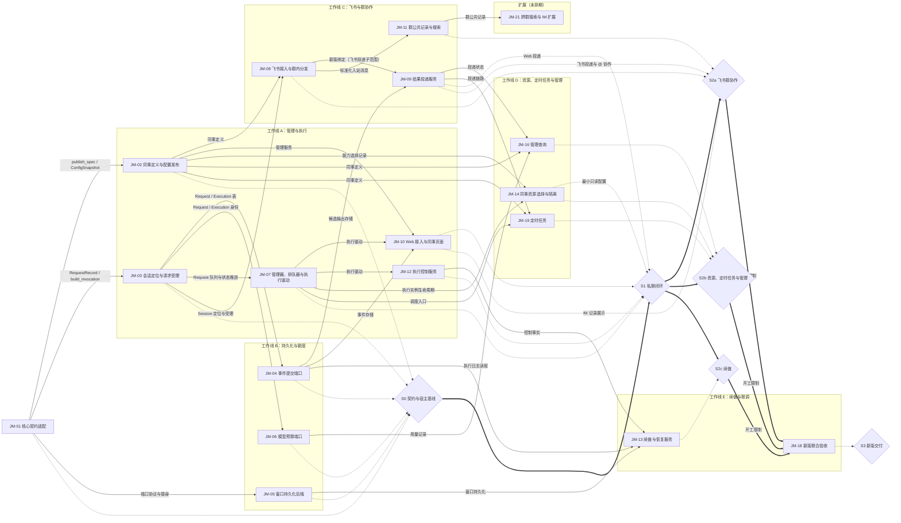
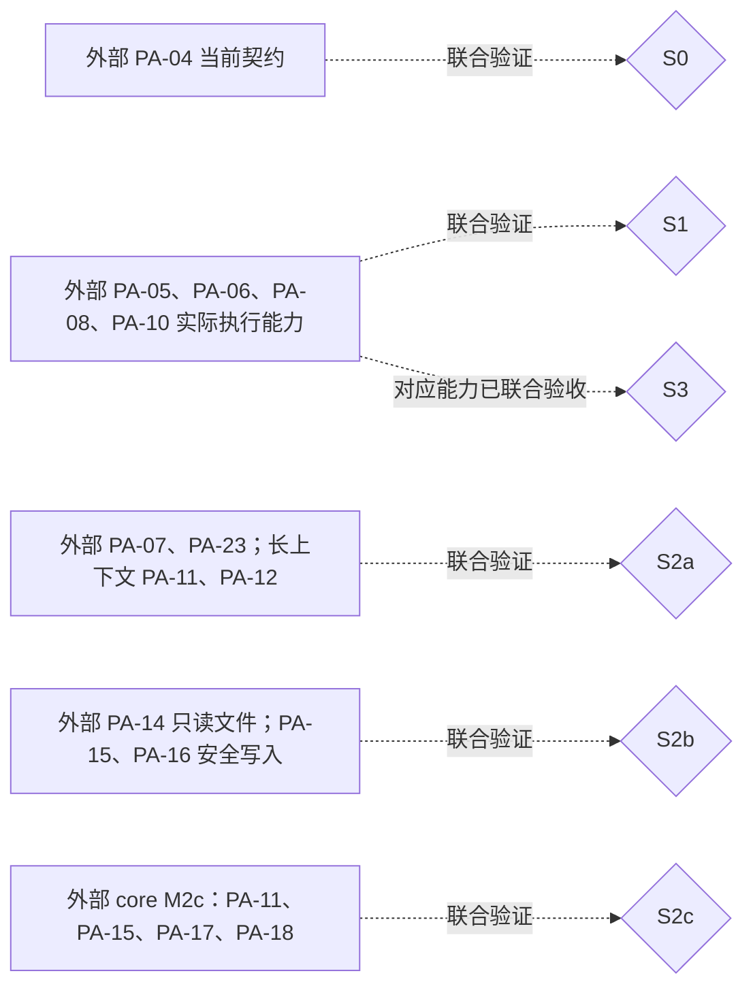
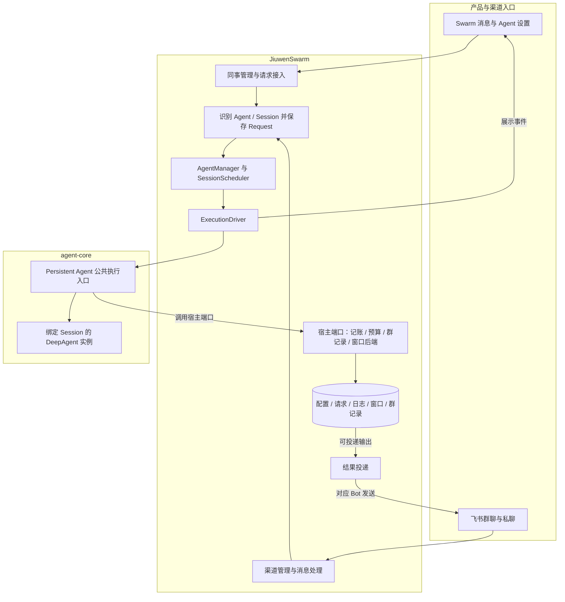

# JiuwenMate 特性开发计划

## 1. 这份计划怎么读和维护

- 计划范围：结合 agent-core 的 Persistent Agent 能力，在 JiuwenSwarm 独立开发新版 AI 同事。Swarm 负责同事管理、渠道接入、执行调度、会话与事件存储、结果投递和续做安排；agent-core 在指定 Session 内执行任务、管理模型上下文、产生过程事件与候选结果。
- 范围之外：确认恢复（需要用户确认的工具调用及 `resume_persistent_request`）、授权知识版本、跨来源失效管理、主动学习和扩展执行模式；个人版单 Agent、集群模式及个人飞书入口的既有行为不在本计划内修改。
- 所属模块：jiuwenswarm 仓 `jiuwenswarm/server/jiuwenmate/`，以及新版接入所需的 `gateway/`、`server/agent_ws_server.py` 与前端 `channels/web/frontend/src/features/jiuwenmate/`。agent-core 仓 `openjiuwen/harness/persistent_agent/` 的工作以 PA 编号登记在对端计划，本计划只引用。
- 交付分类：本期 17 项（JM-01～JM-14、JM-16、JM-18、JM-19）；扩展 1 项（JM-21）。已移出的 SW-15、SW-17、SW-20 不复用，见附录 B。
- 本轮安排：本期 17 项均为纳入；JM-21 跨群子范围已启动方案设计，代码实施与其他 IM 扩展仍未排期，不计入本期节点。
- 维护人：常钰聪。
- 更新日期：2026-10-17。
- 设计依据：
  - 本仓：[JiuwenMate 设计概览](jiuwenmate-overview.md)、[JiuwenMate 服务端架构设计](jiuwenmate-architecture.md)。
  - 对端：agent-core 仓 `jiuwenmate` 分支 `openjiuwen/harness/persistent_agent/docs/designs/` 下的 [Persistent Agent 开发计划](https://gitcode.com/huenrui_/agent-core/blob/jiuwenmate/openjiuwen/harness/persistent_agent/docs/designs/persistent-agent-development-plan.md) 与 [Persistent Agent 架构设计](https://gitcode.com/huenrui_/agent-core/blob/jiuwenmate/openjiuwen/harness/persistent_agent/docs/designs/persistent-agent-architecture.md)。
  - 参考版本：PA 编号与契约以 agent-core `jiuwenmate` 分支 commit `d016f8d7dafe741281f360a84a60e6aa4aeb9061`（2026-10-08）为准。开发验证已改用本地 core `9eb336b4`（接通 PA-06、PA-10）；`pyproject.toml` 与 `uv.lock` 只在本地修改，不随提交入库。
  - Swarm 接入基线：本地 `jiuwenmate` 分支 commit `f0a69728c`。
  - 群记录与搜索设计补充（2026-10-17）：以本地 agent-core `jiuwenmate_v0.1.20` 的 PA-23 未提交实现及其 F_23 / S_09 为接口依据，基线 HEAD 为 `ea270daca`；不将本地实现当作已发布依赖或本仓联调证据。宿主方案见 F_11、F_21。
- 关键假设与待确认项：
  - core 计划中“PA-05 已完成”目前只代表组件验收。开发验证所用 core `9eb336b4` 已接通 PA-10、PA-06，正式执行入口可以运行。PA-14 的只读工具已由 JM-14 最小只读配置接入。JM-09 Web 文本投递已实现并可查询；S1 仍待真实模型浏览器验收和节点联合验收。Feishu 真机联调与文件投递分别仍待真实渠道验证和 PA-08；群响应需 PA-07 联调；续做依赖 PA-18。
  - `namespace_id` 映射既有用户 / 工作空间边界，具体映射规则在 JM-10 接入时确定，不影响 JM-01～JM-04 的组件验证。
  - agent-core 依赖版本的入库固定方式，待对端发布可引用版本后确定。
- 术语与全局约束：见下文“术语”与“全局约束”。
- 进度摘要：本期完成 0/17，待验收 9 项（JM-01～JM-08、JM-12，宿主组件通过，联合验收待完成），进行中 6 项（JM-09、JM-10、JM-11、JM-13、JM-14、JM-16；JM-11 本地实现与验证已完成，真实联合验证待完成）；待开始 2 项（JM-18、JM-19）；扩展完成 0/1，JM-21 跨群子范围方案已编写，代码未开始。

先读本节确认范围和完成口径，再到第 2 节了解特性与验收要求，第 3 节判断开工条件和并行机会，第 4 节确认负责人、状态和证据。迁移与接入安排见附录 A，历史变更见附录 B。

- 特性是有明确责任和验收边界的开发单元；开工硬前置只列独立实现必需的直接前置（间接前置不重复列出）；交付节点 S0～S3 表示若干特性与真实依赖汇合后的可演示结果，不计入特性数。
- 新增或调整特性时，同步第 2 节定义、第 3 节图和第 4 节表。认领、开发、验证或阻塞变化时，更新第 4 节的“状态”“负责人”“证据”“最近更新”，并在同一次更新中同步对应 feature 的管理字段。
- 状态统一使用“待开始、进行中、阻塞、待验收、完成”。只通过宿主替身验证时，状态为“待验收”，并在证据中写明“宿主组件通过，联合验收待完成”。
- 代码开发前在 [features/](../features/) 建立或更新对应 feature，契约变化同步 `specs/`。本计划遵循 [docs/AGENTS.md](../AGENTS.md)，结构参照 [特性开发计划模板](../templates/feature-development-plan-template.md)。按目录约定，第 4 节的证据列名为“证据”，对应模板中的“进展说明”。
- 编号说明：JM 编号是本计划的条目编号，2026-10-13 前称 SW 编号，序号不变（`SW-01` 即 `JM-01`）。PA 编号表示 agent-core 的工作。验收编号使用 `JM-xx-V-xx`，由本计划定义，feature 沿用。

**术语**

| 名称 | 含义 |
| --- | --- |
| Agent | 持久保存的 AI 同事身份、Template 关联和配置 |
| Session | 某个同事的一段独立对话；同一群中的不同同事各有自己的 Session |
| Request | 一次任务；续做仍关联原任务 |
| Execution | 一次实际执行尝试；续做时分配新的 `execution_id` |
| 宿主端口 | Swarm 向 core 提供的记账、预算、群记录和窗口存储接口；core 契约中的可选知识端口本轮不接入 |
| 开工硬前置 | 缺少该产物就无法独立实现当前特性；不等同于全部联调条件 |

**全局约束**

| 事项 | 本次接入目标 | 对 Swarm 的影响 |
| --- | --- | --- |
| 实例生命周期 | 业务 Agent 持久存在；每次活动 Execution 使用绑定指定 Session 的原生 DeepAgent 实例，结束后清理；并行 Session 使用不同实例 | AgentManager 管理业务 Agent、排队和执行任务，不缓存供所有 Session 共用的 DeepAgent；飞书连接由渠道管理器维持，不依赖模型实例常驻 |
| 主动响应 | PA-07 在 core 内做独立轻量模型判断，人类与 Agent 消息走同一流程；被 @ 也可忽略，未被 @ 也可参与 | Swarm 提供原始消息、职责配置和可查询群记录，不自行调用另一套响应判断模型，也不把 @ 等同于必须执行 |
| 跨群查询 | 本地 PA-23 已将 `recent_messages` 定位为当前 Session 群，`search_messages` 定位为 Agent 当前授权群；私有窗口检索仍是独立能力 | JM-11 提供每群公共记录、扫描和底层搜索，JM-21 接入 Agent 授权目标解析与跨库合并；不重复开发搜索工具，不读取其他 Session 私有窗口；真实宿主实现与联调尚未完成 |

- 新版 AI 同事使用独立数据和运行入口，可调用通用接口，但不读取或转换旧版 AI 同事数据。
- 只使用 core 公共导出类型和执行入口，不从其内部 `execution/`、`schema/` 私有实现拼装第二条执行链。
- 同一 Session 同时只有一个活动 Execution；停止或取消只作用于目标 Execution。
- 一个 Request 的续做固定使用原 Spec；新配置只影响新 Request。
- `CommitPort.record` 是事件唯一的持久化入口，执行流只用于展示；Swarm 持续消费到流结束，前端断线不取消执行。
- 会话窗口由 core 的 WindowStore 管理格式；Swarm 提供持久化 `BaseKVStore`，不直接修改窗口内容。
- 按所需 PA 能力逐项联调，不把 core 的整个 M1 / M2a / M2b 节点作为硬前置。

## 2. 要开发的特性

每个特性与第 3 节节点、第 4 节行一一对应。验收标准写预期，实际执行结果统一写在第 4 节“证据”列。

计划重点覆盖五类共享场景，每类指定一个主责特性：

- 多 Bot 收到同一消息时遗漏某个同事或重复执行（主责 JM-08）。
- 前端断线导致后台任务退出（主责 JM-10）。
- 停止 / 取消误伤其他 Session（主责 JM-12）。
- 日志缺失被误判为工具未执行（主责 JM-13）。
- 结果投递失败导致业务任务重跑（主责 JM-09）。

架构第 11.5 节的检查主题在各主责特性的“来源验证点”中关联到验收 ID。

### JM-01 核心契约适配

- **目标与范围：** 固定 SDK 版本，建立宿主与 core 公共协议之间的转换，并补齐契约测试。包含配置发布为 Spec 快照、由存储记录组装单次调用，以及宿主端口替身；不包含调用 core 执行入口。
- **责任与契约：** `spec_provider.py`、`execution_models.py`。输出 `ConfigSnapshot`，以及由 `build_invocation` 组装的 `PersistentAgentSpec` 与 `PersistentBuildContext`；校验失败抛出 `PersistentContractError`。宿主开放的能力取 core 支持集合与宿主开放集合的交集。
- **开工硬前置：** 无。
- **独立验证入口：** `tests/unit_tests/server/jiuwenmate/test_core_contract.py`。
- **独立验证条件：** 使用真实 agent-core 公共类型和宿主端口替身，不需要真实模型或执行入口。
- **验收标准：**
  1. JM-01-V-01：合法的 Spec、ExecutionContext 和 RequestInput 被 core 接受，单轮字段被固定。
  2. JM-01-V-02：字段错配、core 不支持或宿主未开放的能力在发布时被拒绝；core 入口对同类值同样拒绝。
  3. JM-01-V-03：快照被篡改、Request 配置版本不符、能力快照不符或请求续做时，拒绝组装调用。
  4. JM-01-V-04：宿主端口替身的签名与返回类型符合 core 协议。
  5. JM-01-V-05：core 正式执行入口在 PA-10 接入前拒绝执行（哨兵测试）；PA-10 接入后须改写该测试。
- **来源验证点与共享场景：** 架构第 11.5 节“版本与调用隔离” → JM-01-V-03 → 主责 JM-01，协同 JM-03 → S0（组件）、S1（真实执行）。
- **前端独立验证：** 不适用。
- **联合交付与开放条件：** 参与 S0；真实执行在 S1 与 PA-05、PA-10 联合验证。
- **设计索引：** [F_01 核心契约适配](../features/F_01_core-contract.md)；架构第 4.1、4.3 节。

### JM-02 同事定义与配置发布

- **目标与范围：** 支持自定义创建同事、首次使用时自动创建默认小九（不重复创建）、读取与修改设置、发布和删除。同事与 Template 一对一，新版数据独立保存，Request 固定配置快照。不包含管理接口与页面（JM-10）和资源装配（JM-14）。
- **责任与契约：** `models.py`、`repository.py`、`service.py`；数据位于 `~/.jiuwenswarm/jiuwenmate/`。`PersistentAgentService` 是唯一管理入口，`current_snapshot` 提供新 Request 所固定的版本；对外视图不含 Spec 和模型凭据。
- **开工硬前置：** JM-01 的 `publish_spec` 与 `ConfigSnapshot`。
- **独立验证入口：** `tests/unit_tests/server/jiuwenmate/test_persistent_agent_service.py`。
- **独立验证条件：** 使用真实 SQLite 与 Template 文件，模型目录使用替身；本机模型配置可做冒烟发布。
- **验收标准：**
  1. JM-02-V-01：首次使用只创建一次默认小九；多个服务实例共享同一存储时也不重复创建；删除后不再创建；无可用模型时创建但不发布。
  2. JM-02-V-02：自定义创建和从 Template 创建都生成独立 Template 并发布 v1；同事与 Template 一对一；创建失败不留下文件或记录。
  3. JM-02-V-03：设置修改在发布前不影响 Request；发布未变化的设置时沿用原版本；模型凭据轮换时产生新版本；保存失败时恢复旧 Template；过期 revision 的写入被拒绝。
  4. JM-02-V-04：删除后同事及其版本不可见；不同数据空间互相隔离；对外视图不含模型凭据。
  5. JM-02-V-05：非法设置被拒绝；模型经现有模型目录解析。
- **来源验证点与共享场景：**
  - 架构第 11.5 节“身份和默认初始化” → JM-02-V-01 → 主责 JM-02 → S0。
  - “保存与发布” → JM-02-V-03 → 主责 JM-02 → S0。
  - “权限与凭据”的查询脱敏部分 → JM-02-V-04 → 主责 JM-02，协同 JM-10 → S1。
- **前端独立验证：** 不适用；页面入口在 JM-10。
- **联合交付与开放条件：** 参与 S0；页面可见小九须待 JM-10 接入。
- **设计索引：** [F_02 同事定义与配置发布](../features/F_02_colleague-management.md)；架构第 4.1、4.2、7.3 节。

### JM-03 会话定位与请求受理

- **目标与范围：** 建立 Session / Request / Execution 关联仓库和新版群会话映射。Session 定位、Request 幂等受理、Request 状态推进和重启查询属于本项；串行调度（JM-07）与公共群记录（JM-11）不属于本项。
- **责任与契约：**
  - 文件：`execution_repository.py`、`group_chat_repository.py`、`sqlite_store.py`，以及 `execution_models.py` 中的 `ConversationRef`、`SessionRecord`、`RequestState`。
  - Session 按 (namespace, agent, 会话类型, 渠道, 会话键) 分列唯一约束定位，`session_id` 随机生成。
  - Request 按 (namespace, agent, source_ref) 幂等受理。
  - 派发时，若同一 Session 已有已派发的 Request，返回 `SESSION_BUSY`。
- **开工硬前置：** JM-01 的 `RequestRecord` 与 `build_invocation`。
- **独立验证入口：** `tests/unit_tests/server/jiuwenmate/test_request_routing.py`。
- **独立验证条件：** 使用真实 SQLite 与真实 core 类型；配置快照由 JM-02 服务提供。
- **验收标准：**
  1. JM-03-V-01：
     - 同一同事在同一群复用 Session；同一群中不同同事各有 Session。
     - Web 私聊与 IM 私聊使用不同 Session；不同数据空间互相隔离。
     - 过长或含分隔符的会话 ID 不会碰撞。
  2. JM-03-V-02：
     - 补充消息是同一 Session 中的新 Request。
     - 平台重复投递同一事件时，返回已存储的 Request；同一事件送达两个同事时，生成两个 Request。
     - Request 类型与会话不符时拒绝。
  3. JM-03-V-03：Request 固定受理时的已发布版本；属于其他同事的快照或未发布的同事被拒绝。
  4. JM-03-V-04：同一 Session 同时只有一个已派发 Request；重复结束时保持原结果。
  5. JM-03-V-05：重启后可查回排队中和已派发的 Request；由存储记录可重建合法的 core 调用。
- **来源验证点与共享场景：** 架构第 11.5 节“版本与调用隔离” → JM-03-V-03 → 协同 JM-03（主责 JM-01）→ S0、S1。
- **前端独立验证：** 不适用。
- **联合交付与开放条件：** 参与 S0；调度与渠道接入后在 S1、S2a 联合验证。
- **设计索引：** [F_03 会话定位与请求受理](../features/F_03_session-request.md)；架构第 2.1、6.1、9.2 节。

### JM-04 事件提交端口

- **目标与范围：** 实现 `ports/commit.py` 及事件与候选输出的存储。在 AgentServer 启停时持有队列由 JM-07 完成，不属于本项。
- **责任与契约：** `HostCommitPort` 实现 core `CommitPort`：
  - `tool.intent`、`execution.paused`、`execution.final` 等关键事件同步落盘，失败时抛出异常。
  - 普通事件经 `CommitQueue` 后台写入，失败时只留下日志缺口。
  - final 在同一事务中补存它引用的候选。
  - `read_execution_log` 只允许读取同一 Session、同一 Request 中的执行日志。
- **开工硬前置：** JM-03 的 Request 与 Execution 表（用于事件归属校验）。
- **独立验证入口：** `tests/unit_tests/server/jiuwenmate/test_commit_port.py`。
- **独立验证条件：** 使用真实 SQLite；通过继承真实仓库的替身注入写入故障；使用真实 core 事件类型。
- **验收标准：**
  1. JM-04-V-01：普通事件按 `local_seq` 读回；同一 event_id 重交只存一次；同 ID 不同内容被拒绝。
  2. JM-04-V-02：普通事件写入失败不阻断后续关键事件；关键事件写入失败时抛出异常。
  3. JM-04-V-03：final 缺少候选时被拒绝且不保存；候选写入失败或尚在队列中时，由 final 补存；候选与 final 重交后保持原 ID。
  4. JM-04-V-04：output_id 不被其他事件复用；每个 Execution 至多一个 final 或 paused。
  5. JM-04-V-05：其他 Execution 的事件和其他 Request 的日志读取被拒绝；重启后日志仍在。
  6. JM-04-V-06：关闭后的队列拒绝普通事件，并写完已入队的事件；端口满足 core `CommitPort` 协议。
- **来源验证点与共享场景：** “日志缺失被误判为工具未执行”场景的日志缺口语义 → JM-04-V-02 → 协同 JM-04（主责 JM-13）→ S2c。
- **前端独立验证：** 不适用。
- **联合交付与开放条件：** 参与 S0；与真实执行的联调在 S1，对端为 PA-04、PA-08。
- **设计索引：** [F_04 事件提交端口](../features/F_04_commit-port.md)；架构第 6.2、6.3、7.2 节。

### JM-05 窗口持久化后端

- **目标与范围：** 实现 `ports/window_backend.py`，提供持久化后端，支持 Session 隔离、保留期和删除清理。不包含窗口内容格式，该格式由 core 管理。
- **责任与契约：** 提供符合 `BaseKVStore` 的持久化实现，并注入 `PersistentPorts.window_backend`；数据按 namespace / Session 隔离，且与 Agent 文件工具隔离。
- **开工硬前置：** JM-01 的端口协议适配与替身。
- **独立验证入口：** `tests/unit_tests/server/jiuwenmate/test_window_backend.py`；删除同事时的清理见 `test_persistent_agent_service.py`。
- **独立验证条件：** 后端组件可用真实存储独立验证；core 的加载与保存须使用真实 core 窗口组件。
- **验收标准：**
  1. JM-05-V-01：服务重启后，窗口状态与归档仍可加载；core 能经该后端加载和保存状态与归档。
  2. JM-05-V-02：A Session 不能读写 B Session 的窗口；Agent 文件工具读不到窗口数据。
  3. JM-05-V-03：保留期到期或删除同事 / Session 时，相关数据被清理；生产配置拒绝内存后端。
- **来源验证点与共享场景：** 无。
- **前端独立验证：** 不适用。
- **联合交付与开放条件：** 参与 S0；长上下文在 S2a 与 PA-10～PA-12 联合验证。
- **设计索引：** [F_05 窗口持久化后端](../features/F_05_window-backend.md)；架构第 7.1、7.3 节。

### JM-06 模型预算端口

- **目标与范围：** 实现 `ports/budget.py`，覆盖模型准入、额度预留、用量结算和查询。
- **责任与契约：** 实现 `BudgetPort.admit(execution, model_call_id)` 与 `report(execution, model_call_id, usage)`。群额度共享计算并原子准入；按模型调用身份防止重复结算。
- **开工硬前置：** JM-03 的 Request / Execution 身份。
- **独立验证入口：** `tests/unit_tests/server/jiuwenmate/test_budget_port.py`。
- **独立验证条件：** 使用真实存储和并发构造；core 调用方可用替身代替。
- **验收标准：**
  1. JM-06-V-01：同一群多个 Agent 同时申请额度时不超卖；准入被拒绝时不调用模型。
  2. JM-06-V-02：重复 report 不重复计费；usage 未知时不记为零消耗。
  3. JM-06-V-03：额度恢复留下可验证的依据，供续做判断使用。
- **来源验证点与共享场景：** 无。
- **前端独立验证：** 不适用。
- **联合交付与开放条件：** 参与 S0；真实执行时与 PA-05、PA-07、PA-11 联合验证。
- **设计索引：** [F_06 模型预算端口](../features/F_06_budget-port.md)；架构第 9.3 节。

### JM-07 同事管理器、Session 排队器与执行驱动

- **目标与范围：** 新建 AgentManager、SessionScheduler 和 ExecutionDriver，负责 Session 排队、容量控制、执行任务的生命周期，以及调用 core 的执行 / 停止 / 取消入口。另外接手 JM-04 和 JM-02 的遗留：
  - 在 AgentServer 启停时持有 `CommitQueue`，执行收尾时释放候选副本；
  - 删除同事时处理其排队中的 Request；
  - 每次执行经 JM-05 的 `WindowBackendStore.bind` 注入窗口后端，并定时调用 `purge_expired`；
  - 注入 JM-06 的 `HostBudgetPort`，并回收已准入但未 report 的悬挂预留。
- **责任与契约：** 使用 JM-01 的 `build_invocation` 组装调用，调用 `execute_persistent_request` / `abort_persistent_request`。等待流结束且 core 清理完成后，才释放 Session 占用。
- **开工硬前置：** JM-03 的 Request 队列与 `start_execution` / `finish_request`（JM-01 经 JM-03 间接满足）。
- **独立验证入口：** `tests/unit_tests/server/jiuwenmate/test_session_scheduler.py`。
- **独立验证条件：** 调度可用 core 执行入口替身验证；正式执行须待 PA-10 接通。
- **验收标准：**
  1. JM-07-V-01：同一 Session 串行执行；不同 Session 在容量内并发，并使用不同实例。
  2. JM-07-V-02：控制只作用于目标 Execution；流结束且清理完成后才释放 Session 占用。
  3. JM-07-V-03：新 Request 与非确认续做走同一调度入口；全局与 Agent 级并发上限、排队上限生效。
  4. JM-07-V-04：`CommitQueue` 随 AgentServer 启停；执行异常收尾时释放候选副本；删除同事时，其排队中的 Request 按约定结束；每次执行注入的窗口后端绑定到本 Session，过期归档按保留期清理；执行异常结束后不留下悬挂的预算预留。
- **来源验证点与共享场景：** 架构第 11.5 节“顺序、控制与关闭” → JM-07-V-02 → 主责 JM-07，协同 JM-12 → S1。
- **前端独立验证：** 不适用。
- **联合交付与开放条件：** 参与 S1；正式执行联调依赖 JM-04～JM-06 及 PA-05、PA-06、PA-10；续做再联调 PA-17、PA-18。
- **设计索引：** [F_07 同事管理器、Session 排队器与执行驱动](../features/F_07_execution-driver.md)；架构第 4.3、5.2 节。

### JM-08 飞书接入与群内分发

- **目标与范围：** 为新版 AI 同事接入现有飞书连接能力，新建消息标准化和群内分发逻辑。个人版飞书路由保持原状。
- **责任与契约：** `server/jiuwenmate/feishu_group_fanout.py` 负责调用绑定解析器、标准化 Feishu 事件并按接收通道 `app_id` 路由到唯一 namespace / Agent；再按平台事件身份生成稳定 `source_ref`，交给 JM-03 受理。入口接入 `message_handler.py` 与 Feishu channel，个人版既有路由保持不变。
- **开工硬前置：** JM-02 的同事定义；JM-03 的 Session 定位与受理。
- **独立验证入口：** `tests/unit_tests/gateway/test_persistent_group_fanout.py`。
- **独立验证条件：** 组件验证使用飞书事件样本；真机验证须使用测试应用、测试群，并具备应用接收权限。
- **验收标准：**
  1. JM-08-V-01：绑定 app_id 后正确定位新版 Agent；群聊 / 私聊来源，以及 @、回复、发送者和附件信息完整传入。
  2. JM-08-V-02：重复事件不重复派发，同一平台事件的 `source_ref` 保持不变；多个目标 Agent 之间不互相去重；绑定 Bot 收到经校验的群事件即允许其 Agent 接入，不新增群白名单或工作空间权限。
  3. JM-08-V-03：人类与 Agent 的消息都进入 core 判断；个人版飞书路由不变。
- **来源验证点与共享场景：** “多 Bot 收到同一消息时遗漏某个同事或重复执行” → JM-08-V-02 → 主责 JM-08，协同 JM-03 → S2a。
- **前端独立验证：** 不适用。
- **联合交付与开放条件：** 参与 S2a；PA-07 就绪后才放行群执行。
- **设计索引：** [F_08 飞书接入与群内分发](../features/F_08_feishu-group-fanout.md)；架构第 5.3、9.1 节及附录 A。

### JM-09 结果投递服务

- **目标与范围：** 新建结果投递服务，实现新版 Web 与 Feishu 的终态结果投递；Web / Feishu 文本是本次实现子范围，文件按 PA-08 门控。Agent 主动协作发送若纳入产品范围，须另定触发契约；PA-15 仅在其通过有副作用工具触发时承担意图记账，不提供发送接口。
- **责任与契约：** `AgentManager` 在 JM-04 final 持久化后唤醒 `ResultDeliveryService`；JM-04 在同一事务中保存 final 引用和投递账本。Web 文本从 JM-10 Request / history 查询；飞书文本由 AgentServer 按 JM-08 入站时固定的路由快照，经 Gateway 专用 E2A 发送并持久化平台 ACK。文件与其他副作用范围按 PA 契约门控；生成成功不等于外部发送成功。
- **开工硬前置：** JM-04 候选输出存储；Web 查询投影依赖 JM-10.02，飞书文本依赖 JM-08 绑定与 Request 路由快照。文件子范围依赖 PA-08；如 Agent 通过有副作用工具发起协作发送，则该工具的意图记账依赖 PA-15，但 PA-15 本身不提供消息发送接口。
- **独立验证入口：** `tests/unit_tests/server/jiuwenmate/test_commit_port.py`、`test_web_private_chat.py`、`test_feishu_group_production_wiring.py` 与 Gateway 的 `test_persistent_group_fanout.py`。
- **独立验证条件：** Web / Feishu 文本路径可用 SQLite、E2A 与 SDK 替身验证；平台实际送达须使用真实 Feishu 测试应用与群；真实 Agent 端到端执行按 S1 / S2a 的 core 联合条件验证。
- **验收标准：**
  1. JM-09-V-01：使用当前 Agent 对应的 Bot 向正确的群发送，保留真实的 @ / 回复关系；A @ B 后由 B 的入站链路继续处理，不在内部代为执行。
  2. JM-09-V-02：群里不泄露判断或工具过程；文件上传和发消息分别记录。
  3. JM-09-V-03：
     - 发送失败不导致任务重跑；重复交接不重复发起正常发送。
     - 平台已接收但本地未保存回执时，按平台幂等标识或消息查询核对；无法确认时保留待核实状态，不盲目重发。
- **来源验证点与共享场景：**
  - “结果投递失败导致业务任务重跑” → JM-09-V-03 → 主责 JM-09 → S2a。
  - 架构第 11.5 节“阶段完成与未知结果” → JM-09-V-03 → 主责 JM-09，协同 JM-13 → S2a、S2c。
- **前端独立验证：** 不适用。
- **联合交付与开放条件：** 文本 Web 投递参与 S1，文本飞书投递参与 S2a。真实 Agent 执行需对应 core 执行链集成；群内 Agent 响应另需 PA-07 的 AgentServer 联调。文件子范围依赖 PA-08；中途协作发送只有在明确其触发契约后才接入，若为有副作用工具则与 PA-15 联合验收。详见 [F_09](../features/F_09_web-and-feishu-result-delivery.md) 的剩余闭环条件。
- **设计索引：** [F_09 Web 与飞书结果投递](../features/F_09_web-and-feishu-result-delivery.md)；架构第 6.3、8.2 节。

### JM-10 Web 接入与同事页面

- **目标与范围：** 在 `agent_ws_server.py` 接入独立的后台消费，并让前端 `channels/web/frontend/src/features/jiuwenmate/` 和消息组件对接服务端。同事管理部分只依赖 JM-02，可以先行开发；群展示随 JM-08、JM-09 验收。
- **责任与契约：** 把服务端事件转换为产品协议，不向前端暴露 core 运行对象。打开同事页时，先调用 JM-02 的 `ensure_default_colleague`，再加载同事列表。
- **开工硬前置：** JM-02 的管理服务；JM-04 的事件存储；JM-07 的执行驱动。其中同事管理子范围只需 JM-02。
- **独立验证入口：** 前端同事页；Web 断开与状态重查测试放在 `tests/integration_tests/jiuwenmate/`（已建立，见 [F_10_02](../features/F_10_02_web-private-chat.md)）。
- **独立验证条件：** 前端可依据接口契约和模拟数据独立验证；断线续跑须有真实后端。
- **验收标准：**
  1. JM-10-V-01：创建、设置、发消息、查历史和查状态均可用；打开同事页后小九可见。
  2. JM-10-V-02：Web 断开后任务继续执行，重连能查询到结果；收到 final / paused 后仍消费到流结束。
  3. JM-10-V-03：不把模型中间文本误报成最终结果；个人版事件的含义不变。
- **来源验证点与共享场景：** “前端断线导致后台任务退出” → JM-10-V-02 → 主责 JM-10，协同 JM-07 → S1。
- **前端独立验证：** 在同事页使用模拟接口，核对加载、空列表、成功、失败和重复操作等状态。同事管理子范围已改为调用后端；私聊、历史与状态已接入后端，并经 core 正式执行入口验证（模型为替身）；真实模型的浏览器验收待 S1。
- **联合交付与开放条件：** 参与 S1；IM 记录展示参与 S2a。
- **设计索引：** 同事管理子范围见 [F_10 Web 同事管理接入](../features/F_10_web-colleague-management.md)；其余子范围开工前建档；架构第 4.4 节。

### JM-11 群公共记录与搜索

- **目标与范围：** 为新版群聊建立每群独立保存的公共记录、当前群扫描与底层搜索服务，实现 `ports/group_chat.py`；跨群范围解析与多库合并由 JM-21 消费同一服务。跨来源失效管理不在本轮验收范围内。
- **责任与契约：**
  - 在 `group_chat_repository.py` 中扩展公共记录，新增 `conversation_archive.py`、`conversation_search.py`、`conversation_resources.py`。
  - 群数据放在所有者数据根目录的 `jiuwenmate/group_messages/<group_id>/messages.sqlite3` 与 `attachments/`，不增加 `local` / namespace 路径层；代码和数据库继续按 namespace 隔离，内部群 ID 在同一根目录唯一。
  - Agent—群访问关系放在现有 `agents.sqlite3`，由宿主依据当前绑定和 Bot 成员事实维护；不放进 Agent 办公目录。
  - 实现 `GroupChatPort.recent_messages` 及共享搜索适配入口；JM-21 补齐同一 `search_messages` 的跨群授权与合并，未开放时明确不可用，不能静默退化为只查询当前群。
  - core 只经端口读取群记录，不直接访问归档路径。
- **开工硬前置：** JM-08 的标准化入站消息（JM-03 的群映射经 JM-08 间接满足）。
- **独立验证入口：** `tests/unit_tests/server/jiuwenmate/test_group_chat_port.py`；`test_feishu_group_production_wiring.py`、`test_commit_port.py`；`tests/integration_tests/jiuwenmate/test_group_records_real_core.py`（真实 core 与宿主、模型替身）。
- **独立验证条件：** 可用标准化消息样本做组件验证；真机多 Bot 场景在 S2a 验证。
- **验收标准：**
  1. JM-11-V-01：同一群只维护一份逻辑公共记录；多个 Bot 重复接收同一消息时不重复写入。
  2. JM-11-V-02：最近消息按游标读取，支持 PA-23 从触发消息向后的补读，最终背景排除触发消息；底层检索结果带来源与完整性状态，跨群工具开放另按 JM-21 验收。
  3. JM-11-V-03：撤回的消息不返回正文；权限未知时不读取；读取失败不伪装成空记录；不读取旧版群记录。
- **来源验证点与共享场景：** 无。
- **前端独立验证：** 不适用。
- **联合交付与开放条件：** 当前群读取参与 S2a，直接对接 PA-07、PA-23；跨群搜索按 JM-21 子范围单独开放。PA-11、PA-12 参与后续长上下文联合场景，不是归档、当前群读取或跨群搜索的开工硬前置。真实执行需另核对最新 core 的容量配置与可靠计数支持。
- **设计索引：** [F_11 群公共记录与搜索](../features/F_11_group-public-records.md)；[F_21 跨群搜索](../features/F_21_cross-group-search.md)。

### JM-12 执行控制服务

- **目标与范围：** 新增 `execution_control_service.py`，接入 Web 和飞书的停止与取消入口。不接入确认卡片，也不接入 `resume_persistent_request`。
- **责任与契约：** 校验控制权限，记录控制事实，经 JM-07 调用 `abort_persistent_request(context, reason="stop" / "cancel")`。
- **开工硬前置：** JM-07 的执行驱动（JM-03 经 JM-07 间接满足）。
- **独立验证入口：** `tests/unit_tests/server/jiuwenmate/test_execution_control_service.py`。
- **独立验证条件：** 可用执行驱动替身验证；真实中止已在 core `9eb336b4` 下以模型替身验证。
- **验收标准：**
  1. JM-12-V-01：只有发起人或被授权的管理者可以控制目标 Execution。
  2. JM-12-V-02：重复的控制请求不重复执行；停止 / 取消只影响当前 Session。
  3. JM-12-V-03：收尾异常时仍保留控制事实，不误触发自动续做。
  4. JM-12-V-04：经 core 正式中止入口，停止与取消在模型输出中途生效，会话随后可继续。
  5. JM-12-V-05：Web 页面可停止处理中的消息、取消排队中的消息。
- **来源验证点与共享场景：**
  - “停止 / 取消误伤其他 Session” → JM-12-V-02 → 主责 JM-12，协同 JM-07 → S1。
  - 架构第 11.5 节“权限与凭据”的业务主体检查部分 → JM-12-V-01 → 主责 JM-12，协同 JM-10 → S1。
- **前端独立验证：** 停止 / 取消按钮的交互随 JM-10 验证。
- **联合交付与开放条件：** 参与 S1，对端为 PA-05。
- **设计索引：** [F_12](../features/F_12_execution-control.md)；架构第 8.3、9.1 节。

### JM-13 续做与恢复服务

- **目标与范围：** 新增 `recovery_service.py`，实现重启扫描、执行异常核对、停止后继续，以及条件恢复后的重新排队。
- **责任与契约：** 依据 JM-04 的执行日志和 JM-03 的 Request 状态，决定哪个 Request 在何时再次执行；续做推理与窗口恢复由 core 负责。
- **开工硬前置：**
  - JM-04 的执行日志读取；
  - JM-05 的窗口持久化；
  - JM-12 的控制事实（JM-07 经 JM-12 间接满足）。
- **独立验证入口：** `tests/unit_tests/server/jiuwenmate/test_recovery_service.py`。
- **独立验证条件：** 可用 core 替身构造中断与日志缺口；自动续做须与真实 core 联合验证。
- **验收标准：**
  1. JM-13-V-01：只核对本次 Execution 的 final / paused；没有结束记录且未被主动停止 / 取消时，等旧执行退出后再续做。
  2. JM-13-V-02：续做沿用原 Request 和原 Spec，`recovery_ref` 指向正确的执行；预算等条件未改变时，不反复续做。
  3. JM-13-V-03：缺少工具结果时先查证，不推断为“未执行”；已保存 final 后即使清理异常，也不重跑。
- **来源验证点与共享场景：** “日志缺失被误判为工具未执行” → JM-13-V-03 → 主责 JM-13，协同 JM-04 → S2c。
- **前端独立验证：** 不适用。
- **联合交付与开放条件：** 参与 S2c；自动续做的放行依赖 PA-11、PA-15、PA-17、PA-18。
- **设计索引：** [F_13](../features/F_13_recovery.md)；架构第 8.3 节。

### JM-14 同事资源选择与隔离

- **目标与范围：** 为新版同事建立资源选择与隔离能力，调用现有的 Skill、MCP、插件管理接口，并开放工作空间只读能力。需要用户确认或来源失效管理的操作暂不开放。
- **责任与契约：**
  - 新版 `capabilities.py`、`resource_scope.py`、`resource_bootstrap.py`、`agent_workspace.py`，负责装配 JM-02 记录的能力选择。
  - 在 `spec_provider.HOST_OPEN_FEATURES` 中开放对应能力。
  - 安装、选择和凭据管理仍属于 Swarm。
- **开工硬前置：** JM-02 的能力选择记录；JM-07 的执行实例生命周期。
- **独立验证入口：** `tests/unit_tests/server/jiuwenmate/test_resource_scope.py`（最小只读配置部分已建立）；`tests/integration_tests/jiuwenmate/test_web_real_core.py` 的读取用例。
- **独立验证条件：** 资源隔离可用本机资源目录验证；写操作须有 PA-15、PA-16 的意图记账。
- **验收标准：**
  1. JM-14-V-01：每个同事独立选择 Skill / MCP / 插件；不同执行不覆盖全局环境和凭据。
  2. JM-14-V-02：Session 私有草稿不被其他 Session 读取；共享文件冲突可识别。
  3. JM-14-V-03：只开放无需人工确认、且已接入意图记账的写操作；清理一个实例不卸载其他实例的工具。
- **来源验证点与共享场景：** 无。
- **前端独立验证：** 资源选择交互随 JM-10 的同事设置页验证。
- **联合交付与开放条件：** 最小只读配置参与 S1，完整范围参与 S2b；读取依赖 PA-14，写入依赖 PA-15、PA-16（已在 core `9eb336b4` 接入，见 [F_14](../features/F_14_workspace-read.md)）。
- **设计索引：** [F_14](../features/F_14_workspace-read.md)。办公目录读写见第 2–9 节；Skill / MCP / 插件发布装配见第 11 节（2026-10-16）。知识选择仍只记录。架构第 4.2、9.2 节。

### JM-16 管理查询

- **目标与范围：** 依据同事定义、执行事件与投递状态提供只读管理查询。本轮只接办公室「活跃数据」页签：全员的数据概览、热力图和排行榜，以及个体的工作记录和群聊表。办公室「任务中心」看板不在本轮，保持现有样例页面。
- **责任与契约：** 只读查询，不改变执行或投递状态；权限过滤与入口一致。本轮查询只服务活跃数据，不提供任务中心的状态分列，也不展开一次 Request 的多次 Execution。
- **开工硬前置：** JM-02 的同事定义；JM-06 的用量记录；JM-09 的投递状态（JM-04 经 JM-09 间接满足）。
- **独立验证入口：** `tests/unit_tests/server/jiuwenmate/test_management_query.py`（待建立）。
- **独立验证条件：** 可用构造的事件与投递数据独立验证。
- **验收标准：**
  1. JM-16-V-01（任务中心，本轮不验收）：查询能区分排队、执行中、暂停、结束和发送失败；能从一个 Request 查到其多次 Execution。
  2. JM-16-V-02（活跃数据）：统计调用次数 / Token 用量及渠道；ignored 不计为回复，也不计为失败。
  3. JM-16-V-03：活跃数据查询的权限过滤与入口一致。
- **来源验证点与共享场景：** 无。
- **前端独立验证：** 办公室「活跃数据」页签使用构造数据验证。任务中心不接入。
- **联合交付与开放条件：** 参与 S2b。
- **设计索引：** [F_16 管理查询](../features/F_16_management-query.md)；架构第 4.4 节。

### JM-18 新版联合验收

- **目标与范围：** 串联两仓的集成测试、个人版回归和新版功能开放，核对所有共享入口的差异。
- **责任与契约：** 组织真实链路验收，引用各主责特性的结论，不重复维护各项的验收要求。
- **开工硬前置：** 开工限制为 S2a、S2b、S2c 通过（S1 经这三个节点间接满足）。这是业务开工顺序，不是技术依赖。
- **独立验证入口：** `tests/integration_tests/jiuwenmate/`（目录已由 JM-10 建立）；飞书真机验收记录。
- **独立验证条件：**
  - 使用测试应用和测试群，至少覆盖两个 Bot、两个群、一次私聊。
  - 覆盖重复事件、发送失败、停止 / 取消和服务重启。
  - 写明飞书应用的接收权限，以及对端 core 的版本。
- **验收标准：**
  1. JM-18-V-01：Web 私聊、飞书私聊、群主动响应、A @ B 协作、定时触发、停止 / 取消、断线、重启续做，均有真实证据。
  2. JM-18-V-02：个人版和集群模式不回归。
  3. JM-18-V-03：从空数据启动；新版与旧版各自读取自己的数据，不存在重复监听或重复执行。
- **来源验证点与共享场景：** 架构第 11.5 节“产品链路开放” → JM-18-V-01 → 主责 JM-18 → S3。
- **前端独立验证：** 不适用；页面链路在真实环境中验证。
- **联合交付与开放条件：** S3；全量验收要求本期其余 16 项完成，且对应已接入的 PA 能力通过联合验收。
- **设计索引：** 架构第 11.5、12.2 节。

### JM-19 定时任务

- **目标与范围：** 接入现有的定时任务管理能力，为新版同事保存计划、启停状态和触发记录。
- **责任与契约：** 新版 `scheduled_requests.py`，把到期的触发转换为普通 Request；计划的创建、启停和去重由 Swarm 负责，core 只执行 `scheduled` 请求。
- **开工硬前置：** JM-02 的同事定义；JM-07 的调度入口；JM-09 的投递链路（JM-03 经 JM-07 间接满足）。
- **独立验证入口：** `tests/unit_tests/server/jiuwenmate/test_scheduled_requests.py`（待建立）。
- **独立验证条件：** 可用可控时钟独立验证；执行使用 PA-05 的普通任务入口。
- **验收标准：**
  1. JM-19-V-01：同一次触发只创建一个 `RequestInput(kind="scheduled")`；到点后由指定同事执行。
  2. JM-19-V-02：定时任务与普通任务使用同一套预算和结果投递链路。
  3. JM-19-V-03：服务重启后，不漏触发也不重复执行；定时计划与旧版数据隔离。
- **来源验证点与共享场景：** 无。
- **前端独立验证：** 计划管理交互随 JM-10 验证。
- **联合交付与开放条件：** 参与 S2b。
- **设计索引：** feature 开工前建档；架构第 10.4 节。

### JM-21 跨群搜索与 IM 扩展（扩展）

- **目标与范围：** 按 PA-23 实现 Agent 当前授权群的跨群搜索子范围；后续 IM 平台扩展仍未排期，整项完成须分别覆盖两部分。
- **责任与契约：** 复用 JM-11 每群独立消息库与宿主访问关系，使用已扩展的 `GroupChatPort.search_messages`，从可信 Execution 解析 Agent，完成精确群过滤、跨库稳定排序分页、每页当前授权检查；不要求提问者属于目标群，不复制群正文或另建模型搜索工具。
- **开工硬前置：** JM-11 的群公共记录（作为跨群查询的数据来源）。
- **独立验证入口：** 拟建 `tests/unit_tests/server/jiuwenmate/test_cross_group_search.py`，并在跨仓集成测试验证真实 PA-23 工具；新平台验证入口另行确定。
- **独立验证条件：** 可用临时每群 SQLite 和可控成员状态端口验证合并、隔离与失败语义；真实授权、退群及私聊／跨群链路需测试应用和两个测试群。对端 PA-23 契约已具备，JM-11 数据服务与实际成员核验仍待实现。
- **验收标准：**
  1. JM-21-V-01：跨群查询只读取已授权的公开群记录，不读取其他 Session 的私有窗口。
  2. JM-21-V-02：新增平台沿用绑定 / Request / 投递模型。
- **来源验证点与共享场景：** 无。
- **前端独立验证：** 跨群检索首期复用现有对话入口，不新增搜索页面；新平台扩展另行评估。
- **联合交付与开放条件：** 不参与本期节点，单独交付。
- **设计索引：** [F_21 跨群搜索子范围](../features/F_21_cross-group-search.md)；存储和关系定义见 [F_11](../features/F_11_group-public-records.md)。

## 3. 特性依赖关系与并行开发

完整关系图覆盖第 2 节全部特性和交付节点。每条细实线对应特性定义中的一个开工硬前置，线上注明所需的最小产物；虚线表示特性参与节点的联合验收；粗实线表示约定的交付顺序或业务开工限制。



**图例：** 矩形为特性，菱形为交付节点，分组为工作线；细实线表示开工硬前置，虚线表示联合验收参与，粗实线表示约定交付顺序或业务开工限制。图中只画直接前置，间接前置在特性定义中注明。

**外部协作视图（agent-core）：** 下图只展示各交付节点所需的对端 PA 能力，用于联合验证。图中的虚线表示联合验证关系，不构成开工硬前置。图中省略了本仓特性，PA 能力的定义与状态以对端计划为准。



- **可并行开发与分工：** JM-01 完成后，JM-02、JM-03、JM-05 可以并行推进。JM-03 完成后，JM-04、JM-06、JM-07 可以并行；JM-08 需要等 JM-02 与 JM-03 都完成。JM-04 完成后，JM-09 的 Web 投递可以独立开发；JM-10 的同事管理子范围只需 JM-02，可以先于 JM-07 开发。各工作线可以使用宿主端口替身独立开发，依赖真实 core 的能力须通过对应节点的联合验收后才开放。JM-08、JM-09、JM-11 由闫祉君负责（JM-11 等待 JM-08 的标准化入站消息）；其余特性由常钰聪负责，见第 4 节。
- **联合交付：**
  - S0：JM-01～JM-06 的配置、身份、事件、窗口后端和预算各自测试通过，并明确哪些是替身。
  - S1：指定同事能收消息、回复、停止和取消；前端断线不影响执行；两个 Session 不串状态。
  - S2a：有 @ 和无 @ 的消息都能判断；A 真实 @ B 后由 B 处理；同一群共享记录，各 Agent 的私有窗口隔离；换窗后可以继续工作。
  - S2b：同事的资源配置互不干扰；定时任务按计划执行，重启后不重复触发；用量和渠道可查。任务中心的执行状态不在本轮 JM-16。
  - S2c：进程中断、关键记账失败和停止后继续，都关联到原任务；结果已保存而清理失败时不重跑；结果缺失的写操作先查证。
  - S3：从空数据创建同事，完成飞书真机协作和重启验证；个人版和集群模式回归通过；新旧数据与路由隔离。
- **范围与顺序限制：** 先完成接口与持久化基线（S0），再贯通私聊的单次执行（S1）。之后的群协作（S2a）、资源与管理（S2b）和续做（S2c）可以在各自前置完成后并行。JM-18 在 S2a、S2b、S2c 通过后才开工。JM-21 属于扩展，跨群方案已建档，代码与其他 IM 扩展仍未排期，不参与本期节点。

## 4. 开发计划与进展

本节的表格是当前进度的唯一台账，每个特性一行，每个交付节点一行；节点不计入特性数。“证据”列按“已完成范围 / 验收 ID → 验证方式与环境 → 实际结果及记录链接 → 剩余项或阻塞”的顺序填写。目前没有创建 PR，实现通过证据中的提交号追溯。

| ID / 名称 | 类型 / 交付分类 | 本轮安排 | 当前实现或交付范围 | 优先级 / 开发批次 | 工作线 / 关联节点 | 计划时间 | 状态 | 负责人 | 关联 PR | 证据 | 最近更新 |
| --- | --- | --- | --- | --- | --- | --- | --- | --- | --- | --- | --- |
| JM-01 核心契约适配 | 特性 / 本期 | 纳入 | 第 2 节全部范围 | 未评估 / 随 S0 | — / S0 | 未排期 | 待验收 | 常钰聪 | — | JM-01-V-01～V-05 → 真实 core 类型与宿主端口替身，agent-core `12cf92bd` → 提交 `7a78a10f`，2026-10-13 于 `12b619ad` 复核 32 passed，记录见 [F_01](../features/F_01_core-contract.md) → 宿主组件通过，联合验收待完成；正式执行已在 core `9eb336b4` 经 JM-10 跑通，续做待 PA-18 | 2026-10-15；同步执行入口 |
| JM-02 同事定义与配置发布 | 特性 / 本期 | 纳入 | 第 2 节全部范围 | 未评估 / 随 S0 | A / S0 | 未排期 | 待验收 | 常钰聪 | — | JM-02-V-01～V-05 → 真实 SQLite 与 Template 文件，模型目录替身；本机模型配置冒烟发布 v1 → 提交 `5f12ea8a`，2026-10-13 复核 22 passed，记录见 [F_02](../features/F_02_colleague-management.md) → 宿主组件通过，联合验收待完成；页面入口已由 JM-10 同事管理子范围接入（提交 `d934f611`）；资源装配待 JM-14 | 2026-10-15；同步提交号 |
| JM-03 会话定位与请求受理 | 特性 / 本期 | 纳入 | 第 2 节全部范围 | 未评估 / 随 S0 | A / S0 | 未排期 | 待验收 | 常钰聪 | — | JM-03-V-01～V-05 → 真实 SQLite 与真实 core 类型，与 JM-02 配置快照联调 → 提交 `952726c1`，2026-10-13 复核 16 passed，记录见 [F_03](../features/F_03_session-request.md) → 宿主组件通过，联合验收待完成；串行调度与删除同事时的排队处理已由 JM-07 承接 | 2026-10-14；同步 JM-07 |
| JM-04 事件提交端口 | 特性 / 本期 | 纳入 | 第 2 节全部范围 | 未评估 / 随 S0 | B / S0 | 未排期 | 待验收 | 常钰聪 | — | JM-04-V-01～V-06 → 真实 SQLite、故障注入替身、真实 core 事件类型 → 提交 `d0a6999c`，2026-10-13 复核 16 passed，记录见 [F_04](../features/F_04_commit-port.md) → 宿主组件通过，联合验收待完成；队列已由 JM-07 持有，AgentServer 接线已由 JM-10 完成（见 [F_10_02](../features/F_10_02_web-private-chat.md)），正式执行已在 core `9eb336b4` 经 JM-10 写入事件；文本投递账本由 JM-09 实现，文件投递待 PA-08 | 2026-10-15；同步执行入口及 JM-09 |
| JM-05 窗口持久化后端 | 特性 / 本期 | 纳入 | 第 2 节全部范围 | 未评估 / 随 S0 | B / S0 | 未排期 | 待验收 | 常钰聪 | — | 宿主组件 18 项测试通过，全目录 104 项，见 [F_05](../features/F_05_window-backend.md)；执行入口注入与定时清理已由 JM-07 完成，AgentServer 接线已由 JM-10 完成（见 [F_10_02](../features/F_10_02_web-private-chat.md)）；联合验证待 PA-10～PA-12 | 2026-10-14；同步 JM-07 |
| JM-06 模型预算端口 | 特性 / 本期 | 纳入 | 第 2 节全部范围 | 未评估 / 随 S0 | B / S0 | 未排期 | 待验收 | 常钰聪 | — | 宿主组件 15 项测试通过，全目录 119 项，见 [F_06](../features/F_06_budget-port.md)；执行入口注入与悬挂预留回收已由 JM-07 完成，AgentServer 接线已由 JM-10 完成（见 [F_10_02](../features/F_10_02_web-private-chat.md)）；联合验证待 PA-05、PA-07、PA-11 | 2026-10-14；同步 JM-07 |
| JM-07 管理器、排队器与执行驱动 | 特性 / 本期 | 纳入 | 第 2 节全部范围；AgentServer 启停接线已由 JM-10 完成 | 未评估 / 随 S1 | A / S1 | 未排期 | 待验收 | 常钰聪 | — | JM-07-V-01～V-04 → 真实 SQLite 与真实宿主端口，core 执行与中断入口为替身 → 27 项测试通过，全目录 146 项，记录见 [F_07](../features/F_07_execution-driver.md) → 宿主组件通过，联合验收待完成；AgentServer 接线已由 JM-10 完成（见 [F_10_02](../features/F_10_02_web-private-chat.md)）；正式执行入口已在 core `9eb336b4` 下经 JM-10 验收测试跑通（模型为替身，见 [F_10_02](../features/F_10_02_web-private-chat.md)）；`resume` 仍拒绝续做，重启扫描在 JM-13 工作区，续做执行待 PA-17、PA-18 | 2026-10-15 |
| JM-08 飞书接入与群内分发 | 特性 / 本期 | 纳入 | 第 2 节全部范围 | 未评估 / 随 S2a | C / S2a | 未排期 | 待验收 | 闫祉君 | — | 提交 `cef26ade`：本地 Feishu 配置的 `app_id → agent_id` 解析、Gateway→AgentServer E2A 入站及 AgentServer JM-07 条件启停已接入；未绑定个人版通道不发 E2A、不改旧路由。另在 JM-07 Request 受理时持久化 `RequestRouteSnapshot` 供 JM-09 按原 Bot / 消息关系回投。JM-08 及消息 / 附件、JM-03/07 聚焦回归 142 项通过；JM-08 路由快照 + JM-09 文本投递联合聚焦 105 项、较宽回归 249 项通过，1 项 Windows SQLite 权限断言排除，见 [F_08](../features/F_08_feishu-group-fanout.md)、[F_09](../features/F_09_web-and-feishu-result-delivery.md)。宿主组件通过，真实 Feishu 应用 / 群联调仍待执行；不新增群白名单或工作空间权限；PA-07 AgentServer 联调后开放群执行 | 2026-10-15；补充 JM-09 入站快照 |
| JM-09 结果投递服务 | 特性 / 本期 | 纳入 | Web 投递与飞书投递两个子范围 | 未评估 / Web 随 S1，飞书随 S2a | C / S1、S2a | 未排期 | 进行中 | 闫祉君 | — | 文本子范围已实现：JM-04 final + outbox 同事务、Web 结果与状态可查、Feishu Request 固定路由快照、AgentServer→Gateway→Feishu 文本 ACK；初次聚焦 101 项、联合回归 207 项通过；修复断连和 ACK 恢复边界后，最新跨 JM-08/JM-09、个人版 / 附件 / JM-03/07 回归 249 项通过，1 项 Windows SQLite 权限断言排除，详见 [F_09](../features/F_09_web-and-feishu-result-delivery.md)。真实 Feishu 与 Agent 联调待验；群响应需 PA-07 联调；文件需 PA-08；PA-15 只在协作发送作为副作用工具时提供意图记账，不提供发送接口 | 2026-10-15；文本实现与验证 |
| JM-10 Web 接入与同事页面 | 特性 / 本期 | 纳入 | 同事管理、私聊、历史、状态、流式回复与每个同事多条 Web 会话已接入；回复仍只读候选输出，投递记录留给 JM-09；IM 记录展示未做 | 未评估 / 随 S1 | A / S1、S2a | 未排期 | 进行中 | 常钰聪 | — | 同事管理 → 提交 `d934f611`，见 [F_10](../features/F_10_web-colleague-management.md)；私聊、历史、状态与流式 → 提交 `ceae1203`，多会话 → 提交 `c978f512`，见 [F_10_02](../features/F_10_02_web-private-chat.md)。宿主组件与 core `9eb336b4` 正式执行入口已验证（模型为替身）。真实模型浏览器验收待 S1，IM 记录展示待 S2a | 2026-10-15 |
| JM-11 群公共记录与搜索 | 特性 / 本期 | 纳入 | 每群消息库、宿主访问关系、归档前置、当前群扫描与底层单群搜索 | 未评估 / 随 S2a | C / S2a | 未排期 | 进行中 | 闫祉君 | — | 已实现共享归档、成员与消息实时核验、当前群端口注入及确认出站的只补归档重试；[F_11](../features/F_11_group-public-records.md) 记录验证，[S_01](../specs/S_01_group-public-records.md) 维护宿主契约。真实 core 已用模型替身验证背景进入窗口；真实飞书及生产 PA-18 配置联合验证待完成，JM-21 跨群未开放 | 2026-10-17；实现与本地验证 |
| JM-12 执行控制服务 | 特性 / 本期 | 纳入 | 第 2 节全部范围；经负责人确认先接 Web 入口，只有发起人可以控制，管理者授权与飞书入口随 JM-08 | 未评估 / 随 S1 | A / S1 | 未排期 | 待验收 | 常钰聪 | — | JM-12-V-01～V-05 → 真实 SQLite 与调度器，core 入口替身；另经 core `9eb336b4` 正式中止入口（模型为替身）→ 单测 10 项、Web 4 项、真实 core 2 项通过，jiuwenmate 单测与集成测试共 210 项；前端 `test:jiuwenmate-api` 16 项通过；记录见 [F_12](../features/F_12_execution-control.md) → 提交 `7ae2ea86`；浏览器验收待 S1；有控制事实的遗留请求由 JM-13 工作区结束，续做执行待 PA-18 | 2026-10-15 |
| JM-13 续做与恢复服务 | 特性 / 本期 | 纳入 | 第 2 节全部范围；经负责人确认先交付重启扫描与执行异常核对，中断的 Request 结束为 `paused` 并记为待续做；续做执行、停止后继续与条件恢复后重新排队待 PA-17、PA-18 | 未评估 / 随 S2c | E / S2c | 未排期 | 进行中 | 常钰聪 | — | 重启扫描与异常核对：JM-13-V-01～V-03 的宿主部分 → 真实 SQLite 与调度器，core 入口替身，日志按上一进程写入 → 8 项测试通过，jiuwenmate 单测与集成测试共 218 项；前端 `test:jiuwenmate-api` 17 项通过；记录见 [F_13](../features/F_13_recovery.md) → 未提交；续做执行待 PA-18 | 2026-10-15 |
| JM-14 同事资源选择与隔离 | 特性 / 本期 | 纳入 | 最小只读配置、办公目录写入与完整范围三个子范围 | 未评估 / 只读随 S1，完整随 S2b | D / S1、S2b | 未排期 | 进行中 | 常钰聪 | — | 最小只读配置：JM-14-V-01 只读部分 → 真实 SQLite 与 core `9eb336b4` 路径检查；真实 core 执行读取文件，模型为替身 → 单测 18 项、集成测试 2 项通过，jiuwenmate 共 274 项；前端 17 项 → 提交 `9d5b69e8`。办公目录写入：JM-14-V-02 Session 隔离、V-03 写入与意图记账 → 真实 core `9eb336b4` 的 PA-16 写入 Rail、PA-15 意图 Rail 与真实 `HostCommitPort` → jiuwenmate 单测 271 项、集成测试 12 项通过，server / gateway / channel 回归 2867 项通过、1 项跳过 → 未提交。两部分均只开放 Web 请求，记录见 [F_14](../features/F_14_workspace-read.md)，宿主组件通过。模型尚无法使用私有草稿区（core 执行头不含 `session_id`）；Skill / MCP / 插件装配随 S2b | 2026-10-15；增加写入子范围 |
| JM-16 管理查询 | 特性 / 本期 | 纳入 | 活跃数据子范围；任务中心不在本轮 | 未评估 / 活跃数据随 S2b | D / S2b | 未排期 | 进行中 | 常钰聪 | — | 活跃数据：JM-16-V-02、V-03 → 真实 SQLite 只读汇总 → `test_management_query.py` 4 passed；前端 `test:jiuwenmate-office` 7 passed、`test:jiuwenmate-api` 19 passed → 见 [F_16](../features/F_16_management-query.md)。任务中心保持样例，JM-16-V-01 本轮不验收 | 2026-10-16；接入活跃数据 |
| JM-18 新版联合验收 | 特性 / 本期 | 纳入 | 第 2 节全部范围 | 未评估 / 随 S3 | E / S3 | 未排期 | 待开始 | 常钰聪 | — | 未执行；开工限制为 S2a、S2b、S2c 通过 | 2026-10-13；编号更名 |
| JM-19 定时任务 | 特性 / 本期 | 纳入 | 第 2 节全部范围 | 未评估 / 随 S2b | D / S2b | 未排期 | 待开始 | 常钰聪 | — | 未执行；执行使用 PA-05 普通任务入口 | 2026-10-13；编号更名 |
| JM-21 跨群搜索与 IM 扩展 | 特性 / 扩展 | 未排期 | 跨群搜索宿主子范围已实现；其他 IM 扩展仍未设计 | 未评估 / — | 扩展 / — | 未排期 | 进行中 | 常钰聪 | — | 跨群授权、群名精确解析、稳定合并／分页、逐页重授权及 direct-message／group-message PA-23 接线 → 真实 SQLite、真实 core 与模型／成员服务替身；跨群、3 个执行链测试和真实 core 集成共 26 passed，JM-11 `test_group_chat_port.py` 回归 17 passed；JiuwenMate 全目录回归 345 passed、14 failed（5 项既有 Windows／本地 core 基线失败，9 项本地 agent-core PA-18 capacity 配置缺口），详见 [F_21](../features/F_21_cross-group-search.md) §8。真实飞书成员核验／Gateway 联调和其他 IM 扩展待验证／设计；未调整负责人、扩展分类或纳入本期节点 | 2026-10-17；宿主跨群子范围实现 |
| S0 契约与宿主基线 | 节点 / 本期 | 纳入 | JM-01～JM-06 组件验证；对端 PA-04 当前契约 | 顺序 1 | A、B / — | 未排期 | 进行中 | 常钰聪 | — | JM-01～JM-06 宿主组件均已通过，见各行证据 → 节点验收待核对替身清单与 PA-04 当前契约 | 2026-10-13 |
| S1 私聊闭环 | 节点 / 本期 | 纳入 | JM-07、JM-10、JM-12；JM-09 Web 投递；JM-14 最小只读配置 | 顺序 2 | A、B、C、D / — | 未排期 | 待开始 | 常钰聪 | — | JM-07、JM-10、JM-12 已接入，并在 core `9eb336b4` 下以模型替身跑通收消息、回复、停止与取消；JM-14 最小只读配置已在工作区实现，Web 请求可读取同事办公目录；JM-09 Web 投递未开始；浏览器验收与节点联合验收未完成 | 2026-10-15 |
| S1 私聊闭环 | 节点 / 本期 | 纳入 | JM-07、JM-10、JM-12；JM-09 Web 投递；JM-14 最小只读配置 | 顺序 2 | A、B、C、D / — | 未排期 | 待开始 | 常钰聪 | — | JM-07、JM-10、JM-12 已接入，并在 core `9eb336b4` 下以模型替身跑通收消息、回复、停止与取消；JM-14 最小只读配置已接入，Web 请求可读取同事办公目录；JM-09 Web 文本投递已实现并可查询；真实模型浏览器验收与节点联合验收待完成 | 2026-10-15 |
| S2a 飞书群协作 | 节点 / 本期 | 纳入 | JM-08、JM-09、JM-11；JM-10 IM 记录展示 | 顺序 3 | A、C / — | 未排期 | 待开始 | 常钰聪 | — | JM-08 宿主组件已提交 `cef26ade`；JM-09 Feishu 文本投递已实现，真实 Feishu / Agent 联调待验；JM-11 归档、当前群读取与生产接线已实现，本地真实 core 测试通过，真实飞书未验；JM-10 IM 记录展示未开始；真实群主动响应与 @ 协作未验收，JM-21 跨群子范围不计入本期节点 | 2026-10-17；同步群记录实现 |
| S2b 资源、定时任务与管理 | 节点 / 本期 | 纳入 | JM-14、JM-16 活跃数据、JM-19 | 顺序 3 | D / — | 未排期 | 待开始 | 常钰聪 | — | JM-14 资源配置与办公目录写入仍在进行；JM-16 活跃数据宿主查询和前端页签已有实现及测试，任务中心不在本轮；JM-19 未开始，节点联合验收待完成 | 2026-10-17；同步 JM-14、JM-16 |
| S2c 续做 | 节点 / 本期 | 纳入 | JM-13；对端 core M2c | 顺序 3 | E / — | 未排期 | 待开始 | 常钰聪 | — | 未执行；异常、重启、停止后继续及配置保持 | 2026-10-13 |
| S3 新版交付 | 节点 / 本期 | 纳入 | JM-18；对应 core 能力已联合验收 | 顺序 4 | E / — | 未排期 | 待开始 | 常钰聪 | — | 未执行；从空数据启动、独立存储、个人版回归与飞书联调 | 2026-10-13 |

本期进度只统计交付分类为“本期”、类型为“特性”的 17 行：完成 0/17，待验收 9 项（JM-01～JM-08、JM-12），进行中 6 项（JM-09、JM-10、JM-11、JM-13、JM-14、JM-16），待开始 2 项（JM-18、JM-19）；扩展 JM-21 单独统计为 0/1。节点状态按真实联合交付边界判断；特性的宿主组件通过，不代表 S0、S1、S2a 或整项完成。

## 附录 A. 迁移与接入安排

### A.1 新旧版本隔离与公共能力复用

新版 AI 同事从空数据开始，创建自己的 Agent、渠道绑定、Session、任务、群记录和窗口存储；不读取、转换或覆盖旧版数据，因此不需要数据迁移脚本。旧版实现可以帮助理解飞书事件格式和现有产品接口，新版业务逻辑独立开发。

| 现有公共能力 | 新版使用方式 | 关联条目 |
| --- | --- | --- |
| AgentTemplate、模型、Skill、MCP 和插件管理接口 | 调用公共接口创建和装配新版同事；资源选择和工作空间归属由新版服务独立记录 | JM-02、JM-14 |
| 飞书连接、消息解析和发送接口 | 复用平台适配能力；用新版绑定定位新版 Agent，接收事件时保留 @、回复和发送者信息；旧版路由保持原状 | JM-08、JM-09 |
| Web 消息组件 | 复用通用展示组件；新版会话与个人版会话分别查询和保存 | JM-10 |

新版接入时需要验证以下几点（由 JM-08、JM-09 主责，S2a 联合验证）：

- 一个飞书事件不会同时误入个人版和新版的执行链；
- 同机多个 Bot 不会因全局去重而遗漏目标 Agent；
- Agent Bot 发出的普通消息不会引起自己循环回复；
- 两个 Bot 能通过飞书真实 @ 协作。

需要用户确认的写操作暂不启用。

### A.2 模块落点与架构

以下目录相对于 jiuwenswarm 仓的 `jiuwenswarm/` 包目录。表中尚未实现的模块是新版的拟定落点，文件名只表示模块职责，不要求复制旧版同事实现。

| 代码模块 / 目录 | Swarm 承担的职责 | 与 agent-core 的边界 | 关联条目 |
| --- | --- | --- | --- |
| `server/jiuwenmate/service.py`、`models.py`、`repository.py` | AI 同事创建、Template 关联、配置发布、默认小九 | 输出业务定义和固定版本的 Spec，不包含模型执行循环 | JM-02 |
| `server/jiuwenmate/spec_provider.py`、`execution_models.py` | 配置快照与 core DTO 转换；Request、Execution、来源与回复路由的关联 | 直接复用 `PersistentAgentSpec`、`ExecutionContext`、`RequestInput` | JM-01、JM-03 |
| `server/jiuwenmate/execution_repository.py`、`group_chat_repository.py`、`sqlite_store.py` | Session / Request / Execution、事件和候选输出存储；群映射 | core 负责窗口恢复与续做推理，Swarm 决定哪个 Request 在何时执行 | JM-03、JM-04、JM-11 |
| `server/jiuwenmate/ports/commit.py`、`ports/window_backend.py`、`ports/budget.py`、`budget_repository.py`；拟定 `ports/group_chat.py` | 实现本轮所需的宿主端口 | 端口协议由 core 定义，后端由 Swarm 实现；可选知识端口暂不接入 | JM-04、JM-06、JM-11、JM-05 |
| 拟定 `capabilities.py`、`resource_scope.py`、`resource_bootstrap.py`、`agent_workspace.py` | 装配模型、Skill、MCP、插件及办公空间授权 | core 使用已装配的工具和 Workspace；安装、选择和凭据管理仍属 Swarm | JM-14 |
| `server/jiuwenmate/agent_manager.py`、`session_scheduler.py`、`execution_driver.py` | Session 排队、容量控制、执行生命周期、调用 core 执行 / 停止 / 取消入口 | 实例绑定、模型运行和实例内清理由 core 完成；Swarm 等待清理结束后再释放 Session | JM-07 |
| 拟定 `execution_control_service.py`、`recovery_service.py` | 停止 / 取消事实及续做安排 | 续做推理由 core 负责 | JM-12、JM-13 |
| 拟定 `scheduled_requests.py`，接入现有定时任务调度器 | 定时计划、触发记录和投递目标 | core 只执行 `scheduled` 请求 | JM-19 |
| 拟定 `conversation_archive.py`、`conversation_search.py`、`conversation_resources.py` | 公开聊天记录、最近消息和搜索、附件引用及权限过滤 | core 经 GroupChatPort 读取，不直接访问归档路径 | JM-11 |
| `feishu_sync.py`、`lark_cli_provisioner.py`；`gateway/channel_manager/`；`server/jiuwenmate/feishu_group_fanout.py` | Bot 配置同步、连接生命周期、飞书收发、入站标准化与逐 Agent 去重 | 飞书 SDK、app_id、凭据和 Bot 发送逻辑留在 Swarm；Gateway 不判断消息的业务价值 | JM-08 |
| 拟定 `execution_result_handler.py`、`delivery_service.py` | 候选输出的可靠交接、Bot 身份选择、投递与重试 | core 产出候选；Swarm 负责送达 | JM-09 |
| `server/jiuwenmate/web_adapter.py`、`server/agent_ws_server.py`、`channels/web/frontend/src/features/jiuwenmate/` | 管理接口、聊天展示、停止 / 取消操作、断线重连查询 | 转换产品协议，不向前端暴露 core 运行对象 | JM-10 |
| agent-core 仓 `openjiuwen/harness/persistent_agent/` | Spec、原生 DeepAgent 构造、执行入口、参与判断、上下文装配、窗口保存与换窗、工具记账适配与续做 | Swarm 不保留同等职责的第二套 ContextAssembler、窗口控制器或参与判断器 | 对端 PA |



图中的“识别 Agent / Session 并保存 Request”是接入阶段的职责，由 service、渠道绑定和会话仓库共同完成，不额外引入 ExecutionRouter。每个活动 Execution 都对应独立构造的上下文；图中只画一个执行框，表示调用关系，不表示全局只有一个实例。

### A.3 跨仓接口与数据关系

**身份和会话。**
- `agent_id` 对应持久化的同事定义及其独立的 Template 目录；`group_chat_id` 标识 Swarm 中的一个群，关联平台原始 `chat_id`。
- 在同一业务数据空间内，`(agent_id, group_chat_id)` 对应一个稳定的 `session_id`。不同同事在同一群中拥有不同 Session，共用该群的公开聊天记录。
- Swarm 私聊、飞书私聊和不同群的 Session 分开创建。
- `namespace_id` 是 core 要求的宿主数据空间标识，由 Swarm 映射既有的用户 / 工作空间边界；它不等同于飞书 tenant_id。

**任务和执行。** 每条被接纳的输入创建一个 `request_id`，每次执行或续做创建新的 `execution_id`。续做沿用原 Request、原 Spec 和原始输入，通过 `recovery_ref` 指向该 Request 待接续的 Execution。请求原文、发起人、接收时间、附件引用、回复目标和配置版本，须在派发前持久化。

**渠道识别。**
- 用接收事件的渠道实例及其 `app_id` 查新版渠道绑定，得到 `agent_id`；@ 列表只用于说明消息指向谁，不用于反查接收连接。
- 新版绑定保存自己的 `binding_id`、`platform`、`app_id`、凭据和 `agent_id`，公开响应须脱敏。
- 多个应用接收到同一消息时，公共记录按平台与消息身份只归档一次，各 Agent 的请求分别去重。

**跨仓直接调用。**
- Swarm 传入 `PersistentAgentSpec` 和单次使用的 `PersistentBuildContext`，调用 `execute_persistent_request(spec, context, inputs)`；停止或取消时调用 `abort_persistent_request(context, reason="stop" / "cancel")`。
- 续做沿用原 Request 并提供 `recovery_ref`，待 PA-18 接入后开放；本轮不调用 `resume_persistent_request`。
- 每次执行都提供一个使用相同业务 `session_id` 的新空 Session，并显式注入 `NoopCheckpointer`。Swarm 不额外调用 Session 的 `pre_run / post_run`。
- 构造上下文和执行控制对象只存在于内存，不序列化。

| core 接口 | Swarm 实现要求 | 本仓条目 | 对端任务 |
| --- | --- | --- | --- |
| `CommitPort.record(execution, event)` | 校验事件归属，按 event_id 去重；普通事件入队后返回，允许日志缺口；关键事件等待自身落盘；final 的 output_refs 所引用的候选也必须可靠保存 | JM-04 | PA-04、PA-05、PA-08、PA-15 |
| `CommitPort.read_execution_log(execution, execution_id)` | 只允许读取同一 Session、同一 Request 的目标执行日志，按 local_seq 排序；不把非空结果声明为完整 | JM-04、JM-13 | PA-17、PA-18 |
| `BudgetPort.admit(execution, model_call_id)` / `report(execution, model_call_id, usage)` | 群额度共享计算并原子准入；按模型调用身份防止重复结算；保留 usage 未知状态 | JM-06 | PA-05、PA-07、PA-11 |
| `PersistentPorts.window_backend: BaseKVStore` | 提供持久化、与 Agent 文件工具隔离、按 namespace / Session 隔离的后端 | JM-05 | PA-10、PA-11、PA-12 |
| `GroupChatPort.recent_messages(execution, cursor, limit)` | 从执行关联 Session 定位当前群，核实当前 Agent 访问关系，支持正向扫描与可信 scanned_through；权限未知、读取失败不当空 | JM-11 | PA-07、PA-23 |
| `GroupChatPort.search_messages(execution, query)` | 从可信 Agent 解析当前授权群，精确过滤后查询各群库，稳定合并分页并重验授权；返回新的 GroupMessageSearchResult | JM-11 数据与端口、JM-21 跨群范围与合并 | PA-23 |

业务状态、事件和投递记录使用新版独立的 SQLite 存储（`~/.jiuwenswarm/jiuwenmate/agents.sqlite3`），支持请求唯一约束、原子状态更新和重启恢复；拟议 Agent—群访问关系也保存在该库。按 2026-10-17 用户确认的布局，群正文与附件分别保存到 `jiuwenmate/group_messages/<group_id>/messages.sqlite3` 和同级 `attachments/`，无 local / namespace 目录层，数据内部仍校验 namespace。各群库和业务库分别提交，不承诺跨库原子事务。这是 Swarm 的实现选择，不是 core 提供的数据库。所有路径从用户数据根目录派生，不放进源码目录，也不指向旧版数据目录；群归档尚未实现。

### A.4 验证命令

在 jiuwenswarm 仓根目录执行。如果本地 pytest 的默认参数与环境不一致，追加 `-o addopts="--asyncio-mode=auto"`。

```bash
python -m pytest tests/unit_tests/server/jiuwenmate -q
python -m pytest tests/unit_tests/gateway/test_persistent_group_fanout.py -q
python -m pytest tests/integration_tests/jiuwenmate -q
```

第一条命令对应的 JM-01～JM-04 测试已经建立，执行结果见第 4 节；后两条命令对应的测试文件尚未建立，未执行。

## 附录 B. 历史变更与阶段交付记录

本附录保留当时的编号与结论；当前状态以第 4 节为准。2026-10-13 起，`SW-xx` 改称 `JM-xx`，序号不变。

| 日期 | 条目 / 当时编号 | 变更或阶段产物 | 适用架构 / 验证范围 | 证据、当时遗留及当前替代关系 |
| --- | --- | --- | --- | --- |
| 2026-10-17 | JM-11、JM-21 | 按用户确认编写 F_11、F_21：每群独立消息库与附件目录，无 local 路径层；权限关系在 agents.sqlite3。对齐本地 PA-23 跨群契约，区分当前群扫描与 Agent 级跨群搜索；原负责人和交付分类不变 | 方案设计与只读代码核对；非运行验证 | 两项按“已启动设计”记进行中；代码、测试和真实飞书／跨仓联调未开始。整项完成仍为本期 0/17、扩展 0/1；整体架构文件未修改 |
| 2026-10-17 | JM-11 | 按 F_11 实现每群共享归档、访问关系、撤回与读取前刷新、内部平台核验、出站补归档重试及 GroupChatPort 注入；定稿契约同步 S_01。审查后补齐撤回触发拦截、换绑关系退休及可见下界重设、补归档分页轮转。JM-21 不实施 | 真实 SQLite、真实 core／模型替身、Gateway 与 SDK 替身，含个人版聚焦回归 | 最终合并回归 412 项通过、4 项既有容量配置／Windows 环境断言排除，详情见 F_11 第 8 节；真实飞书和生产 PA-18 配置验证仍待完成，JM-11 保持进行中；未提交 |
| 2026-10-17 | JM-21 | 按 F_21 完成跨群宿主子范围：实时授权集合内群名解析、每群固定归档快照、稳定合并与不透明 15 分钟游标、续页重授权／修订复核，以及 private/group 执行中的真实 PA-23 搜索工具接入；同步 S_01 | 本地真实 SQLite、真实 agent-core PA-23 执行与模型／成员服务替身 | JM-21 跨群单测、3 项 ExecutionDriver 接线测试及真实 core 集成共 26 项通过，JM-11 单群端口回归 17 项通过；JiuwenMate 全回归 345 项通过、14 项失败（5 项既有 Windows／本地 core 基线失败，9 项本地 agent-core PA-18 capacity 配置缺口），详见 [F_21](../features/F_21_cross-group-search.md) §8；真实飞书成员核验与 Gateway 联调待完成，JM-21 其他 IM 扩展仍未设计；整项状态保持进行中、扩展 0/1；未提交 |
| 2026-10-08 | 全部 / SW | 建立 Swarm 跨仓开发计划 | agent-core `d016f8d7` 的 PA 契约；静态核对 | 未实施开发 |
| 2026-10-08 | 全部 / SW | 按 core 开发计划重整为特性清单、工作线、交付节点和进度跟踪 | 文档结构调整 | 开发完成数不变；2026-10-13 已改为本模板四节结构 |
| 2026-10-09 | SW-12、SW-15、SW-20 | 收窄本轮范围，移出确认恢复、授权知识版本、跨来源失效、主动学习和扩展执行模式；保留停止 / 取消 | 范围调整 | SW-12（现 JM-12）改为控制服务；SW-15、SW-20 不纳入本轮且编号不复用；主链路 17 项、扩展 2 项，完成数仍为 0 |
| 2026-10-09 | SW-17、SW-18 | 新版独立开发、独立存储 | 范围调整 | 删除 SW-17 数据迁移任务，编号不复用；SW-18（现 JM-18）改为新旧版隔离验收；主链路 16 项、扩展 2 项 |
| 2026-10-09 | SW-19 | 将定时任务纳入主线 | 范围调整 | SW-19（现 JM-19）从扩展项移入资源与管理工作线；主链路 17 项、扩展 1 项 |
| 2026-10-12 | SW-01（现 JM-01） | 固定 agent-core 版本，新增 `spec_provider.py`、`execution_models.py` 与契约测试 | 宿主替身端口 | 32 项契约测试通过；状态待验收；提交 `7a78a10f` |
| 2026-10-12 | SW-02（现 JM-02） | 新增同事定义、存储与管理服务，默认小九、设置读写、发布与删除 | 宿主组件；本机模型配置冒烟 | 22 项服务测试通过；状态待验收；提交 `5f12ea8a`；页面不显示小九，入口登记至 SW-10（现 JM-10） |
| 2026-10-12 | 全部 | 指定负责人：SW-11（现 JM-11）为闫祉君，其余任务与交付节点为常钰聪 | — | 原“待分配”24 处；完成数不变 |
| 2026-10-12 | SW-03（现 JM-03） | 新增 Session / Request / Execution 仓库与新版群会话映射，与 SW-02 配置快照联调 | 宿主组件 | 16 项测试通过，全目录 70 项；状态待验收；提交 `952726c1` |
| 2026-10-13 | SW-04（现 JM-04） | 新增 `ports/commit.py` 与事件、候选输出存储 | 宿主组件；替身预算端口 | 16 项测试通过，全目录 86 项；队列尚未接入 AgentServer；状态待验收；提交 `d0a6999c` |
| 2026-10-13 | 全部 | 代码与文档迁入 `jiuwenswarm/server/jiuwenmate/`，测试迁入 `tests/unit_tests/server/jiuwenmate/` | 目录迁移 | 迁移后全目录 86 项测试通过；行为与完成数不变；提交 `12b619ad` |
| 2026-10-13 | SW-01～SW-21 → JM-01～JM-21 | 按 [docs/AGENTS.md](../AGENTS.md) 与 [特性开发计划模板](../templates/feature-development-plan-template.md) 调整：编号改为 JM；重写为四节结构，并建立单一进度表、完整依赖图和验收编号 `JM-xx-V-xx`；补写 F_01～F_04 并互链；前端目录更正为 `features/jiuwenmate/`；JM-04 与 JM-02 遗留的接线和删除处理明确纳入 JM-07 | 文档调整 | 状态、负责人、完成数不变；原第 2 节分组表、第 3 节工作线与节点表、第 4 节节点表由当前第 2～4 节替代；原第 5、6 节移入附录 A |
| 2026-10-13 | JM-05 | 先建 [F_05](../features/F_05_window-backend.md)，再新增 `ports/window_backend.py`（按 namespace / Agent / Session 作用域存储的 SQLite 后端）；`build_invocation` 拒绝非宿主或未绑定本 Session 的后端；删除同事时清理其窗口数据；执行入口注入与定时清理并入 JM-07 | 宿主组件；core WindowStore 未接入 | 18 项测试通过，全目录 104 项；状态待验收 |
| 2026-10-13 | JM-06 | 先建 [F_06](../features/F_06_budget-port.md)，再新增 `budget_repository.py` 与 `ports/budget.py`：群会话共享群账户，其余按同事计账；准入单事务检查并预留；按 `model_call_id` 幂等结算；未知用量按预留量扣减并标记待对账；额度调整写修订记录；额度规则经负责人确认（未设上限不限额、只经管理调整恢复）；注入与悬挂预留回收并入 JM-07 | 宿主组件；core 调用方未联调 | 15 项测试通过，全目录 119 项；状态待验收 |
| 2026-10-14 | JM-07 | 按变更闸门先提交分析与改动方案，经负责人确认（暂不接入 AgentServer、续做只预留入口）后建 [F_07](../features/F_07_execution-driver.md)，再新增 `execution_driver.py`、`session_scheduler.py`、`agent_manager.py`，并在 `budget_repository.py` 增加 `settle_unreported`：Session 内串行、两级并发上限与排队上限；控制只作用于目标，流结束后才释放 Session；无终态记为 `failed`；收尾释放候选副本并结算悬挂预留；删除同事先结束其工作；定时清理窗口归档 | 宿主组件；core 入口为替身 | 27 项测试通过，全目录 146 项；状态待验收；AgentServer 接线推迟到 S1 |
| 2026-10-14 | JM-08 | 按最新计划、文档规范和 F_07 接口建 [F_08](../features/F_08_feishu-group-fanout.md) 草稿；明确按接收 `app_id` 路由、逐 Agent 幂等及新旧入口互斥，并记录 Bot 消息过滤、群访问依据、授权快照、附件引用和 Scheduler 容量顺序等待确认点 | 设计草稿；未改代码 | 实现与验证未执行；JM-08 状态仍为待开始 |
| 2026-10-14 | JM-08 | 按负责人安排将 JM-08 及 F_08 的负责人由常钰聪调整为闫祉君 | 责任人调整；范围、状态与验收标准不变 | 已同步计划进展表和特性方案元信息 |
| 2026-10-14 | JM-08 | 实现可注入分发组件与飞书入口互斥分流；真实 SQLite / JM-02 / JM-03 / AgentManager-Scheduler 集成验证，core 执行入口使用替身；不新增生产绑定 / 授权存储或 AgentServer 生命周期接线 | 组件与个人版回归范围 | 新增 JM-08 测试 24 项通过；聚焦回归 130 项通过，Ruff 通过；整体状态进行中，生产装配、真机和 PA-07 验收未完成，见 [F_08](../features/F_08_feishu-group-fanout.md) |
| 2026-10-14 | JM-08 | 根据只读审查补充同一 Agent 并发重投验证；JM-07 队列已满时幂等重放限制继续作为生产启用前置项，不在 JM-08 改 Scheduler | 组件与个人版聚焦回归补充 | 新增 JM-08 测试 25 项通过；聚焦回归共 131 项通过，Ruff 通过；生产装配、真机、PA-07 及 JM-07 队列容量语义仍待验收，见 [F_08](../features/F_08_feishu-group-fanout.md) |
| 2026-10-14 | JM-08 | 修正文档范围：群准入按“绑定 Bot 收到经校验的群事件即允许”处理，不新增群白名单或工作空间权限；纠正组件文件路径及验证入口，并记录生产绑定源、Gateway→AgentServer 请求交接、请求上下文及 AgentManager 启动装配缺口 | 对当前 Feishu 配置、`app_gateway`、WebSocket `ReqMethod` 和 JM-08 代码的检查 | 组件与入口隔离已实现；生产群—Agent 绑定源与跨进程请求入口尚未在仓库中找到，生产启动接线未完成，见 [F_08](../features/F_08_feishu-group-fanout.md) |
| 2026-10-14 | JM-08 | 按负责人确认的一对一关系，将 `agent_id` 加入现有 Feishu 应用配置；Gateway 仅为绑定通道发送标准化 E2A 入站请求；AgentServer 按接收 `app_id` 复核配置，并条件装配 / 关闭 JM-07 | 真实 SQLite、E2A→AgentRequest 转换、AgentServer dispatch 与运行时启停测试；个人版消息 / 附件及 JM-03/07 回归 | 聚焦回归 142 项通过；真实 Feishu 测试应用 / 群联调待执行；状态进行中，见 [F_08](../features/F_08_feishu-group-fanout.md) |
| 2026-10-14 | JM-10（同事管理子范围） | 按变更闸门先提交分析与改动方案，经负责人确认（只做同事管理、固定 namespace `local`、模板只提交设置内容、新增不含密钥的 `jiuwenmate.models.list`）后建 [F_10](../features/F_10_web-colleague-management.md)，再新增 `web_adapter.py` 与九个 `jiuwenmate.*` 方法并接入 AgentServer 与 Gateway 转发；前端新增 `jiuwenmateApi.ts`，同事页改为加载服务端同事（含小九），创建与删除调用后端，模型列表来自服务端 | 宿主组件；浏览器端到端未执行 | 后端 15 项新增测试通过，全目录 161 项；前端 13 项相关测试通过；状态进行中；未提交 |
| 2026-10-15 | 进度台账 | 按已提交实现重计第 4 节：待验收增加 JM-12；JM-10 记入流式与多会话提交；S1 改为记录已接入部分，节点仍待联合验收；开发验证 core 改为 `9eb336b4` | 文档调整 | 完成数仍为 0/17；进行中为 JM-08、JM-10、JM-13 |
| 2026-10-15 | JM-08 | 按本分支提交 `496b04d9` 将状态由进行中改为待验收；S2a 改为记录 JM-08 已接入，节点仍待联合验收 | 文档调整；未改实现 | 宿主组件通过，真实飞书联调未完成；完成数仍为 0/17 |
| 2026-10-15 | JM-13（重启扫描与执行异常核对子范围） | 按变更闸门先提交分析与改动方案，经负责人确认（依赖未完成的 PA 项暂不实施；中断的 Request 结束为 `paused` 并记为待续做）后建 [F_13](../features/F_13_recovery.md)；新增 `recovery_service.py` 与 `request_recoveries` 表：重启后按最近一次 Execution 的终止事件或控制事实结束遗留 Request，不重跑；无终止事件时记为待续做，并列出结果未确认的工具调用；`SessionScheduler.wake` 放行其 Session；新增 `RequestView.recovery` 与页面提示 | 宿主组件；core 续做未接入 | 8 项测试通过，jiuwenmate 共 218 项；前端 17 项；状态进行中；未提交 |
| 2026-10-15 | JM-14（最小只读配置子范围） | 经负责人确认（目录只建立不导入文件；只开放 Web 请求；系统提示补充相对路径说明）后建 [F_14](../features/F_14_workspace-read.md)；新增 `ports/workspace_access.py`：每个同事一个办公目录，请求的启动与来源范围都含 `workspace_read` 时读取范围为该目录；`HOST_OPEN_FEATURES` 开放 `workspace_read`，`build_invocation` 核对端口归属；发布时开启只读工具、关闭图片能力探测；Web 运行时启动前重新发布无未发布修改的同事；视图与详情页显示 `workspace_dir` | 宿主组件 + core `9eb336b4` 只读工具；模型为替身 | 单测 18 项、集成测试 2 项通过，jiuwenmate 共 274 项；前端 17 项；状态由待开始改为进行中；未提交 |
| 2026-10-14 | JM-12 | 按变更闸门先提交分析与改动方案，经负责人确认（只有发起人可控制；执行中发送按钮变为“停止”，排队消息显示“取消”）后建 [F_12](../features/F_12_execution-control.md)；新增 `execution_control_service.py` 与 `request_controls` 表，先写控制事实再中断，每个 Request 只接受一次控制；`SessionScheduler.abort` 对上一进程遗留的 Request 改为直接结束并继续该 Session 的排队；新增 `jiuwenmate.request.abort` 与 `RequestView.control`；前端接入停止与取消 | 宿主组件；core 正式中止入口，模型为替身 | 新增 16 项测试通过，jiuwenmate 共 210 项；前端 16 项；状态待验收；未提交 |
| 2026-10-14 | JM-10（私聊、历史与状态子范围） | 按变更闸门先提交分析与改动方案，经负责人确认（现在接线并以替身验证、回复只读候选输出、轮询更新）后建 [F_10_02](../features/F_10_02_web-private-chat.md)；`AgentManager` 随首次调用启动并恢复排队消息，随 AgentServer 停止关闭；新增 `jiuwenmate.chat.send`、`jiuwenmate.chat.history`、`jiuwenmate.request.get`；删除同事改为经由 `AgentManager`；前端私聊区可发送并显示历史与状态；建立 `tests/integration_tests/jiuwenmate/` | 宿主组件；真实执行未接通 | 单测 15 项、集成测试 2 项、前端 9 项通过；状态进行中；未提交 |
| 2026-10-14 | JM-10（core 接通后补验） | core `jiuwenmate` 分支 `9eb336b4` 接通 PA-10、PA-06；本地依赖升级后，宿主代码无需修改；新增 `test_web_real_core.py` 正式执行验收，删除已失效的 canary，并按 core 新包结构调整两处测试导入 | 宿主组件 + core 正式执行入口；模型为替身 | 集成测试 4 项、jiuwenmate 共 179 项、server 与 gateway 单测 2527 项通过；未提交 |
| 2026-10-14 | JM-10（流式输出与 Markdown） | 浏览器试用后负责人要求回复流式输出、渲染 Markdown；按变更闸门提交分析与方案并经确认后，`HostCommitPort` 增加事件观察者，适配器把 `reply.delta` 等事件经 `send_push` 推送为 `jiuwenmate.chat.stream`，Gateway 保留其完整 payload，`RequestView` 增加查询补齐用的 `draft`；前端订阅推送、按 `seq` 合并，回复与草稿以 `MarkdownRenderer` 渲染（[F_10_02](../features/F_10_02_web-private-chat.md) D-05、D-06） | 跨 AgentServer、Gateway、前端；core 未改 | jiuwenmate 186 项、server/gateway/channel 2741 项、前端 13 项通过；浏览器验收待执行；未提交 |
| 2026-10-15 | JM-09 | 新建 [F_09](../features/F_09_web-and-feishu-result-delivery.md) 草稿：明确 Web 以持久且可查询为成功、飞书采用 SQLite 投递账本与 Gateway 回执；提出 JM-08 持久化接收 Bot / 消息路由快照及出站 E2A ACK 的必要适配，并将 PA-08 文件、PA-15 中途协作设为门控 | 方案与现状源码核对；未改代码 | 未执行 JM-09 测试或真实飞书联调；方案待评审 |
| 2026-10-15 | JM-08、JM-09 | JM-09 负责人调整为闫祉君；将其需要的入站 `RequestRouteSnapshot`、出站 ACK 与专用文本发送边界并入 F_08；实现 JM-04 持久投递账本 / Web 查询状态 / Feishu 文本 E2A 投递与回执，不改变个人版通用 Feishu 路径 | SQLite、AgentServer / Gateway 与 SDK 替身；个人版消息、附件、JM-03/07 聚焦回归 | JM-09 聚焦 101 项、联合回归 207 项通过；真实 Feishu 与真实 Agent 执行验收未完成；文件依赖 PA-08，群执行依赖 PA-07 联调；PA-15 不是发送接口，详见 F_09 |
| 2026-10-15 | JM-09 | 修复取消 / 重启时未发送 outbox 项误转 unknown；支持 Gateway 明确未发送时的 pending ACK 与同轮去重；无活动 Feishu app 留在 pending 等待下一轮 | ACK / 断连 / 取消恢复故障用例；JM-08/JM-09、个人版消息和附件、JM-03/07 聚焦回归 | 249 项通过；1 项 Windows SQLite 权限位断言因平台差异排除。真实 Agent / Feishu 联调、PA-08 文件仍未闭环；详见 [F_09](../features/F_09_web-and-feishu-result-delivery.md) |
| 2026-10-15 | JM-08、JM-09 | 按投递状态复核结果，将 JM-08/JM-09 联合聚焦测试更新为 105 项；补充断连和取消恢复验证 | Gateway ACK、outbox 重启恢复、Personal Web / 附件及 JM-03/07 相关测试 | JM-08/JM-09 联合聚焦 105 项、较宽回归 249 项通过；1 项 Windows SQLite 权限断言排除；真实 Feishu 与 Agent 联调仍待执行 |
| 2026-10-15 | JM-14 | 增加办公目录写入子范围：开放 `workspace_write`，整个办公目录可写，`sessions/<session_id>/` 为本会话私有草稿；只开放 Web 请求；写入不经人工确认，依赖 PA-15 意图记账与 PA-16 条件写入 | 真实 core `9eb336b4` 写入与意图 Rail、真实 `HostCommitPort` 与 SQLite，模型为替身 | jiuwenmate 单测 271 项、集成测试 12 项，server / gateway / channel 回归 2867 项通过、1 项跳过；模型尚无法使用私有草稿区；详见 [F_14](../features/F_14_workspace-read.md) |
| 2026-10-16 | JM-16 | 经负责人确认，本轮只接办公室「活跃数据」（数据概览、热力图、排行榜、工作记录、群聊表）；「任务中心」保持样例页面，JM-16-V-01 本轮不验收 | 文档调整；未改实现 | 状态仍为待开始；完成数仍为 0/17 |
| 2026-10-16 | JM-16 | 新增 `activity_query.py` 与 `jiuwenmate.activity.get`：已开始且非 ignored 的 Request 计入任务，已结算调用计入次数和 Token，文件投递计入群产物；活跃数据页签改为读取该查询 | 真实 SQLite；前端接口映射 | `test_management_query.py` 4 passed；前端办公室 7 项、接口 19 项通过；任务中心未接入；状态改为进行中 |
