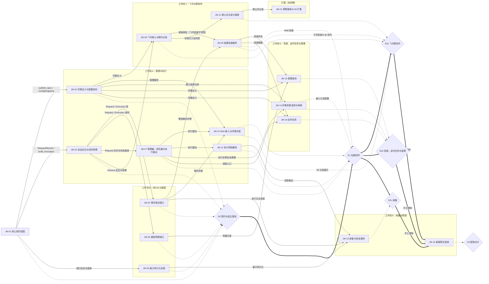
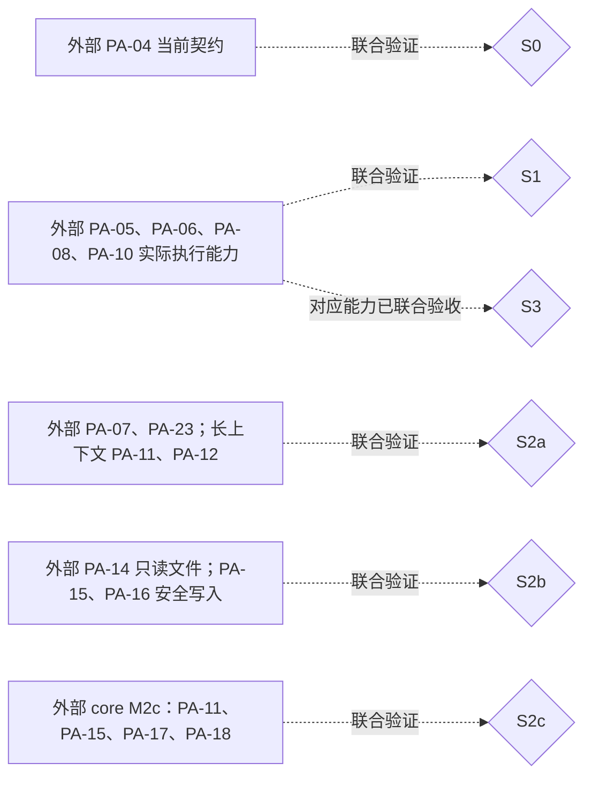
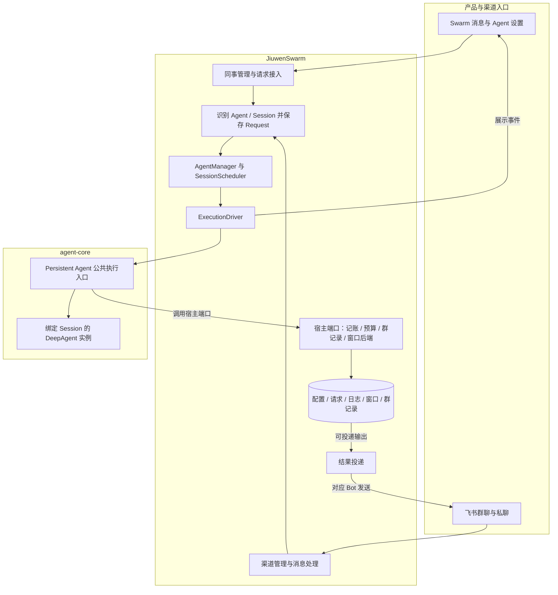

# JiuwenMate 特性开发计划

## 1. 这份计划怎么读和维护

- 计划范围：结合 agent-core 的 Persistent Agent 能力，在 JiuwenSwarm 独立开发新版 AI 同事。Swarm 负责同事管理、渠道接入、执行调度、会话与事件存储、结果投递和续做安排；agent-core 在指定 Session 内执行任务、管理模型上下文、产生过程事件与候选结果。
- 范围之外：确认恢复（需要用户确认的工具调用及 `resume_persistent_request`）、授权知识版本、跨来源失效管理、主动学习和扩展执行模式；个人版单 Agent、集群模式及个人飞书入口的既有行为不在本计划内修改。
- 所属模块：jiuwenswarm 仓 `jiuwenswarm/server/jiuwenmate/`，以及新版接入所需的 `gateway/`、`server/agent_ws_server.py` 与前端 `channels/web/frontend/src/features/jiuwenmate/`。agent-core 仓 `openjiuwen/harness/persistent_agent/` 的工作以 PA 编号登记在对端计划，本计划只引用。
- 交付分类：本期 17 项（JM-01～JM-14、JM-16、JM-18、JM-19）；扩展 1 项（JM-21）。已移出的 SW-15、SW-17、SW-20 不复用，见附录 B。
- 本轮安排：本期 17 项均为纳入；JM-21 未排期。
- 维护人：常钰聪。
- 更新日期：2026-10-13。
- 设计依据：
  - 本仓：[JiuwenMate 设计概览](jiuwenmate-overview.md)、[JiuwenMate 服务端架构设计](jiuwenmate-architecture.md)。
  - 对端：agent-core 仓 `jiuwenmate` 分支 `openjiuwen/harness/persistent_agent/docs/designs/` 下的 [Persistent Agent 开发计划](https://gitcode.com/huenrui_/agent-core/blob/jiuwenmate/openjiuwen/harness/persistent_agent/docs/designs/persistent-agent-development-plan.md) 与 [Persistent Agent 架构设计](https://gitcode.com/huenrui_/agent-core/blob/jiuwenmate/openjiuwen/harness/persistent_agent/docs/designs/persistent-agent-architecture.md)。
  - 参考版本：PA 编号与契约以 agent-core `jiuwenmate` 分支 commit `d016f8d7dafe741281f360a84a60e6aa4aeb9061`（2026-10-08）为准。开发验证使用 huenrui_agent-core `12cf92bd71dedb3c39309b72fd8519b5ad9134e6`；该版本只固定在本地 `pyproject.toml` / `uv.lock` 中，不随提交入库。
  - Swarm 接入基线：本地 `jiuwenmate` 分支 commit `f0a69728c`。
- 关键假设与待确认项：
  - core 计划中“PA-05 已完成”目前只代表组件验收。正式执行入口在 PA-10 的会话状态记录接入前仍拒绝执行，因此 S1 及之后的节点依赖 PA-10 接通（责任方：agent-core）。
  - `namespace_id` 映射既有用户 / 工作空间边界，具体映射规则在 JM-10 接入时确定，不影响 JM-01～JM-04 的组件验证。
  - agent-core 依赖版本的入库固定方式，待对端发布可引用版本后确定。
- 术语与全局约束：见下文“术语”与“全局约束”。
- 进度摘要：本期完成 0/17，待验收 5 项（JM-01～JM-05 宿主组件通过，联合验收待完成）；扩展完成 0/1。

先读本节确认范围和完成口径，再到第 2 节了解特性与验收要求，第 3 节判断开工条件和并行机会，第 4 节确认负责人、状态和证据。迁移与接入安排见附录 A，历史变更见附录 B。

- 特性是有明确责任和验收边界的开发单元；开工硬前置只列独立实现必需的直接前置（间接前置不重复列出）；交付节点 S0～S3 表示若干特性与真实依赖汇合后的可演示结果，不计入特性数。
- 新增或调整特性时，同步第 2 节定义、第 3 节图和第 4 节表。认领、开发、验证或阻塞变化时，更新第 4 节的“状态”“负责人”“证据”“最近更新”，并在同一次更新中同步对应 feature 的管理字段。
- 状态统一使用“待开始、进行中、阻塞、待验收、完成”。只通过宿主替身验证时，状态为“待验收”，并在证据中写明“宿主组件通过，联合验收待完成”。
- 代码开发前在 [features/](../features/) 建立或更新对应 feature，契约变化同步 `specs/`。本计划遵循 [docs/AGENTS.md](../AGENTS.md)，结构参照 [特性开发计划模板](../templates/feature-development-plan-template.md)。按目录约定，第 4 节的证据列名为“证据”，对应模板中的“进展说明”。
- 编号说明：JM 编号是本计划的条目编号，2026-10-13 前称 SW 编号，序号不变（`SW-01` 即 `JM-01`）。PA 编号表示 agent-core 的工作。验收编号使用 `JM-xx-V-xx`，由本计划定义，feature 沿用。

**术语**

| 名称 | 含义 |
| --- | --- |
| Agent | 持久保存的 AI 同事身份、Template 关联和配置 |
| Session | 某个同事的一段独立对话；同一群中的不同同事各有自己的 Session |
| Request | 一次任务；续做仍关联原任务 |
| Execution | 一次实际执行尝试；续做时分配新的 `execution_id` |
| 宿主端口 | Swarm 向 core 提供的记账、预算、群记录和窗口存储接口；core 契约中的可选知识端口本轮不接入 |
| 开工硬前置 | 缺少该产物就无法独立实现当前特性；不等同于全部联调条件 |

**全局约束**

| 事项 | 本次接入目标 | 对 Swarm 的影响 |
| --- | --- | --- |
| 实例生命周期 | 业务 Agent 持久存在；每次活动 Execution 使用绑定指定 Session 的原生 DeepAgent 实例，结束后清理；并行 Session 使用不同实例 | AgentManager 管理业务 Agent、排队和执行任务，不缓存供所有 Session 共用的 DeepAgent；飞书连接由渠道管理器维持，不依赖模型实例常驻 |
| 主动响应 | PA-07 在 core 内做独立轻量模型判断，人类与 Agent 消息走同一流程；被 @ 也可忽略，未被 @ 也可参与 | Swarm 提供原始消息、职责配置和可查询群记录，不自行调用另一套响应判断模型，也不把 @ 等同于必须执行 |
| 跨群查询 | 当前 `GroupChatPort` 只查询当前 Session 所属群；私有窗口检索只查询当前 Session | 不能把旧跨群查询挂到该端口；跨群读取保留为 JM-21，需另行明确授权和查询契约 |

- 新版 AI 同事使用独立数据和运行入口，可调用通用接口，但不读取或转换旧版 AI 同事数据。
- 只使用 core 公共导出类型和执行入口，不从其内部 `execution/`、`schema/` 私有实现拼装第二条执行链。
- 同一 Session 同时只有一个活动 Execution；停止或取消只作用于目标 Execution。
- 一个 Request 的续做固定使用原 Spec；新配置只影响新 Request。
- `CommitPort.record` 是事件唯一的持久化入口，执行流只用于展示；Swarm 持续消费到流结束，前端断线不取消执行。
- 会话窗口由 core 的 WindowStore 管理格式；Swarm 提供持久化 `BaseKVStore`，不直接修改窗口内容。
- 按所需 PA 能力逐项联调，不把 core 的整个 M1 / M2a / M2b 节点作为硬前置。

## 2. 要开发的特性

每个特性与第 3 节节点、第 4 节行一一对应。验收标准写预期，实际执行结果统一写在第 4 节“证据”列。

计划重点覆盖五类共享场景，每类指定一个主责特性：

- 多 Bot 收到同一消息时遗漏某个同事或重复执行（主责 JM-08）。
- 前端断线导致后台任务退出（主责 JM-10）。
- 停止 / 取消误伤其他 Session（主责 JM-12）。
- 日志缺失被误判为工具未执行（主责 JM-13）。
- 结果投递失败导致业务任务重跑（主责 JM-09）。

架构第 11.5 节的检查主题在各主责特性的“来源验证点”中关联到验收 ID。

### JM-01 核心契约适配

- **目标与范围：** 固定 SDK 版本，建立宿主与 core 公共协议之间的转换，并补齐契约测试。包含配置发布为 Spec 快照、由存储记录组装单次调用，以及宿主端口替身；不包含调用 core 执行入口。
- **责任与契约：** `spec_provider.py`、`execution_models.py`。输出 `ConfigSnapshot`，以及由 `build_invocation` 组装的 `PersistentAgentSpec` 与 `PersistentBuildContext`；校验失败抛出 `PersistentContractError`。宿主开放的能力取 core 支持集合与宿主开放集合的交集。
- **开工硬前置：** 无。
- **独立验证入口：** `tests/unit_tests/server/jiuwenmate/test_core_contract.py`。
- **独立验证条件：** 使用真实 agent-core 公共类型和宿主端口替身，不需要真实模型或执行入口。
- **验收标准：**
  1. JM-01-V-01：合法的 Spec、ExecutionContext 和 RequestInput 被 core 接受，单轮字段被固定。
  2. JM-01-V-02：字段错配、core 不支持或宿主未开放的能力在发布时被拒绝；core 入口对同类值同样拒绝。
  3. JM-01-V-03：快照被篡改、Request 配置版本不符、能力快照不符或请求续做时，拒绝组装调用。
  4. JM-01-V-04：宿主端口替身的签名与返回类型符合 core 协议。
  5. JM-01-V-05：core 正式执行入口在 PA-10 接入前拒绝执行（哨兵测试）；PA-10 接入后须改写该测试。
- **来源验证点与共享场景：** 架构第 11.5 节“版本与调用隔离” → JM-01-V-03 → 主责 JM-01，协同 JM-03 → S0（组件）、S1（真实执行）。
- **前端独立验证：** 不适用。
- **联合交付与开放条件：** 参与 S0；真实执行在 S1 与 PA-05、PA-10 联合验证。
- **设计索引：** [F_01 核心契约适配](../features/F_01_core-contract.md)；架构第 4.1、4.3 节。

### JM-02 同事定义与配置发布

- **目标与范围：** 支持自定义创建同事、首次使用时自动创建默认小九（不重复创建）、读取与修改设置、发布和删除。同事与 Template 一对一，新版数据独立保存，Request 固定配置快照。不包含管理接口与页面（JM-10）和资源装配（JM-14）。
- **责任与契约：** `models.py`、`repository.py`、`service.py`；数据位于 `~/.jiuwenswarm/jiuwenmate/`。`PersistentAgentService` 是唯一管理入口，`current_snapshot` 提供新 Request 所固定的版本；对外视图不含 Spec 和模型凭据。
- **开工硬前置：** JM-01 的 `publish_spec` 与 `ConfigSnapshot`。
- **独立验证入口：** `tests/unit_tests/server/jiuwenmate/test_persistent_agent_service.py`。
- **独立验证条件：** 使用真实 SQLite 与 Template 文件，模型目录使用替身；本机模型配置可做冒烟发布。
- **验收标准：**
  1. JM-02-V-01：首次使用只创建一次默认小九；多个服务实例共享同一存储时也不重复创建；删除后不再创建；无可用模型时创建但不发布。
  2. JM-02-V-02：自定义创建和从 Template 创建都生成独立 Template 并发布 v1；同事与 Template 一对一；创建失败不留下文件或记录。
  3. JM-02-V-03：设置修改在发布前不影响 Request；发布未变化的设置时沿用原版本；模型凭据轮换时产生新版本；保存失败时恢复旧 Template；过期 revision 的写入被拒绝。
  4. JM-02-V-04：删除后同事及其版本不可见；不同数据空间互相隔离；对外视图不含模型凭据。
  5. JM-02-V-05：非法设置被拒绝；模型经现有模型目录解析。
- **来源验证点与共享场景：**
  - 架构第 11.5 节“身份和默认初始化” → JM-02-V-01 → 主责 JM-02 → S0。
  - “保存与发布” → JM-02-V-03 → 主责 JM-02 → S0。
  - “权限与凭据”的查询脱敏部分 → JM-02-V-04 → 主责 JM-02，协同 JM-10 → S1。
- **前端独立验证：** 不适用；页面入口在 JM-10。
- **联合交付与开放条件：** 参与 S0；页面可见小九须待 JM-10 接入。
- **设计索引：** [F_02 同事定义与配置发布](../features/F_02_colleague-management.md)；架构第 4.1、4.2、7.3 节。

### JM-03 会话定位与请求受理

- **目标与范围：** 建立 Session / Request / Execution 关联仓库和新版群会话映射。Session 定位、Request 幂等受理、Request 状态推进和重启查询属于本项；串行调度（JM-07）与公共群记录（JM-11）不属于本项。
- **责任与契约：**
  - 文件：`execution_repository.py`、`group_chat_repository.py`、`sqlite_store.py`，以及 `execution_models.py` 中的 `ConversationRef`、`SessionRecord`、`RequestState`。
  - Session 按 (namespace, agent, 会话类型, 渠道, 会话键) 分列唯一约束定位，`session_id` 随机生成。
  - Request 按 (namespace, agent, source_ref) 幂等受理。
  - 派发时，若同一 Session 已有已派发的 Request，返回 `SESSION_BUSY`。
- **开工硬前置：** JM-01 的 `RequestRecord` 与 `build_invocation`。
- **独立验证入口：** `tests/unit_tests/server/jiuwenmate/test_request_routing.py`。
- **独立验证条件：** 使用真实 SQLite 与真实 core 类型；配置快照由 JM-02 服务提供。
- **验收标准：**
  1. JM-03-V-01：
     - 同一同事在同一群复用 Session；同一群中不同同事各有 Session。
     - Web 私聊与 IM 私聊使用不同 Session；不同数据空间互相隔离。
     - 过长或含分隔符的会话 ID 不会碰撞。
  2. JM-03-V-02：
     - 补充消息是同一 Session 中的新 Request。
     - 平台重复投递同一事件时，返回已存储的 Request；同一事件送达两个同事时，生成两个 Request。
     - Request 类型与会话不符时拒绝。
  3. JM-03-V-03：Request 固定受理时的已发布版本；属于其他同事的快照或未发布的同事被拒绝。
  4. JM-03-V-04：同一 Session 同时只有一个已派发 Request；重复结束时保持原结果。
  5. JM-03-V-05：重启后可查回排队中和已派发的 Request；由存储记录可重建合法的 core 调用。
- **来源验证点与共享场景：** 架构第 11.5 节“版本与调用隔离” → JM-03-V-03 → 协同 JM-03（主责 JM-01）→ S0、S1。
- **前端独立验证：** 不适用。
- **联合交付与开放条件：** 参与 S0；调度与渠道接入后在 S1、S2a 联合验证。
- **设计索引：** [F_03 会话定位与请求受理](../features/F_03_session-request.md)；架构第 2.1、6.1、9.2 节。

### JM-04 事件提交端口

- **目标与范围：** 实现 `ports/commit.py` 及事件与候选输出的存储。在 AgentServer 启停时持有队列由 JM-07 完成，不属于本项。
- **责任与契约：** `HostCommitPort` 实现 core `CommitPort`：
  - `tool.intent`、`execution.paused`、`execution.final` 等关键事件同步落盘，失败时抛出异常。
  - 普通事件经 `CommitQueue` 后台写入，失败时只留下日志缺口。
  - final 在同一事务中补存它引用的候选。
  - `read_execution_log` 只允许读取同一 Session、同一 Request 中的执行日志。
- **开工硬前置：** JM-03 的 Request 与 Execution 表（用于事件归属校验）。
- **独立验证入口：** `tests/unit_tests/server/jiuwenmate/test_commit_port.py`。
- **独立验证条件：** 使用真实 SQLite；通过继承真实仓库的替身注入写入故障；使用真实 core 事件类型。
- **验收标准：**
  1. JM-04-V-01：普通事件按 `local_seq` 读回；同一 event_id 重交只存一次；同 ID 不同内容被拒绝。
  2. JM-04-V-02：普通事件写入失败不阻断后续关键事件；关键事件写入失败时抛出异常。
  3. JM-04-V-03：final 缺少候选时被拒绝且不保存；候选写入失败或尚在队列中时，由 final 补存；候选与 final 重交后保持原 ID。
  4. JM-04-V-04：output_id 不被其他事件复用；每个 Execution 至多一个 final 或 paused。
  5. JM-04-V-05：其他 Execution 的事件和其他 Request 的日志读取被拒绝；重启后日志仍在。
  6. JM-04-V-06：关闭后的队列拒绝普通事件，并写完已入队的事件；端口满足 core `CommitPort` 协议。
- **来源验证点与共享场景：** “日志缺失被误判为工具未执行”场景的日志缺口语义 → JM-04-V-02 → 协同 JM-04（主责 JM-13）→ S2c。
- **前端独立验证：** 不适用。
- **联合交付与开放条件：** 参与 S0；与真实执行的联调在 S1，对端为 PA-04、PA-08。
- **设计索引：** [F_04 事件提交端口](../features/F_04_commit-port.md)；架构第 6.2、6.3、7.2 节。

### JM-05 窗口持久化后端

- **目标与范围：** 实现 `ports/window_backend.py`，提供持久化后端，支持 Session 隔离、保留期和删除清理。不包含窗口内容格式，该格式由 core 管理。
- **责任与契约：** 提供符合 `BaseKVStore` 的持久化实现，并注入 `PersistentPorts.window_backend`；数据按 namespace / Session 隔离，且与 Agent 文件工具隔离。
- **开工硬前置：** JM-01 的端口协议适配与替身。
- **独立验证入口：** `tests/unit_tests/server/jiuwenmate/test_window_backend.py`；删除同事时的清理见 `test_persistent_agent_service.py`。
- **独立验证条件：** 后端组件可用真实存储独立验证；core 的加载与保存须使用真实 core 窗口组件。
- **验收标准：**
  1. JM-05-V-01：服务重启后，窗口状态与归档仍可加载；core 能经该后端加载和保存状态与归档。
  2. JM-05-V-02：A Session 不能读写 B Session 的窗口；Agent 文件工具读不到窗口数据。
  3. JM-05-V-03：保留期到期或删除同事 / Session 时，相关数据被清理；生产配置拒绝内存后端。
- **来源验证点与共享场景：** 无。
- **前端独立验证：** 不适用。
- **联合交付与开放条件：** 参与 S0；长上下文在 S2a 与 PA-10～PA-12 联合验证。
- **设计索引：** [F_05 窗口持久化后端](../features/F_05_window-backend.md)；架构第 7.1、7.3 节。

### JM-06 模型预算端口

- **目标与范围：** 实现 `ports/budget.py`，覆盖模型准入、额度预留、用量结算和查询。
- **责任与契约：** 实现 `BudgetPort.admit(execution, model_call_id)` 与 `report(execution, model_call_id, usage)`。群额度共享计算并原子准入；按模型调用身份防止重复结算。
- **开工硬前置：** JM-03 的 Request / Execution 身份。
- **独立验证入口：** `tests/unit_tests/server/jiuwenmate/test_budget_port.py`（待建立）。
- **独立验证条件：** 使用真实存储和并发构造；core 调用方可用替身代替。
- **验收标准：**
  1. JM-06-V-01：同一群多个 Agent 同时申请额度时不超卖；准入被拒绝时不调用模型。
  2. JM-06-V-02：重复 report 不重复计费；usage 未知时不记为零消耗。
  3. JM-06-V-03：额度恢复留下可验证的依据，供续做判断使用。
- **来源验证点与共享场景：** 无。
- **前端独立验证：** 不适用。
- **联合交付与开放条件：** 参与 S0；真实执行时与 PA-05、PA-07、PA-11 联合验证。
- **设计索引：** feature 开工前建档；架构第 9.3 节。

### JM-07 同事管理器、Session 排队器与执行驱动

- **目标与范围：** 新建 AgentManager、SessionScheduler 和 ExecutionDriver，负责 Session 排队、容量控制、执行任务的生命周期，以及调用 core 的执行 / 停止 / 取消入口。另外接手 JM-04 和 JM-02 的遗留：
  - 在 AgentServer 启停时持有 `CommitQueue`，执行收尾时释放候选副本；
  - 删除同事时处理其排队中的 Request；
  - 每次执行经 JM-05 的 `WindowBackendStore.bind` 注入窗口后端，并定时调用 `purge_expired`。
- **责任与契约：** 使用 JM-01 的 `build_invocation` 组装调用，调用 `execute_persistent_request` / `abort_persistent_request`。等待流结束且 core 清理完成后，才释放 Session 占用。
- **开工硬前置：** JM-03 的 Request 队列与 `start_execution` / `finish_request`（JM-01 经 JM-03 间接满足）。
- **独立验证入口：** `tests/unit_tests/server/jiuwenmate/test_session_scheduler.py`、`test_execution_driver.py`（待建立）。
- **独立验证条件：** 调度可用 core 执行入口替身验证；正式执行须待 PA-10 接通。
- **验收标准：**
  1. JM-07-V-01：同一 Session 串行执行；不同 Session 在容量内并发，并使用不同实例。
  2. JM-07-V-02：控制只作用于目标 Execution；流结束且清理完成后才释放 Session 占用。
  3. JM-07-V-03：新 Request 与非确认续做走同一调度入口；全局与 Agent 级并发上限、排队上限生效。
  4. JM-07-V-04：`CommitQueue` 随 AgentServer 启停；执行异常收尾时释放候选副本；删除同事时，其排队中的 Request 按约定结束；每次执行注入的窗口后端绑定到本 Session，过期归档按保留期清理。
- **来源验证点与共享场景：** 架构第 11.5 节“顺序、控制与关闭” → JM-07-V-02 → 主责 JM-07，协同 JM-12 → S1。
- **前端独立验证：** 不适用。
- **联合交付与开放条件：** 参与 S1；正式执行联调依赖 JM-04～JM-06 及 PA-05、PA-06、PA-10；续做再联调 PA-17、PA-18。
- **设计索引：** feature 开工前建档；架构第 4.3、5.2 节。

### JM-08 飞书接入与群内分发

- **目标与范围：** 为新版 AI 同事接入现有飞书连接能力，新建消息标准化和群内分发逻辑。个人版飞书路由保持原状。
- **责任与契约：** 新版 `gateway/message_handler/persistent_group_fanout.py`，接入公共 `message_handler.py`。按接收事件的 `app_id` 查新版绑定，得到 `agent_id`；按平台事件身份生成稳定的 `source_ref`，交给 JM-03 受理。
- **开工硬前置：** JM-02 的同事定义；JM-03 的 Session 定位与受理。
- **独立验证入口：** `tests/unit_tests/gateway/test_persistent_group_fanout.py`（待建立）。
- **独立验证条件：** 组件验证使用飞书事件样本；真机验证须使用测试应用、测试群，并具备应用接收权限。
- **验收标准：**
  1. JM-08-V-01：绑定 app_id 后正确定位新版 Agent；群聊 / 私聊来源，以及 @、回复、发送者和附件信息完整传入。
  2. JM-08-V-02：重复事件不重复派发，同一平台事件的 `source_ref` 保持不变；多个目标 Agent 之间不互相去重；只向有群访问依据的同事派发。
  3. JM-08-V-03：人类与 Agent 的消息都进入 core 判断；个人版飞书路由不变。
- **来源验证点与共享场景：** “多 Bot 收到同一消息时遗漏某个同事或重复执行” → JM-08-V-02 → 主责 JM-08，协同 JM-03 → S2a。
- **前端独立验证：** 不适用。
- **联合交付与开放条件：** 参与 S2a；PA-07 就绪后才放行群执行。
- **设计索引：** feature 开工前建档；架构第 5.3 节。

### JM-09 结果投递服务

- **目标与范围：** 新建结果投递服务，调用现有飞书发送接口，实现新版 Bot 回复和协作发送。Web 投递与飞书投递是两个子范围。
- **责任与契约：** 新版 `execution_result_handler.py`、`delivery_service.py`。通过 JM-04 的 `candidate_output` 读取候选，选择 Bot 身份，投递文本和文件，并记录发送状态；生成成功不等于发送成功。
- **开工硬前置：** JM-04 的候选输出存储。飞书投递子范围另需 JM-08 的新版绑定。
- **独立验证入口：** `tests/unit_tests/server/jiuwenmate/test_delivery_service.py`（待建立）。
- **独立验证条件：** Web 投递和发送失败可用替身验证；飞书真实 @ 协作须真机验证。
- **验收标准：**
  1. JM-09-V-01：使用当前 Agent 对应的 Bot 向正确的群发送，保留真实的 @ / 回复关系；A @ B 后由 B 的入站链路继续处理，不在内部代为执行。
  2. JM-09-V-02：群里不泄露判断或工具过程；文件上传和发消息分别记录。
  3. JM-09-V-03：
     - 发送失败不导致任务重跑；重复交接不重复发起正常发送。
     - 平台已接收但本地未保存回执时，按平台幂等标识或消息查询核对；无法确认时保留待核实状态，不盲目重发。
- **来源验证点与共享场景：**
  - “结果投递失败导致业务任务重跑” → JM-09-V-03 → 主责 JM-09 → S2a。
  - 架构第 11.5 节“阶段完成与未知结果” → JM-09-V-03 → 主责 JM-09，协同 JM-13 → S2a、S2c。
- **前端独立验证：** 不适用。
- **联合交付与开放条件：** Web 投递子范围参与 S1，飞书投递参与 S2a。对端依赖 PA-08；中途协作发送接入 PA-15，并记录投递事实。
- **设计索引：** feature 开工前建档；架构第 6.3、8.2 节。

### JM-10 Web 接入与同事页面

- **目标与范围：** 在 `agent_ws_server.py` 接入独立的后台消费，并让前端 `channels/web/frontend/src/features/jiuwenmate/` 和消息组件对接服务端。同事管理部分只依赖 JM-02，可以先行开发；群展示随 JM-08、JM-09 验收。
- **责任与契约：** 把服务端事件转换为产品协议，不向前端暴露 core 运行对象。打开同事页时，先调用 JM-02 的 `ensure_default_colleague`，再加载同事列表。
- **开工硬前置：** JM-02 的管理服务；JM-04 的事件存储；JM-07 的执行驱动。其中同事管理子范围只需 JM-02。
- **独立验证入口：** 前端同事页；Web 断开与状态重查测试放在 `tests/integration_tests/jiuwenmate/`（待建立）。
- **独立验证条件：** 前端可依据接口契约和模拟数据独立验证；断线续跑须有真实后端。
- **验收标准：**
  1. JM-10-V-01：创建、设置、发消息、查历史和查状态均可用；打开同事页后小九可见。
  2. JM-10-V-02：Web 断开后任务继续执行，重连能查询到结果；收到 final / paused 后仍消费到流结束。
  3. JM-10-V-03：不把模型中间文本误报成最终结果；个人版事件的含义不变。
- **来源验证点与共享场景：** “前端断线导致后台任务退出” → JM-10-V-02 → 主责 JM-10，协同 JM-07 → S1。
- **前端独立验证：** 在同事页使用模拟接口，核对加载、空列表、成功、失败和重复操作等状态。当前页面从空列表初始化，尚未调用后端。
- **联合交付与开放条件：** 参与 S1；IM 记录展示参与 S2a。
- **设计索引：** feature 开工前建档；架构第 4.4 节。

### JM-11 群公共记录与搜索

- **目标与范围：** 为新版群聊建立公共记录和搜索服务，实现 `ports/group_chat.py`。跨来源失效管理不在本轮验收范围内。
- **责任与契约：**
  - 在 `group_chat_repository.py` 中扩展公共记录，新增 `conversation_archive.py`、`conversation_search.py`、`conversation_resources.py`。
  - 实现 `GroupChatPort.recent_messages` 和 `search_messages`。
  - core 只经端口读取群记录，不直接访问归档路径。
- **开工硬前置：** JM-08 的标准化入站消息（JM-03 的群映射经 JM-08 间接满足）。
- **独立验证入口：** `tests/unit_tests/server/jiuwenmate/test_group_chat_port.py`（待建立）。
- **独立验证条件：** 可用标准化消息样本做组件验证；真机多 Bot 场景在 S2a 验证。
- **验收标准：**
  1. JM-11-V-01：同一群只维护一份逻辑公共记录；多个 Bot 重复接收同一消息时不重复写入。
  2. JM-11-V-02：最近消息按游标读取，并排除触发消息；检索结果带来源与完整性状态。
  3. JM-11-V-03：撤回的消息不返回正文；权限未知时不读取；读取失败不伪装成空记录；不读取旧版群记录。
- **来源验证点与共享场景：** 无。
- **前端独立验证：** 不适用。
- **联合交付与开放条件：** 参与 S2a，对端为 PA-23，联合 PA-07、PA-11、PA-12。
- **设计索引：** feature 开工前建档；架构第 9.2 节。

### JM-12 执行控制服务

- **目标与范围：** 新增 `execution_control_service.py`，接入 Web 和飞书的停止与取消入口。不接入确认卡片，也不接入 `resume_persistent_request`。
- **责任与契约：** 校验控制权限，记录控制事实，经 JM-07 调用 `abort_persistent_request(context, reason="stop" / "cancel")`。
- **开工硬前置：** JM-07 的执行驱动（JM-03 经 JM-07 间接满足）。
- **独立验证入口：** `tests/unit_tests/server/jiuwenmate/test_execution_control_service.py`（待建立）。
- **独立验证条件：** 可用执行驱动替身验证；真实停止须待 PA-05 接通。
- **验收标准：**
  1. JM-12-V-01：只有发起人或被授权的管理者可以控制目标 Execution。
  2. JM-12-V-02：重复的控制请求不重复执行；停止 / 取消只影响当前 Session。
  3. JM-12-V-03：收尾异常时仍保留控制事实，不误触发自动续做。
- **来源验证点与共享场景：**
  - “停止 / 取消误伤其他 Session” → JM-12-V-02 → 主责 JM-12，协同 JM-07 → S1。
  - 架构第 11.5 节“权限与凭据”的业务主体检查部分 → JM-12-V-01 → 主责 JM-12，协同 JM-10 → S1。
- **前端独立验证：** 停止 / 取消按钮的交互随 JM-10 验证。
- **联合交付与开放条件：** 参与 S1，对端为 PA-05。
- **设计索引：** feature 开工前建档；架构第 8.3、9.1 节。

### JM-13 续做与恢复服务

- **目标与范围：** 新增 `recovery_service.py`，实现重启扫描、执行异常核对、停止后继续，以及条件恢复后的重新排队。
- **责任与契约：** 依据 JM-04 的执行日志和 JM-03 的 Request 状态，决定哪个 Request 在何时再次执行；续做推理与窗口恢复由 core 负责。
- **开工硬前置：**
  - JM-04 的执行日志读取；
  - JM-05 的窗口持久化；
  - JM-12 的控制事实（JM-07 经 JM-12 间接满足）。
- **独立验证入口：** `tests/unit_tests/server/jiuwenmate/test_recovery_service.py`（待建立）。
- **独立验证条件：** 可用 core 替身构造中断与日志缺口；自动续做须与真实 core 联合验证。
- **验收标准：**
  1. JM-13-V-01：只核对本次 Execution 的 final / paused；没有结束记录且未被主动停止 / 取消时，等旧执行退出后再续做。
  2. JM-13-V-02：续做沿用原 Request 和原 Spec，`recovery_ref` 指向正确的执行；预算等条件未改变时，不反复续做。
  3. JM-13-V-03：缺少工具结果时先查证，不推断为“未执行”；已保存 final 后即使清理异常，也不重跑。
- **来源验证点与共享场景：** “日志缺失被误判为工具未执行” → JM-13-V-03 → 主责 JM-13，协同 JM-04 → S2c。
- **前端独立验证：** 不适用。
- **联合交付与开放条件：** 参与 S2c；自动续做的放行依赖 PA-11、PA-15、PA-17、PA-18。
- **设计索引：** feature 开工前建档；架构第 8.3 节。

### JM-14 同事资源选择与隔离

- **目标与范围：** 为新版同事建立资源选择与隔离能力，调用现有的 Skill、MCP、插件管理接口，并开放工作空间只读能力。需要用户确认或来源失效管理的操作暂不开放。
- **责任与契约：**
  - 新版 `capabilities.py`、`resource_scope.py`、`resource_bootstrap.py`、`agent_workspace.py`，负责装配 JM-02 记录的能力选择。
  - 在 `spec_provider.HOST_OPEN_FEATURES` 中开放对应能力。
  - 安装、选择和凭据管理仍属于 Swarm。
- **开工硬前置：** JM-02 的能力选择记录；JM-07 的执行实例生命周期。
- **独立验证入口：** `tests/unit_tests/server/jiuwenmate/test_resource_scope.py`（待建立）。
- **独立验证条件：** 资源隔离可用本机资源目录验证；写操作须有 PA-15、PA-16 的意图记账。
- **验收标准：**
  1. JM-14-V-01：每个同事独立选择 Skill / MCP / 插件；不同执行不覆盖全局环境和凭据。
  2. JM-14-V-02：Session 私有草稿不被其他 Session 读取；共享文件冲突可识别。
  3. JM-14-V-03：只开放无需人工确认、且已接入意图记账的写操作；清理一个实例不卸载其他实例的工具。
- **来源验证点与共享场景：** 无。
- **前端独立验证：** 资源选择交互随 JM-10 的同事设置页验证。
- **联合交付与开放条件：** 最小只读配置参与 S1，完整范围参与 S2b；读取依赖 PA-14，写入依赖 PA-15、PA-16。
- **设计索引：** feature 开工前建档；架构第 4.2、9.2 节。

### JM-16 管理查询

- **目标与范围：** 依据同事定义、执行事件与投递状态提供管理查询，复用前端的记录 / 看板入口。
- **责任与契约：** 只读查询，不改变执行或投递状态；权限过滤与入口一致。
- **开工硬前置：** JM-02 的同事定义；JM-06 的用量记录；JM-09 的投递状态（JM-04 经 JM-09 间接满足）。
- **独立验证入口：** `tests/unit_tests/server/jiuwenmate/test_management_query.py`（待建立）。
- **独立验证条件：** 可用构造的事件与投递数据独立验证。
- **验收标准：**
  1. JM-16-V-01：查询能区分排队、执行中、暂停、结束和发送失败；能从一个 Request 查到其多次 Execution。
  2. JM-16-V-02：统计调用次数 / Token 用量及渠道；ignored 不计为回复，也不计为失败。
  3. JM-16-V-03：权限过滤与入口一致。
- **来源验证点与共享场景：** 无。
- **前端独立验证：** 记录 / 看板页面使用模拟接口验证。
- **联合交付与开放条件：** 参与 S2b。
- **设计索引：** feature 开工前建档；架构第 4.4 节。

### JM-18 新版联合验收

- **目标与范围：** 串联两仓的集成测试、个人版回归和新版功能开放，核对所有共享入口的差异。
- **责任与契约：** 组织真实链路验收，引用各主责特性的结论，不重复维护各项的验收要求。
- **开工硬前置：** 开工限制为 S2a、S2b、S2c 通过（S1 经这三个节点间接满足）。这是业务开工顺序，不是技术依赖。
- **独立验证入口：** `tests/integration_tests/jiuwenmate/`（待建立）；飞书真机验收记录。
- **独立验证条件：**
  - 使用测试应用和测试群，至少覆盖两个 Bot、两个群、一次私聊。
  - 覆盖重复事件、发送失败、停止 / 取消和服务重启。
  - 写明飞书应用的接收权限，以及对端 core 的版本。
- **验收标准：**
  1. JM-18-V-01：Web 私聊、飞书私聊、群主动响应、A @ B 协作、定时触发、停止 / 取消、断线、重启续做，均有真实证据。
  2. JM-18-V-02：个人版和集群模式不回归。
  3. JM-18-V-03：从空数据启动；新版与旧版各自读取自己的数据，不存在重复监听或重复执行。
- **来源验证点与共享场景：** 架构第 11.5 节“产品链路开放” → JM-18-V-01 → 主责 JM-18 → S3。
- **前端独立验证：** 不适用；页面链路在真实环境中验证。
- **联合交付与开放条件：** S3；全量验收要求本期其余 16 项完成，且对应已接入的 PA 能力通过联合验收。
- **设计索引：** 架构第 11.5、12.2 节。

### JM-19 定时任务

- **目标与范围：** 接入现有的定时任务管理能力，为新版同事保存计划、启停状态和触发记录。
- **责任与契约：** 新版 `scheduled_requests.py`，把到期的触发转换为普通 Request；计划的创建、启停和去重由 Swarm 负责，core 只执行 `scheduled` 请求。
- **开工硬前置：** JM-02 的同事定义；JM-07 的调度入口；JM-09 的投递链路（JM-03 经 JM-07 间接满足）。
- **独立验证入口：** `tests/unit_tests/server/jiuwenmate/test_scheduled_requests.py`（待建立）。
- **独立验证条件：** 可用可控时钟独立验证；执行使用 PA-05 的普通任务入口。
- **验收标准：**
  1. JM-19-V-01：同一次触发只创建一个 `RequestInput(kind="scheduled")`；到点后由指定同事执行。
  2. JM-19-V-02：定时任务与普通任务使用同一套预算和结果投递链路。
  3. JM-19-V-03：服务重启后，不漏触发也不重复执行；定时计划与旧版数据隔离。
- **来源验证点与共享场景：** 无。
- **前端独立验证：** 计划管理交互随 JM-10 验证。
- **联合交付与开放条件：** 参与 S2b。
- **设计索引：** feature 开工前建档；架构第 10.4 节。

### JM-21 跨群搜索与 IM 扩展（扩展）

- **目标与范围：** 保留跨群搜索和后续 IM 扩展的设计，分别补充授权查询契约与平台适配。
- **责任与契约：** 当前的 GroupChatPort 不能直接承载跨群查询，需要先完成授权查询契约设计，再开发。
- **开工硬前置：** JM-11 的群公共记录（作为跨群查询的数据来源）。
- **独立验证入口：** 契约设计完成后确定。
- **独立验证条件：** 待确认：授权查询契约的责任方与对端支持情况；影响开工。
- **验收标准：**
  1. JM-21-V-01：跨群查询只读取已授权的公开群记录，不读取其他 Session 的私有窗口。
  2. JM-21-V-02：新增平台沿用绑定 / Request / 投递模型。
- **来源验证点与共享场景：** 无。
- **前端独立验证：** 待契约确定后评估。
- **联合交付与开放条件：** 不参与本期节点，单独交付。
- **设计索引：** 架构第 12.2 节。

## 3. 特性依赖关系与并行开发

完整关系图覆盖第 2 节全部特性和交付节点。每条细实线对应特性定义中的一个开工硬前置，线上注明所需的最小产物；虚线表示特性参与节点的联合验收；粗实线表示约定的交付顺序或业务开工限制。



**图例：** 矩形为特性，菱形为交付节点，分组为工作线；细实线表示开工硬前置，虚线表示联合验收参与，粗实线表示约定交付顺序或业务开工限制。图中只画直接前置，间接前置在特性定义中注明。

**外部协作视图（agent-core）：** 下图只展示各交付节点所需的对端 PA 能力，用于联合验证。图中的虚线表示联合验证关系，不构成开工硬前置。图中省略了本仓特性，PA 能力的定义与状态以对端计划为准。



- **可并行开发与分工：** JM-01 完成后，JM-02、JM-03、JM-05 可以并行推进。JM-03 完成后，JM-04、JM-06、JM-07 可以并行；JM-08 需要等 JM-02 与 JM-03 都完成。JM-04 完成后，JM-09 的 Web 投递可以独立开发；JM-10 的同事管理子范围只需 JM-02，可以先于 JM-07 开发。各工作线可以使用宿主端口替身独立开发，依赖真实 core 的能力须通过对应节点的联合验收后才开放。JM-11 由闫祉君负责，等待点为 JM-08 的标准化入站消息；其余特性由常钰聪负责，见第 4 节。
- **联合交付：**
  - S0：JM-01～JM-06 的配置、身份、事件、窗口后端和预算各自测试通过，并明确哪些是替身。
  - S1：指定同事能收消息、回复、停止和取消；前端断线不影响执行；两个 Session 不串状态。
  - S2a：有 @ 和无 @ 的消息都能判断；A 真实 @ B 后由 B 处理；同一群共享记录，各 Agent 的私有窗口隔离；换窗后可以继续工作。
  - S2b：同事的资源配置互不干扰；定时任务按计划执行，重启后不重复触发；用量和执行状态可查。
  - S2c：进程中断、关键记账失败和停止后继续，都关联到原任务；结果已保存而清理失败时不重跑；结果缺失的写操作先查证。
  - S3：从空数据创建同事，完成飞书真机协作和重启验证；个人版和集群模式回归通过；新旧数据与路由隔离。
- **范围与顺序限制：** 先完成接口与持久化基线（S0），再贯通私聊的单次执行（S1）。之后的群协作（S2a）、资源与管理（S2b）和续做（S2c）可以在各自前置完成后并行。JM-18 在 S2a、S2b、S2c 通过后才开工。JM-21 属于扩展，未排期，不参与本期节点。

## 4. 开发计划与进展

本节的表格是当前进度的唯一台账，每个特性一行，每个交付节点一行；节点不计入特性数。“证据”列按“已完成范围 / 验收 ID → 验证方式与环境 → 实际结果及记录链接 → 剩余项或阻塞”的顺序填写。目前没有创建 PR，实现通过证据中的提交号追溯。

| ID / 名称 | 类型 / 交付分类 | 本轮安排 | 当前实现或交付范围 | 优先级 / 开发批次 | 工作线 / 关联节点 | 计划时间 | 状态 | 负责人 | 关联 PR | 证据 | 最近更新 |
| --- | --- | --- | --- | --- | --- | --- | --- | --- | --- | --- | --- |
| JM-01 核心契约适配 | 特性 / 本期 | 纳入 | 第 2 节全部范围 | 未评估 / 随 S0 | — / S0 | 未排期 | 待验收 | 常钰聪 | — | JM-01-V-01～V-05 → 真实 core 类型与宿主端口替身，agent-core `12cf92bd` → 提交 `7a78a10f`，2026-10-13 于 `12b619ad` 复核 32 passed，记录见 [F_01](../features/F_01_core-contract.md) → 宿主组件通过，联合验收待完成；正式执行待 PA-10，续做待 PA-18 | 2026-10-13；补 feature 链接 |
| JM-02 同事定义与配置发布 | 特性 / 本期 | 纳入 | 第 2 节全部范围 | 未评估 / 随 S0 | A / S0 | 未排期 | 待验收 | 常钰聪 | — | JM-02-V-01～V-05 → 真实 SQLite 与 Template 文件，模型目录替身；本机模型配置冒烟发布 v1 → 提交 `5f12ea8a`，2026-10-13 复核 22 passed，记录见 [F_02](../features/F_02_colleague-management.md) → 宿主组件通过，联合验收待完成；页面不显示小九，入口待 JM-10；资源装配待 JM-14 | 2026-10-13；补 feature 链接 |
| JM-03 会话定位与请求受理 | 特性 / 本期 | 纳入 | 第 2 节全部范围 | 未评估 / 随 S0 | A / S0 | 未排期 | 待验收 | 常钰聪 | — | JM-03-V-01～V-05 → 真实 SQLite 与真实 core 类型，与 JM-02 配置快照联调 → 提交 `952726c1`，2026-10-13 复核 16 passed，记录见 [F_03](../features/F_03_session-request.md) → 宿主组件通过，联合验收待完成；串行调度与删除同事时的排队处理待 JM-07 | 2026-10-13；登记提交号 |
| JM-04 事件提交端口 | 特性 / 本期 | 纳入 | 第 2 节全部范围 | 未评估 / 随 S0 | B / S0 | 未排期 | 待验收 | 常钰聪 | — | JM-04-V-01～V-06 → 真实 SQLite、故障注入替身、真实 core 事件类型 → 提交 `d0a6999c`，2026-10-13 复核 16 passed，记录见 [F_04](../features/F_04_commit-port.md) → 宿主组件通过，联合验收待完成；AgentServer 接线待 JM-07，真实执行联调待 PA-04、PA-08 | 2026-10-13；登记提交号 |
| JM-05 窗口持久化后端 | 特性 / 本期 | 纳入 | 第 2 节全部范围 | 未评估 / 随 S0 | B / S0 | 未排期 | 待验收 | 常钰聪 | — | 宿主组件 18 项测试通过，全目录 104 项，见 [F_05](../features/F_05_window-backend.md)；执行入口接线待 JM-07；联合验证待 PA-10～PA-12 | 2026-10-13 |
| JM-06 模型预算端口 | 特性 / 本期 | 纳入 | 第 2 节全部范围 | 未评估 / 随 S0 | B / S0 | 未排期 | 待开始 | 常钰聪 | — | 未执行；联合验证待 PA-05、PA-07、PA-11 | 2026-10-13；编号更名 |
| JM-07 管理器、排队器与执行驱动 | 特性 / 本期 | 纳入 | 第 2 节全部范围 | 未评估 / 随 S1 | A / S1 | 未排期 | 待开始 | 常钰聪 | — | 未执行；正式执行联调依赖 JM-04～JM-06 及 PA-05、PA-06、PA-10，续做再联调 PA-17、PA-18 | 2026-10-13；纳入 JM-02、JM-04 遗留 |
| JM-08 飞书接入与群内分发 | 特性 / 本期 | 纳入 | 第 2 节全部范围 | 未评估 / 随 S2a | C / S2a | 未排期 | 待开始 | 常钰聪 | — | 未执行；PA-07 就绪后放行群执行 | 2026-10-13；编号更名 |
| JM-09 结果投递服务 | 特性 / 本期 | 纳入 | Web 投递与飞书投递两个子范围 | 未评估 / Web 随 S1，飞书随 S2a | C / S1、S2a | 未排期 | 待开始 | 常钰聪 | — | 未执行；对端 PA-08，中途协作发送接入 PA-15 | 2026-10-13；编号更名 |
| JM-10 Web 接入与同事页面 | 特性 / 本期 | 纳入 | 同事管理、会话与状态、IM 记录展示 | 未评估 / 随 S1 | A / S1、S2a | 未排期 | 待开始 | 常钰聪 | — | 未执行；前端 `features/jiuwenmate/` 当前从空列表初始化，未调用后端 | 2026-10-13；更正前端目录 |
| JM-11 群公共记录与搜索 | 特性 / 本期 | 纳入 | 第 2 节全部范围 | 未评估 / 随 S2a | C / S2a | 未排期 | 待开始 | 闫祉君 | — | 未执行；对端 PA-23，联合 PA-07、PA-11、PA-12 | 2026-10-13；编号更名 |
| JM-12 执行控制服务 | 特性 / 本期 | 纳入 | 第 2 节全部范围 | 未评估 / 随 S1 | A / S1 | 未排期 | 待开始 | 常钰聪 | — | 未执行；对端 PA-05 | 2026-10-13；编号更名 |
| JM-13 续做与恢复服务 | 特性 / 本期 | 纳入 | 第 2 节全部范围 | 未评估 / 随 S2c | E / S2c | 未排期 | 待开始 | 常钰聪 | — | 未执行；自动续做放行依赖 PA-11、PA-15、PA-17、PA-18 | 2026-10-13；编号更名 |
| JM-14 同事资源选择与隔离 | 特性 / 本期 | 纳入 | 最小只读配置与完整范围两个子范围 | 未评估 / 只读随 S1，完整随 S2b | D / S1、S2b | 未排期 | 待开始 | 常钰聪 | — | 未执行；读取依赖 PA-14，写入依赖 PA-15、PA-16 | 2026-10-13；编号更名 |
| JM-16 管理查询 | 特性 / 本期 | 纳入 | 第 2 节全部范围 | 未评估 / 随 S2b | D / S2b | 未排期 | 待开始 | 常钰聪 | — | 未执行 | 2026-10-13；编号更名 |
| JM-18 新版联合验收 | 特性 / 本期 | 纳入 | 第 2 节全部范围 | 未评估 / 随 S3 | E / S3 | 未排期 | 待开始 | 常钰聪 | — | 未执行；开工限制为 S2a、S2b、S2c 通过 | 2026-10-13；编号更名 |
| JM-19 定时任务 | 特性 / 本期 | 纳入 | 第 2 节全部范围 | 未评估 / 随 S2b | D / S2b | 未排期 | 待开始 | 常钰聪 | — | 未执行；执行使用 PA-05 普通任务入口 | 2026-10-13；编号更名 |
| JM-21 跨群搜索与 IM 扩展 | 特性 / 扩展 | 未排期 | 第 2 节全部范围 | 未评估 / — | 扩展 / — | 未排期 | 待开始 | 常钰聪 | — | 未执行；授权查询契约待设计 | 2026-10-13；编号更名 |
| S0 契约与宿主基线 | 节点 / 本期 | 纳入 | JM-01～JM-06 组件验证；对端 PA-04 当前契约 | 顺序 1 | A、B / — | 未排期 | 进行中 | 常钰聪 | — | JM-01～JM-05 宿主组件通过，见各行证据 → 预算验证待 JM-06 | 2026-10-13 |
| S1 私聊闭环 | 节点 / 本期 | 纳入 | JM-07、JM-10、JM-12；JM-09 Web 投递；JM-14 最小只读配置 | 顺序 2 | A、B、C、D / — | 未排期 | 待开始 | 常钰聪 | — | 未执行；等待 PA-05、PA-06、PA-08、PA-10 正式执行链路接通 | 2026-10-13 |
| S2a 飞书群协作 | 节点 / 本期 | 纳入 | JM-08、JM-09、JM-11；JM-10 IM 记录展示 | 顺序 3 | A、C / — | 未排期 | 待开始 | 常钰聪 | — | 未执行；群消息、主动响应、真实 @ 与隔离验证 | 2026-10-13 |
| S2b 资源、定时任务与管理 | 节点 / 本期 | 纳入 | JM-14、JM-16、JM-19 | 顺序 3 | D / — | 未排期 | 待开始 | 常钰聪 | — | 未执行；资源隔离、定时触发和管理查询 | 2026-10-13 |
| S2c 续做 | 节点 / 本期 | 纳入 | JM-13；对端 core M2c | 顺序 3 | E / — | 未排期 | 待开始 | 常钰聪 | — | 未执行；异常、重启、停止后继续及配置保持 | 2026-10-13 |
| S3 新版交付 | 节点 / 本期 | 纳入 | JM-18；对应 core 能力已联合验收 | 顺序 4 | E / — | 未排期 | 待开始 | 常钰聪 | — | 未执行；从空数据启动、独立存储、个人版回归与飞书联调 | 2026-10-13 |

本期进度只统计交付分类为“本期”、类型为“特性”的 17 行：完成 0/17，待验收 5 项；扩展 JM-21 单独统计为 0/1。节点状态按真实联合交付边界判断；JM-01～JM-05 的宿主组件通过，不代表 S0 或整项完成。

## 附录 A. 迁移与接入安排

### A.1 新旧版本隔离与公共能力复用

新版 AI 同事从空数据开始，创建自己的 Agent、渠道绑定、Session、任务、群记录和窗口存储；不读取、转换或覆盖旧版数据，因此不需要数据迁移脚本。旧版实现可以帮助理解飞书事件格式和现有产品接口，新版业务逻辑独立开发。

| 现有公共能力 | 新版使用方式 | 关联条目 |
| --- | --- | --- |
| AgentTemplate、模型、Skill、MCP 和插件管理接口 | 调用公共接口创建和装配新版同事；资源选择和工作空间归属由新版服务独立记录 | JM-02、JM-14 |
| 飞书连接、消息解析和发送接口 | 复用平台适配能力；用新版绑定定位新版 Agent，接收事件时保留 @、回复和发送者信息；旧版路由保持原状 | JM-08、JM-09 |
| Web 消息组件 | 复用通用展示组件；新版会话与个人版会话分别查询和保存 | JM-10 |

新版接入时需要验证以下几点（由 JM-08、JM-09 主责，S2a 联合验证）：

- 一个飞书事件不会同时误入个人版和新版的执行链；
- 同机多个 Bot 不会因全局去重而遗漏目标 Agent；
- Agent Bot 发出的普通消息不会引起自己循环回复；
- 两个 Bot 能通过飞书真实 @ 协作。

需要用户确认的写操作暂不启用。

### A.2 模块落点与架构

以下目录相对于 jiuwenswarm 仓的 `jiuwenswarm/` 包目录。表中尚未实现的模块是新版的拟定落点，文件名只表示模块职责，不要求复制旧版同事实现。

| 代码模块 / 目录 | Swarm 承担的职责 | 与 agent-core 的边界 | 关联条目 |
| --- | --- | --- | --- |
| `server/jiuwenmate/service.py`、`models.py`、`repository.py` | AI 同事创建、Template 关联、配置发布、默认小九 | 输出业务定义和固定版本的 Spec，不包含模型执行循环 | JM-02 |
| `server/jiuwenmate/spec_provider.py`、`execution_models.py` | 配置快照与 core DTO 转换；Request、Execution、来源与回复路由的关联 | 直接复用 `PersistentAgentSpec`、`ExecutionContext`、`RequestInput` | JM-01、JM-03 |
| `server/jiuwenmate/execution_repository.py`、`group_chat_repository.py`、`sqlite_store.py` | Session / Request / Execution、事件和候选输出存储；群映射 | core 负责窗口恢复与续做推理，Swarm 决定哪个 Request 在何时执行 | JM-03、JM-04、JM-11 |
| `server/jiuwenmate/ports/commit.py`、`ports/window_backend.py`；拟定 `ports/budget.py`、`ports/group_chat.py` | 实现本轮所需的宿主端口 | 端口协议由 core 定义，后端由 Swarm 实现；可选知识端口暂不接入 | JM-04、JM-06、JM-11、JM-05 |
| 拟定 `capabilities.py`、`resource_scope.py`、`resource_bootstrap.py`、`agent_workspace.py` | 装配模型、Skill、MCP、插件及办公空间授权 | core 使用已装配的工具和 Workspace；安装、选择和凭据管理仍属 Swarm | JM-14 |
| 拟定 `agent_manager.py`、`session_scheduler.py`、`execution_driver.py` | Session 排队、容量控制、执行生命周期、调用 core 执行 / 停止 / 取消入口 | 实例绑定、模型运行和实例内清理由 core 完成；Swarm 等待清理结束后再释放 Session | JM-07 |
| 拟定 `execution_control_service.py`、`recovery_service.py` | 停止 / 取消事实及续做安排 | 续做推理由 core 负责 | JM-12、JM-13 |
| 拟定 `scheduled_requests.py`，接入现有定时任务调度器 | 定时计划、触发记录和投递目标 | core 只执行 `scheduled` 请求 | JM-19 |
| 拟定 `conversation_archive.py`、`conversation_search.py`、`conversation_resources.py` | 公开聊天记录、最近消息和搜索、附件引用及权限过滤 | core 经 GroupChatPort 读取，不直接访问归档路径 | JM-11 |
| `feishu_sync.py`、`lark_cli_provisioner.py`；`gateway/channel_manager/`；拟定 `gateway/message_handler/persistent_group_fanout.py` | Bot 配置同步、连接生命周期、飞书收发、入站标准化与逐 Agent 去重 | 飞书 SDK、app_id、凭据和 Bot 发送逻辑留在 Swarm；Gateway 不判断消息的业务价值 | JM-08 |
| 拟定 `execution_result_handler.py`、`delivery_service.py` | 候选输出的可靠交接、Bot 身份选择、投递与重试 | core 产出候选；Swarm 负责送达 | JM-09 |
| `server/agent_ws_server.py`、`channels/web/frontend/src/features/jiuwenmate/` | 管理接口、聊天展示、停止 / 取消操作、断线重连查询 | 转换产品协议，不向前端暴露 core 运行对象 | JM-10 |
| agent-core 仓 `openjiuwen/harness/persistent_agent/` | Spec、原生 DeepAgent 构造、执行入口、参与判断、上下文装配、窗口保存与换窗、工具记账适配与续做 | Swarm 不保留同等职责的第二套 ContextAssembler、窗口控制器或参与判断器 | 对端 PA |



图中的“识别 Agent / Session 并保存 Request”是接入阶段的职责，由 service、渠道绑定和会话仓库共同完成，不额外引入 ExecutionRouter。每个活动 Execution 都对应独立构造的上下文；图中只画一个执行框，表示调用关系，不表示全局只有一个实例。

### A.3 跨仓接口与数据关系

**身份和会话。**
- `agent_id` 对应持久化的同事定义及其独立的 Template 目录；`group_chat_id` 标识 Swarm 中的一个群，关联平台原始 `chat_id`。
- 在同一业务数据空间内，`(agent_id, group_chat_id)` 对应一个稳定的 `session_id`。不同同事在同一群中拥有不同 Session，共用该群的公开聊天记录。
- Swarm 私聊、飞书私聊和不同群的 Session 分开创建。
- `namespace_id` 是 core 要求的宿主数据空间标识，由 Swarm 映射既有的用户 / 工作空间边界；它不等同于飞书 tenant_id。

**任务和执行。** 每条被接纳的输入创建一个 `request_id`，每次执行或续做创建新的 `execution_id`。续做沿用原 Request、原 Spec 和原始输入，通过 `recovery_ref` 指向该 Request 待接续的 Execution。请求原文、发起人、接收时间、附件引用、回复目标和配置版本，须在派发前持久化。

**渠道识别。**
- 用接收事件的渠道实例及其 `app_id` 查新版渠道绑定，得到 `agent_id`；@ 列表只用于说明消息指向谁，不用于反查接收连接。
- 新版绑定保存自己的 `binding_id`、`platform`、`app_id`、凭据和 `agent_id`，公开响应须脱敏。
- 多个应用接收到同一消息时，公共记录按平台与消息身份只归档一次，各 Agent 的请求分别去重。

**跨仓直接调用。**
- Swarm 传入 `PersistentAgentSpec` 和单次使用的 `PersistentBuildContext`，调用 `execute_persistent_request(spec, context, inputs)`；停止或取消时调用 `abort_persistent_request(context, reason="stop" / "cancel")`。
- 续做沿用原 Request 并提供 `recovery_ref`，待 PA-18 接入后开放；本轮不调用 `resume_persistent_request`。
- 每次执行都提供一个使用相同业务 `session_id` 的新空 Session，并显式注入 `NoopCheckpointer`。Swarm 不额外调用 Session 的 `pre_run / post_run`。
- 构造上下文和执行控制对象只存在于内存，不序列化。

| core 接口 | Swarm 实现要求 | 本仓条目 | 对端任务 |
| --- | --- | --- | --- |
| `CommitPort.record(execution, event)` | 校验事件归属，按 event_id 去重；普通事件入队后返回，允许日志缺口；关键事件等待自身落盘；final 的 output_refs 所引用的候选也必须可靠保存 | JM-04 | PA-04、PA-05、PA-08、PA-15 |
| `CommitPort.read_execution_log(execution, execution_id)` | 只允许读取同一 Session、同一 Request 的目标执行日志，按 local_seq 排序；不把非空结果声明为完整 | JM-04、JM-13 | PA-17、PA-18 |
| `BudgetPort.admit(execution, model_call_id)` / `report(execution, model_call_id, usage)` | 群额度共享计算并原子准入；按模型调用身份防止重复结算；保留 usage 未知状态 | JM-06 | PA-05、PA-07、PA-11 |
| `PersistentPorts.window_backend: BaseKVStore` | 提供持久化、与 Agent 文件工具隔离、按 namespace / Session 隔离的后端 | JM-05 | PA-10、PA-11、PA-12 |
| `GroupChatPort.recent_messages(execution, cursor, limit)` / `search_messages(execution, query)` | 从执行关联的 Session 定位群，过滤授权范围、入群时间、撤回和附件访问状态；返回完整性状态 | JM-11 | PA-07、PA-23 |

业务状态、事件和投递记录使用新版独立的 SQLite 存储（`~/.jiuwenswarm/jiuwenmate/agents.sqlite3`），支持请求唯一约束、原子状态更新和重启恢复；这是 Swarm 的实现选择，不是 core 提供的数据库。所有路径都从用户数据根目录下的新版专用目录派生，不放进源码目录，也不指向旧版数据目录。

### A.4 验证命令

在 jiuwenswarm 仓根目录执行。如果本地 pytest 的默认参数与环境不一致，追加 `-o addopts="--asyncio-mode=auto"`。

```bash
python -m pytest tests/unit_tests/server/jiuwenmate -q
python -m pytest tests/unit_tests/gateway/test_persistent_group_fanout.py -q
python -m pytest tests/integration_tests/jiuwenmate -q
```

第一条命令对应的 JM-01～JM-04 测试已经建立，执行结果见第 4 节；后两条命令对应的测试文件尚未建立，未执行。

## 附录 B. 历史变更与阶段交付记录

本附录保留当时的编号与结论；当前状态以第 4 节为准。2026-10-13 起，`SW-xx` 改称 `JM-xx`，序号不变。

| 日期 | 条目 / 当时编号 | 变更或阶段产物 | 适用架构 / 验证范围 | 证据、当时遗留及当前替代关系 |
| --- | --- | --- | --- | --- |
| 2026-10-08 | 全部 / SW | 建立 Swarm 跨仓开发计划 | agent-core `d016f8d7` 的 PA 契约；静态核对 | 未实施开发 |
| 2026-10-08 | 全部 / SW | 按 core 开发计划重整为特性清单、工作线、交付节点和进度跟踪 | 文档结构调整 | 开发完成数不变；2026-10-13 已改为本模板四节结构 |
| 2026-10-09 | SW-12、SW-15、SW-20 | 收窄本轮范围，移出确认恢复、授权知识版本、跨来源失效、主动学习和扩展执行模式；保留停止 / 取消 | 范围调整 | SW-12（现 JM-12）改为控制服务；SW-15、SW-20 不纳入本轮且编号不复用；主链路 17 项、扩展 2 项，完成数仍为 0 |
| 2026-10-09 | SW-17、SW-18 | 新版独立开发、独立存储 | 范围调整 | 删除 SW-17 数据迁移任务，编号不复用；SW-18（现 JM-18）改为新旧版隔离验收；主链路 16 项、扩展 2 项 |
| 2026-10-09 | SW-19 | 将定时任务纳入主线 | 范围调整 | SW-19（现 JM-19）从扩展项移入资源与管理工作线；主链路 17 项、扩展 1 项 |
| 2026-10-12 | SW-01（现 JM-01） | 固定 agent-core 版本，新增 `spec_provider.py`、`execution_models.py` 与契约测试 | 宿主替身端口 | 32 项契约测试通过；状态待验收；提交 `7a78a10f` |
| 2026-10-12 | SW-02（现 JM-02） | 新增同事定义、存储与管理服务，默认小九、设置读写、发布与删除 | 宿主组件；本机模型配置冒烟 | 22 项服务测试通过；状态待验收；提交 `5f12ea8a`；页面不显示小九，入口登记至 SW-10（现 JM-10） |
| 2026-10-12 | 全部 | 指定负责人：SW-11（现 JM-11）为闫祉君，其余任务与交付节点为常钰聪 | — | 原“待分配”24 处；完成数不变 |
| 2026-10-12 | SW-03（现 JM-03） | 新增 Session / Request / Execution 仓库与新版群会话映射，与 SW-02 配置快照联调 | 宿主组件 | 16 项测试通过，全目录 70 项；状态待验收；提交 `952726c1` |
| 2026-10-13 | SW-04（现 JM-04） | 新增 `ports/commit.py` 与事件、候选输出存储 | 宿主组件；替身预算端口 | 16 项测试通过，全目录 86 项；队列尚未接入 AgentServer；状态待验收；提交 `d0a6999c` |
| 2026-10-13 | 全部 | 代码与文档迁入 `jiuwenswarm/server/jiuwenmate/`，测试迁入 `tests/unit_tests/server/jiuwenmate/` | 目录迁移 | 迁移后全目录 86 项测试通过；行为与完成数不变；提交 `12b619ad` |
| 2026-10-13 | SW-01～SW-21 → JM-01～JM-21 | 按 [docs/AGENTS.md](../AGENTS.md) 与 [特性开发计划模板](../templates/feature-development-plan-template.md) 调整：编号改为 JM；重写为四节结构，并建立单一进度表、完整依赖图和验收编号 `JM-xx-V-xx`；补写 F_01～F_04 并互链；前端目录更正为 `features/jiuwenmate/`；JM-04 与 JM-02 遗留的接线和删除处理明确纳入 JM-07 | 文档调整 | 状态、负责人、完成数不变；原第 2 节分组表、第 3 节工作线与节点表、第 4 节节点表由当前第 2～4 节替代；原第 5、6 节移入附录 A |
| 2026-10-13 | JM-05 | 先建 [F_05](../features/F_05_window-backend.md)，再新增 `ports/window_backend.py`（按 namespace / Agent / Session 作用域存储的 SQLite 后端）；`build_invocation` 拒绝非宿主或未绑定本 Session 的后端；删除同事时清理其窗口数据；执行入口注入与定时清理并入 JM-07 | 宿主组件；core WindowStore 未接入 | 18 项测试通过，全目录 104 项；状态待验收 |
