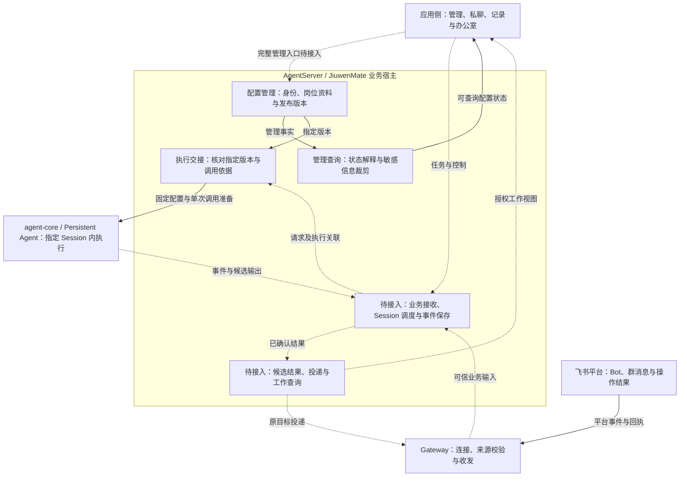
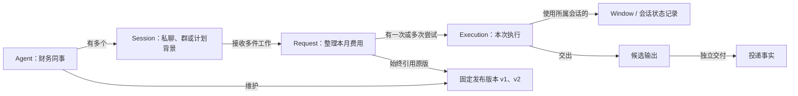
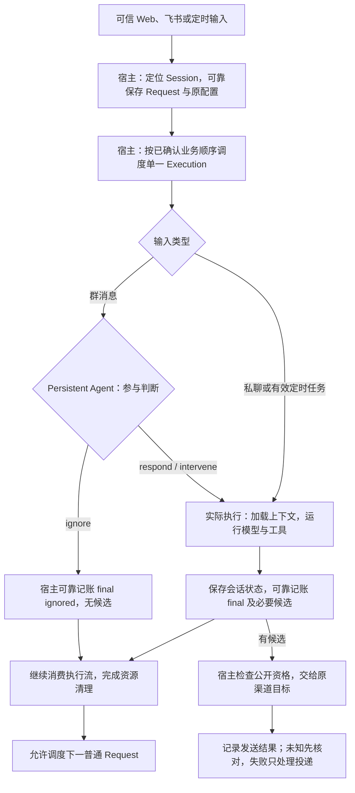

# JiuwenMate 服务端设计概览

## 文档状态与阅读说明

| 项 | 说明 |
| --- | --- |
| 类型 | 目标与当前能力的设计概览；目标流程尚未全部贯通，不能作为已开放接口的说明 |
| 最近一次修订日期 | 2026-10-13 |
| 责任人 | henry hu |
| 所属模块 | `jiuwenswarm.server.jiuwenmate`；现有业务基础位于 `server/runtime/persistent_agents/` |
| 编写依据 | [架构模板](../templates/architecture-template.md)、[概览模板](../templates/overview-template.md)与[文档约定](../AGENTS.md) |
| 详细设计 | [JiuwenMate 服务端详细架构设计](jiuwenmate-architecture.md) |
| 协作模块 | agent-core 仓的 [Persistent Agent 概览](../../../../../../agent-core/openjiuwen/harness/persistent_agent/docs/designs/persistent-agent-overview.md)及[详细架构](../../../../../../agent-core/openjiuwen/harness/persistent_agent/docs/designs/persistent-agent-architecture.md) |
| 关键前提与未决事项 | 可信主体映射、跨资料一致性、正式请求保存、执行结果与渠道交接尚需接入或验证，责任见[详细架构第 12.2 节](jiuwenmate-architecture.md#arch-16-2) |

本文面向产品、设计、开发与维护人员，说明数字同事服务的目标、责任、核心对象和主要工作链路。全文以“创建财务同事，再请它整理月度费用”为例，帮助读者区分配置管理、任务执行与结果送达。

**当前已有同事管理、配置发布和单次调用准备基础；用户入口、可靠业务接收、正式执行确认与结果投递尚未贯通。** 本文将当前基础与接入目标分别说明，代码依据见第 5.1 节。组件验证不能代表真实用户入口、agent-core 执行和飞书投递已经联合验收，本次文档重构也不产生新的运行验证结论。

本文分别说明本轮接入目标与当前能力；能力边界及跨模块约束以详细架构为依据，实际支持情况仍需源码和验证证据确认。具体实施与验收记录在对应特性方案中维护，不在本文复制进度或验收台账。

| 阅读目的 | 阅读位置 |
| --- | --- |
| 了解产品价值、本轮目标与后续范围 | [第 1 节](#overview-scope) |
| 了解参与方、对象关系与事实权威 | [第 2 节](#overview-model) |
| 理解管理与执行流程、完成和失败口径 | [第 3 节](#overview-flows) |
| 理解配置、会话、公开协作、权限与恢复限制 | [第 4 节](#overview-constraints) |
| 查找实现依据、开放条件和配套文档 | [第 5 节](#overview-delivery) |

图中箭头表示调用、资料交接或处理顺序，不表示独立部署或跨存储事务。各图分别标明当前基础与目标链路，不能凭连线推断功能已经接通。

## 1. 目标与范围

### 1.1 产品定位与典型场景

**JiuwenMate 是有稳定身份、独立岗位配置和持续工作记录的数字同事；服务端是它的业务宿主。** 用户管理的是持续存在的同事，模型与工具运行则按一次次活动执行创建和释放。

例如，用户从财务岗位模板创建“财务同事”，配置“先核对金额，再生成费用摘要”，发布版本 v1。随后在私聊中提出“整理本月费用”，该工作应明确属于这位同事、这段会话和 v1；即使后来发布 v2，原工作也不静默换版。目标链路接通后，用户可以分别查询工作进度、生成文件和送达状态，发送失败只处理发送环节。

服务端围绕这个场景承担四类责任：

1. **管理同事及配置：** 创建稳定身份，维护独立岗位资料，区分编辑、发布与当前生效版本。
2. **组织业务工作：** 核验输入来源，定位会话，保存请求与执行关联，按明确顺序和容量条件调度。
3. **确认执行与交付：** 为指定请求提供固定配置及宿主能力，保存必要结果和结束依据，再交给原渠道目标。
4. **提供可解释查询：** 按权限展示配置、任务、用量与交付事实，避免把页面状态当作后台完成依据。

其中第一类和调用依据准备已有代码基础；完整工作记录、调度、实际执行和交付仍属接入目标。

### 1.2 服务端职责与外部边界

管理链路接收结构化同事设置，产出可查询的身份、编辑资料和发布版本；业务链路接收可信任务输入，目标是产出可核验工作事实、候选成果和独立投递结果。两条链路有不同的入口、权限和完成条件。

应用侧负责创建、设置、私聊、群记录与办公室等页面，以及个人版和团队版的导航切换。服务端负责业务数据隔离和后台工作生命周期；页面切换或订阅断开不应取消后台执行。“团队版”是产品入口，不等同于已有集群运行模式。

Gateway 负责渠道连接、来源校验、协议转换和平台收发。飞书平台掌握实际群成员关系和消息操作效果。Persistent Agent 负责宿主指定 Session 内的判断与执行；服务端负责请求选择、单一活动执行、业务保存与投递。各方的完整分工见第 2.1 节。

### 1.3 本轮接入目标与后续范围

下表说明本轮接入目标与边界，不表示相关能力已经对用户开放。

| 范围 | 本轮接入目标 | 边界与限制 |
| --- | --- | --- |
| 同事管理与产品内私聊 | 独立创建与配置同事，接入消息、历史和执行状态 | 现有前端仍有页面内状态，完整管理和调用入口待接入 |
| 飞书私聊、群聊及公开协作 | 通过各同事的 Bot 接收消息，由执行器独立判断是否参与，按原身份返回结果 | 群聊本轮仅接飞书；全量群消息依赖平台权限和事件订阅 |
| 会话保存、停止与取消、非确认续做 | 保留请求、配置和执行关联，控制只作用于目标执行，异常先核对再续做 | 不接入需要用户确认的工具及确认恢复，不承诺跨进程安全接管 |
| 文件与资源、预算及管理查询 | 逐项接入独立资源选择、授权文件访问、模型预算和真实工作状态 | 仅开放已接通并验证的能力；保存选择不代表可以执行 |
| 定时任务 | 管理计划和触发记录，使用同一业务执行与投递链路 | 创建与修改通过管理入口；可靠触发与重启行为待验证 |

**后续或暂缓范围：** 原生群聊、其他 IM、跨群授权查询、自然语言管理写入、确认恢复、授权知识版本与来源失效管理、主动学习、task-loop 及子智能体模式不纳入本轮闭环。Team 整体入群、群 Leader 和从本地 Agent 接入仍为产品扩展方向。远期能力不能直接列成本轮交付条件。

管理配置和定时计划通过获授权的结构化管理入口修改。普通任务中的临时要求属于业务输入；它不能变成修改长期岗位、配置、渠道或预算的管理命令。对话设置计划和保存长期规范需要另行形成管理契约。

## 2. 核心模型与职责

### 2.1 总体关系与模块分工

下面按四类逻辑职责展示整体关系。实线表示现有管理与调用准备基础，虚线表示数字同事产品链路待接入；这不是部署拓扑。

| 参与方或逻辑模块 | 负责什么 | 交接与责任边界 |
| --- | --- | --- |
| 应用侧 | 提交用户操作，展示当前同事、会话和工作状态 | 不持有执行权，不以本地页面状态确认后台事实 |
| Gateway | 验证渠道来源，保留 Bot 身份和回复目标，操作平台 | 不选择业务版本，不通过重跑任务修复发送失败 |
| 配置管理 | 同事身份、独立岗位资料、编辑、发布、默认初始化与删除 | 交出固定版本；创建和发布成功不证明任务开始或渠道可用 |
| 模型与能力解析、执行交接 | 解析模型，核对双方开放能力及请求、版本、来源、执行关联 | 交出独立调用依据；准备成功不代表请求已可靠接收或模型已运行 |
| 待接入的请求、结果及查询职责 | 可靠保存请求，调度单一活动执行，保存事件与候选结果，管理投递和授权查询 | 宿主确认业务事实，渠道和平台分别确认发送效果；管理查询已有配置基础 |
| Persistent Agent | 群参与判断、原生 DeepAgent 模型与工具循环、会话窗口与历史管理、执行记账 | 使用宿主指定的 Session；不自行选择下一请求或直接操作渠道发送 |

服务端使用 agent-core 的公开类型和执行入口，agent-core 不反向依赖 `jiuwenswarm`。本轮接入采用 AgentServer 进程内调用；长期存在的是业务身份和保存的资料，每位同事不需要常驻独占执行进程。跨仓调用和宿主端口的详细契约由双方归属文档维护。

### 2.2 核心对象与关系

**Agent → Session → Request → Execution** 分别回答“谁在工作”“在哪段工作背景中”“处理哪件事”“这是哪一次尝试”。发布版本关联 Agent，并由 Request 固定引用；一次恢复可以增加 Execution，但不能把原事情改成另一件事。

| 对象 | 含义与例子 | 生命周期与共享边界 |
| --- | --- | --- |
| 命名空间 | 一组同事所属的业务数据范围 | 用于定位和隔离数据，不直接证明主体有管理或访问权 |
| Agent / 数字同事 | 持续存在的“财务同事”身份 | 拥有独立设置与发布版本；不等于活动 DeepAgent 实例 |
| 当前设置 / 发布版本 | 可编辑的岗位资料，以及发布后固定的执行依据 v1 | 保存不修改旧版；新发布供新请求选用，原请求继续引用原版 |
| Session / 会话 | 私聊或某个群中独立的工作背景 | 同一 Agent 可有多个 Session；私有窗口、进度和草稿相互隔离 |
| Request / 请求 | “整理本月费用”这件事 | 保留来源、主体和配置依据；目前已有关联模型，可靠接收仓库待接入 |
| Execution / 执行 | 原请求的一次判断、执行或续做尝试 | 使用独立可变现场；结束与清理分别确认，目前续做未开放 |
| Window / 会话状态记录 | 模型当前可见的窗口和下次可加载的上下文 | 由对端 WindowStore 管理格式，宿主提供保存后端；不等于业务完成记录 |
| 候选输出 / 投递 | 准备回复的文本或文件，以及向具体目标发送的事实 | 候选可靠保存、允许公开、实际送达分别确认，链路尚待接入 |

图表示对象归属与目标关系，不能据此认为每个对象已有持久仓库。Window 可以覆盖多个 Request，一个 Request 也可以跨窗口推进。办公室中的“正式任务”是进入实际业务执行的请求视图；忽略消息和恢复核对不能简单按执行次数累计为新任务。

### 2.3 关键事实以什么为准

| 事实 | 权威来源与确认责任 | 不能据此推断什么 |
| --- | --- | --- |
| 同事存在、设置保存与版本生效 | 配置管理的同事、岗位资料和发布记录；已有基础 | 创建不代表发布，发布不代表依赖永久可用 |
| 来源、调用归属与指定版本 | 可信调用方提供依据，执行交接检查一致性；完整入口待接入 | 标识合法或关联匹配不代表主体已认证、已授权 |
| 业务请求、执行结局和必要候选 | 待接入的宿主请求及事件保存职责 | 流式文本、内存句柄和函数返回不代表业务终态已落盘 |
| 会话上下文与历史 | Persistent Agent 的 WindowStore 及宿主注入的持久后端 | 窗口保存不代表业务结果确认，正文格式不由服务端另行定义 |
| 工作文件 | 当前授权范围内的文件状态、工具结果及副作用证据 | 文件存在不代表工作完成、允许共享或已经送达 |
| 群公开内容与成员状态 | 待接入的群记录服务，结合飞书平台消息与成员事实 | 入群不授予私有轨迹、连接器或其他会话的访问权 |
| 平台发送效果 | 渠道操作结果及待接入的业务投递记录 | 候选文本、发送命令受理或 Web 展示不代表平台已送达 |
| 页面、统计和管理视图 | 相应管理者已确认事实的授权投影 | 查询视图不能反向改写业务事实，查询失败不能显示成零记录 |

贯穿设计的原则是：**依据固定、现场独立、阶段分别确认、未知效果先核对、资源按实际开放范围使用。** 各原则的具体条件与限制见[详细架构共同规则](jiuwenmate-architecture.md#architecture-concepts)，不把配置冲突保护扩展为跨资料事务，也不把会话串行扩展为跨进程执行权。

## 3. 关键流程与完成语义

### 3.1 当前管理与调用准备流程

当前可以核对的后台主线结束于调用准备，完整用户入口仍待接入。沿用财务同事的例子：

1. **创建身份。** 配置管理校验业务范围、岗位、来源模板与模型，为同事建立独立资料。普通创建要求有可用模型，并继续尝试首版发布；默认“小九”可以在缺少模型时保留未发布身份。默认初始化事实保留，用户删除后不自动重建。
2. **保存岗位设置。** 用户修改工作要求，配置管理保存当前资料并识别过时修改。保存不改变 v1；岗位资料与同事设置的整体并发及中断一致性仍有边界。
3. **发布配置。** 解析模型并校验实际开放能力，确认固定内容与生效关系。执行配置未发生实质变化时可以沿用原版本，否则形成 v2。资源选择可以先保存，但未接通能力不能因被选择而执行。
4. **准备指定版本调用。** 调用方提供原请求、执行、来源与主体依据，执行交接读取指定版本并核对归属、内容和能力。原版本缺失、损坏或不匹配时拒绝，不静默改用 v2。

实线表示后台已有管理与准备基础，不表示整条管理操作原子完成。首版发布失败可能已留下同事身份；调用方应查询已完成阶段，不能因为整体调用失败就重复创建。当前没有覆盖所有管理请求的幂等重放保证。

### 3.2 目标业务链路：从输入到结果

下面描述本轮待接入的正常业务流程，执行步骤依据[对端概览第 3 节](../../../../../../agent-core/openjiuwen/harness/persistent_agent/docs/designs/persistent-agent-overview.md#3-关键流程与完成语义)，不是已开放链路。

接收由宿主负责：Web 明确目标同事与会话，飞书保留可信 Bot、群、发送者、回复关系和附件来源，定时输入关联计划与触发记录。重复消息需要分别处理“平台公开记录去重”和“每位同事的派发去重”，避免一个 Bot 的记录使另一位同事漏收。可靠交接的确认时机仍需在接入方案中定稿和故障验证。

调度也由宿主负责：同一 Session 同时只有一个活动 Execution，不同 Session 可以在容量内并行。**业务输入的具体排序仍待确认，不能直接继承通用聊天的最新输入优先策略，也不能将严格 FIFO（先进先出）写成已实现保证。** 暂停与控制的顺序范围见第 3.4 节。

群消息轮到执行时，由 Persistent Agent 独立判断 `ignore / respond / intervene`（忽略、响应或主动参与）。人类和 Agent 消息使用同一判断流程，@、回复关系和发送者是判断依据，不强制执行。忽略需可靠确认结局，但不进入正式任务、不写入窗口、不产生回复；判断失败或预算拒绝不能伪装成忽略。

进入实际执行后，对端使用原生 DeepAgent，宿主通过记账端口保存事件和候选，通过预算端口提供模型准入与计量，通过持久后端保存会话资料。`record` 是事件持久化通道，事件流用于实时展示；普通日志允许缺失，写意图、暂停、final 及其必要候选需可靠确认。宿主消费任务应独立于前端连接，收到 final 或 paused 后仍须消费到流结束并完成清理。

### 3.3 各阶段怎样确认完成

| 确认点 | 谁确认、凭什么 | 允许什么后续动作，仍缺什么 |
| --- | --- | --- |
| 身份已创建 / 设置已保存 | 配置管理读取对应管理事实 | 可继续发布；不证明设置已生效 |
| 配置已发布 | 固定版本与生效关系一起确认 | 可准备指定版本调用；不证明入口、权限或真实执行已接通 |
| 调用已准备 | 执行交接交出一致的配置与单次调用依据 | 可交给已接通的执行服务；不证明请求可靠接收 |
| Request 已可靠接收（目标） | 宿主保存请求、来源和配置依据并确认接收 | 可排队；不证明开始、结束或送达 |
| 本次执行结局已确认（目标） | final 成功记账，引用的必要候选已经可靠保存 | 保留业务结局，独立推进投递；Session 新执行仍须等待旧执行退出与清理 |
| 结果可公开 / 平台效果已确认（目标） | 宿主检查目标及资源资格，渠道核对平台操作结果 | 分别更新交付事实；不改变已确认的业务结局 |

“本轮结束”属于该同事的这件请求，不代表其他同事或整个群协作目标已经完成。暂停也不是最终完成：其原因、原请求关联和后续处置需要保留。执行结束、资源释放、投递成功和页面展示必须使用各自证据。

### 3.4 控制、失败与重试

本轮停止和取消应定位目标 Execution、核验发起人或管理资格，避免误伤其他 Session；收尾未完成时保留真实控制结果。需要用户确认的工具和确认恢复不在本轮开放范围，不能仅凭“聊天确认”承诺恢复执行或修改配置。

对端区分等待确认与其他暂停：等待确认阻塞所属 Session，其他暂停不阻塞后续 Request；本轮不接入前者。数字同事的控制保存、暂停后准入和续做排序仍需宿主方案确认。不能把所有暂停统一写成“占住原队列位置”，也不能把重新启动当作自动续做的依据。

| 情况 | 当前或目标处理 | 责任与继续条件 |
| --- | --- | --- |
| 创建或发布的回复丢失 | 先查询身份、设置和实际版本 | 配置管理核对；不根据回复缺失重做全部步骤 |
| 原版不匹配、资源未开放 | 拒绝对应准备或访问 | 执行交接和能力解析处理；不静默换版或扩大能力 |
| 执行中断、日志缺失 | 非确认续做是接入目标，先核对结局、主动控制和真实副作用 | 宿主与对端在旧执行退出后沿原 Request / Spec 继续；当前未开放 |
| final 已保存，清理失败 | 保留已确认结果，处理资源收尾 | 运行职责核对；不重跑已经结束的业务任务 |
| 发送明确失败或结果未知 | 发送失败只处理投递；未知先核对平台效果 | 渠道和结果职责处理；缺少回执不等于从未发送 |

未知外部写入不能因本地日志缺失就重复执行。取消和超时也不能撤销已发生效果。当前安全重试与恢复限制见[详细架构第 8 节](jiuwenmate-architecture.md#architecture-failures)；投递去重、目标顺序与对账协议仍需具体接入方案确认，不承诺未经证明的“恰好一次”。

## 4. 持续状态与关键约束

### 4.1 配置、实例与资料生命周期

同事身份、岗位资料和发布版本长期保存，活动执行现场按次创建与清理。新请求选定版本后固定其依据；已保存配置中的凭据和外部模型是否仍可用，需要在实际使用边界核验。原版本不可解释时拒绝，不能用当前新版本补位。

工作资料分三类：**办公空间文件**可以在当前授权下复用；**会话窗口、历史及草稿**仅属于原 Session；**PersonalContext 知识**由独立模块采集和发布。本轮接入文件和会话保存，不装配授权知识版本，也不读取宿主整个个人上下文目录。知识选择目前只是管理设置；后续接入应使用对端公开契约，不复制采集游标、凭据或另建发布权威。

服务端提供持久化后端，对端 WindowStore 掌握会话状态和归档格式；业务事件及结果由宿主保存。两者分别确认，不以窗口中的文字或文件时间推断工作结局。

停止活动、解除渠道绑定、删除身份和清理资料属于不同操作。产品目标中，Agent 启停不应自动退群或解绑；当前完整启停链路尚未接入。现有删除会移除同事、版本和岗位资料，尚无在途请求和未决投递的版本保留协议。正式运行前需明确引用保留与迟到结果核对，不能据此宣称安全运行清理已经具备。

### 4.2 群公开协作与可见性

目标中，同一群的不同 Agent 各有 Session、参与判断、私有窗口和执行事实；群成员可见的消息与附件由共享公开记录保存。群公开资料不包括隐藏判断、工具过程、私有上下文或未发送候选。普通群访问权和同事轨迹管理权分别核验。

例如，财务同事 A 公开询问业务同事 B 某笔费用的用途，B 收到后独立决定是否回答；B 的公开回答再成为 A 后续输入。协作通过真实渠道消息继续，发起询问不代表 B 已承接，也不存在统一发言轮次。双方分别确认自己的业务与发送事实，不用 A 的一次结束表示整个协作完成。中途协作发送须记录真实投递事实，能力与失败边界需结合对端契约，在具体接入方案中确认并验证。

办公文件存在不等于群内可见；需要公开时，宿主核验目标、资料权限和共享方式，再上传或发送。多 Bot 重复接收、平台回调和同事间公开协作的去重仍需联合验证。当前群查询端口仅覆盖所属群；跨群读取不能使用普通私有历史工具替代授权查询。

### 4.3 授权、资源隔离与预算

入口需核验主体、业务范围、目标同事及管理或调用资格；实际工具、文件、模型和共享操作需核验资源范围。命名空间、所有者标识、群成员关系或资源路径都不能单独扩大权限。当前已有数据范围和公开管理视图基础，完整主体映射与真实资源授权尚待接入。

不同 Session 和 Execution 的可变状态、工具环境和凭据不得相互覆盖。技能、连接器和插件可以复用既有管理体系，逐同事选择与授权装配仍需完成；Shell、CLI、MCP 等能力必须具备相应隔离依据才开放。本轮不开放需要人工确认或来源失效管理的操作。

固定 Spec 与当前授权分别解释。对端当前设计的知识版本在 Execution 开始时解析，本期撤权在下一个 Execution 生效；调用级即时撤权是后续扩展。本轮未接入知识版本，不能承诺每次模型调用前刷新知识或即时动态撤权。

模型预算由宿主提供准入、预留、计量和核对，对端在判断与执行中使用该能力。预算拒绝不调用模型，未知用量不能当作零。现有通用容量和模型账户额度不等于数字同事业务预算已贯通；群、私聊、计划及学习的统一账户关系和原子结算仍须各自方案明确。主动学习不在本轮范围，不能混入业务 Session 的计量与排队。

### 4.4 恢复、长期作业与查询限制

非确认续做应沿用原 Request 和配置，在旧执行退出并清理后核对已保存结局、窗口、日志及真实副作用。当前调用准备明确拒绝续做，宿主持久保存与对端能力接通后才可开放。跨进程安全接管、卡死检测及程序层面的精确崩溃恢复不属于本轮保证。

定时任务是本轮目标：服务端管理计划与触发事实，通用 Cron 可以复用时间计算与唤醒，触发后进入同一请求、预算、执行和投递链路。新版数据需与旧版隔离；不能直接沿用旧 Cron 的每次新建会话和独立推送语义。稳定会话映射、重复触发和重启行为在计划接入方案中确认。

长期学习是后续独立作业方向，需要独立授权、调度、预算、进度及发布交接；Persistent Agent 和 PersonalContext 的职责由对端文档定义，本概览不预设学习状态机或第二份知识发布记录。

管理查询以已确认事实生成授权视图：Request 与多次 Execution 分开展示，执行前的排队或阻塞不能伪造成正式任务，忽略不能算回复或失败。私聊报告、资产汇总、分页搜索和断线重订阅仍需相应查询契约；范围、完整性和读取失败应明确，不能将部分结果当作全量，也不能把查询失败显示成零条记录。当前已有配置查询，完整工作统计与轨迹尚待接入。

## 5. 现有基础与落地边界

### 5.1 可复用基础与待建设能力

下表依据本地源码及现有组件测试整理，说明可以复用什么和仍缺什么；不作为新的测试通过记录。

| 已有基础与依据 | 已有行为 | 待补齐责任及能力限制 |
| --- | --- | --- |
| [同事管理服务](../../../runtime/persistent_agents/service.py)、[业务模型](../../../runtime/persistent_agents/models.py) | 创建、默认初始化、独立设置、发布、查询和删除；公开视图不交出内部 Spec 或模型凭据 | 入口与授权职责接入真实用户管理；当前不能由页面创建或启停状态推断后台已执行 |
| [配置与岗位资料存储](../../../runtime/persistent_agents/repository.py) | 同事和固定版本保存，发布内容与当前关系在数据库事务内确认；岗位资料独立维护 | 配置职责核对跨资料并发与中断一致性、部署访问保护及在途引用保留；不能扩展为全链路事务 |
| [版本及调用准备](../../../runtime/persistent_agents/spec_provider.py)、[请求执行关联](../../../runtime/persistent_agents/execution_models.py) | 校验原配置、归属、来源和执行关联，准备单次现场；宿主目前仅开放 `construction`，拒绝续做和未开放模式 | 请求执行职责补齐可靠仓库、真实宿主端口及执行驱动；具备类型和准备函数不等于正式任务可运行 |
| [现有组件测试](../../../../../tests/unit_tests/server/runtime/persistent_agents/) | 覆盖默认初始化、发布前后行为、范围隔离、公开信息裁剪和契约拒绝等场景 | 这些用例不能代替产品入口、真实执行和平台投递的联合验收；本次未重跑这些测试 |
| [通用协议入口](../../../agent_ws_server.py)、[会话协调器](../../../../runtime/session/coordinator.py)、[会话调度器](../../../../runtime/session/work_scheduler.py) | 运行就绪检查、通用会话内串行、会话间并行、控制及关闭基础 | 数字同事接收与调度职责明确持久请求、业务顺序、控制与容量；通用聊天采用最新输入优先，不能直接当作业务 FIFO |
| [飞书适配器](../../../../gateway/channel_manager/im_platforms/feishu/feishu_connect.py)、[定时控制器](../../../../gateway/cron/controller.py) | 现有渠道收发与定时执行基础 | 渠道与计划职责补齐新版绑定、可靠分发、公开记录、触发去重及业务结果交接，不继承旧版全部语义 |
| [同事前端入口](../../../../channels/web/frontend/src/features/jiuwenmate/JiuwenMateApp.tsx) | 创建、配置与办公室页面已有交互基础，使用页面内状态并从空同事列表初始化 | 用户入口需调用后台默认初始化、加载列表与真实状态；前端存在不等于后台管理与工作闭环已接通 |

上述业务基础位于 `server/runtime/persistent_agents/`，本文所在 `server/jiuwenmate/` 当前承载设计文档，不用目录名推断运行模块已经迁移。既有个人版、集群模式和旧版同事数据与入口保留原语义；新版从独立数据与路由接入，不读取或转换旧版同事资料作为初始化来源。

### 5.2 能力开放条件

这些是设计门槛，具体接入场景、验证步骤与证据在对应特性方案中维护，不在概览重复登记状态与负责人。

| 能力 | 开放前应能证明什么 | 依据及缺失时的限制 |
| --- | --- | --- |
| 同事管理与查询 | 可信主体和范围映射、保存与发布可解释、内部凭据保护、入口真实调用后台 | [详细架构第 4、7、9 节](jiuwenmate-architecture.md#architecture-modules)；缺失时限制对应产品访问 |
| 私聊单次工作 | 请求与原版可靠保存、宿主端口和真实执行接通、结局与候选可靠确认、流结束与清理可核验、断线不取消后台 | 准备能力不能代替正式执行开放 |
| 飞书群协作 | 平台权限有效、各 Bot 正确定位同事、公开记录与逐同事派发去重、真实回复与共享权限、群私有状态隔离 | 缺少依据不开放对应群执行或共享 |
| 资源、预算与定时 | 实际授权和执行隔离、模型准入与结算、可靠触发与统一结果链路 | 配置选择或通用 Cron 存在不能替代验收 |
| 非确认续做与新版交付 | 旧执行退出、原归属与结局可核对、未知副作用先查证，真实两仓和飞书链路验证、既有模式回归 | 不承诺确认恢复或跨进程接管 |

缺少必要依据时，由拥有该事实的模块拒绝、限制或核对相应操作，不用静默换版、默认空结果或整条任务重跑掩盖缺口。未验证前提和未决问题的责任集中在[详细架构第 12.2 节](jiuwenmate-architecture.md#arch-16-2)。

### 5.3 详细设计与实施文档索引

| 文档 | 阅读用途与维护责任 |
| --- | --- |
| [详细架构第 2～3 节](jiuwenmate-architecture.md#architecture-concepts) | 查核心对象、共同规则、逻辑组成与外部责任 |
| [详细架构第 4～6 节](jiuwenmate-architecture.md#architecture-modules) | 查配置与执行交接、当前主流程、阶段状态和确认依据 |
| [详细架构第 7～10 节](jiuwenmate-architecture.md#architecture-data) | 查数据权威、故障、权限、资源及删除保留限制 |
| [详细架构第 11～12 节](jiuwenmate-architecture.md#architecture-scenarios) | 查完整场景、重要选择、未验证前提及待确认问题 |
| [Persistent Agent 详细架构](../../../../../../agent-core/openjiuwen/harness/persistent_agent/docs/designs/persistent-agent-architecture.md) | 查 agent-core 的执行、窗口、记账与恢复契约，不在服务端复制内部设计 |
| [文档约定](../AGENTS.md) | 查概览、架构、spec、feature 与计划的分工及同步要求 |

当前服务端 `specs/` 与 `features/` 尚无可引用的独立业务规约和接入方案。具体接口、状态细则、存储和算法由责任方在对应方案形成后维护，定稿契约同步规约；不链接已移除文档，也不为未来主题创建空文件。
