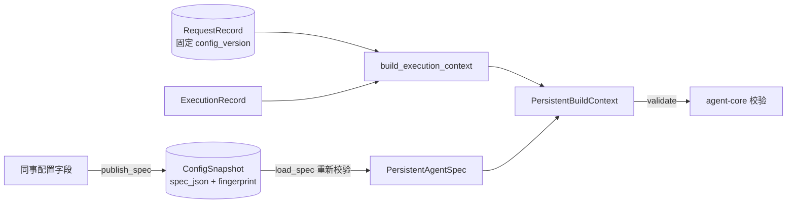

# 核心契约适配设计方案

## 1. 元信息

| 项 | 值 |
| --- | --- |
| 建档日期 | 2026-10-13 |
| 范围 | jiuwenswarm `jiuwenswarm/server/jiuwenmate/` 的 `spec_provider.py`、`execution_models.py`（JM-01 部分）及契约测试；对端 agent-core `openjiuwen/harness/persistent_agent/` 只读引用 |
| 方案成熟度 | 已确认（依据开发计划 JM-01 条目及已合入实现；本文为实现后补写，见“设计演进与修订”） |
| 计划条目 | [JM-01](../designs/jiuwenmate-development-plan.md)（原 SW-01）：固定 SDK 版本、公开协议适配与契约测试 |
| 负责人 | 常钰聪 |
| 状态 | 待验收：宿主组件通过，联合验收待完成（与开发计划一致） |
| 设计依据 | [JiuwenMate 服务端架构设计](../designs/jiuwenmate-architecture.md) 第 4.1 节“配置管理”、第 4.3 节“执行交接”；agent-core 仓 `jiuwenmate` 分支 [Persistent Agent 架构设计](https://gitcode.com/huenrui_/agent-core/blob/jiuwenmate/openjiuwen/harness/persistent_agent/docs/designs/persistent-agent-architecture.md) |
| 关联 feature | 后续：[F_02 同事定义与配置发布](F_02_colleague-management.md) 使用本文的 `publish_spec`；[F_03 会话定位与请求受理](F_03_session-request.md) 使用本文的 `RequestRecord`、`build_invocation` |
| 验证摘要 | 32 项契约测试通过（真实 agent-core 类型 + 宿主端口替身）；未与 core 正式执行入口联调，因 core 在 PA-10 接入前拒绝执行 |
| Refs | 无独立 issue；需求来源为开发计划 JM-01 |

## 2. 背景、目标与范围

### 2.1 背景与问题

agent-core 的 Persistent Agent 以 `PersistentAgentSpec`（固定配置）、`PersistentBuildContext`（单次执行上下文）和 `RequestInput`（任务输入）作为公共入口。Swarm 若直接拼装这些对象，会出现三类问题：宿主开放了 core 尚不支持的能力；core 已支持但宿主尚未接好端口的能力被误开放；Request 受理后配置被修改，导致同一任务前后使用不同配置。JM-01 之前，Swarm 没有统一的转换层，也没有测试证明宿主替身与真实 SDK 类型一致。

### 2.2 目标与关键场景

| 场景 / 触发条件 | 当前行为 | 目标行为 / 可观察变化 |
| --- | --- | --- |
| 发布同事配置 | 不支持 | 生成经 core 校验的 Spec，冻结为带指纹的 `ConfigSnapshot` |
| 配置开启 core 不支持或宿主未开放的能力 | 不支持 | 发布时以 `PersistentContractError` 明确拒绝，不依赖执行期才失败 |
| 已受理 Request 发起一次 Execution | 不支持 | 由存储记录重建 Spec 与 `PersistentBuildContext`，并由 core 再次校验 |
| 存储中的快照被篡改或与 Request 版本不符 | 不支持 | 拒绝构造调用 |
| 请求续做（`recovery_ref` 非空） | 不支持 | 以 `PERSISTENT_NOT_OPENED` 拒绝，待 PA-18 |

### 2.3 本次范围与非目标

- 本次包含：固定 agent-core 依赖版本（仅本地）；`publish_spec`、`ConfigSnapshot`、`build_invocation`；`AccessSnapshot`、`RequestRecord`、`ExecutionRecord`、`build_execution_context`；契约测试与端口替身。
- 本次不包含：调用 `execute_persistent_request`（JM-07）；宿主端口的真实实现（JM-04～JM-06、JM-11）；续做（JM-13）；工作空间只读能力 `workspace_read`（JM-14）。

## 3. 设计约束、假设与待决问题

- 已确认约束与依赖：只使用 `openjiuwen.harness.persistent_agent` 的公共导出类型，不从 core 内部 `execution/`、`schema/` 拼装执行链（开发计划第 1 节“全局约束”）。本轮只开放单轮执行，`enable_task_loop`、子 Agent 等能力不开放。
- 关键假设：`PersistentAgentSpec.enabled_features` 的类型注解以 `Literal` 列出 core 支持的能力。若 core 改用其他表达方式，`core_features()` 将识别不到能力，发布会全部被拒绝；契约测试 `test_host_opens_only_features_core_advertises` 用于发现这一变化。
- 待决问题：agent-core 依赖版本目前只固定在本地 `pyproject.toml` / `uv.lock`，不随提交入库；正式入库的版本固定方式待对端发布可引用版本后确定，不影响本仓组件验证。

## 4. 总体方案与设计取舍

### 4.1 方案概览

宿主在两个时点与 core 契约交接：发布时把同事配置转换为 Spec 并冻结；执行时把存储的快照和 Request 记录还原为 core 调用参数。两个时点都由 core 自身的校验器再次检查，宿主侧校验只负责尽早拒绝未开放的能力。

图中实线箭头表示数据转换方向。`ConfigSnapshot` 与 `RequestRecord` 是宿主持久保存的事实；`PersistentAgentSpec` 和 `PersistentBuildContext` 只在内存中存在，每次执行重新构造。

### 4.2 关键决策

#### D-01 能力开放取 core 支持集合与宿主开放集合的交集

- 选择与依据：`publish_spec` 先用 `core_features()` 读取 core 支持的能力，再与 `HOST_OPEN_FEATURES` 比较；两者都包含的能力才允许发布。当前宿主只开放 `construction`。
- 代价与成立条件：宿主每接好一项能力，需要同时修改 `HOST_OPEN_FEATURES` 和对应测试。
- 实现体现：`spec_provider.py` 的 `core_features`、`publish_spec`；验证见 JM-01-V-02。

#### D-02 快照以指纹自证，加载时重新校验

- 选择与依据：发布时保存 `spec.model_dump_json()` 及 core 计算的 `fingerprint()`；`load_spec` 重新校验 JSON，并核对 `card.id`、指纹和能力集合。这样可以保证 Request 使用的确实是受理时固定的配置。
- 代价与成立条件：core 修改指纹算法后，旧快照将无法加载，需要重新发布。
- 实现体现：`ConfigSnapshot.load_spec`；验证见 JM-01-V-03。

#### D-03 每次 Execution 使用新的空 Session，并显式注入 `NoopCheckpointer`

- 选择与依据：窗口状态由 core 通过 window backend 恢复（JM-05），Session 自身不做检查点，避免两套状态来源。
- 实现体现：`build_invocation` 中的 `create_agent_session(..., checkpointer=NoopCheckpointer())`。

### 4.3 替代方案与排除理由

| 候选 / 关联决策 | 候选目的与关键差异 | 拒绝或暂缓原因 | 重新评估条件 |
| --- | --- | --- | --- |
| R-01 / D-01 只依赖 core 校验 | 宿主不维护开放集合，全部交给 core | core 支持但宿主未接端口的能力会在执行期才失败，用户发布成功后却无法使用 | 无 |
| R-02 / D-02 保存配置字段，执行时重新生成 Spec | 不保存 Spec JSON | 模型目录或凭据变化后，同一 Request 会得到不同 Spec，违反“续做沿用原 Spec” | 无 |

## 5. 详细设计

### 5.1 模块责任与关键不变量

- `spec_provider.py` 负责配置与 core Spec 之间的转换，以及单次调用参数的组装；不保存数据，也不调用执行入口。
- `execution_models.py` 定义宿主持久化的 Request、Execution 和权限快照，并负责将它们还原为 core 的 `ExecutionContext`。
- 不变量：已受理 Request 只能与其 `config_version`、`config_fingerprint` 完全一致的快照组装调用（JM-01-V-03）。

### 5.2 关键类与函数设计

| 类名 / 所属模块 | 变更类型与可见范围 | 职责与边界 | 继承 / 组合关系 |
| --- | --- | --- | --- |
| `spec_provider.ConfigSnapshot` | 新增；包内公开 | 一个已发布配置版本；持有 Spec JSON、指纹和能力集合 | 冻结 dataclass；由 F_02 的仓库序列化保存 |
| `execution_models.AccessSnapshot` | 新增；包内公开 | 受理时固定的发起人与权限范围 | 冻结 dataclass；组合于 `RequestRecord` |
| `execution_models.RequestRecord` | 新增；包内公开 | 一次已受理任务，派发前持久化，每次 Execution 复用 | 组合 `AccessSnapshot` 与 core `RequestInput` |
| `execution_models.ExecutionRecord` | 新增；包内公开 | 一次执行尝试；`recovery_ref` 指向被续做的执行 | 冻结 dataclass |
| `execution_models.PersistentContractError` | 新增；包内公开 | 宿主侧契约错误，默认 `code="PERSISTENT_CONTRACT_INVALID"` | 继承 `ValueError` |

| 函数 / 所属模块 | 完整签名 | 职责与调用方 | 输入输出及行为约束 |
| --- | --- | --- | --- |
| `spec_provider.core_features` | `() -> frozenset[str]` | 读取 core Spec 接受的能力名称 | 遍历 `enabled_features` 注解中的 `Literal` 值 |
| `spec_provider.publish_spec` | `(agent_id: str, config_version: str, spec_fields: Mapping[str, Any]) -> ConfigSnapshot` | F_02 发布时调用 | 强制单轮字段；拒绝子 Agent、未支持或未开放的能力；`card.id` 必须等于 `agent_id`；失败抛 `PersistentContractError` |
| `spec_provider.build_invocation` | `(snapshot, request, execution, *, ports: PersistentPorts) -> tuple[PersistentAgentSpec, PersistentBuildContext]` | JM-07 执行驱动调用 | 核对 Agent 与配置版本；`recovery_ref` 非空时拒绝；最终由 `PersistentBuildContext.validate` 校验 |
| `execution_models.build_execution_context` | `(request, execution, *, capability_snapshot: frozenset[str]) -> ExecutionContext` | `build_invocation` 内部调用 | Execution 必须属于该 Request；core 构造失败转换为 `PersistentContractError` |

### 5.3 接口定义与消息契约

本特性不新增对外接口。宿主侧消费的 core 公共类型为 `PersistentAgentSpec`、`PersistentBuildContext`、`PersistentPorts`、`ExecutionContext`、`RequestInput`，定义以 agent-core 仓 `openjiuwen/harness/persistent_agent/` 为准，本文不复制。`RequestRecord` 额外约束新 Request 不得携带 `continue_instruction`，`received_at` 必须带时区并统一转为 UTC。

### 5.7 正常执行流程

1. 发布：F_02 组装配置字段并调用 `publish_spec`。该函数写入固定单轮字段，校验能力集合，再由 core 校验 Spec 并计算指纹，最后返回 `ConfigSnapshot`。
2. 受理：F_03 将快照的 `config_version` 与 `fingerprint` 写入 `RequestRecord`。
3. 执行：JM-07 读取快照、Request 和 Execution 记录，并调用 `build_invocation`。该函数核对版本，调用 `load_spec` 重新校验，再组装上下文并交给 core 校验，最后返回 Spec 与构造上下文。

### 5.8 异常、中断与重试处理

所有校验失败都在产生副作用之前抛出 `PersistentContractError`，不会写入存储。续做请求使用 `code="PERSISTENT_NOT_OPENED"`，以便调用方区分“能力未开放”和“数据非法”。

## 6. 影响面与实施设计

### 6.1 修改点与实施顺序

| 实施项 | 模块 / 文件或符号 | 修改内容与责任 | 必要前置 / 独立验证产物 |
| --- | --- | --- | --- |
| I-01 | 本地 `pyproject.toml`、`uv.lock` | 固定 huenrui_agent-core `12cf92bd71dedb3c39309b72fd8519b5ad9134e6`；仅本地保留，不入库 | 无 |
| I-02 | [`spec_provider.py`](../../spec_provider.py) | 发布与调用组装 | I-01 |
| I-03 | [`execution_models.py`](../../execution_models.py) | Request / Execution / 权限快照模型 | I-01 |
| I-04 | [`test_core_contract.py`](../../../../../tests/unit_tests/server/jiuwenmate/test_core_contract.py) | 契约测试与宿主端口替身 | I-02、I-03 |

兼容核对：新版模块独立，不修改个人版或旧版同事的任何调用；无兼容与迁移影响。

### 6.2 文档同步

- spec：尚无 `specs/` 规约；宿主契约随 JM-07 接入执行后再评估是否建档。
- 开发计划：JM-01 的“证据”列链接本文。

## 8. 验证设计、执行记录与结论

### 8.1 验证设计与通过条件

| 验证 ID | 场景 | 验证入口 | 预期结果 | 层级 |
| --- | --- | --- | --- | --- |
| JM-01-V-01 | 合法 Spec / Context / RequestInput | `test_published_spec_is_a_core_spec_with_fixed_single_round_fields`、`test_valid_spec_context_and_request_input_are_accepted_by_core`、`test_scheduled_request_input_is_accepted_without_source` | core 接受，单轮字段被固定 | 单测，真实 core 类型 |
| JM-01-V-02 | 字段错配与未开放能力 | `test_mismatched_spec_fields_are_rejected`、`test_capabilities_not_opened_by_the_host_are_rejected`、`test_host_opens_only_features_core_advertises`、`test_core_entries_still_reject_values_the_host_cannot_publish` | 发布被拒绝；core 入口同样拒绝 | 单测，真实 core 类型 |
| JM-01-V-03 | 快照篡改、版本不符、能力快照不符、续做 | `test_tampered_snapshot_is_refused`、`test_request_from_another_configuration_is_refused`、`test_capability_snapshot_mismatch_is_refused_by_core`、`test_continuation_is_not_opened` | 拒绝组装调用 | 单测 |
| JM-01-V-04 | 替身与真实 SDK 一致 | `test_fake_ports_match_core_protocol_signatures`、`test_fake_ports_pass_core_port_validation_and_return_core_types` | 替身签名与返回类型符合 core 协议 | 单测 |
| JM-01-V-05 | core 正式执行尚未开放 | `test_core_execution_is_not_open_until_session_state_is_integrated` | core 拒绝执行；PA-10 接入后此哨兵测试应失败并需改写 | 单测，哨兵 |

### 8.2 实际执行与证据

| 执行日期 / 验证范围 | 实现版本与环境 | 命令 | 实际结果 | 未覆盖项 |
| --- | --- | --- | --- | --- |
| 2026-10-12 / V-01～V-05 | 提交 `7a78a10f`；agent-core `12cf92bd` | `.venv/bin/python -m pytest tests/unit_tests/server/jiuwenmate/test_core_contract.py -o addopts="--asyncio-mode=auto"` | 通过，32 passed | 与 core 正式执行的联调 |
| 2026-10-13 / V-01～V-05（目录迁移后复核） | 提交 `12b619ad`；agent-core `12cf92bd` | 同上，追加 `-q -p no:cacheprovider` | 通过，32 passed | 同上 |

### 8.3 验证结论

- 已证明范围：宿主侧发布、快照自证和调用组装符合 core 公共类型的校验；替身与 core 协议一致。
- 未覆盖的承诺：真实执行链路。core 正式执行入口在 PA-10 前拒绝执行，因此无法证明 Spec 在真实执行中可用。
- 可支持的交付判断：满足 JM-01 的宿主组件验收；整项完成须待 S1 联合验收。

## 9. 风险与已知遗留

### 9.2 已知遗留

| 遗留项 | 性质 | 影响与现有处置 | 后续入口 |
| --- | --- | --- | --- |
| agent-core 版本未入库固定 | 有意取舍 | 其他开发环境需自行固定同一版本 | 对端发布可引用版本后入库 |
| `workspace_read` 未开放 | 未实现 | Spec 不能启用工作空间只读 | JM-14 |
| 续做未开放 | 范围外 | `recovery_ref` 非空时拒绝 | JM-13，对端 PA-18 |

## 10. 设计演进与修订

### 2026-10-13 实现后补写特性文档

- 原结论与适用范围：JM-01 开发时以开发计划条目作为设计依据，没有单独的 feature 文档。
- 新证据与原因：[docs/AGENTS.md](../AGENTS.md) 要求特性设计先于实现，并由计划条目链接 feature。
- 最终变化：依据已合入的源码和测试补写本文，未改变实现。
- 旧结论的效力：计划条目中的验收要求仍为唯一来源；本文提供技术方案与验证记录。
- 验证：2026-10-13 在提交 `12b619ad` 上复核 32 项测试通过。
