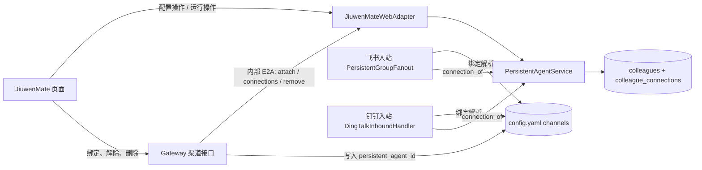
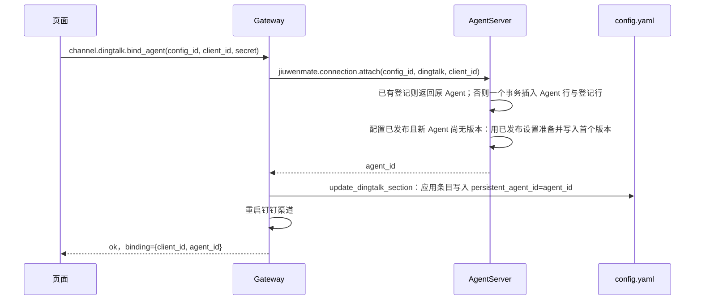
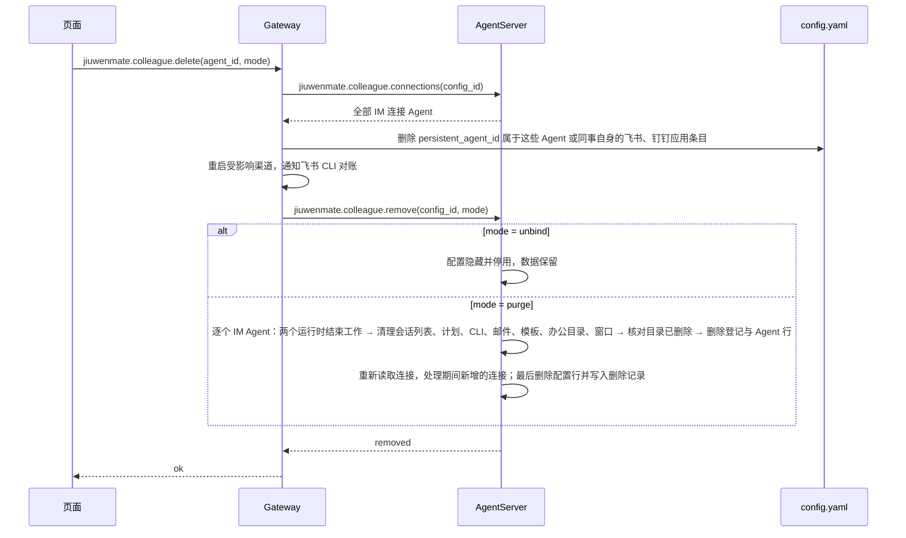

# 同事配置与连接聚合设计方案

## 1. 元信息

| 项 | 值 |
| --- | --- |
| 建档日期 | 2026-10-26 |
| 范围 | Swarm `jiuwenswarm/server/jiuwenmate/` 的同事存储、发布、运行时视图与 IM 入站检查；Gateway 飞书和钉钉的绑定、解除与同事删除入口；JiuwenMate 前端同事列表、IM 连接、删除和工作空间选择。不修改 agent-core |
| 方案成熟度 | 已确认：产品取舍、D-01、D-08、企业飞书处理方式与架构修订均由本 session 用户于 2026-10-26 确认（第 3 节） |
| 计划条目 | [JM-02](../designs/jiuwenmate-development-plan.md) 的子特性；同时修改 JM-08（飞书入站检查）、JM-10（同事页面）和 JM-21 钉钉子范围的接线。保留这些条目的整项负责人、排期与状态；本子范围负责人同步登记到计划 |
| 负责人 | 本子特性方案与实现：Song Haoran；JM-02、JM-10 整项负责人常钰聪，JM-08、JM-21 整项负责人闫祉君，不变 |
| 状态 | 本地实现；第二轮五项修复与第三轮 Gateway 绑定保存窗口修复均已有组件和接线（替身）验证，见第 8、10 节；本次作为 PR2 提交子仓并提请审阅，未进行完整浏览器核对、原生 PA 执行与真实飞书、钉钉联调 |
| 设计依据 | [架构](../designs/jiuwenmate-architecture.md)第 2.1、4.1、9.2 节（按 6.2 节修订，已获确认）；[S_03](../specs/S_03_im-direct-message-and-delivery.md) |
| 关联 feature | 前置：[F_02](F_02_colleague-management.md)、[F_21_02 钉钉单聊](F_21_02_dingtalk-direct-message.md)（本方案替代其第 9 节的合入依赖和 D-07 的临时检查）；相关：[F_08](F_08_feishu-group-fanout.md)、[F_10](F_10_web-colleague-management.md)、[F_14](F_14_workspace-read.md)、[F_24](F_24_personal-data-access.md) |
| 验证摘要 | 第三轮：聚合专项 44 passed（新增 24 项），后端完整集合 985 passed、6 failed、1 skipped，集成与渠道 163 passed、4 failed、1 skipped；失败项与 HEAD 基线相同。推送前复核重新执行后端集合，仍为 985 passed、6 failed、1 skipped；前端 108 项、设置页 64 项与构建通过。完整浏览器、原生 PA 与真实平台未验证，当前预览模型创建员工受分词器准备失败阻塞，详见第 8、9 节 |
| Refs | 无独立 issue；需求来源为本 session 用户决定。[PR1 !76（钉钉，提交 `1d6f9445`）](https://gitcode.com/huenrui_/jiuwenswarm/merge_requests/76) 与 [PR2 !77（本方案）](https://gitcode.com/huenrui_/jiuwenswarm/merge_requests/77) 配套审阅和交付；均为草稿，未经用户审批不合入 |

## 2. 背景、目标与范围

### 2.1 背景与问题

当前一位同事只有一个 `agent_id`，Web 私聊、飞书和钉钉都由这一个 Agent 服务，共用同一个办公目录、Session 库和飞书 CLI 身份。已核实的问题：

- **跨平台读取。** 飞书单聊与群聊拿到 `workspace_read`，可以读取该 Agent 办公目录中的全部共享输出，包括为钉钉用户生成的文件（PR1 检视中已复现）。
- **换应用复用数据。** 同一同事换绑另一个钉钉应用后，新应用的用户能读到旧应用用户留下的文件。
- **PR1 的临时措施不对称。** 钉钉入站和绑定接口拒绝已服务其他连接的 Agent（`has_sessions_outside_dingtalk_app`、`has_feishu_binding`、`jiuwenmate.dingtalk.binding_check`），飞书路径没有对应检查。F_21_02 第 9 节因此把“PR1 不单独发布”列为合入依赖。

用户的决定是：用户看到的一个“同事”是一份配置；每个连接（Web、每个飞书应用、每个钉钉应用）有自己的运行 Agent 和工作空间，隔离单位是连接。

### 2.2 目标与关键场景

| 场景 / 触发条件 | 当前行为 | 目标行为 |
| --- | --- | --- |
| 给“会计助手”绑定飞书应用 A 和钉钉应用 B | 三个入口共用一个 Agent | Web、A、B 各有独立的运行 Agent、办公目录和 Session；同事列表仍只显示一个“会计助手” |
| 修改人设并发布 | 发布一个 Agent | 同一次发布在一个事务内切换该配置全部运行 Agent 的版本；任一失败或并发冲突时全部保持原版本 |
| 飞书用户请求读取文件 | 能读到钉钉连接的输出 | 只能读到飞书应用 A 这个连接的办公目录 |
| 手工修改 YAML，把某 Agent 绑到另一个应用或平台 | 飞书照常运行，钉钉拒绝 | 飞书和钉钉入站都拒绝，不回落普通助手 |
| 同一配置重新绑定原来的应用 | — | 沿用原连接的 Agent 和数据 |
| 应用改绑到另一个配置 | — | 新配置得到新的 Agent；旧 Agent 的数据保留、不再被该应用使用 |
| 在工作台切换到“飞书·A”工作空间 | 不支持 | 聊天、历史、文件、执行轨迹和群记录都来自应用 A 的 Agent；定时任务、邮件授权和活跃统计仍在 Web Agent 上 |
| 删除同事 | 删除 Agent，YAML 绑定残留 | 用户选择“仅解除连接”或“全部删除”，两者都先移除 YAML 中的绑定应用 |

### 2.3 本次范围与非目标

- 本次包含：连接登记、按连接派生运行 Agent、全有或全无的发布、Gateway 绑定与解除接入登记、飞书和钉钉入站共用的登记检查、两种删除、配置级启停、工作空间选择、撤回 PR1 的临时检查。
- 本次不包含：恢复已解除的同事或查看已解除连接的数据（不提供入口）；单个连接的启停；旧数据迁移（见第 7 节）；定时任务、邮件授权和活跃统计按连接切换；企业飞书（`channels.feishu_enterprise`）的界面绑定与登记（见第 3 节约束 10）；改动 agent-core。

## 3. 设计约束、假设与待决问题

**已确认约束**（本 session 用户，2026-10-26）：

1. 一份配置对应每个连接各自的运行 Agent；每份配置固定一个 Web Agent。
2. 隔离单位是连接；更换 client_id 或 app_id 就是新连接。
3. 前端的同事句柄继续使用 Web 连接的 agent_id，另带 `config_id`；配置类操作用 `config_id`，运行类操作用所选工作空间的 agent_id。
4. PR2 之前开发环境里的同事不迁移；它们原有的飞书或钉钉绑定需要重新绑定（接受此代价，须告知飞书负责人）。
5. 聊天、历史、文件、执行轨迹和群记录跟随工作空间选择；定时任务、邮件授权和活跃统计固定在 Web Agent 上。
6. “仅解除连接”：从列表隐藏，移除 YAML 绑定，停用各运行 Agent，保留数据，不提供恢复入口。“全部删除”：逐个清除运行 Agent，再删除配置。
7. 配置级启停作用于全部连接。
8. PR1 与 PR2 同时合入上游。
9. 不修改 agent-core；不做格式化和静态检查；不提交、不推送。
10. 企业飞书暂不纳入登记检查：未登记的 Agent 照旧受理，问题记入遗留（第 9.2 节）。
11. D-01、D-08 及第 6.2 节的架构修订按本文执行。

**关键假设：**

- 本机只有一个命名空间 `local`，与现有 Web 和 IM 入口一致。
- 一份配置的连接数量很小（个位数），发布时逐个装配资源的开销可以接受。

**待决问题：** 无。以下问题已于 2026-10-26 由用户决定：

- Q1 企业飞书：`channels.feishu_enterprise` 的机器人只能手写 YAML 绑定，没有登记。决定暂不对其要求登记（约束 10），缺口记入第 9.2 节。
- Q2 D-01：确认配置标识等于 Web agent_id。
- Q3 D-08：确认解除时删除 YAML 应用条目。
- Q4 架构修订：确认按第 6.2 节修改。

## 4. 总体方案与设计取舍

### 4.1 方案概览

配置仍是 `colleagues` 表中的一行，这一行同时就是它的 Web 运行 Agent。每添加一个 IM 连接，AgentServer 新建一个运行 Agent（`colleagues` 表中的另一行），并在新表 `colleague_connections` 中登记“这个 Agent 专属于哪份配置的哪个平台应用”。YAML 中的 `persistent_agent_id` 改为写入连接的运行 Agent。飞书和钉钉入站在原有绑定解析之后再核对登记：YAML 绑定到的 Agent 必须登记为本平台、本应用的连接，否则拒绝。



实线是调用方向。YAML 决定某个应用当前由哪个 Agent 服务；登记表决定一个 Agent 只能服务哪个应用。两者一致时入站才被受理。

### 4.2 关键决策

#### D-01 配置沿用其 Web Agent 的同事行（config_id 等于 Web agent_id）

- 选择与依据：不新建配置表。现有 `colleagues` 行保存配置的设置、revision、发布标记和启停，同时是 Web 运行 Agent；`config_id` 就是这一行的 `agent_id`，接口中单独返回 `config_id` 字段。
  - 每份配置固定一个 Web Agent（约束 1），两者终身一一对应，共用标识不会产生歧义。
  - 现有服务接口 `update_settings`、`publish`、`set_enabled`、`current_snapshot` 等以这个标识调用时含义不变。JM-02、JM-07、JM-08、JM-10、JM-14 的测试约有 60 处按此调用，不必改写。
  - 前端句柄、Web 会话、定时任务、邮件授权和 `namespace_defaults` 中的默认同事认领都不变。
  - 没有登记为 IM 连接的旧行自然就是“只有 Web 连接的配置”（约束 4），不需要迁移步骤。
- 代价与成立条件：配置事实（草稿、revision）和 Web Agent 的运行事实（当前版本）在同一行；Web 连接不能被替换或单独删除。IM 运行 Agent 也是 `colleagues` 行，其中设置、revision 等字段只记录它当前版本所对应的配置修订。若以后一份配置需要多个或可替换的 Web Agent，须改为独立配置表。
- 实现体现：5.2、5.5 节；I-01。
- 相关候选：R-01。
- 确认依据：约束 3 确认的是“前端继续用 Web agent_id，配置操作另有 config_id”；本决策让二者取值相同，用户于 2026-10-26 确认（Q2）。

#### D-02 登记表只记录 Agent 的专属连接，不记录“当前生效”

- 选择与依据：`colleague_connections` 每行表示“Agent X 属于配置 C，只能服务平台 P 的应用 K”。一个 Agent 至多一行，同一配置的同一应用至多一行。某个应用当前由哪个 Agent 服务，仍以 YAML 为准。
  - 隔离所需的不变量是“一个 Agent 只服务一个连接”，专属登记已经足够。
  - 应用改绑到另一份配置时，旧行不需要标记解除；旧 Agent 在 YAML 中不再被引用，也就不再收到消息。
  - 绑定只需一次内部调用，不需要“预留、确认”两阶段，也不会因 YAML 保存失败而让旧连接失效。
- 代价与成立条件：同一应用可以在两份配置中各有一行登记，页面只把 YAML 当前指向的那个显示为已连接。
- 实现体现：5.5、5.7 节；I-01、I-03。
- 相关候选：R-02。

#### D-03 一次发布在一个事务内切换配置的全部运行 Agent

- 选择与依据：发布时先为配置的每个运行 Agent（Web 加全部已登记的 IM Agent）各自装配资源、解析模型并生成版本快照，再在一个 SQLite `BEGIN IMMEDIATE` 事务中写入所有新版本并切换各自的 `current_version`。
  - 事务内核对配置的 revision、每个 Agent 的当前版本与版本号，以及配置名下的 Agent 集合未变；任一不符则整体回滚，返回 `CONFLICT`。
  - 资源副本按内容摘要建目录（`_materialize_skills`、`_materialize_knowledge`），准备阶段不会覆盖正在执行的任务所用的文件；回滚后留下的未引用目录与现状一致。
- 代价与成立条件：一次发布的装配耗时与连接数成正比。不再被 YAML 引用的旧 IM Agent 也会一起发布，以便重新绑定时直接可用。
- 实现体现：5.7 节；I-01。

#### D-04 添加连接时，新 Agent 只使用已发布的设置

- 选择与依据：添加连接为新 Agent 发布版本时，使用配置最近一次发布的设置（新列 `published_settings_json`，含人设），不使用尚未发布的草稿。同一配置重新绑定同一应用时，沿用已登记的 Agent。配置从未发布时，新 Agent 也不发布，入站返回未发布（与现状相同）。
- 代价与成立条件：PR2 之前的配置没有该列；没有未发布修改时，以当前设置和 Template 人设作为已发布设置；有未发布修改时新 Agent 暂不发布，等用户下次发布。
- 实现体现：5.7 节；I-01。

#### D-05 绑定、解除和删除由 Gateway 编排，YAML 先于 AgentServer

- 选择与依据：YAML 和渠道重启归 Gateway 管理，同事数据归 AgentServer 管理。
  - 绑定：Gateway 先请求 AgentServer 取得或新建连接 Agent，再写 YAML 并重启渠道。
  - 删除：Gateway 先查询配置的全部 IM Agent，移除 YAML 中指向它们（以及指向配置自身 Web Agent）的应用，再请求 AgentServer 隐藏或清除。
  - 任一步失败都可以原样重试：绑定重复调用得到同一个 Agent；删除重复调用时已移除的应用不会再被找到。
- 代价与成立条件：增加三个内部 E2A 方法；`jiuwenmate.colleague.delete` 从“Gateway 直接转发”改为 Gateway 本地处理。
- 实现体现：5.3、5.7、5.8 节；I-04。
- 相关候选：R-03。

#### D-06 删除两种模式，两个运行时都结束该 Agent 的工作

- 选择与依据：
  - `unbind`：配置行设为隐藏并停用；IM Agent 的启停跟随配置，因此一并停用；数据全部保留。
  - `purge`：对每个运行 Agent，先在 IM 运行时和 Web 运行时结束其排队和执行中的请求，再沿用现有 `AgentManager.delete_colleague` 删除记录、版本、办公目录、窗口、定时任务、CLI 资料和邮件授权，最后删除登记与配置。
  - 现有删除只结束 Web 运行时中的执行，绑定飞书的同事在 IM 运行时的执行不会被结束；`purge` 一并处理。
- 实现体现：5.7、5.8 节；I-02。

#### D-07 运行操作跟随工作空间，其余固定在 Web Agent

- 选择与依据：按约束 5 实现。工作空间选择只改变前端运行类调用使用的 agent_id，服务端按 agent_id 工作的代码不变。飞书 CLI 身份只准备在飞书连接的 Agent 上；Web Agent 不再有飞书 CLI，需要飞书 CLI 时切换到飞书工作空间对话。
- 代价与成立条件：主人在飞书工作空间里私聊生成的共享输出，飞书用户也能读取；这是主人选择工作空间时的明确行为，页面需提示。
- 实现体现：5.11 节；I-05。

#### D-08 解除连接时删除 YAML 中的应用条目

- 选择与依据：解除单个连接或删除同事时，Gateway 从 `channels.feishu.apps` 或 `channels.dingtalk.apps` 中删除该应用条目，凭据随之删除，再次绑定需要重新填写。
  - 不改成普通应用：飞书普通应用会把外部用户接到主人的个人助手。
  - 不仅停用：钉钉“最多一个普通应用”的检查会把停用项也计算在内；停用后的条目对绑定、启用又要单独约定。
- 代价与成立条件：如果该应用在绑定前是用户配置过的普通应用，原来的普通配置也会被删除。
- 确认依据：用户于 2026-10-26 确认（Q3）。

#### D-09 撤回 PR1 的临时检查

- 选择与依据：登记检查覆盖 PR1 临时措施要防止的全部情况，同时作用于飞书。撤回：
  - 内部方法 `jiuwenmate.dingtalk.binding_check` 及 Gateway 的绑定前询问；
  - `ExecutionRepository.has_sessions_outside_dingtalk_app`；
  - `has_feishu_binding`、`_reject_feishu_agents` 及 `configured_dingtalk_bindings` 中排除飞书 Agent 的逻辑；
  - 钉钉入站的历史会话检查。

  F_21_02 第 9 节的合入依赖由本方案关闭。
- 实现体现：I-03、I-04。

### 4.3 替代方案与排除理由

| 候选 / 关联决策 | 关键差异 | 拒绝原因 | 重新评估条件 |
| --- | --- | --- | --- |
| R-01 / D-01 新建 `colleague_configs` 表，配置与 Web Agent 分开 | 概念最干净，Web Agent 可替换 | 需要把设置、发布、启停、默认认领、Template 位置全部迁到新表，改写其他特性约 60 处测试和管理接口；PR2 之前的数据需要迁移 | 一份配置需要多个或可替换的 Web Agent |
| R-02 / D-02 登记表记录 active / detached 状态，绑定时解除旧连接 | 登记表也能回答“当前谁在服务” | 需要两阶段提交，否则 YAML 保存失败会让旧连接被错误解除；YAML 已经是“当前服务”的权威 | 不再以 YAML 作为渠道配置权威 |
| R-03 / D-05 AgentServer 直接改 YAML | 少一跳 | AgentServer 不能重启 Gateway 的渠道实例，需要新增反向通知 | 渠道配置迁入 AgentServer |
| R-04 前端全部改用 config_id 加连接 ID | 概念统一 | 约 6,000 行 JiuwenMate 前端及其测试需要改写（已在 2026-10-26 讨论中排除） | 无 |
| R-05 保留 PR1 钉钉临时检查，另给飞书补同样检查 | 不新增表 | 只能事后拒绝，不能防止数据进入共用目录；“换应用算新连接”无法表达 | 无 |

## 5. 详细设计

### 5.1 模块责任与关键不变量

| 模块 | 本次责任 |
| --- | --- |
| `repository.py` | `colleague_connections` 表；`colleagues` 新增 `hidden`、`published_settings_json` 列；配置发布事务、连接 Agent 的创建与首次发布 |
| `service.py` | 区分配置与运行 Agent；运行视图按配置解析名称、设置和启停；全有或全无的发布；添加连接、查询连接、隐藏配置 |
| `agent_manager.py` | 群名单与 CLI 对账改为遍历全部运行 Agent；提供结束单个 Agent 工作的入口供另一运行时调用 |
| `web_adapter.py` | 同事视图带 `config_id` 与 `connections`；配置操作要求配置标识；连接、删除的内部处理 |
| `agent_ws_server.py` | 分派三个内部方法；清除时同时结束 IM 运行时中的工作 |
| `feishu_group_fanout.py`、`dingtalk_inbound.py` | 入站核对登记 |
| `app_web_handlers.py` | 飞书和钉钉的绑定、解除，同事删除的编排 |
| 前端 `features/jiuwenmate/` | 连接列表、添加 / 解除连接、两种删除、工作空间选择 |

关键保证：

- **C-1 专属：** 一个运行 Agent 至多登记一个连接；同一配置的同一平台应用至多一个 Agent。
- **C-2 入站一致：** 飞书和钉钉只受理 YAML 绑定到的 Agent 恰好登记为本平台、本应用的事件；否则拒绝，不回落普通助手。
- **C-3 发布一致：** 发布成功时，配置名下全部运行 Agent 都切换到这次修订；失败或冲突时全部保持原版本。
- **C-4 新连接不带草稿：** 新连接 Agent 只由已发布设置生成。
- **C-5 删除先断流：** 两种删除都在 AgentServer 改动数据之前移除 YAML 中的绑定应用。
- **C-6 原有按 agent_id 的行为不变：** Session、Request、窗口、办公目录、群访问、投递和恢复仍按运行 agent_id 工作。
- **C-7 删除可重试且不误报：** 每个运行 Agent 的清理全部完成后才删除它的登记与同事表行，同事自身的行最后删除；任何清理失败都返回错误并留下可再次找到的对象。已完成的删除在原样重试时被识别为完成，未知的配置 ID 仍返回 `NOT_FOUND`。
- **C-8 无孤立连接：** 连接只在其同事存在、未隐藏时创建，检查与插入在同一事务中；同事行在仍有连接时不能删除。
- **C-9 绑定不落在已删除的 Agent 上：** 在同一个 Gateway 进程中，同一同事的飞书绑定、钉钉绑定与同事删除逐个执行，每个操作覆盖“询问 AgentServer → 写 YAML → 重启渠道”整段；绑定成功返回时，YAML 中的应用指向仍存在的连接 Agent，删除成功返回时，YAML 中没有指向该同事任一 Agent 的应用。

### 5.2 关键类与函数设计

| 符号 | 变更 | 定义与行为 |
| --- | --- | --- |
| `repository.ConnectionRecord` | 新增，冻结 dataclass | `namespace_id`、`agent_id`、`config_id`、`channel`（`feishu` / `dingtalk`）、`connection_key`、`created_at` |
| `PersistentAgentRepository.connection_of(namespace_id, agent_id) -> ConnectionRecord \| None` | 新增 | 读取 Agent 的专属连接；配置行返回 `None` |
| `PersistentAgentRepository.connections(namespace_id, config_id) -> list[ConnectionRecord]` | 新增 | 配置名下全部 IM 连接，按创建时间排序 |
| `PersistentAgentRepository.insert_connection_agent(definition, connection) -> ConnectionRecord` | 新增 | 一个事务内插入运行 Agent 行和登记行；同一 `(config, channel, key)` 已有登记时返回已有记录，不插入 |
| `PersistentAgentRepository.publish_configuration(namespace_id, config_id, *, revision, published_settings, agent_ids, changes, published_at) -> None` | 新增 | 一个事务：核对配置 revision 与 Agent 集合；逐个核对并写入版本；更新配置的 `published_revision`、`published_settings_json`。`changes` 为 `(agent_id, previous_version, snapshot \| None)`；任一核对失败抛 `CONFLICT` |
| `PersistentAgentRepository.publish_connection_agent(namespace_id, agent_id, *, config_revision, previous_version, snapshot, published_at) -> None` | 新增 | 为新连接 Agent 写入首个版本；核对配置 `published_revision` 仍为 `config_revision`，否则 `CONFLICT` |
| `PersistentAgentRepository.hide(namespace_id, config_id, *, updated_at) -> None` | 新增 | 设 `hidden = 1`、`enabled = 0`；重复调用无副作用 |
| `PersistentAgentRepository.delete(namespace_id, agent_id, *, record_removal=False) -> bool` | 修改 | 仍有 IM 连接的配置行拒绝删除（`CONFLICT`）；`record_removal` 时同一事务写入 `removed_colleagues` |
| `PersistentAgentRepository.was_removed(namespace_id, agent_id) -> bool` | 新增 | 配置 ID 是否已被记录为删除 |
| `PersistentAgentRepository.list(namespace_id)` | 复用 | 仍返回全部行；服务层区分配置与运行 Agent |
| `PersistentAgentService.list_colleagues(namespace_id) -> list[ColleagueView]` | 修改 | 只返回未隐藏的配置行 |
| `PersistentAgentService.list_agents(namespace_id) -> list[ColleagueView]` | 新增 | 全部运行 Agent 的运行视图（含 Web Agent），供群名单、CLI 对账和群记录名称使用 |
| `PersistentAgentService.get_colleague(namespace_id, agent_id) -> ColleagueView` | 修改 | 对 IM Agent 返回运行视图：`agent_id`、`current_version`、`workspace_dir` 是它自己的，名称、描述、群回复方式、启停来自配置；配置已隐藏时 `enabled` 为假 |
| `PersistentAgentService.get_config(namespace_id, config_id) -> ColleagueView` | 新增 | 配置视图；传入 IM Agent 或已隐藏配置时 `NOT_FOUND` |
| `PersistentAgentService.read_settings(namespace_id, agent_id) -> ColleagueSettings` | 修改 | IM Agent 解析为其配置的当前设置，保持 [F_23](F_23_group-reply-mode.md) “入站读取当前设置”的语义 |
| `update_settings`、`set_enabled`、`publish(namespace_id, agent_id, ...)` | 修改 | 参数必须是配置标识；传入 IM Agent 返回 `BAD_REQUEST`。`publish` 按 D-03 发布全部运行 Agent，返回 Web Agent 的版本视图 |
| `PersistentAgentService.refresh_published(namespace_id, *, models=None) -> bool` | 修改 | 只遍历未隐藏的配置，逐个按 D-03 发布；其余语义不变 |
| `PersistentAgentService.attach_connection(namespace_id, config_id, channel, connection_key) -> str` | 新增 | 返回连接 Agent；不存在时新建并按 D-04 发布；重复调用返回同一 Agent |
| `PersistentAgentService.connection_of(namespace_id, agent_id) -> ConnectionRecord \| None` | 新增 | 入站检查使用 |
| `PersistentAgentService.connections(namespace_id, config_id) -> list[ConnectionRecord]` | 新增 | 删除编排与页面使用 |
| `PersistentAgentService.hide_colleague(namespace_id, config_id) -> None` | 新增 | `unbind` 模式；接受已隐藏的同事 |
| `PersistentAgentService.removal_connections(namespace_id, config_id) -> list[ConnectionRecord] \| None` | 新增 | 删除用的连接列表：已隐藏的同事照常列出；已被记录删除时返回 `None`；未知 ID 为 `NOT_FOUND` |
| `PersistentAgentService.delete_colleague(namespace_id, agent_id, *, record_removal=False) -> None` | 修改 | 仍有连接时 `CONFLICT`；先删模板、办公目录与窗口并核对目录已不存在（否则 `CLEANUP_FAILED`），最后删除行 |
| `PersistentAgentService._version_fields(namespace_id, agent_id, settings, persona, models) -> dict` | 新增，内部 | 从现有 `publish` 抽出：按 Agent 装配资源、解析模型（`client_id=jiuwenmate:<agent_id>`）、套用该 Agent 的飞书 Skill，生成 Spec 字段 |
| `AgentManager.delete_colleague(namespace_id, agent_id, *, record_removal=False) -> None` | 修改 | 结束工作后依次清理计划、CLI 资料与邮件授权，最后调用服务层删除；另一运行时中的工作由调用方经其 `scheduler.end_agent` / `release_agent` 结束（2026-10-26 更正：原表所列 `end_agent_work` 未新增） |
| `JiuwenMateWebAdapter.attach_connection(params)`、`colleague_connections(params)`、`remove_colleague(params, *, im_runtime=None)` | 新增 | 内部方法的实现；`im_runtime` 是 IM 运行时的 AgentManager；`_purge_agent` 处理单个 Agent |

### 5.3 接口定义与消息契约

公开 Web 方法（经 Gateway）：

| 方法 | 变化 |
| --- | --- |
| `jiuwenmate.colleague.list / get / ensure_default / create` | 返回值增加 `config_id`（等于 `agent_id`）和 `connections`；去掉按 YAML 推断的 `im_platform`，`im_configured` 改为“至少一个 IM 连接已绑定” |
| `jiuwenmate.colleague.settings.get / settings.update / publish / set_enabled` | `agent_id` 参数取值必须是配置标识；IM Agent 返回 `BAD_REQUEST` |
| `jiuwenmate.colleague.delete {agent_id, mode}` | `mode` 为 `unbind` 或 `purge`，必填；改由 Gateway 本地处理 |
| 聊天、会话、请求、群记录、执行轨迹方法 | `agent_id` 可以是配置的任一已绑定连接 Agent，含 Web |
| 定时任务、邮件授权、活跃统计 | 不变，前端只传 Web Agent |

`connections` 元素：`{channel, connection_key, agent_id, workspace_dir}`。第一个元素是 Web 连接（`channel = "web"`，`connection_key = "web"`）；IM 连接只列出 YAML 当前绑定到该连接 Agent、且应用启用的项。

Gateway 渠道方法：

| 方法 | 输入 | 行为与失败语义 |
| --- | --- | --- |
| `channel.feishu.bind_agent` | `config_id`、`app_id`、`app_secret` | 先调用内部 `attach` 得到 `agent_id`，再写入或更新应用条目的 `persistent_agent_id` 与密钥并重启飞书渠道；参数名由 `persistent_agent_id` 改为 `config_id`。AgentServer 不可达返回 `SERVICE_UNAVAILABLE`，配置不存在返回 `NOT_FOUND`，都不写 YAML |
| `channel.dingtalk.bind_agent` | `config_id`、`client_id`、`client_secret`、`robot_code?` | 同上，写入沿用 PR1 的 `update_dingtalk_section`；去掉绑定前的 `binding_check` 询问 |
| `channel.feishu.unbind_agent` / `channel.dingtalk.unbind_agent` | `app_id` / `client_id` | 删除该应用条目，仅当它带有 `persistent_agent_id`；登记保留；不存在时成功返回 |
| `jiuwenmate.colleague.delete` | `agent_id`、`mode` | 见 5.7 节流程 |

内部 E2A 方法（Gateway → AgentServer，不对 Web 公开）：

| 方法 | 输入 | 成功结果 | 失败 |
| --- | --- | --- | --- |
| `jiuwenmate.connection.attach` | `config_id`、`channel`、`connection_key` | `{agent_id}` | `ok=false`，错误码沿用 `PersistentAgentError.code` |
| `jiuwenmate.colleague.connections` | `config_id` | `{connections: [{channel, connection_key, agent_id}], removed}`，含 YAML 已不引用的连接；已隐藏的同事照常列出，已被 `purge` 删除时为空列表且 `removed` 为真 | 同上 |
| `jiuwenmate.colleague.remove` | `config_id`、`mode` | `{removed: true}`；已完成的删除被重复时同样返回成功 | 同上；清理失败为 `CLEANUP_FAILED`，删除期间持续新增连接为 `CONFLICT` |

撤回 `jiuwenmate.dingtalk.binding_check`（PR1）与 `channel.dingtalk.get_bindings`（PR1，前端改用 `connections`）。飞书原有的 `channel.feishu.get_bindings` 保留不动。

### 5.4 配置与能力控制

- 配置启停：`set_enabled` 改配置行；IM Agent 的运行视图按配置计算 `enabled`，因此飞书和钉钉入站的 `_im_open`、定时任务的同事检查自动生效。
- 飞书 CLI：`FeishuCliRuntime._binding` 仍按 YAML 中的 `persistent_agent_id` 找应用，现在找到的是飞书连接 Agent；Web Agent 在重新绑定后找不到绑定，下一次准备会清除它原有的 CLI 资料（F_24 的用户登录态随之移到飞书连接 Agent 上，需要在该 Agent 重新登录）。
- 能力派生：每个运行 Agent 的版本各自套用自己的飞书 Skill，指纹因此可以不同；`refresh_feishu_capability` 仍按单个 Agent 生成能力版本，不读草稿。

### 5.5 数据模型与事实归属

| 数据 | 语义与隔离范围 | 权威位置 | 创建、更新与释放 |
| --- | --- | --- | --- |
| 配置 | 用户看到的同事；`config_id` = 其 Web Agent 的 `agent_id` | `colleagues` 中没有登记行的行 | 创建同事时插入；`unbind` 设隐藏；`purge` 删除 |
| 已发布设置 | 配置最近一次发布的设置，含人设 | `colleagues.published_settings_json`（新列，仅配置行） | 发布成功时写入 |
| 隐藏标记 | 配置是否在列表中 | `colleagues.hidden`（新列，默认 0） | `unbind` 设为 1 |
| 连接登记 | Agent 专属的平台与应用 | `colleague_connections`（新表） | 添加连接时插入；`purge` 删除；`unbind` 保留 |
| IM 运行 Agent | 一个连接的执行身份 | `colleagues` 中有登记行的行 | 添加连接时插入；发布时更新版本；`purge` 删除 |
| 应用当前由谁服务 | 平台应用 → Agent | `config.yaml` 的 `persistent_agent_id` | Gateway 绑定、解除、删除时改写 |
| 人设草稿 | 配置的人设 | `templates/<config_id>/`（位置不变） | 配置设置保存时替换；`purge` 删除 |
| 删除记录 | 已被 `purge` 删除的配置 ID，用于识别响应丢失后的重试 | `removed_colleagues`（新表，主键 `(namespace_id, agent_id)`） | 与配置行在同一事务中写入；不删除 |

```sql
CREATE TABLE IF NOT EXISTS colleague_connections (
    namespace_id TEXT NOT NULL,
    agent_id TEXT NOT NULL,
    config_id TEXT NOT NULL,
    channel TEXT NOT NULL,
    connection_key TEXT NOT NULL,
    created_at TEXT NOT NULL,
    PRIMARY KEY (namespace_id, agent_id),
    UNIQUE (namespace_id, config_id, channel, connection_key)
);
```

两个新列按现有 `enabled` 列的方式在打开仓库时用 `ALTER TABLE` 补齐。IM Agent 行：`settings_json` 为其当前版本所用的设置（不含人设），`revision = published_revision` 记录对应的配置修订，`is_default = 0`，`source_template_id` 为空，`enabled = 1`（不使用，以配置为准）；IM Agent 没有 Template 目录。

### 5.6 状态与生命周期

| 对象 | 状态 | 进入条件 | 离开条件 |
| --- | --- | --- | --- |
| 配置 | 可见 | 创建 | `unbind` → 隐藏；`purge` → 删除 |
| 配置 | 隐藏（同时停用） | `unbind` | `purge`（无界面入口）；不提供恢复 |
| IM 连接 | 已绑定 | YAML 中的应用指向该 Agent 且启用 | 解除、改绑到其他配置、应用被删除或停用 |
| IM 连接 | 未绑定（保留数据） | 上述离开条件 | 同一配置重新绑定同一应用 → 已绑定 |

“已绑定 / 未绑定”从 YAML 计算，不持久化。

### 5.7 正常执行流程

**添加连接（以钉钉为例，飞书相同）：**



`attach_connection` 的步骤：

1. 校验配置存在、未隐藏、不是 IM Agent；`channel` 只能是 `feishu` 或 `dingtalk`，`connection_key` 通过 `require_identifier`。
2. 查登记 `(config_id, channel, key)`；没有则生成新 agent_id，在一个事务中插入 Agent 行与登记行。并发的两个首次添加只会有一个插入成功，另一个读到已有记录。
3. Agent 尚无版本且配置有已发布设置时，用 `_prepare_version` 生成快照，调用 `publish_connection_agent`。配置在此期间又发布了一次：若该次发布已给新 Agent 版本（新 Agent 已登记，属于发布的 Agent 集合），添加连接照常成功；否则返回 `CONFLICT`，Gateway 原样报错，用户重试即可。
4. 返回 agent_id。

**发布配置：**

1. 读配置行，记下 revision；读人设；列出 Agent 集合（Web 加全部登记的 IM Agent）。
2. 逐个 `_prepare_version` → `publish_spec`，与该 Agent 当前版本的指纹比较；相同则只记录“无变化”。
3. 调用 `publish_configuration` 一次提交；返回 Web Agent 的版本视图。

**删除同事：**



**入站检查（飞书 `PersistentGroupFanout.handle`、钉钉 `DingTalkInboundHandler.handle`）：** 现有绑定解析得到唯一 `binding` 后，读取 `connection_of(binding.agent_id)`；记录不存在，或其 `channel`、`connection_key` 与本次平台和接收应用不同，返回 `REJECTED`。检查位于群消息存档、Session 创建和受理之前，读取失败时同样拒绝。飞书群接力 `continue_handoff` 经同一入口，自动适用。

企业飞书的绑定（`FeishuBinding.enterprise` 为真）在 Agent 没有登记时照旧受理（约束 10）；Agent 已登记给其他连接时仍然拒绝，避免企业飞书借用另一个连接的工作空间。

### 5.8 异常、中断与重试处理

- **绑定：** `attach` 成功而 YAML 保存失败时，只留下一个尚未被 YAML 引用的 Agent，原有连接不受影响；重试得到同一 Agent。YAML 已保存而渠道重启失败时沿用 PR1 的 `CHANNEL_APPLY_FAILED`。
- **删除：** YAML 删除部分成功（例如飞书已删、钉钉失败）时返回错误，AgentServer 数据未动，重试会跳过已删的应用。YAML 全部删除后 AgentServer 失败时，同事仍可见、已没有 IM 连接，重试只执行第二步。
- **清除中途失败：** 某个 Agent 的任一清理步骤失败（含目录删除后仍存在）时返回错误，该 Agent 的登记与同事表行保留，重试会再次找到它并重复全部清理；已完成的 Agent 不会恢复。配置行最后删除，因此失败后仍能从列表重试。
- **绑定或删除失败、超时、取消：** 串行化随操作结束释放，包括 AgentServer 无响应（`_connection_request` 的 120 秒超时）、返回错误与请求被取消；之后的绑定与删除照常进行。持有期间同一同事的其他绑定与删除最长等待上述超时。
- **完成但响应丢失：** 原样重试时，`connections` 对已隐藏的同事照常返回其连接，对已删除的同事返回空列表与 `removed: true`；`remove` 对已隐藏同事的 `unbind`、对已删除同事的两种模式都直接返回成功。从未存在的 ID 仍为 `NOT_FOUND`，不会因此删除其他同事的应用。
- **发布冲突：** 返回 `CONFLICT`，全部 Agent 保持原版本；页面沿用现有提示，重新读取后再发布。

### 5.9 并发与一致性

| 竞争 | 处理 |
| --- | --- |
| 两次发布同一配置 | revision 与各 Agent 版本号核对，后提交者 `CONFLICT` |
| 发布与添加连接 | 发布事务核对 Agent 集合未变；添加连接的首次发布核对 `published_revision` 未变；任一方失败返回 `CONFLICT` |
| 发布与飞书 CLI 能力版本 | 沿用现状：双方都以版本号为条件，后提交者失败 |
| 两个钉钉绑定同时保存 | 沿用 PR1 的写锁内读文件、合并、写回 |
| 两个飞书绑定同时保存 | 沿用飞书现有实现（读内存配置后写回），本方案不改；存在与 PR1 修复前钉钉相同的覆盖风险，记入遗留 |
| 删除与在途 IM 消息 | YAML 先删，渠道重启后不再产生新事件；`purge` 前在两个运行时结束该 Agent 的工作 |
| 添加连接与删除同事 | 插入连接的事务核对同事存在且未隐藏；删除同事行的事务核对已无连接，否则 `CONFLICT`。`purge` 删除完已读取的连接后重新读取，处理期间新增的连接；添加连接在准备版本后发现自己的 Agent 已被删除时，移除它重新建立的办公目录并返回 `NOT_FOUND` |
| Gateway 中的绑定与删除 | 按同事 ID 串行（C-9）：绑定先进入时，删除等它写完 YAML，再把这个应用与其他连接一并移除；删除先进入时，绑定在其后询问 AgentServer，得到 `NOT_FOUND`，不写 YAML。不同同事不共用编排锁；渠道自身的重启协调不变。2026-10-26 第三轮前此处未协调，见第 10 节 |

### 5.10 持久化与恢复

新表和新列都在 `agents.sqlite3`，与同事行同库，可在同一事务中提交。发布、添加连接、隐藏都是单事务提交；资源目录在事务前写入，按内容摘要命名，崩溃后留下的未引用目录不影响正式版本。Request 恢复、投递认领按运行 agent_id 和渠道集合工作，不变。

### 5.11 页面交互

- **同事列表：** 仍一项一个配置。`toColleague` 增加 `configId` 与 `connections`；不再调用 `channel.feishu.get_bindings` 和 `channel.dingtalk.get_bindings`。
- **资料页 IM 区：** 改为连接列表（平台图标、应用 ID、“更新密钥”“解除”），底部“添加连接”。更新密钥时平台和应用 ID 锁定；添加连接沿用 `ImAuthorizeDialog`，确认时传 `config_id`，成功后重新读取该同事。
- **删除确认：** 两个选项及说明：“仅解除连接（保留数据，同事从列表移除，无法在页面恢复）”和“全部删除”。“全部删除”沿用现有删除流程，删除各连接的版本、办公目录、会话列表、窗口、定时任务、CLI 与邮件资料；执行记录等现有删除不清理的数据保持原规则（第 9.2 节）。
- **工作台：** 同事有两个及以上连接时，标题区显示工作空间选择器，默认 Web。选择结果决定会话列表、私聊、共享文件、群记录和执行轨迹使用的 agent_id；定时任务、邮件、活跃统计仍用同事句柄。非 Web 工作空间显示提示：在此生成的共享文件，该平台用户也能读取。用户选择 IM 工作空间后，后台发现的 Web 新结果不切换工作空间，只显示“网页有新结果”入口，用户点击后才打开；在 Web 工作空间中仍沿用原有的自动跳转。
- 新增和改动的元素按 `channels/web/AGENTS.md` 加 `jiuwenmate-` 前缀的 `data-testid`；中英文文案同步。

## 6. 影响面与实施设计

### 6.1 修改点与实施顺序

| 实施项 | 文件或符号 | 修改内容 | 前置 / 验证 |
| --- | --- | --- | --- |
| I-01 | `repository.py`、`models.py`、`service.py` | 新表、新列、发布事务、连接 Agent；服务按 5.2 节区分配置与运行 Agent | V-01～V-05 |
| I-02 | `agent_manager.py`、`web_adapter.py`、`agent_ws_server.py`、`common/schema/message.py` | 群名单与 CLI 对账改用 `list_agents`；`_channel_records` 名称改用 `list_agents`；同事视图带连接；三个内部方法与清除流程；撤回 `binding_check` 分派 | I-01；V-06、V-07 |
| I-03 | `feishu_group_fanout.py`、`dingtalk_inbound.py`、`execution_repository.py`、`dingtalk/configuration.py` | 入站登记检查；撤回 PR1 临时检查 | I-01；V-08、V-09 |
| I-04 | `gateway/channel_manager/web/app_web_handlers.py` | 飞书、钉钉绑定改用 `attach`；新增解除；同事删除改为本地编排并移出两个转发清单；撤回 `_dingtalk_binding_verdict`、`_reject_feishu_agents`、钉钉 `get_bindings` | I-02；V-10、V-11 |
| I-05 | 前端 `jiuwenmateApi.ts`、`types.ts`、`JiuwenMateApp.tsx`、`createFlowState.ts`、`ImAuthorizeDialog.tsx`、`ColleagueProfilePage.tsx`、`ColleagueWorkspacePage.tsx`、`OfficeDashboardPage.tsx`、中英文文案 | 5.11 节 | I-04；V-12 |
| I-06 | 测试 | 新增 `test_colleague_connections.py`；更新 PR1 钉钉测试（撤回的检查）、飞书绑定测试（`config_id` 参数，属飞书负责人）、`test_web_adapter.py` 内部方法清单、前端测试 | 与各项同步 |
| I-07 | 文档 | 见 6.2 节 | 全部实现后 |

需要他人审阅的位置：`feishu_group_fanout.py` 的入站检查、`channel.feishu.bind_agent` 与新的解除方法、飞书相关测试（闫祉君）；`repository.py`、`service.py`、`agent_manager.py`、`web_adapter.py` 与 JiuwenMate 页面（常钰聪）；Gateway 转发清单的检视人。

实际修改（2026-10-26）：

| 范围 | 文件 |
| --- | --- |
| AgentServer | `models.py`、`repository.py`、`service.py`、`agent_manager.py`、`web_adapter.py`、`feishu_group_fanout.py`、`dingtalk_inbound.py`、`execution_repository.py`、`agent_ws_server.py`、`common/schema/message.py` |
| Gateway | `app_web_handlers.py`、`dingtalk/configuration.py`（撤回 `has_feishu_binding`） |
| 前端 | `types.ts`、`jiuwenmateApi.ts`、`JiuwenMateApp.tsx`、`components/ImAuthorizeDialog.tsx`、`components/ColleagueDeleteDialog.tsx`（新增）、`pages/ColleagueProfilePage.tsx`、`pages/ColleagueWorkspacePage.tsx`、`jiuwenmate.css`、中英文文案 |
| 新增测试 | `tests/unit_tests/server/jiuwenmate/test_colleague_connections.py`；前端删除对话框交互测试；第二轮：`tests/jiuwenmateWorkspacePage.test.mjs`（`package.json` 的 `test:jiuwenmate-profile` 增加该文件，`tests/buildJiuwenmateProfile.mjs` 增加工作台页面入口） |
| 第二轮修复 | `repository.py`（父同事事务检查、仍有连接不删配置行、删除记录）、`service.py`（清理顺序与目录核对、`removal_connections`、隐藏可重复、添加连接失败后的目录清理）、`agent_manager.py`（清理顺序）、`web_adapter.py`（删除可重试、重新读取连接）、`ColleagueWorkspacePage.tsx`（IM 工作空间不被后台结果覆盖）、中英文文案；`test_session_scheduler.py` 替身的 `delete_colleague` 接受 `record_removal` |
| 调整的既有测试 | 飞书（闫祉君）：`test_persistent_group_fanout.py` 改用连接 Agent，换应用场景改为企业飞书绑定；`test_feishu_cli_production_wiring.py` 与 `test_app_web_handlers.py` 的绑定替身回答添加连接、参数改为 `config_id`。JM-07/10（常钰聪）：`test_session_scheduler.py` 替身增加 `list_agents`，两项群名单测试改为替换 `list_agents`；`test_web_adapter.py` 内部方法清单、IM 状态与删除用例；`test_web_private_chat.py` 两项删除用例改为调用 AgentServer 的删除。PR1：钉钉接线与配置测试按连接登记重写 |

### 6.2 文档同步

- spec：新增 `S_04_colleague-connections`（配置、连接登记、入站检查、删除模式的契约），实现完成后建立；修订 S_03（绑定参数、撤回 `binding_check`、合入依赖关闭）。
- 架构（待确认后修改，Q4）：
  - 第 2.1 节：“数字同事”拆为“配置”和“运行 Agent / 连接”两层；
  - 第 4.1 节：发布对象是配置，一次发布覆盖全部运行 Agent；
  - 第 9.2 节：隔离表增加“不同连接”一行（可复用配置与已发布设置，必须分别管理办公目录、Session、CLI 身份）。
- 开发计划：在 JM-02 的“设计索引”增加本文链接，登记 Song Haoran 为 F_02_02 子范围负责人；同时登记 F_21_02 钉钉子范围负责人。保留 JM-02、JM-21 的整项负责人、状态与验收口径。
- F_21_02：第 9 节合入依赖标为由本文关闭；D-07 标为已由本文 D-09 替代；同时修正状态与执行记录中“未提交”的表述（PR1 已提交为 `1d6f9445`）。

## 7. 兼容与迁移

- **PR2 之前的同事：** 自动成为只有 Web 连接的配置，数据、版本、会话不变，不执行迁移步骤。
- **旧的飞书、钉钉绑定：** YAML 仍指向旧同事行（现在是 Web Agent），登记检查会拒绝其入站，需要在页面重新绑定；重新绑定生成新的连接 Agent，旧的 IM 会话和群记录留在 Web Agent 上（约束 4，须告知飞书负责人）。
- **企业飞书：** 绑定方式不变，暂不要求登记（约束 10）；跨连接隔离的缺口见第 9.2 节。
- **回滚：** 旧版本代码会把 IM 运行 Agent 行当作普通同事显示在列表中，且不认识新列和新表。发布前须声明不可直接回滚，与 F_21_02 第 7 节的回滚限制合并说明。

## 8. 验证设计、执行记录与结论

### 8.1 验证设计与通过条件

| 验证 ID | 场景 | 通过条件 | 层级 |
| --- | --- | --- | --- |
| F_02_02-V-01 | 添加飞书、钉钉连接；同一配置重新绑定同一应用；同一应用绑定到另一配置 | 每个连接一个新 Agent，办公目录不同；重复绑定得到同一 Agent；另一配置得到新 Agent，旧 Agent 数据保留 | 单测，真实 SQLite 与文件 |
| F_02_02-V-02 | 配置有未发布修改时添加连接；配置从未发布时添加连接 | 新 Agent 的 Spec 使用已发布人设，不含草稿；未发布配置的新 Agent 无版本 | 单测 |
| F_02_02-V-03 | 发布配置；其中一个 Agent 的模型或资源装配失败 | 全部 Agent 切换到同一修订；失败时全部保持原版本，配置仍有未发布修改 | 单测，模型替身注入失败 |
| F_02_02-V-04 | 发布与添加连接交错；两次发布交错 | 后提交者 `CONFLICT`，不存在只切换了一部分 Agent 的状态 | 单测，控制执行顺序 |
| F_02_02-V-05 | 运行视图与配置操作 | IM Agent 的名称、群回复方式、启停来自配置；对 IM Agent 调用保存、发布、启停返回 `BAD_REQUEST`；列表只含配置 | 单测 |
| F_02_02-V-06 | `unbind` 与 `purge` | `unbind` 后列表不显示、IM 视图停用、数据仍在；`purge` 后全部 Agent、版本、办公目录、窗口、登记与配置都被删除 | 单测与接线替身 |
| F_02_02-V-07 | `purge` 时 IM 运行时有执行中的请求 | 该请求被结束后才删除数据 | 接线测试，执行入口替身 |
| F_02_02-V-08 | 飞书：YAML 绑定到未登记 Agent、登记为其他应用或钉钉的 Agent | 返回 `REJECTED`，不创建群记录或 Session，不进入普通助手 | 接线测试 |
| F_02_02-V-09 | 钉钉：同上；PR1 原有钉钉用例 | 返回 `REJECTED`；PR1 其余行为不变 | 接线测试 |
| F_02_02-V-10 | Gateway 绑定：AgentServer 不可达；YAML 保存失败后重试 | 不可达时不写 YAML；重试得到同一 Agent，原连接不受影响 | Gateway 接线测试 |
| F_02_02-V-11 | Gateway 删除：YAML 删除失败；AgentServer 失败后重试 | 第一种不改 AgentServer 数据；第二种重试完成且只删除本配置的应用 | Gateway 接线测试 |
| F_02_02-V-12 | 页面：连接列表、添加与解除、两种删除、工作空间切换 | 运行类请求使用所选 Agent；定时任务、邮件、活跃统计使用 Web Agent | 前端单测与构建；浏览器核对视环境 |
| F_02_02-V-14 | `purge` 中某个 IM Agent 的办公目录删除失败一次后重试 | 第一次返回错误且该 Agent 仍可找到；重试成功后其办公目录、窗口、会话列表、CLI 与邮件资料、登记与同事行都不存在 | 单测，真实 SQLite 与文件，注入一次失败 |
| F_02_02-V-15 | `purge`、`unbind` 已在 AgentServer 完成而响应丢失，Gateway 原样重试 | 重试成功；未知 ID 仍返回 `NOT_FOUND`；其他同事的应用条目不变 | Gateway 与真实 Adapter 接线，替身传输丢弃一次响应 |
| F_02_02-V-16 | 添加连接与删除同事交错：检查通过后同事被删除；删除读取连接后新增连接；准备版本时其 Agent 被删除 | 三种交错结束后都没有父同事不存在的登记、Agent 行或办公目录 | 单测，线程与事件控制执行顺序 |
| F_02_02-V-18 | 钉钉、飞书绑定已在 AgentServer 建好连接 Agent、响应未返回时并发删除同事；删除先完成后再绑定；绑定先完成后删除；绑定失败、超时、取消后再删除或绑定；另一同事同时绑定 | 最终 YAML 不含指向已删除 Agent 的应用；同事、运行 Agent、登记与办公目录与最终操作一致；没有“返回成功而目标已失效”；另一同事不等待且不受影响 | Gateway 处理器与真实 Adapter 接线，替身传输，真实临时 SQLite / YAML |
| F_02_02-V-17 | 页面：用户选择 IM 工作空间后，轮询发现 Web 新结果 | 选择器保持 IM；历史与发送请求使用 IM Agent；显示新结果入口，点击后才切到 Web 会话 | JSDOM 中渲染真实组件 |
| F_02_02-V-13 | 回归 | JM-02、JM-07、JM-08、JM-10、JM-14、F_21_02 既有测试与前端测试通过（既有失败单独记录） | 单测 |

### 8.2 实际执行与证据

| 执行日期 / 验证范围 | 实现版本与环境 | 命令 | 实际结果 | 未覆盖项 |
| --- | --- | --- | --- | --- |
| 2026-10-26 / 基线 | HEAD `a82621aa` 的 `git archive` 快照；本地 core `b203e7e85` 的 `.venv`，Python 3.11，`JIUWENSWARM_DATA_DIR` 指向临时目录 | `pytest tests/unit_tests/server/jiuwenmate tests/unit_tests/gateway/test_persistent_group_fanout.py tests/unit_tests/gateway/test_app_web_handlers.py tests/unit_tests/gateway/test_dingtalk_cron_routing.py tests/unit/channel/test_dingtalk_persistent.py tests/unit/channel/test_dingtalk_file.py tests/unit_tests/server/test_config_adapter_permission_reload.py`（参数同 F_21_02 第 8.2 节） | 934 passed、10 failed、1 skipped | 10 项既有失败：`test_bash_runtime.py` 7 项（日志可见子进程找不到 `python`，退出码 127）、`test_agent_mail_runtime.py` 1 项、`test_resource_assembly.py` 知识页发布 1 项、`test_persistent_group_fanout.py::test_missing_published_configuration...` 1 项 |
| 2026-10-26 / V-01～V-11、V-13 后端 | 本地工作区，环境同上 | 同上命令 | 949 passed、9 failed、1 skipped；与基线逐项对比无新增失败。基线中的 `test_missing_published_configuration_rejects_before_group_or_session_creation` 转为通过：未登记 Agent 先被连接检查拒绝 | 9 项失败均为基线既有项 |
| 2026-10-26 / 新增用例 | 同上 | `pytest tests/unit_tests/server/jiuwenmate/test_colleague_connections.py`；`test_dingtalk_production_wiring.py` | 11 passed；28 passed | 两种交错用替换 `_prepare_version` 的方式构造；`purge` 用例在第二个运行时中挂起一个请求后删除 |
| 2026-10-26 / 集成与渠道回归 | 同上，快照与工作区分别执行 | `pytest tests/integration_tests/jiuwenmate tests/unit_tests/channel/test_web_channel_jiuwenmate_stream.py tests/unit_tests/channel/test_attachment_persist.py tests/unit_tests/gateway/test_channel_manager_file_fanout.py tests/unit_tests/gateway/test_im_session_input.py tests/unit_tests/gateway/test_session_input_forwarding.py tests/unit_tests/e2a/test_chat_id_integration.py tests/unit_tests/agentserver/test_ws_send.py` | 两者均为 163 passed、4 failed、1 skipped，失败项相同 | 4 项既有失败（bash 与写入意图持久化，环境相关） |
| 2026-10-26 / V-12 前端 | Node 24.19.0，`package.json` 原样执行 | `npm run test:jiuwenmate-*`（12 个脚本）、`test:settings-panel`、`build`；`git diff --check` | 106 passed（改动前基线 104 项全部通过）；设置页 64 passed；构建通过，仅既有 chunk 大小提示；diff 检查通过 | 工作台的工作空间切换没有自动化覆盖；未做浏览器核对 |
| 2026-10-26 第二轮 / 复现 | 修复前的本地工作区；审阅方复现脚本复制到 scratchpad 运行，`JIUWENSWARM_DATA_DIR` 指向临时目录 | 后端四个场景脚本；工作台 JSDOM 脚本 | 与审阅方一致：两种删除丢失响应后重试为 `NOT_FOUND`；清理失败后重试返回成功而办公目录残留；并发添加连接留下 1 条孤立登记与 1 个孤立 Agent 行；选择飞书空间后被改回 Web，后续历史请求发往 Web | — |
| 2026-10-26 第二轮 / V-14～V-16 | 修复后的本地工作区，环境同第一轮 | `pytest tests/unit_tests/server/jiuwenmate/test_colleague_connections.py` | 20 passed（新增 9 项：清理失败后重试 2 项、丢失响应后重试 2 项、三种交错 3 项、有连接时拒删 1 项、删除状态区分 1 项）。在副本中逐项撤回修复后，对应用例均失败：行先删、无目录核对、隐藏同事严格查询、无删除记录、无父同事检查、无目录回收、不重新读取连接 | 交错用替换仓库或服务方法并以线程事件控制；未覆盖多个 AgentServer 进程同时删除 |
| 2026-10-26 第二轮 / V-17 | 同上，Node 24.19.0 | `npm run test:jiuwenmate-profile`（含 `tests/jiuwenmateWorkspacePage.test.mjs`） | 24 passed（新增 2 项：IM 空间保持、历史与发送发往飞书 Agent、点击入口才切到 Web；Web 空间仍自动打开新结果）。临时撤回修复后第 1 项失败，恢复后通过 | JSDOM 渲染真实组件，聊天接口与定时器为替身；未做浏览器核对 |
| 2026-10-26 第二轮 / 回归 | 同上 | 审阅方 9 个后端文件；第一轮的完整后端集合；集成与渠道集合；12 个前端脚本、`test:settings-panel`、`build`、`git diff --check` | 473 passed；958 passed、9 failed、1 skipped（9 项均为 HEAD 基线既有失败，无新增）；163 passed、4 failed、1 skipped（与基线相同）；前端 108 passed、设置页 64 passed、构建与 diff 检查通过 | 同第一轮 |
| 2026-10-26 第三轮 / V-18 | Swarm `a82621aa` 上的本地工作区；本地 core `b203e7e85` 的 `.venv`，Python 3.11.17；`PYTHONPATH` 含 Swarm、Core 源码与既有 `/private/tmp/jiuwen-dingtalk-test-deps`，`PATH` 含 Core `.venv/bin`；`JIUWENSWARM_DATA_DIR` 指向临时目录，未安装或替换依赖 | `python -B -m pytest -q --tb=short --asyncio-mode=auto -o addopts='' -o log_cli=false -p no:cacheprovider tests/unit_tests/server/jiuwenmate/test_colleague_connections.py` | 44 passed，新增 24 项：绑定先进入与两种删除交错 4 项、删除先进入与绑定交错 4 项、已保存绑定随后删除 2 项、两种操作的异常 / 传输超时 / 取消后继续操作 12 项、另一同事不被编排锁阻塞 2 项。补丁前仅运行 `-k test_gateway_serializes_a_binding_with_colleague_deletion` 得到 4 failed、40 deselected，补丁后全部通过 | 真实 Gateway 处理器、真实 Adapter、临时 SQLite 与 YAML；AgentServer 传输及渠道重启为替身，无 SDK 网络；传输超时用受控等待的实际超时构造；不覆盖跨进程 |
| 2026-10-26 第三轮 / 后端与集成回归 | 同上 | 本节首行的完整后端集合，以及“集成与渠道回归”行的集合，pytest 参数同本轮 V-18；`git diff --check` | 后端 985 passed、6 failed、1 skipped；集成与渠道 163 passed、4 failed、1 skipped；diff 检查通过。单测 6 项与第三轮前审阅的干净 HEAD 快照逐项相同：邮件 provider 1 项、Bash 3 项、CLI 进程终止 1 项、知识页发布 1 项；不是新增测试失败 | 本轮未修改前端，未重跑其测试与构建；前端源码内容与第二轮验证后保持一致。仍未做浏览器、原生 PA 完整执行和真实平台联调 |
| 2026-10-26 第三轮 / 集成失败对照 | 干净 HEAD `a82621aa` 的 `git archive` 快照；Core、补充依赖与进程环境同本轮 | 原样运行本轮失败的 4 个测试节点：`test_bash_feishu_cli_real_core.py::test_published_agent_can_execute_bash_in_its_office`；`test_web_real_core.py` 中的越界只读参数、写入意图持久化、意图提交失败阻止副作用三项 | 4 failed，测试节点与工作区相同。历史第二轮的 958 / 9 等结果仍保留其原环境与适用范围，不用本轮环境下的数字覆盖历史记录 | 仅对照失败节点，不是再次执行整个 HEAD 集合 |
| 2026-10-26 推送前复核 | Swarm `a82621aa` 上同一实现工作区；本地 core `b203e7e85`，Python 与依赖路径同第三轮；临时数据目录 | 第三轮后端完整集合；Node `--run test:jiuwenmate-*`（12 个脚本）、`--run test:settings-panel`、`--run build`；`git diff --check` | 后端 985 passed、6 failed、1 skipped，失败节点与第三轮相同；前端 108 passed、设置页 64 passed，构建通过（既有 chunk 大小提示）；diff 检查通过 | 未再次运行集成集合，沿用第三轮 163 passed、4 failed、1 skipped；原生 PA 与真实平台未验收。预览环境当前模型的分词器准备失败见第 9.2 节 |

### 8.3 验证结论

- 第一轮结论（已由第二轮检视推翻，保留原文）：“C-1～C-6 在真实 SQLite、文件与替身模型 / 渠道下成立”。第二轮检视复现了 C-5 相关的删除重试缺陷、添加连接与删除的孤立登记以及工作空间被后台结果覆盖，该结论不再成立，以第二轮修复后的记录为准。
- 第二轮修复后已证明范围（替身环境）：C-7 的“失败后可再次找到并完成”与“完成后重试成功、未知 ID 仍拒绝”；C-8 的三种交错不留孤立登记、Agent 行或办公目录；工作台在 IM 空间不被后台结果改写，历史与发送发往所选 Agent；第一轮已有用例在修复后仍通过。C-1～C-6 只有第一轮用例与第二轮回归的证据，没有针对新失败场景之外的补充验证。
- 第三轮修复后已证明范围（替身环境）：C-9 在单个 Gateway 的真实处理器与真实 Adapter 接线上成立，覆盖飞书、钉钉与两种删除的先后顺序、异常 / 传输超时 / 取消后的继续操作、其他同事和普通应用的保留；断言核对实际 YAML、Agent 行、登记、办公目录及结果，不只检查返回值。第二轮的 20 个聚合专项用例仍通过。
- 未覆盖：浏览器中的连接列表、删除对话框和工作空间切换；原生 PA 执行；真实飞书与钉钉应用的绑定、解除与入站；跨进程的 Gateway 与 AgentServer 联调（第二轮的丢失响应用例中 Gateway 调用的是同进程真实 Adapter，不经网络）；多个 AgentServer 进程同时操作同一数据库。
- 交付判断：第二轮五个问题与第三轮 Gateway 保存窗口在本地组件和接线（替身）验证中已修复；合入前仍需浏览器核对，并由相关负责人检视第 6.1 节所列位置；真实平台与原生 PA 完整执行仍不能声明已验收。

## 9. 风险与已知遗留

### 9.1 设计风险

| 风险 / 触发条件 | 影响 | 应对 | 核实方式 |
| --- | --- | --- | --- |
| 连接较多时一次发布耗时变长 | 发布请求超时 | 逐个装配，内容相同的资源目录复用 | V-03 记录耗时；必要时再评估 |
| 同一群里有同一配置的两个飞书连接 | 群名单出现两个同名成员，按名字 @ 有歧义 | 首版接受，文档说明 | 联调时观察 |

### 9.2 已知遗留

| 遗留项 | 性质 | 影响与处置 | 后续入口 |
| --- | --- | --- | --- |
| 已解除连接与已隐藏同事的数据没有查看入口 | 有意取舍（约束 6） | 数据在磁盘上保留；同一配置重新绑定同一应用后可见 | 产品需要时另行设计 |
| 定时任务、邮件授权、活跃统计不按连接切换 | 有意取舍（约束 5） | IM 连接的活跃数据不计入同事页面 | 后续评估 |
| 飞书绑定沿用读内存配置后写回 | 范围外（飞书负责人） | 并发绑定可能互相覆盖 | 由飞书负责人参照 PR1 钉钉修复评估 |
| 企业飞书未纳入连接登记 | 有意取舍（约束 10） | `channels.feishu_enterprise` 绑定的 Agent 若同时被 Web 使用（例如直接写入同事句柄），企业飞书用户可以读到 Web 私聊产生的共享文件，与 PR2 前的跨连接问题相同；绑定到其他已登记连接的 Agent 会被拒绝 | 由飞书负责人提供企业飞书的“添加连接”入口后，去掉豁免并纳入 C-2 |
| 真实飞书、钉钉联调 | 未验证 | — | 测试应用就绪后 |
| 当前预览模型的分词器准备失败 | 既有发布链路的运行限制；非本 PR 引入 | 模型 API 别名 `deepseek/deepseek-v4-flash-0731` 被现有推断规则作为 HuggingFace 仓库 ID；所请求分词器地址返回 401，本地无缓存，`cache_formal_tokenizer` 复现 `INVALID_CONFIG: tokenizer_revision_unavailable`，创建员工被拒绝 | 单独核实模型与分词器映射；本次未修复，不声明真实模型创建或执行通过 |
| Gateway 中绑定与删除并发 | 2026-10-26 第三轮修复（C-9，第 10 节）；原性质为未处理 | 原影响：删除流程移除 YAML 之后完成的绑定，会留下指向已删除同事 Agent 的应用条目，绑定却报告成功。修复后在单个 Gateway 进程内不再出现 | 多个 Gateway 进程同时写同一份渠道配置不在部署范围内，未提供跨进程保证 |
| `purge` 不清理执行记录等数据 | 沿用现有删除范围 | Session、Request、执行事件、候选输出与投递记录，权限审批与群检索游标保留在数据库中，没有页面入口；界面文案已写明“执行记录不随之删除” | JM-02 / JM-07 负责人评估删除范围时一并处理 |

## 10. 设计演进与修订

### 2026-10-26 实现中的调整

- 原结论与适用范围：第 5.7 节原写“添加连接期间同事被重新发布时返回 `CONFLICT`”；第 5.3、5.7 节的删除只移除指向 IM Agent 的应用。
- 新证据与原因：新 Agent 一经登记就属于发布的 Agent 集合，并发发布会直接给它新版本，此时报错没有意义；PR2 之前保存的绑定指向同事的 Web Agent，删除后会残留。
- 最终变化：添加连接在新 Agent 已有版本时照常成功；删除同时移除指向同事自身 Web Agent 的应用。另有两处实现选择：飞书绑定保留“同一 Agent 只出现在一个应用条目中”的原有过滤；`FeishuBinding` 增加 `enterprise` 字段以实现约束 10。
- 旧结论的效力：已替换，当前规则见第 5.7 节与 S_04。
- 同步：开发期间上游合入 `337db274`（员工权限与群回复方式），`permission_profile` 作为设置随发布进入每个运行 Agent，无需另行处理。
- 验证：见第 8.2 节。

### 2026-10-26 第二轮检视：删除重试、并发孤立与工作空间切换

- 原结论与适用范围：第 5.7、5.8 节认为“配置行最后删除，失败后可重试”“删除的每一步都可重复”；第 5.9 节只考虑了发布与添加连接的竞争；第 5.11 节的工作台沿用原有“发现新结果即跳转”。
- 新证据（审阅方复现，本地重放一致）：
  1. 清除中某个 IM Agent 的行与登记先被删除，随后办公目录删除失败；重试时找不到该 Agent，返回成功而目录残留。`WorkspaceStore.remove` 以忽略错误的方式删除目录，真实失败时也不会报错。
  2. 用户选了飞书工作空间后，轮询发现 Web 会话的新结果，页面把工作空间改回 Web，随后的历史请求也发往 Web Agent。
  3. `purge` 或 `unbind` 已完成而响应丢失时，原样重试在连接查询处得到 `NOT_FOUND`（同事已删除或已隐藏），无法成功。
  4. 添加连接通过服务层检查后暂停，另一方删除同事，恢复后插入事务仍写入 Agent 行与登记，留下父同事不存在的对象。
  5. F_08 仍把 `persistent_agent_id` 描述为同事本身的 `agent_id` 并写明不建绑定表。
- 修复方案（不改变第 4 节决策与 S_04 的公开接口）：
  1. 每个 Agent 的清理顺序改为：两个运行时结束工作 → 会话列表、计划、CLI、邮件、模板、办公目录、窗口 → 核对模板与办公目录已不存在（否则 `CLEANUP_FAILED`）→ 在一个事务中删除版本、登记、群访问与同事表行。行删除是最后一步，失败后对象仍能被找到。
  2. 工作台在 IM 工作空间中不再因后台结果切换空间，改为显示新结果入口；Web 工作空间保持原行为。
  3. 新增 `removed_colleagues` 删除记录，与配置行同一事务写入。内部 `connections` 接受已隐藏的同事，对已删除的同事返回 `removed: true`；`remove` 对已完成的操作直接成功。
  4. 插入连接的事务核对父同事；删除同事行的事务核对已无连接；`purge` 在删除配置行前重新读取连接；添加连接在发现自己的 Agent 已被删除时移除其重新建立的办公目录。
  5. F_08、开发计划中 JM-08 的绑定描述标注被本文与 S_04 替代的范围，保留历史决定与验证。
- 旧结论的效力：第 5.7～5.9、5.11 节已按上述方案修订；第一轮验证结论见第 8.3 节说明。
- 同步：S_04 第 3～5 节（内部方法对已完成删除的结果、删除记录、无孤立连接）；F_08 与开发计划的替代说明。
- 实现状态：上述五项均已实现，第 5.2、5.5、5.7～5.9、5.11 节与 S_04 已同步。另发现第 5.2 节第一轮记载的 `AgentManager.end_agent_work` 并未实现，已更正为实际做法。
- 验证：见第 8.2 节“第二轮”各行；浏览器、原生 PA 与真实平台仍未验证。

### 2026-10-26 第三轮检视：Gateway 保存绑定前的窗口

- 原结论与适用范围：第二轮在 AgentServer 的数据库事务中核对父同事、在删除前重新读取连接，解决了“添加连接与删除交错留下孤立登记、Agent 行与办公目录”。第 5.9 节把 Gateway 中绑定与删除的交错记为遗留，判断为“入站拒绝、不泄露数据”。
- 新证据（审阅方复现，本地重放一致）：钉钉绑定的 `attach` 已在 AgentServer 建好连接 Agent，响应暂未返回；此时另一请求 `purge` 了该同事，删除同事、连接 Agent 与登记并返回成功；随后 Gateway 用返回的旧 `agent_id` 写入 YAML 并报告绑定成功。结果是两个操作都返回成功，YAML 却新增了指向已删除 Agent 的应用：界面显示的绑定不成立，删除也没有清掉这个应用，后续消息全部被入站拒绝。飞书绑定同样是先 `attach`、后保存，存在同一窗口（以本轮测试核验）。数据库层的检查无法覆盖这一窗口，因为 `attach` 在删除开始前已经成功完成。
- 修复方案：Gateway 为每个同事 ID 保留一把 `asyncio.Lock`，`channel.dingtalk.bind_agent`、`channel.feishu.bind_agent` 与 `jiuwenmate.colleague.delete` 在提取非空同事 ID 后、第一次询问 AgentServer 之前取得它，直到 YAML 写入、渠道重启和响应发出后释放（C-9）。在三个方法注册处统一使用 `_serialize_colleague_operation` 包裹原处理器；绑定取 `config_id`，删除取 `agent_id`，参数错误仍交给原处理器返回。不另做事前查询或等待。
  - 绑定先进入：删除等待绑定写完，再读取连接（已含新 Agent），把该应用与其他连接一起移除。两个操作都成功，最终没有残留。
  - 删除先进入：绑定在删除完成后询问 AgentServer，得到 `NOT_FOUND`，不写 YAML、不保存凭据。
  - 失败、超时、取消：`async with` 在异常与取消时释放锁，后续操作不被永久阻塞。
- 适用边界：只在单个 Gateway 进程内成立，与渠道配置由一个 Gateway 管理的现有部署一致；不扩展为跨进程保证。按应用解除（`unbind_agent`）不带同事 ID，不参与串行；它只删除带 `persistent_agent_id` 的条目，与绑定交错时结果取决于先后，均不留下指向已删除 Agent 的条目。锁对象在当前处理器注册生命周期内按请求中的同事 ID 留存。
- 公共接口：不变。S_04 增加不变量 10 与限制说明。
- 旧结论的效力：第 5.9 节相应行与第 9.2 节遗留已更新；第二轮的数据库层修复仍有效。
- 断点续接与实际落地：中断时只有本节方案、C-9 / S_04 不变量 10 与 V-18 设计，代码和测试尚未修改。续接后在原 Gateway 处理器注册处增加 `_serialize_colleague_operation`，共用按同事 ID 区分的锁；在既有 `test_colleague_connections.py` 增加 24 项接线回归，没有修改 AgentServer、Core 或前端。原复现脚本在释放 attach 响应前等待删除完成，串行化后会让脚本自身互相等待；正式用例先断言删除未越过编排边界，再释放响应并等待两个操作，既能在补丁前失败，也能验证补丁后的合法顺序。
- 验证：见第 8.2 节“第三轮”记录。
