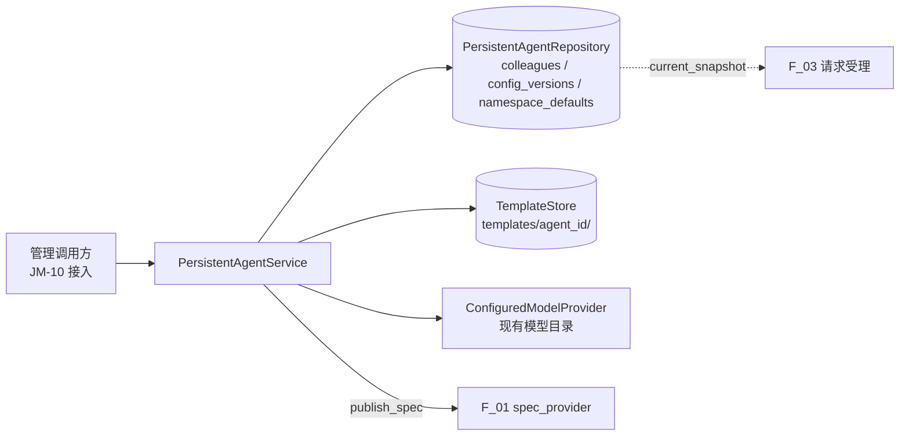

# 同事定义与配置发布设计方案

## 1. 元信息

| 项 | 值 |
| --- | --- |
| 建档日期 | 2026-10-13 |
| 范围 | jiuwenswarm `jiuwenswarm/server/jiuwenmate/` 的 `models.py`、`repository.py`、`service.py`；数据目录 `~/.jiuwenswarm/jiuwenmate/`。连接与事务代码在 JM-03 中抽出为 `sqlite_store.py`，见 [F_03](F_03_session-request.md) |
| 方案成熟度 | 已确认（依据开发计划 JM-02 条目及已合入实现；本文为实现后补写，见“设计演进与修订”） |
| 计划条目 | [JM-02](../designs/jiuwenmate-development-plan.md)（原 SW-02）：AI 同事定义、存储和管理服务 |
| 负责人 | 常钰聪 |
| 状态 | 待验收：宿主组件通过，联合验收待完成（与开发计划一致） |
| 设计依据 | [JiuwenMate 服务端架构设计](../designs/jiuwenmate-architecture.md) 第 4.1 节“配置管理”、第 4.2 节“模型与能力解析”、第 7.3 节“版本保留与引用约束” |
| 关联 feature | 前置：[F_01 核心契约适配](F_01_core-contract.md)；后续：[F_03 会话定位与请求受理](F_03_session-request.md) 在受理时固定本文发布的版本 |
| 验证摘要 | 既有同事定义与发布宿主组件通过；2026-10-23 模型保存解耦、后台刷新及页面组件回归见第 8.2 节；真实服务升级与页面联调待验收 |
| Refs | 无独立 issue；需求来源为开发计划 JM-02 |

## 2. 背景、目标与范围

### 2.1 背景与问题

新版 AI 同事需要独立于个人版专家市场保存：每个同事拥有自己的 Template（人设文件与 manifest）、能力选择与已发布配置版本。执行侧要求一个 Request 自始至终使用受理时的配置，因此“编辑设置”与“发布新版本”必须分离。用户首次使用时应自动获得默认同事“小九”，但用户删除小九后不应再次被创建。

### 2.2 目标与关键场景

| 场景 / 触发条件 | 当前行为 | 目标行为 / 可观察变化 |
| --- | --- | --- |
| 数据空间首次使用 | 不支持 | 创建并发布小九；并发调用只创建一个 |
| 用户删除小九后再次使用 | 不支持 | 不再创建 |
| 创建自定义同事或从 Template 创建 | 不支持 | 生成独立 Template 目录并发布 v1 |
| 修改设置 | 不支持 | 仅保存设置；已受理 Request 与新 Request 均继续使用当前版本，直到发布 |
| 发布未变化的设置 | 不支持 | 沿用当前版本，不新增版本号 |
| 对外查询同事或版本 | 不支持 | 视图不含 Spec 及模型凭据 |

### 2.3 本次范围与非目标

- 本次包含：同事定义与版本存储、Template 文件读写、默认小九、设置读写、发布、删除、模型解析；2026-10-23 补充模型保存与 Persistent 后台刷新解耦及设置页状态反馈。
- 原始范围不包含同事管理接口与前端接入（JM-10）；本次修复仅调整现有模型设置入口的刷新反馈，不扩展同事页面。不包含 Skill、连接器、插件装配（JM-14）或删除同事时排队 Request 的处理（JM-07）。

## 3. 设计约束、假设与待决问题

- 已确认约束与依赖：新版数据从空数据开始，不读取旧版同事数据（开发计划第 5 节）；模型经现有模型目录解析；对外视图不得包含凭据。
- 关键假设：`namespace_id` 由调用方映射既有用户 / 工作空间边界，本特性只做格式校验。
- 待决问题：`namespace_id` 的实际映射规则由 JM-10 接入时确定。

## 4. 总体方案与设计取舍

### 4.1 方案概览

`PersistentAgentService` 是唯一的管理入口。它在 SQLite 中保存同事定义和配置版本，在 `templates/<agent_id>/` 下保存 Template 文件，并调用 F_01 的 `publish_spec` 冻结版本。

实线表示服务的调用方向；虚线表示 F_03 读取当前已发布版本。

### 4.2 关键决策

2026-10-23 模型保存修复采用后台串行刷新，替代此前“保存等待全部同事发布”的行为，原因是发布阶段强制联网准备 tokenizer 可长时间阻塞回执。配置入队前复制，连续保存合并为最新待处理配置，旧代完成不能覆盖新代状态；页面独立查询 [S_03](../specs/S_03_model-refresh.md) 的只读状态，不延长保存弹窗生命周期。发布保留可选离线 tokenizer 描述，不预下载、不因本地文件缺失拒绝发布；回退计数由 core 负责。草稿保护、在途 Request 固定版本和个人版逻辑不变。队列属于 Worker 内存，正常关闭等待刷新结束，重启后由既有初始化使用持久化模型配置；不新增数据库状态。实际验证见第 8.2 节。

#### D-01 设置与版本分离，以 revision 乐观并发

- 选择与依据：`colleagues.revision` 在每次设置修改时递增；`published_revision` 记录最近一次发布对应的 revision。`update_settings`、`save_version`、`mark_published` 均以 `revision = ?` 作为条件，若更新影响 0 行，则返回 `CONFLICT`。
- 代价与成立条件：并发编辑的一方会失败并需重试；单机 SQLite 的 `BEGIN IMMEDIATE` 保证条件更新的原子性。
- 实现体现：`repository.py`；验证见 JM-02-V-03。

#### D-02 默认同事的认领与同事记录分开保存

- 选择与依据：`namespace_defaults` 表记录“该数据空间已认领过默认同事”。删除小九只删除 `colleagues` 行，认领记录保留，因此不会重新创建。
- 实现体现：`PersistentAgentRepository.insert(..., claim_default=True)`、`default_agent_id`。

#### D-03 Template 先写入临时目录，再改名生效

- 选择与依据：`TemplateStore` 先写入 `.staging-*` 目录并用现有 `load_agent_template_package` 校验，再改名为正式目录。数据库写入失败时，新目录被删除；替换时旧目录先改名为 `.backup-*`，失败后恢复。
- 代价与成立条件：进程在改名之间崩溃会遗留临时目录，不影响正式目录的内容。
- 实现体现：`TemplateStore.create`、`replace`；验证见 `test_rejected_creation_leaves_nothing_behind`、`test_failed_settings_store_restores_the_previous_template`。

#### D-04 未变化的发布沿用版本

- 选择与依据：发布时先用当前版本号试算指纹；指纹相同则只更新 `published_revision`。模型凭据轮换会改变指纹，因此会产生新版本。
- 实现体现：`PersistentAgentService.publish`；验证见 JM-02-V-03。

### 4.3 替代方案与排除理由

| 候选 / 关联决策 | 关键差异 | 拒绝原因 | 重新评估条件 |
| --- | --- | --- | --- |
| R-01 / D-02 在 `colleagues` 行上标记 `is_default` 判断是否已创建 | 不另建表 | 删除小九后记录消失，下次使用会重新创建 | 无 |
| R-02 将同事写入个人版专家市场目录 | 复用现有 Template 存储位置 | 新旧数据混合，违反独立存储要求 | 无 |
| R-03 保存等待同事全量重发布并强制准备 tokenizer | 回执时确认全部应用 | 网络缓存准备阻塞保存；core 已支持回退计数，发布不应依赖下载 | 发布另有必须预备资源时重新评估，但不恢复长请求等待 |

## 5. 详细设计

### 5.1 模块责任与关键不变量

- `models.py`：设置与视图的数据类型及输入校验（名称 ≤ 64 字符，描述 ≤ 2000 字符，人设 ≤ 20000 字符，列表 ≤ 64 项，拒绝未知字段）。`group_reply_mode` 只取 `passive` 或 `adaptive`，缺省 `adaptive`；入站读取当前设置，行为见 [F_23](F_23_group-reply-mode.md)。
- `repository.py`：同事定义、版本及默认认领的持久化；Template 文件的生命周期。
- `service.py`：业务流程编排，不向调用方暴露 Spec 或凭据。
- 不变量：一个同事对应一个 Template 目录；`ColleagueView` 与 `ConfigVersionView` 不含模型凭据（JM-02-V-04）。

### 5.2 关键类与函数设计

| 类名 / 所属模块 | 变更类型 | 职责与边界 | 关系 |
| --- | --- | --- | --- |
| `models.ColleagueSettings` | 新增 | 用户可编辑的全部设置；人设写入 Template，不写入数据库 | 组合 `CapabilitySelection` |
| `models.CapabilitySelection` | 新增 | 模型、Skill、连接器、插件、知识、开场提示的选择；不负责装配 | 冻结 dataclass |
| `models.ColleagueDefinition` | 新增 | 持久化的同事；`has_unpublished_changes` 比较两个 revision | 冻结 dataclass |
| `models.ColleagueView`、`ConfigVersionView` | 新增 | 对外视图，不含 Spec | 由定义或版本构造 |
| `repository.PersistentAgentRepository` | 新增 | 三张表的读写与条件更新 | 继承 `SQLiteStore` |
| `repository.TemplateStore` | 新增 | Template 目录的创建、替换、读取与删除 | 使用现有 Template 包校验 |
| `service.PersistentAgentService` | 新增 | 管理入口 | 组合仓库、TemplateStore、`ModelProvider` |
| `service.ConfiguredModelProvider` | 新增 | `ModelProvider` 协议的默认实现，读取现有模型目录 | 实现 `ModelProvider` |

`PersistentAgentService` 的关键方法（均为同步方法）：

| 方法签名 | 职责 | 异常与副作用 |
| --- | --- | --- |
| `ensure_default_colleague(namespace_id) -> ColleagueView \| None` | 首次使用时创建并发布小九 | 无模型时创建但不发布；已删除时返回 `None` |
| `create_colleague(namespace_id, settings, *, template_id=None) -> ColleagueView` | 创建并发布 v1 | `TEMPLATE_NOT_FOUND`、`MODEL_NOT_CONFIGURED`；失败不留下 Template |
| `read_settings(namespace_id, agent_id) -> ColleagueSettings` | 读取设置及 Template 人设 | `NOT_FOUND` |
| `update_settings(namespace_id, agent_id, settings) -> ColleagueView` | 保存设置与 Template，不发布 | `CONFLICT`；失败时恢复旧 Template |
| `publish(namespace_id, agent_id) -> ConfigVersionView` | 冻结当前设置为新版本或沿用原版本 | `MODEL_NOT_CONFIGURED`、`INVALID_CONFIG`、`CONFLICT` |
| `current_snapshot(namespace_id, agent_id) -> ConfigSnapshot` | 供 F_03 受理时固定版本 | `NOT_PUBLISHED` |
| `snapshot(namespace_id, agent_id, config_version) -> ConfigSnapshot` | 读取指定版本 | `NOT_FOUND` |
| `delete_colleague(namespace_id, agent_id) -> None` | 删除同事、全部版本与 Template | 默认认领保留 |

### 5.5 数据模型与事实归属

模型设置热更新复用 `refresh_published(namespace_id, *, models=None) -> bool`：模型保存回调与 `agent.reload_config` 在原有模型热更新后将通知交给 Worker 后台队列，不等待已有同事全量发布。通知携带配置时，刷新使用该份已保存配置，并保留为本服务后续发布的模型来源，避免初始化或手动发布退回旧参数；下一次通知再更新该来源。队列串行执行并合并为最新待处理配置。Web 与飞书的新请求在刷新生效后从共享数据库读取新版本；刷新期间可能仍受理旧版本，已受理 Request 不变。没有 JiuwenMate 数据库的个人版实例不初始化同事服务。重复通知在指纹未变化时不新增版本。当前消息与状态契约统一见 [S_03 模型刷新规约](../specs/S_03_model-refresh.md)。

保留既有草稿边界：未发布的同事不自动发布；有未发布修改的已发布同事保留现有版本和草稿，须用户明确发布后更新。自动刷新传入读取时的 `expected_revision`，防止并发保存的草稿被自动发布。单个同事失败保留旧版本并继续其他同事；通过独立 `models.refresh_status` 告知未全部应用，不再用保存的 `applied_without_restart` 或 reload 错误响应表达后台结果。网关保留对旧 Worker 的 `PERSISTENT_MODELS_NOT_APPLIED` 兼容处理。发布仅生成可选离线 tokenizer 描述，不强制联网准备或因本地文件缺失拒绝发布；计数回退属于 core。本次不清空 Session、不修改 core 的有效窗口解析或个人版热更新。

同一宿主进程内的 Template 替换与人设读取使用共享锁：文件替换后，直到数据库 revision 保存成功或文件回滚完成前，其他服务实例不得读取中间人设。发布随后仍检查 revision，避免读到尚未提交的草稿；此锁不代替数据库版本检查，也不承诺跨进程文件事务。

| 数据 | 隔离范围 | 权威位置 | 创建、更新与释放 |
| --- | --- | --- | --- |
| 同事定义 | (namespace_id, agent_id) | `agents.sqlite3` 的 `colleagues` 表 | 创建时插入；设置修改时 revision 加一；删除时移除 |
| 配置版本 | (namespace_id, agent_id, config_version) | `config_versions` 表，`snapshot_json` 含凭据 | 发布时插入；随同事一并删除 |
| 默认认领 | namespace_id | `namespace_defaults` 表 | 首次创建小九时插入；不删除 |
| 人设与 manifest | agent_id | `templates/<agent_id>/` | 随同事创建、替换、删除 |

数据目录权限为 0700，数据库文件为 0600（当前由 `sqlite_store.private_dir` 设置）。

### 5.8 异常、中断与重试处理

- 创建：Template 已改名生效，但数据库插入失败时，`TemplateStore.create` 删除目录。默认同事认领竞争失败时，删除刚写入的 Template。
- 默认同事发布失败：保留未发布的小九，记录警告，不阻断首次使用。
- 并发修改：返回 `CONFLICT`，调用方需重新读取后重试。

## 6. 影响面与实施设计

| 实施项 | 文件 | 修改内容 | 验证产物 |
| --- | --- | --- | --- |
| I-01 | [`models.py`](../../models.py) | 设置、定义与视图类型 | JM-02-V-05 |
| I-02 | [`repository.py`](../../repository.py) | 存储与 Template 文件；JM-03 起继承 `SQLiteStore` | JM-02-V-02、V-03 |
| I-03 | [`service.py`](../../service.py) | 管理流程与模型解析 | JM-02-V-01～V-04 |
| I-04 | [`test_persistent_agent_service.py`](../../../../../tests/unit_tests/server/jiuwenmate/test_persistent_agent_service.py) | 服务测试 | — |
| I-05（2026-10-23） | `model_refresh.py`、`web_adapter.py`、`agent_ws_server.py`、Gateway Web 代理及 `ReqMethod` | 后台串行刷新、保存解耦、只读状态代理 | `test_model_refresh.py`、`test_config_adapter_permission_reload.py` |
| I-06（2026-10-23） | 前端 `ModelsSettings.tsx`、`useModelRefreshStatus.ts`、zh/en 文案 | 保存提示与后台生效状态分离，有限时轮询与过期响应清理 | `test:model-refresh` 与生产构建 |

兼容核对：数据位于新版专用目录，不读写个人版专家市场或旧版同事数据；无兼容与迁移影响。

开发计划：JM-02 的“证据”列链接本文。目前没有入口调用 `ensure_default_colleague`，因此页面打开后不显示小九；该入口登记在 JM-10。

## 8. 验证设计、执行记录与结论

### 8.1 验证设计与通过条件

| 验证 ID | 场景 | 验证入口（`test_persistent_agent_service.py`） | 预期结果 | 层级 |
| --- | --- | --- | --- | --- |
| JM-02-V-01 | 默认小九 | `test_default_colleague_is_created_once_and_published`、`..._is_shared_by_services_on_the_same_store`、`test_deleted_default_colleague_is_not_created_again`、`test_default_colleague_without_models_is_created_unpublished` | 只创建一次；删除后不再创建 | 单测，真实 SQLite 与文件 |
| JM-02-V-02 | 创建与 Template 一对一 | `test_custom_colleague_gets_its_own_core_template_and_first_version`、`test_colleague_created_from_template_uses_its_persona`、`test_each_colleague_owns_one_template`、`test_rejected_creation_leaves_nothing_behind` | 独立 Template 与 v1；失败无残留 | 单测 |
| JM-02-V-03 | 设置、发布与版本 | `test_settings_change_only_affects_requests_after_publication`、`test_publishing_unchanged_settings_keeps_the_version`、`test_rotated_model_credentials_need_a_new_version`、`test_failed_settings_store_restores_the_previous_template`、`test_stale_settings_write_is_refused` | 发布前不影响 Request；并发写入被拒绝 | 单测 |
| JM-02-V-04 | 删除、隔离与脱敏 | `test_deleted_colleague_and_versions_are_gone`、`test_namespaces_do_not_see_each_other`、`test_public_views_never_carry_model_credentials` | 删除彻底；数据空间隔离；视图不含凭据 | 单测 |
| JM-02-V-05 | 输入校验与模型目录 | `test_malformed_settings_are_rejected`、`test_configured_model_provider_uses_the_existing_model_catalog` | 非法输入被拒绝；使用现有模型目录 | 单测 |

### 8.2 实际执行与证据

| 执行日期 / 验证范围 | 实现版本与环境 | 命令 | 实际结果 | 未覆盖项 |
| --- | --- | --- | --- | --- |
| 2026-10-12 / V-01～V-05 | 提交 `5f12ea8a` | `.venv/bin/python -m pytest tests/unit_tests/server/jiuwenmate -o addopts="--asyncio-mode=auto"` | 通过，全目录 54 passed（本特性 22 项） | 管理接口与页面 |
| 2026-10-12 / 冒烟 | 本机模型配置 | 手工调用服务发布 | 发布 v1 成功 | 非自动化 |
| 2026-10-13 / V-01～V-05（目录迁移后复核） | 提交 `12b619ad` | `.venv/bin/python -m pytest tests/unit_tests/server/jiuwenmate/test_persistent_agent_service.py -q -o addopts="--asyncio-mode=auto" -p no:cacheprovider` | 通过，22 passed | 同上 |
| 2026-10-22 / 模型热更新通知 | Windows，现有 `.venv`；真实 SQLite，模型和渠道替身 | `.\.venv\Scripts\python.exe -m pytest -q -o addopts='--asyncio-mode=auto --strict-markers --tb=short' -o log_cli=false tests/unit_tests/server/test_config_adapter_permission_reload.py tests/unit_tests/server/jiuwenmate/test_persistent_agent_service.py tests/unit_tests/server/jiuwenmate/test_web_adapter.py tests/unit_tests/server/jiuwenmate/test_resource_scope.py tests/unit_tests/server/jiuwenmate/test_feishu_group_production_wiring.py tests/unit_tests/test_model_resource_fixes.py tests/unit_tests/gateway/test_message_handler_mode.py tests/unit_tests/channel/test_attachment_persist.py -k 'not test_public_views_never_carry_model_credentials and not test_web_gateway_does_not_forward_internal_jiuwenmate_methods'` | 239 passed、1 skipped、2 deselected、1 warning；覆盖真实保存回调与显式 reload、通知配置源及后续刷新不回退、E2A 错误码和不重启、新旧请求版本、重复通知、草稿与并发人设保护、单个失败继续、无 JM 数据的个人版不初始化；1 个 Authlib 弃用告警 | 未调用真实模型、未重启用户服务；1 项 Windows symlink 权限跳过；排除项单独执行均失败：Windows 文件权限位为 0666 而非 0600；既有 Web 接口清单未排除 `jiuwenmate.thinking_notice.ack`，与本次模型同步无关 |

个人版模式路由与附件持久化的 63 项回归包含在上述结果中；两个排除项仍按上表单独失败记录，不代表全仓通过。并发人设场景使用同一路径的两个真实服务实例和双线程，暂停于文件替换后、数据库 revision 更新前，验证刷新等待提交后因版本冲突保留旧发布和新草稿。

2026-10-23 保存解耦修复，本地基线 `ddad63ed1` 加工作区变更，Windows `.venv`、本地 core `f46e39fd9`：

- 测试先行：后台回执、串行合并、失败脱敏、无下载发布先复现 5 failed；实现后 5 passed。状态 RPC 与适配器关闭后复用先复现 2 failed，再补齐实现。独立审查发现后续不带模型的 reload 可丢弃快照，新增 None / 空配置 / 非模型配置的 SQLite 回归先复现 3 failed，保留最近一次明确模型配置后通过。
- 聚焦命令：`.venv/Scripts/python.exe -m pytest tests/unit_tests/server/jiuwenmate/test_model_refresh.py tests/unit_tests/server/test_config_adapter_permission_reload.py tests/unit_tests/server/jiuwenmate/test_persistent_agent_service.py tests/unit_tests/server/jiuwenmate/test_web_adapter.py tests/unit_tests/server/jiuwenmate/test_resource_scope.py tests/unit_tests/server/jiuwenmate/test_feishu_group_production_wiring.py tests/unit_tests/test_model_resource_fixes.py tests/unit_tests/gateway/test_message_handler_mode.py tests/unit_tests/channel/test_attachment_persist.py tests/unit_tests/agentserver/test_agent_reload_model_scope.py -q -o addopts='' -o log_cli=false --asyncio-mode=auto -k 'not test_public_views_never_carry_model_credentials and not test_web_gateway_does_not_forward_internal_jiuwenmate_methods' --tb=short`：266 passed、1 skipped、2 deselected、1 Authlib 弃用告警。覆盖不等待后台的保存回执、入队配置复制、连续保存合并、后续无模型通知保留最新快照、旧代不能覆盖最新 pending、失败与重试、关闭排空和再次使用、两种 Gateway 部署下真实 E2A 查询、真实 SQLite 快照更新与草稿保护、个人版路由和附件。
- 上述两个排除项单独重跑仍失败：Windows 文件模式 0666 / 0600 差异；既有 `thinking_notice.ack` 清单断言。新增 `models.refresh_status` 已从通用 `jiuwenmate.*` 转发断言分离，并由端到端代理组件测试覆盖。
- 全仓单测尝试：`.venv/Scripts/python.exe -m pytest tests/unit_tests -q -o addopts='' -o log_cli=false --asyncio-mode=auto --maxfail=1 --tb=short` 在 `a2ui/test_auto_harness_channel_context.py::test_runtime_config_syncs_channel_and_task_workspace` 的 Windows 路径断言停止（预期 `/different/project`，实际 `C:\\different\\project`），2 passed、1 failed；未修改该模块，不能宣称全仓通过。
- 未修改真实配置和数据库、未重启用户服务、未调用真实模型；页面真实保存及服务升级后联调待验收。前端测试与生产构建单独记录，不等同于真实浏览器验收。
- 前端组件命令（前端目录）：`npm run test:model-refresh` 20/20 通过，`npm run test:settings-panel` 62/62 通过。新增用例实际挂载设置页和免费模型弹窗，覆盖自定义模型、模型组和免费模型保存后重新观察后台状态；状态查询阻塞不阻塞保存，拒绝保存或无修改不重复通知，初始 generation=0 不展示全部就绪。免费模型保存通知先以新增用例复现遗漏，再接通 `onSaved` 回调；因组件增加属性，既有两处源码结构断言只放宽开标签匹配，行为由真实组件测试覆盖。
- 构建：前端 `npm --ignore-scripts run build` 通过（实际执行 `tsc && vite build`，跳过会生成范围外 Agent 资源索引的 prebuild）；仅有既有 chunk 体积与混合动态 / 静态导入警告。免费模型回调补齐后再次构建通过。独立只读审查发现的两个 P2（空通知丢快照、免费模型遗漏观察）均已补回归并复核解决；浏览器视觉与真实后端联调仍未执行。
- 前端额外回归 `npm run test:model-reasoning`：16 项在测试初始化阶段受 `import.meta.env.DEV` 未定义阻断（`hookFailed`）；未修改该测试或 `webClient.ts`，不计入通过数，不在本修复中扩展修理测试基础设施。

### 8.3 验证结论

- 已证明范围：同事定义、版本、默认小九和 Template 的存储语义，以及凭据脱敏。
- 未覆盖的承诺：用户通过页面创建、设置和查看同事；Skill / 连接器 / 插件的实际装配。
- 可支持的交付判断：满足 JM-02 宿主组件验收；整项完成须待 JM-10 接入及联合验收。

## 9. 风险与已知遗留

### 9.2 已知遗留

| 遗留项 | 性质 | 影响与现有处置 | 后续入口 |
| --- | --- | --- | --- |
| 无管理接口，页面不显示小九 | 未实现 | 前端仍为页面内状态 | JM-10 |
| 能力选择仅记录不装配 | 范围外 | 执行时不使用所选 Skill / 连接器 / 插件；2026-10-15 起发布的版本固定开放办公目录只读，见 [F_14](F_14_workspace-read.md) | JM-14（S2b） |
| 删除同事时排队 Request 未处理 | 未实现 | 删除后排队任务找不到配置版本 | JM-07 |
| 改名之间崩溃遗留临时目录 | 有意取舍 | 不影响正式目录，占用磁盘 | 待评估清理时机 |

## 10. 设计演进与修订

### 2026-10-13 实现后补写特性文档

- 原结论与适用范围：JM-02 开发时以开发计划条目作为设计依据，没有单独的 feature 文档。
- 新证据与原因：[docs/AGENTS.md](../AGENTS.md) 要求特性设计先于实现，并由计划条目链接 feature。
- 最终变化：依据已合入的源码和测试补写本文，未改变实现。
- 验证：2026-10-13 在提交 `12b619ad` 上复核 22 项测试通过。

### 2026-10-22 模型热更新通知 Persistent Agent

- 原因：模型目录已保存 128K，而同事发布快照仍为 1M；原热更新只通知个人版 Agent 管理器，后续新版请求继续固定旧版本。
- 方案：复用现有发布刷新，接通模型保存代理回调和显式 reload 入口，统一使用通知携带的模型配置；保护并发草稿，单个同事失败继续刷新，部分未应用不触发网关重启。不引入额外开关或第二套发布机制，不逐轮读取配置文件覆盖执行中快照。
- 验证：新增场景先复现 6 failed、2 passed，补齐通知与返回值后通过；审查补齐实际代理回调、后续刷新回退、并发人设和网关不重启场景。最终含个人版模式与附件回归为 239 passed、1 skipped、2 deselected，排除项及实际命令见第 8.2 节。这里只更新配置发布接线，不代表真实模型换窗行为已重新验收。

### 2026-10-23 保存与后台刷新解耦

- 定位：配置已落盘，但保存等待发布刷新；旧 `cache_formal_tokenizer` 强制开启下载并关闭离线，绕过全局禁用预热。该路径属于 Persistent 发布，不是个人版运行时重载。
- 修复：删除强制准备步骤；后台队列串行合并最新通知，失败保留旧版本；新增 Worker 只读查询，前端独立展示后台状态。正常关闭排空队列，不以取消 await 假装线程写库已停止。
- 契约替代：前一日“保存等待 Persistent、部分未应用返回 reload 错误”的设计由 [S_03](../specs/S_03_model-refresh.md) 替代；草稿、旧 Request 版本、重复通知及并发保护仍适用。未修改 core 换窗策略。
- 实现与验证：本地工作区变更；实际命令与结果见第 8.2 节；未重启用户服务、未调用真实模型，不宣称真实页面联调已验收。

### 2026-10-23 真实页面与完整重启复核

- 用户反馈：重启后模型列表空白、添加按钮禁用。实际浏览器复现页面短暂连接后再次断连，按钮随连接状态禁用；新 Worker 日志在 Windows named pipe 创建处连续报 `WinError 5`，同时旧 Worker 仍驻留。前述单元测试与构建未覆盖该现场，不能作为页面可用的证据。
- 经用户明确同意，停止接入进程并清理已核验身份的旧 Worker，再完整启动服务。新 Worker 正常就绪，原有两个模型重新显示；实际打开添加模型表单并取消，随后打开 DeepSeek 编辑表单，保留原 `1M` 与其他字段直接确认保存，表单正常关闭，页面按钮仍可用。保存前后配置文件 SHA-256 相同，未改变原模型设置或凭据；未删除聊天或模型数据。
- 查询状态 RPC 在当前真实入口已正常到达 Worker。曾怀疑前端声明式方法清单漏项，但该清单并非当前开源入口的请求分发路径，不作为本次断连根因，也未追加无关路由修改。
- 独立遗留：后台全量刷新返回失败；只读检查确认默认“小九”仍绑定已不存在的 `deepseek-v4-flash#0`，解析返回 `MODEL_NOT_FOUND`；其余四个同事模型与当前快照可读取，无未发布草稿。未擅自改变小九的模型绑定。该部分失败不再阻塞模型设置保存；不能因此宣称所有同事已刷新成功。
- 验证范围：真实本机浏览器与服务的查看、打开新增表单、已有模型原值保存、进程及配置校验；没有创建虚构模型、调用付费推理或验证所有聊天场景。此现场记录补充并局部替代上节“真实页面联调未执行”的结论，不改变 JM-02 整项待验收状态。
