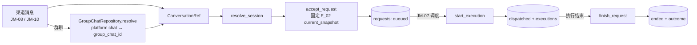
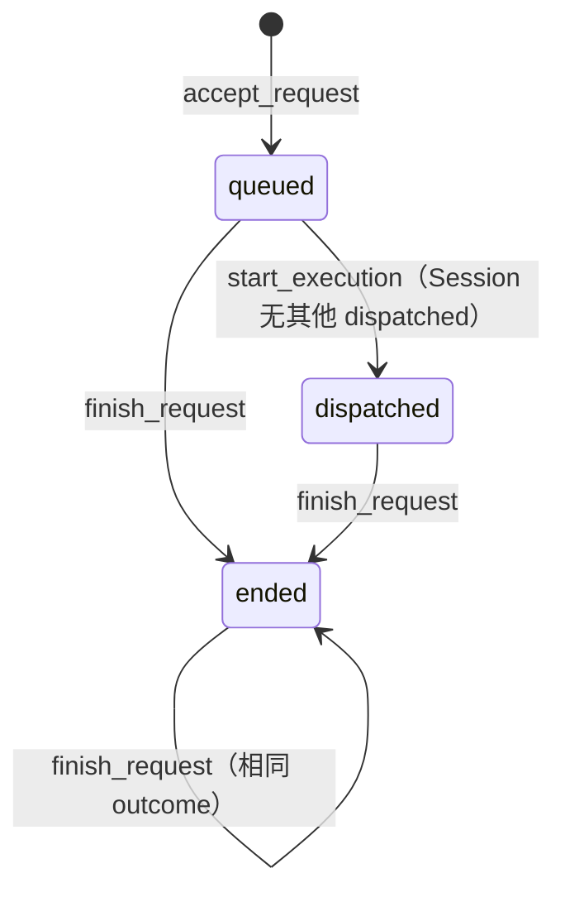

# 会话定位与请求受理设计方案

## 1. 元信息

| 项 | 值 |
| --- | --- |
| 建档日期 | 2026-10-13 |
| 范围 | jiuwenswarm `jiuwenswarm/server/jiuwenmate/` 的 `execution_repository.py`（Session / Request / Execution 部分）、`group_chat_repository.py`、`sqlite_store.py`，以及 `execution_models.py` 中的 `ConversationRef`、`SessionRecord`、`RequestState` |
| 方案成熟度 | 已确认（依据开发计划 JM-03 条目及已合入实现；本文为实现后补写，见“设计演进与修订”） |
| 计划条目 | [JM-03](../designs/jiuwenmate-development-plan.md)（原 SW-03）：Session / Request / Execution 关联仓库及新版群会话映射 |
| 负责人 | 常钰聪 |
| 状态 | 待验收：宿主组件通过，联合验收待完成（与开发计划一致） |
| 设计依据 | [JiuwenMate 服务端架构设计](../designs/jiuwenmate-architecture.md) 第 2.1 节“核心对象、关系与生命周期”、第 6.1 节“状态分类与转换”、第 9.2 节“共享与隔离”；开发计划第 6.2 节“身份和会话”“任务和执行” |
| 关联 feature | 前置：[F_01 核心契约适配](F_01_core-contract.md)、[F_02 同事定义与配置发布](F_02_colleague-management.md)；后续：[F_04 事件提交端口](F_04_commit-port.md) 在本文的表上记录事件 |
| 验证摘要 | 16 项测试通过，含与 F_02 配置快照的联调；尚无渠道入口与调度器调用 |
| Refs | 无独立 issue；需求来源为开发计划 JM-03 |

## 2. 背景、目标与范围

### 2.1 背景与问题

一条消息到达后，系统需要确定三件事：这条消息属于哪个同事的哪一段对话（Session）；它是新任务还是平台重复投递的同一事件；它在该对话中排第几。旧实现用拼接字符串作为会话键，在长 ID 或含分隔符的 ID 下存在截断与碰撞风险。core 要求同一 Session 同时只有一个活动 Execution，Request 原文和配置版本须在派发前持久化，以便重启后恢复。

### 2.2 目标与关键场景

| 场景 / 触发条件 | 当前行为 | 目标行为 / 可观察变化 |
| --- | --- | --- |
| 同一同事在同一群再次收到消息 | 不支持 | 复用同一 Session |
| 两个同事在同一群 | 不支持 | 共用一个 `group_chat_id`，各有独立 Session |
| Web 私聊与飞书私聊 | 不支持 | 不同 Session |
| 平台重复投递同一事件 | 不支持 | 返回已受理的 Request，标记为非新建 |
| 同一事件送达两个同事 | 不支持 | 每个同事各一个 Request |
| 补充消息 | 不支持 | 同一 Session 中的新 Request，序号递增 |
| 服务重启 | 不支持 | 能查回排队中和已派发的 Request |

### 2.3 本次范围与非目标

- 本次包含：Session 定位、群映射、Request 受理与幂等、Request 状态推进、Execution 记录、重启查询，以及共用的 SQLite 存储基类。
- 本次不包含：Session 串行调度与并发上限（JM-07）；渠道消息标准化（JM-08）；公共群记录与搜索（JM-11，将在 `group_chat_repository.py` 中扩展）；续做产生的 Execution（JM-13）。

## 3. 设计约束、假设与待决问题

- 已确认约束与依赖：`(agent_id, group_chat_id)` 对应一个稳定 `session_id`，Swarm 私聊、飞书私聊与不同群分别创建 Session（开发计划第 6.2 节）。补充消息是新 Request。
- 关键假设：`source_ref` 由渠道层按平台事件身份生成，同一平台事件对同一同事保持不变。若渠道层生成方式不稳定，幂等受理将失效；JM-08 实现时需核对。
- 待决问题：无。

## 4. 总体方案与设计取舍

### 4.1 方案概览

渠道层先把平台会话转换为 `ConversationRef`，群聊会先经 `GroupChatRepository.resolve` 换成 `group_chat_id`。然后由 `ExecutionRepository.resolve_session` 定位 Session，再由 `accept_request` 固定配置版本并入队。调度器（JM-07）调用 `start_execution` 派发，执行结束后调用 `finish_request`。

### 4.2 关键决策

#### D-01 会话键各部分分列保存，Session ID 随机生成

- 选择与依据：`sessions` 表对 `(namespace_id, agent_id, kind, channel, conversation_key)` 建唯一约束，各部分完整保存。`session_id` 使用 `sess_` 加随机 UUID，不由会话键推导，因此不会因拼接或截断而碰撞。
- 实现体现：`resolve_session`；验证见 `test_long_or_ambiguous_conversation_ids_do_not_collide`。

#### D-02 以 (namespace_id, agent_id, source_ref) 实现幂等受理

- 选择与依据：唯一约束包含 `agent_id`，所以同一事件可以分别送达多个同事，不会被全局去重成一个。重复投递返回已存储的 Request 和 `False`。
- 代价与成立条件：同一 `source_ref` 出现在另一个 Session 时返回 `CONFLICT`，避免一个事件进入两段对话。
- 实现体现：`accept_request`；验证见 JM-03-V-02。

#### D-03 Session 内序号由 `next_seq` 计数器分配

- 选择与依据：在同一事务中读取并递增 `sessions.next_seq`，配合 `UNIQUE (namespace_id, session_id, seq)`，保证队列顺序稳定且无重复。

#### D-04 派发时检查 Session 占用

- 选择与依据：`start_execution` 在同一事务中检查该 Session 是否已有 `dispatched` 的 Request，若有则返回 `SESSION_BUSY`。这是数据层的最后防线，串行调度本身由 JM-07 负责。

### 4.3 替代方案与排除理由

| 候选 / 关联决策 | 关键差异 | 拒绝原因 | 重新评估条件 |
| --- | --- | --- | --- |
| R-01 / D-01 以拼接字符串的哈希作为 `session_id` | 不需要查表即可得到 ID | 拼接存在分隔符歧义；哈希截断有碰撞可能，且无法从 ID 反查会话 | 无 |
| R-02 / D-02 全局按平台消息 ID 去重 | 实现简单 | 多个 Bot 收到同一消息时只会保留一个同事的任务 | 无 |

## 5. 详细设计

### 5.1 模块责任与关键不变量

- `SQLiteStore`：打开时建表；`_transaction()` 使用 `BEGIN IMMEDIATE`，异常时回滚。所有仓库共用 `~/.jiuwenswarm/jiuwenmate/agents.sqlite3`。
- `GroupChatRepository`：平台群到 `group_chat_id`（`grp_` 前缀）的映射；一经创建不再改变。不读取个人版群记录。
- `ExecutionRepository`：Session、Request、Execution 三张表的读写。
- 不变量：
  - 同一 Session 至多一个 `dispatched` Request（JM-03-V-04）。
  - Request 一经受理，所固定的 `config_version` 不再改变（JM-03-V-03）。

### 5.2 关键类与函数设计

| 类名 / 所属模块 | 变更类型 | 职责与边界 |
| --- | --- | --- |
| `execution_models.ConversationRef` | 新增 | 会话位置：`kind` 为 `web_direct` / `im_direct` / `group`。`web_direct` 的 `channel` 固定为 `web`，`group` 的 `channel` 固定为 `group` 且 `key` 为 `group_chat_id`，`im_direct` 的 `channel` 为平台名。`accepts(kind)` 限定可进入的 Request 类型 |
| `execution_models.SessionRecord` | 新增 | 一个同事在一个会话中的稳定 Session |
| `execution_models.RequestState` | 新增 | `RequestRecord` 加队列序号、状态（`queued` / `dispatched` / `ended`）与结果 |
| `group_chat_repository.GroupChat`、`GroupChatRepository` | 新增 | 群映射记录与仓库 |
| `sqlite_store.SQLiteStore` | 新增 | 共用的 SQLite 连接与事务基类 |
| `execution_repository.ExecutionRepository` | 新增 | 见下表 |

`ExecutionRepository` 的关键方法（均为同步方法）：

| 方法签名 | 职责 | 异常与副作用 |
| --- | --- | --- |
| `resolve_session(namespace_id, agent_id, conversation, *, now) -> SessionRecord` | 定位 Session，首次接触时创建 | 无 |
| `accept_request(session, *, snapshot, source_ref, access, request_input, received_at) -> tuple[RequestState, bool]` | 受理并入队；第二个返回值表示是否新建 | 快照属于其他同事或 Request 类型与会话不符时抛 `PersistentContractError`（后者 `code="REQUEST_SOURCE_MISMATCH"`）；事件已属其他 Session 时返回 `CONFLICT` |
| `start_execution(namespace_id, request_id, *, now) -> ExecutionRecord` | `queued` → `dispatched`，并记录首个 Execution（`exe_` 前缀） | `CONFLICT`、`SESSION_BUSY` |
| `finish_request(namespace_id, request_id, outcome, *, now) -> RequestState` | 进入 `ended` 并记录结果；以相同结果重复调用不产生变化 | 结果不同返回 `CONFLICT` |
| `pending_requests(namespace_id) -> list[RequestState]` | 重启时按 Session 与序号列出未结束 Request | 无 |
| `get_session`、`get_request`、`executions`、`session_requests` | 查询 | `NOT_FOUND` |

### 5.6 状态机与生命周期

`outcome` 取值为 `completed`、`ignored`、`paused`、`failed`、`cancelled`、`stopped`。对 `ended` 的 Request 再次调用 `start_execution` 返回 `CONFLICT`。

### 5.8 异常、中断与重试处理

- 重复受理：返回已有 Request，调用方依据返回值 `False` 跳过派发。
- 进程在派发后崩溃：Request 仍为 `dispatched`，`pending_requests` 可查回；如何处理由 JM-13 决定。
- 所有写入在单个 `BEGIN IMMEDIATE` 事务中完成，失败时整体回滚。

## 6. 影响面与实施设计

| 实施项 | 文件 | 修改内容 | 验证产物 |
| --- | --- | --- | --- |
| I-01 | [`sqlite_store.py`](../../sqlite_store.py) | 从 F_02 的仓库中抽出共用基类；`PersistentAgentRepository` 改为继承 | JM-02 回归 |
| I-02 | [`execution_models.py`](../../execution_models.py) | 会话与请求状态类型 | JM-03-V-01 |
| I-03 | [`group_chat_repository.py`](../../group_chat_repository.py) | 群映射 | JM-03-V-01 |
| I-04 | [`execution_repository.py`](../../execution_repository.py) | Session / Request / Execution | JM-03-V-01～V-05 |
| I-05 | [`test_request_routing.py`](../../../../../tests/unit_tests/server/jiuwenmate/test_request_routing.py) | 测试 | — |

兼容核对：新增表位于新版专用数据库，不影响个人版会话；I-01 修改了 F_02 的仓库继承关系，JM-02 的 22 项测试保持通过。

开发计划：JM-03 的“证据”列链接本文。

## 8. 验证设计、执行记录与结论

### 8.1 验证设计与通过条件

| 验证 ID | 场景 | 验证入口（`test_request_routing.py`） | 预期结果 | 层级 |
| --- | --- | --- | --- | --- |
| JM-03-V-01 | Session 定位与隔离 | `test_same_colleague_in_same_group_reuses_one_session`、`test_one_group_is_shared_while_each_colleague_has_its_own_session`、`test_web_and_im_private_chats_are_separate_sessions`、`test_same_platform_chat_in_different_namespaces_is_isolated`、`test_long_or_ambiguous_conversation_ids_do_not_collide` | 复用与隔离符合预期 | 单测，真实 SQLite |
| JM-03-V-02 | 受理与幂等 | `test_supplementary_message_is_a_new_request_in_the_same_session`、`test_redelivered_source_event_returns_the_stored_request`、`test_same_source_event_for_two_colleagues_creates_two_requests`、`test_request_kind_must_match_the_session` | 新 Request、重复返回、按同事区分 | 单测 |
| JM-03-V-03 | 配置版本固定 | `test_request_is_pinned_to_the_published_version`、`test_snapshot_of_another_colleague_is_rejected`、`test_unpublished_colleague_cannot_accept_requests` | 受理后新发布不影响该 Request | 单测，与 F_02 联调 |
| JM-03-V-04 | 状态推进 | `test_session_dispatches_one_request_at_a_time`、`test_finish_request_is_idempotent_and_keeps_the_outcome` | `SESSION_BUSY`；重复结束不改变结果 | 单测 |
| JM-03-V-05 | 重启与重建调用 | `test_queue_and_dispatched_requests_survive_restart`、`test_stored_records_rebuild_a_valid_core_invocation` | 新仓库实例可查回队列；存储记录经 F_01 重建合法 core 调用 | 单测，真实 core 类型 |

### 8.2 实际执行与证据

| 执行日期 / 验证范围 | 实现版本与环境 | 命令 | 实际结果 | 未覆盖项 |
| --- | --- | --- | --- | --- |
| 2026-10-12 / V-01～V-05 | 提交 `952726c1` | `.venv/bin/python -m pytest tests/unit_tests/server/jiuwenmate -o addopts="--asyncio-mode=auto"` | 通过，全目录 70 passed（本特性 16 项） | 渠道入口与调度器 |
| 2026-10-13 / V-01～V-05（目录迁移后复核） | 提交 `12b619ad` | `.venv/bin/python -m pytest tests/unit_tests/server/jiuwenmate/test_request_routing.py -q -o addopts="--asyncio-mode=auto" -p no:cacheprovider` | 通过，16 passed | 同上 |

### 8.3 验证结论

- 已证明范围：会话定位、幂等受理、版本固定、状态推进与重启查询的数据层语义。
- 未覆盖的承诺：真实飞书事件的 `source_ref` 稳定性；并发调度下的端到端串行执行。
- 可支持的交付判断：满足 JM-03 宿主组件验收；整项完成须待 JM-07、JM-08 接入及联合验收。

## 9. 风险与已知遗留

### 9.2 已知遗留

| 遗留项 | 性质 | 影响与现有处置 | 后续入口 |
| --- | --- | --- | --- |
| 删除同事时排队 Request 未处理 | 已处理 | 经 JM-07 的 `AgentManager.delete_colleague` 删除时，排队中的 Request 记为 `cancelled`；直接调用 `PersistentAgentService.delete_colleague` 不做此处理 | 见 [F_07](F_07_execution-driver.md)；管理入口须经 `AgentManager`（JM-10） |
| 续做 Execution 未支持 | 范围外 | `start_execution` 只创建首个 Execution | JM-13 |
| 公共群记录与搜索 | 范围外 | `group_chat_repository.py` 仅含映射 | JM-11 |

## 10. 设计演进与修订

### 2026-10-13 实现后补写特性文档

- 原结论与适用范围：JM-03 开发时以开发计划条目作为设计依据，没有单独的 feature 文档。
- 新证据与原因：[docs/AGENTS.md](../AGENTS.md) 要求特性设计先于实现，并由计划条目链接 feature。
- 最终变化：依据已合入的源码和测试补写本文，未改变实现。
- 验证：2026-10-13 在提交 `12b619ad` 上复核 16 项测试通过。
