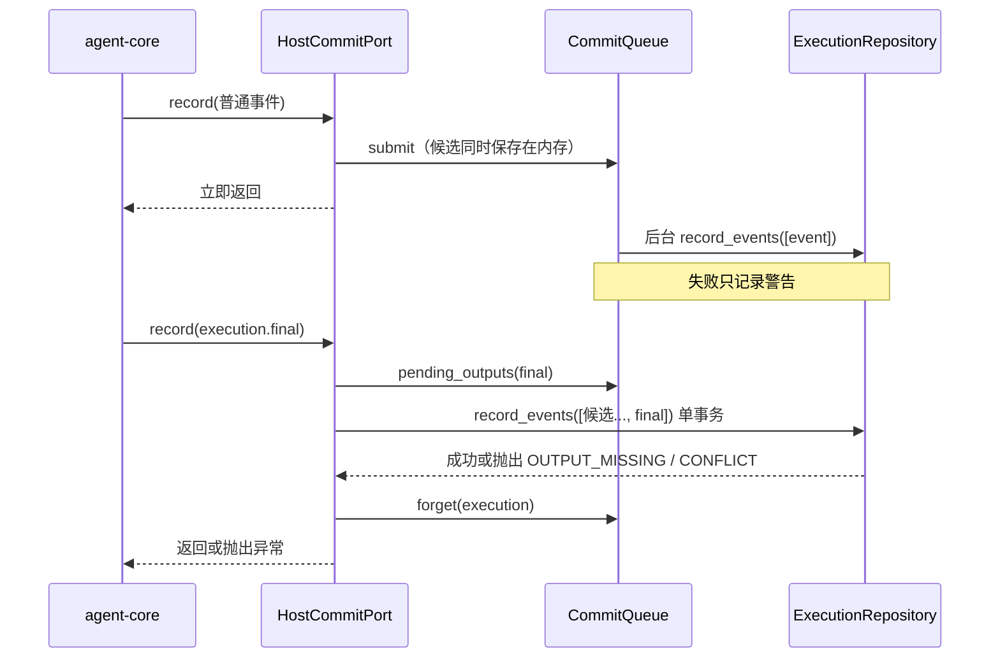

# 事件提交端口设计方案

## 1. 元信息

| 项 | 值 |
| --- | --- |
| 建档日期 | 2026-10-13 |
| 范围 | jiuwenswarm `jiuwenswarm/server/jiuwenmate/ports/commit.py`；`execution_repository.py` 中的 `execution_events`、`candidate_outputs` 表及相关方法；对端 agent-core 的 `CommitPort` 协议只读引用 |
| 方案成熟度 | 已确认（依据开发计划 JM-04 条目及已合入实现；本文为实现后补写，见“设计演进与修订”） |
| 计划条目 | [JM-04](../designs/jiuwenmate-development-plan.md)（原 SW-04）：`ports/commit.py` 与事件、候选输出存储 |
| 负责人 | 常钰聪 |
| 状态 | 待验收：宿主组件通过，联合验收待完成（与开发计划一致） |
| 设计依据 | [JiuwenMate 服务端架构设计](../designs/jiuwenmate-architecture.md) 第 6.2 节“事件、确认与流量控制”、第 6.3 节“完成与结果交接”、第 7.2 节“提交顺序与跨资料交接”；开发计划第 6.2 节 `CommitPort` 接口要求；agent-core 仓 `jiuwenmate` 分支 `openjiuwen/harness/persistent_agent/` 的 `CommitPort` 协议 |
| 关联 feature | 前置：[F_03 会话定位与请求受理](F_03_session-request.md)（事件归属校验依赖其 Request / Execution 表） |
| 验证摘要 | 16 项测试通过（真实 SQLite、替身故障注入）；队列尚未接入 AgentServer，未与 core 正式执行联调 |
| Refs | 无独立 issue；需求来源为开发计划 JM-04 |

## 2. 背景、目标与范围

### 2.1 背景与问题

core 通过 `CommitPort.record(execution, event)` 提交执行过程中的全部事件，这是事件唯一的持久化入口。各类事件的可靠性要求不同。普通进度事件量大，写入失败不应拖慢执行。`tool.intent`、`execution.paused`、`execution.final` 是续做和防止重复副作用的依据，必须在返回前落盘，失败时 core 需要停止执行。`execution.final` 通过 `output_refs` 引用此前的候选输出；如果候选的普通写入尚未完成或已失败，而 final 已经保存，结果交接就会缺少内容。

### 2.2 目标与关键场景

| 场景 / 触发条件 | 当前行为 | 目标行为 / 可观察变化 |
| --- | --- | --- |
| 普通事件 | 不支持 | 入队后立即返回，后台写入 |
| 普通事件写入失败 | 不支持 | 记录警告，日志留缺口，不阻断后续关键事件 |
| 关键事件写入失败 | 不支持 | 异常抛给 core |
| final 引用的候选尚在队列中或写入失败 | 不支持 | final 在同一事务中补存这些候选 |
| final 引用的候选完全缺失 | 不支持 | 以 `OUTPUT_MISSING` 拒绝，final 不保存 |
| 同一事件重交 | 不支持 | 内容相同则跳过，内容不同返回 `CONFLICT` |
| 续做读取旧执行日志 | 不支持 | 只允许读取同一 Session、同一 Request 的执行，按 `local_seq` 排序 |

### 2.3 本次范围与非目标

- 本次包含：`HostCommitPort`、`CommitQueue`、事件与候选输出两张表、日志读取与候选查询。
- 本次不包含：在 AgentServer 启停时持有队列，以及执行异常时调用 `forget`（JM-07）；候选输出的投递（JM-09）；依据日志续做（JM-13）。

## 3. 设计约束、假设与待决问题

- 已确认约束与依赖：普通事件允许日志缺口；关键事件须等待自身落盘；final 引用的候选也必须可靠保存；读取日志不声明结果完整（开发计划第 6.2 节）。
- 关键假设：core 在同一 Execution 内保证 `local_seq` 唯一，且 `AgentEvent.proposal_digest()` 对相同内容稳定。
- 待决问题：队列满（默认 10000）时 `put_nowait` 抛出 `asyncio.QueueFull`，当前直接传给 core。超限策略待 JM-07 接入真实负载后评估。

## 4. 总体方案与设计取舍

### 4.1 方案概览

普通事件只经过队列；关键事件经 `asyncio.to_thread` 同步写入数据库。final 写入时会附带内存中尚未确认落盘的候选，两者在同一事务中提交。

### 4.2 关键决策

#### D-01 普通事件与关键事件分两条写入路径

- 选择与依据：普通事件的写入失败只造成日志缺口，异步写入避免阻塞执行；关键事件的写入失败必须让 core 感知。
- 代价与成立条件：普通事件可能在关键事件之后才落盘，读取时按 `local_seq` 排序，而不是按写入时间排序。
- 实现体现：`HostCommitPort.record`、`CRITICAL_EVENTS`；验证见 JM-04-V-02。

#### D-02 候选在内存中保留到终态事件

- 选择与依据：`CommitQueue.submit` 对 `output.proposed` 事件按 (namespace_id, execution_id) 保留一份副本；final 写入时取出被引用的候选一并提交。这样即使候选的后台写入失败，final 也能保证引用完整。
- 代价与成立条件：内存占用持续到 final / paused 或 `forget`；若执行异常且未调用 `forget`，副本会一直保留，因此 JM-07 需要在执行收尾时调用 `forget`。
- 实现体现：`pending_outputs`、`forget`；验证见 JM-04-V-03。

#### D-03 以 event_id 加内容摘要去重

- 选择与依据：重交相同事件属于正常重试，应跳过；同一 ID 携带不同内容说明上游有错误，应拒绝。
- 实现体现：`execution_events.digest`；验证见 JM-04-V-01。

### 4.3 替代方案与排除理由

| 候选 / 关联决策 | 关键差异 | 拒绝原因 | 重新评估条件 |
| --- | --- | --- | --- |
| R-01 / D-01 所有事件同步写入 | 实现简单，日志无缺口 | 每个流式事件都等待数据库，执行延迟随事件量增长 | 实测普通事件写入开销可忽略时 |
| R-02 / D-02 final 写入前等待队列清空 | 不需要内存副本 | 无法处理候选写入已失败的情况；队列积压时会拖慢 final | 无 |

## 5. 详细设计

### 5.1 模块责任与关键不变量

- `CommitQueue`：普通事件的后台写入与候选副本。生命周期由 AgentServer 持有（`start` / `aclose`）。
- `HostCommitPort`：实现 core 的 `CommitPort` 协议，负责归属校验（`event.assert_matches(execution)`）与路径选择。
- `ExecutionRepository`：事件与候选的事务写入与读取。
- 不变量：
  - 已保存的 final 所引用的候选全部已保存（JM-04-V-03）。
  - 每个 Execution 至多一个 final 或 paused（JM-04-V-04）。
  - 一个 `output_id` 只属于首次提出它的事件。

### 5.2 关键类与函数设计

`CommitQueue(repository: ExecutionRepository, *, maxsize: int = 10_000, clock=...)`：

| 方法签名 | 职责 | 异常与副作用 |
| --- | --- | --- |
| `async start() -> None` | 创建队列和后台任务；重复调用不产生变化 | 无 |
| `async aclose() -> None` | 停止接收，写完已入队事件后停止任务 | 无 |
| `async drain() -> None` | 等待当前已入队事件处理完毕 | 无 |
| `submit(event: AgentEvent) -> None` | 入队；候选同时保存在内存 | 队列未运行时返回 `QUEUE_CLOSED`；队列满时抛 `QueueFull` |
| `pending_outputs(final: AgentEvent) -> list[AgentEvent]` | 按 `output_refs` 顺序返回内存中的候选 | 无 |
| `forget(namespace_id: str, execution_id: str) -> None` | 释放该 Execution 的候选副本 | 无 |

`HostCommitPort(repository, queue, *, clock=...)`：

| 方法签名 | 职责 | 异常与副作用 |
| --- | --- | --- |
| `async record(execution: ExecutionContext, event: AgentEvent) -> None` | 校验归属后分流写入；终态事件写入后调用 `forget` | 非 `AgentEvent` 或归属不符时抛 `PersistentContractError`；关键事件写入失败时原样抛出 |
| `async read_execution_log(execution: ExecutionContext, execution_id: str) -> tuple[AgentEvent, ...]` | 读取同一 Session、同一 Request 中目标执行的日志 | 不属于该 Request 时返回 `NOT_FOUND` |

`ExecutionRepository` 新增方法：

| 方法签名 | 职责 | 异常 |
| --- | --- | --- |
| `record_events(events: Sequence[AgentEvent], *, now: datetime) -> None` | 单事务写入一组事件；任一被拒绝则全部回滚 | `NOT_FOUND`（Execution 不存在或身份不符）、`CONFLICT`、`OUTPUT_MISSING` |
| `read_execution_log(namespace_id, session_id, request_id, execution_id) -> tuple[AgentEvent, ...]` | 按 `local_seq` 返回已保存事件 | `NOT_FOUND` |
| `candidate_output(namespace_id, output_id) -> AgentEvent \| None` | 供投递交接读取候选 | 无 |

### 5.5 数据模型与事实归属

| 数据 | 隔离范围 | 权威位置 | 创建与释放 |
| --- | --- | --- | --- |
| 执行事件 | (namespace_id, event_id)；另有 `UNIQUE (namespace_id, execution_id, local_seq)` | `execution_events` 表，含 `digest` 与完整 `event_json` | `record_events` 写入；当前不删除 |
| 候选输出 | (namespace_id, output_id) | `candidate_outputs` 表，记录 request、execution、event、`target_ref`、`share_mode` | 随 `output.proposed` 事件写入 |
| 候选副本 | (namespace_id, execution_id) | `CommitQueue` 内存 | 终态事件或 `forget` 时释放；不跨进程 |

### 5.8 异常、中断与重试处理

- 普通事件写入失败：日志留下缺口；续做读取时不能把缺口推断为“工具未执行”，由 JM-13 查证。
- 关键事件写入失败：异常传给 core，由 core 停止执行；事务已回滚，不留下部分写入。
- 重交：相同内容跳过；final 重交时候选与 final 都已存在，二者保持原 ID。
- 关闭：`aclose` 后再提交普通事件返回 `QUEUE_CLOSED`；关闭前已入队的事件全部写完。
- 进程崩溃：队列中尚未写入的普通事件丢失，只造成日志缺口；关键事件已在返回前落盘。

## 6. 影响面与实施设计

| 实施项 | 文件 | 修改内容 | 验证产物 |
| --- | --- | --- | --- |
| I-01 | [`execution_repository.py`](../../execution_repository.py) | 两张表与 `record_events`、`read_execution_log`、`candidate_output` | JM-04-V-01、V-03～V-05 |
| I-02 | [`ports/commit.py`](../../ports/commit.py)、[`ports/__init__.py`](../../ports/__init__.py) | `HostCommitPort`、`CommitQueue` | JM-04-V-02、V-06 |
| I-03 | [`test_commit_port.py`](../../../../../tests/unit_tests/server/jiuwenmate/test_commit_port.py) | 测试与故障注入 | — |
| I-04（未实施） | AgentServer 启停流程 | 持有 `CommitQueue`；执行收尾时调用 `forget` | 由 JM-07 完成 |

兼容核对：新增表位于新版专用数据库；个人版事件链路不受影响。

开发计划：JM-04 的“证据”列链接本文。

## 8. 验证设计、执行记录与结论

### 8.1 验证设计与通过条件

| 验证 ID | 场景 | 验证入口（`test_commit_port.py`） | 预期结果 | 层级 |
| --- | --- | --- | --- | --- |
| JM-04-V-01 | 写入、去重与冲突 | `test_ordinary_events_are_queued_and_read_back_in_order`、`test_resubmitted_event_id_is_stored_once`、`test_same_event_id_with_other_content_is_rejected` | 按序读回；重交只存一次；异内容被拒绝 | 单测，真实 SQLite |
| JM-04-V-02 | 失败隔离 | `test_failed_ordinary_write_does_not_block_a_later_critical_event`、`test_critical_write_failure_is_raised` | 普通失败不阻断；关键失败抛出 | 单测，替身仓库注入故障 |
| JM-04-V-03 | final 与候选 | `test_final_without_saved_candidate_fails_and_is_not_stored`、`test_final_stores_a_candidate_whose_queued_write_failed`、`test_final_stores_a_candidate_still_in_the_queue`、`test_resubmitted_candidate_and_final_keep_their_ids` | 缺失时拒绝；补存成功；重交保持 ID | 单测 |
| JM-04-V-04 | 唯一性约束 | `test_output_id_cannot_be_reused_by_another_event`、`test_execution_has_at_most_one_terminal_event` | `CONFLICT` | 单测 |
| JM-04-V-05 | 归属与持久 | `test_event_of_another_execution_is_rejected`、`test_reading_a_log_of_another_request_is_rejected`、`test_log_survives_restart` | 跨归属被拒绝；重建仓库后日志仍在 | 单测 |
| JM-04-V-06 | 生命周期与协议 | `test_closed_queue_rejects_ordinary_events_but_writes_what_was_queued`、`test_port_satisfies_the_core_contract` | 关闭语义正确；满足 core `CommitPort` 协议 | 单测，真实 core 类型 |

### 8.2 实际执行与证据

| 执行日期 / 验证范围 | 实现版本与环境 | 命令 | 实际结果 | 未覆盖项 |
| --- | --- | --- | --- | --- |
| 2026-10-13 / V-01～V-06 | 提交 `d0a6999c` | `.venv/bin/python -m pytest tests/unit_tests/server/jiuwenmate -o addopts="--asyncio-mode=auto"` | 通过，全目录 86 passed（本特性 16 项） | AgentServer 接线；core 真实执行 |
| 2026-10-13 / V-01～V-06（目录迁移后复核） | 提交 `12b619ad` | `.venv/bin/python -m pytest tests/unit_tests/server/jiuwenmate/test_commit_port.py -q -o addopts="--asyncio-mode=auto" -p no:cacheprovider` | 通过，16 passed | 同上 |

### 8.3 验证结论

- 已证明范围：两条写入路径的失败隔离、final 引用完整性、去重与唯一性、归属校验与重启后持久。
- 未覆盖的承诺：core 在真实执行中产生的事件序列；队列满时的行为；队列与 AgentServer 生命周期的绑定。
- 可支持的交付判断：满足 JM-04 宿主组件验收；整项完成须待 JM-07 接线，以及与 PA-04、PA-08 的联合验收。

## 9. 风险与已知遗留

### 9.1 设计风险

| 风险 / 触发条件 | 影响 | 已有应对措施 | 核实方式 |
| --- | --- | --- | --- |
| 执行异常且未调用 `forget` | 候选副本持续占用内存 | 无 | JM-07 增加收尾测试 |
| 普通事件量超过队列上限 | `QueueFull` 传给 core，可能中断执行 | 默认上限 10000 | JM-07 接入真实负载后测量 |

### 9.2 已知遗留

| 遗留项 | 性质 | 影响与现有处置 | 后续入口 |
| --- | --- | --- | --- |
| 队列未接入 AgentServer | 未实现 | 端口目前只能在测试中使用 | JM-07 |
| 事件与候选无保留期清理 | 未实现 | 数据持续增长 | 待评估，与 JM-05 保留期一起考虑 |

## 10. 设计演进与修订

### 2026-10-13 实现后补写特性文档

- 原结论与适用范围：JM-04 开发时以开发计划条目作为设计依据，没有单独的 feature 文档。
- 新证据与原因：[docs/AGENTS.md](../AGENTS.md) 要求特性设计先于实现，并由计划条目链接 feature。
- 最终变化：依据已合入的源码和测试补写本文，未改变实现。
- 验证：2026-10-13 在提交 `12b619ad` 上复核 16 项测试通过。
