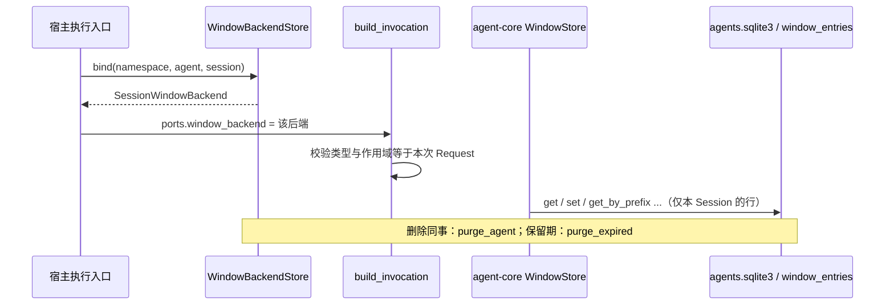

# 窗口持久化后端设计方案

## 1. 元信息

| 项 | 值 |
| --- | --- |
| 建档日期 | 2026-10-13 |
| 范围 | jiuwenswarm `jiuwenswarm/server/jiuwenmate/ports/window_backend.py`；`spec_provider.build_invocation` 的后端校验；`service.PersistentAgentService.delete_colleague` 的窗口清理；对端 agent-core 的 `PersistentPorts.window_backend` 与 `BaseKVStore` 只读引用 |
| 方案成熟度 | 已确认（依据开发计划 JM-05 条目与 agent-core S_03 规约第 2、5.3 节；先于实现建档） |
| 计划条目 | [JM-05](../designs/jiuwenmate-development-plan.md)（原 SW-05）：窗口持久化后端 |
| 负责人 | 常钰聪 |
| 状态 | 待验收：宿主组件通过，联合验收待完成（与开发计划一致） |
| 设计依据 | [JiuwenMate 服务端架构设计](../designs/jiuwenmate-architecture.md) 第 7.1 节“数据由谁维护，以什么为准”、第 7.3 节“版本保留与引用约束”；开发计划附录 A.3 `PersistentPorts.window_backend` 接口要求；agent-core 仓 `jiuwenmate` 分支 `openjiuwen/harness/persistent_agent/docs/specs/S_03_context-and-windows.md` 第 2 节（键布局）、第 5.3 节（后端、清理与部分成功），以及 `ports.py` 中的 `PersistentPorts.validate` |
| 关联 feature | 前置：[F_01 core 契约适配](F_01_core-contract.md)（`build_invocation`）；协作：[F_02 同事管理](F_02_colleague-management.md)（删除同事）、[F_03 会话定位与请求受理](F_03_session-request.md)（Session 标识） |
| 验证摘要 | 18 项测试通过（真实 SQLite；全目录 104 项）；core 的 WindowStore（PA-10）尚未接入，未与真实加载和保存联调 |
| Refs | 无独立 issue；需求来源为开发计划 JM-05 |

## 2. 背景、目标与范围

### 2.1 背景与问题

core 跨 Execution 保存 Session 的会话状态记录，并在换窗时保存旧窗原文和归档索引。这两类数据都通过 `PersistentPorts.window_backend: BaseKVStore` 读写。core 只校验该对象是否为 `BaseKVStore` 实例。S_03 第 5.3 节将以下保证交给宿主：数据持久保存；按命名空间隔离；Agent 工具无法访问；单条状态记录一次写入；按保留期清理归档；删除 Agent 或 Session 时清理对应前缀。

现有测试使用 `InMemoryKVStore`。该实现在进程重启后会丢失数据，也不区分 Session。

### 2.2 目标与关键场景

| 场景 / 触发条件 | 当前行为 | 目标行为 / 可观察变化 |
| --- | --- | --- |
| 服务重启后加载 Session 记录 | 内存后端数据丢失 | 数据从私有 SQLite 文件读回 |
| A Session 的执行访问 B Session 的键 | 内存后端不区分 | 单键操作被拒绝；前缀查询只返回本 Session 的数据 |
| 两个命名空间出现相同 Agent 和 Session 标识 | 不区分 | 两者的数据互不可见 |
| 归档超过保留期 | 无清理 | `purge_expired` 删除过期归档原文和到期条目 |
| 删除同事 | 窗口数据残留 | 删除该同事在本命名空间下全部 Session 的窗口数据 |
| 向执行传入内存后端或绑定其他 Session 的后端 | core 接受 | `build_invocation` 拒绝 |

### 2.3 本次范围与非目标

- 本次包含：`WindowBackendStore`、`SessionWindowBackend`，以及 `build_invocation` 的后端校验和 `delete_colleague` 的清理接线。
- 本次不包含：
  - 窗口内容格式、序列化和整理，这些由 core 的 WindowStore 负责（PA-10～PA-12）；
  - 周期性调用 `purge_expired` 的调度，以及保留期的配置项；
  - Session 删除入口（现有代码中不存在）；
  - 在途请求与删除之间的并发处理（JM-07）。

## 3. 设计约束、假设与待决问题

- **已确认约束与依赖：**
  - 键布局为 `pa:{agent_id}:{session_id}:state`、`pa:{agent_id}:{session_id}:archive:{序号}`、`pa:{agent_id}:{session_id}:archive_index`。
  - 命名空间与跨主体隔离由宿主保障，宿主不能根据键中包含的 ID 推断访问已获授权（S_03 第 2 节）。
  - Swarm 不修改窗口内容（开发计划第 1 节“全局约束”）。
- **关键假设：** core 对同一 Session 的写入只使用上述前缀。宿主保证同一 Session 同一时刻只有一个执行者，这一保证由 JM-03 的 `SESSION_BUSY` 提供。
- **待决问题：**
  - 归档保留期的取值尚未确定。S_03 第 5.3 节将其留给实现特性，因此本特性只提供以 `archive_retention` 为参数的清理接口。
  - 归档原文按保留期删除后，`archive_index` 仍会引用已删除的序号。S_03 第 4.4 节要求检索区分“确定没有”与“没查完或失败”，core 的处理方式须在 PA-11 联合验证时确认。

## 4. 总体方案与设计取舍

### 4.1 方案概览

全部窗口数据保存在共享私有数据库 `agents.sqlite3` 的 `window_entries` 表中。每行带有 (namespace_id, agent_id, session_id) 作用域列。执行只能拿到绑定到本 Session 的视图。

### 4.2 关键决策

#### D-01 复用共享 SQLite 文件，按作用域列存储

- 选择与依据：`agents.sqlite3` 已位于权限为 0700 的私有数据目录，文件权限为 0600，并且不在任何 Agent 工作区内。复用它可以直接满足持久保存和工具不可访问的要求，与 JM-02～JM-04 的存储方式一致。
- 代价与成立条件：窗口归档可能较大，会增加数据库体积，并与配置和事件写入争用同一把写锁。工作区访问范围（JM-14）不能把数据目录纳入可读范围。
- 实现体现：`WindowBackendStore(SQLiteStore)`；验证见 JM-05-V-01、V-02。

#### D-02 每次执行绑定一个 Session 视图，隔离依据作用域列而非键

- 选择与依据：`bind` 返回 `SessionWindowBackend`，所有 SQL 都附带作用域条件。单键操作还要求键以 `pa:{agent_id}:{session_id}:` 开头，不满足时立即报错，以便尽早暴露 core 的越界写入。前缀查询和前缀删除只作用于本 Session 的行。即使键中写入了其他 Session 的 ID，也无法读取对方的数据。
- 代价与成立条件：core 若改变键布局，单键前缀检查会拒绝新键，需要同步修改。
- 实现体现：`SessionWindowBackend._key`、`_SCOPE`；验证见 JM-05-V-02。

#### D-03 在 `build_invocation` 中拒绝非宿主后端

- 选择与依据：后端必须是 `SessionWindowBackend`，并且作用域等于本次 Request 的 (namespace_id, agent_id, session_id)。这一检查覆盖“生产配置拒绝内存后端”的要求，也防止把其他 Session 的视图误传给执行。宿主当前没有生产与测试的配置开关，因此所有调用一律执行该检查。
- 代价与成立条件：测试必须使用真实后端（指向临时目录），不能再使用 `InMemoryKVStore`。
- 实现体现：`spec_provider.build_invocation`；验证见 JM-05-V-03。

#### D-04 删除同事时，先删除配置，再清理窗口

- 选择与依据：先删除配置可以保证同事从管理视图中消失；如果之后的清理失败，残留数据只能由宿主再次清理，执行无法访问，因为已没有可用配置。若顺序相反，清理成功而配置删除失败时，同事仍然存在，但现场已经丢失。
- 代价与成立条件：清理失败时会残留数据，当前没有自动补偿。
- 实现体现：`PersistentAgentService.delete_colleague`；验证见 JM-05-V-03。

### 4.3 替代方案与排除理由

| 候选 / 关联决策 | 关键差异 | 拒绝原因 | 重新评估条件 |
| --- | --- | --- | --- |
| R-01 / D-01 使用 core 的 `DbBasedKVStore` 或 `ShelveStore` | 不需要自行实现 KV 存储 | 不带作用域列，隔离只能依靠键前缀；文件位置与权限需要另外管理 | core 提供带命名空间的持久 KV 实现时 |
| R-02 / D-02 宿主在写入时为键加上命名空间前缀 | 只需一张普通 KV 表 | core 的 `get_by_prefix` 返回的键会被改写，与 core 写入时的键不一致 | 无 |
| R-03 / D-03 增加“生产模式”开关，仅在生产环境拒绝内存后端 | 测试可以继续使用内存后端 | 测试路径与生产路径不一致，开关可能被误配置 | 无 |

## 5. 详细设计

### 5.1 模块责任与关键不变量

- `WindowBackendStore`：持有 `window_entries` 表，提供 `bind` 和清理操作。
- `SessionWindowBackend`：实现 core 的 `BaseKVStore`，所有操作通过 `asyncio.to_thread` 在线程中执行 SQLite 调用。
- **不变量：**
  - 一个视图只能读写本作用域内的行（JM-05-V-02）。
  - 每次写入在一个事务内完成；pipeline 中排队的操作在同一事务中执行，任一操作失败则全部回滚（JM-05-V-01）。
  - 值按写入时的类型（`str` 或 `bytes`）原样读回。

### 5.2 关键类与函数设计

`WindowBackendStore(db_path: Path, *, clock: Callable[[], float] = time.time)`：

| 方法签名 | 职责 | 异常与副作用 |
| --- | --- | --- |
| `bind(namespace_id, agent_id, session_id) -> SessionWindowBackend` | 返回绑定到该 Session 的视图 | 标识非法时抛出 `PersistentAgentError` |
| `purge_agent(namespace_id, agent_id) -> int` | 删除该同事在本命名空间下全部 Session 的数据 | 返回删除的行数 |
| `purge_session(namespace_id, agent_id, session_id) -> int` | 删除单个 Session 的数据 | 返回删除的行数 |
| `purge_expired(*, archive_retention: timedelta) -> int` | 删除已到期的条目，以及最近写入早于保留期的归档原文（`…:archive:…`）；`state` 与 `archive_index` 不在保留期清理范围内 | 返回删除的行数 |

`SessionWindowBackend` 实现 `BaseKVStore` 的全部抽象方法：`set`、`exclusive_set(expiry)`、`get`、`exists`、`delete`、`get_by_prefix`、`delete_by_prefix`、`mget`、`batch_delete` 和 `pipeline`。

- 键不属于本 Session，或值不是 `str` / `bytes` 时，抛出 `PersistentContractError`。
- `exclusive_set` 在已有未到期条目时返回 `False`。条目到期后视为不存在，可以被覆盖。
- `batch_size` 参数被接受但不分批，一次事务完成全部删除。

### 5.5 数据模型与事实归属

| 数据 | 隔离范围 | 权威位置 | 创建与释放 |
| --- | --- | --- | --- |
| 会话状态记录、归档原文、归档索引 | (namespace_id, agent_id, session_id, key) | `window_entries` 表；内容格式由 core 决定，宿主不解析 | core 经视图写入；`purge_agent`、`purge_session`、`purge_expired` 释放 |

`expires_at` 和 `updated_at` 以 Unix 秒保存。只有 `exclusive_set(expiry=...)` 写入的条目会设置 `expires_at`。

### 5.8 异常、中断与重试处理

- SQLite 写入失败时，异常原样传给 core。按 S_03 的规定，状态保存失败属于运行错误，不回退为空窗口。
- 进程在事务中途崩溃时，SQLite 回滚未提交的写入，不会留下半条记录。
- 删除同事后若窗口清理失败，配置已经删除，残留的窗口数据无法被执行访问；再次调用 `purge_agent` 即可清除。

## 6. 影响面与实施设计

| 实施项 | 文件 | 修改内容 | 验证产物 |
| --- | --- | --- | --- |
| I-01 | [`ports/window_backend.py`](../../ports/window_backend.py) | 新增 `WindowBackendStore`、`SessionWindowBackend` | JM-05-V-01～V-03 |
| I-02 | [`spec_provider.py`](../../spec_provider.py) | `build_invocation` 校验后端类型与作用域 | JM-05-V-03 |
| I-03 | [`service.py`](../../service.py) | 新增可选依赖 `windows`；`create_default` 在同一数据库上创建；`delete_colleague` 调用 `purge_agent` | JM-05-V-03 |
| I-04 | [`test_window_backend.py`](../../../../../tests/unit_tests/server/jiuwenmate/test_window_backend.py)、[`test_persistent_agent_service.py`](../../../../../tests/unit_tests/server/jiuwenmate/test_persistent_agent_service.py) | 新增测试 | — |
| I-05 | `test_core_contract.py`、`test_persistent_agent_service.py`、`test_request_routing.py` | 原 `InMemoryKVStore` 替身改为绑定到临时目录的真实后端 | 原有测试全部通过 |
| I-06（未实施） | 宿主执行入口 | 每次执行调用 `bind` 并注入；定时调用 `purge_expired` | 由 JM-07 完成 |

兼容核对：新增表位于新版专用数据库；个人版不受影响。

开发计划：JM-05 的“证据”列链接本文。

## 8. 验证设计、执行记录与结论

### 8.1 验证设计与通过条件

| 验证 ID | 场景 | 验证入口 | 预期结果 | 层级 |
| --- | --- | --- | --- | --- |
| JM-05-V-01 | 持久保存与 `BaseKVStore` 契约 | `test_window_backend.py`：`test_state_and_archives_survive_restart`、`test_backend_implements_every_base_kv_store_operation`、`test_exclusive_set_respects_live_entries_and_expiry`、`test_pipeline_runs_queued_operations_together`、`test_failed_pipeline_writes_nothing`、`test_non_text_values_are_rejected`、`test_backend_passes_core_port_validation` | 重建实例后数据仍在；全部方法语义正确；pipeline 失败时整体回滚；通过 core 的 `PersistentPorts.validate` | 单测，真实 SQLite 与 core 类型 |
| JM-05-V-02 | Session 与命名空间隔离，与 Agent 文件分离 | `test_window_backend.py`：`test_session_cannot_reach_another_sessions_keys`、`test_same_keys_in_another_namespace_are_separate`、`test_invalid_scope_is_refused`、`test_window_data_lives_only_in_the_private_database` | 越界键被拒绝；前缀操作不触及其他 Session；数据只位于 0700 目录下的 0600 数据库文件 | 单测 |
| JM-05-V-03 | 保留期、删除清理与拒绝其他后端 | `test_window_backend.py`：`test_retention_drops_old_archives_and_expired_entries_only`、`test_purging_a_session_or_agent_leaves_the_rest`、`test_invocation_refuses_a_backend_not_bound_to_its_session`（4 组参数）；`test_persistent_agent_service.py`：`test_deleting_a_colleague_purges_only_its_window_data` | 只清理目标数据；内存后端、其他 Session 或其他命名空间的视图以及空后端均被拒绝 | 单测 |

### 8.2 实际执行与证据

| 执行日期 / 验证范围 | 实现版本与环境 | 命令 | 实际结果 | 未覆盖项 |
| --- | --- | --- | --- | --- |
| 2026-10-13 / V-01～V-03 | 本提交；agent-core 为 `.venv` 中的已安装版本 | `.venv/bin/python -m pytest tests/unit_tests/server/jiuwenmate -q -o addopts="--asyncio-mode=auto" -p no:cacheprovider`；`.venv/bin/ruff check jiuwenswarm/server/jiuwenmate tests/unit_tests/server/jiuwenmate` | 104 passed（本特性 18 项）；ruff 通过 | core 经该后端真实加载和保存；Agent 工作区工具的实际访问范围 |

### 8.3 验证结论

- **已证明范围：** 持久保存；完整实现 `BaseKVStore`；Session 与命名空间隔离；保留期清理和删除清理；执行构建时拒绝非宿主后端。
- **未覆盖的承诺：**
  - V-01 中“core 能经该后端加载和保存”的部分，须待 PA-10 接入真实 WindowStore 后联合验证。
  - V-02 中“Agent 文件工具读不到”的部分，当前仅由存储位置保证，须在 JM-14 开放工作区读取时复核访问范围。
  - V-03 中“删除 Session 时清理”的部分，目前只提供了 `purge_session` 接口，尚无删除入口。
- **可支持的交付判断：** 满足 JM-05 宿主组件验收。整项完成须待 JM-07 接线，以及在 S2a 与 PA-10～PA-12 的联合验收。

## 9. 风险与已知遗留

### 9.1 设计风险

| 风险 / 触发条件 | 影响 | 已有应对措施 | 核实方式 |
| --- | --- | --- | --- |
| core 调整键布局 | 单键操作被拒绝，执行报错 | 错误信息明确指出越界 | 跟随 core 版本升级运行契约测试 |
| 删除同事时该同事仍有执行在进行 | 执行后续写入会产生无主数据 | 无 | JM-07 处理删除与在途请求的关系（架构第 7.3 节） |
| 归档体积较大 | 数据库增长，写锁争用 | 保留期清理接口 | JM-07 接入真实负载后测量 |

### 9.2 已知遗留

| 遗留项 | 性质 | 影响与现有处置 | 后续入口 |
| --- | --- | --- | --- |
| 执行入口未调用 `bind` 注入后端 | 未实现 | 后端目前只能在测试中使用 | JM-07 |
| `purge_expired` 无定时调用，保留期取值未定 | 未实现 | 归档持续保留 | JM-07；保留期取值与 PA-11 共同确定 |
| 没有 Session 删除入口 | 未实现 | `purge_session` 暂无调用方 | 新增 Session 删除功能时接入 |
| 保留期清理后归档索引引用已删除的原文 | 待确认 | 由 core 将其视为“原文不可用” | PA-11 联合验证 |

## 10. 设计演进与修订

暂无。
