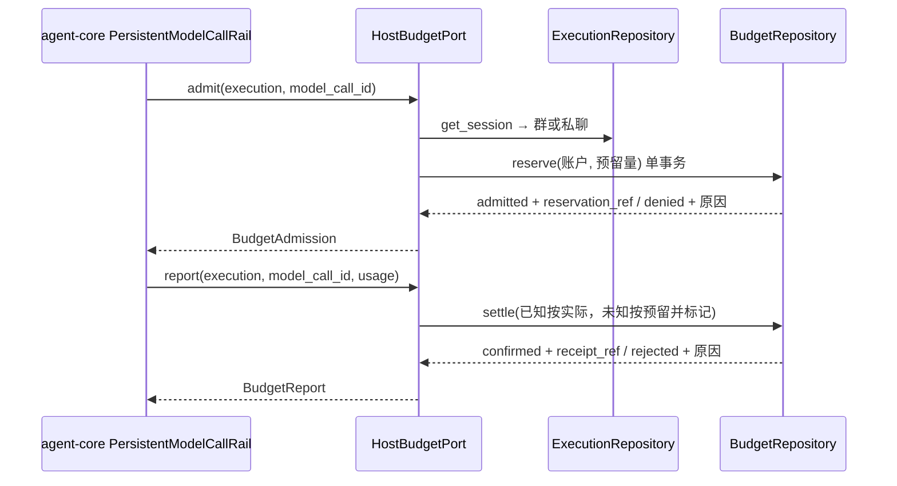

# 模型预算端口设计方案

## 1. 元信息

| 项 | 值 |
| --- | --- |
| 建档日期 | 2026-10-13 |
| 范围 | jiuwenswarm `jiuwenswarm/server/jiuwenmate/budget_repository.py`、`ports/budget.py`；对端 agent-core 的 `BudgetPort`、`BudgetAdmission`、`BudgetReport`、`ModelUsage` 只读引用 |
| 方案成熟度 | 已确认（依据开发计划 JM-06 条目、agent-core 架构第 9.3 节与 S_01 第 4.4 节；额度规则于 2026-10-13 经负责人确认；先于实现建档） |
| 计划条目 | [JM-06](../designs/jiuwenmate-development-plan.md)（原 SW-06）：模型预算端口 |
| 负责人 | 常钰聪 |
| 状态 | 待验收：宿主组件通过，联合验收待完成（与开发计划一致） |
| 设计依据 | [JiuwenMate 服务端架构设计](../designs/jiuwenmate-architecture.md) 第 9.3 节“容量、预算与使用条件”；开发计划附录 A.3 `BudgetPort` 接口要求；agent-core 仓 `jiuwenmate` 分支 `openjiuwen/harness/persistent_agent/docs/designs/persistent-agent-architecture.md` 第 9.3 节、`docs/specs/S_01_public-api-and-execution.md` 第 2 节与 `S_02_events-and-result-handoff.md` 中 `PersistentModelCallRail` 的说明 |
| 关联 feature | 前置：[F_03 会话定位与请求受理](F_03_session-request.md)（由 Session 确定账户）；协作：[F_01 core 契约适配](F_01_core-contract.md) |
| 验证摘要 | 15 项测试通过（真实 SQLite 与并发线程；全目录 119 项）；core 的 `PersistentModelCallRail` 真实调用尚未联调 |
| Refs | 无独立 issue；需求来源为开发计划 JM-06 |

## 2. 背景、目标与范围

### 2.1 背景与问题

core 在每次模型调用前由 `PersistentModelCallRail` 生成新的 `model_call_id` 并调用 `BudgetPort.admit`。准入被拒绝时，core 跳过模型调用，执行以 `paused(budget_denied)` 结束；`admit` 抛异常时以 `paused(error)` 结束。模型调用结束或失败后，core 调用 `report` 报告用量，用量可能为已知（输入、输出 token 数）或未知（附原因）；`report` 抛异常只记诊断，执行继续。

额度账户、预留和结算归宿主所有。JiuwenMate 架构第 9.3 节未预设预算算法和数值。当前测试中的预算端口是替身，总是准入。

### 2.2 目标与关键场景

| 场景 / 触发条件 | 当前行为 | 目标行为 / 可观察变化 |
| --- | --- | --- |
| 同一群中多位同事同时申请额度 | 替身总是准入 | 共享同一群账户；剩余额度不足时拒绝，已准入总量不超过上限 |
| 账户未配置上限 | 替身总是准入 | 准入，照常预留和结算，留下用量记录 |
| 用量已知的 report | 不记录 | 按实际 token 扣减，释放预留 |
| 用量未知的 report | 不记录 | 按预留量扣减，标记待对账，不记为零 |
| 同一 `model_call_id` 重复 report | 不记录 | 用量相同返回同一回执；用量不同返回 rejected |
| 管理员调整上限 | 不支持 | 写入带修订号的调整记录；续做判断可查询拒绝之后是否有调整 |

### 2.3 本次范围与非目标

- 本次包含：账户、调用、调整三张表；`HostBudgetPort` 的 `admit` 与 `report`；账户查询、上限调整与拒绝后调整记录查询。
- 本次不包含：
  - 管理页面或 API 入口（JM-10）；
  - 已准入但未 report 的悬挂预留的回收（JM-07 / JM-13）；
  - 待对账调用的核对流程；
  - 按周期自动重置额度（负责人确认不做）。

## 3. 设计约束、假设与待决问题

- **已确认约束与依赖：**
  - 准入只有 admitted / denied；admitted 须带 `reservation_ref`，denied 须带原因。回报只有 confirmed / rejected；confirmed 须带 `receipt_ref`，rejected 须带原因（S_01 第 2 节）。
  - 未知用量不能记为零消耗（开发计划 JM-06-V-02）。
  - 真实重试使用新的 `model_call_id`（S_01 第 4.4 节）。
- **负责人确认的额度规则（2026-10-13）：**
  - 未配置上限时不限额，但照常预留、结算和记录。
  - 额度只通过管理操作调整，每次调整写一条带修订号的记录；不按周期自动重置。
  - 未知用量按预留量扣减，并标记待对账。
- **关键假设：** 额度单位为 token，按输入与输出之和计费。
- **待决问题：** 每次准入的预留量默认 4096 token，是未经测量的占位值，需在 JM-07 接入真实负载后校准。

## 4. 总体方案与设计取舍

### 4.1 方案概览

### 4.2 关键决策

#### D-01 群会话共享群账户，其余会话按同事分账户

- 选择与依据：开发计划要求群额度共享计算。群 Session 的会话键为 Swarm 的 `group_chat_id`，同一群中的各位同事落在同一账户；私聊、Web 和定时任务按 (namespace_id, agent_id) 计账。
- 代价与成立条件：同一同事在群内和私聊中的消耗分属两个账户。
- 实现体现：`HostBudgetPort._account`；验证见 JM-06-V-01。

#### D-02 准入在单个立即事务中检查并预留

- 选择与依据：检查“已用 + 已预留 + 本次预留 ≤ 上限”与写入预留在同一个 `BEGIN IMMEDIATE` 事务中完成，并发申请串行化，不会超卖。
- 代价与成立条件：所有预算写入共享同一把数据库写锁。
- 实现体现：`BudgetRepository.reserve`；验证见 JM-06-V-01。

#### D-03 以 `model_call_id` 作为准入与结算的幂等键

- 选择与依据：同一调用重复 admit 返回原决定；重复 report 时比较用量，相同则返回原回执，不同则拒绝，避免重复计费。
- 实现体现：`budget_calls` 主键 (namespace_id, model_call_id)；验证见 JM-06-V-02。

#### D-04 未知用量按预留量扣减并标记待对账

- 选择与依据：负责人确认。模型可能已消耗 token，释放预留会低估消耗；按预留量扣减偏保守，不会超卖。
- 代价与成立条件：实际消耗可能高于或低于预留量，需由后续对账修正。
- 实现体现：`BudgetRepository.settle`；验证见 JM-06-V-02。

#### D-05 额度调整写修订记录，续做据此判断条件是否变化

- 选择与依据：每次调整使账户修订号加一，并记录新上限、原因和操作人。拒绝记录保存当时的账户修订号。`adjustments_since_denial` 返回拒绝之后的调整；为空表示条件未变，续做不应自动重试。
- 实现体现：`budget_adjustments` 表；验证见 JM-06-V-03。

### 4.3 替代方案与排除理由

| 候选 / 关联决策 | 关键差异 | 拒绝原因 | 重新评估条件 |
| --- | --- | --- | --- |
| R-01 / D-02 先读余额再在另一事务中写预留 | 锁持有时间更短 | 并发申请可能同时读到充足余额，导致超卖 | 无 |
| R-02 / D-04 未知用量释放预留 | 不会多扣额度 | 低估真实消耗，可能持续超出上限 | 有可靠对账数据时 |
| R-03 / D-05 按自然日自动重置 | 运营简单 | 负责人确认不做；也需预设未经测量的周期数值 | 产品提出周期额度需求时 |

## 5. 详细设计

### 5.1 模块责任与关键不变量

- `BudgetRepository`：三张表的事务读写。
- `HostBudgetPort`：实现 core 的 `BudgetPort`，确定账户并转换为 core 的结果类型。
- **不变量：**
  - 有上限的账户中，已用与已预留之和在准入时不超过上限（结算按实际用量扣减，可能使已用量超过上限，之后的准入会被拒绝）。
  - 每个 `model_call_id` 至多扣费一次。
  - 未知用量的扣减量等于该调用的预留量，且调用标记为待对账。

### 5.2 关键类与函数设计

`BudgetRepository(db_path: Path)`：

| 方法签名 | 职责 | 异常与副作用 |
| --- | --- | --- |
| `reserve(ref: InvocationRef, model_call_id, account: BudgetAccountRef, tokens: int, *, now) -> CallDecision` | 准入并预留，或记录拒绝；同一调用返回原决定 | 同一 `model_call_id` 属于其他执行时抛 `PersistentContractError` |
| `settle(ref: InvocationRef, model_call_id, usage: ModelUsage, *, now) -> CallDecision` | 结算；重复结算按用量比较 | 无；不可结算时返回 rejected 决定 |
| `account(namespace_id, account: BudgetAccountRef) -> BudgetAccountView` | 查询上限、已用、已预留、修订号和待对账数 | 无 |
| `adjust_limit(namespace_id, account, limit_tokens: int \| None, *, reason, actor_ref, now) -> int` | 调整上限并写修订记录，返回新修订号 | 参数非法时抛 `PersistentAgentError` |
| `adjustments_since_denial(namespace_id, model_call_id) -> list[BudgetAdjustment]` | 返回拒绝之后的调整记录 | 调用不存在或未被拒绝时抛 `NOT_FOUND` |

`HostBudgetPort(repository, sessions: ExecutionRepository, *, reservation_tokens: int = 4096, clock=...)`：

| 方法签名 | 职责 | 异常与副作用 |
| --- | --- | --- |
| `async admit(execution, model_call_id) -> BudgetAdmission` | 确定账户后准入 | Session 不存在或数据库失败时抛异常，core 以 `paused(error)` 结束 |
| `async report(execution, model_call_id, usage) -> BudgetReport` | 结算用量 | 数据库失败时抛异常，core 只记诊断 |

### 5.5 数据模型与事实归属

| 数据 | 隔离范围 | 权威位置 | 创建与释放 |
| --- | --- | --- | --- |
| 账户 | (namespace_id, account_kind, account_key)；kind 为 `group` 或 `agent` | `budget_accounts`：上限、已用、已预留、修订号 | 首次准入或调整时创建；当前不删除 |
| 模型调用 | (namespace_id, model_call_id) | `budget_calls`：调用身份、决定、预留量、拒绝时的账户修订号、用量状态与扣减量 | admit 创建，report 结算 |
| 额度调整 | (namespace_id, account, revision) | `budget_adjustments`：新上限、原因、操作人、时间 | `adjust_limit` 写入；不修改 |

### 5.8 异常、中断与重试处理

- 数据库失败时异常原样抛出。admit 失败时 core 不调用模型；report 失败时调用保持“已预留”，由后续对账处理。
- 进程在准入后、report 前崩溃时，预留不会释放，并持续占用额度，列为遗留项。
- 迟到的 report（调用已结算）按幂等规则处理；对拒绝的调用 report 返回 rejected。

## 6. 影响面与实施设计

| 实施项 | 文件 | 修改内容 | 验证产物 |
| --- | --- | --- | --- |
| I-01 | [`budget_repository.py`](../../budget_repository.py) | 三张表与事务方法 | JM-06-V-01～V-03 |
| I-02 | [`ports/budget.py`](../../ports/budget.py) | `HostBudgetPort` | JM-06-V-01、V-02 |
| I-03 | [`test_budget_port.py`](../../../../../tests/unit_tests/server/jiuwenmate/test_budget_port.py) | 测试 | — |
| I-04（未实施） | 宿主执行入口 | 注入 `HostBudgetPort`；回收悬挂预留 | 由 JM-07 完成 |

兼容核对：新增表位于新版专用数据库；个人版不受影响。

开发计划：JM-06 的“证据”列链接本文。

## 8. 验证设计、执行记录与结论

### 8.1 验证设计与通过条件

| 验证 ID | 场景 | 验证入口（`test_budget_port.py`） | 预期结果 | 层级 |
| --- | --- | --- | --- | --- |
| JM-06-V-01 | 群共享额度与原子准入 | `test_group_colleagues_share_one_account_without_overselling`、`test_private_sessions_are_charged_per_colleague`、`test_account_without_limit_admits_and_records_usage`、`test_denied_admission_is_a_valid_core_result`、`test_port_satisfies_the_core_contract`、`test_reservation_must_be_positive` | 并发申请时准入总量不超过上限；拒绝结果满足 core 校验；端口签名与 core 协议一致并通过 `PersistentPorts.validate` | 单测，真实 SQLite 并发线程 |
| JM-06-V-02 | 幂等结算与未知用量 | `test_known_usage_is_charged_and_reservation_released`、`test_unknown_usage_charges_the_reservation_and_is_flagged`、`test_repeated_report_is_charged_once`、`test_report_with_other_usage_is_rejected`、`test_report_for_unadmitted_or_foreign_call_is_rejected`、`test_repeated_admit_returns_the_first_decision` | 每次调用至多扣费一次；未知用量不记为零 | 单测 |
| JM-06-V-03 | 额度恢复依据 | `test_adjustment_after_denial_is_evidence_for_continuation`、`test_budget_state_survives_restart`、`test_adjustment_needs_a_valid_limit_and_reason` | 拒绝之后无调整时为空；调整之后返回记录；重启后数据仍在 | 单测 |

### 8.2 实际执行与证据

| 执行日期 / 验证范围 | 实现版本与环境 | 命令 | 实际结果 | 未覆盖项 |
| --- | --- | --- | --- | --- |
| 2026-10-13 / V-01～V-03 | 本提交；agent-core 为 `.venv` 中的已安装版本 | `.venv/bin/python -m pytest tests/unit_tests/server/jiuwenmate -q -o addopts="--asyncio-mode=auto" -p no:cacheprovider`；`.venv/bin/ruff check jiuwenswarm/server/jiuwenmate tests/unit_tests/server/jiuwenmate` | 119 passed（本特性 15 项）；ruff 通过 | core 真实执行中的准入与回报；悬挂预留回收 |

### 8.3 验证结论

- **已证明范围：** 群共享账户的并发准入不超卖；按 `model_call_id` 幂等准入与结算；未知用量按预留量扣减并标记待对账；拒绝之后的额度调整可查询；数据在重启后保留；结果类型通过 core 校验。
- **未覆盖的承诺：**
  - V-01 中“准入被拒绝时不调用模型”由 core 的 `PersistentModelCallRail` 实现，本特性只证明返回的拒绝结果合法，须在 S1 与 PA-05 联合验证。
  - V-03 的调整记录供续做判断使用，判断逻辑属于 JM-13。
- **可支持的交付判断：** 满足 JM-06 宿主组件验收。整项完成须待 JM-07 接线，以及与 PA-05、PA-07、PA-11 的联合验收。

## 9. 风险与已知遗留

### 9.1 设计风险

| 风险 / 触发条件 | 影响 | 已有应对措施 | 核实方式 |
| --- | --- | --- | --- |
| 预留量 4096 与实际调用差距大 | 预留过大时并发受限，过小时结算后已用量明显超过上限 | 构造参数可调 | JM-07 接入真实负载后测量 |
| 结算按实际用量扣减 | 已用量可能超过上限 | 之后的准入被拒绝 | 单测覆盖 |

### 9.2 已知遗留

| 遗留项 | 性质 | 影响与现有处置 | 后续入口 |
| --- | --- | --- | --- |
| 已准入但未 report 的悬挂预留 | 未实现 | 持续占用额度 | JM-07 / JM-13 |
| 待对账调用的核对流程 | 未实现 | 未知用量按预留量扣减 | 待评估 |
| 管理入口 | 未实现 | `adjust_limit` 暂无调用方 | JM-10 |
| 执行入口注入 | 未实现 | 端口目前只能在测试中使用 | JM-07 |

## 10. 设计演进与修订

暂无。
