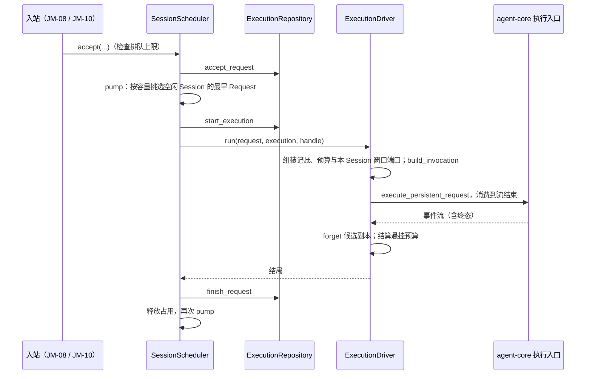

# 同事管理器、Session 排队器与执行驱动设计方案

## 1. 元信息

| 项 | 值 |
| --- | --- |
| 建档日期 | 2026-10-14 |
| 范围 | jiuwenswarm `jiuwenswarm/server/jiuwenmate/agent_manager.py`、`session_scheduler.py`、`execution_driver.py`；`budget_repository.py` 新增悬挂预留结算；对端 agent-core 的 `execute_persistent_request`、`abort_persistent_request` 只读引用 |
| 方案成熟度 | 已确认（依据开发计划 JM-07 条目；按 [AGENTS.md](../../../../../AGENTS.md) 的变更闸门先提交分析与改动方案，2026-10-14 经负责人确认；先于实现建档） |
| 计划条目 | [JM-07](../designs/jiuwenmate-development-plan.md)（原 SW-07）：同事管理器、Session 排队器与执行驱动 |
| 负责人 | 常钰聪 |
| 状态 | 待验收：宿主组件通过，联合验收待完成（与开发计划一致） |
| 设计依据 | [JiuwenMate 服务端架构设计](../designs/jiuwenmate-architecture.md) 第 4.3 节“执行交接”、第 5.2.3 节“通用会话调度、控制与关闭”；agent-core 仓 `jiuwenmate` 分支 `persistent-agent-architecture.md` 第 9.3 节与 `execution/entries.py` 的入口语义 |
| 关联 feature | 前置：[F_03 会话定位与请求受理](F_03_session-request.md)；组合：[F_01](F_01_core-contract.md)、[F_02](F_02_colleague-management.md)、[F_04](F_04_commit-port.md)、[F_05](F_05_window-backend.md)、[F_06](F_06_budget-port.md) |
| 验证摘要 | 见第 8 节；core 入口用替身验证，真实执行须待 PA-10 |
| Refs | 无独立 issue；需求来源为开发计划 JM-07 |

## 2. 背景、目标与范围

### 2.1 背景与问题

JM-03 已经把 Request 持久排队，并保证同一 Session 同一时刻至多一个 Request 处于 `dispatched`。JM-04～JM-06 分别提供了记账、窗口和预算端口。目前没有组件按顺序取出 Request、组装端口、调用 core 执行入口、等待流结束并记录结局，也没有组件处理停止、取消、删除同事和关闭。

core 的 `execute_persistent_request` 返回事件流。宿主须消费到结束；流结束时，core 已完成实例清理。`abort_persistent_request(context, reason)` 只记录停止或取消原因并请求中断，结局仍由执行入口写出。

### 2.2 目标与关键场景

| 场景 / 触发条件 | 当前行为 | 目标行为 / 可观察变化 |
| --- | --- | --- |
| 同一 Session 排了多条 Request | 无组件取出 | 按到达顺序逐条执行，上一条的流结束后才开始下一条 |
| 多个 Session 同时有 Request | 无组件取出 | 在全局与每位同事的并发上限内并行，每次执行使用独立的 core 实例 |
| Session 排队数达到上限 | 无限制 | 受理被拒绝，返回 `QUEUE_FULL` |
| 停止或取消某个 Request | 不支持 | 只作用于目标；排队中的直接结束，执行中的调用 core 中断，等流结束后才释放 Session |
| 执行异常且没有终态事件 | 不支持 | 记为 `failed`，释放 Session |
| 执行结束 | 候选副本、预算预留无人释放 | 释放候选副本；已准入但未上报的预算调用按用量未知结算 |
| 删除同事 | 排队 Request 无人处理 | 排队中的记为 `cancelled`，执行中的取消并等待结束，再删除同事 |
| 续做 | 不支持 | 调度入口已预留；当前拒绝并返回 `PERSISTENT_NOT_OPENED`，实际续做由 JM-13 完成 |

### 2.3 本次范围与非目标

- 本次包含：`SessionScheduler`、`ExecutionDriver`、`AgentManager`；`BudgetRepository.settle_unreported`。
- 本次不包含：
  - 接入 AgentServer 启停（负责人确认推迟到 S1 联调；`AgentManager.start` / `aclose` 已具备）；
  - 渠道入站与投递（JM-08、JM-09）；
  - 续做执行的写入与恢复判断（JM-13，依赖 PA-17、PA-18）；
  - 确认后的恢复执行（JM-12 / PA-09）。

## 3. 设计约束、假设与待决问题

- **已确认约束与依赖：**
  - 等流结束且 core 清理完成后，才释放 Session 占用（开发计划 JM-07“责任与契约”）。
  - 本轮不改动 AgentServer、个人版聊天链路、`chat.session_result` 与 `chat.final` 顺序。
  - 不改动 agent-core。
- **负责人确认（2026-10-14）：**
  - 暂不接入 AgentServer。
  - 续做只预留调度入口。
  - 执行异常且没有终态事件时记为 `failed`。
  - 悬挂的预算调用按用量未知结算。
- **关键假设：** 本特性只在单进程内调度；同一数据库不被多个进程同时调度。
- **待决问题：** 容量上限与保留期的默认值（全局并发 4、每位同事并发 2、每个 Session 排队 100、归档保留 90 天、清理间隔 1 小时）是未经测量的占位值，须在 S1 接入真实负载后校准。

## 4. 总体方案与设计取舍

### 4.1 方案概览

### 4.2 关键决策

#### D-01 调度器只在内存中记录占用，持久状态以 JM-03 的仓库为准

- 选择与依据：Request 的排队与派发状态已由 `ExecutionRepository` 持久保存，`start_execution` 自身拒绝同一 Session 的第二个派发。调度器只记录本进程正在运行的执行，用于容量判断和控制。
- 代价与成立条件：进程重启后，上次处于 `dispatched` 的 Request 不会自动恢复；`recover` 只返回它们，处理由 JM-13 完成。
- 实现体现：`SessionScheduler._running`、`recover`；验证见 JM-07-V-01。

#### D-02 结局由终态事件确定，异常无终态时记为 `failed`

- 选择与依据：`execution.final` 的状态直接作为结局；`execution.paused` 中原因为 `stopped` 时记为 `stopped`，其余原因记为 `paused`。负责人确认，没有终态事件时记为 `failed`，以免 Session 被永久占用。
- 代价与成立条件：崩溃后本可续做的 Request 会被记为失败；JM-13 接入续做时需要重新评估。
- 实现体现：`ExecutionDriver._outcome`；验证见 JM-07-V-02。

#### D-03 控制在 core 入口之前到达时，先登记再交给 core

- 选择与依据：停止或取消可能发生在上下文构造之前。驱动器先保存原因；上下文构造完成后，在调用执行入口之前调用 `abort_persistent_request`。core 在进入原生调用前检查原因并写出对应终态，结局仍由 core 决定。
- 实现体现：`ExecutionHandle`；验证见 JM-07-V-02。

#### D-04 执行结束后统一收尾

- 选择与依据：无论正常结束、异常还是取消，驱动器都调用 `CommitQueue.forget` 释放候选副本，并调用 `BudgetRepository.settle_unreported`，把已准入但未上报的调用按用量未知结算（JM-06 已确认的规则）。
- 实现体现：`ExecutionDriver.run` 的 `finally`；验证见 JM-07-V-04。

#### D-05 删除同事先结束其工作，再删除资料

- 选择与依据：先阻止该同事的新受理，把排队中的 Request 记为 `cancelled`，取消执行中的 Execution 并等待结束，最后调用 `PersistentAgentService.delete_colleague`。这样删除时不会有执行仍在写入窗口或预算。
- 实现体现：`AgentManager.delete_colleague`；验证见 JM-07-V-04。

### 4.3 替代方案与排除理由

| 候选 / 关联决策 | 关键差异 | 拒绝原因 | 重新评估条件 |
| --- | --- | --- | --- |
| R-01 / D-01 在数据库中记录运行占用 | 支持多进程调度 | 本轮只有单进程；需要额外的租约与过期处理 | 部署多进程时 |
| R-02 / D-02 异常无终态时保持 `dispatched` | 保留续做机会 | 续做未开放，Session 会被永久占用，后续 Request 全部无法执行 | JM-13 开放续做时 |
| R-03 / 不预留续做入口 | 调度器更简单 | JM-13 需要同一入口，届时需要改动调度器接口 | 无 |

## 5. 详细设计

### 5.1 模块责任与关键不变量

- `ExecutionDriver`：执行一次 Execution 并返回结局，不修改 Request 状态。
- `SessionScheduler`：受理、容量判断、派发、控制、关闭，以及写入 `finish_request`。
- `AgentManager`：组合以上组件和 `CommitQueue`，管理定时清理任务和删除同事。
- **不变量：**
  - 同一 Session 同一时刻至多一个执行在运行（JM-07-V-01）。
  - 驱动器返回之前，调度器不释放该 Session，也不派发其下一条 Request（JM-07-V-02）。
  - 每个运行中的执行都占用全局和该同事的一个并发名额（JM-07-V-03）。

### 5.2 关键类与函数设计

`ExecutionDriver(*, snapshots, sessions, commit_port, queue, budget_port, budgets, windows, workspaces, execute=..., abort=..., clock=...)`（`workspaces` 于 2026-10-15 由 JM-14 加入，用于构造本同事的只读范围端口，见 [F_14](F_14_workspace-read.md)）：

| 方法签名 | 职责 | 异常与副作用 |
| --- | --- | --- |
| `async run(state: RequestState, execution: ExecutionRecord, handle: ExecutionHandle) -> str` | 组装端口与上下文，消费 core 事件流到结束，返回结局 | 不抛出；构造失败、执行异常均返回 `failed` 并记录日志 |

`ExecutionHandle`：`async abort(reason: Literal["cancel", "stop"]) -> None`。上下文已就绪时调用 core 中断；否则登记原因，由驱动器在进入 core 前提交。

`SessionScheduler(sessions, driver, *, limits: SchedulerLimits, clock=...)`：

| 方法签名 | 职责 | 异常与副作用 |
| --- | --- | --- |
| `accept(session, **accept_kwargs) -> tuple[RequestState, bool]` | 检查排队上限并受理，然后尝试派发 | 排队已满时抛 `QUEUE_FULL`；关闭后抛 `SCHEDULER_CLOSED`；该同事正在删除时抛 `AGENT_DELETING` |
| `resume(state: RequestState) -> None` | 续做的调度入口（预留） | 当前抛 `PERSISTENT_NOT_OPENED` |
| `async abort(namespace_id, request_id, reason) -> None` | 控制目标 Request | 排队中的直接结束为 `cancelled` / `stopped`；执行中的交给 handle |
| `recover(namespace_id) -> list[RequestState]` | 重新调度排队中的 Request，返回上次遗留的 `dispatched` Request | 无 |
| `async drain() -> None` | 等待当前所有执行结束（测试与关闭使用） | 无 |
| `async aclose() -> None` | 停止受理，以 `stop` 中断全部执行并等待结束 | 无 |

`AgentManager(service, sessions, windows, budgets, *, execute=..., abort=..., limits=..., reservation_tokens=..., archive_retention=timedelta(days=90), purge_interval=timedelta(hours=1), clock=...)`：`async start()`、`async aclose()`、`async delete_colleague(namespace_id, agent_id)`，以及只读属性 `scheduler`。

`BudgetRepository.settle_unreported(namespace_id, execution_id, *, now) -> int`：把该 Execution 下仍为“已预留”的调用按用量未知结算并标记待对账，返回结算条数。

### 5.8 异常、中断与重试处理

- 配置快照缺失、上下文构造失败或 core 入口抛出异常时，结局记为 `failed`；收尾照常执行。
- 驱动器所在任务被取消时（例如关闭），core 的 `_drive` 会取消并等待其内部任务清理完成，然后驱动器再收尾。
- `finish_request` 写入失败时记录日志，Session 占用仍会释放；该 Request 保持 `dispatched`，由 JM-13 核对。

## 6. 影响面与实施设计

| 实施项 | 文件 | 修改内容 | 验证产物 |
| --- | --- | --- | --- |
| I-01 | [`execution_driver.py`](../../execution_driver.py) | `ExecutionDriver`、`ExecutionHandle` | JM-07-V-01、V-02、V-04 |
| I-02 | [`session_scheduler.py`](../../session_scheduler.py) | `SessionScheduler`、`SchedulerLimits` | JM-07-V-01～V-03 |
| I-03 | [`agent_manager.py`](../../agent_manager.py) | `AgentManager` | JM-07-V-04 |
| I-04 | [`budget_repository.py`](../../budget_repository.py) | `settle_unreported` | JM-07-V-04 |
| I-05 | `test_session_scheduler.py`、`test_execution_driver.py` | 测试 | — |
| I-06（未实施） | `jiuwenswarm/server/agent_ws_server.py` | 在 `start()` 与 `_stop_main_services()` 中调用 `AgentManager.start` / `aclose` | 推迟到 S1 联调 |

兼容核对：不修改 AgentServer 与个人版代码；新增表与方法均位于新版专用数据库。

开发计划：JM-07 的“证据”列链接本文。

## 8. 验证设计、执行记录与结论

### 8.1 验证设计与通过条件

| 验证 ID | 场景 | 验证入口 | 预期结果 | 层级 |
| --- | --- | --- | --- | --- |
| JM-07-V-01 | 串行与并发 | 见第 8.2 节实际用例 | 同一 Session 串行；不同 Session 并发且各用独立实例 | 单测，core 入口替身 |
| JM-07-V-02 | 控制与释放 | 同上 | 控制只作用于目标；流结束后才派发下一条 | 单测 |
| JM-07-V-03 | 统一入口与上限 | 同上 | 全局、同事并发上限与排队上限生效；续做入口当前拒绝 | 单测 |
| JM-07-V-04 | 生命周期与收尾 | 同上 | 队列随管理器启停；收尾释放候选副本与悬挂预留；删除同事结束其 Request；窗口后端绑定本 Session；定时清理归档 | 单测 |

### 8.2 实际执行与证据

待实现后填写。

### 8.3 验证结论

待实现后填写。

## 9. 风险与已知遗留

### 9.1 设计风险

| 风险 / 触发条件 | 影响 | 已有应对措施 | 核实方式 |
| --- | --- | --- | --- |
| 进程崩溃 | 遗留 `dispatched` Request 占用 Session | `recover` 返回清单，由 JM-13 按日志结束并放行 Session（见 [F_13](F_13_recovery.md)） | JM-13 |
| 占位容量值与实际负载不符 | 吞吐不足或资源争用 | 构造参数可调 | S1 实测 |

### 9.2 已知遗留

| 遗留项 | 性质 | 影响与现有处置 | 后续入口 |
| --- | --- | --- | --- |
| AgentServer 启停接线 | 已处理 | 由 JM-10 的 Web 适配器在首次调用时启动、随 AgentServer 停止关闭 | [F_10_02](F_10_02_web-private-chat.md) |
| 续做执行 | 未开放 | `resume` 拒绝 | JM-13 |
| 群消息执行 | 依赖缺失 | 缺少群聊端口时 core 拒绝，结局为 `failed` | JM-11 |
| 真实执行 | 依赖缺失 | core 会话状态记录未接入，真实执行均失败 | PA-10 |

## 10. 设计演进与修订

- 2026-10-14：JM-10 私聊子范围为 `AgentManager` 增加 `create_default`、私聊入口与请求视图，并完成 AgentServer 启停接线（见 [F_10_02](F_10_02_web-private-chat.md)）；本文的调度与执行设计不变。
