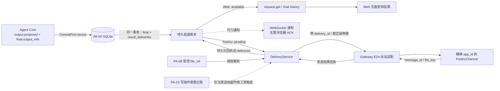
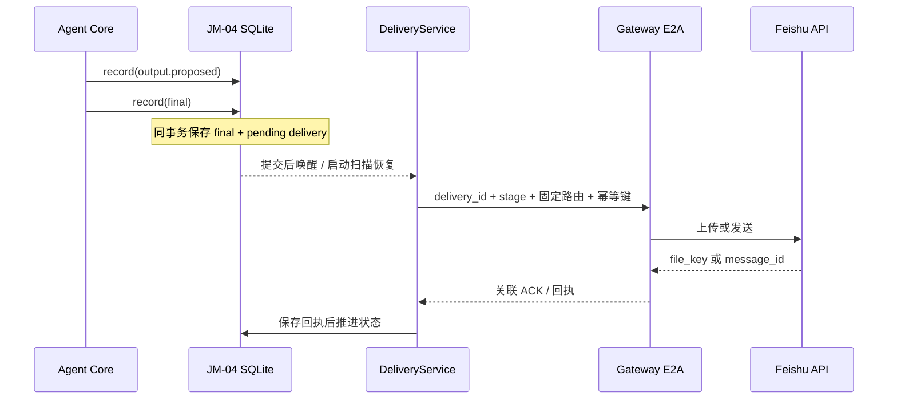

# Web 与飞书结果投递设计方案

## 1. 元信息

| 项 | 值 |
| --- | --- |
| 建档日期 | 2026-10-15 |
| 范围 | JiuwenSwarm 新版 JiuwenMate 的 Web 与飞书终态结果投递；本次实现文本，定义 PA-08 文件交接边界；Agent 主动协作发送作为尚待确认的独立范围，不归 PA-15 提供 |
| 方案成熟度 | 文本投递实现阶段；Web / Gateway / AgentServer 自动化验证通过，文件与协作范围仍按 PA 特性门控 |
| 计划条目 | [JM-09 结果投递服务](../designs/jiuwenmate-development-plan.md) |
| 负责人 | 闫祉君（与开发计划一致） |
| 状态 | 进行中（文本子范围已实现；真实飞书与 Agent 联调、PA-08 文件未完成；协作发送触发方式待明确） |
| 设计依据 | [JiuwenMate 服务端架构设计](../designs/jiuwenmate-architecture.md) 第 6.3、8.2、11.5 节；[JM-04 事件提交端口](F_04_commit-port.md)、[JM-08 飞书接入与群内分发](F_08_feishu-group-fanout.md)、[JM-10.02 Web 私聊](F_10_02_web-private-chat.md) |
| 关联 feature | [F_04](F_04_commit-port.md) 提供已提交候选；[F_08](F_08_feishu-group-fanout.md) 提供飞书入站绑定；[F_10_02](F_10_02_web-private-chat.md) 提供 Web 查询与会话视图 |
| 验证摘要 | 2026-10-15：JM-04 outbox、Web 文本状态查询、JM-08 Request 路由快照、AgentServer→Gateway→Feishu 文本发送 / ACK 路径已实现；最新聚焦与个人版回归 249 项通过，1 项 Windows 文件权限断言因平台权限位差异排除。飞书调用使用 SDK 模型与假响应，未连真实应用；PA-08 文件和 PA-07 群执行未闭环；Agent 主动协作发送的触发契约尚未定义。 |
| Refs | 需求来源：[JM-09 开发计划](../designs/jiuwenmate-development-plan.md)；Web 成功口径由负责人在本任务中确认；飞书 API 参考见第 3 节 |

## 2. 背景、目标与范围

### 2.1 背景与问题

新版执行链已经把 `output.proposed` 候选写入 JM-04 的 `candidate_outputs`，`execution.final` 只通过 `output_refs` 引用这些候选。JM-10.02 的 Request 查询现在会带回文本 delivery 状态：Web 行在 final 与候选同一事务提交后记为 `available`；浏览器 WebSocket 仍是尽力通知，不参与成功判定。

飞书入站由 JM-08 根据事件中的 `receiving_app_id` 定位绑定，并把 `chat_id` 作为 `RequestInput.reply_target`。本次已在 Request 受理时持久化 `RequestRouteSnapshot`（接收 `app_id`、目标 `chat_id`、来源消息 ID 与来源 `reply_to`），历史记录缺失快照时不推测路由。

个人版 Gateway 的 `FeishuChannel.send()` / `_create_and_send_message()` 保持原样；JM-09 新增独立文本发送入口，读取 Feishu SDK 实际 `message_id`，通过 E2A ACK 回写 JM SQLite。`MessageHandler.robot_messages` 不作为 JM-09 投递事实。旧版实现只提供 final-only、精确 Bot 路由等经验，未迁移其 JSONL 归档或内存 `Future`。

### 2.2 目标与关键场景

| 场景 / 触发条件 | 当前行为 | 目标行为 / 可观察变化 |
| --- | --- | --- |
| Web 请求产生 final 输出 | 可从候选读文本 | final 与候选同事务持久化，并在 `request.get` / `chat.history` 返回 `available` 状态；WebSocket 仅尽力通知，不等待浏览器 ACK |
| 飞书请求产生 final 文本输出 | 无 JM-09 专用出站路径 | 持久 outbox 依赖该 Request 的路由快照，按唯一 `app_id` 发送并将 SDK `message_id` ACK 持久化 |
| 发送超时、重投或进程重启 | 无法区分未发送、已发送但回执丢失 | 用持久幂等键及回执核对；无法确认时保持 `unknown`，不盲目换新键重发，也不重跑 Agent |
| final 引用文件候选 | PA-08 尚未提供完整的文件交接适配 | 通过 PA-08 的受控 `file_ref` 解析文件；上传与可见消息分别记录，失败只恢复投递步骤 |
| Agent 主动发起中途群协作消息（如纳入产品范围） | 尚无触发工具 / 调用契约 | 先明确目标、结构化 mention 与调用方式，再定义独立投递事实；若由有副作用工具触发，再接入 PA-15 意图记账 |

### 2.3 本次范围与非目标

- 已实现范围：JM-04 final 引用文本候选后在同一事务建账；Web 文本结果与状态可查询；飞书文本结果经 Gateway 精确 app 路由发送并持久化 ACK；JM-08 在 Request 受理时持久化路由快照。未实现范围：PA-08 文件结果 / 下载与上传、真实 Feishu 联调及真实 Agent 端到端验收。
- 本方案同时定义但未开放：文件结果边界，以及（若产品确认需要）Agent 主动协作发送。PA-15 只在协作发送被实现为副作用工具时提供意图记账，不定义发送工具或消息契约。
- 本次不包含：修改 agent-core 执行或输出候选语义；替代 PA-08 定义文件产物；替代 PA-15 实现工具意图；自动重跑 Agent；其它 IM 平台；改变个人版原有消息路由；把推理、工具日志或模型草稿作为群内终态回复。

## 3. 设计约束、假设与待决问题

- **已确认约束与依赖：** JM-04 的候选输出已由 `HostCommitPort` / `ExecutionRepository` 持久化，final 缺少已保存候选时会被拒绝；JM-08 绑定按实际接收 `app_id` 匹配；JM-10.02 已提供 Web 请求查询与历史视图。Web 成功口径已确认：服务端持久化且可从会话历史查询即成功，WebSocket 不要求浏览器 ACK。
- **已确认的 Agent Core 输出边界：** `output.proposed` 提供 `output_id`、`target_ref`、`share_mode`、文本或 `file_ref`；final 只引用 `output_refs`。JM-09 只消费 final 明确引用的候选，不从 `reply.delta`、reasoning、工具日志或未被 final 采用的候选推断外发内容。文件模式以 agent-core 的 PA-08 / S_02 为准，不在 JiuwenSwarm 重新解释。
- **硬依赖：** JM-04 是投递账本创建的前置；飞书文本依赖 JM-08 绑定和 Request 路由快照；文件子范围依赖 agent-core PA-08 的文件候选、引用解析与共享语义。Web / Feishu final 文本投递不依赖 PA-15；如未来通过 Agent 有副作用工具发起协作发送，再由该工具接入 PA-15。
- **关键假设：** 每条飞书 Request 可保留唯一的接收 `app_id` 与 `chat_id`；绑定变更后仍按请求受理时的快照发送，不临时改用另一个 Bot。若该 Bot 已停用或无法访问目标群，投递失败 / 待核实，不自动切换身份。
- **待核实事项：** 当前 Feishu SDK / Open API 的消息幂等字段及适用边界、文件上传在回执丢失时的查询能力，需在 JM-09 实现和真实联调时按实际版本核验。飞书官方接口参考：[发送消息](https://open.feishu.cn/document/uAjLw4CM/ukTMukTMukTM/reference/im-v1/message/create)、[回复消息](https://open.feishu.cn/document/uAjLw4CM/ukTMukTMukTM/reference/im-v1/message/reply)、[上传文件](https://open.feishu.cn/document/server-docs/im-v1/file/create)、[获取会话历史消息](https://open.feishu.cn/document/uAjLw4CM/ukTMukTMukTM/reference/im-v1/message/list)。不能因文档链接存在就假定当前 SDK 已提供对应字段或权限。

## 4. 总体方案与设计取舍

### 4.1 方案概览

采用“final 事务写入投递账本 + AgentServer 可恢复投递 + Gateway 执行平台副作用 + 回执回写”的路径。JM-04 保存 final 时，在同一 SQLite 事务中为其引用的文本候选建立投递记录：Web 记为 `available`，飞书记为 `pending`。现阶段由 `AgentManager` 在 final 持久提交后观察事件并唤醒 `ResultDeliveryService`；服务同时周期扫描 pending。Web 从既有 Request 查询接口读取结果；飞书凭据和渠道实例留在 Gateway，AgentServer 通过带 `delivery_id` 的 E2A server-push 发送命令，Gateway 以 E2A ACK 返回结果。文件分阶段投递、文件结果查询和 PA-15 协作入口尚未实现。



图中实线表示持久结果与实际投递交接，虚线表示不构成成功依据的通知或后续调用。队列只用于唤醒；数据库状态和平台回执才是可恢复的事实。

### 4.2 关键决策

#### D-01 只投递 final 明确引用的候选

- 选择与依据：以 `execution.final.output_refs` 为允许外发集合，并通过 JM-04 `candidate_output(namespace_id, output_id)` 取内容。过滤 `share_mode` 时遵循 core 输出契约；不把过程事件、草稿或未采用候选拼成群回复。
- 代价与成立条件：候选必须先可靠写入，final 才能创建完整账本；缺失候选是契约错误，不以“空回复”绕过。
- 实现体现：投递账本事务、Web 投影和飞书发送均从同一组 output refs 派生；对应 JM-09-V-02 / V-03。
- 相关候选：R-01（投递流式 delta）会让过程文本越过最终输出边界，因此拒绝。

#### D-02 Web 的“成功”是服务端可查询，不是浏览器确认

- 选择与依据：final 引用的候选和 `available` 状态持久化后，`request.get` / `chat.history` 可读取，即视作 Web 投递成功。保留 JM-10.02 现有草稿流；草稿不是终态结果。WebSocket 对终态更新只作尽力通知；页面断线后通过查询补齐。
- 代价与成立条件：这证明结果已在服务端可查，不证明某个浏览器已显示或用户已读；不新增浏览器 ACK 协议。
- 实现体现：同一数据库提交 final、候选引用和 Web `available` 记录；JM-10.02 的 `RequestView` 增加兼容的投递状态 / 文件描述字段。
- 相关候选：R-02（等待前端 ACK）与已确认口径不符，拒绝。

#### D-03 飞书采用持久 outbox，不能把内存队列当成功

- 选择与依据：飞书发送是外部副作用，必须先持久化 `pending`，由后台投递器执行；收到 Gateway 的平台回执并成功保存后才标记 `delivered`。发送失败不会重跑 Agent。
- 代价与成立条件：平台已接收而本地回执未保存时存在未知窗口；必须用同一稳定幂等键核对或查询。无法确认就保留 `unknown`，不自动生成新键重发。
- 实现体现：`result_deliveries` 唯一键、阶段状态、E2A 回执、启动恢复；对应 JM-09-V-03。
- 相关候选：R-03（只 `put` 到 `robot_messages` 即标记送达）不具备持久事实与回执，拒绝。

#### D-04 飞书出站使用请求受理时的 Bot 路由快照（已实现）

- 选择与依据：同一 Agent 可能绑定多个应用；群里可能有多个 Bot。必须使用本次入站的 `receiving_app_id`，不能用 `agent_id` 或当前配置反查一个“看起来合适”的 Bot。`reply_target` 是会话（`chat_id`），来源 `message_id` 与来源 `reply_to` 是消息关系，彼此不能混用。
- 代价与成立条件：新旧 Request 的数据兼容要保留明确行为；缺少快照时 fail closed。
- 实现体现：JiuwenSwarm 宿主侧 `RequestRouteSnapshot` 在 JM-08 受理时持久化；Gateway 仅按快照路由；对应 JM-09-V-01，自动化覆盖通过，真实 Feishu 联调待做。
- 相关候选：R-04（发送时读取最新 binding）会在绑定变化后改变原请求身份，拒绝。

#### D-05 Gateway 保留飞书凭据，AgentServer 只请求发送并保存回执

- 选择与依据：复用 Gateway 的 FeishuChannel 与现有 `app_id` 配置；AgentServer 不直接持有飞书 app secret，也不从 Agent Core 读取 SDK 客户端。
- 代价与成立条件：普通 `robot_messages` 仍可传输，但不能作为 JM-09 完成依据；真实平台 UUID 去重语义仍需验证。
- 实现体现：JM-09 文本专用发送适配返回实际 `message_id` 并经 E2A ACK 回传；文件 `file_key` 尚未实现；个人版通用 `send()` 的返回与重试语义保持原样。
- 相关候选：R-05（在 AgentServer 直接调用飞书 Open API）会重复维护凭据与渠道连接，拒绝。

#### D-06 文件先按 PA-08 引用解析，再分阶段上传与发送

- 选择与依据：`file_ref` 是受控引用，不是本地路径。仅使用 PA-08 / 宿主批准的 resolver 解析；飞书“上传成功”和“发出可见消息”是两个不同事实。
- 代价与成立条件：PA-08 的文件输出和分享方式尚未在 core 实现；JM-09 文件子范围在该契约可用前不能验收。
- 实现体现：账本保留 `upload_status`、`file_key`、`send_status`、`message_id`；失败只重试可确认的阶段。
- 相关候选：R-06（把 `file_ref` 当文件系统路径或只记录上传成功）越过授权边界或把不可见资源误报为已交付，拒绝。

### 4.3 替代方案与排除理由

| 候选 / 关联决策 | 候选目的与关键差异 | 拒绝或暂缓原因 | 重新评估条件 |
| --- | --- | --- | --- |
| R-01 / D-01 | 将 `reply.delta` 或 Agent 流式片段直接投递给 Web / 飞书 | 会把草稿、未采纳输出或执行过程当作终态结果；不满足 final 引用约束 | 仅当未来明确提出独立流式产品需求，并重新定义授权、撤回及失败语义 |
| R-02 / D-02 | 浏览器 ACK 才算 Web 成功 | 负责人已确认服务端持久且可查即成功；浏览器断线不应阻塞后台执行 | 不重新评估 |
| R-03 / D-03 | 以内存 `robot_messages` 入队成功作为送达 | 进程重启会丢失队列状态；没有平台接收回执 | 仅可作为 outbox 的传输层，不能成为事实源 |
| R-04 / D-04 | 发送时按 `agent_id` 查询当前绑定 | 配置变化或多 Bot 时可能用错发送身份、改变历史 Request 的目的地 | 若将来产品明确要求“发送时绑定”，需另定义可审计的重路由操作 |
| R-05 / D-05 | AgentServer 直接调用飞书 API | 凭据跨越现有 Gateway 边界，重复实现连接 / 重试 / 通道选择 | 只有架构责任正式迁移并获确认后才评估 |
| R-06 / D-06 | 复用旧版 JSONL 归档、进程内 Future 与直连发送 | 旧实现没有可恢复的投递状态；协作工具还忽略 `reply_to_message_id` | 不迁移旧数据；只复用 final-only、路由精确、分阶段回执等语义 |

## 5. 详细设计

### 5.1 模块责任与关键不变量

| 模块 / 参与方 | 责任 | 本次必须保持的保证 |
| --- | --- | --- |
| `ExecutionRepository` / JM-04 | 在 final 提交事务中写入文本投递记录；提供状态查询、领取和更新 | final 引用的候选全部已保存；相同 final 重交不产生第二条逻辑投递 |
| `AgentManager` / `ResultDeliveryService` | final 确认持久后唤醒 worker；启动时将遗留 sending 标为 unknown，并扫描 pending | 不决定执行结局；结果未知时不盲目重发；投递错误不触发 Agent 重跑 |
| JM-08 入站 / `RequestRecord` | 固化来源渠道、Bot、会话和消息关系 | Feishu Request 的目的地来自首次受理事实；旧记录缺少快照时 fail closed |
| Gateway / Feishu 出站适配 | 精确选择 FeishuChannel，发送文本并返回平台 `message_id` | 凭据仅留在 Gateway；ACK 以 delivery ID 关联；个人版通用 `send()` 不改变语义 |
| JM-10 Web 查询 | 返回 final 引用的文本与 delivery 状态 | `available` 可从 Request 查询；WebSocket 断线不影响读取，不要求浏览器 ACK |
| PA-08 / PA-15 | PA-08 定义受控文件引用；PA-15 记录有副作用工具执行意图，但不提供消息发送接口 | JM-09 不伪造 core 事件、不越过 PA 的授权和调用契约；文本终态投递不依赖 PA-15 |

核心不变量：

1. 只有 final 的 `output_refs` 可创建终态投递；`ignored`、`paused`、`failed` 等没有引用可见输出的结局不发群消息。
2. 投递失败只推进或暂停投递状态，不重新执行模型、工具或 Request。
3. Web `available` 表示服务端查询接口可取到已提交结果；WebSocket 成功与否不改变状态。
4. Feishu `delivered` 必须有已保存的外部回执；请求入队、Gateway 收到请求或 SDK 调用开始都不算送达。
5. 未知外部结果保持 `unknown`；未经平台幂等或查询核对，不创建新的发送键自动重发。
6. 文件引用只通过 PA-08 授权 resolver 解析；物理路径、密钥和正文不得写入错误日志或 E2A 元数据。

### 5.2 关键类与函数设计

以下区分已实现的文本能力与未实现的门控能力。

| 名称 / 所属模块 | 变更 | 职责与调用边界 |
| --- | --- | --- |
| `RequestRouteSnapshot` / `execution_models.py` | 已新增，宿主内部模型 | 保存 channel、app、目标会话、来源消息和来源回复关系；旧 `RequestRecord` 缺字段时兼容读取；不扩展 agent-core 公共协议 |
| `ResultDeliveryService` / `delivery_service.py` | 已新增，内部服务 | 扫描 Feishu 文本 pending、等待 Gateway 回执、分类 unknown；不重跑 Agent、不自动重发 unknown |
| `ExecutionRepository` | 已扩展 | final + 文本 outbox 同事务写入；Web `available` 与 Feishu `pending` 状态可查询 / 更新 |
| JM-08 E2A / `AgentWebSocketServer` | 已新增出站 ACK 入口 | 用 server-push 下发 delivery，接收 `jiuwenmate.delivery.ack` 并先持久化 ACK，再唤醒等待者 |
| Gateway `MessageHandler` / `ChannelManager` | 已新增文本路径 | 不进入 `robot_messages`；严格按 `app_id` 解析唯一 FeishuChannel，并返回关联回执 |
| `FeishuChannel.send_persistent_result` | 已新增 JM-09 专用路径 | 使用稳定 UUID 发文本 / 回复并返回消息 ID；通用个人版 `send()` 行为不变 |
| 文件 resolver / Agent 主动协作发送 | 未实现 | 文件等待 PA-08 resolver；协作发送须先定义触发工具 / 调用契约，若为有副作用工具再接入 PA-15 |

当前文本投递入口（内部实现）：

```python
await ResultDeliveryService.start()
await ResultDeliveryService.dispatch_pending(limit=100)
await ResultDeliveryService.apply_ack(ack)
```

`AgentManager` 的 commit observer 在 JM-04 final 事务成功后唤醒服务；worker 也周期扫描 pending，避免只依赖内存事件。`dispatch_pending` 只发送 final 事务建账的文本候选。函数返回本身不是事实，Feishu `delivered` 只能在 AgentServer 将 E2A ACK 写入 SQLite 后成立。

### 5.3 接口定义与消息契约

#### JM-08 入站 Request 路由快照

在现有 JM-08 E2A 入站事件已有的 `receiving_app_id`、`chat_id`、`message_id`、`reply_to` 上扩充宿主持久化：

| 字段 | 类型 | 约束 | 语义 |
| --- | --- | --- | --- |
| `channel` | `"web" \| "feishu"` | 必填 | 受理时的来源渠道 |
| `app_id` | `str \| None` | Feishu 必填 | 实际收到本事件的 Bot 应用；Web 为空 |
| `target_id` | `str` | 必填 | Web 会话键或 Feishu `chat_id`；对应既有 `reply_target` |
| `source_message_id` | `str \| None` | Feishu 群消息应提供 | 本 Request 对应的入站消息 ID；作为回复关系定位依据 |
| `source_reply_to` | `str \| None` | 可空 | 入站消息原本回复的消息 ID，仅保留上下文；不替代 `source_message_id` 或 `target_id` |

快照只存在于 JiuwenSwarm 的 `RequestRecord` / JM 数据库，不要求 agent-core `RequestInput` 新增飞书配置字段。`receiving_app_id` 必须在 JM-08 校验绑定时确定，不可从消息正文、mention 列表或执行结束时的当前配置推导。

#### Gateway 出站命令与回执（当前文本契约）

| 消息 | 调用方 / 消费者 | 输入与成功结果 | 失败语义 |
| --- | --- | --- | --- |
| server-push `event_type=jiuwenmate.delivery.send` | AgentServer → Gateway | `delivery_id`、`stage="send"`、快照 `app_id` / `chat_id` / `source_message_id`、稳定 `idempotency_key`、文本 | 无 Gateway 连接时保持 `pending`；等待 ACK 超时为 `unknown`；不经 `_robot_messages` |
| `ReqMethod.JIUWENMATE_DELIVERY_ACK` (`jiuwenmate.delivery.ack`) | Gateway → AgentServer | `delivery_id`、`stage="send"`、`outcome`、可选 `external_message_id` / `error_code` | ACK 允许 `delivered` / `failed` / `unknown` / `pending`；AgentServer 先持久化再唤醒等待者；重复的相同 pending ACK 幂等；迟到的确定 ACK 可把 unknown 更新为确定结果 |

字段按最小必要原则传递：不传 app secret、不传 Agent 内部日志、不把本地文件路径暴露给 Gateway。当前文本回执包含 Feishu `message_id`；文件 `file_key` 与后续可见消息 ACK 尚未实现。当前 Feishu SDK 请求携带稳定 UUID，但真实平台的去重行为仍须按目标租户与 API 验证。

### 5.4 数据模型与事实归属

JM-04 同一 `agents.sqlite3` 已新增 `result_deliveries` 表，不复制候选正文：

| 数据 | 隔离范围 | 权威位置 | 创建、更新与释放 |
| --- | --- | --- | --- |
| 来源路由快照 | `(namespace_id, request_id)` | Request 持久记录 | JM-08 校验通过、Request 受理时一次写入；不可在投递时改写 |
| 投递记录 | `(namespace_id, delivery_id)`；唯一键 `(namespace_id, request_id, output_id, channel, target_id)` | `result_deliveries` | final 事件与候选引用在同一 SQLite 事务内创建；状态由 DeliveryService 以事务 / CAS 更新 |
| 候选正文 / 文件引用 | `(namespace_id, output_id)` | JM-04 `candidate_outputs` / core output event | JM-09 只读引用；投递记录不复制正文或本地文件路径 |
| 外部回执 | `(namespace_id, delivery_id)` | `result_deliveries.external_message_id` / `error_code` | 收到 Gateway ACK 后保存；当前仅实现文本 `message_id`，文件 `file_key` 待 PA-08 |

当前 `result_deliveries` 包含 `delivery_id`、`request_id`、`execution_id`、`output_id`、`channel`、`target_id`、`status`、`idempotency_key`、`attempt_count`、`external_message_id`、`error_code` 和时间戳。上传阶段、`file_key`、文件正文与文件解析路径未实现；凭据与未脱敏平台响应不落库。

### 5.5 状态机与生命周期

| 当前状态 | 条件 / 转移主体 | 下一状态 | 写入顺序 | 重复或非法操作 |
| --- | --- | --- | --- | --- |
| 无记录 | JM-04 提交 final；引用候选已存在 | Web `available` / Feishu `pending` | 与 final 事件同事务 | 相同 final / output 重交命中唯一键，不生成第二条 |
| `pending` | 投递器 CAS 领取 | `sending` | 先保存 attempt 与稳定幂等键，再发 E2A | 其他 worker 不能重复领取同一阶段 |
| `sending` | Gateway 返回明确平台成功且回执落库 | `delivered`（文件上传后仍是发送未完成） | 先保存外部 ID，再推进状态 | 重复 ACK 无副作用 |
| `sending` | Gateway 确认对应 Feishu app 当前未连接，且尚未调用平台 API | `pending` | 持久化 `FEISHU_APP_NOT_CONNECTED`，留待后续周期扫描重试 | 本轮扫描跳过已尝试 delivery，继续处理后续记录 |
| `sending` | 明确拒绝、确定性失败 | `failed` 或等待策略允许的重试 | 记录脱敏错误和阶段 | 不影响 Request / Execution 结局 |
| `sending` | 超时、进程崩溃或 ACK 丢失，外部结果未知 | `unknown` | 保留原 idempotency key | unknown 不自动回到 pending；当前没有平台查询 / 人工核对入口 |
| `unknown` | 迟到 ACK 确定平台结果 | `delivered` / `failed` | 使用原 delivery 更新回执 | 未核实前禁止自动重发 |
| Web 候选已由历史 API 返回 | 查询投影 | `available` | 查询从 JM-04 持久结果读取 | WebSocket 丢失不改变状态 |

`failed` 表示确定未完成；`unknown` 表示可能已完成但证据不足。Gateway 确认目标 app 未连接、尚未调用 Feishu API 时保留 `pending`，由后续周期扫描重试；一般超时或异常仍是 `unknown`，不能自动重试。文件状态机尚未实现。

### 5.6 正常执行流程

1. JM-08 在受理 Feishu 事件时把 `receiving_app_id`、`chat_id`、`message_id` 和来源 `reply_to` 存入 Request 路由快照；Web Request 在 JM-10.02 提交时保存 `channel="web"` 与会话目标。
2. Agent Core 提交 `output.proposed`；JM-04 保存候选。随后提交 `execution.final` 时验证每个 output ref，并在同一事务中写 final 与 delivery rows。非终态事件不建终态投递。
3. Web delivery row 标记 `available`；`RequestView.deliveries` 随 `request.get` / `chat.history` 返回状态。WebSocket 可通知页面，但页面断线后通过历史查询补齐。
4. `AgentManager` 在 final 事务成功后观察事件并唤醒 `ResultDeliveryService`。服务按路由快照领取 Feishu pending，经 E2A server-push 交给 Gateway；Gateway 只匹配唯一 `app_id` 的 FeishuChannel。
5. 当前文本使用 Feishu reply API 回复本 Request 的 `source_message_id`；缺少该 ID 时才按 `chat_id` 新建消息。来源的 `reply_to` 只作为上下文保存，不替代目标会话或来源消息 ID。结构化 mention 与 PA-15 协作发送未实现。
6. 文件通过 PA-08 授权 resolver 上传、返回 `file_key` 并发送可见文件消息的流程仍是设计，不在当前代码启用。
7. Gateway 返回 `message_id` ACK 后，AgentServer 先持久化 receipt 再结束发送等待；迟到 ACK 可更新 unknown；Request final 状态不回滚、不重新执行。



### 5.7 异常、中断与重试处理

- **final 前失败：** 没有 delivery rows；JM-09 不补造结果，也不把错误或工具输出当回复。
- **final 已提交、投递器未运行：** 启动扫描恢复 `pending`；业务执行不重跑。
- **Gateway / Feishu 明确拒绝：** 记录确定错误；可重试的拒绝按同一 delivery ID 和稳定幂等键有限重试，不可重试错误置 `failed` 并留给查询 / 管理处理。
- **平台已接收但 ACK 丢失：** 置 `unknown`；用原幂等键重试核对或在有权限时查询目标会话消息。若平台无法提供确认，则保留 unknown，不盲目创建新消息。
- **文件上传成功、消息发送失败：** 保留 `file_key` 和 `upload_status=delivered`，只恢复消息发送阶段；不重新上传。
- **文件上传回执未知：** 不继续发送，也不无条件再次上传；先用受支持的幂等 / 查询能力核实。无法核实则待人工确认，可能产生不可见孤儿资源。
- **WebSocket 推送失败：** 只记可观测日志；不改变 Web `available`，请求历史仍可查。
- **投递账本写入失败：** Feishu 外部调用不得先于持久 `pending`；若回执收到但本地保存失败，后续按原 delivery ID 对账。数据库故障不能反向触发 Agent 执行。
- **路由 Bot / 会话不存在：** 拒绝投递并记录确定性错误，不回退到个人版通道或另一个绑定 Bot。

### 5.8 并发与一致性

同一 SQLite 唯一键防止重复 final / 重复唤醒建立多条投递；投递器以状态条件更新或事务领取单条 pending，避免两个 worker 并行发送。SQLite 事务只覆盖本地 final、候选引用和 outbox 记录，不覆盖 Gateway 或飞书 API；跨进程不宣称原子事务。

外部调用前先提交 `sending` 和稳定 idempotency key；外部调用后先保存回执，再标记 delivered。进程在两者之间崩溃时，重启后恢复为 `unknown` 并对账。WebSocket 与历史查询存在通知竞态不影响正确性，因为历史查询依赖持久结果，而非通知顺序。

### 5.9 持久化与恢复

建议沿用 JM-04 的 `agents.sqlite3`，新增表由现有 `ExecutionRepository` 初始化；终态投递记录与 final 一起提交，避免“final 已成功但系统没有任何待投递事实”的窗口。数据库升级只增表 / 增字段，不改写现有事件与候选记录。

AgentServer 启动后扫描 `pending`、过期 `sending` 与 `unknown`：`pending` 可投递；过期 `sending` 先归为 `unknown`；`unknown` 只有核对成功、确定未发送或经显式人工决策后才能推进。飞书 message ID、file key 和每阶段的幂等键必须在原记录上恢复，不生成新的业务输出或 output_id。Web 可根据原 final 与候选记录重建查询视图；WebSocket 不恢复历史推送。

### 5.10 按需专项设计：飞书文件、JM-08 / JM-10 / PA 适配

#### 飞书与 Web 文件映射

| 候选类型 | Web | 飞书 | 完成条件 |
| --- | --- | --- | --- |
| `share_mode=message` | 查询接口返回文本 | 由快照 Bot 向目标会话发送文本 / 回复 | Web 已可查询；Feishu 有已保存 `message_id` |
| 文件类 `share_mode` | 查询接口返回受控文件描述；下载由带认证的服务端路由解析 `file_ref`，不返回物理路径 | PA-08 resolver → Gateway 上传 → 可见文件消息（按 PA-08 share mode） | 上传与所需可见消息阶段分别成功并落库 |
| 未知 / 尚未支持的模式 | 不把引用伪装成可下载链接 | 不发送原始 `file_ref` | 记录不支持 / blocked，等待 PA-08 契约，不降级为裸路径或文本猜测 |

如果 JM-09 实施时尚无按 Request 授权解析 `file_ref` 的服务端接口，文件 Web 下载与 Feishu 文件发送应保持关闭；不能为了“闭环”绕过 PA-08 或 PA-14 的权限边界。

#### JM-08 已完成的 JM-09 前置适配

1. **入站路由快照持久化。** JM-08 在绑定与事件校验成功后、调用 JM-07 受理 Request 时写入宿主 `RequestRouteSnapshot`：`app_id`、`chat_id`、来源 `message_id`、`reply_to`。快照落入 `RequestRecord`，旧 Request 缺快照时兼容读取但按不可安全路由处理，不从当前绑定补猜。
2. **Gateway 出站及 ACK。** 新增 JM-09 专用 E2A server-push / ACK 路径，包含 `delivery_id`、阶段和固定 `app_id`；Gateway 使用现有凭据与精确匹配的 `FeishuChannel` 执行发送并返回平台回执。只进入 `_robot_messages` 不作为交付证据。
3. **专用文本发送适配。** `FeishuChannel.send_persistent_result` 支持文本发送 / 回复、稳定请求 UUID，并返回真实 Feishu `message_id`；文件上传、`file_key`、结构化 mention 与 PA-15 中途工具调用尚未实现。发送超时或 ACK 不确定时维持 `unknown`，不自动换键重发。
4. **个人版隔离。** 新能力仅由 JM-09 E2A / 新版 delivery route 触发；个人版既有 `MessageHandler` 和通用 `FeishuChannel.send()` 保持原样。个人版消息路由与附件用例已纳入本次聚焦回归。

这些改动已同步到 [F_08](F_08_feishu-group-fanout.md) 的入站快照责任边界和验证证据。JM-08 仍待真实 Feishu 应用 / 群联合验收；本次不改变架构文档定义的 Gateway / AgentServer 职责。

#### PA-15 中途协作发送边界

中途协作消息不是 `execution.final.output_refs`，不得伪装成终态候选。现有 PA-15 的职责是副作用工具调用前的意图记账，不提供“向飞书发协作消息”的调用接口或消息负载；若产品要开放 Agent 主动协作发送，仍须先定义触发工具 / 调用契约、结构化 mention 与 target、独立 `kind=collaboration` 投递事实，再决定该工具如何接入 PA-15。PA-15 可保护一个被明确定义为有副作用的发送工具，但不是 JM-09 文本终态投递的硬依赖。协作消息成功不代表 Agent 任务完成，失败也不触发 Agent 自动重跑。

#### 旧版实现取舍

旧版参考仓 `C:\yzj\files\cyc_jiuwenswarm\jiuwenswarm\server\runtime\persistent_agents` 中的 `execution_result_handler.py`、`conversation_archive.py`、`agent_manager.py`、`group_collaboration_tools.py` 及 Gateway 文件 ACK 路径，结论如下：

| 旧版做法 | 处理 | 原因 |
| --- | --- | --- |
| `GroupResponseAccumulator` 等到成功终态再对群输出 | 复用“final-only、不外泄 reasoning / 工具过程”的语义；新版以 core `final.output_refs` 作为唯一输出来源 | 新版已经有更明确的候选与终态协议，不复制旧累积器作为事实来源 |
| 飞书发送后读取 `message_id`、文件上传后读取 `file_key`，再记录对外结果 | 复用“真实平台回执”语义；改为写入 JM-04 SQLite 投递账本和阶段状态 | JSONL archive 写失败只记日志，不能证明可靠恢复 |
| `persistent_file_route` + 随机 delivery ID + 进程内 `asyncio.Future` 等 ACK | 仅复用“请求与 ACK 关联”的思路；改为持久 outbox、稳定幂等键与可恢复状态 | Future 在进程重启后丢失，不能作为最终状态 |
| Runtime 直接持有飞书客户端发协作消息 | 不迁移；统一由 Gateway 的渠道实例和凭据执行 | 避免 AgentServer 绕过 Gateway 边界；旧代码还会丢弃 `reply_to_message_id` |

## 6. 影响面与实施设计

### 6.1 修改点与实施顺序

| 实施项 | 模块 / 文件或符号 | 修改内容与责任 | 必要前置 / 独立验证产物 |
| --- | --- | --- | --- |
| I-01 | `execution_models.py`、`execution_repository.py` | 持久 Request 路由快照；新增投递表、唯一键、状态读写；final 与 outbox 同事务 | JM-04；SQLite 重复提交与故障注入测试 |
| I-02 | `agent_manager.py`、新增 `delivery_service.py` | `AgentManager` 在 final 事务成功后通知投递服务；服务启动时恢复状态并扫描 pending，执行 Feishu 文本投递状态机 | I-01；服务单测 / 替身 |
| I-03 | `agent_manager.py`、`web_adapter.py` | RequestView / history 暴露可查询结果和投递状态；文件输出仅给受控描述 / 下载引用 | JM-10.02；Web 查询与断线恢复测试 |
| I-04（JM-08 适配） | `feishu_group_fanout.py`、`execution_models.py`、`execution_repository.py`、`agent_ws_server.py` | 已将入站 `app_id`、`chat_id`、来源消息 ID 与 `reply_to` 持久化；新增 JM-09 E2A 文本发送和 ACK，ACK 入库后才唤醒等待者 | 已实现；E2A / Request 往返及 ACK 持久化测试 |
| I-05（Gateway 适配） | `gateway/message_handler/message_handler.py`、`gateway/channel_manager/channel_manager.py`、`gateway/channel_manager/im_platforms/feishu/feishu_connect.py` | 已精确按 app 路由并新增 JM-09 文本发送 / 回复适配，返回平台 `message_id`；不改变个人版通用 `send()`。文件上传回执和结构化 mention 未实现 | 已实现；Gateway stub 与 Feishu SDK 模型测试；真实 Feishu 待联调 |
| I-06（PA-08 门控） | agent-core PA-08 输出契约接入；JiuwenSwarm file resolver 与 Web 下载路由 | 按 PA-08 已定稿契约受控解析 `file_ref`，按 `share_mode` 完成 Web 下载与 Feishu 上传 / 可见发送；不在 JM-09 重做 core 文件能力 | PA-08 合同、输出与授权解析已接通；否则文件子范围阻塞 |
| I-07（条件范围） | 待定义的 Agent 协作发送调用与 `delivery_service.py` | 若产品纳入 Agent 主动发送，建立独立 delivery，不混入 final outputs；如通过有副作用工具调用，再接入 PA-15 意图记账 | 触发工具 / 调用契约确认后实施；独立回执、失败与授权验证 |
| I-08 | `tests/unit_tests/server/jiuwenmate/test_commit_port.py`、`test_web_private_chat.py`、`test_feishu_group_production_wiring.py`、`tests/unit_tests/gateway/test_persistent_group_fanout.py` | 已覆盖 Web 查询、ledger、E2A、文本 ACK、unknown 安全处理及个人版 / JM-03/07 回归；PA-08 文件与协作触发范围未覆盖 | JM-09-V-01～V-03 文本路径自动化测试通过；真实 Feishu 与真实 Agent 联合验收待完成 |

实施进度：I-01～I-05 的文本投递实现已完成；Web 文本状态查询、Feishu 文本 E2A 和 ACK 有自动化覆盖。真实 Web / Feishu Agent 端到端验收仍需 S1 / S2a 对应的 core 执行链联合验证；飞书还需真实应用 / 群。文件在 PA-08 契约与受控 resolver 可用后实施 I-06；Agent 主动协作发送须先明确触发契约，再判断 PA-15 意图记账如何接入。新能力只装配到新版 JM 服务，不全局改个人版通道语义。

兼容核对结论：新增 JM 表和 Request 路由元数据只服务新版 JiuwenMate；现有请求记录须支持缺少新路由字段的读取。旧记录缺少接收 `app_id` 时不补猜测、不自动投递飞书。新增 JM-09 专用 Feishu 发送适配，避免修改个人版通用 `send()` 的返回类型、重试和消息过滤语义。

### 6.2 文档同步

- spec：投递状态和 E2A 消息为草案；评审并实现稳定后再建立 / 更新对应 spec，不能把本文草案当正式跨仓协议。
- 架构 / 模块约定：本次未修改架构文档；durable outbox 由 AgentServer / JM-04 持有、Gateway 返回平台 ACK 的实现边界及后续文档同步，仍按架构设计确认流程处理。
- 开发计划：JM-09 负责人、实现状态、验证证据与剩余前置已同步到计划条目；组件通过不等于 Web / Feishu 全范围交付完成。
- 其他入口：JM-08 的 Request 路由快照已同步到 F_08；PA-08 文件模式定稿后再补充文件 resolver 及 Web / Feishu 映射。

## 7. 兼容与迁移

本特性不迁移旧版 persistent-agent 的 JSONL archive、内存 ACK 或旧 route 数据。新版继续使用 JM 数据库；数据库变更仅新增投递表 / 宿主路由字段。已有 Request 若没有来源 Bot 快照，不自动补写或发送；旧个人版消息与 FeishuChannel 调用保持原行为。Feishu JM-09 通过专用适配调用，不改写个人版通用 `send()` 语义，并用个人版回归验证。

## 8. 验证设计、执行记录与结论

### 8.1 验证设计与通过条件

沿用开发计划的 JM-09-V-01～V-03，不重复建立第二套验收清单：

| 验证 ID | 场景 / 前置状态与输入 | 操作或验证入口 | 预期结果 / 通过条件 | 验证层级与环境 |
| --- | --- | --- | --- | --- |
| JM-09-V-01 | Web 文本结果；Feishu 多 Bot / 群回复；A @ B 的独立入站处理 | `test_commit_port.py`、`test_web_private_chat.py`、`test_persistent_group_fanout.py`、`test_feishu_group_production_wiring.py`；最终使用真实 Feishu Bot / 群 | Web final 持久且历史可查，通知断开后查询仍有结果；Feishu 使用入站快照的 Bot / chat，消息回复到正确来源；A @ B 由 B 的独立 JM-08 入站 Request 处理，Gateway 不内部调用 B | 宿主单测、E2A 集成、真实 Feishu 联调；Agent 主动 mention 发送如纳入范围，另待其触发契约定义 |
| JM-09-V-02 | 成功、ignored / failed、未引用候选、文件输出 | final 输出投影与 Feishu / Web 文件 adapter 测试 | 只有 final 引用输出可见；reasoning、工具事件和未采用候选不外发；文件 upload 与可见 send 分别记账；只上传成功不显示为文件送达 | SQLite + stub；文件最终验收需 PA-08 与受控 resolver |
| JM-09-V-03 | Gateway / Feishu 明确失败、超时、ACK 丢失、相同 final 重交、AgentServer 重启 | 故障注入测试；重启后复用同一 DB 和平台 idempotency key | 任务不重跑；同一 delivery 不重复产生可见消息；平台结果未知时保留 `unknown` 并核对；无核对能力时不自动盲重发 | SQLite / Gateway stub；真实平台重复发送与查询能力需真机验证 |

JM-09-V-01 的 Agent 主动协作消息不属于当前 final 文本验收；若产品纳入，先定义触发方式与消息契约，再按副作用属性决定是否由 PA-15 记账。JM-09-V-02 的文件场景只有 PA-08 文件候选、resolver 和目标 `share_mode` 明确后才验收。个人版回归须覆盖普通 Feishu `send()` 和旧 Web / AgentServer 路由，不把新路径的 stub 测试解释为个人版兼容证明。

### 8.2 实际执行与证据

| 执行日期 / 验证范围 | 实现版本与环境 | 命令 / 复现步骤 / 记录链接 | 实际结果 | 未覆盖项 / 失败原因 |
| --- | --- | --- | --- | --- |
| 2026-10-15 / JM-09 文本投递聚焦验证 | Python 3.12.12；JM-04 SQLite；AgentServer / Gateway 内部 E2A；Feishu SDK 模型与 API 响应为替身 | `uv run --offline pytest -W 'ignore:invalid escape sequence:SyntaxWarning' --no-cov -q -o log_cli=false --tb=short tests/unit_tests/server/jiuwenmate/test_commit_port.py tests/unit_tests/server/jiuwenmate/test_web_private_chat.py tests/unit_tests/gateway/test_persistent_group_fanout.py tests/unit_tests/server/jiuwenmate/test_feishu_group_production_wiring.py` | 101 passed；覆盖 final + outbox 同事务、Web 查询状态、JM-08 路由快照、精确 app 路由、Feishu 文本 SDK 调用与 ACK、未知结果不盲目重发 | 未连真实 Feishu 应用；core 执行入口 / 模型不是本次真实端到端验收；PA-08 文件与 Agent 主动协作发送未覆盖 |
| 2026-10-15 / 联合与个人版回归 | 同上；另包含 Gateway 个人版消息 / 附件、JM-03 Request 与 JM-07 Scheduler | `uv run --offline pytest -W 'ignore:invalid escape sequence:SyntaxWarning' --no-cov -q -o log_cli=false --tb=short tests/unit_tests/server/jiuwenmate/test_commit_port.py tests/unit_tests/server/jiuwenmate/test_web_private_chat.py tests/unit_tests/gateway/test_persistent_group_fanout.py tests/unit_tests/server/jiuwenmate/test_feishu_group_production_wiring.py tests/unit_tests/gateway/test_message_handler_mode.py tests/unit_tests/channel/test_attachment_persist.py tests/unit_tests/server/jiuwenmate/test_request_routing.py tests/unit_tests/server/jiuwenmate/test_session_scheduler.py` | 207 passed；覆盖新版投递、个人版消息和附件隔离、JM-03/07 回归 | 仍未覆盖真实 Agent 模型执行与真实 Feishu API / 群联调 |
| 2026-10-15 / ACK、断连恢复与个人版联合复验 | Python 3.12.12；本地 `uv` 环境；Feishu SDK 与平台 API 为替身 | 对 JM-04/08/09、JM-03/07、个人版消息及附件相关的 13 个测试文件运行，完整命令见下方 | 249 passed、1 deselected；新增覆盖批量取消后未发送项仍 pending、Gateway pending ACK 持久化与幂等、绑定 app 断连可重试、内部 ACK 不进入 Web 转发 | 被排除用例在 Windows 上断言 SQLite 文件 POSIX `0o600` 权限位，当前环境报告 `0o666`；此平台差异不属于 JM-09 改动。真实 Feishu / Agent 执行仍未联调 |

复现命令（Windows PowerShell）：

```powershell
uv run pytest `
  tests/unit_tests/server/jiuwenmate/test_commit_port.py `
  tests/unit_tests/server/jiuwenmate/test_feishu_group_production_wiring.py `
  tests/unit_tests/server/jiuwenmate/test_web_private_chat.py `
  tests/unit_tests/server/jiuwenmate/test_web_adapter.py `
  tests/unit_tests/server/jiuwenmate/test_request_routing.py `
  tests/unit_tests/server/jiuwenmate/test_persistent_agent_service.py `
  tests/unit_tests/server/jiuwenmate/test_execution_control_service.py `
  tests/unit_tests/server/jiuwenmate/test_core_contract.py `
  tests/unit_tests/server/jiuwenmate/test_session_scheduler.py `
  tests/unit_tests/gateway/test_persistent_group_fanout.py `
  tests/unit_tests/channel/test_web_channel_jiuwenmate_stream.py `
  tests/unit_tests/channel/test_attachment_persist.py `
  tests/unit_tests/server/test_media_attachments.py `
  -o addopts= --asyncio-mode=auto -q --tb=short `
  -k 'not test_public_views_never_carry_model_credentials'
```

### 8.3 验证结论

- 已证明范围：JM-04 final + 文本 outbox 持久提交、Web 按 Request 查询结果及状态、JM-08 Feishu 入站路由快照、AgentServer→Gateway→Feishu 专用文本发送 / ACK 均有自动化覆盖；个人版 Gateway 消息与附件路径、JM-03/07 回归在最新 249 项通过中。
- 未覆盖或未通过的承诺：未连接真实 Feishu 应用 / 群；未由真实 Agent Core 执行产生 final 并完成端到端验收；PA-08 文件投递尚无 resolver；中途协作发送的触发工具与负载契约尚未定义。此前 101 / 207 项及最新 249 项均是宿主组件与替身验证，不等同平台真实送达或 S1 / S2a 联合验收；另有 1 项 Windows 文件权限断言未纳入本次通过数。
- 可支持的交付判断：JM-09 的文本投递代码与自动化验证已具备，但 JM-09 整体仍进行中，不能宣称 Web + Feishu + 文件 / 协作全范围闭环。

## 9. 风险与已知遗留

### 9.1 设计风险

| 风险 / 触发条件 | 影响 | 应对措施 | 核实方式 |
| --- | --- | --- | --- |
| 飞书调用结果未知且无可用查询 / 幂等能力 | 重试可能重复群消息，停止又可能漏发 | 保留 `unknown`，优先复用稳定幂等键；无法证明时不自动重发 | 按正式 SDK / Open API 版本验证 create、reply、历史查询权限与重复请求行为 |
| JM-08 Request 路由快照 / 出站 ACK 新路径尚未真实平台联调 | 自动化测试不能证明目标租户的 Bot 身份字段、消息回复和 ACK 行为 | 快照、E2A ACK 与 Gateway 专用文本发送已实现；缺快照时 fail closed；保留 unknown 不盲重发 | 使用真实 Feishu 测试应用与群验证 JM-08 / JM-09 |
| PA-08 文件引用 / 分享模式未接通 | 文件无法安全读取或上传 | 文件子范围保持关闭，不把 `file_ref` 当路径 | PA-08 真实接口联调和拒绝越权测试 |
| Agent 主动协作发送尚无触发契约 | 可能把终态输出、工具副作用与群协作混为一谈 | 先定义独立工具 / 调用、target、结构化 mention 和 delivery kind；PA-15 只为有副作用工具提供执行前意图记账，不提供发送接口 | 产品范围与 core / Gateway 调用契约确认后再联合测试 |
| AgentServer 与 Gateway 跨进程 ACK 丢失 | 外部已发送但本地状态不明 | durable outbox + 稳定 delivery ID + unknown 对账流程 | 故障注入：平台成功后断开 ACK，再重启恢复 |

### 9.2 已知遗留

| 遗留项 | 性质 | 影响与现有处置 | 后续入口 |
| --- | --- | --- | --- |
| PA-08 文件候选、引用解析与受控 resolver 未就绪 | JM-09 文件子范围的 core / 宿主前置未完成 | 不把 `file_ref` 当文件系统路径；文件下载、上传及可见消息保持关闭 | agent-core PA-08 实现并完成授权 resolver 联调后继续 |
| S1 的真实 Agent 执行链尚未整体验收 | PA-05 组件已验收；PA-06 待验收；PA-10 进行中，具体现状以 agent-core 开发计划为准 | 现有 JM-09 文本测试使用宿主 / 执行替身，不把它解释为真实 Agent 生成结果 | S1 对 PA-05 / PA-06 / PA-10 与 JM-07 / JM-10.02 联合验收 |
| 群内真实 Agent 响应还不能作为已闭环 | PA-07 组件已验收但 AgentServer 联调未完成；JM-08 也待真实 Feishu 群验收；群上下文还需真实 GroupChatPort | JM-09 只负责投递 final，不自行判断是否参与群聊 | PA-07 与 JM-08 联调；需要群历史上下文的场景再联合 PA-23 / JM-11 |
| PA-15 与中途协作发送的关系尚需定义 | PA-15 是写操作意图记账能力，不是消息发送接口；该发送范围不影响终态文本投递 | PA-15 不作为 Web / Feishu final 文本闭环的硬前置；先明确协作发送调用方式，再为其定义独立验收 | 仅在产品要求 Agent 主动发协作消息时处理 |
| 真实 Feishu API / 回执行为未验证 | SDK 替身不能证明目标租户权限、回复行为、Bot 身份或稳定 UUID 去重效果 | 不宣称真实送达；未知结果保持 `unknown` | JM-08 / JM-09 使用真实测试应用和群执行联调 |

### 9.3 验证闭环所需的前置特性

当前文本路径的实现和替身测试已完成；以下按闭环范围区分，不是所有子范围都互相阻塞：

| 闭环范围 | 还需的特性 / 验证 | 当前状态与作用 |
| --- | --- | --- |
| Web 文本结果的真实 Agent 端到端 | S1 执行链联合验收：PA-05 执行入口、PA-06 上下文装配、PA-10 会话状态记录，与 JM-07 / JM-10.02 实际运行链 | PA-05 组件已验收；PA-06 仍待验收；PA-10 仍进行中。JM-09 的 Web 持久化与可查询状态已有组件测试，不必等待 PA-08 文件能力 |
| Feishu 私聊 / 群文本结果真实投递 | JM-08 真实 Feishu 测试应用与群联调；真实 Agent final 仍需 S1 执行链。群消息是否产生响应另需 PA-07 AgentServer 联调；使用群历史上下文时需 PA-23 / JM-11 对应能力 | Gateway / AgentServer E2A 和 SDK 替身测试通过；尚无真实平台送达证据。PA-07 组件完成但主机联调待做 |
| Web / Feishu 文件结果 | agent-core PA-08 输出契约、`file_ref` 的 Request 授权 resolver，以及 Web 下载 / Feishu 上传与可见消息分阶段回执 | PA-08 当前待开始；文件范围保持关闭，不影响文本投递 |
| Agent 主动中途协作发送（若纳入产品范围） | 先明确触发工具 / 调用合同、接收目标与 mention，再确定 Gateway 发送接口；若工具产生外部副作用，再与 PA-15 意图记账联合验证 | PA-15 当前进行中，但单独完成 PA-15 也不会提供协作发送功能；该范围不是 final 文本投递的前置 |

## 10. 设计演进与修订

- 2026-10-15：首次建立方案。基于 JM-04、JM-08、JM-10.02 现状与旧版 persistent-agent 参考，提出 Web 查询即成功、飞书持久 outbox + Gateway 回执、JM-08 来源路由快照、PA-08 文件和 PA-15 协作分门控。方案尚待评审，未实现、未验证。
- 2026-10-15：JM-09 负责人改为闫祉君；实现文本投递与 JM-08 Request 路由快照 / E2A ACK 适配，补充 101 项聚焦测试和 207 项联合个人版回归证据。将 PA-15 的职责校正为副作用工具意图记账：不再把它描述成协作发送接口或终态文本投递硬依赖；真实 Agent / Feishu 联调、PA-08 文件及协作发送触发契约列为遗留。
- 2026-10-15：复核投递恢复状态：改为逐条领取后立即发送，取消时未发送的记录不会被误转成 `unknown`；同一轮跳过已尝试的 pending 项；Gateway 明确目标 app 断连 / 无可用路由时回 `pending`，相同 pending ACK 可幂等落库。聚焦与个人版联合回归 249 项通过，Windows 权限位测试单独排除；更新 ACK 和状态机说明。
