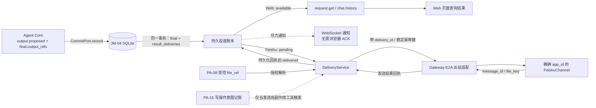
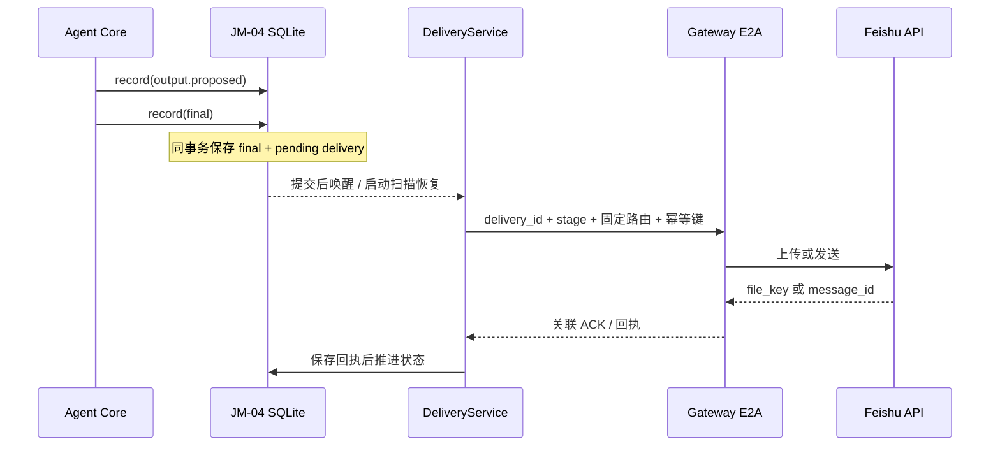

# Web 与飞书结果投递设计方案

## 1. 元信息

| 项 | 值 |
| --- | --- |
| 建档日期 | 2026-10-15 |
| 范围 | JiuwenSwarm 新版 JiuwenMate 的 Web 与飞书终态结果投递；定义 PA-08 文件交接边界，并实现飞书群内基于原生 @ 消息的 Agent 接力 |
| 方案成熟度 | 文本与文件宿主投递实现阶段；Web / Gateway / AgentServer 自动化验证通过，真实 Feishu 文件投递尚未验收 |
| 计划条目 | [JM-09 结果投递服务](../designs/jiuwenmate-development-plan.md) |
| 负责人 | 闫祉君（与开发计划一致） |
| 状态 | 进行中（文本、文件直读投递与群内接力宿主实现已完成；真实飞书与 Agent 联调待验收） |
| 设计依据 | [JiuwenMate 服务端架构设计](../designs/jiuwenmate-architecture.md) 第 6.3、8.2、11.5 节；[JM-04 事件提交端口](F_04_commit-port.md)、[JM-08 飞书接入与群内分发](F_08_feishu-group-fanout.md)、[JM-10.02 Web 私聊](F_10_02_web-private-chat.md) |
| 关联 feature | [F_04](F_04_commit-port.md) 提供已提交候选；[F_08](F_08_feishu-group-fanout.md) 提供飞书入站绑定；[F_10_02](F_10_02_web-private-chat.md) 提供 Web 查询与会话视图 |
| 验证摘要 | JM-04 outbox、Web 文本状态查询、JM-08 Request 路由快照、AgentServer→Gateway→Feishu 文本 / 文件发送及 ACK 路径已实现；文件直接从 Agent `output/` 校验、读取，不复制到宿主 `outputs/`；群内接力自动化验证通过。真实 Feishu 文件投递与真实 Agent 联合验收未完成。 |
| Refs | 需求来源：[JM-09 开发计划](../designs/jiuwenmate-development-plan.md)；Web 成功口径由负责人在本任务中确认；飞书 API 参考见第 3 节 |

## 2. 背景、目标与范围

### 2.1 背景与问题

新版执行链已经把 `output.proposed` 候选写入 JM-04 的 `candidate_outputs`，`execution.final` 只通过 `output_refs` 引用这些候选。JM-10.02 的 Request 查询现在会带回文本 delivery 状态：Web 行在 final 与候选同一事务提交后记为 `available`；浏览器 WebSocket 仍是尽力通知，不参与成功判定。

飞书入站由 JM-08 根据事件中的 `receiving_app_id` 定位绑定，并把 `chat_id` 作为 `RequestInput.reply_target`。本次已在 Request 受理时持久化 `RequestRouteSnapshot`（接收 `app_id`、目标 `chat_id`、来源消息 ID 与来源 `reply_to`），历史记录缺失快照时不推测路由。

个人版 Gateway 的 `FeishuChannel.send()` / `_create_and_send_message()` 保持原样；JM-09 新增独立文本发送入口，读取 Feishu SDK 实际 `message_id`，通过 E2A ACK 回写 JM SQLite。`MessageHandler.robot_messages` 不作为 JM-09 投递事实。旧版实现只提供 final-only、精确 Bot 路由等经验，未迁移其 JSONL 归档或内存 `Future`。

### 2.2 目标与关键场景

| 场景 / 触发条件 | 当前行为 | 目标行为 / 可观察变化 |
| --- | --- | --- |
| Web 请求产生 final 输出 | 可从候选读文本 | final 与候选同事务持久化，并在 `request.get` / `chat.history` 返回 `available` 状态；WebSocket 仅尽力通知，不等待浏览器 ACK |
| 飞书请求产生 final 文本输出 | 无 JM-09 专用出站路径 | 持久 outbox 依赖该 Request 的路由快照，按唯一 `app_id` 发送 Markdown 卡片并将 SDK `message_id` ACK 持久化；私聊新建消息不引用用户原消息，群聊仍回复来源消息 |
| 发送超时、重投或进程重启 | 无法区分未发送、已发送但回执丢失 | 用持久幂等键及回执核对；无法确认时保持 `unknown`，不盲目换新键重发，也不重跑 Agent |
| final 引用文件候选 | 按 PA-08 的 `file_ref`、大小和工作空间相对路径生成候选 | 校验 Agent `output/<文件名>` 与记录摘要一致；Web 直接链接原文件，Feishu 上传原文件并持久化 `file_key` 供重试复用 |
| Agent 请求群内其他员工接力 | 终态文本没有目标员工的原生 @，不能触发对应员工的入站处理 | 从当前群的有效成员动态生成协作上下文；终态消息中的明确目标被解析为该群已授权员工，并转换成飞书原生 Bot @。接力完全经过公开群消息和目标员工自己的入站链路，不调用后台 Agent-to-Agent 接口 |

### 2.3 本次范围与非目标

- 已实现范围：JM-04 final 引用候选后建账；Web 文本状态可查询；飞书文本 / 文件结果经 Gateway 精确 app 路由发送并持久化 ACK；文件从 Agent `output/` 直接校验和读取，不复制到 JiuwenSwarm `outputs/`；JM-08 Request 路由快照及群内接力。真实 Feishu 文件投递及真实 Agent 端到端验收仍待执行。
- 文件候选遵循 PA-08 的 `file_ref`、大小和路径契约。群内接力复用 JM-09 的 final-only 结果投递，不新增后台 Agent 通信或副作用工具；PA-15 不提供群消息发送接口。
- 本次不包含：修改 agent-core 执行或输出候选语义；替代 PA-08 定义文件产物；替代 PA-15 实现工具意图；自动重跑 Agent；其它 IM 平台；改变个人版原有消息路由；把推理、工具日志或模型草稿作为群内终态回复。

## 3. 设计约束、假设与待决问题

- **已确认约束与依赖：** JM-04 的候选输出已由 `HostCommitPort` / `ExecutionRepository` 持久化，final 缺少已保存候选时会被拒绝；JM-08 绑定按实际接收 `app_id` 匹配；JM-10.02 已提供 Web 请求查询与历史视图。Web 成功口径已确认：服务端持久化且可从会话历史查询即成功，WebSocket 不要求浏览器 ACK。
- **已确认的 Agent Core 输出边界：** `output.proposed` 提供 `output_id`、`target_ref`、`share_mode`、文本或 `file_ref`；终态通过 `output_refs` 交付候选。JM-09 的 Agent 业务结果只消费终态明确引用的候选，不从 `reply.delta`、reasoning、工具日志或未被终态采用的候选推断外发内容。宿主异常状态通知使用独立 outbox 文本，不伪造 core 候选、终态或输出引用，见 2026-10-23 修订。文件模式以 agent-core 的 PA-08 / S_02 为准，不在 JiuwenSwarm 重新解释。
- **硬依赖：** JM-04 是投递账本创建的前置；飞书文本 / 文件依赖 JM-08 绑定和 Request 路由快照；群内接力依赖当前群有效成员记录、目标员工的 Feishu 绑定和 JM-08 入站链路；文件处理依赖 agent-core PA-08 输出契约，已接入宿主校验和投递路径。
- **关键假设：** 每条飞书 Request 可保留唯一的接收 `app_id` 与 `chat_id`；绑定变更后仍按请求受理时的快照发送，不临时改用另一个 Bot。若该 Bot 已停用或无法访问目标群，投递失败 / 待核实，不自动切换身份。
- **待核实事项：** 当前 Feishu SDK / Open API 的消息幂等字段及适用边界、文件上传在回执丢失时的查询能力，需在 JM-09 实现和真实联调时按实际版本核验。飞书官方接口参考：[发送消息](https://open.feishu.cn/document/uAjLw4CM/ukTMukTMukTM/reference/im-v1/message/create)、[回复消息](https://open.feishu.cn/document/uAjLw4CM/ukTMukTMukTM/reference/im-v1/message/reply)、[上传文件](https://open.feishu.cn/document/server-docs/im-v1/file/create)、[获取会话历史消息](https://open.feishu.cn/document/uAjLw4CM/ukTMukTMukTM/reference/im-v1/message/list)。不能因文档链接存在就假定当前 SDK 已提供对应字段或权限。

## 4. 总体方案与设计取舍

### 4.1 方案概览

采用“final 事务写入投递账本 + AgentServer 可恢复投递 + Gateway 执行平台副作用 + 回执回写”的路径。JM-04 保存 final 时，为被引用的候选建立投递记录：Web 结果可查询，飞书结果进入 `pending`。文本和文件都通过带 `delivery_id` 的 E2A server-push 交给 Gateway，Gateway 发回平台回执；群接力只丰富终态文本的目标 Bot mention，不另建后台 Agent 通信。文件从共享工作空间 `output/` 校验并直接读取，不建立第二份宿主副本。



图中实线表示持久结果与实际投递交接，虚线表示不构成成功依据的通知或后续调用。队列只用于唤醒；数据库状态和平台回执才是可恢复的事实。

### 4.2 关键决策

#### D-01 只投递 final 明确引用的候选

- 选择与依据：以 `execution.final.output_refs` 为允许外发集合，并通过 JM-04 `candidate_output(namespace_id, output_id)` 取内容。过滤 `share_mode` 时遵循 core 输出契约；不把过程事件、草稿或未采用候选拼成群回复。
- 代价与成立条件：候选必须先可靠写入，final 才能创建完整账本；缺失候选是契约错误，不以“空回复”绕过。
- 实现体现：投递账本事务、Web 投影和飞书发送均从同一组 output refs 派生；对应 JM-09-V-02 / V-03。
- 相关候选：R-01（投递流式 delta）会让过程文本越过最终输出边界，因此拒绝。

#### D-02 Web 的“成功”是服务端可查询，不是浏览器确认

- 选择与依据：final 引用的候选和 `available` 状态持久化后，`request.get` / `chat.history` 可读取，即视作 Web 投递成功。保留 JM-10.02 现有草稿流；草稿不是终态结果。WebSocket 对终态更新只作尽力通知；页面断线后通过查询补齐。
- 代价与成立条件：这证明结果已在服务端可查，不证明某个浏览器已显示或用户已读；不新增浏览器 ACK 协议。
- 实现体现：同一数据库提交 final、候选引用和 Web `available` 记录；JM-10.02 的 `RequestView` 增加兼容的投递状态 / 文件描述字段。
- 相关候选：R-02（等待前端 ACK）与已确认口径不符，拒绝。

#### D-03 飞书采用持久 outbox，不能把内存队列当成功

- 选择与依据：飞书发送是外部副作用，必须先持久化 `pending`，由后台投递器执行；收到 Gateway 的平台回执并成功保存后才标记 `delivered`。发送失败不会重跑 Agent。
- 代价与成立条件：平台已接收而本地回执未保存时存在未知窗口；必须用同一稳定幂等键核对或查询。无法确认就保留 `unknown`，不自动生成新键重发。
- 实现体现：`result_deliveries` 唯一键、阶段状态、E2A 回执、启动恢复；对应 JM-09-V-03。
- 相关候选：R-03（只 `put` 到 `robot_messages` 即标记送达）不具备持久事实与回执，拒绝。

#### D-04 飞书出站使用请求受理时的 Bot 路由快照（已实现）

- 选择与依据：同一 Agent 可能绑定多个应用；群里可能有多个 Bot。必须使用本次入站的 `receiving_app_id`，不能用 `agent_id` 或当前配置反查一个“看起来合适”的 Bot。`reply_target` 是会话（`chat_id`），来源 `message_id` 与来源 `reply_to` 是消息关系，彼此不能混用。
- 代价与成立条件：新旧 Request 的数据兼容要保留明确行为；缺少快照时 fail closed。
- 实现体现：JiuwenSwarm 宿主侧 `RequestRouteSnapshot` 在 JM-08 受理时持久化；Gateway 仅按快照路由；对应 JM-09-V-01，自动化覆盖通过，真实 Feishu 联调待做。
- 相关候选：R-04（发送时读取最新 binding）会在绑定变化后改变原请求身份，拒绝。

#### D-05 Gateway 保留飞书凭据，AgentServer 只请求发送并保存回执

- 选择与依据：复用 Gateway 的 FeishuChannel 与现有 `app_id` 配置；AgentServer 不直接持有飞书 app secret，也不从 Agent Core 读取 SDK 客户端。
- 代价与成立条件：普通 `robot_messages` 仍可传输，但不能作为 JM-09 完成依据；真实平台 UUID 去重语义仍需验证。
- 实现体现：JM-09 专用发送适配返回实际 `message_id`，文件发送还会回传 `file_key`；个人版通用 `send()` 的返回与重试语义保持原样。
- 相关候选：R-05（在 AgentServer 直接调用飞书 Open API）会重复维护凭据与渠道连接，拒绝。

#### D-06 文件按 PA-08 引用校验后直接使用 Agent 工作空间文件

- 选择与依据：`file_ref` 是内容摘要，不是本地路径。AgentServer 依据 PA-08 授权解析并校验 `<Agent 工作空间>/output/<文件名>`；Web 与 Gateway 使用同一共享工作空间原文件，不另存宿主副本；飞书发送成功后保存平台 `file_key`。
- 代价与成立条件：Gateway 必须能访问与 AgentServer 相同的数据根 / workspace；分机部署没有共享挂载时，当前直读方案不可用，需另行实现受控文件传输。源文件被覆盖时不作为历史不可变归档。
- 实现体现：`result_deliveries.file_key` 持久化上传回执并可在后续发送尝试复用；当前没有单独的 `upload_status` / `send_status` 阶段表，真实平台阶段恢复仍待联调验证。
- 相关候选：R-06（把 `file_ref` 当文件系统路径或只记录上传成功）越过授权边界或把不可见资源误报为已交付，拒绝。

### 4.3 替代方案与排除理由

| 候选 / 关联决策 | 候选目的与关键差异 | 拒绝或暂缓原因 | 重新评估条件 |
| --- | --- | --- | --- |
| R-01 / D-01 | 将 `reply.delta` 或 Agent 流式片段直接投递给 Web / 飞书 | 会把草稿、未采纳输出或执行过程当作终态结果；不满足 final 引用约束 | 仅当未来明确提出独立流式产品需求，并重新定义授权、撤回及失败语义 |
| R-02 / D-02 | 浏览器 ACK 才算 Web 成功 | 负责人已确认服务端持久且可查即成功；浏览器断线不应阻塞后台执行 | 不重新评估 |
| R-03 / D-03 | 以内存 `robot_messages` 入队成功作为送达 | 进程重启会丢失队列状态；没有平台接收回执 | 仅可作为 outbox 的传输层，不能成为事实源 |
| R-04 / D-04 | 发送时按 `agent_id` 查询当前绑定 | 配置变化或多 Bot 时可能用错发送身份、改变历史 Request 的目的地 | 若将来产品明确要求“发送时绑定”，需另定义可审计的重路由操作 |
| R-05 / D-05 | AgentServer 直接调用飞书 API | 凭据跨越现有 Gateway 边界，重复实现连接 / 重试 / 通道选择 | 只有架构责任正式迁移并获确认后才评估 |
| R-06 / D-06 | 复用旧版 JSONL 归档、进程内 Future 与直连发送 | 旧实现没有可恢复的投递状态；协作工具还忽略 `reply_to_message_id` | 不迁移旧数据；只复用 final-only、路由精确、分阶段回执等语义 |

## 5. 详细设计

### 5.1 模块责任与关键不变量

| 模块 / 参与方 | 责任 | 本次必须保持的保证 |
| --- | --- | --- |
| `ExecutionRepository` / JM-04 | 在 final 提交事务中写入文本投递记录；提供状态查询、领取和更新 | final 引用的候选全部已保存；相同 final 重交不产生第二条逻辑投递 |
| `AgentManager` / `ResultDeliveryService` | final 确认持久后唤醒 worker；启动时将遗留 sending 标为 unknown，并扫描 pending | 不决定执行结局；结果未知时不盲目重发；投递错误不触发 Agent 重跑 |
| JM-08 入站 / `RequestRecord` | 固化来源渠道、Bot、会话和消息关系 | Feishu Request 的目的地来自首次受理事实；旧记录缺少快照时 fail closed |
| Gateway / Feishu 出站适配 | 精确选择 FeishuChannel，发送文本并返回平台 `message_id` | 凭据仅留在 Gateway；ACK 以 delivery ID 关联；个人版通用 `send()` 不改变语义 |
| JM-10 Web 查询 | 返回 final 引用的文本与 delivery 状态 | `available` 可从 Request 查询；WebSocket 断线不影响读取，不要求浏览器 ACK |
| PA-08 / PA-15 | PA-08 定义受控文件引用；PA-15 记录有副作用工具执行意图，但不提供消息发送接口 | JM-09 不伪造 core 事件、不越过 PA 的授权和调用契约；文本终态投递不依赖 PA-15 |

核心不变量：

1. Agent 业务结果只投递终态 `output_refs` 明确交付的候选。宿主对 `paused(error/context_unfit/budget_denied)`、`final(failed)` 和无有效终态的执行异常补发独立状态通知；`ignored`、用户取消 / 停止、正常等待确认不会因此发送失败通知。状态通知不授权未交付候选外发。
2. 投递失败只推进或暂停投递状态，不重新执行模型、工具或 Request。
3. Web `available` 表示服务端查询接口可取到已提交结果；WebSocket 成功与否不改变状态。
4. Feishu `delivered` 必须有已保存的外部回执；请求入队、Gateway 收到请求或 SDK 调用开始都不算送达。
5. 未知外部结果保持 `unknown`；未经平台幂等或查询核对，不创建新的发送键自动重发。
6. 文件引用只通过 PA-08 授权 resolver 解析；物理路径、密钥和正文不得写入错误日志或 E2A 元数据。

### 5.2 关键类与函数设计

以下记录当前宿主实现状态；真实平台联调仍未完成。

| 名称 / 所属模块 | 变更 | 职责与调用边界 |
| --- | --- | --- |
| `RequestRouteSnapshot` / `execution_models.py` | 已新增，宿主内部模型 | 保存 channel、app、目标会话、来源消息和来源回复关系；旧 `RequestRecord` 缺字段时兼容读取；不扩展 agent-core 公共协议 |
| `ResultDeliveryService` / `delivery_service.py` | 已新增，内部服务 | 扫描 Feishu pending、等待 Gateway 回执、分类 unknown；不重跑 Agent、不自动重发 unknown |
| `ExecutionRepository` | 已扩展 | final + outbox 同事务写入；生成 Agent `output/` 逻辑 key，并持久化 Web / Feishu 状态及已上传 `file_key` |
| JM-08 E2A / `AgentWebSocketServer` | 已新增出站 ACK 入口 | 用 server-push 下发 delivery，接收 `jiuwenmate.delivery.ack` 并先持久化 ACK，再唤醒等待者 |
| Gateway `MessageHandler` / `ChannelManager` | 已新增文本路径 | 不进入 `robot_messages`；严格按 `app_id` 解析唯一 FeishuChannel，并返回关联回执 |
| `FeishuChannel.send_persistent_result` | 已新增 JM-09 专用路径 | 使用稳定 UUID 发文本 / 回复或已上传的文件消息，返回消息 ID 与 `file_key`；通用个人版 `send()` 行为不变 |
| `WorkspaceOutputFiles` / 群消息接力 | 文件直读宿主实现与群接力宿主实现已完成 | 按 PA-08 核对授权、`output/<文件名>`、摘要和大小；Gateway 以逻辑 key 解析同一工作空间文件；群接力只使用 final 文本和 JM-09 原生群 @ |

当前文本投递入口（内部实现）：

```python
await ResultDeliveryService.start()
await ResultDeliveryService.dispatch_pending(limit=100)
await ResultDeliveryService.apply_ack(ack)
```

`AgentManager` 的 commit observer 在 JM-04 final 事务成功后唤醒服务；worker 也周期扫描 pending，避免只依赖内存事件。`dispatch_pending` 只发送 final 事务建账的文本候选。函数返回本身不是事实，Feishu `delivered` 只能在 AgentServer 将 E2A ACK 写入 SQLite 后成立。

### 5.3 接口定义与消息契约

#### JM-08 入站 Request 路由快照

在现有 JM-08 E2A 入站事件已有的 `receiving_app_id`、`chat_id`、`message_id`、`reply_to` 上扩充宿主持久化：

| 字段 | 类型 | 约束 | 语义 |
| --- | --- | --- | --- |
| `channel` | `"web" \| "feishu"` | 必填 | 受理时的来源渠道 |
| `app_id` | `str \| None` | Feishu 必填 | 实际收到本事件的 Bot 应用；Web 为空 |
| `target_id` | `str` | 必填 | Web 会话键或 Feishu `chat_id`；对应既有 `reply_target` |
| `source_message_id` | `str \| None` | Feishu 群消息应提供 | 本 Request 对应的入站消息 ID；作为回复关系定位依据 |
| `source_reply_to` | `str \| None` | 可空 | 入站消息原本回复的消息 ID，仅保留上下文；不替代 `source_message_id` 或 `target_id` |

快照只存在于 JiuwenSwarm 的 `RequestRecord` / JM 数据库，不要求 agent-core `RequestInput` 新增飞书配置字段。`receiving_app_id` 必须在 JM-08 校验绑定时确定，不可从消息正文、mention 列表或执行结束时的当前配置推导。

#### Gateway 出站命令与回执

| 消息 | 调用方 / 消费者 | 输入与成功结果 | 失败语义 |
| --- | --- | --- | --- |
| server-push `event_type=jiuwenmate.delivery.send` | AgentServer → Gateway | `delivery_id`、`stage="send"`、快照路由、稳定 `idempotency_key`、文本，或文件逻辑 key / 名称 / 大小 / `file_ref` / 已有 `file_key` | 无 Gateway 连接时保持 `pending`；等待 ACK 超时为 `unknown`；不传绝对文件路径，不经 `_robot_messages` |
| `ReqMethod.JIUWENMATE_DELIVERY_ACK` (`jiuwenmate.delivery.ack`) | Gateway → AgentServer | `delivery_id`、`stage="send"`、`outcome`、可选 `external_message_id` / `file_key` / `error_code` | ACK 允许 `delivered` / `failed` / `unknown` / `pending`；AgentServer 先持久化回执和已上传 `file_key` 再结束等待；迟到的确定 ACK 可把 unknown 更新为确定结果 |

字段按最小必要原则传递：不传 app secret、不传 Agent 内部日志、不传绝对本机路径；文件使用限定在 `output/<文件名>` 的逻辑 key。回执包含 Feishu `message_id`，文件上传后还包含 `file_key`。Feishu SDK 请求携带稳定 UUID，但真实平台的去重行为仍须按目标租户与 API 验证。

### 5.4 数据模型与事实归属

JM-04 同一 `agents.sqlite3` 的 `result_deliveries` 保存投递状态，不复制 Agent 候选正文；宿主异常通知的安全正文单独保存在 `notice_text`：

| 数据 | 隔离范围 | 权威位置 | 创建、更新与释放 |
| --- | --- | --- | --- |
| 来源路由快照 | `(namespace_id, request_id)` | Request 持久记录 | JM-08 校验通过、Request 受理时一次写入；不可在投递时改写 |
| 投递记录 | `(namespace_id, delivery_id)`；唯一键 `(namespace_id, request_id, output_id, channel, target_id)` | `result_deliveries` | final 事件与候选引用在同一 SQLite 事务内创建；状态由 DeliveryService 以事务 / CAS 更新 |
| 候选正文 / 文件引用 | `(namespace_id, output_id)` | JM-04 `candidate_outputs` / core output event | JM-09 只读引用；投递记录不复制正文或本地文件路径 |
| 宿主异常通知 | `(namespace_id, execution_id)`；每次 Execution 最多一条 | `result_deliveries.notice_text` | 异常终态同事务写入；宿主执行 / 收尾失败状态与通知同事务保存，防止重启误续跑。不是 core 输出，查询和归档时不得用同名候选替换正文 |
| 外部回执 | `(namespace_id, delivery_id)` | `result_deliveries.external_message_id` / `file_key` / `error_code` | 收到 Gateway ACK 后保存；重试复用已有 `file_key`，不重复上传 |

当前 `result_deliveries` 包含 `delivery_id`、`request_id`、`execution_id`、`output_id`、`channel`、`target_id`、`status`、`idempotency_key`、`attempt_count`、`external_message_id`、`file_key`、`error_code`、可空的 `notice_text` 和时间戳。旧库初始化时只补充可空列，不回填历史失败通知、不改旧投递状态。通知行的 `output_id` 只是 outbox 内部引用，不指向或创建 core 候选；正文由 `notice_text` 提供。数据库不保存文件正文或物理路径；凭据与未脱敏平台响应不落库。上传与文件消息发送在一次 Gateway 调用中完成，若已有 `file_key` 则只复用该 key，不重新上传。

### 5.5 状态机与生命周期

| 当前状态 | 条件 / 转移主体 | 下一状态 | 写入顺序 | 重复或非法操作 |
| --- | --- | --- | --- | --- |
| 无记录 | JM-04 提交 final；引用候选已存在 | Web `available` / Feishu `pending` | 与 final 事件同事务 | 相同 final / output 重交命中唯一键，不生成第二条 |
| `pending` | 投递器 CAS 领取 | `sending` | 先保存 attempt 与稳定幂等键，再发 E2A | 其他 worker 不能重复领取同一阶段 |
| `sending` | Gateway 返回明确平台成功且回执落库 | `delivered`（文件上传后仍是发送未完成） | 先保存外部 ID，再推进状态 | 重复 ACK 无副作用 |
| `sending` | Gateway 确认对应 Feishu app 当前未连接，且尚未调用平台 API | `pending` | 持久化 `FEISHU_APP_NOT_CONNECTED`，留待后续周期扫描重试 | 本轮扫描跳过已尝试 delivery，继续处理后续记录 |
| `sending` | 明确拒绝、确定性失败 | `failed` 或等待策略允许的重试 | 记录脱敏错误和阶段 | 不影响 Request / Execution 结局 |
| `sending` | 超时、进程崩溃或 ACK 丢失，外部结果未知 | `unknown` | 保留原 idempotency key | unknown 不自动回到 pending；当前没有平台查询 / 人工核对入口 |
| `unknown` | 迟到 ACK 确定平台结果 | `delivered` / `failed` | 使用原 delivery 更新回执 | 未核实前禁止自动重发 |
| Web 候选已由历史 API 返回 | 查询投影 | `available` | 查询从 JM-04 持久结果读取 | WebSocket 丢失不改变状态 |

`failed` 表示确定未完成；`unknown` 表示可能已完成但证据不足。Gateway 确认目标 app 未连接、尚未调用 Feishu API 时保留 `pending`，由后续周期扫描重试；一般超时或异常仍是 `unknown`，不能自动重试。文件发送复用同一投递状态；上传成功返回的 `file_key` 先持久化，后续可见文件消息重试复用它，不再读取或上传源文件。

### 5.6 正常执行流程

1. JM-08 在受理 Feishu 事件时把 `receiving_app_id`、`chat_id`、`message_id` 和来源 `reply_to` 存入 Request 路由快照；Web Request 在 JM-10.02 提交时保存 `channel="web"` 与会话目标。
2. Agent Core 提交 `output.proposed`；JM-04 保存候选。随后提交 `execution.final` 时验证每个 output ref，并在同一事务中写 final 与 delivery rows。非终态事件不建终态投递。
3. Web delivery row 标记 `available`；`RequestView.deliveries` 随 `request.get` / `chat.history` 返回状态。WebSocket 可通知页面，但页面断线后通过历史查询补齐。
4. `AgentManager` 在 final 事务成功后观察事件并唤醒 `ResultDeliveryService`。服务按路由快照领取 Feishu pending，经 E2A server-push 交给 Gateway；Gateway 只匹配唯一 `app_id` 的 FeishuChannel。
5. 文本结果使用含 `lark_md` 元素的 Feishu interactive 卡片，以便渲染 Markdown。群聊通过 reply API 回复本 Request 的 `source_message_id`；私聊使用 create API 直接向 `chat_id` 发送，不附带原消息引用。历史来源的 `reply_to` 仍只作为上下文保存，不替代目标会话或来源消息 ID。普通终态回复不复制入站 `mention_ids`。群聊执行可读取当前群内有效员工的动态名单；只有最终文本中明确指向名单成员的协作请求才附加结构化目标，Gateway 将其渲染成飞书原生 Bot @。该消息仍由原发送 Bot 发到同一群，目标员工通过自己的 JM-08 入站链路收到 @ 后执行；JiuwenSwarm 不直接调用目标 Agent。私聊、群外员工、歧义目标和无效目标均不生成 @。
6. 文件结果沿同一发送路径上传并发送可见文件消息；回执里的 `file_key` 使重试不再重复上传。
7. Gateway 返回 `message_id` ACK 后，AgentServer 先持久化 receipt 再结束发送等待；迟到 ACK 可更新 unknown；Request final 状态不回滚、不重新执行。



### 5.7 异常、中断与重试处理

- **final 前失败：** 没有 delivery rows；JM-09 不补造结果，也不把错误或工具输出当回复。
- **final 已提交、投递器未运行：** 启动扫描恢复 `pending`；业务执行不重跑。
- **Gateway / Feishu 明确拒绝：** 记录确定错误；可重试的拒绝按同一 delivery ID 和稳定幂等键有限重试，不可重试错误置 `failed` 并留给查询 / 管理处理。
- **平台已接收但 ACK 丢失：** 置 `unknown`；用原幂等键重试核对或在有权限时查询目标会话消息。若平台无法提供确认，则保留 unknown，不盲目创建新消息。
- **文件上传成功、消息发送失败：** 保留 `file_key` 和 `upload_status=delivered`，只恢复消息发送阶段；不重新上传。
- **文件上传回执未知：** 不继续发送，也不无条件再次上传；先用受支持的幂等 / 查询能力核实。无法核实则待人工确认，可能产生不可见孤儿资源。
- **WebSocket 推送失败：** 只记可观测日志；不改变 Web `available`，请求历史仍可查。
- **投递账本写入失败：** Feishu 外部调用不得先于持久 `pending`；若回执收到但本地保存失败，后续按原 delivery ID 对账。数据库故障不能反向触发 Agent 执行。
- **路由 Bot / 会话不存在：** 拒绝投递并记录确定性错误，不回退到个人版通道或另一个绑定 Bot。

### 5.8 并发与一致性

同一 SQLite 唯一键防止重复 final / 重复唤醒建立多条投递；投递器以状态条件更新或事务领取单条 pending，避免两个 worker 并行发送。SQLite 事务只覆盖本地 final、候选引用和 outbox 记录，不覆盖 Gateway 或飞书 API；跨进程不宣称原子事务。

外部调用前先提交 `sending` 和稳定 idempotency key；外部调用后先保存回执，再标记 delivered。进程在两者之间崩溃时，重启后恢复为 `unknown` 并对账。WebSocket 与历史查询存在通知竞态不影响正确性，因为历史查询依赖持久结果，而非通知顺序。

### 5.9 持久化与恢复

建议沿用 JM-04 的 `agents.sqlite3`，新增表由现有 `ExecutionRepository` 初始化；终态投递记录与 final 一起提交，避免“final 已成功但系统没有任何待投递事实”的窗口。数据库升级只增表 / 增字段，不改写现有事件与候选记录。

AgentServer 启动后扫描 `pending`、过期 `sending` 与 `unknown`：`pending` 可投递；过期 `sending` 先归为 `unknown`；`unknown` 只有核对成功、确定未发送或经显式人工决策后才能推进。飞书 message ID、file key 和每阶段的幂等键必须在原记录上恢复，不生成新的业务输出或 output_id。Web 可根据原 final 与候选记录重建查询视图；WebSocket 不恢复历史推送。

### 5.10 按需专项设计：飞书文件、JM-08 / JM-10 / PA 适配

#### 飞书与 Web 文件映射

| 候选类型 | Web | 飞书 | 完成条件 |
| --- | --- | --- | --- |
| `share_mode=message` | 查询接口返回文本 | 由快照 Bot 向目标会话发送文本 / 回复 | Web 已可查询；Feishu 有已保存 `message_id` |
| 文件类 `share_mode` | 查询接口返回受控文件描述；下载由带认证的服务端路由解析 `file_ref`，不返回物理路径 | PA-08 resolver → Gateway 上传 → 可见文件消息（按 PA-08 share mode） | 上传与所需可见消息阶段分别成功并落库 |
| 未知 / 尚未支持的模式 | 不把引用伪装成可下载链接 | 不发送原始 `file_ref` | 记录不支持 / blocked，等待 PA-08 契约，不降级为裸路径或文本猜测 |

Persistent Agent 工作空间的最终文件源路径遵循 F_14/JM-14：Agent 将需要交付的文件复制或移动到当前 Session 的 `sessions/<session_id>/output/<文件名>`，再通过 `share_file` 以工作空间相对路径引用。文件交付与下载定位均保留 Session ID，避免跨 Session 解析。

二维码 PNG 等现有 `_is_image_file` 支持的图片通过既有 `image.create` 接口上传，并发送 `msg_type=image`，直接在聊天内展示；PPT、PDF 等继续上传和发送普通文件。复用 JM-09 现有 `file_key` 回执字段保存平台上传标识：图片保存原始 `image_key`，普通文件保存原始 `file_key`；重试时按 Feishu 图片标识的 `img_` 前缀还原图片消息类型，无需重新读取工作空间文件。升级前已按普通文件上传的 PNG 仍复用其旧文件 key 按文件发送，不把旧文件 key 当图片 key 使用。图片上传失败时返回既有上传失败结果，不自动另发文件；图文说明、稳定 UUID 和未知结果规则保持。此调整仅作用于 `send_persistent_result`，个人版图片、文件发送流程不变，不增加工具、配置或数据库字段。平台消息格式见[飞书图片消息说明](https://open.feishu.cn/document/server-docs/im-v1/message-content-description/create_json)。

本方案最初设计由宿主将文件复制到内部 `outputs/`；该复制设计已由 **2026-10-21 JM-09 实施调整**替代。当前不再创建或读取宿主 `outputs/`：AgentServer 在接收文件候选和终态时核验来源文件的大小与 SHA-256；Web 文件视图及 Gateway 投递使用 `namespace_id/agent_id/sessions/<session_id>/output/<文件名>` 逻辑 key，在同一个 Agent 工作空间中重新解析并核验原文件。绝对本机路径不进入 Gateway 消息。Web 下载 URL 指向该 Session 原文件，不创建副本；Feishu 上传成功后保留平台 `file_key`，后续重试可直接复用，不要求重新读取源文件。Agent 根目录旧 `output/` 及历史 `outputs/` 不会被代码自动迁移或删除，新文件工具和投递解析不将其视为 Session 交付目录。

直接使用 Session 源文件意味着它不是不可变归档：如果 Agent 后续覆盖或删除同名文件，重新生成 Web 文件视图或执行尚未上传的 Feishu 投递时会因摘要或大小不匹配而失败关闭；已经上传并记录的 Feishu `file_key` 仍可用于后续发送。已签发的 Web 下载 URL 当前携带的是受签名保护的文件路径，不携带内容摘要；如果文件在签发后被覆盖，旧 URL 可能读到新内容。需要保留历史版本时，应使用不同文件名；Web URL 的下载时内容校验留作后续增强，不恢复 `outputs/` 副本。

这个目录约定本身不等于 PA-08 `file_ref` 解析、Web 下载、飞书上传或文件消息投递已完成；这些仍按上表的授权解析和分阶段投递契约验收。

如果 JM-09 实施时尚无按 Request 授权解析 `file_ref` 的服务端接口，文件 Web 下载与 Feishu 文件发送应保持关闭；不能为了“闭环”绕过 PA-08 或 PA-14 的权限边界。

#### JM-08 已完成的 JM-09 前置适配

1. **入站路由快照持久化。** JM-08 在绑定与事件校验成功后、调用 JM-07 受理 Request 时写入宿主 `RequestRouteSnapshot`：`app_id`、`chat_id`、来源 `message_id`、`reply_to`。快照落入 `RequestRecord`，旧 Request 缺快照时兼容读取但按不可安全路由处理，不从当前绑定补猜。
2. **Gateway 出站及 ACK。** 新增 JM-09 专用 E2A server-push / ACK 路径，包含 `delivery_id`、阶段和固定 `app_id`；Gateway 使用现有凭据与精确匹配的 `FeishuChannel` 执行发送并返回平台回执。只进入 `_robot_messages` 不作为交付证据。
3. **专用文本发送适配。** `FeishuChannel.send_persistent_result` 支持文本发送 / 回复、稳定请求 UUID，并返回真实 Feishu `message_id`；群接力标记只在动态群成员校验后映射为目标 Bot 原生 @。文件上传和 `file_key` 尚未实现。发送超时或 ACK 不确定时维持 `unknown`，不自动换键重发。
4. **个人版隔离。** 新能力仅由 JM-09 E2A / 新版 delivery route 触发；个人版既有 `MessageHandler` 和通用 `FeishuChannel.send()` 保持原样。个人版消息路由与附件用例已纳入本次聚焦回归。

这些改动已同步到 [F_08](F_08_feishu-group-fanout.md) 的入站快照责任边界和验证证据。JM-08 仍待真实 Feishu 应用 / 群联合验收；本次不改变架构文档定义的 Gateway / AgentServer 职责。

#### 群内 Agent 接力

接力是终态群消息的一种受限渲染方式，不是后台 Agent 调用，也不需要新的协作工具。执行上下文只展示当前群内处于有效绑定状态且已发布的员工，并说明群内交接必须通过公开消息完成。输出必须明确提出交接并指向名单中的唯一成员；宿主将显示名解析成内部员工 ID，投递负载仅携带解析出的 ID。Gateway 结合绑定配置中的员工 ID 与 Bot `open_id` 生成飞书原生 `<at>`，用户可见文本保留可读名称。

解析必须 fail closed：不在当前群名单、多个同名候选、发送者自身、私聊、缺少 Bot `open_id` 或无有效群绑定时不构造原生 @；不根据近似匹配猜测目标。消息仍按 JM-09 原有 app / chat / source-message 快照发送并回 ACK。目标 Bot 收到群消息后按 JM-08 事件归档、@ 映射及 PA-07 自身响应路径继续执行，随后可用同一机制接力给下一位动态成员。目标不可用时由飞书发送或目标入站链路体现失败，不由后台绕过消息再次调用。

普通 Bot 公开消息只归档，不自动触发其他 Agent。只有飞书原生 @ 当前目标 Bot，或 `continue_handoff` 校验已投递消息及指定接收者后构造的明确 @ 事件，才继续 JM-08 受理；引用回复、正文提及名称不等于交接。交接重投仍按目标 Agent 与平台消息 ID 幂等，不为普通结束语新增后台调用。

#### 旧版实现取舍

旧版参考仓 `C:\yzj\files\cyc_jiuwenswarm\jiuwenswarm\server\runtime\persistent_agents` 中的 `execution_result_handler.py`、`conversation_archive.py`、`agent_manager.py`、`group_collaboration_tools.py` 及 Gateway 文件 ACK 路径，结论如下：

| 旧版做法 | 处理 | 原因 |
| --- | --- | --- |
| `GroupResponseAccumulator` 等到成功终态再对群输出 | 复用“final-only、不外泄 reasoning / 工具过程”的语义；新版以 core `final.output_refs` 作为唯一输出来源 | 新版已经有更明确的候选与终态协议，不复制旧累积器作为事实来源 |
| 飞书发送后读取 `message_id`、文件上传后读取 `file_key`，再记录对外结果 | 复用“真实平台回执”语义；改为写入 JM-04 SQLite 投递账本和阶段状态 | JSONL archive 写失败只记日志，不能证明可靠恢复 |
| `persistent_file_route` + 随机 delivery ID + 进程内 `asyncio.Future` 等 ACK | 仅复用“请求与 ACK 关联”的思路；改为持久 outbox、稳定幂等键与可恢复状态 | Future 在进程重启后丢失，不能作为最终状态 |
| Runtime 直接持有飞书客户端发协作消息 | 不迁移；统一由 Gateway 的渠道实例和凭据执行 | 避免 AgentServer 绕过 Gateway 边界；旧代码还会丢弃 `reply_to_message_id` |

## 6. 影响面与实施设计

### 6.1 修改点与实施顺序

| 实施项 | 模块 / 文件或符号 | 修改内容与责任 | 必要前置 / 独立验证产物 |
| --- | --- | --- | --- |
| I-01 | `execution_models.py`、`execution_repository.py` | 持久 Request 路由快照；新增投递表、唯一键、状态读写；final 与 outbox 同事务 | JM-04；SQLite 重复提交与故障注入测试 |
| I-02 | `agent_manager.py`、新增 `delivery_service.py` | `AgentManager` 在 final 事务成功后通知投递服务；服务启动时恢复状态并扫描 pending，执行 Feishu 文本投递状态机 | I-01；服务单测 / 替身 |
| I-03 | `agent_manager.py`、`web_adapter.py` | RequestView / history 暴露可查询结果和投递状态；文件输出仅给受控描述 / 下载引用 | JM-10.02；Web 查询与断线恢复测试 |
| I-04（JM-08 适配） | `feishu_group_fanout.py`、`execution_models.py`、`execution_repository.py`、`agent_ws_server.py` | 已将入站 `app_id`、`chat_id`、来源消息 ID 与 `reply_to` 持久化；新增 JM-09 E2A 文本发送和 ACK，ACK 入库后才唤醒等待者 | 已实现；E2A / Request 往返及 ACK 持久化测试 |
| I-05（Gateway 适配） | `gateway/message_handler/message_handler.py`、`gateway/channel_manager/channel_manager.py`、`gateway/channel_manager/im_platforms/feishu/feishu_connect.py` | 已精确按 app 路由并新增 JM-09 文本 / 文件发送适配；不改变个人版通用 `send()` | 宿主 SDK 替身测试通过；真实 Feishu 待联调 |
| I-06（PA-08 文件接入） | `output_files.py`、`execution_repository.py`、`agent_manager.py`、Gateway resolver 与 Feishu 上传入口 | 接收候选和终态时核验 `output/<文件名>`、大小与 SHA-256；Web 视图签发原文件下载链接；Gateway 按逻辑 key 重新解析并核验后上传；不复制到宿主 `outputs/` | PA-08 契约已接通；定向文件测试通过；真实 Web 下载和 Feishu 文件发送未验收 |
| I-07（群接力） | `agent_manager.py`、`execution_driver.py`、`group_chat_repository.py`、`delivery_service.py`、Gateway Feishu 文本适配 | 执行时生成当前群动态名单；final 明确交接标记经当前成员和 app 绑定复核后转成目标 Bot 原生 @，仍由目标员工自己的入站处理 | 宿主代码与 SDK 替身验证通过；真实群及真实 Agent 联调未执行 |
| I-08 | `tests/unit_tests/server/jiuwenmate/test_commit_port.py`、`test_web_private_chat.py`、`test_feishu_group_production_wiring.py`、`tests/unit_tests/gateway/test_persistent_group_fanout.py` | 覆盖动态群名单范围、token 校验、群原生 @、私聊隔离、JM-09 ACK；个人版与较宽回归仍需执行 | 自动化结果按实际执行记录；真实 Feishu 与真实 Agent 联合验收待完成 |

实施进度：I-01～I-07 的宿主实现已完成，自动化验证通过；文件投递直接使用 Agent 工作空间 `output/`，新路径不依赖宿主 `outputs/` 副本。真实 Web 下载、Feishu 文件上传与 Agent 端到端验收仍待执行；当前直接读取 Gateway 侧同一数据根下的 workspace，分机部署若无共享挂载需另建受控文件传输接口。新能力只装配到新版 JM 服务，不改变个人版通用发送 / 附件语义。

兼容核对结论：新增 JM 表和 Request 路由元数据只服务新版 JiuwenMate；现有请求记录须支持缺少新路由字段的读取。旧记录缺少接收 `app_id` 时不补猜测、不自动投递飞书。新增 JM-09 专用 Feishu 发送适配，避免修改个人版通用 `send()` 的返回类型、重试和消息过滤语义。

### 6.2 文档同步

- spec：投递状态和 E2A 消息为草案；评审并实现稳定后再建立 / 更新对应 spec，不能把本文草案当正式跨仓协议。
- 架构 / 模块约定：本次未修改架构文档；durable outbox 由 AgentServer / JM-04 持有、Gateway 返回平台 ACK 的实现边界及后续文档同步，仍按架构设计确认流程处理。
- 开发计划：JM-09 负责人、实现状态、验证证据与剩余前置已同步到计划条目；组件通过不等于 Web / Feishu 全范围交付完成。
- 其他入口：JM-08 的 Request 路由快照已同步到 F_08；PA-08 文件契约及 JM-09 直读 `output/` 的实现边界已记录于本文 §5.10 和 §8.2。

## 7. 兼容与迁移

本特性不迁移旧版 persistent-agent 的 JSONL archive、内存 ACK 或旧 route 数据。新版继续使用 JM 数据库；数据库变更仅新增投递表 / 宿主路由字段。已有 Request 若没有来源 Bot 快照，不自动补写或发送；旧个人版消息与 FeishuChannel 调用保持原行为。Feishu JM-09 通过专用适配调用，不改写个人版通用 `send()` 语义，并用个人版回归验证。

## 8. 验证设计、执行记录与结论

### 8.1 验证设计与通过条件

沿用开发计划的 JM-09-V-01～V-03，不重复建立第二套验收清单：

| 验证 ID | 场景 / 前置状态与输入 | 操作或验证入口 | 预期结果 / 通过条件 | 验证层级与环境 |
| --- | --- | --- | --- | --- |
| JM-09-V-01 | Web 文本结果；Feishu 群回复及动态目标 Bot @；被 @ 员工独立入站处理 | `test_commit_port.py`、`test_web_private_chat.py`、`test_persistent_group_fanout.py`、`test_feishu_group_production_wiring.py`；最终使用真实 Feishu Bot / 群 | Web final 持久且历史可查；群接力对象必须来自当前群有效绑定名单，Gateway 只按有效 app 与 `bot_open_id` 渲染原生 @，由目标员工自己的 JM-08 Request 继续处理；不后台调用目标 Agent | 宿主单测、E2A 集成、真实 Feishu 联调 |
| JM-09-V-02 | 成功、ignored / failed、未引用候选、文件输出 | final 输出投影与 Feishu / Web 文件 adapter 测试 | 只有 final 引用输出可见；reasoning、工具事件和未采用候选不外发；文件 upload 与可见 send 分别记账；只上传成功不显示为文件送达 | SQLite + stub；文件最终验收需 PA-08 与受控 resolver |
| JM-09-V-03 | Gateway / Feishu 明确失败、超时、ACK 丢失、相同 final 重交、AgentServer 重启 | 故障注入测试；重启后复用同一 DB 和平台 idempotency key | 任务不重跑；同一 delivery 不重复产生可见消息；平台结果未知时保留 `unknown` 并核对；无核对能力时不自动盲重发 | SQLite / Gateway stub；真实平台重复发送与查询能力需真机验证 |

JM-09-V-01 的群接力通过终态 final 消息承载，自动化验证证明映射和入站链路边界，不等同于真实 Feishu 群验收。JM-09-V-02 的文件场景只有 PA-08 文件候选、resolver 和目标 `share_mode` 明确后才验收。个人版回归须覆盖普通 Feishu `send()` 和旧 Web / AgentServer 路由，不把新路径的 stub 测试解释为个人版兼容证明。

### 8.2 实际执行与证据

| 执行日期 / 验证范围 | 实现版本与环境 | 命令 / 复现步骤 / 记录链接 | 实际结果 | 未覆盖项 / 失败原因 |
| --- | --- | --- | --- | --- |
| 2026-10-20 / 动态群成员接力与原生 Bot @ | 本地工作区，Python 3.13.9；真实 JM SQLite；执行入口、E2A 与 Feishu API 为本地 / SDK 替身 | `uv run pytest --no-cov -q tests/unit_tests/server/jiuwenmate/test_group_collaboration.py tests/unit_tests/server/jiuwenmate/test_commit_port.py tests/unit_tests/server/jiuwenmate/test_feishu_group_production_wiring.py tests/unit_tests/server/jiuwenmate/test_session_scheduler.py tests/unit_tests/server/jiuwenmate/test_cross_group_search.py tests/unit_tests/gateway/test_persistent_group_fanout.py -k 'not test_missing_published_configuration_rejects_before_group_or_session_creation'` | 167 passed、1 deselected；覆盖当前群已发布成员动态 prompt、同群 app 约束、发送前成员校验、私聊 token 清除、飞书原生 `<at id=...>` 卡片渲染及目标独立入站路径边界 | 未连接真实 Feishu 应用；被排除断言在此前记录中已有 handled / rejected 预期差异，不属于本次改动；未做真实 Agent 接力验收 |
| 2026-10-20 / 普通回复简化、群读取与个人版兼容检查 | 本地未提交工作区，Python 3.12.12；SQLite 真实文件，Feishu SDK 替身 | `uv run --no-sync pytest --no-cov -q -o log_cli=false --tb=short`，运行 `tests/unit_tests/server/jiuwenmate/` 下 `test_commit_port.py`、`test_feishu_group_production_wiring.py`、`test_session_scheduler.py`、`test_group_chat_port.py`、`test_cross_group_search.py`，以及 `tests/unit_tests/gateway/test_persistent_group_fanout.py`、`test_feishu_streaming_card.py` 和 `tests/unit_tests/channel/test_feishu_upload.py`；随后同参数运行生产接线文件与 `test_output_files.py` | 第一批 184 passed、1 failed；失败为此前已存在的“未发布同事返回 handled / rejected”预期差异，未修改其行为。第二批 37 passed，两批有重叠不累加。个人版卡片与附件原有 18 项测试均通过；这是兼容性检查，没有修改个人版发送 / 上传逻辑。新增普通投递、名称缓存、消息刷新断言在旧实现下先得到 3 项预期失败 | 无真实飞书发送复测、无吞吐或时延基准；平台成功仍需重启服务后用新消息核实，不重放既有失败任务 |
| 2026-10-20 / 群卡片 @ 修复与个人版回归 | Python 3.12.12；JM-08 / JM-07 使用真实本地 SQLite；Feishu 发送为 SDK 替身 | 对 `test_persistent_group_fanout.py`、`test_session_scheduler.py`、`test_feishu_group_production_wiring.py` 运行 `uv run pytest --no-cov -q -o log_cli=false --tb=short`，以 `-k 'jm09 or receiver_bot_mention or persistent_route_resolves_bot_open_id or mention_of_another_bot or group_execution_preserves_verified_bot_mention or group_message_keeps_current_trigger or direct_message_gets_search_port'` 筛选；同样参数运行 `tests/unit_tests/gateway/test_feishu_streaming_card.py tests/unit_tests/channel/test_feishu_upload.py` | 定向 13 passed、80 deselected；个人版飞书卡片与附件 18 passed。修正后的卡片测试在旧实现下先失败，显示错误 `user_id` 属性及内部 / 自身 Bot 标识，修改后通过 | 未重启用户服务或重新发送真实群消息；本次通过仅证明本地发送负载、身份过滤和回归行为 |
| 2026-10-20 / 修复前真实私聊与群聊观察 | 用户本机已启动的 AgentServer / Gateway、真实 Feishu 应用与模型；只读检查宿主执行和投递记录 | 对比同一 Agent 北京时间 15:42 的一条私聊和一条明确 @ 群消息的 Request / Execution / delivery | 私聊 final completed 且 delivered；群消息 participation respond、final completed，但 delivery failed，错误 `FEISHU_230099`。从宿主派发到 started，私聊约 0.14 秒、群聊约 8.0 秒；started 到 final 分别约 2.1 秒和 15.1 秒 | 这是两条请求的阶段耗时，不是性能基准；started 到 final 同时包含群背景读取、模型和提交开销，不能全部归为模型耗时。没有保存该次平台响应的详细子错误；补充错误日志后待新请求核实 |
| 2026-10-15 / JM-09 文本投递聚焦验证 | Python 3.12.12；JM-04 SQLite；AgentServer / Gateway 内部 E2A；Feishu SDK 模型与 API 响应为替身 | `uv run --offline pytest -W 'ignore:invalid escape sequence:SyntaxWarning' --no-cov -q -o log_cli=false --tb=short tests/unit_tests/server/jiuwenmate/test_commit_port.py tests/unit_tests/server/jiuwenmate/test_web_private_chat.py tests/unit_tests/gateway/test_persistent_group_fanout.py tests/unit_tests/server/jiuwenmate/test_feishu_group_production_wiring.py` | 101 passed；覆盖 final + outbox 同事务、Web 查询状态、JM-08 路由快照、精确 app 路由、Feishu 文本 SDK 调用与 ACK、未知结果不盲目重发 | 未连真实 Feishu 应用；core 执行入口 / 模型不是本次真实端到端验收；PA-08 文件与 Agent 主动协作发送未覆盖 |
| 2026-10-15 / 联合与个人版回归 | 同上；另包含 Gateway 个人版消息 / 附件、JM-03 Request 与 JM-07 Scheduler | `uv run --offline pytest -W 'ignore:invalid escape sequence:SyntaxWarning' --no-cov -q -o log_cli=false --tb=short tests/unit_tests/server/jiuwenmate/test_commit_port.py tests/unit_tests/server/jiuwenmate/test_web_private_chat.py tests/unit_tests/gateway/test_persistent_group_fanout.py tests/unit_tests/server/jiuwenmate/test_feishu_group_production_wiring.py tests/unit_tests/gateway/test_message_handler_mode.py tests/unit_tests/channel/test_attachment_persist.py tests/unit_tests/server/jiuwenmate/test_request_routing.py tests/unit_tests/server/jiuwenmate/test_session_scheduler.py` | 207 passed；覆盖新版投递、个人版消息和附件隔离、JM-03/07 回归 | 仍未覆盖真实 Agent 模型执行与真实 Feishu API / 群联调 |
| 2026-10-15 / ACK、断连恢复与个人版联合复验 | Python 3.12.12；本地 `uv` 环境；Feishu SDK 与平台 API 为替身 | 对 JM-04/08/09、JM-03/07、个人版消息及附件相关的 13 个测试文件运行，完整命令见下方 | 249 passed、1 deselected；新增覆盖批量取消后未发送项仍 pending、Gateway pending ACK 持久化与幂等、绑定 app 断连可重试、内部 ACK 不进入 Web 转发 | 被排除用例在 Windows 上断言 SQLite 文件 POSIX `0o600` 权限位，当前环境报告 `0o666`；此平台差异不属于 JM-09 改动。真实 Feishu / Agent 执行仍未联调 |

复现命令（Windows PowerShell）：

```powershell
uv run pytest `
  tests/unit_tests/server/jiuwenmate/test_commit_port.py `
  tests/unit_tests/server/jiuwenmate/test_feishu_group_production_wiring.py `
  tests/unit_tests/server/jiuwenmate/test_web_private_chat.py `
  tests/unit_tests/server/jiuwenmate/test_web_adapter.py `
  tests/unit_tests/server/jiuwenmate/test_request_routing.py `
  tests/unit_tests/server/jiuwenmate/test_persistent_agent_service.py `
  tests/unit_tests/server/jiuwenmate/test_execution_control_service.py `
  tests/unit_tests/server/jiuwenmate/test_core_contract.py `
  tests/unit_tests/server/jiuwenmate/test_session_scheduler.py `
  tests/unit_tests/gateway/test_persistent_group_fanout.py `
  tests/unit_tests/channel/test_web_channel_jiuwenmate_stream.py `
  tests/unit_tests/channel/test_attachment_persist.py `
  tests/unit_tests/server/test_media_attachments.py `
  -o addopts= --asyncio-mode=auto -q --tb=short `
  -k 'not test_public_views_never_carry_model_credentials'
```

2026-10-21 / 工作空间直接投递（替代上方旧验证结论）：`uv run --no-sync pytest --no-cov -q tests/unit_tests/server/jiuwenmate/test_output_files.py`，14 passed。覆盖候选校验、直接解析 Agent `output/`、禁止路径越界、内容变化后拒绝、Web 下载令牌指向原文件、Gateway 直读与 Feishu 上传 key 重试；测试确认不创建第二份 `outputs/`。未覆盖真实 Web 下载请求、真实 Feishu 上传 / 发消息、分机部署和并发覆盖场景。

2026-10-22 / 二维码图片消息：执行 `.venv/Scripts/python.exe -m pytest -q -o addopts='--asyncio-mode=auto --strict-markers --tb=short' -o log_cli=false tests/unit_tests/server/jiuwenmate/test_output_files.py tests/unit_tests/server/jiuwenmate/test_feishu_group_production_wiring.py tests/unit_tests/gateway/test_feishu_streaming_card.py tests/unit_tests/channel/test_feishu_upload.py`，79 passed。新增 4 个场景在原实现下先失败，修复后通过；覆盖私聊 / 群回复中的图片上传与原生图片消息、独立说明卡片、稳定 UUID、发送回执未知后的图片 key 复用、图片上传失败时不另发普通文件。既有普通文件、Gateway 接线、个人版卡片与附件用例通过；平台 SDK 为替身，未发送真实二维码，不代表当前租户的图片权限和客户端显示已验证。

### 8.3 验证结论

- 已证明范围：JM-04 final + outbox 持久提交、Web 结果查询、JM-08 Feishu 入站路由快照、AgentServer→Gateway→Feishu 文本 / 文件适配和 ACK、从 Agent `output/` 直接解析文件均有自动化覆盖；个人版消息 / 附件定向回归通过。
- 未覆盖或未通过的承诺：未连接真实 Feishu 应用 / 群；未完成真实 Agent Core 到 Web / Feishu 的端到端交付；Web 下载签发后的内容完整性校验、分机无共享文件系统场景和并发覆盖尚未覆盖。
- 可支持的交付判断：JM-09 文本、文件直读投递和群接力的宿主代码与自动化验证已具备；JM-09 整体仍因真实 Feishu / Agent 联调及若干文件恢复边界未验收而进行中。

## 9. 风险与已知遗留

### 9.1 设计风险

| 风险 / 触发条件 | 影响 | 应对措施 | 核实方式 |
| --- | --- | --- | --- |
| 飞书调用结果未知且无可用查询 / 幂等能力 | 重试可能重复群消息，停止又可能漏发 | 保留 `unknown`，优先复用稳定幂等键；无法证明时不自动重发 | 按正式 SDK / Open API 版本验证 create、reply、历史查询权限与重复请求行为 |
| JM-08 Request 路由快照 / 出站 ACK 新路径尚未真实平台联调 | 自动化测试不能证明目标租户的 Bot 身份字段、消息回复和 ACK 行为 | 快照、E2A ACK 与 Gateway 专用文本发送已实现；缺快照时 fail closed；保留 unknown 不盲重发 | 使用真实 Feishu 测试应用与群验证 JM-08 / JM-09 |
| PA-08 文件引用 / 分享模式未接通 | 文件无法安全读取或上传 | 文件子范围保持关闭，不把 `file_ref` 当路径 | PA-08 真实接口联调和拒绝越权测试 |
| 群成员在提示组装与投递之间变化 | 可能尝试提及已离群或绑定已撤销的员工 | 投递前重新读取该群 active 绑定，目标必须同时属于当时名单且匹配该群 app_id；缺失或歧义时降级为纯文本名称 | 在成员状态变化后验证新投递不会创建过期 Bot @ |
| AgentServer 与 Gateway 跨进程 ACK 丢失 | 外部已发送但本地状态不明 | durable outbox + 稳定 delivery ID + unknown 对账流程 | 故障注入：平台成功后断开 ACK，再重启恢复 |

### 9.2 已知遗留

| 遗留项 | 性质 | 影响与现有处置 | 后续入口 |
| --- | --- | --- | --- |
| PA-08 文件候选、引用解析与受控 resolver 未就绪 | JM-09 文件子范围的 core / 宿主前置未完成 | 不把 `file_ref` 当文件系统路径；文件下载、上传及可见消息保持关闭 | agent-core PA-08 实现并完成授权 resolver 联调后继续 |
| S1 的真实 Agent 执行链尚未整体验收 | PA-05 组件已验收；PA-06 待验收；PA-10 进行中，具体现状以 agent-core 开发计划为准 | 现有 JM-09 文本测试使用宿主 / 执行替身，不把它解释为真实 Agent 生成结果 | S1 对 PA-05 / PA-06 / PA-10 与 JM-07 / JM-10.02 联合验收 |
| 群内真实 Agent 响应还不能作为已闭环 | PA-07 组件已验收但 AgentServer 联调未完成；JM-08 也待真实 Feishu 群验收；群上下文还需真实 GroupChatPort | JM-09 只负责投递 final，不自行判断是否参与群聊 | PA-07 与 JM-08 联调；需要群历史上下文的场景再联合 PA-23 / JM-11 |
| 群消息接力尚未真实 Feishu 联合验收 | 终态卡片原生 @ 与群成员动态核验目前由宿主和 SDK 替身证明 | 目标仍只经公开群消息进入其自身 JM-08 / PA-07 路径，不增加后台调用 | 真实测试群确认目标 Bot 收到原生 @ 并创建独立 Request |
| 真实 Feishu API / 回执行为未验证 | SDK 替身不能证明目标租户权限、回复行为、Bot 身份或稳定 UUID 去重效果 | 不宣称真实送达；未知结果保持 `unknown` | JM-08 / JM-09 使用真实测试应用和群执行联调 |

### 9.3 验证闭环所需的前置特性

当前文本路径的实现和替身测试已完成；以下按闭环范围区分，不是所有子范围都互相阻塞：

| 闭环范围 | 还需的特性 / 验证 | 当前状态与作用 |
| --- | --- | --- |
| Web 文本结果的真实 Agent 端到端 | S1 执行链联合验收：PA-05 执行入口、PA-06 上下文装配、PA-10 会话状态记录，与 JM-07 / JM-10.02 实际运行链 | PA-05 组件已验收；PA-06 仍待验收；PA-10 仍进行中。JM-09 的 Web 持久化与可查询状态已有组件测试，不必等待 PA-08 文件能力 |
| Feishu 私聊 / 群文本结果真实投递 | JM-08 真实 Feishu 测试应用与群联调；真实 Agent final 仍需 S1 执行链。群消息是否产生响应另需 PA-07 AgentServer 联调；使用群历史上下文时需 PA-23 / JM-11 对应能力 | Gateway / AgentServer E2A 和 SDK 替身测试通过；尚无真实平台送达证据。PA-07 组件完成但主机联调待做 |
| Web / Feishu 文件结果 | agent-core PA-08 输出契约、`file_ref` 的 Request 授权 resolver，以及 Web 下载 / Feishu 上传与可见消息分阶段回执 | PA-08 当前待开始；文件范围保持关闭，不影响文本投递 |
| Feishu 群内消息接力 | 在动态群成员范围内把终态文本交接标记转成原生 Bot @，目标通过自己的 JM-08 / PA-07 入站链路继续 | 宿主替身验证已通过；真实 Feishu 群和真实 Agent 联调未执行 |

## 10. 设计演进与修订

### 2026-10-23 异常中断通知

用户要求异常时不再静默结束。真实请求的 `execution.paused(error)` 没有 `output_refs`，旧投递器因此没有消息可发。现有 outbox 增加独立的宿主通知文本，不伪造 core 候选或改变其输出引用；异常终态同事务入队，构建失败 / 无终态等宿主异常共用同一入口，以 Execution 去重。公开消息只提供安全的异常类型、分类原因和请求编号，不广播原始响应、密钥、路径或堆栈。普通结果与文件、原始路由、ACK、未知结果不盲重发及个人版保持不变。Web 通过已有请求视图展示宿主通知，Feishu 复用原 app / 聊天投递；已结束历史请求不自动补发。

实现还覆盖收尾阶段抛错：Scheduler 将逃出 Driver 的异常记为失败并尝试通知，避免 Request 留在 dispatched 而阻塞后续排队。宿主失败状态与通知在同一事务持久化，即使随后进程退出，恢复扫描也不会把已知失败任务误当成意外断流而自动续跑；不伪造 core 终态。通知不声称已回滚副作用，不自动重跑业务任务。已交付的部分文件或文本保留，同时补充异常状态。完整内部诊断仍在原事件 / 日志中；Web 公开视图有通知时使用安全原因，不将原始异常正文再次作为消息返回。缺少路由快照的旧请求仍保存本地 `available` 提示供请求视图查询，但不创建飞书外发任务、不猜测接收人。

定向执行异常通知、事件提交、调度、恢复、文件和 Web 私聊六个测试文件，最终 **155 passed**；个人版飞书上传 / 流式卡片兼容性检查 **18 passed**。全量 JiuwenMate **556 passed / 8 failed / 1 skipped**，未通过项仍为 Windows 权限位 / 符号链接特权、既有知识选择断言和 thinking-notice Web 方法白名单差异，未改动这些无关问题。独立审查发现的原子结束和无路由本地可见性问题已用失败回归复现并修复；补充重启后不重跑失败任务的验证。存储无法写入、缺失外部路由或渠道本身不可用时，不能保证聊天中即时可见：不猜测或切换其他 app / 聊天；持久化失败记录服务日志，渠道拒绝、暂不可用及未知回执沿既有 failed / pending / unknown 状态处理。未启动或重启用户服务、未写入用户现用数据库、未调用真实模型或发送真实飞书消息，本次不修复模型压缩响应解码问题。实现与验证记录见 [执行计划](../../../../../docs/superpowers/plans/2026-10-23-execution-failure-notices.md)。

### 2026-10-22 二维码等图片在聊天内展示

用户截图显示授权二维码作为 PNG 文件卡片发送，需要打开文件才能查看。代码核实 JM-09 专用发送入口对所有附件固定使用文件上传与 `msg_type=file`，没有复用已有图片上传能力。已调整为受支持图片使用原生图片消息，并沿用现有上传回执保存、稳定 UUID 和重试流程；不改变普通文档、共享文件路径校验或个人版发送逻辑。定向与个人版兼容性验证 79 项通过，详见 §8.2；真实飞书图片显示待重启服务后验证，旧文件卡片不会被自动改写或重发。

### 2026-10-20 普通回复去掉自动 @

用户确认简化：保留 app 与 Agent 绑定、JM-08 入站 @ 识别，以及 Request / Execution / outbox / ACK 链；普通回复只回复原消息，不把入站提及重新发送。这替代本日早先“过滤后重新拼接平台 @”的发送方案，避免内部身份与平台身份在结果投递中再次混用。已删除 `delivery_mention_ids`、发送卡片提及辅助函数和两端 `mention_ids` 交接；不改个人版 `send()`、文件回执、幂等键或未知结果处理。第 8.2 节记录了出站不复制提及、原始入站提及保留、群读取和个人版兼容性测试；真实飞书复测待用户重启服务后进行。

### 2026-10-20 群消息接力

按“接力通过飞书群消息，不走后台 Agent 通信”的范围实现通用接力。群执行提示从当前群 active、已发布员工动态生成；final 中的交接标记在投递前按当前群成员和 app 绑定重新校验，再由 Gateway 解析目标 `bot_open_id` 并生成卡片原生 @。私聊、发送者自身、无效或群外目标不触发接力。宿主和 Feishu SDK 替身回归 167 passed，另 1 项历史 handled / rejected 预期差异排除；真实 Feishu 群和 Agent 接力尚未验证。

最终接线审查发现 Gateway `MessageHandler._handle_feishu_group_push` 尚未放行消息读取的 `ok` 响应，原有组件测试未覆盖此转发边界。新增 AgentServer → Gateway MessageHandler → ChannelManager → 响应返回的 4 个场景，先得到 1 failed / 3 passed，修复转发层按查询类型筛选响应后通过。最终执行 `uv run --no-sync pytest --no-cov -q -o log_cli=false --tb=short tests/unit_tests/server/jiuwenmate/test_feishu_group_production_wiring.py tests/unit_tests/server/jiuwenmate/test_output_files.py tests/unit_tests/gateway/test_feishu_streaming_card.py tests/unit_tests/channel/test_feishu_upload.py` 得到 **59 passed**；包含个人版原有 18 项兼容性测试。该批与第 8.2 节此前结果重叠，不累加；仍不代表真实飞书已复测。

- 2026-10-20 / 群回复卡片修复：真实本机记录显示明确 @ 的群 Request 已产生 `participation.decided(respond)` 和 `execution.final(completed)`，但 Feishu 投递失败为 `FEISHU_230099`；同一 Agent 的私聊投递成功。代码核对发现群卡片错误复用 text 消息的 `<at user_id>` 语法，且把 Request 中追加的内部 `agent_id` 作为平台提及。依据[飞书官方 @ 说明](https://open.feishu.cn/document/client-docs/bot-v3/add-custom-bot)修正为卡片专用 `<at id=...></at>`，并在专用发送边界排除当前内部 Agent 标记与发送 Bot 自身，删除仅为包装卡片而生成再解析 text JSON 的辅助函数。平台拒绝时补充 code / msg 日志。路由、幂等键和投递失败状态沿用已有实现；定向 13 项和个人版回归 18 项通过。群执行的多次成员、群信息和消息状态实时核验产生额外网络等待，权限校验规则本轮未调整；性能优化与修复后真实群发送复验仍待进行。

- 2026-10-15：首次建立方案。基于 JM-04、JM-08、JM-10.02 现状与旧版 persistent-agent 参考，提出 Web 查询即成功、飞书持久 outbox + Gateway 回执、JM-08 来源路由快照、PA-08 文件和 PA-15 协作分门控。方案尚待评审，未实现、未验证。
- 2026-10-15：JM-09 负责人改为闫祉君；实现文本投递与 JM-08 Request 路由快照 / E2A ACK 适配，补充 101 项聚焦测试和 207 项联合个人版回归证据。将 PA-15 的职责校正为副作用工具意图记账：不再把它描述成协作发送接口或终态文本投递硬依赖；真实 Agent / Feishu 联调、PA-08 文件及协作发送触发契约列为遗留。
- 2026-10-15：复核投递恢复状态：改为逐条领取后立即发送，取消时未发送的记录不会被误转成 `unknown`；同一轮跳过已尝试的 pending 项；Gateway 明确目标 app 断连 / 无可用路由时回 `pending`，相同 pending ACK 可幂等落库。聚焦与个人版联合回归 249 项通过，Windows 权限位测试单独排除；更新 ACK 和状态机说明。

### 2026-10-30 飞书附件发送参数兼容修复

真实请求已完成本地文件生成、校验与 share_file 登记，正文 delivered，但附件为 unknown / FEISHU_SEND_ERROR。Gateway 将钉钉专用 share_mode、file_name 参数也传给飞书，导致真实发送方法在上传前抛 TypeError。现按渠道传参，只向钉钉传这两个字段，飞书复用原 file_path／file_key 上传与重试流程。新增测试通过真实 FeishuChannel 发送方法验证本地 Session 文件和已上传 file_key 两种情况，网络调用为替身；4 项通过，另钉钉群文件参数回归 1 项通过。旧 unknown 记录不自动重发，真实平台待用户重启服务后用新请求复测。
