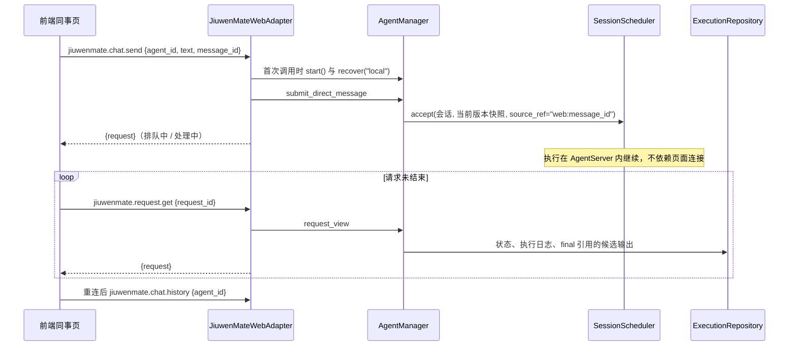

# Web 私聊、历史与状态接入设计方案

## 1. 元信息

| 项 | 值 |
| --- | --- |
| 建档日期 | 2026-10-14 |
| 范围 | jiuwenswarm：`server/jiuwenmate/agent_manager.py`、`execution_repository.py`、`ports/commit.py`（事件观察者）、`web_adapter.py`、`server/agent_ws_server.py`（适配器实例、推送与关闭）、`common/schema/message.py`、`gateway/channel_manager/web/app_web_handlers.py`、`gateway/channel_manager/web/web_connect.py`（完整 payload 白名单）；前端 `channels/web/frontend/src/features/jiuwenmate/` 与 jiuwenmate 文案 |
| 方案成熟度 | 已确认（按 jiuwenswarm 仓 `AGENTS.md` 的变更闸门先提交分析与改动方案，2026-10-14 经负责人确认；先于实现建档） |
| 计划条目 | [JM-10](../designs/jiuwenmate-development-plan.md)：Web 接入与同事页面；本文覆盖“私聊、历史、状态与断线续跑”子范围 |
| 负责人 | 常钰聪 |
| 状态 | 待验收（宿主组件与 core 正式执行入口均已验证，模型为替身；真实模型的浏览器验收待执行） |
| 设计依据 | [JiuwenMate 服务端架构设计](../designs/jiuwenmate-architecture.md) 第 4.4 节“管理查询与状态解释” |
| 关联 feature | 前置：[F_10 Web 同事管理接入](F_10_web-colleague-management.md)、[F_07 会话调度与执行驱动](F_07_execution-driver.md)；Web 投递记录：JM-09 |
| 验证摘要 | 见第 8 节 |
| Refs | 无独立 issue；需求来源为开发计划 JM-10 |

## 2. 背景、目标与范围

### 2.1 背景与问题

F_10 完成后，同事页可以管理同事，但发送按钮不可用：AgentServer 没有持有 `AgentManager`，也没有私聊、历史与状态接口。JM-07 的调度器与执行驱动只在单测中运行。

### 2.2 目标与关键场景

| 场景 / 触发条件 | 当前行为 | 目标行为 / 可观察变化 |
| --- | --- | --- |
| 在同事页发送消息 | 按钮不可用 | 消息进入该同事的 Web 会话，页面立即显示“排队中”或“处理中” |
| 处理结束 | 不适用 | 页面显示被 final 采纳的回复，或显示“无需回复”“已停止”“处理失败”等结果 |
| 关闭或刷新页面、连接断开 | 不适用 | 服务端继续执行；重新打开或重连后查询到结果（JM-10-V-02） |
| AgentServer 重启 | 不适用 | 排队中的消息在新进程中继续执行；重启时正在执行的消息显示“已停止”或“处理已中断” |
| 执行中途的候选输出 | 不适用 | 不显示为回复；只有 final 的 `output_refs` 所引用的消息输出才显示（JM-10-V-03） |
| 模型正在生成回复 | 不适用 | 页面逐段显示模型当前输出的文字（草稿），final 后改为显示采纳的回复（JM-10-V-04） |
| 回复含 Markdown | 不适用 | 加粗、列表、代码块等按 Markdown 渲染，不显示原始符号（JM-10-V-04） |
| 重复提交同一条消息 | 不适用 | 返回同一个 Request，不重复执行 |

### 2.3 本次范围与非目标

- 本次包含：`AgentManager` 接入 AgentServer 生命周期；三个新接口；删除同事改为经由 `AgentManager`；前端私聊区的发送、历史、轮询与重连重查；回复文字的流式推送与 Markdown 渲染（D-05、D-06，2026-10-14 补充）。
- 本次不包含：
  - 个人版 `chat.*` 事件与 `chatStore`（不变）；
  - 投递记录：本文只读取已保存的候选输出，不写入投递事实（JM-09）；
  - 停止 / 取消按钮（JM-12 协同）；
  - 每个同事多条 Web 会话（页面的会话记录列表仍为页面内状态，见 9.2）；
  - IM 渠道与群记录（JM-08、S2a）。

## 3. 设计约束、假设与待决问题

- **已确认约束与依赖：**
  - 不修改 agent-core；不修改 `chat.send`、`chat.final`、`chat.session_result` 的顺序与 `chatStore`。
  - core 的 `execute_persistent_request` 依赖 PA-10（会话状态记录）与 PA-06（窗口装配）。两者在 core `jiuwenmate` 分支 `9eb336b4` 接通，均使用宿主已提供的 `window_backend` 端口（JM-05），宿主不需要新增端口。本地 `pyproject.toml` 与 `uv.lock` 的 core 版本随之改为 `9eb336b4`（这两个文件只在本地修改，不提交）。
  - 执行驱动把执行入口抛出的异常记录为结果 `failed`，原因只写日志。
- **负责人确认（2026-10-14）：**
  - 现在接线：以执行入口替身验证全部流程；core 接通前，真实发送如实显示“处理失败”。core 接通后，再以正式执行入口与模型替身补做验收（见 8.2）。
  - 回复来源：只读读取已保存的候选输出，不记录投递事实。
  - 更新方式：请求未结束时轮询；重连后重新查询；不新增推送事件。
- **负责人确认（2026-10-14，浏览器试用后）：** 回复文字应流式输出，Markdown 应渲染。采用“服务端推送 `jiuwenmate.chat.stream`，断线后以查询草稿补齐”的方案（D-05），改动跨 AgentServer、Gateway 与前端三层，不修改 agent-core；Markdown 使用前端已有的 `MarkdownRenderer`（D-06）。D-04 的“不新增推送事件”据此修订。
- **关键假设：** 与 F_10 相同，本机单用户，`namespace_id` 固定为 `local`。
- **待决问题：** 无。

## 4. 总体方案与设计取舍

### 4.1 方案概览

流式补充（D-05）：core 每个模型输出片段产生 `reply.delta`，每次模型调用结束产生 `model.completed`。`HostCommitPort` 记录事件时通知适配器的推送发布器；发布器把片段合并约 30 毫秒，经 `send_push` → Gateway → `WebChannel` 按 `ws_id` 送到最近访问该同事的 Web 连接，事件名为 `jiuwenmate.chat.stream`。

### 4.2 关键决策

#### D-01 运行时随首次调用启动，随 AgentServer 停止关闭

- 选择与依据：与 F_10 的同事服务一致，首次调用私聊、历史、状态或删除接口时才创建 `AgentManager`，并执行 `start()` 与 `scheduler.recover("local")`，使上一进程遗留的排队消息继续执行。AgentServer 持有同一个适配器实例；`_stop_main_services` 调用其 `aclose()`，停止仍在执行的 Execution，之后的调用重新启动运行时。
- 实现体现：`JiuwenMateWebAdapter._runtime()`、`aclose()`；`agent_ws_server.py`；验证见 JM-10-V-02。

#### D-02 Web 消息以 `message_id` 去重

- 选择与依据：前端为每条消息生成 `message_id`，发送失败后重发同一内容时沿用该编号；服务端以 `web:<message_id>` 作为 `source_ref`，由 `accept_request` 去重。网络失败后的重试因此不会产生第二个 Request。
- 实现体现：`AgentManager.submit_direct_message`、`usePrivateChat.ts`；验证见 JM-10-V-01。

#### D-03 回复只取 final 采纳的消息输出

- 选择与依据：执行中途的 `output.proposed` 只是候选。视图从该 Request 最后一次 Execution 的终止事件读取 `output_refs`，按顺序取出 `share_mode="message"` 的候选文本；没有终止事件时回复为空。PAUSED 不带回复，原因取 `detail`。
- 代价与成立条件：不记录投递事实；JM-09 接入 Web 投递后，改为显示已投递的消息。
- 实现体现：`AgentManager._view`；验证见 JM-10-V-03。

#### D-04 页面轮询作为兜底（2026-10-14 修订）

- 选择与依据：请求为“排队中”或“处理中”时，页面每 1.5 秒查询一次这些请求；连接恢复（`webClient` 状态重新变为 `ready`）后重新查询历史。个人版事件与 `chat.*` 链路不受影响。原决策为“不新增推送事件”；D-05 引入推送后，轮询保留为兜底，用于补齐断线期间漏收的推送与结束状态。
- 实现体现：`usePrivateChat.ts`、`JiuwenMateApp.tsx`；验证见 JM-10-V-02。

#### D-05 回复片段经服务端推送，查询结果中的草稿用于补齐

- 选择与依据：`jiuwenmate.chat.send` 立即返回，不能像个人版 `chat.send` 那样把流绑定在请求上，因此改用 AgentServer 已有的 `send_push`。
  - 来源：`HostCommitPort` 增加可选观察者，事件被接受后通知；观察者异常只写日志，不影响执行与落库。
  - 接收者：发送、历史或状态查询带来的 `metadata.ws_id`。每个同事最多记录 8 个连接，按最近访问保留。推送不带 `session_id`，Gateway 按 `ws_id` 定向投递，不进入个人版会话路由。
  - 内容：`kind` 为 `delta`（文字片段）、`segment`（一次模型调用结束）或 `ended`（执行终止），并携带 `agent_id`、`request_id`、`execution_id`、`seq`、`text`。同一执行连续的片段在约 30 毫秒内合并为一次推送。
  - 补齐：未结束请求的 `RequestView.draft` 由最近一次执行日志计算，包含当前模型调用的文字及其 `seq`。由于普通事件在后台写库，查询结果可能落后于推送，前端只在查询草稿的 `seq` 更新时替换本地草稿。收到 `ended`、或收到未列出请求的片段时，前端立即查询该请求。
- 代价与成立条件：每次推送在 Gateway 写一条 INFO 日志；漏收的推送由下一次查询补齐，最多延迟一个轮询周期。草稿只是进行中的显示，最终回复仍以 D-03 为准。
- 实现体现：`ports/commit.py`、`AgentManager`（`on_event`、`ReplyDraft`）、`web_adapter.StreamPublisher`、`agent_ws_server.py`、`web_connect.py` 的 `_WEB_FULL_PAYLOAD_EVENT_TYPES`、前端 `applyStreamEvent`、`mergeChatRequest`、`usePrivateChat.ts`；验证见 JM-10-V-04。

#### D-06 回复与草稿按 Markdown 渲染

- 选择与依据：模型输出为 Markdown。回复与草稿使用前端已有的 `MarkdownRenderer`，样式类与个人版消息相同（`chat-text chat-markdown`），草稿传入 `isStreaming`，以便未闭合的代码块正常显示。用户消息仍按纯文本显示。
- 实现体现：`pages/ColleagueWorkspacePage.tsx`、`jiuwenmate.css`；验证见 JM-10-V-04。

### 4.3 替代方案与排除理由

| 候选 / 关联决策 | 关键差异 | 拒绝原因 | 重新评估条件 |
| --- | --- | --- | --- |
| R-01 / D-04 新增推送事件 | 更新更及时 | 初版不采用；2026-10-14 负责人要求流式输出后改为采用（D-05） | 已重新评估 |
| R-04 / D-05 只靠更快的轮询读取草稿 | 只改一层 | 文字成批出现，体验不接近个人版；普通事件后台写库，查询还会滞后 | 推送链路不可用时 |
| R-02 / D-03 显示全部候选输出 | 实现更简单 | 会把中间文本误报为最终结果（V-03） | 无 |
| R-03 / D-01 AgentServer 启动时创建运行时 | 重启后立即恢复排队消息 | 未使用同事页时也打开数据库并启动后台任务 | 定时任务（JM-13）需要无页面时运行 |

## 5. 详细设计

### 5.1 模块责任

- `ExecutionRepository.find_session`：只读查找会话，不存在时返回 `None`，历史查询不创建会话。
- `AgentManager.create_default`：在 `PersistentAgentService.create_default` 相同的数据目录下打开 `agents.sqlite3`。
- `AgentManager.submit_direct_message`：读取当前发布版本快照，解析会话，构造 `direct_message` 输入并交给调度器；输入不合法时返回 `BAD_REQUEST`。
- `AgentManager.conversation_requests`、`request_view`：返回 `RequestView`，字段见 5.2。
- `JiuwenMateWebAdapter`：同事管理方法仍在线程中调用同事服务；删除、私聊、历史、状态经由运行时；`PersistentContractError` 与 `PersistentAgentError` 的错误码原样返回。
- 前端 `jiuwenmateApi.ts`：新增 `sendMessage`、`history`、`getRequest`，以及状态解释 `chatPhase`、`isPending` 与合并 `mergeChatRequest`。
- 前端 `usePrivateChat.ts`：历史加载、轮询、重连重查与发送去重；订阅 `jiuwenmate.chat.stream` 并更新当前同事请求的草稿。
- `HostCommitPort` 观察者、`AgentManager` 的 `on_event` 与 `ReplyDraft`、`web_adapter.StreamPublisher`：见 D-05。
- 前端 `ColleagueWorkspacePage.tsx`、`ConversationComposer.tsx`：私聊区展示与发送（Enter 发送，Shift+Enter 换行）。

### 5.2 接口

| 方法 | 参数 | 返回 `payload` |
| --- | --- | --- |
| `jiuwenmate.chat.send` | `agent_id`、`text`、`message_id` | `{request: RequestView}` |
| `jiuwenmate.chat.history` | `agent_id` | `{requests: RequestView[]}`，按接收顺序 |
| `jiuwenmate.request.get` | `request_id` | `{request: RequestView}` |

`RequestView` 字段：`request_id`、`session_id`、`agent_id`、`message_id`、`text`、`received_at`、`status`（`queued` / `dispatched` / `ended`）、`outcome`（结束后为 `completed`、`ignored`、`paused`、`stopped`、`cancelled`、`failed`）、`running`（是否在本进程执行）、`replies`、`reason`、`draft`、`updated_at`。

`draft`：请求未结束且最近一次执行已有模型输出时为 `{execution_id, seq, text, closed}`，否则为 `null`。`text` 是最近一次模型调用的文字；`closed` 表示该调用已结束，下一片段开始新的文字。

推送事件 `jiuwenmate.chat.stream` 的 payload：`event_type`、`kind`（`delta` / `segment` / `ended`）、`agent_id`、`request_id`、`execution_id`、`seq`、`text`（仅 `delta` 非空）。

Web 会话固定为 `ConversationRef.web("local")`；访问快照的主体为 `local`，范围为 `direct_message`；发送者名称为“用户”。

### 5.3 页面状态

| `status` / `running` / `outcome` | 页面显示 |
| --- | --- |
| `queued` | 排队中 |
| `dispatched`，`running=true` | 处理中 |
| `dispatched`，`running=false` | 服务重启，处理已中断 |
| `ended` | 按 `outcome` 显示；`completed` 且有回复时只显示回复，无回复时显示“同事没有回复消息” |

排队中或处理中的请求有草稿文字时，在状态之上显示草稿。

### 5.8 异常处理

- 发送失败：保留草稿并显示原因；重发同一内容沿用原 `message_id`。
- 历史加载失败：显示原因；连接恢复后自动重查。
- 单次轮询失败：保留当前显示，下一轮继续查询。
- 推送失败或连接断开：发布器只写日志；页面由轮询与重连后的历史查询补齐。
- 执行入口抛出异常（如模型配置错误）：结果为“处理失败”，页面不显示原因（执行驱动只把异常写入日志）。

## 6. 影响面与实施设计

| 实施项 | 文件 | 修改内容 | 验证产物 |
| --- | --- | --- | --- |
| I-01 | `execution_repository.py` | 新增 `find_session` | JM-10-V-01 |
| I-02 | `agent_manager.py` | `create_default`、`submit_direct_message`、`conversation_requests`、`request_view`、`RequestView` | JM-10-V-01、V-03 |
| I-03 | `web_adapter.py` | 运行时启动与关闭；三个新方法；删除经由 `AgentManager` | JM-10-V-01、V-02 |
| I-04 | `agent_ws_server.py` | 保存适配器实例并在两处注册；停止服务时调用 `aclose()` | JM-10-V-02 |
| I-05 | `message.py`、`app_web_handlers.py` | 三个 `ReqMethod`；加入两个转发集合 | JM-10-V-01 |
| I-06 | 前端 `jiuwenmateApi.ts`、`usePrivateChat.ts`（新增）、`JiuwenMateApp.tsx`、`pages/ColleagueWorkspacePage.tsx`、`components/ConversationComposer.tsx`、`jiuwenmate.css`、中英文文案 | 私聊区接入 | JM-10-V-01 |
| I-07 | [`test_web_private_chat.py`](../../../../../tests/unit_tests/server/jiuwenmate/test_web_private_chat.py)、[`test_web_disconnect.py`](../../../../../tests/integration_tests/jiuwenmate/test_web_disconnect.py)（新建目录）、前端 `tests/jiuwenmateApi.test.mjs` | 单测、集成测试与前端接口测试 | — |
| I-08 | [`test_web_real_core.py`](../../../../../tests/integration_tests/jiuwenmate/test_web_real_core.py)（新增）；`test_core_contract.py` 删除“core 执行尚未开放”的 canary；`test_core_contract.py`、`test_budget_port.py` 的 core 端口导入改为 `openjiuwen.harness.persistent_agent.ports`（core 已移除内层 `persistent_agent.persistent_agent` 包） | core 接通后的正式执行验收 | JM-10-V-01～V-03 |

| I-09 | `ports/commit.py`、`agent_manager.py`、`web_adapter.py`、`agent_ws_server.py`、`web_connect.py`；前端 `jiuwenmateApi.ts`、`usePrivateChat.ts`、`JiuwenMateApp.tsx`、`pages/ColleagueWorkspacePage.tsx`、`jiuwenmate.css`；测试 `test_commit_port.py`、`test_web_private_chat.py`、`test_web_real_core.py`、[`test_web_channel_jiuwenmate_stream.py`](../../../../../tests/unit_tests/channel/test_web_channel_jiuwenmate_stream.py)（新增）、`tests/jiuwenmateApi.test.mjs` | 流式推送与 Markdown 渲染（D-05、D-06） | JM-10-V-04 |

兼容核对：个人版方法与事件不变；新增方法与推送事件均以 `jiuwenmate.` 开头。`_WEB_FULL_PAYLOAD_EVENT_TYPES` 只增加一项，不影响其他事件的裁剪。

## 8. 验证设计、执行记录与结论

### 8.1 验证设计与通过条件

| 验证 ID | 场景 | 验证入口 | 预期结果 | 层级 |
| --- | --- | --- | --- | --- |
| JM-10-V-01（私聊、历史、状态部分） | 发送、历史、状态查询、去重、错误码、删除经由运行时 | `test_web_private_chat.py`；`npm run test:jiuwenmate-api` | 发送立即返回；历史按顺序；重发同一 `message_id` 不重复执行；参数错误返回 `BAD_REQUEST`，未知同事返回 `NOT_FOUND`；删除前结束执行中的 Request | 单测（真实 SQLite 与调度器，执行入口替身） |
| JM-10-V-02 | 页面离开与 AgentServer 重启 | `tests/integration_tests/jiuwenmate/test_web_disconnect.py` | 发送后不保持连接，执行结束后可查询到回复；重启后排队消息继续执行，原执行中的消息显示已停止 | 集成测试（两个适配器实例共用一个数据目录） |
| JM-10-V-03 | 候选输出不冒充回复 | `test_web_private_chat.py` | final 之前回复为空；final 未引用的候选不显示；`ignored` 与 `failed` 无回复 | 单测 |
| JM-10-V-01、V-02（正式执行） | 经 core 正式执行入口私聊 | `tests/integration_tests/jiuwenmate/test_web_real_core.py` | 小九回复显示为 final 采纳的输出；第二条消息的模型输入包含第一轮问答；AgentServer 重启后窗口仍在 | 集成测试（真实同事服务、`AgentManager`、宿主端口与 core PA-10、PA-06，模型为本地替身） |
| JM-10-V-04 | 流式推送与 Markdown | `test_commit_port.py`、`test_web_private_chat.py`、`test_web_real_core.py`、`test_web_channel_jiuwenmate_stream.py`、`npm run test:jiuwenmate-api`；浏览器人工确认 | 观察者看到被接受的事件且异常不影响落库；执行中查询返回当前模型调用的草稿；片段按顺序推送到发起连接，拼接结果等于最终回复；无连接时不推送；Gateway 保留完整 payload 且只投递到指定连接；前端按 `seq` 合并且不被滞后的查询覆盖；浏览器中文字逐段出现，加粗等格式被渲染 | 单测、集成测试（真实 core，模型分两段输出）、前端单测、人工 |

### 8.2 实际执行与证据

2026-10-14，在 `fork/huenrui_jiuwenswarm` 工作区执行，未提交。

| 验证 ID | 命令 | 结果 | 覆盖内容 |
| --- | --- | --- | --- |
| JM-10-V-01、V-03 | `pytest tests/unit_tests/server/jiuwenmate/test_web_private_chat.py` | 15 passed | 见 8.1 |
| JM-10-V-02 | `pytest tests/integration_tests/jiuwenmate` | 2 passed | 页面离开后取得回复；重启后恢复排队消息 |
| — | `pytest tests/unit_tests/server/jiuwenmate tests/integration_tests/jiuwenmate` | 176 passed（单测）+ 2 passed | JM-01～JM-07 与同事管理不受影响 |
| — | `pytest` Gateway 处理器、TUI 转发、KV 会话生命周期、扩展挂载、资产发布与经验流程中涉及转发集合或 `_stop_main_services` 的用例 | 296 passed | 既有转发与停止流程不变 |
| JM-10-V-01 | `npm run test:jiuwenmate-api` 及其余 6 个 `test:jiuwenmate-*` | 9 passed；其余合计 26 passed | 新增状态解释、合并与三个接口调用 |
| — | `ruff check`、`ruff format --check`（改动的后端文件）；`eslint src/features/jiuwenmate`；`npm run build`（含 `tsc`） | 通过 | — |

core 升级到 `9eb336b4` 后补充执行（同日）：

| 验证 ID | 命令 | 结果 | 覆盖内容 |
| --- | --- | --- | --- |
| JM-10-V-01、V-02（正式执行） | `pytest tests/integration_tests/jiuwenmate` | 4 passed | 新增 2 项正式执行验收；原有 2 项断线与重启测试 |
| — | `pytest tests/unit_tests/server/jiuwenmate tests/integration_tests/jiuwenmate` | 179 passed（单测 175 项，删除 canary 1 项） | JM-01～JM-10 在新 core 下不受影响 |
| — | `pytest tests/unit_tests/server tests/unit_tests/gateway` | 2527 passed，1 skipped | core 升级不影响 AgentServer 与 Gateway 既有行为 |

流式推送与 Markdown 补充执行（同日）：

| 验证 ID | 命令 | 结果 | 覆盖内容 |
| --- | --- | --- | --- |
| JM-10-V-04 | `pytest tests/unit_tests/server/jiuwenmate tests/integration_tests/jiuwenmate tests/unit_tests/channel/test_web_channel_jiuwenmate_stream.py` | 186 passed（连续 3 次） | 新增观察者 1 项、草稿与推送 5 项、真实 core 推送 1 项、Gateway 1 项 |
| — | `pytest tests/unit_tests/server tests/unit_tests/gateway tests/unit_tests/channel tests/integration_tests/jiuwenmate` | 2741 passed，1 skipped | AgentServer、Gateway 与 Web 渠道既有行为不变 |
| JM-10-V-04 | `npm run test:jiuwenmate-api` 及其余 6 个 `test:jiuwenmate-*` | 13 passed；其余合计 26 passed | 新增草稿构造、未知请求、滞后查询合并与订阅 4 项 |
| — | `ruff check`、`ruff format`（改动的后端文件）；`eslint src/features/jiuwenmate`；`npm run build`（含 `tsc`） | 通过 | — |
| JM-10-V-04（浏览器） | 重启 AgentServer、Gateway 并刷新页面后私聊 | 待执行 | 文字逐段出现；Markdown 被渲染 |

### 8.3 验证结论

宿主组件验证通过：私聊、历史、状态、去重、断线续跑与重启恢复均符合 8.1 的预期。core 接通后，正式执行入口在宿主侧跑通：回复来自 final 采纳的输出，会话窗口在请求之间和 AgentServer 重启之后均得到保留。尚未执行的是真实模型的浏览器验收，需要重启 AgentServer 后在同事页人工确认，并计入 S1 私聊闭环。

## 9. 风险与已知遗留

### 9.1 设计风险

| 风险 / 触发条件 | 影响 | 已有应对措施 | 核实方式 |
| --- | --- | --- | --- |
| 历史请求数持续增长 | 历史接口返回全部请求 | 本机单用户，数据量有限 | 待评估分页 |
| 多个页面同时轮询 | 查询次数成倍增加 | 只查询未结束的请求 | 待评估 |
| 推送频率高 | Gateway 每次推送写一条 INFO 日志 | 片段按约 30 毫秒合并 | 浏览器验收时观察日志量 |

### 9.2 已知遗留

| 遗留项 | 性质 | 影响与现有处置 | 后续入口 |
| --- | --- | --- | --- |
| 失败原因不可见 | 已知限制 | 执行驱动不保存异常原因，页面只显示“处理失败”；原因见 AgentServer 日志 | JM-07 后续 |
| 每个同事只有一条 Web 会话 | 未实施 | 页面的“会话记录”列表仍为页面内状态，所有记录显示同一私聊历史 | 待 UCD 与会话设计 |
| 投递记录 | 未实施 | 回复读取候选输出，不写投递事实 | JM-09 |
| 停止 / 取消按钮 | 未实施 | 接口未开放 | JM-12 |
| 真实模型浏览器验收 | 未执行 | 正式执行入口已以模型替身验证；流式与 Markdown 待人工确认 | S1 |

## 10. 设计演进与修订

- 2026-10-14：core 在 `9eb336b4` 接通 PA-10、PA-06。宿主代码无需修改；补充正式执行验收（I-08），删除已失效的 canary，并按 core 新的包结构调整两处测试导入。
- 2026-10-14：负责人在浏览器试用后要求回复流式输出并渲染 Markdown。按变更闸门提交分析与方案，经确认采用推送加查询补齐（D-05）与 `MarkdownRenderer`（D-06）；D-04 修订为轮询兜底；新增 I-09 与 JM-10-V-04。改动跨 AgentServer、Gateway 与前端，未修改 agent-core。
