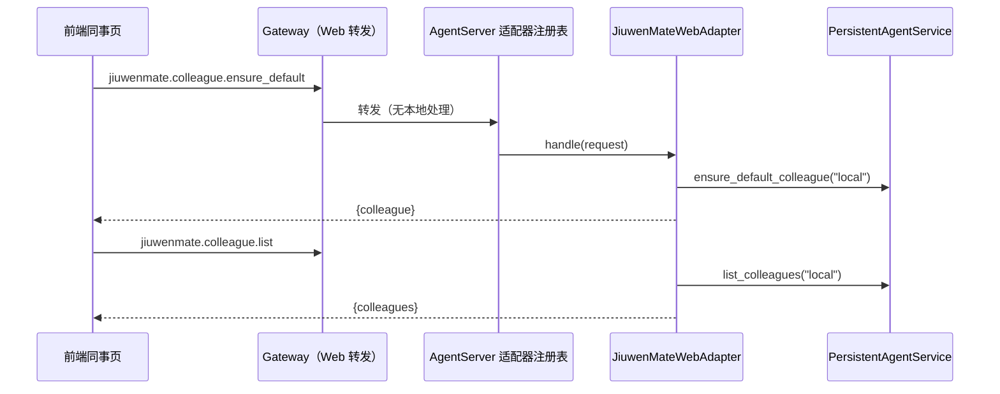

# Web 同事管理接入设计方案

## 1. 元信息

| 项 | 值 |
| --- | --- |
| 建档日期 | 2026-10-14 |
| 范围 | jiuwenswarm：`jiuwenswarm/server/jiuwenmate/web_adapter.py`（新增）、`common/schema/message.py`、`server/agent_ws_server.py`（注册一处）、`gateway/channel_manager/web/app_web_handlers.py`（转发集合）；前端 `channels/web/frontend/src/features/jiuwenmate/` 与 jiuwenmate 文案 |
| 方案成熟度 | 已确认（依据开发计划 JM-10 条目；按 jiuwenswarm 仓 `AGENTS.md` 的变更闸门先提交分析与改动方案，2026-10-14 经负责人确认；先于实现建档） |
| 计划条目 | [JM-10](../designs/jiuwenmate-development-plan.md)（原 SW-10）：Web 接入与同事页面；本文只覆盖“同事管理”子范围 |
| 负责人 | 常钰聪 |
| 状态 | 待验收（同事管理子范围；与开发计划一致） |
| 设计依据 | [JiuwenMate 服务端架构设计](../designs/jiuwenmate-architecture.md) 第 4.4 节“管理查询与状态解释” |
| 关联 feature | 前置：[F_02 同事定义与配置发布](F_02_colleague-management.md)；后续：私聊、历史与状态子范围另行建档 |
| 验证摘要 | 见第 8 节 |
| Refs | 无独立 issue；需求来源为开发计划 JM-10 |

## 2. 背景、目标与范围

### 2.1 背景与问题

JM-02 已提供同事的创建、列表、详情、设置读写、发布、删除和默认同事小九，但没有任何接口把这些能力暴露给 Web。前端同事页的列表从空数组初始化，创建、删除只修改本地状态；模型与模板来自 `mockData.ts`。因此打开同事页看不到小九，创建的同事在刷新后消失。

### 2.2 目标与关键场景

| 场景 / 触发条件 | 当前行为 | 目标行为 / 可观察变化 |
| --- | --- | --- |
| 打开同事页 | 空列表 | 先确保小九存在，再加载列表；小九可见 |
| 加载失败 | 不适用 | 显示失败原因与重试入口，不以空列表代替 |
| 创建同事 | 只写本地 | 提交后端；成功后进入同事资料页；失败时保留草稿并显示原因；提交中不可重复提交 |
| 选择模型 | mock 的两个模型 | 列出本机已配置的模型；不选或所选模型不在列表中时使用后端默认模型 |
| 删除同事 | 只改本地 | 调用后端删除；失败时保留并显示原因 |
| 读写设置与发布 | 无接口 | 后端接口可用；页面暂无编辑入口 |

### 2.3 本次范围与非目标

- 本次包含：九个管理接口与前端的列表、创建、删除、模型列表接入。
- 本次不包含：
  - 私聊、历史、执行状态、断线续跑，以及 `AgentManager` 接入 AgentServer（JM-10 后续子范围，另行审批）；
  - 设置编辑与发布的页面入口（现有页面没有编辑设计）；
  - “停用”与“已配置 IM”的持久化（后端无对应字段，仍为页面内状态；IM 属于 JM-08）；
  - 后端真实 Agent 模板目录（负责人确认保留 mock 模板，只把模板内容作为设置提交）；
  - 群记录展示（S2a）。

## 3. 设计约束、假设与待决问题

- **已确认约束与依赖：**
  - 不修改个人版聊天链路，包括 `chat.send`、`chat.final`、`chat.session_result` 的顺序与 `chatStore`。
  - 不修改 agent-core。
  - 接口不返回 Spec、模型连接信息或密钥（架构第 4.4 节）。
- **负责人确认（2026-10-14）：**
  - 本轮只做同事管理。
  - Web 用户的 `namespace_id` 固定为本机常量 `local`。
  - 模型列表由新增的 `jiuwenmate.models.list` 提供，不复用会返回密钥的 `models.list`。
  - 保留 mock 模板，创建时不传模板 ID。
- **关键假设：** 本机单用户；同一 AgentServer 进程只服务一个本机用户的数据目录。
- **待决问题：** 多账号区分（若需要）须重新确定 `namespace_id` 的来源。

## 4. 总体方案与设计取舍

### 4.1 方案概览

### 4.2 关键决策

#### D-01 以独立适配器接入，不扩展 AgentServer 的处理链

- 选择与依据：AgentServer 已有按业务域注册的 `GatewayAdapter`，在旧处理链之前分发。新增 `JiuwenMateWebAdapter` 并在现有注册处登记，AgentServer 只增加一行。
- 实现体现：`web_adapter.py`；验证见 JM-10-V-01。

#### D-02 同事服务按需创建

- 选择与依据：首次请求时才调用 `PersistentAgentService.create_default()`，不在 AgentServer 启动时打开数据库，不影响未使用同事页的启动过程。服务方法为同步 SQLite 调用，在线程中执行。
- 实现体现：`JiuwenMateWebAdapter._service()`；验证见 JM-10-V-01。

#### D-03 模型列表与同事服务同源，且不含密钥

- 选择与依据：同事服务从 `get_default_models` 构建模型目录并按 `selection_key` 解析；已有 `models.list` 读取的是含登录模型的列表并返回 `api_key`。新接口返回 `ModelCatalogResult.to_dict()`，只含选择键、显示名、模型名与提供方。
- 代价与成立条件：`selection_key` 含配置序号，调整模型配置顺序后，已保存的选择可能指向其他模型；与 JM-02 现有行为一致。
- 实现体现：`jiuwenmate.models.list`；验证见 JM-10-V-01。

#### D-04 错误原样返回

- 选择与依据：`PersistentAgentError` 的错误码（如 `NOT_FOUND`、`MODEL_NOT_FOUND`）原样返回；前端在页面上显示失败，不以空列表或旧内容冒充当前事实（架构第 4.4 节）。
- 实现体现：`web_adapter.py`、`jiuwenmateApi.ts`；验证见 JM-10-V-01。

### 4.3 替代方案与排除理由

| 候选 / 关联决策 | 关键差异 | 拒绝原因 | 重新评估条件 |
| --- | --- | --- | --- |
| R-01 / D-01 在 AgentServer 处理链中逐个添加 `if` | 与旧处理方式一致 | 增加超大文件的分支；与适配器分层约定不符 | 无 |
| R-02 / D-03 复用 `models.list` | 无需新接口 | 返回密钥；登录模型无法被同事服务解析 | 无 |
| R-03 / D-02 在启动时创建服务 | 首次请求无延迟 | 未使用同事页时也打开数据库 | 第二步接入 `AgentManager` 时统一管理生命周期 |

## 5. 详细设计

### 5.1 模块责任

- `JiuwenMateWebAdapter`：解析参数、调用同事服务、把结果转为前端结构、映射错误。
- `jiuwenmateApi.ts`：封装请求与字段转换（下划线命名与前端驼峰命名互转），不依赖连接实现，由调用方注入请求函数。
- `createFlowState.ts` 的 `replaceColleagues`：以服务端列表替换页面同事，保留页面内的 IM、停用与上传头像标记。
- `components/ModelLabel.tsx`：按模型列表显示模型名称；未选择时显示默认模型。
- `JiuwenMateApp.tsx`：加载、创建、删除的状态与失败提示。

### 5.2 接口

所有方法的 `namespace_id` 均为 `local`，前端不传。

| 方法 | 参数 | 返回 `payload` |
| --- | --- | --- |
| `jiuwenmate.colleague.ensure_default` | 无 | `{colleague: Colleague \| null}` |
| `jiuwenmate.colleague.list` | 无 | `{colleagues: Colleague[]}` |
| `jiuwenmate.colleague.get` | `agent_id` | `{colleague}` |
| `jiuwenmate.colleague.create` | `settings` | `{colleague}` |
| `jiuwenmate.colleague.settings.get` | `agent_id` | `{settings}` |
| `jiuwenmate.colleague.settings.update` | `agent_id`、`settings` | `{colleague}` |
| `jiuwenmate.colleague.publish` | `agent_id` | `{version}` |
| `jiuwenmate.colleague.delete` | `agent_id` | `{deleted: true}` |
| `jiuwenmate.models.list` | 无 | `{models: [{selection_key, display_name, model_name, provider, ...}], current_selection, current_display_name}` |

`Colleague` 即 `ColleagueView.to_dict()`；`settings` 即 `ColleagueSettings.to_dict()`；`version` 即 `ConfigVersionView.to_dict()`。失败时 `ok=false`，`payload={error, code}`；参数缺失或类型错误返回 `BAD_REQUEST`。

### 5.3 前端字段对应

| 前端 | 后端 |
| --- | --- |
| `id` | `agent_id` |
| `avatarUrl` | `avatar_url` |
| `capabilities.starterPrompts` | `capabilities.starter_prompts` |
| `capabilities.model`（空串表示默认模型） | `capabilities.model`（`null` 表示默认模型） |
| `joinedAt` | `created_at` |
| `isDefault`、`currentVersion`、`hasUnpublishedChanges` | 同名下划线字段 |
| `imConfigured`、`disabled` | 无；页面内状态 |

提交时，不在模型列表中的模型按默认模型提交；名称、简介和各列表项先去除首尾空白，空白列表项不提交（服务端拒绝空白项）。`avatar_url` 只提交普通地址；上传图片生成的 `data:` 地址和超过 2048 字符的地址按空值提交，上传头像仅在本次页面会话内显示。

### 5.8 异常处理

- 加载失败：页面显示原因与重试按钮。
- 创建、删除失败：保留当前页面与数据，显示原因；创建期间禁止重复提交。

## 6. 影响面与实施设计

| 实施项 | 文件 | 修改内容 | 验证产物 |
| --- | --- | --- | --- |
| I-01 | [`web_adapter.py`](../../web_adapter.py) | 新增适配器 | JM-10-V-01 |
| I-02 | `common/schema/message.py` | 新增九个 `ReqMethod` | JM-10-V-01 |
| I-03 | `server/agent_ws_server.py` | 两处适配器注册列表各加一项 | JM-10-V-01 |
| I-04 | `gateway/channel_manager/web/app_web_handlers.py` | 九个方法加入转发集合与“无本地处理”集合 | JM-10-V-01 |
| I-05 | 前端 `jiuwenmateApi.ts`、`components/ModelLabel.tsx`（新增），`JiuwenMateApp.tsx`、`createFlowState.ts`、`types.ts`、`mockData.ts`、`pages/ColleagueCreatePage.tsx`、`pages/ColleagueProfilePage.tsx`、`jiuwenmate.css`、中英文文案 | 接入真实接口；删除 mock 模型列表 | JM-10-V-01 |
| I-06 | [`test_web_adapter.py`](../../../../../tests/unit_tests/server/jiuwenmate/test_web_adapter.py)、前端 `tests/jiuwenmateApi.test.mjs`（新增）、`tests/jiuwenmateCreateFlow.test.mjs`、`package.json` 的 `test:jiuwenmate-api` | 后端适配器与转发集合测试；前端接口与状态测试 | — |

兼容核对：个人版的方法与事件不变；新增方法均以 `jiuwenmate.` 开头。

开发计划：JM-10 的“证据”列链接本文。

## 8. 验证设计、执行记录与结论

### 8.1 验证设计与通过条件

| 验证 ID | 场景 | 验证入口 | 预期结果 | 层级 |
| --- | --- | --- | --- | --- |
| JM-10-V-01（同事管理部分） | 小九可见、创建、设置、发布、删除、模型列表 | 后端 `test_web_adapter.py`；前端 `npm run test:jiuwenmate-api`、`test:jiuwenmate-create-flow` | 首次打开即有小九；接口结果与同事服务一致；错误码原样返回；不返回密钥；转发集合包含全部新方法 | 单测（真实 SQLite，模型目录替身）；前端接口测试 |

### 8.2 实际执行与证据

2026-10-14，在 `fork/huenrui_jiuwenswarm` 工作区执行，未提交。

| 验证 ID | 命令 | 结果 | 覆盖内容 |
| --- | --- | --- | --- |
| JM-10-V-01 | `pytest tests/unit_tests/server/jiuwenmate/test_web_adapter.py` | 15 passed | 首次加载创建小九；新建同事以默认模型发布 v1；修改设置后待发布，发布得 v2；删除后查询返回 `NOT_FOUND`；缺少参数、未知字段、未知模型等错误码原样返回；模型列表不打开同事存储，且不含密钥；并发下存储只打开一次；`ReqMethod`、适配器与 Gateway 两个转发集合一致；经 AgentServer 分发链路返回结果；数据写入 `local` |
| JM-10-V-01 | `pytest tests/unit_tests/server/jiuwenmate` | 161 passed | 新增适配器不影响 JM-01～JM-07 |
| JM-10-V-01 | `pytest` Gateway 处理器、`test_message` 与 jiuwenmate 目录 | 343 passed | 新方法加入转发集合后，既有转发行为不变 |
| JM-10-V-01 | `pytest` 适配器注册、AgentServer 边界、连接关闭、CLI 通道与会话创建边界 | 167 passed | 注册新适配器后，既有分发行为不变 |
| JM-10-V-01 | `npm run test:jiuwenmate-api` | 6 passed | 字段对应；模型列表与默认模型；提交前去除空白项、丢弃上传图片地址、未知模型按默认提交；先保证小九再列出；请求不携带 `namespace_id`；服务端拒绝原样传给调用方 |
| JM-10-V-01 | `npm run test:jiuwenmate-create-flow` 及其余 5 个 `test:jiuwenmate-*` | 7 passed；其余合计 19 passed | 服务端列表替换页面数据并保留页面内标记；既有页面状态不变 |
| — | `ruff check`、`ruff format --check`（新增后端文件）；`eslint src/features/jiuwenmate`；`npm run build` | 通过 | 全仓 `npm run lint` 存在与本次无关的既有错误 |

### 8.3 验证结论

同事管理子范围的宿主组件验证通过：接口、字段对应、错误传递和密钥隔离均符合 8.1 的预期。浏览器中打开同事页看到小九、创建后刷新仍存在，需要重启 AgentServer 后人工确认，尚未执行。JM-10-V-01 的私聊、历史、状态部分以及 V-02、V-03 属于后续子范围。

## 9. 风险与已知遗留

### 9.1 设计风险

| 风险 / 触发条件 | 影响 | 已有应对措施 | 核实方式 |
| --- | --- | --- | --- |
| 调整模型配置顺序 | 已保存的选择指向其他模型 | 与 JM-02 一致 | 待评估 |

### 9.2 已知遗留

| 遗留项 | 性质 | 影响与现有处置 | 后续入口 |
| --- | --- | --- | --- |
| 私聊、历史、状态、断线续跑 | 未实施 | 发送按钮仍不可用 | JM-10 后续子范围 |
| 删除同事未经 `AgentManager` | 暂时安全 | 当前没有执行入口，不会留下未结束的 Request | 接入 `AgentManager` 时改为经由其删除 |
| 设置编辑与发布入口 | 未设计 | 接口已可用 | 待 UCD |
| 停用与 IM 状态 | 页面内状态 | 刷新后丢失 | JM-08 |
| 模板目录 | mock | 不记录来源模板 | 待评估 |
| 上传头像 | 未持久化 | 服务端 `avatar_url` 上限 2048 字符，图片不入库；刷新后显示分类默认头像 | 待设计文件存储 |
| 浏览器端到端确认 | 未执行 | 需重启 AgentServer 加载新适配器 | 联合验收 |

## 10. 设计演进与修订

暂无。
