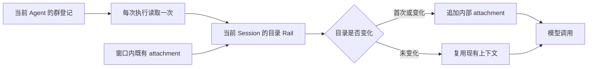

# Agent 群目录动态上下文设计方案

建档：2026-11-04。关联：JM-11；沿用 [群公共记录](F_11_group-public-records.md)。方案经用户确认，代码与定向验证完成；真实平台联调待验收。

## 背景、目标与范围

群登记已用于 Web 渠道面板，但模型没有列出自身群归属的统一入口。使用 Prompt Attachment 提供当前 Agent 的飞书、钉钉等群目录；不增加工具，也不提供群消息正文。每个 Session 在下次执行时看到更新。

## 关键决策与替代方案

采用已有 Rail 扩展与 PromptAttachmentManager 的快照／变化检测。第一次提供完整有界目录，之后仅变化时追加，目录包含平台、群名、内部群 ID 与登记状态。每个 Session 从自身带标记的附件历史恢复旧目录，重启不依赖内存标志；新窗口没有快照时重新注入。当前目录只列可访问的 active 群；移除时提供一次变化提示，内部保留失效事实供审计。明确改名信息。

不使用每次追加系统提示（重复且混淆稳定指令），也不采用提示词引导 read_file（模型可能不读）。群名是外部数据，不得作为指令；目录不授予跨群消息或产物分享权，原有审批链不变。

## 详细设计与边界

宿主按 namespace／Agent 查询群登记与成员关系，活动关系优先，重复应用绑定不重复计数；多个活动绑定标记不确定。仅确认的生命周期事实能导致退群／解散状态。飞书补接解散事件并将该群各 Agent 的关系置为失效；迟到事件不能覆盖更新的事实。飞书和钉钉都只在可信群消息到达后登记，不要求模型回复；入群事件、正向核验不创建或恢复登记。钉钉接入 Stream 群事件，已登记群的成员变化触发只读 Bot 在群核验，可信入站与既有成员轮询继续保留；不把核验失败当成退群或解散，尚未收到事件的新群无法凭空列出。

目录长度有界，并提供总数与省略说明。每次执行只读取一次本地登记数据，工具循环不重复访问数据库。附件通过当前 Session 的模型上下文落入 Persistent 窗口，不向 IM 群或 Web 对话发送可见消息。历史条目存在不代表当前仍在群中，最新目录优先。

ReAct 在接收用户输入前就会同步 attachment，因此 Rail 同时接入 `on_user_message` 和 `before_model_call`：前者先登记 section，防止新实例的空 manager 把旧目录误标移除；后者覆盖没有输入写入的恢复路径。注册稳定的 runtime section，重建实例时从历史中的完整 section 与其 hash 恢复相同文本，避免变更说明在下一请求消失而额外制造一条更新。

群解散使用同库新表 `group_dissolutions` 留存可信时间和来源，不更改既有 GroupAccess 三状态契约。该群当前成员关系置为 left；内部目录保留 dissolved，Web／模型可访问目录移除该群。后续退群确认保留解散原因，同一平台群 ID 的任何入群、核验或消息均不能恢复已解散关系。数据库新增表由既有初始化自动创建，无需手动迁移。

English summary: An invocation-local host Rail supplies the current Agent's recorded cross-channel group directory through existing Prompt Attachments. Each Session receives an initial bounded snapshot and later updates only when metadata changes. Renames, departures and confirmed dissolution are explicit; unknown states are not departures. The directory contains no message bodies and never grants sharing permission. DingTalk Stream lifecycle events are wired separately from robot callbacks. Human membership events require a live Bot membership check; unavailable checks preserve the last trusted membership, grant no new access, and request retry. Content reads still require live authorization. Platform subscription and delivery limitations still apply.

## 验证与已知遗留

### 消息后登记与退出失效统一（2026-11-05，代码与定向回归完成）

用户已明确选择统一策略：飞书、钉钉仅在系统实际收到可信群消息后登记并在 Web 展示，不要求 Agent 回复。加入事件只作为平台事实，不新增／恢复可访问登记；正向在群核验也不能代替消息登记。改名只更新已有群；未登记群的退群／解散仍保留最小失效标记防止旧消息重放。

保留内部群身份、历史消息和失效标记，而非物理删除共享记录。首次可信消息建立活动关系；退出后的重入必须由时间晚于失效事实的新消息证明，旧消息重投不能恢复。解散为终态，任何正向核验或消息均不能重新激活同一平台群 ID。Web 与模型目录均只列 active，模型收到一次移除提示，不再附带非活动群的完整历史清单。此规则替代本文早期“加入事件直接登记”和“持续列出 inactive”的设计。

确认退群时使该 Agent 对该群的关系失效；解散时对群内全部 Agent 生效。关系失效与来源／目标涉及该群的跨群长期授权撤销、待审批失效期限、已批准请求窗口作废在同库事务提交。保留审计记录，不恢复旧授权；已批准一次、永久及 owner-read 均受失效边界约束，重新加入也不能释放旧请求结果或复用旧导入授权。正常后台过期处理继续负责结束原生审批，避免制造新的挂起任务。

不采用“直接删全部群库”：公共消息还可能供其他仍在群的 Agent 使用；也不采用“移除 Web 卡片即可”：这不能阻止旧审批与文件复用。没有平台事件或可靠核验仍无法自动推断解散；部署订阅和核验身份要求单独说明。本轮 474 项定向回归全部通过（148.05 秒），日志 `C:/Users/zs/.codex/backups/message-driven-groups-final.txt`。覆盖消息登记、旧消息与入群／核验不能复活、终态解散、来源／目标失效、一次／永久／owner-read 回执、无审批行的在途请求、缓存文件与 CLI、SDK→Gateway→Server、本地真实 Core attachment。只读复核未发现新的明确回归。未提交、推送或重启服务，未进行真实 IM 验收；agent-core 无修改。

共享库新增 `group_share_invalidations`，以处理时刻记录首次请求失效边界，避免乱序旧平台时间无法推进已有窗口；审批原文保留用于文件溯源，不能作为有效许可。当前来源和目标的活动应用关系在创建快照的事务内复核，缓存／搜索／CLI 释放前与最终投递均检查请求窗口。待审批缩短到期时间，由原有后台清理原生暂停，不另造审批恢复流程。

用户确认的四个旧钉钉群此前已做一次人工解散状态纠正并备份；这不是平台事件送达或自动核验成功的证据。本轮代码不再手改真实群数据。
### 核验不可用与入群事件确认修正（2026-11-05）

用户实际新钉钉群已成功收到并回复消息，却在下一轮轮询后从 Web 消失。确认旧逻辑将 CLI 缓存缺失、缓存锁竞争等服务不可用统一转换为 unknown，再覆盖可信入站建立的 active。此次修正：无法查询不等于成员关系发生变化；定时核验或普通人员事件核验不可用时保留最后可信关系并重试，不给未知新群增加授权。只有完整名单证明机器人缺席才注销登记；正向核验不恢复登记，内容读取端的实时授权失败仍拒绝读取。后台核验不经 npx 下载 CLI，必须使用现成显式或缓存程序，防止每轮触发安装及缓存竞争。前一节将失败直接降级的方案由此修正，不再作为当前契约。

飞书用户已确认两个应用都已订阅并发布机器人进群事件，但静默群未登记。SDK 事件解析和直接宿主登记已模拟正常，实际缺失原因仍待定位。明确发现生命周期同步回调调度异步任务即返回，SDK 提前 ACK，Future 异常及宿主 REJECTED 无人观察。已修复为在 SDK 独立线程等待宿主确认（有界 3 秒），失败／超时向 SDK 报错以便平台重试，并记录事件类型、群、事件 ID 及 disposition；不把该已确认缺陷冒称此次丢事件的已证明根因。

本轮先复现钉钉不可用错误降级 3 项、后台安装 1 项、飞书提前 ACK 5 项失败，再修复。最终 243 项关联回归全部通过，包含 SDK→Gateway→E2A→AgentServer→真实 SQLite 两个静默群登记且业务 Request 为零的模拟用例；只读复核未发现明确缺陷。日志：`C:/Users/zs/.codex/backups/group-directory-availability-final.txt`。未手动修改真实群关系、未提交或重启；旧代码已产生的 unknown 仅由时间更新的可信消息恢复，不自动猜测恢复所有群。真实飞书入群事件须重新触发，钉钉读取和可靠退群核验仍需正常的接口身份及现成 CLI。

### 钉钉被动模式失效登记修复（2026-11-05）

实际复现：客户交流会对接群已解散，但数据库仍保留 11 月 2 日首条消息建立的 active；未登记解散事实，策划助手为 passive，原有仅 adaptive 的消息轮询不会核验该绑定。模型已收到正确注入的目录，但目录本身过期。

已在现有 DingTalkGroupPoller 生命周期内另启独立低频在群核验任务，启动即执行首轮，轮次结束后默认等待 60 秒，每轮最多 8 个已知绑定，公平轮转；群较多、接口较慢时不能承诺 60 秒内完成全部检查。覆盖 passive／adaptive，且与消息轮询分离，查询机器人名单而不读取正文、不触发模型或业务 Request。仅检查当前有效应用绑定的 active／待核实关系，不发现未知群、不重新激活已退出或解散群。绑定锁内检查当前归属，写回时使用 update_membership 的可选 expected_revision 做原子比较，防止较旧核验覆盖解散或解绑。

完整名单确认缺少机器人则 left；查询失败、无授权或名单不完整不修改既有可信关系，不据此建立新关系；unknown 后正向核验不恢复 active，必须由晚于失效事实的新消息重新登记，并收紧 visible_from；此规则替代早期正向核验恢复设计。状态未变化不反复修改 revision，以免让搜索分页和已受理请求失效。Web 活动列表与下一次目录 attachment 均复用原有查询刷新。不得用机器人缺席推断“群已解散”，dissolved 仍只来自可信解散事件。服务关闭时同时取消两类轮询。

新增 10 项回归先复现失败再修复，与原消息轮询合计 57 项通过。最终关联回归 234 项通过，覆盖事件传输、机器人核验、绑定、轮询、目录单元与真实 Core 本地模型替身集成；日志 `C:/Users/zs/.codex/backups/dingtalk-passive-membership-final.txt`。只读复核未发现本次增量的明确缺陷。真实钉钉联调待用户重启验收；未修改本地真实群状态、提交、推送或重启用户服务。

English summary: A separate bounded membership loop checks known DingTalk groups in both passive and adaptive modes, even without lifecycle delivery or new messages. Confirmed Bot absence retires access; unavailable verification cannot overwrite trusted membership or grant new access. Revision-checked writes cannot overwrite newer lifecycle facts. The loop reads no message bodies and creates no Agent requests; it requires the employee's existing DingTalk OAuth access and an installed CLI. Missing CLI caches never trigger background installation.

### 钉钉群事件接入（2026-11-04）

经用户确认继续补齐钉钉。复用当前已认证的 Stream 连接注册 EventHandler，白名单接收 `chat_add_member`、`chat_remove_member`、`chat_quit`、`chat_update_title`、`chat_disband`。与机器人消息 CallbackHandler 分开，生命周期不创建业务 Request、不调用模型、不套用操作者的聊天 allow_from。

按官方 Stream 事件信封或 SDK headers＋业务 data 解析事件，校验企业标识一致性与可信时间，使用当前连接的 app／Agent 归属，经已有内部钉钉入站路由送达服务端；再次核验绑定，拒绝旧绑定。已登记群的改名可直接更新，group_name_events 记录平台时间，防止旧事件或迟到消息覆盖新群名；解散使用 group_dissolutions，即使尚无成员登记也保留解散事实，防止首次迟到消息激活已解散群，不因此给 Agent 增加访问关系。

成员事件仅表示人员变化，不冒充机器人进出群：仅对已登记群，通过当前员工独立 DWS 登录身份只读查询群内 robotCode，核验缺席后注销该 Agent 的关系；核验在群不注册或恢复关系。当前查询使用本次 Stream 接收时间作为核验时间下界，不能借用迟到人员事件的旧发生时间。名单缺失、格式异常、未登录或调用失败均不授予新群访问，也不把错误当退群；保留既有可信关系，并返回失败 ACK 允许平台重试。首次登记、退群、改名、解散继续进入同一个 attachment 更新链。平台已确认解散、但后续核验不可用时，不丢失原解散事实。

官方文档与范围：

- [Stream 协议](https://open-dingtalk.github.io/developerpedia/docs/learn/stream/protocol/)：EVENT 与机器人消息 CALLBACK 是两个独立入口；代码注册 `*`，具体事件需开发者后台勾选。
- [群解散](https://open.dingtalk.com/document/orgapp/event-chat-disband.md)、[改名](https://open.dingtalk.com/document/orgapp/event-chat-update-title.md)、[人员增加](https://open.dingtalk.com/document/orgapp/event-chat-add-member.md)、[人员移除](https://open.dingtalk.com/document/orgapp/event-chat-remove-member.md)、[主动退群](https://open.dingtalk.com/document/orgapp/event-chat-quit.md)。钉钉普通群的事件覆盖受应用／群接入方式影响，不承诺添加机器人必定产生“人员增加”事件；不要把飞书的“保留历史不推送解散”限制直接套用为钉钉保证。

验证覆盖官方信封解析、注册隔离、Gateway 到 AgentServer 路由、重绑、人员变化与 Bot 状态区别、未知不授权、失败重试、乱序改名、解散早于首次消息及附件更新。真实钉钉联调仍待验收，不自动修改用户的事件订阅或发布应用。

2026-11-04 验证结果：

- 钉钉生命周期及关联回归：最终合并运行 224 项全部通过，包含 `test_dingtalk_group_events.py`、`test_dingtalk_group_membership_inspection.py`、`test_dingtalk_persistent.py`、`test_dingtalk_production_wiring.py`、`test_dingtalk_group_polling.py` 及下述目录单元／真实 Core 用例。日志：`C:/Users/zs/.codex/backups/dingtalk-lifecycle-final.txt`。核验失败、迟到核验及解散早于首次消息的边界先通过失败用例复现，再修复；只读复核未发现新的明确缺陷。
- `test_group_directory_attachment.py`：15 项通过。覆盖首次、无变化、改名、退群、解散、跨平台同名群、Agent／namespace／Session 隔离、新窗口、晚到事件、数据库失败、歧义绑定、中英文及长目录。
- `test_group_directory_real_core.py`：1 项通过。真实 Web driver／Core／SQLite 与本地模型替身验证目录实际进入模型请求，跨请求去重、进程重建后改名以及退群更新。未调用真实模型或 IM。
- Gateway 新解散用例与原退群／撤回用例：2 项通过。调度与 Shell 相关回归：43 项通过。
- 扩大回归中 12 项原 Gateway 用例及 2 项原频道／群端口用例失败，全部在独立解释器加载提交前生产模块后复现；未扩展本次范围修复旧测试或旧行为。

只读审查发现两个长目录边界，已通过失败用例复现并修复：退群条目移出可见列表时仍须给变化提示；此前被省略的历史退群项不能抢占真实变化的提示预算。变化在完整当前目录上计算，再限制展示；旧目录已省略、无法比较的条目不冒称新增／退群，设置 `changes_complete=false`，并注明省略数量。

真实飞书、钉钉联调未执行。飞书应用须在事件配置中订阅 `im.chat.disbanded_v1`，不是搜索同名权限。钉钉应用须订阅上述五种群事件并发布生效，Bot 核验还需该员工的钉钉 DWS 登录和相应接口权限；添加机器人本身不保证触发人员事件，平台未投递的变化仍可能滞后。数据库新增表由服务正常初始化创建；无需重新发布 Agent，重启服务后用新请求验证。本次未提交、推送或重启用户服务。

### 可靠退群／解散输入与部署要求

统一处理链是：平台已认证连接 → Gateway 绑定的应用／Agent → 内部 E2A 路由 → 当前绑定复核 → SQLite 提交成员失效、授权撤销和请求失效 → 成功 ACK。失败或超时不得提前 ACK 成功；重复事件幂等，旧退群事件不能覆盖更新可信消息，解散终态不可恢复。Web 已有可见页约 10 秒刷新及重连刷新，模型在各 Session 的下一次请求收到目录更新。

飞书：在每个应用“事件与回调 → 事件配置”订阅并发布 `im.chat.member.bot.deleted_v1`（机器人被移出）和 `im.chat.disbanded_v1`（群解散）；改名沿用 `im.chat.updated_v1`。这是事件配置，不是在权限搜索框搜索事件代码。机器人能力及相应群权限需开启。离群事件仅发给被移出且订阅的机器人；解散事件仅发给群内订阅的机器人。飞书客户端解散时勾选“为群成员保留历史记录”不会触发解散事件，因此事件本身无法保证覆盖所有操作。补偿可用目标应用 tenant_access_token 调用 `GET /open-apis/im/v1/chats/{chat_id}/members/is_in_chat`，不能用某个用户的 token 冒充机器人状态。当前已有内容读取核验；本轮没有新增飞书全量后台轮询。

钉钉：应用后台订阅 Stream 群事件，消息 CALLBACK 与生命周期 EVENT 分开注册。`chat_disband` 是明确群解散输入；`chat_add_member`、`chat_remove_member`、`chat_quit` 只是人员事件，不能据此直接判断 Bot 退出。普通机器人群未核到通用专属 Bot 退群 Stream 事件，且不能将 API／群模板场景的覆盖外推到所有普通群。代码对已登记群在人员变化时核验，并保留独立低频核验（启动首轮、每轮最多 8 个绑定、轮后默认 60 秒）。

当前钉钉核验使用员工已有私有 DWS 用户身份执行 `dws chat group bots --group <cid> --profile <固定资料> --format json`；需要现成 CLI、正常 OAuth、查询权限以及完整结果中可核对的本 Bot robotCode。后台不自动经 npx 安装。应用身份的 `POST /v1.0/robot/groups/robots/query` 使用 accessToken 和 `qyapi_chat_manage`，但官方参数说明针对群模板创建群；这是可用的受限替代接口，本轮未替换现有 DWS 链路。成功且完整的名单缺少自身 Bot 才能判定退群，不能由缺席推断解散。超时、403、缺授权、格式异常或不完整名单都不能当作退群证据。

官方来源：

- [飞书机器人被移出事件](https://open.feishu.cn/document/uAjLw4CM/ukTMukTMukTM/reference/im-v1/chat-member-bot/events/deleted)
- [飞书解散事件及保留历史限制](https://open.feishu.cn/document/server-docs/group/chat/events/disbanded)
- [飞书在群核验身份与权限](https://open.feishu.cn/document/server-docs/group/chat-member/is_in_chat)
- [飞书事件 ACK 与重试](https://open.feishu.cn/document/server-docs/event-subscription-guide/overview)
- [钉钉群解散](https://open.dingtalk.com/document/development/group-session-disband-group)
- [钉钉群事件适用范围](https://open.dingtalk.com/document/development/group-session-events)
- [钉钉 Stream 配置](https://open.dingtalk.com/document/development/configure-stream-push)
- [钉钉应用身份群机器人列表及群模板限制](https://open.dingtalk.com/document/development/obtain-the-list-of-robots-in-the-group)
- [钉钉官方 Workspace CLI](https://github.com/DingTalk-Real-AI/dingtalk-workspace-cli/blob/main/README_zh.md)

English summary: Both channels now admit group membership only after a trusted incoming group message, without requiring an Agent reply. Join events and positive probes cannot create or revive admission. Confirmed departure/dissolution removes active-directory visibility and transactionally revokes related grants, expires pending deadlines and invalidates old requests/windows, including once and owner-only receipts. Provenance and tombstones remain for audit; old grants never return after rejoin. Local regression: 474 passed; real IM acceptance remains pending. Feishu has dedicated Bot removal/disband events, with a documented retained-history exception. DingTalk human membership events require Bot-list verification and cannot guarantee ordinary-group lifecycle coverage.

### 钉钉首条消息的双时钟边界修复（2026-11-05）

真实请求 `req_91c00e818ca8450f87d91b802aa5500e` 在“下午好”触发后以 `trigger is outside readable history` 中断。归档和 Request 接收时间为 15:47:43.702166，平台消息时间为 15:47:43.960，旧登记默认采用后者作为 visible_from，导致当前触发消息早于自己的可读边界。该错误由消息登记改动引入，与群解散事件是否订阅无关。

钉钉可信回调现在显式将 visible_from 设为本机接收时间，与本条归档时间保持一致；平台 createTime 继续独立传入 message_time，用于退出后新消息的严格新鲜度校验，不通过放宽 current_trigger 或忽略权限修复。先以 +258ms 偏差复现失败，-258ms 对照通过，再修复生产入站。新增真实 SQLite／调度／投递链用例验证两个方向的偏差及实际完成响应。真实 IM 验收仍需服务重启后发送新消息；不自动重放失败请求，不修改真实登记或重启服务。

English summary: DingTalk's first-message visibility floor uses the host receipt clock, matching the archived trigger. Platform message time remains a separate freshness proof for re-entry after departure. This prevents small positive clock skew from rejecting the trigger itself without relaxing authorization checks.

本轮定向回归 120 项全部通过（70.75 秒），覆盖钉钉入站／投递、消息登记和旧消息不得复活、后台历史轮询。日志 `C:/Users/zs/.codex/backups/dingtalk-trigger-clock-skew-tests.txt`。未提交、推送或重启服务。

### Develop backport validation (2026-11-06)

Backports `e9c8ca0ba` and `46542a843` onto `60c2c6b74`. Conflict resolution retains the target's public `sessions`, `now()` and `verified_snapshot()` APIs, platform access checks and shared Gateway architecture. Newly imported Gateway tests use `agent_gateway`; obsolete in-repository Gateway implementations are not restored.

Validation: 264 focused backend tests passed, including real Core directory attachment integration; 12 workspace frontend tests passed. Backend checks used target-pinned Core `f3f8f576`, Protocol `cbbadde9`, runtime foundation `d4a8761` and Gateway `cff3b1b9` sources. A local test runner tolerates Windows sandbox log-handle cleanup contention; repository conftest and dependency declarations are unchanged. The raw-message identity regressions verify safe rejection after removing exception chaining to an expired `exc` variable. Cross-package dispositions are checked by their wire value.

Integration dependency remains open: the pinned external Gateway lacks the source commit's Feishu dissolution/ACK and DingTalk lifecycle subscription changes. This Swarm candidate alone does not complete the platform event path; a Gateway companion change and dependency update are required before merging. No real IM service was restarted or user credentials changed.
