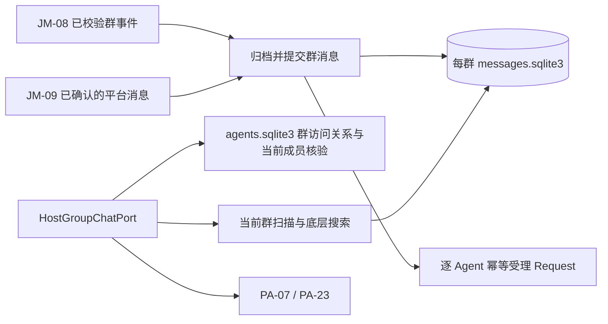

# 群公共记录与搜索设计方案

## 1. 元信息

| 项 | 值 |
| --- | --- |
| 建档日期 | 2026-10-17 |
| 范围 | JiuwenMate 群消息公共保存、当前群扫描、底层搜索、附件引用与 PA-23 宿主端口 |
| 方案成熟度 | 用户确认方案已实施；宿主契约见 [S_01](../specs/S_01_group-public-records.md) |
| 计划条目 | [JM-11](../designs/jiuwenmate-development-plan.md#jm-11-群公共记录与搜索) |
| 负责人 | 闫祉君 |
| 状态 | 进行中（归档、读取与生产接线已实现；真实飞书和生产执行配置联合验证待完成） |
| 设计依据 | [服务端架构](../designs/jiuwenmate-architecture.md)的宿主责任与隔离边界；agent-core 仓 `openjiuwen/harness/persistent_agent/docs/{features/F_23_group-chat-history-retrieval.md,specs/S_09_group-chat-and-knowledge.md}` |
| 关联 feature | [F_08 飞书接入](F_08_feishu-group-fanout.md)、[F_09 结果投递](F_09_web-and-feishu-result-delivery.md)、[F_21 跨群搜索](F_21_cross-group-search.md) |
| 验证摘要 | 已建立真实 SQLite、Gateway / SDK 替身和真实 core 执行窗口测试；运行结果见第 8 节，真实飞书未验证 |
| Refs | 开发计划 JM-11；2026-10-17 用户确认按群建目录，去掉目录中的 `local` 层 |

## 2. 背景、目标与范围

本项实施前，`group_chat_repository.py` 只有平台群与内部群身份映射，JM-08 保存每个 Agent 的 Request，执行驱动没有注入 `GroupChatPort`。本次增加共享归档和宿主端口，为 PA-07／PA-23 提供真实消息保存、权限过滤和当前群查询。

本项让同一群的多个 Bot 共享一份逻辑记录，保存人类与 Agent 消息、编辑和撤回事实，支持最近扫描与底层搜索。私聊对话和 Agent 私有窗口不进入公共记录。跨群目标解析和多群结果合并由 F_21 负责，复用本项数据与同一个端口，不新增搜索工具。

附件引用属于本项；完整文件投递、历史全量回拉和跨来源派生内容失效不包含在本次范围。创建 `attachments/` 不等于已经下载附件或已授予文件工具读取权限。2026-10-30 起，频道记录页同时读取钉钉群归档；钉钉来源明确标记为机器人已收到的部分记录。

## 3. 设计约束、假设与待决问题

- 已确认目录：所有者自己的数据根目录下，`jiuwenmate/group_messages/<group_id>/`；每群一个消息库与附件目录；不增加 `namespace_id` 目录层。
- 已确认权限规则：Bot 入群允许其绑定 Agent 接入，不新增群白名单、审批或工作空间权限；读取仍检查当前 Agent—群关系，不能以历史事件作为永久授权。
- 数据身份仍含 `namespace_id`；去掉目录层不解除租户与 Agent 隔离。同一数据根目录内的内部 `group_id` 必须唯一，不能由群名称或平台输入直接拼路径。
- 已按本地锁定的飞书 SDK 核对成员查询、群名、消息查询及撤回／Bot 入退群／群更新订阅；编辑通过读取前的消息查询刷新。无法确认当前授权时拒绝读取；真机证明仍是开放条件。
- 每个群的公共记录最多保留最近 5000 条；更早的消息在写入或读取时删除。删除某个 Agent 只删除其访问关系，不因此删除其他 Agent 共用的群记录。扩容后此前已删除的消息无法恢复。

## 4. 总体方案与设计取舍

### 4.1 方案概览



归档和 Request 受理使用不同数据库，图中的先后顺序不表示跨库事务。只有公共消息提交成功才唤醒执行；归档成功但派发失败时，重投按消息 ID 去重并继续受理。

### 4.2 关键决策

- **D-01 按群存储，共享一份记录。** 同群多 Bot 不复制正文到各 Agent 办公目录。使用用户确认的布局，接受跨群查询需要访问多个数据库的代价。
- **D-02 访问关系由宿主管理。** 在现有 `agents.sqlite3` 中保存关系，公共记录不放进任何 Agent 的 `workspace_read` 范围。关系结构和状态由本方案唯一维护，F_21 消费它。
- **D-03 先归档再决定执行。** 自身 Bot 回声只抑制 Request 派发，不抑制公共归档；PA-07 忽略、请求取消或排队失败不能抹掉已经收到的群消息。
- **D-04 查询事实与窗口事实分开。** PA-23 合并补读、去重和排除触发消息；宿主只提供当前群稳定扫描及可信位置，不另写窗口组装器。

### 4.3 替代方案与排除理由

| 实际候选 | 处理及原因 |
| --- | --- |
| 所有群共用 `group_messages/messages.sqlite3` | 用户选择每群独立目录与数据库，便于按群查看和管理；不采用统一消息库 |
| `group_messages/local/<group_id>/` | 用户确认去掉 `local` 目录层；数据内部保留 namespace |
| 每 Agent 各保存一份群消息与权限文件 | 正文重复、撤回难同步；办公资料可写也不适合作为宿主授权依据 |

## 5. 详细设计

### 5.1 存储目录及身份

```text
<用户数据根目录>/jiuwenmate/
├── agents.sqlite3
├── group_messages/
│   ├── <group_id_1>/
│   │   ├── messages.sqlite3
│   │   └── attachments/
│   └── <group_id_2>/
│       ├── messages.sqlite3
│       └── attachments/
└── workspaces/<namespace_id>/<agent_id>/
```

根路径复用 `default_data_dir()`，默认位于所有者本地 `.jiuwenswarm/jiuwenmate/`，尊重已有数据根目录配置。群目录只使用 `GroupChatRepository` 生成、登记并核实的内部 ID；群改名不改目录。

`group_chats` 增加数据根目录内 `group_chat_id` 唯一约束以及群名信息。现有重复 ID 若跨 namespace 冲突，升级时明确报错，不让两个群共用目录，也不未经核对自动改已有 Session 引用。每个消息库的 `archive_info` 保存 schema 版本、namespace、内部群 ID 和平台群身份；打开时逐项匹配。不存在、损坏或归属错误的数据库不按空库返回，查询不会自动创建它。

### 5.2 数据模型与访问关系

实际表结构由归档及关系仓储的 schema 维护；以下说明其语义，不复制完整 DDL。

| 位置 / 数据 | 关键字段及约束 |
| --- | --- |
| `agents.sqlite3` / `group_chats` | namespace、内部群 ID、平台、平台群 ID、可核实群名；保留现有平台映射唯一性 |
| `agents.sqlite3` / `agent_group_access` | namespace、agent_id、group_id、app_id、`status(active/left/unknown)`、visible_from、verified_at、revision、source_ref；关系键为 namespace＋Agent＋群＋app。不冗余保存 joined_at／left_at，当前状态与可信时间、来源共同表达边界 |
| 每群库 / `archive_info` | 身份、schema 版本、内容修订号、已知采集缺口；最大 ingest_seq 从消息表求得，不宣称拥有平台全量历史 |
| 每群库 / `messages` | message_id、固定 ingest_seq、GroupMessage JSON、UTC 微秒接收时间、平台修订时间与 source_ref；namespace／群身份由 archive_info 统一约束 |
| 每群库 / 撤回依据 | message_id 与可信撤回事件身份；允许正文首次收到前先保存撤回标记，后续重投也不得恢复正文 |

`visible_from` 表示本次有效访问期的保守历史下界；有可信入群时间则使用它，只有首个有效入站事实时使用该事实时间并标明其不等于真实入群时间。不能因另一 Bot 保存了更早消息就自动把这些消息开放给后来入群的 Agent。再次入群建立新的有效期，不自动恢复先前访问范围。

关系更新来自已校验入群／退群事实、绑定变更与当前平台成员状态核对。仅有 `group_chats` 行、旧 Request 或旧 `AccessSnapshot` 不能建立有效授权。迟到的旧入站事件不得把已退群关系重新激活；缺少可比较修订依据时，先核实当前状态，状态为 unknown 时不读取。

多个 Agent 共用一个群消息库，读取按各自当前访问关系过滤。不同所有者进程或机器不因同名平台群而共享本地文件。

### 5.3 关键模块与接口

| 模块 / 类 | 关键入口及责任 |
| --- | --- |
| `group_chat_repository.py` / `GroupChatRepository` | 扩展群名、当前访问关系和全局群 ID 冲突检查；保留现有 `resolve` / `get` |
| `conversation_archive.py` / `ConversationArchive` | `append(namespace_id: str, group_id: str, message: GroupMessage, *, source_ref: str) -> str`，同步事务提交并返回稳定消息引用；编辑／撤回处理必须携带可信修订依据 |
| `conversation_search.py` / `ConversationSearch` | `search_group` 提供单群、可见时间下界内的字面搜索与稳定排序；当前群扫描由归档组件负责，多群合并留给 JM-21 |
| `conversation_resources.py` / `ConversationResources` | 过滤不匹配来源的附件引用、归档已确认出站消息；本次不下载附件，不向模型暴露物理归档路径 |
| `ports/group_chat.py` / `HostGroupChatPort` | 组合执行身份校验、当前权限解析和归档查询，实现 core 公共 `GroupChatPort`；阻塞数据库 I/O 放到工作线程 |

对端方法沿用现有公共签名：

```python
async def recent_messages(execution: ExecutionContext, cursor: str | None = None,
                          limit: int = 20) -> GroupMessagesResult: ...
async def search_messages(execution: ExecutionContext,
                          query: GroupMessageQuery) -> GroupMessageSearchResult: ...
```

参数和返回 DTO 的权威来源为 agent-core 的 S_09 与公共导出。`recent_messages` 已实现并注入群执行；`search_messages` 明确返回 unavailable，F_21 负责完整跨群范围解析及多库合并，本项仅提供其底层单群数据服务。

### 5.4 入站、出站和提交顺序

1. JM-08 校验接收 app 绑定、事件身份和群来源，解析内部群 ID。
2. 建立或核实该 Agent 的当前访问关系，再以群消息 ID 幂等保存公共消息。首次提交分配固定递增 `ingest_seq`；平台时间 `received_at` 不作为扫描进度。
3. 提交后才执行自身回声过滤、Request 构造与 Scheduler 受理。各 Agent 的 Request 仍按原身份分别去重；公共归档不采用逐 Agent 去重键。
4. JM-09 保存可靠平台发送 ACK 后，以 ACK 的消息 ID 和真实发送内容归档；不能把模型候选或尚未确认发送的内容当作群消息。自身回声与 ACK 按同一消息 ID 汇合；两者字段冲突需核对，不静默覆盖。
5. 发送 ACK 已保存而归档失败时，仅重试归档；不重新发送消息或重跑任务。归档已提交但 Request 未受理时只补受理。若渠道不能保证失败重投，应记录采集缺口，不能承诺无损收集。

`queued_request` 是相对于当前 Agent 的派发状态，不能固定存为所有 Agent 共用的布尔值；返回时结合该 Agent 的 Request 状态计算。

实际接线：绑定 JiuwenMate 的渠道订阅撤回、Bot 入群／退群和群更新；AgentServer 经 Gateway 的 `jiuwenmate.group.inspect` / `jiuwenmate.group.response` 内部交接核实当前成员与消息状态，严格匹配 query_id、app_id、chat_id。消息正文不可核实时返回 unavailable，不回退旧正文。成员不明则整次拒绝。查询绑定当前配置，不将旧 app 授权沿用给新绑定。

`group_delivery_archives` 单独记录已确认 Feishu / DingTalk 消息是否成功归档，原投递扫描在重启或下一次扫描时补归档，不改变已发送状态，也不再调用渠道发送。钉钉附件归档只呈现已确认投递文件名，不形成可下载链接。

审查后补充：归档后的触发消息先重读，撤回先到时不再受理原文；排队期间发生变化的触发消息，在 ExecutionDriver 进入 core 前经端口重新授权、刷新与重读，撤回／不可核实时结束为 failed，不调用模型。更新输入只用于本次执行，不覆写原受理事实；不承诺取消已开始的模型调用。

换绑 Bot 时核对旧 app 当前配置，只退休已不再绑定当前 Agent 的关系（unknown，来源 `binding:`）；新的有效入站可重新开启这种绑定退休关系并重设下界，但不能恢复物理退群关系。多个仍配置的 active app 继续按歧义拒绝。补归档使用稳定键分页与到尾回绕，单个故障群的首批 100 条失败不能一直遮住后续健康群。

### 5.5 当前群扫描与底层查询

`recent_messages` 从执行的 Session 记录解析群并核对 Agent 归属，不接受模型参数指定其他群。无 cursor 时取本地最近 limit 条、按扫描顺序返回，供 PA-07 使用；有消息 ID cursor 时定位固定 `ingest_seq`，从其后正向读取。分页位置可使用宿主短 token，必须与消息 ID 游标区分并绑定当前 Agent／群；后续页同样重新鉴权。

首轮读取固定本地扫描上界。仅在范围确已扫描到时返回对应消息 ID 作为 `scanned_through`，不得直接给出尚未扫描的库尾位置。正文暂缺或撤回仍可推进可信扫描位置。游标不在授权区间、无法定位或有已知采集缺口时返回 incomplete 或抛出明确读取错误；不从头重读后声称增量完整。

消息 ID 游标用于 PA-23 触发补读：必须支持从早于当前 Session 游标的触发消息向后读。触发排除与合并由 PA-23 做，宿主不基于“已被其他 Agent 处理”删除公共记录。稳定入库序号不随编辑变化；读取正文始终采用最新可信状态。

底层关键词按 Python Unicode `casefold` 后做字面子串比较，不能把 `%`、`_` 当通配符；时间统一 UTC，起止端点均包含，发送者精确匹配。搜索的授权目标、分页和完整性规则见 F_21。

### 5.6 附件与生命周期

实际下载的附件存放在本群 `attachments/`，使用宿主生成的文件名，保留平台来源与校验信息；不按用户文件名拼任意路径。下载能力未接通时只保留带来源的引用并准确标记可读状态，不伪造本地文件。

撤回或附件权限失效后，后续查询不返回可用正文／文件入口；对已下载副本进行撤销访问和清理，物理删除重试不影响先拒绝读取。该规则不承诺擦除此前已经进入模型窗口的内容。

Agent 普通文件读取不能直接访问群消息库、访问关系或附件根目录。文件是否可公开投递由文件／结果链另行判断，不能以群记录可检索代替附件下载或发送授权。

## 6. 影响面与实施设计

| 顺序 | 文件 / 接入点 | 修改与独立验证产物 |
| --- | --- | --- |
| I-01 | `group_chat_repository.py`、`conversation_archive.py` | 创建访问关系与每群数据库、归属校验、消息去重和撤回；使用临时所有者数据根目录验证 |
| I-02 | `conversation_search.py`、`conversation_resources.py` | 当前群扫描、底层搜索与附件引用；验证缺口、游标、重复和状态 |
| I-03 | `feishu_group_fanout.py`、Gateway Feishu 标准化与内部 E2A | 归档前置、当前成员事实、编辑／撤回事件、群名更新；保持个人版入口分界 |
| I-04 | `delivery_service.py` | 确认消息归档及失败后只补归档，不重发 |
| I-05 | `ports/group_chat.py`、`agent_manager.py`、`execution_driver.py`、`spec_provider.py` | 注入并核对宿主端口归属；群执行接通 PA-07／PA-23；F_21 未就绪时搜索明确不可用，不静默缩小查询范围 |
| I-06 | `tests/unit_tests/server/jiuwenmate/`、Gateway 及跨仓集成测试 | 建立下节测试入口，记录本地与真机证据 |

定稿宿主契约已同步 [S_01](../specs/S_01_group-public-records.md)，未改写整体架构；core 公共协议引用对端 S_09。开发计划是状态和验收 ID 的唯一台账。

## 7. 兼容与迁移

仅创建新版目录与数据表，不读取或迁移旧版群归档；不改变个人版、集群模式或既有 Agent 办公目录。现有 `group_chats` 只说明身份，不因升级自动变成有效访问关系。首次建立空消息库不得宣称已采集平台历史。

多库没有原子总提交，重启后以每群已提交消息为事实，按稳定平台消息 ID 补保存／受理。去掉 namespace 路径层后仍核对每个库的 namespace 和全局群 ID 唯一性。关闭本能力保留归档，不自动删数据。

## 8. 验证设计、执行记录与结论

### 8.1 验证设计

沿用开发计划验收 ID，不另立整项验收标准：

| ID | 技术准备、操作及预期 | 层级 |
| --- | --- | --- |
| JM-11-V-01 | 两个 Agent / Bot 并发收到同群消息，重投及重启后仍只有一个群库、一条消息，各 Agent 的 Request 各自幂等；归档后派发失败能只补派发 | 真实临时 SQLite＋Scheduler；飞书样本与真机分开 |
| JM-11-V-02 | 当前群近期读取及 M120 触发、M180 旧游标的补读；覆盖未知游标、分页、不可用正文、queued 标记；结果给出准确来源与扫描进度 | 真实宿主＋PA-23；PA-07 的独立近期判断回归 |
| JM-11-V-03 | 撤回先于原消息、迟到重投、退群／解绑、权限未知、损坏／缺失数据库、路径越界、跨 namespace ID 冲突及附件不可用；均不能读出无权内容或误报为空 | SQLite 与故障／成员端口替身，另做飞书验证 |

实际入口：`test_group_chat_port.py`、`test_feishu_group_production_wiring.py`、Gateway `test_persistent_group_fanout.py`、`test_commit_port.py` 及 `tests/integration_tests/jiuwenmate/test_group_records_real_core.py`。最后一项使用真实 core、真实 SQLite 与宿主端口，但模型为替身，不等于真实飞书验证。

### 8.2 实际记录与结论

2026-10-17：已实现第 6 节接入点并执行本地回归，先以缺失实现／错误行为的失败测试确认，再实现并回归。覆盖并发共享归档、独立 Request、自身回声、撤回先到、权限撤销与重新入群、消息状态刷新、分页签名与固定上界、更新及重复撤回、只补归档不重发、删除 Agent 保留公共记录及内部响应关联校验。真实飞书未执行，状态不记为整项完成。

环境：Swarm `jiuwenmate_0.2.8` 当前工作区、Python 3.12.12、本地 agent-core `jiuwenmate_v0.1.20` 工作区（含 PA-23），模型与飞书 SDK 调用为替身。测试环境缺少的 a4p 已按 `uv.lock` 指定提交安装到现有虚拟环境，未修改本地依赖配置文件。

最终合并回归 **412 项通过、4 项排除**（72.42 秒）。覆盖 JiuwenMate 服务端、群分发、真实 core 背景读取，以及个人版 Feishu 上传、流式卡片、IM 适配、渠道配置、文件分发和模式切换。排除项均已实际运行并定位：

- `test_core_rejects_group_message_without_group_chat_port`：既有测试 Spec 未提供新 PA-18 所需容量配置，因此先报容量错误，未到其预期的缺少群端口断言；新增真实 core 用例显式提供容量配置验证本项链路。
- `test_public_views_never_carry_model_credentials`、`test_window_data_lives_only_in_the_private_database`：Windows 不满足其 POSIX 0600／0700 模式断言。
- `test_a_symlink_out_of_the_office_is_forbidden`：当前 Windows 进程无创建符号链接权限（WinError 1314），尚未进入业务断言。

可复现命令（仓库根目录；`-k` 只排除上述四项）：

```powershell
.venv/Scripts/python.exe -m pytest tests/unit_tests/server/jiuwenmate tests/unit_tests/gateway/test_persistent_group_fanout.py tests/integration_tests/jiuwenmate/test_group_records_real_core.py tests/unit_tests/channel/test_feishu_upload.py tests/unit_tests/gateway/test_feishu_streaming_card.py tests/unit_tests/gateway/test_feishu_im_adapter.py tests/unit_tests/gateway/test_channel_manager_config.py tests/unit_tests/gateway/test_channel_manager_file_fanout.py tests/unit_tests/gateway/test_message_handler_mode.py -q -o addopts= -o asyncio_mode=auto -W ignore::SyntaxWarning -k 'not test_core_rejects_group_message_without_group_chat_port and not test_public_views_never_carry_model_credentials and not test_a_symlink_out_of_the_office_is_forbidden and not test_window_data_lives_only_in_the_private_database'
```

此结果不等于全仓测试通过，也不证明真实飞书、浏览器或真实模型可用；本轮未运行格式化或静态检查工具。

真实 core 集成文件覆盖直接公共入口、宿主 ExecutionDriver 自动注入群端口、已排队触发消息撤回三种场景；前两条路径完成参与判断、背景入窗、正式执行及事件持久化，第三条证明撤回后不进入模型。上述场景已计入合并回归，不重复累加。

独立审查发现并修复了三个边界：撤回正文绕过归档进入任务、旧绑定关系阻断新 Bot、最早 100 条失败归档饿死后续群。均新增失败测试后修复；进一步覆盖 A→B→A 换绑，以及 unknown／解绑退休关系重新入群必须重置可见下界。复核确认上述问题已处理，修订后重新运行完整的上述定向合并命令得到 412 项通过；未确认新的个人版回归。

## 9. 风险与已知遗留

- JM-21 的跨群目标解析、权限过滤与多群分页尚未实施，当前 search_messages 不对外开放；不得将底层单群搜索当作跨群功能完成。
- 飞书群名、成员、撤回与消息刷新已接线但仍须真实账号联调，事件断连重投与实际凭据权限也须验证；覆盖起点前的历史不在首期承诺内。
- 正式 core 执行还需宿主按最新 PA-18 提供容量配置与可靠计数支持；当前 Swarm 发布链未见完整适配。此项不阻止归档组件开发，但会影响真实 PA-07／23 执行验证。
- PA-11 换窗、PA-12 私有历史检索不是本项归档和当前群读取的硬前置；联合长上下文场景分别等待对应能力，不将它们的缺口计作群归档失败。

## 10. 设计演进与修订

### 2026-10-30 钉钉员工群记录展示

频道记录复用 `ChannelRecords` 与 JiuwenMate 频道页；同名群不再合并隐藏。钉钉入站消息成功归档后标记已知采集缺口，页面展示“仅含 WorkSwarm 实际收到并保存的钉钉消息”；已确认的出站文本和文件仍通过共享投递归档流程入库。消息读取增加签名旧记录游标、时间展示和文件名卡片；每群保留上限由 100 增至 5000。接入前被清理的数据和钉钉未送达机器人的消息无法补回。实现验证待执行；真实钉钉页面验收未执行。

### 2026-10-20 减少群读取的重复查询

当前群读取保留刷新前、刷新后的实时成员校验；仅删除消息批量刷新中重复的成员和群名查询。内部 `group.inspect` 无消息 ID 时返回成员事实，有消息 ID 时只读取指定消息并返回 `status=ok`；`ok` 不代表授权，通过 S_01 的请求类型关联校验防止被当作成员成功响应。群名在每个渠道实例内缓存 300 秒、最多 256 群；只缓存成功名称，不缓存成员资格。缓存期间名称可能短暂过时，成员退群与未知状态仍即时拒绝；进程重启清空缓存。本次不改变跨群搜索规则或工作空间权限。已验证名称缓存与过期、实时撤权、消息跨群校验、响应类型关联及默认生产刷新接线；命令、数量和已知既有失败统一见 [F_09 第 8.2 节](F_09_web-and-feishu-result-delivery.md#82-实际执行与证据)。尚未实测真实飞书耗时，不据减少调用数量宣称响应时间已达标。

2026-10-17：用户选择每群独立的 `messages.sqlite3` 与 `attachments/`，并去掉 `local` 目录层；因此替代此前讨论的统一消息库布局。代码和数据库中的 namespace 继续保留，Agent—群关系保存在 `agents.sqlite3`。本次仅完成方案记录。

2026-10-17（实施）：按批准方案开发归档、成员核验、消息状态刷新、出站补归档与真实 core 接口接线，补充 S_01。群名采用独立详情表；权限状态及 visible_from、verified_at、source_ref 足以表达当前边界，不增加重复时间字段。仅正常绑定的 JiuwenMate 渠道进入新链，个人版普通渠道分支保持原路径。
