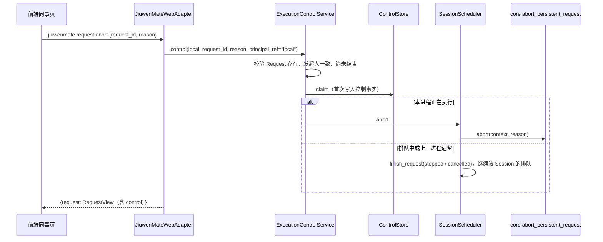

# 执行控制服务设计方案

## 1. 元信息

| 项 | 值 |
| --- | --- |
| 建档日期 | 2026-10-14 |
| 范围 | jiuwenswarm：`server/jiuwenmate/execution_control_service.py`（新增）、`session_scheduler.py`（`abort`）、`agent_manager.py`、`web_adapter.py`、`common/schema/message.py`、`gateway/channel_manager/web/app_web_handlers.py`；前端 `channels/web/frontend/src/features/jiuwenmate/` 与 jiuwenmate 文案 |
| 方案成熟度 | 已确认（按 jiuwenswarm 仓 `AGENTS.md` 的变更闸门先提交分析与改动方案，2026-10-14 经负责人确认） |
| 计划条目 | [JM-12](../designs/jiuwenmate-development-plan.md)：执行控制服务 |
| 负责人 | 常钰聪 |
| 状态 | 待验收（宿主组件与 core 正式中止入口均已验证，模型为替身；浏览器验收与飞书入口待执行） |
| 设计依据 | [JiuwenMate 服务端架构设计](../designs/jiuwenmate-architecture.md) 第 8.3、9.1 节，第 11.5 节“顺序、控制与关闭”“权限与凭据” |
| 关联 feature | 前置：[F_07 会话调度与执行驱动](F_07_execution-driver.md)；页面：[F_10_02 Web 私聊、历史与状态](F_10_02_web-private-chat.md)；后续：JM-13 续做与恢复、JM-08 飞书入口 |
| 验证摘要 | 见第 8 节 |
| Refs | 无独立 issue；需求来源为开发计划 JM-12 |

## 2. 背景、目标与范围

### 2.1 背景与问题

JM-07 的 `SessionScheduler.abort` 能够中断本进程正在执行的 Request，也能结束排队中的 Request，但没有权限检查，也不保存控制事实；对上一进程遗留为 `dispatched` 的 Request 返回 `CONFLICT`，该 Session 的排队消息因此一直无法继续。Web 页面没有停止或取消入口。

### 2.2 目标与关键场景

| 场景 / 触发条件 | 当前行为 | 目标行为 / 可观察变化 |
| --- | --- | --- |
| 同事正在回复 | 无法中断 | 发送按钮变为“停止”；点击后回复中断，结果为“已停止”，同一会话的下一条消息继续执行 |
| 消息仍在排队 | 无法撤回 | 消息旁显示“取消”；点击后该消息不再执行，结果为“已取消” |
| 他人控制该消息 | 不适用 | 返回 `FORBIDDEN`，不记录控制，不中断执行（JM-12-V-01） |
| 重复点击或并发控制 | 不适用 | 只中断一次，之后返回第一次的控制事实（JM-12-V-02） |
| 中断时出错 | 不适用 | 控制事实仍保留，标记为 `failed` 并记录原因（JM-12-V-03） |
| 上一进程遗留的执行中消息 | 返回 `CONFLICT`，会话无法继续 | 直接结束为“已停止”或“已取消”，会话的排队消息继续执行 |

### 2.3 本次范围与非目标

- 本次包含：控制服务与控制事实表；`jiuwenmate.request.abort` 接口；`RequestView.control` 字段；Web 页面的停止与取消入口；调度器对遗留 Request 的处理。
- 本次不包含：
  - 修改 agent-core；
  - 个人版停止与 `chat.*` 事件；
  - 确认卡片与 `resume_persistent_request`；
  - 管理者授权：须等 JM-08 提供 IM 身份后再接入；
  - 飞书入口：随 JM-08 接入，届时复用本服务；
  - 有控制事实的 Request 不续做的执行逻辑：由 JM-13 读取 `ControlStore` 实现。

## 3. 设计约束、假设与待决问题

- **已确认约束与依赖：**
  - core 的 `abort_persistent_request(context, reason)` 已在 `9eb336b4` 提供：`stop` 产生 `EXECUTION_PAUSED`（`reason="stopped"`），结果为 `stopped`；`cancel` 产生 `EXECUTION_FINAL`（`status="cancelled"`），结果为 `cancelled`。结果锁定后，core 忽略之后的控制。
  - 执行驱动先保存中止原因，core 尚未开始执行时由 `_attach` 移交（JM-07）。
- **负责人确认（2026-10-14）：**
  - 权限：只有发起人可以控制，即 `principal_ref` 等于 Request 访问快照中的 `principal_ref`；Web 的主体固定为 `local`。
  - 页面：执行中时发送按钮变为“停止”（`reason=stop`）；排队中的消息显示“取消”（`reason=cancel`）。
- **关键假设：** 与 F_10 相同，本机单用户，`namespace_id` 固定为 `local`。
- **待决问题：** 管理者授权的判定依据（随 JM-08 确定）。

## 4. 总体方案与设计取舍

### 4.1 方案概览

### 4.2 关键决策

#### D-01 先写控制事实，再中断

- 选择与依据：控制事实是 JM-13 判断“不自动续做”的依据，必须先于中断落库。中断抛出异常时，事实保留并标记为 `failed`，原因写入 `detail` 与日志（JM-12-V-03）。
- 实现体现：`ControlStore.claim`、`ControlStore.fail`、`ExecutionControlService.control`。

#### D-02 每个 Request 只接受一次控制

- 选择与依据：`request_controls` 以 `(namespace_id, request_id)` 为主键，`claim` 使用 `INSERT OR IGNORE`。只有写入成功的调用才执行中断；重复或并发的调用直接返回已保存的事实，即使原因不同。这与 core “结果锁定后忽略控制”的语义一致。
- 实现体现：`ControlStore.claim`；验证见 JM-12-V-02。

#### D-03 按 Request 状态选择结束方式

| 状态 | 处理 |
| --- | --- |
| 本进程正在执行 | 经执行驱动调用 core 中止；结果由 core 终止事件决定 |
| `queued` | `finish_request` 直接结束为 `cancelled`（`cancel`）或 `stopped`（`stop`） |
| `dispatched` 但不在本进程（上一进程遗留） | 同 `queued`；该 Session 重新加入调度，排队消息继续执行 |
| `ended` 且无控制事实 | 返回 `CONFLICT`，不写入控制 |

- 选择与依据：调度器在锁内重新确认 Request 是否在执行，避免与派发并发时误判。遗留 Request 原本返回 `CONFLICT`，会话因此一直无法继续；改为直接结束，使用户的停止或取消产生实际效果。
- 实现体现：`SessionScheduler.abort`、`SessionScheduler._run_of`。

#### D-04 控制事实单独建表

- 选择与依据：JM-03 的 Request 表记录受理与结束，控制是另一类事实，且可能在结束前写入。单独建表不改动既有表结构，与 `web_conversations` 相同，存放在同一个 `agents.sqlite3` 中。
- 实现体现：`ControlStore`。

### 4.3 替代方案与排除理由

| 候选 / 关联决策 | 关键差异 | 拒绝原因 | 重新评估条件 |
| --- | --- | --- | --- |
| R-01 / D-01 中断成功后再记录 | 不会留下失败的事实 | 中断异常时丢失控制，JM-13 可能误续做 | 无 |
| R-02 / D-02 允许后一次控制覆盖前一次 | 可从停止改为取消 | core 已锁定结果，覆盖后事实与执行结果不一致 | core 支持修改结果时 |
| R-03 / D-03 遗留 Request 继续返回 `CONFLICT` | 不改调度器 | 会话无法继续，用户的停止没有效果 | JM-13 接管遗留 Request 后可复核 |

## 5. 详细设计

### 5.1 模块责任

- `ControlStore`：`request_controls(namespace_id, request_id, reason, principal_ref, status, detail, requested_at, updated_at)`；`claim`、`fail`、`get`。
- `ExecutionControlService.control`：校验 `request_id` 与 `reason`；Request 不存在返回 `NOT_FOUND`；发起人不一致返回 `FORBIDDEN`；已有控制则返回该控制；已结束返回 `CONFLICT`；写入控制后调用调度器。
- `SessionScheduler.abort`：见 D-03。
- `AgentManager.control_request`：以访问快照的 `principal_ref` 调用控制服务，返回最新的 `RequestView`；`RequestView` 增加 `control`。
- 前端：`jiuwenmateApi.abortRequest`；`usePrivateChat.abort`；`ConversationComposer` 的 `onStop`、`stopping`；会话页的“取消”按钮与控制状态文案。

### 5.2 接口

| 方法 | 参数 | 返回 `payload` |
| --- | --- | --- |
| `jiuwenmate.request.abort` | `request_id`、`reason`（`stop` / `cancel`） | `{request: RequestView}` |

`RequestView.control`：无控制时为 `null`，否则为 `{request_id, reason, status, detail, requested_at, updated_at}`；`status` 为 `accepted`（已结束或已请求中断）或 `failed`（中断时出错）。控制方的 `principal_ref` 不返回。

错误码：`BAD_REQUEST`（参数不合法）、`NOT_FOUND`、`FORBIDDEN`、`CONFLICT`。

### 5.3 页面状态

| 条件 | 页面显示 |
| --- | --- |
| 当前会话有处理中的消息 | 发送按钮变为“停止” |
| 停止已受理，回复尚未结束 | “停止”按钮不可用；消息状态显示“正在停止…” |
| 排队中且无控制 | 状态“排队中”旁显示“取消” |
| 取消已受理，尚未结束 | “正在取消…” |
| 控制为 `failed` | “停止失败：原因” |
| 已结束 | 按结果显示“已停止”“已取消”等 |

停止期间按 Enter 仍可发送新消息，新消息进入排队。

## 6. 影响面与实施设计

| 实施项 | 文件 | 修改内容 | 验证产物 |
| --- | --- | --- | --- |
| I-01 | `execution_control_service.py`（新增） | `ControlStore`、`ExecutionControlService`、`RequestControl` | JM-12-V-01～V-04 |
| I-02 | `session_scheduler.py` | `abort` 按 D-03 处理遗留 Request；新增 `_run_of` | JM-12-V-03 |
| I-03 | `agent_manager.py` | 创建控制服务；`control_request`；`RequestView.control` | JM-12-V-01、V-05 |
| I-04 | `web_adapter.py`、`message.py`、`app_web_handlers.py` | `jiuwenmate.request.abort` 方法，加入运行时方法与两个转发集合 | JM-12-V-05 |
| I-05 | 前端 `jiuwenmateApi.ts`、`usePrivateChat.ts`、`components/ConversationComposer.tsx`、`pages/ColleagueWorkspacePage.tsx`、`jiuwenmate.css`、中英文文案 | 停止与取消入口 | JM-12-V-05 |
| I-06 | [`test_execution_control_service.py`](../../../../../tests/unit_tests/server/jiuwenmate/test_execution_control_service.py)（新增）、`test_web_private_chat.py`、`test_web_real_core.py`、前端 `tests/jiuwenmateApi.test.mjs` | 单测、集成测试与前端接口测试 | — |

兼容核对：个人版方法与事件不变；新方法以 `jiuwenmate.` 开头；既有表结构不变。

## 8. 验证设计、执行记录与结论

### 8.1 验证设计与通过条件

| 验证 ID | 场景 | 验证入口 | 预期结果 | 层级 |
| --- | --- | --- | --- | --- |
| JM-12-V-01 | 权限与目标范围 | `test_execution_control_service.py` | 非发起人返回 `FORBIDDEN`，无控制记录、无中断；控制只结束目标 Request，其他 Session 不受影响 | 单测（真实 SQLite 与调度器，core 入口替身） |
| JM-12-V-02 | 重复与并发控制 | 同上 | 重复控制返回第一次的事实；三次并发只中断一次；已结束且无控制返回 `CONFLICT` | 单测 |
| JM-12-V-03 | 排队、遗留与中断失败 | 同上 | 排队消息不执行即结束；遗留 Request 结束后同一 Session 的排队消息执行；中断异常时控制保留为 `failed` | 单测 |
| JM-12-V-04 | 经 core 正式中止入口 | `test_web_real_core.py` | 模型输出中途停止结果为 `stopped`、取消结果为 `cancelled`；之后同一会话的新消息正常回复 | 集成测试（真实 core，模型为本地替身） |
| JM-12-V-05 | Web 接口与页面 | `test_web_private_chat.py`；`npm run test:jiuwenmate-api`；浏览器人工确认 | 页面可停止处理中的消息、取消排队消息，历史携带控制；参数错误返回对应错误码；前端正确解析控制 | 单测、前端单测、人工 |

### 8.2 实际执行与证据

2026-10-14，在 `fork/huenrui_jiuwenswarm` 工作区执行，未提交。

| 验证 ID | 命令 | 结果 | 覆盖内容 |
| --- | --- | --- | --- |
| JM-12-V-01～V-03 | `pytest tests/unit_tests/server/jiuwenmate/test_execution_control_service.py` | 10 passed | 见 8.1 |
| JM-12-V-04 | `pytest tests/integration_tests/jiuwenmate/test_web_real_core.py` | 5 passed（新增 2 项） | 停止与取消各 1 项 |
| JM-12-V-05 | `pytest tests/unit_tests/server/jiuwenmate/test_web_private_chat.py` | 32 passed（新增 4 项） | 停止、取消与 3 种错误码 |
| — | `pytest tests/unit_tests/server/jiuwenmate tests/integration_tests/jiuwenmate` | 210 passed（连续 3 次） | JM-01～JM-10 不受影响 |
| — | `pytest tests/unit_tests/server tests/unit_tests/gateway tests/unit_tests/channel tests/integration_tests/jiuwenmate` | 2765 passed，1 skipped | AgentServer、Gateway 与 Web 渠道既有行为不变 |
| JM-12-V-05 | `npm run test:jiuwenmate-api` 及其余 6 个 `test:jiuwenmate-*` | 16 passed；其余合计 26 passed | 新增控制解析与接口调用 1 项 |
| — | `ruff check`、`ruff format`（改动的后端文件）；`eslint src/features/jiuwenmate`；`npm run build`（含 `tsc`） | 通过 | — |
| JM-12-V-05（浏览器） | 重启 AgentServer、Gateway 并刷新页面后停止与取消 | 待执行 | 按钮切换与状态文案 |

### 8.3 验证结论

宿主组件验证通过：权限、幂等、目标范围、排队与遗留 Request 的处理、中断失败时的事实保留均符合 8.1 的预期。core 正式中止入口在模型输出中途生效，会话随后可以继续。尚未执行的是浏览器验收；飞书入口与管理者授权随 JM-08 接入。

## 9. 风险与已知遗留

### 9.1 设计风险

| 风险 / 触发条件 | 影响 | 已有应对措施 | 核实方式 |
| --- | --- | --- | --- |
| core 中止后迟迟不产生终止事件 | 页面持续显示“正在停止…” | 执行驱动在流结束后才释放 Session；无终态时记为 `failed`（JM-07） | 浏览器验收时观察 |
| 控制在 Request 恰好结束时到达 | 控制事实已写入，但结果为 `completed` | 页面以结果为准显示；JM-13 只对未完成的 Request 判断是否续做 | 待 JM-13 复核 |

### 9.2 已知遗留

| 遗留项 | 性质 | 影响与现有处置 | 后续入口 |
| --- | --- | --- | --- |
| 管理者授权 | 未实施 | 只有发起人可以控制 | JM-08 |
| 飞书停止 / 取消入口 | 未实施 | 只有 Web 入口 | JM-08 |
| 有控制事实时不续做 | 重启扫描已实施 | 遗留 Request 有控制事实时按控制结束，不记为待续做（见 [F_13](F_13_recovery.md)）；续做执行待 PA-18 | JM-13 |
| 浏览器验收 | 未执行 | 接口与前端解析已测试 | S1 |

## 10. 设计演进与修订

- 2026-10-14：建档并实现。
