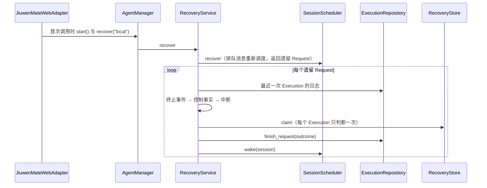

# 续做与恢复服务设计方案

## 1. 元信息

| 项 | 值 |
| --- | --- |
| 建档日期 | 2026-10-15 |
| 范围 | jiuwenswarm：`server/jiuwenmate/recovery_service.py`（新增）、`session_scheduler.py`（`wake`）、`agent_manager.py`、`web_adapter.py`；前端 `channels/web/frontend/src/features/jiuwenmate/` 与 jiuwenmate 文案 |
| 方案成熟度 | 已确认（按 jiuwenswarm 仓 `AGENTS.md` 的变更闸门先提交分析与改动方案，2026-10-15 经负责人确认） |
| 计划条目 | [JM-13](../designs/jiuwenmate-development-plan.md)：续做与恢复服务；重启扫描、异常核对和中断后续做 |
| 负责人 | 常钰聪 |
| 状态 | 进行中（重启扫描、异常核对和中断后续做已接入；停止后继续与条件恢复后的重新排队仍未接入） |
| 设计依据 | [JiuwenMate 服务端架构设计](../designs/jiuwenmate-architecture.md) 第 6.3、8.2、8.3 节 |
| 关联 feature | 前置：[F_04 事件提交端口](F_04_commit-port.md)、[F_07 会话调度与执行驱动](F_07_execution-driver.md)、[F_12 执行控制服务](F_12_execution-control.md) |
| 验证摘要 | 见第 8 节 |
| Refs | 无独立 issue；需求来源为开发计划 JM-13 |

## 2. 背景、目标与范围

### 2.1 背景与问题

JM-07 的 `SessionScheduler.recover` 在重启后重新调度排队中的 Request，但只返回上一进程遗留为 `dispatched` 的 Request，不作处理。`_pump` 随后跳过这些 Session，因此同一会话的后续消息一直排队，页面持续显示“服务重启，处理已中断”。终止事件已经保存、但写入 Request 结果失败的情况，表现相同。

core 在 `9eb336b4` 对带 `recovery_ref` 的执行仍然拒绝（PA-18 未接入），续做本身暂时无法执行。

### 2.2 目标与关键场景

| 场景 / 触发条件 | 当前行为 | 目标行为 / 可观察变化 |
| --- | --- | --- |
| 重启前 final 或 paused 已保存，Request 结果未写入 | Session 阻塞 | 按已保存的终止事件结束，不重跑（JM-13-V-01、V-03） |
| 重启前用户已停止或取消，core 未写出终止事件 | Session 阻塞 | 按控制原因结束为“已停止”或“已取消”，不进入续做（JM-13-V-02） |
| 执行中途进程退出，日志中无终止事件、无控制 | Session 阻塞 | Request 结束为“已暂停”，记为待续做；同一会话的后续消息继续执行 |
| 中断前已写出工具意图，但没有保存工具完成事件 | 不适用 | 记为“结果未确认”的工具调用，不推断为未执行（JM-13-V-03） |
| 再次重启 | 不适用 | 已结束的 Request 不再判断，也不再执行 |

### 2.3 本次范围与非目标

- 本次包含：重启扫描；按执行日志与控制事实结束遗留 Request；恢复判断表；调度器 `wake`；`RequestView.recovery`；页面显示待续做与未确认的工具调用。
- 已接入：中断且没有停止或取消时，原 Request 重新排队。新执行的 `recovery_ref` 指向被中断的执行，并在派发前写下执行链接。
- 仍不包含：停止后继续、条件恢复后的重新排队、确认卡片恢复 `resume_persistent_request`。进程仍在运行时写入 Request 结果失败，仍等到下次重启扫描收尾。

## 3. 设计约束、假设与待决问题

- **已确认约束与依赖：**
  - `tool.intent`、`execution.paused`、`execution.final` 是关键事件，返回前已落库；其他事件在后台写入，可能缺失（JM-04）。因此终止事件的有无可以作为判断依据，`tool.completed` 的缺失不能。
  - 控制事实由 JM-12 先于中断写入；有控制事实的 Request 不续做。
- **负责人确认（2026-10-15，续做已接入）：** 无终止事件、无控制事实的中断 Request 记为待续做，并按原序号重新排队。续做先于同一会话里更晚的消息执行。
- **关键假设：** 遗留 Request 都有至少一次 Execution（`start_execution` 与置为 `dispatched` 在同一事务中）；缺失时按 `failed` 结束并写日志。

## 4. 总体方案与设计取舍

### 4.1 方案概览

### 4.2 关键决策

#### D-01 只依据最近一次 Execution 的日志判断，从不重跑

- 选择与依据：日志中有 final 或 paused 时，按 `outcome_of` 得到结果；即使后续写入 Request 结果或清理失败，也不重新执行（JM-13-V-03）。没有终止事件时，再看控制事实；两者都没有才视为中断。
- 实现体现：`RecoveryService._judge`。

#### D-02 中断的 Request 结束为 `paused` 并记为待续做

- 选择与依据：core 暂不接受续做。保持 `dispatched` 会使 Session 一直阻塞；按新请求重新执行则可能重复已经发生的工具副作用。结束为 `paused` 与“停止后可继续”的语义一致，恢复判断表记录被中断的 `execution_id`，供 PA-18 接通后作为 `recovery_ref`。
- 代价与成立条件：同一会话中排在后面的消息先于续做执行。
- 实现体现：`RecoveryService._judge`、`RecoveryStore`。

#### D-03 缺少工具完成事件记为“结果未确认”

- 选择与依据：`tool.completed` 后台写入，可能在中断时丢失。已有 `tool.intent`、没有对应 `tool.completed` 的调用，记入 `unverified_tool_calls`；页面提示结果未确认，不推断为未执行。
- 实现体现：`unverified_tool_calls`。

#### D-04 每个 Execution 只判断一次

- 选择与依据：`request_recoveries` 以 `(namespace_id, request_id, execution_id)` 为主键，`claim` 使用 `INSERT OR IGNORE`，之后沿用第一次的判断。写入 Request 结果失败而再次扫描时，结果与第一次一致。
- 实现体现：`RecoveryStore.claim`。

### 4.3 替代方案与排除理由

| 候选 / 关联决策 | 关键差异 | 拒绝原因 | 重新评估条件 |
| --- | --- | --- | --- |
| R-01 / D-02 保持中断状态，Session 阻塞到 PA-18 | 保留续做顺序 | 会话长期不可用，只能逐条手动停止 | PA-18 接通后的顺序语义确定时 |
| R-02 / D-02 以新 Execution 重新执行 | 立即得到回复 | 可能重复工具副作用，违反“不重跑” | 无 |
| R-03 / D-03 缺少完成事件视为未执行 | 判断简单 | 普通事件可能缺失，会误判 | 无 |

## 5. 详细设计

### 5.1 模块责任

- `RecoveryStore`：`request_recoveries(namespace_id, request_id, execution_id, decision, outcome, unverified_tool_calls, decided_at)`；`claim`、`latest`。
- `RecoveryService.recover`：调用 `scheduler.recover`，逐个关闭遗留 Request 并 `wake` 其 Session；单个 Request 失败只写日志，不影响其他 Request。
- `SessionScheduler.wake`：把 Session 重新放入调度队列并派发。
- `AgentManager.recover`；`RequestView.recovery`。
- `JiuwenMateWebAdapter._runtime`：运行时启动后调用 `manager.recover`。
- 前端：`toChatRequest` 解析 `recovery`；会话页对待续做的 Request 显示“服务重启时中断，待续做”，有未确认的工具调用时附数量。

### 5.2 接口

`RequestView.recovery`：无判断时为 `null`，否则为 `{request_id, execution_id, decision, outcome, unverified_tool_calls, decided_at}`。

| `decision` | 含义 | `outcome` |
| --- | --- | --- |
| `closed_from_log` | 日志中已有终止事件 | 由终止事件决定 |
| `closed_by_control` | 发送者已停止或取消 | `stopped` / `cancelled` |
| `awaiting_continuation` | 中断，待续做 | `paused` |

## 6. 影响面与实施设计

| 实施项 | 文件 | 修改内容 | 验证产物 |
| --- | --- | --- | --- |
| I-01 | `recovery_service.py`（新增） | `RecoveryStore`、`RecoveryService`、`RequestRecovery`、`unverified_tool_calls` | JM-13-V-01～V-03 |
| I-02 | `session_scheduler.py` | 新增 `wake` | JM-13-V-01 |
| I-03 | `agent_manager.py`、`web_adapter.py` | 创建恢复服务；`recover`；`RequestView.recovery`；运行时启动改为调用 `manager.recover` | JM-13-V-01 |
| I-04 | 前端 `jiuwenmateApi.ts`、`pages/ColleagueWorkspacePage.tsx`、中英文文案 | 显示待续做与未确认的工具调用 | — |
| I-05 | [`test_recovery_service.py`](../../../../../tests/unit_tests/server/jiuwenmate/test_recovery_service.py)（新增）、前端 `tests/jiuwenmateApi.test.mjs` | 单测与前端解析测试 | — |

兼容核对：既有表结构不变；JM-12 的控制处理不变；个人版方法与事件不变。

## 8. 验证设计、执行记录与结论

### 8.1 验证设计与通过条件

| 验证 ID | 场景 | 验证入口 | 预期结果 | 层级 |
| --- | --- | --- | --- | --- |
| JM-13-V-01（重启扫描部分） | 按最近一次 Execution 的终止事件结束；中断时记为待续做 | `test_recovery_service.py` | final 记为 `completed`，stopped 记为 `stopped`，均不重跑；中断记为 `paused` 与 `awaiting_continuation`，`execution_id` 为原执行；同一会话的排队消息随后执行 | 单测（真实 SQLite 与调度器，core 入口替身，日志按上一进程写入） |
| JM-13-V-02（控制与幂等部分） | 有控制时不续做；每个 Execution 只判断一次 | 同上 | 控制取消记为 `cancelled`；终止事件优先于控制；再次重启不再判断、不再执行；同一 Execution 的第二次判断沿用第一次 | 单测 |
| JM-13-V-03 | 工具结果缺失时先查证 | 同上 | 有意图无完成的调用记为未确认，已完成的不列入；Request 不重跑 | 单测 |

### 8.2 实际执行与证据

2026-10-15，在 `fork/huenrui_jiuwenswarm` 工作区执行，未提交。

| 验证 ID | 命令 | 结果 | 覆盖内容 |
| --- | --- | --- | --- |
| JM-13-V-01～V-03 | `pytest tests/unit_tests/server/jiuwenmate/test_recovery_service.py` | 8 passed | 见 8.1 |
| — | `pytest tests/unit_tests/server/jiuwenmate tests/integration_tests/jiuwenmate` | 218 passed（连续 3 次） | JM-01～JM-12 不受影响 |
| — | `pytest tests/unit_tests/server tests/unit_tests/gateway tests/unit_tests/channel tests/integration_tests/jiuwenmate` | 2773 passed，1 skipped | AgentServer、Gateway 与 Web 渠道既有行为不变 |
| — | `npm run test:jiuwenmate-api` 及其余 6 个 `test:jiuwenmate-*` | 17 passed；其余合计 26 passed | 新增恢复判断解析 1 项 |
| — | `ruff check`、`ruff format`（改动的后端文件）；`eslint src/features/jiuwenmate`；`npm run build`（含 `tsc`） | 通过 | — |

### 8.3 验证结论

重启扫描与执行异常核对的宿主组件验证通过：遗留 Request 只依据已保存的事实结束，不重跑；中断的 Request 记为待续做，Session 随后继续。续做执行、停止后继续与条件恢复后的重新排队，须等 PA-17、PA-18 接通后实施并与真实 core 联合验证（S2c）。

## 9. 风险与已知遗留

### 9.1 设计风险

| 风险 / 触发条件 | 影响 | 已有应对措施 | 核实方式 |
| --- | --- | --- | --- |
| 中断的 Request 先结束，后续消息先执行 | 续做时窗口中已有后续轮次 | 记录原 `execution_id`；顺序语义待 PA-18 时确定 | PA-18 联调 |
| 进程运行中写入 Request 结果失败 | 该 Session 在本进程内阻塞 | 下次重启扫描按日志收尾 | 待评估运行中重试 |

### 9.2 已知遗留

| 遗留项 | 性质 | 影响与现有处置 | 后续入口 |
| --- | --- | --- | --- |
| 续做执行 | 已接入 | 中断的 Request 重新排队，新执行的 `recovery_ref` 指向被中断的执行 | 停止后继续与条件恢复仍未接入 |
| 停止后继续、条件恢复后重新排队 | 未实施 | 无入口 | PA-17、PA-18 |
| 工具结果核实 | 部分实施 | 只记录未确认的调用，不查询外部系统 | 续做接通时 |

## 10. 设计演进与修订

- 2026-10-15：建档并实现重启扫描与执行异常核对子范围。
