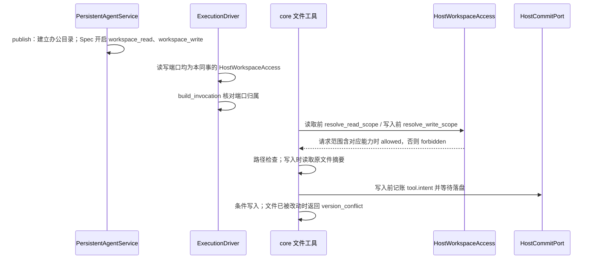

# 同事办公目录读写访问设计方案

## 1. 元信息

| 项 | 值 |
| --- | --- |
| 建档日期 | 2026-10-15 |
| 范围 | jiuwenswarm：`server/jiuwenmate/ports/workspace_access.py`、`spec_provider.py`、`service.py`、`models.py`、`execution_driver.py`、`agent_manager.py`、`web_adapter.py`；前端 `channels/web/frontend/src/features/jiuwenmate/` 与 jiuwenmate 文案 |
| 方案成熟度 | 已确认。只读部分（2026-10-15）：目录只建立不导入文件；只开放 Web 请求；系统提示补充相对路径说明。写入部分（2026-10-15）：整个办公目录可写，另设本会话私有草稿区；只开放 Web 请求；写入不经人工确认，依赖意图记账与条件写入 |
| 计划条目 | [JM-14](../designs/jiuwenmate-development-plan.md)：同事资源选择与隔离；本文覆盖“最小只读配置”与“办公目录写入”两个子范围 |
| 负责人 | 常钰聪 |
| 状态 | 进行中（办公目录读写已实现；Skill / MCP / 插件已在发布时装配。真实模型执行与浏览器验收未做） |
| 设计依据 | [JiuwenMate 服务端架构设计](../designs/jiuwenmate-architecture.md) 第 4.2、9.2 节；agent-core `persistent_agent/workspace/`（PA-14、PA-16）与 `execution/tool_intent_rail.py`（PA-15） |
| 关联 feature | 前置：[F_01 核心契约适配](F_01_core-contract.md)、[F_02 同事定义与配置发布](F_02_colleague-management.md)、[F_04 事件提交端口](F_04_commit-port.md)、[F_07 会话调度与执行驱动](F_07_execution-driver.md)；页面：[F_10 同事管理页面](F_10_web-colleague-management.md) |
| 验证摘要 | 见第 8 节 |
| Refs | 无独立 issue；需求来源为开发计划 JM-14 |

## 2. 背景、目标与范围

### 2.1 背景与问题

S1 私聊闭环要求同事能够读取用户提供的资料。此前 `spec_provider.HOST_OPEN_FEATURES` 只开放 `construction`，发布的 Spec 关闭 `enable_sys_operation`，执行端口不提供 `workspace_access`，同事没有任何文件工具。

core `9eb336b4` 已提供 PA-14：Spec 声明 `workspace_read` 且开启 `enable_sys_operation` 时，`PersistentWorkspaceReadRail` 只注册 `read_file` 与 `list_files` 两个工具。每次调用前，工具向宿主的 `workspace_access.resolve_read_scope(execution)` 取得读取范围，经 `validate_read_scope` 核对身份后，由 `resolve_read_path` 拒绝绝对路径、`..` 与越出范围的符号链接。宿主只需提供范围，不实现路径检查。

同一版本 core 也提供了 PA-16：Spec 声明 `workspace_write` 时，`PersistentWorkspaceWriteRail` 注册 `write_file` 与 `edit_file`。每次写入前，该 Rail 向宿主的 `workspace_write_access.resolve_write_scope(execution)` 取得写入范围，由 `resolve_write_path` 检查路径，并读取目标文件的内容摘要作为条件写入的前提；随后 PA-15 的 `PersistentToolIntentRail` 记账 `tool.intent` 并等待落盘，成功后才实际写入。文件在预检之后被改动时，写入返回 `version_conflict`。JiuwenSwarm 的 `HostCommitPort` 已在 `85b0e66d` 中验证：意图先落盘再产生副作用，落盘失败时副作用为零。

### 2.2 目标与关键场景

| 场景 / 触发条件 | 当前行为 | 目标行为 / 可观察变化 |
| --- | --- | --- |
| 用户在 Web 私聊中请同事查看资料 | 同事没有文件工具 | 同事用 `list_files`、`read_file` 读取自己办公目录中的文件 |
| 用户在 Web 私聊中请同事生成或修改文件 | 同事只能读取 | 同事用 `write_file`、`edit_file` 在自己办公目录中创建和修改文件；每次写入前记账 `tool.intent` |
| 两次写入针对同一文件，且文件在预检后被改动 | 不适用 | 后写入的一方得到 `version_conflict`，不覆盖他人的修改 |
| 访问其他 Session 的私有草稿 `sessions/<其他 session_id>/` | 不适用 | 读写都返回 `forbidden` |
| 模型请求办公目录之外的路径（`..`、绝对路径、指向外部的符号链接） | 不适用 | 工具返回 `forbidden`，回复中不含目录外内容与宿主路径 |
| 飞书群聊请求 | 不适用 | 读取与写入范围均为 `forbidden`，工具不访问任何文件 |
| 用户需要知道文件放在哪里 | 无入口 | 同事详情页“知识”分区显示办公目录的本机路径 |
| 删除同事 | 删除版本、Template 与窗口数据 | 同时删除其办公目录（含私有草稿） |

### 2.3 本次范围与非目标

- 本次包含：每个同事一个办公目录；读取与写入范围端口；`workspace_read`、`workspace_write` 开放与端口校验；Session 私有草稿区的隔离；发布时开启文件工具并补充路径说明；Web 运行时启动时重新发布；页面显示目录。
- 本次不包含：
  - 文件上传或导入：用户自行把文件放入目录（负责人确认）；
  - 飞书请求读写：S2b 再确定群聊的授权来源（负责人确认）；
  - Skill、MCP、插件装配：`SkillUseRail` 会同时注册 `read_file`、代码与命令工具，随 S2b；
  - 写入前的人工确认：PA-09 本轮不开发，写入依赖意图记账与条件写入（负责人确认）；
  - 引导模型使用私有草稿区：模型无法得知本会话的 `session_id`（见第 3 节）；
  - 删除会话时清理私有草稿：会话删除为软删除，窗口数据也保留；
  - 修改 agent-core。

## 3. 设计约束、假设与待决问题

- **已确认约束与依赖：**
  - core 每次读取或写入前都重新调用 `resolve_read_scope` / `resolve_write_scope`，宿主不缓存决定；`validate_read_scope` / `validate_write_scope` 要求 `agent_id`、`session_id`、`principal_ref`、`policy_revision` 与本次 Execution 一致。
  - 范围端口抛出异常时，core 按 `unknown` 拒绝且不返回原因。
  - `enable_sys_operation=True` 时，core 还会在全局资源中登记 shell 与文件系统操作（如 `execute_cmd`），但不作为本同事的能力挂载；同事的能力为 `list_files`、`read_file`、`write_file`、`edit_file`。
  - 写入 Rail 要求 SysOperation 的文件系统声明 `supports_conditional_write`；本机文件系统满足该条件，写入时自动创建父目录。
  - core 的 `read_file` 工具描述要求绝对路径，而路径检查拒绝绝对路径。
  - 构建 Agent 时，core 默认在后台探测模型是否支持图片输入，该调用不经过预算端口；`enable_read_image_multimodal=False` 可关闭。
  - 系统提示按同事版本发布、由各 Session 共用；core 的执行头（PA-06）只含 `request_id`、`execution_id` 与来源，不含 `session_id`。因此模型无法得知本会话私有草稿目录的名称。
- **负责人确认（2026-10-15）：** 只读部分见元信息；写入部分为整个办公目录可写并另设本会话私有草稿区、只开放 Web 请求、写入不经人工确认。
- **关键假设：** Web 本地用户是全部同事的所有者，因此 Web 请求可以读写任一同事自己的办公目录。
- **待决问题：** 飞书群聊的读写授权来源（群成员、绑定者或管理员），由 S2b 确定。

## 4. 总体方案与设计取舍

### 4.1 方案概览

### 4.2 关键决策

#### D-01 授权依据为请求的访问快照

- 选择与依据：Request 接受时冻结 `AccessSnapshot`。启动范围与来源范围都含 `workspace_read` 时，读取范围为 `allowed`；都含 `workspace_write` 时，写入范围为 `allowed`；否则为 `forbidden`。Web 的 `WEB_ACCESS` 加入两项能力；飞书的访问快照不加入，因此飞书请求被拒绝，无需按渠道判断。
- 实现体现：`HostWorkspaceAccess.resolve_read_scope`、`resolve_write_scope`，`web_adapter.WEB_ACCESS`。

#### D-02 目录按命名空间与同事划分，路径检查交给 core

- 选择与依据：目录为 `<数据根>/workspaces/<namespace_id>/<agent_id>`，与数据库、Template、窗口数据分开。名称只允许字母、数字、`_`、`-`，避免由标识构成越界路径。宿主不重复实现路径检查，由 core 的 `resolve_read_path`、`resolve_write_path` 统一处理。
- 实现体现：`WorkspaceStore`。

#### D-03 端口由宿主构造并在调用前核对

- 选择与依据：Spec 声明 `workspace_read` 或 `workspace_write` 时，`build_invocation` 要求对应的 `ports.workspace_access` / `ports.workspace_write_access` 是本同事的 `HostWorkspaceAccess`，否则拒绝调用，避免以他人的范围或空端口执行。端口收到其他同事的 Execution 时抛出异常，core 按 `unknown` 拒绝。
- 实现体现：`spec_provider.build_invocation`、`ExecutionDriver`。

#### D-04 系统提示补充路径说明

- 选择与依据：core 的工具描述要求绝对路径，与路径检查相反，模型按描述调用会被拒绝。不修改 core 时，在发布的系统提示末尾固定追加 `WORKSPACE_PROMPT`，说明使用相对路径、修改前先读取、遇到版本冲突时重新读取，以及不读写 `sessions/`。
- 实现体现：`service.WORKSPACE_PROMPT`、`publish`。

#### D-05 Web 运行时启动时重新发布

- 选择与依据：旧版本 Spec 未开启文件能力。运行时首次启动前，`refresh_published` 重新发布没有未发布修改的同事；设置未变时 `publish` 沿用原版本，有未发布修改的同事保持原版本，避免把草稿发布出去。
- 实现体现：`PersistentAgentService.refresh_published`、`JiuwenMateWebAdapter._runtime`。

#### D-06 整个办公目录可写，`sessions/` 下按 Session 隔离

- 选择与依据：用户资料与同事产出的文件须在各会话之间共享，因此写入范围为整个办公目录。`sessions/` 作为 `private_sessions_root`，本 Session 的 `sessions/<session_id>/` 作为 `current_session_root`；core 的路径检查只允许访问本会话的子目录，`sessions/` 本身与其他会话的子目录均为 `forbidden`。读取范围采用同一组根目录，因此其他会话的草稿既不可写，也不可读。`session_id` 同样只允许字母、数字、`_`、`-`，否则端口抛出异常。
- 实现体现：`HostWorkspaceAccess._session_roots`、`SESSIONS_DIR`。

#### D-07 写入不经人工确认

- 选择与依据：PA-09 本轮不开发。`write_file`、`edit_file` 均不在 PA-15 的只读名单中，每次写入前必须先把 `tool.intent` 写入 SQLite；条件写入保证并发修改可被识别。这一组合满足 JM-14-V-03“只开放无需人工确认、且已接入意图记账的写操作”。
- 实现体现：`service.publish` 写入 `workspace_write`；core 的 `PersistentToolIntentRail`。

### 4.3 替代方案与排除理由

| 候选 / 关联决策 | 关键差异 | 拒绝原因 | 重新评估条件 |
| --- | --- | --- | --- |
| R-01 / D-01 按渠道判断授权 | 不改访问快照 | 授权分散到端口内部，且与已冻结的请求事实不一致 | 无 |
| R-02 / D-06 只允许写入私有草稿区 | 共享文件只读 | 同事产出的文件无法在其他会话中继续使用；负责人选择整个目录可写 | 无 |
| R-03 / D-04 修改 core 的工具描述 | 描述与检查一致 | 本期不修改 agent-core | core 修正描述后删除提示中的路径说明 |
| R-04 / D-04 系统提示中写入草稿目录名称 | 模型可直接使用草稿区 | 系统提示由各 Session 共用，无法写入具体 `session_id`；改写请求文本会污染用户输入 | core 执行头带出 `session_id` 后 |
| R-05 / 范围 同时装配 Skill | 能力更完整 | Skill 机制会挂载代码与命令工具 | S2b |

## 5. 详细设计

### 5.1 模块责任

- `WorkspaceStore`：`path` 校验名称并返回目录；`ensure` 以私有权限建立目录；`remove` 删除目录。
- `HostWorkspaceAccess`：持有一个同事的目录；`scope` 返回 `(namespace_id, agent_id)`；`resolve_read_scope` 与 `resolve_write_scope` 按 D-01、D-06 返回 `WorkspaceReadScope` / `WorkspaceWriteScope`，`source_ref` 为 `workspace://<namespace_id>/<agent_id>`。同一实例同时作为读取端口与写入端口。
- `PersistentAgentService`：`publish` 建立目录，Spec 写入 `enabled_features=["construction", "workspace_read", "workspace_write"]`、`enable_sys_operation=True`、`enable_read_image_multimodal=False` 与追加路径说明的系统提示；`refresh_published` 按 D-05 重新发布；`delete_colleague` 删除目录；视图带 `workspace_dir`。
- `ExecutionDriver`：每次执行的端口加入本同事的 `HostWorkspaceAccess`，同时填入 `workspace_access` 与 `workspace_write_access`。
- 前端：`toColleague` 解析 `workspace_dir`；同事详情页“知识”分区显示目录与说明。

### 5.2 接口

`ColleagueView.workspace_dir`：办公目录的本机绝对路径，字符串。页面只显示该路径，不通过接口读取或上传文件。

## 6. 影响面与实施设计

| 实施项 | 文件 | 修改内容 | 验证产物 |
| --- | --- | --- | --- |
| I-01 | `ports/workspace_access.py` | `WorkspaceStore`、`HostWorkspaceAccess`、`WORKSPACE_READ`；写入部分新增 `WORKSPACE_WRITE`、`SESSIONS_DIR`、`resolve_write_scope` 与私有草稿根目录 | JM-14-V-01、V-02 |
| I-02 | `spec_provider.py` | 开放 `workspace_read`、`workspace_write`；`build_invocation` 核对两个端口 | JM-14-V-01、V-03 |
| I-03 | `service.py`、`models.py` | 发布、重新发布、删除与视图字段；写入部分更新能力列表与路径说明 | JM-14-V-01 |
| I-04 | `execution_driver.py`、`agent_manager.py` | 执行端口加入读取与写入范围 | JM-14-V-01 |
| I-05 | `web_adapter.py` | `WEB_ACCESS` 加入 `workspace_read`、`workspace_write`；运行时启动前重新发布 | JM-14-V-01 |
| I-06 | 前端 `types.ts`、`jiuwenmateApi.ts`、`pages/ColleagueProfilePage.tsx`、中英文文案 | 显示办公目录；写入部分更新说明文案 | — |
| I-07 | [`test_resource_scope.py`](../../../../../tests/unit_tests/server/jiuwenmate/test_resource_scope.py)、[`test_web_real_core.py`](../../../../../tests/integration_tests/jiuwenmate/test_web_real_core.py)、[`test_core_contract.py`](../../../../../tests/unit_tests/server/jiuwenmate/test_core_contract.py)、前端 `tests/jiuwenmateApi.test.mjs`；既有测试替身补充 `workspaces` 与端口 | 单测、真实 core 集成测试与前端解析测试 | — |

兼容核对：既有表结构不变；旧版本 Spec 仍可执行（未声明文件能力时不要求端口），Web 运行时启动后按 D-05 重新发布；`ExecutionDriver` 构造参数不变；个人版方法与事件不变。

## 8. 验证设计、执行记录与结论

### 8.1 验证设计与通过条件

| 验证 ID | 场景 | 验证入口 | 预期结果 | 层级 |
| --- | --- | --- | --- | --- |
| JM-14-V-01（只读部分） | Web 请求读取本同事目录；越界与无授权请求被拒绝 | `test_resource_scope.py` | 相对路径解析到本同事目录；缺少任一范围时为 `forbidden`；`..`、绝对路径、Windows 盘符、外链符号链接为 `forbidden`；其他同事的 Execution 抛出异常；非法名称被拒绝；发布建立目录、删除移除目录；重新发布跳过有未发布修改的同事；缺少或错配端口时拒绝调用 | 单测（真实 SQLite、真实 core 路径检查） |
| JM-14-V-01（执行部分） | 真实 core 执行中调用 `read_file` | `test_web_real_core.py::test_a_colleague_reads_only_its_office_directory` | 读取目录内文件时回复含文件内容；请求 `../other/secret.md` 时回复不含他人文件内容与宿主路径 | 集成（真实 core `9eb336b4`，模型为替身） |
| JM-14-V-02（Session 隔离） | 本会话访问自己的草稿；访问 `sessions/` 与其他会话的草稿 | `test_resource_scope.py::test_a_session_reaches_its_own_drafts_only` 等 | 本会话子目录可读可写；`sessions/`、其他会话子目录及其文件读写均为 `forbidden`；非法 `session_id` 抛出异常 | 单测（真实 core 路径检查） |
| JM-14-V-02（冲突识别） | 文件在预检后被改动 | agent-core PA-16 条件写入测试 | 返回 `version_conflict`，不覆盖 | 由 core 组件测试覆盖；宿主只提供本机条件写入文件系统 |
| JM-14-V-03 | 真实 core 执行中写入、修改、越界写入 | `test_web_real_core.py::test_a_colleague_writes_and_edits_shared_files_but_not_other_sessions_drafts` | `write_file` 创建、`edit_file` 修改共享文件，结果为“定稿”；写入其他会话草稿返回 `workspace path is not writable` 且文件不存在；SQLite 中按顺序记录 `write_file`、`edit_file` 两条 `tool.intent`，目标均为该文件；回复不含宿主路径 | 集成（真实 core `9eb336b4`、真实 `HostCommitPort` 与 SQLite，模型为替身） |
| JM-14-V-03（写前屏障） | 意图落盘成功与失败 | `test_web_real_core.py` 的 PA-15 两项用例（`85b0e66d`） | 意图先落盘再产生副作用；落盘失败时副作用为零 | 集成 |

JM-14-V-01 的 Skill / MCP / 插件部分不在本次范围；V-03 中“清理一个实例不卸载其他实例的工具”随 Skill 装配验证。

### 8.2 实际执行与证据

只读部分：2026-10-15 实现，提交 `9d5b69e8`。

| 验证 ID | 命令 | 结果 | 覆盖内容 |
| --- | --- | --- | --- |
| JM-14-V-01 | `pytest tests/unit_tests/server/jiuwenmate/test_resource_scope.py tests/integration_tests/jiuwenmate/test_web_real_core.py` | 25 passed | 见 8.1 |
| — | `pytest tests/unit_tests/server/jiuwenmate tests/integration_tests/jiuwenmate tests/unit_tests/gateway/test_persistent_group_fanout.py` | 274 passed | JM-01～JM-13 不受影响 |
| — | `pytest tests/unit_tests/server tests/unit_tests/gateway tests/unit_tests/channel tests/integration_tests/jiuwenmate` | 2829 passed，1 skipped | AgentServer、Gateway 与 Web 渠道既有行为不变 |
| — | `npm run test:jiuwenmate-api`、`test:jiuwenmate-presentation`、`tests/i18nLocales.test.mjs` | 17、5、5 passed | 新增目录字段解析 |

写入部分：2026-10-15，在 `fork/huenrui_jiuwenswarm` 工作区执行，基于 `0ba83f08`，core `9eb336b4`，未提交。

| 验证 ID | 命令 | 结果 | 覆盖内容 |
| --- | --- | --- | --- |
| JM-14-V-02、V-03 | `pytest tests/unit_tests/server/jiuwenmate` | 271 passed | 写入范围、Session 隔离、端口核对与发布能力 |
| JM-14-V-03 | `pytest tests/integration_tests/jiuwenmate` | 12 passed | 真实 core 写入、修改、越界写入与写前屏障 |
| — | `pytest tests/unit_tests/server tests/unit_tests/gateway tests/unit_tests/channel tests/integration_tests/jiuwenmate` | 2867 passed，1 skipped | AgentServer、Gateway 与 Web 渠道既有行为不变 |
| — | `ruff check`（改动的文件） | 本次改动无新增问题；`execution_driver.py` 未使用的导入与 `test_web_real_core.py` 导入顺序为既有问题 | — |

### 8.3 验证结论

只读与写入的宿主组件验证通过：Web 请求可以读写本同事办公目录，每次写入前意图已落盘；其他会话的私有草稿、越界路径与飞书请求均被拒绝。浏览器验收、真实模型冒烟与 S1 联合验收未执行。

## 9. 风险与已知遗留

### 9.1 设计风险

| 风险 / 触发条件 | 影响 | 已有应对措施 | 核实方式 |
| --- | --- | --- | --- |
| 模型按 core 工具描述传入绝对路径 | 读写被拒绝 | 系统提示说明使用相对路径 | 真实模型冒烟 |
| core 全局登记 shell 与文件系统操作 | 若后续挂载方式变化，可能超出文件工具范围 | 能力只有四个文件工具 | core 升级时复核 |
| 写入不经人工确认 | 模型可能覆盖共享文件 | 意图记账可追溯；条件写入防止覆盖他人的并发修改；任务失败不自动回滚 | PA-09 开放后评估 |

### 9.2 已知遗留

| 遗留项 | 性质 | 影响与现有处置 | 后续入口 |
| --- | --- | --- | --- |
| Skill、MCP、插件装配 | 已实现发布装配 | 见第 11 节。未安装的名称会拒绝发布 | 真实模型执行验收 |
| 员工知识选择 | 由 JM-22 承接 | 已发布个人上下文页面在发布时复制到办公目录，见 [F_22](F_22_employee-knowledge.md) | 真实模型读取验收 |
| 模型无法使用私有草稿区 | core 限制 | 隔离已生效，但模型不知道本会话的 `session_id`；系统提示要求不读写 `sessions/` | core 执行头带出 `session_id`（PA-06） |
| 删除会话时保留私有草稿 | 未实施 | 会话为软删除，草稿随会话保留；删除同事时一并删除 | 会话硬删除时评估 |
| 飞书请求读写 | 未实施 | 飞书请求为 `forbidden` | S2b |
| 文件导入 | 未实施 | 用户在本机放置文件 | 待评估 |
| 飞书访问快照的范围为空 | JM-08 既有问题 | core 的 `ExecutionContext` 拒绝空范围，飞书请求可能在调用前失败；本次未修改 | JM-08 联合验收 |

## 10. 设计演进与修订

- 2026-10-15：建档并实现最小只读配置子范围（提交 `9d5b69e8`）。
- 2026-10-15：增加办公目录写入子范围：开放 `workspace_write`，同一端口提供写入范围，`sessions/` 下按 Session 隔离；写入不经人工确认；补充真实 core 写入集成测试。
- 2026-10-16：增加 Skill / MCP / 插件发布装配，见第 11 节。

## 11. Skill、MCP 与插件装配

发布时读取 JM-02 已经保存的技能、连接器和插件名称，向现有技能库、`skills_state.json` 和 MCP 状态查询，不在发布过程中安装、卸载或改写这些目录。

- 已安装的技能、插件所含技能，以及只带技能目录的连接器，被复制到该同事办公目录的 `resources/skills/<内容摘要>/`。复制只包含普通文件，不跟随指向技能目录之外的符号链接。内容变化会生成新的摘要目录，已发布版本仍指向原来的副本。
- Spec 写入 `skills` 和一条 `core.skill_use` Rail。Rail 的 `include_tools` 为假，因此不注册 bash 与 code。技能说明由该 Rail 注入；系统提示补充相对路径。
- 带连接地址的连接器冻结为该同事自己的 `McpServerConfig`。`server_id` 含同事标识和配置摘要，凭据只从该连接器的凭据库写入 Spec，不读取、不修改进程环境变量。缺少凭据时发布失败，不把环境变量里的同名值当作凭据。
- 名称未安装、插件没有技能目录，或同一技能名指向两个目录时，发布失败。删除同事只删除其办公目录，不卸载技能库或其他同事的副本。
- 已发布的个人上下文页面由 JM-22 复制到办公目录。core 的 `enabled_features` 没有技能开关，因此不新增宿主特性名。创建页不再提供示例知识名称；未发布的页面名称会拒绝发布。

验证：`tests/unit_tests/server/jiuwenmate/test_resource_assembly.py` 7 项通过。同事服务、Web 适配与办公目录范围测试在补上已安装技能夹具后通过（2026-10-16，`--no-cov`）。未做真实模型执行和浏览器验收。
