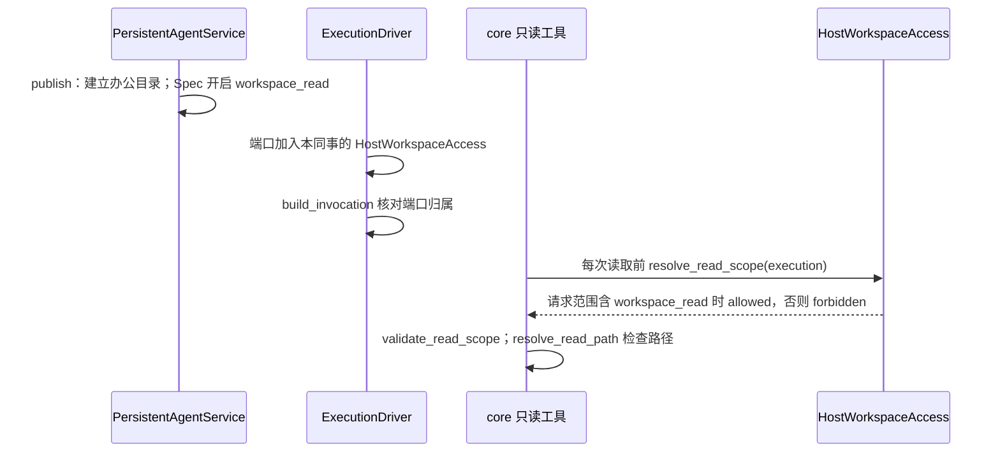

# 同事办公目录只读访问设计方案

## 1. 元信息

| 项 | 值 |
| --- | --- |
| 建档日期 | 2026-10-15 |
| 范围 | jiuwenswarm：`server/jiuwenmate/ports/workspace_access.py`（新增）、`spec_provider.py`、`service.py`、`models.py`、`execution_driver.py`、`agent_manager.py`、`web_adapter.py`；前端 `channels/web/frontend/src/features/jiuwenmate/` 与 jiuwenmate 文案 |
| 方案成熟度 | 已确认（2026-10-15 经负责人确认：目录只建立不导入文件；只开放 Web 请求；系统提示补充相对路径说明） |
| 计划条目 | [JM-14](../designs/jiuwenmate-development-plan.md)：同事资源选择与隔离；本文覆盖“最小只读配置”子范围 |
| 负责人 | 常钰聪 |
| 状态 | 进行中（最小只读配置已实现并通过宿主组件验证；Skill / MCP / 插件装配与写入能力待 S2b） |
| 设计依据 | [JiuwenMate 服务端架构设计](../designs/jiuwenmate-architecture.md) 第 4.2、9.2 节；agent-core `persistent_agent/workspace/`（PA-14） |
| 关联 feature | 前置：[F_01 核心契约适配](F_01_core-contract.md)、[F_02 同事定义与配置发布](F_02_colleague-management.md)、[F_07 会话调度与执行驱动](F_07_execution-driver.md)；页面：[F_10 同事管理页面](F_10_web-colleague-management.md) |
| 验证摘要 | 见第 8 节 |
| Refs | 无独立 issue；需求来源为开发计划 JM-14 |

## 2. 背景、目标与范围

### 2.1 背景与问题

S1 私聊闭环要求同事能够读取用户提供的资料。此前 `spec_provider.HOST_OPEN_FEATURES` 只开放 `construction`，发布的 Spec 关闭 `enable_sys_operation`，执行端口不提供 `workspace_access`，同事没有任何文件工具。

core `9eb336b4` 已提供 PA-14：Spec 声明 `workspace_read` 且开启 `enable_sys_operation` 时，`PersistentWorkspaceReadRail` 只注册 `read_file` 与 `list_files` 两个工具。每次调用前，工具向宿主的 `workspace_access.resolve_read_scope(execution)` 取得读取范围，经 `validate_read_scope` 核对身份后，由 `resolve_read_path` 拒绝绝对路径、`..` 与越出范围的符号链接。宿主只需提供范围，不实现路径检查。

### 2.2 目标与关键场景

| 场景 / 触发条件 | 当前行为 | 目标行为 / 可观察变化 |
| --- | --- | --- |
| 用户在 Web 私聊中请同事查看资料 | 同事没有文件工具 | 同事用 `list_files`、`read_file` 读取自己办公目录中的文件 |
| 模型请求办公目录之外的路径（`..`、绝对路径、指向外部的符号链接） | 不适用 | 工具返回 `forbidden`，回复中不含目录外内容与宿主路径 |
| 飞书群聊请求 | 不适用 | 读取范围为 `forbidden`，工具不读取任何文件 |
| 用户需要知道文件放在哪里 | 无入口 | 同事详情页“知识”分区显示办公目录的本机路径 |
| 删除同事 | 删除版本、Template 与窗口数据 | 同时删除其办公目录 |

### 2.3 本次范围与非目标

- 本次包含：每个同事一个办公目录；只读范围端口；`workspace_read` 开放与端口校验；发布时开启只读工具并补充路径说明；Web 运行时启动时重新发布；页面显示目录。
- 本次不包含：
  - 文件上传或导入：用户自行把文件放入目录（负责人确认）；
  - 飞书请求读取：S2b 再确定群聊的授权来源（负责人确认）；
  - Skill、MCP、插件装配：`SkillUseRail` 会同时注册 `read_file`、代码与命令工具，超出只读范围，随 S2b；
  - 写入能力 `workspace_write`：依赖 PA-15、PA-16；
  - Session 私有草稿区（`private_sessions_root`、`current_session_root`）：本期不设置；
  - 修改 agent-core。

## 3. 设计约束、假设与待决问题

- **已确认约束与依赖：**
  - core 每次读取前都重新调用 `resolve_read_scope`，宿主不缓存决定；`validate_read_scope` 要求 `agent_id`、`session_id`、`principal_ref`、`policy_revision` 与本次 Execution 一致。
  - `resolve_read_scope` 抛出异常时，core 按 `unknown` 拒绝且不返回原因。
  - `enable_sys_operation=True` 时，core 还会在全局资源中登记 shell 与文件系统操作（如 `execute_cmd`），但不作为本同事的能力挂载；探针确认同事的能力只有 `list_files`、`read_file`。
  - core 的 `read_file` 工具描述要求绝对路径，而 `resolve_read_path` 拒绝绝对路径。
  - 构建 Agent 时，core 默认在后台探测模型是否支持图片输入，该调用不经过预算端口；`enable_read_image_multimodal=False` 可关闭。
- **负责人确认（2026-10-15）：** 目录只建立、不导入文件；只开放 Web 请求；在系统提示中说明使用相对路径。
- **关键假设：** Web 本地用户是全部同事的所有者，因此 Web 请求可以读取任一同事自己的办公目录。
- **待决问题：** 飞书群聊的读取授权来源（群成员、绑定者或管理员），由 S2b 确定。

## 4. 总体方案与设计取舍

### 4.1 方案概览

### 4.2 关键决策

#### D-01 授权依据为请求的访问快照

- 选择与依据：Request 接受时冻结 `AccessSnapshot`。启动范围与来源范围都含 `workspace_read` 时，读取范围为 `allowed`，`allowed_roots` 只有本同事目录；否则为 `forbidden`。Web 的 `WEB_ACCESS` 加入 `workspace_read`；飞书的访问快照不加入，因此飞书请求被拒绝，无需按渠道判断。
- 实现体现：`HostWorkspaceAccess.resolve_read_scope`、`web_adapter.WEB_ACCESS`。

#### D-02 目录按命名空间与同事划分，路径检查交给 core

- 选择与依据：目录为 `<数据根>/workspaces/<namespace_id>/<agent_id>`，与数据库、Template、窗口数据分开。名称只允许字母、数字、`_`、`-`，避免由标识构成越界路径。宿主不重复实现路径检查，由 core 的 `resolve_read_path` 统一处理。
- 实现体现：`WorkspaceStore`。

#### D-03 端口由宿主构造并在调用前核对

- 选择与依据：Spec 声明 `workspace_read` 时，`build_invocation` 要求 `ports.workspace_access` 是本同事的 `HostWorkspaceAccess`，否则拒绝调用，避免以他人的范围或空端口执行。端口收到其他同事的 Execution 时抛出异常，core 按 `unknown` 拒绝。
- 实现体现：`spec_provider.build_invocation`、`ExecutionDriver`。

#### D-04 系统提示补充相对路径说明

- 选择与依据：core 的工具描述要求绝对路径，与路径检查相反，模型按描述调用会被拒绝。不修改 core 时，在发布的系统提示末尾固定追加 `WORKSPACE_PROMPT`，说明使用相对路径且只能读取。
- 实现体现：`service.WORKSPACE_PROMPT`、`publish`。

#### D-05 Web 运行时启动时重新发布

- 选择与依据：旧版本 Spec 未开启 `workspace_read`。运行时首次启动前，`refresh_published` 重新发布没有未发布修改的同事；设置未变时 `publish` 沿用原版本，有未发布修改的同事保持原版本，避免把草稿发布出去。
- 实现体现：`PersistentAgentService.refresh_published`、`JiuwenMateWebAdapter._runtime`。

### 4.3 替代方案与排除理由

| 候选 / 关联决策 | 关键差异 | 拒绝原因 | 重新评估条件 |
| --- | --- | --- | --- |
| R-01 / D-01 按渠道判断授权 | 不改访问快照 | 授权分散到端口内部，且与已冻结的请求事实不一致 | 无 |
| R-02 / D-02 以 Session 目录作为读取范围 | 会话间隔离 | 用户放置的资料须在各会话共享；Session 私有区留给写入能力 | 开放写入（PA-15、PA-16）时 |
| R-03 / D-04 修改 core 的工具描述 | 描述与检查一致 | 本期不修改 agent-core | core 修正描述后删除提示中的路径说明 |
| R-04 / 范围 同时装配 Skill | 能力更完整 | Skill 机制会挂载代码与命令工具，超出只读范围 | S2b |

## 5. 详细设计

### 5.1 模块责任

- `WorkspaceStore`：`path` 校验名称并返回目录；`ensure` 以私有权限建立目录；`remove` 删除目录。
- `HostWorkspaceAccess`：持有一个同事的目录；`scope` 返回 `(namespace_id, agent_id)`；`resolve_read_scope` 按 D-01 返回 `WorkspaceReadScope`，`source_ref` 为 `workspace://<namespace_id>/<agent_id>`。
- `PersistentAgentService`：`publish` 建立目录，Spec 写入 `enabled_features=["construction", "workspace_read"]`、`enable_sys_operation=True`、`enable_read_image_multimodal=False` 与追加路径说明的系统提示；`refresh_published` 按 D-05 重新发布；`delete_colleague` 删除目录；视图带 `workspace_dir`。
- `ExecutionDriver`：构造参数增加 `workspaces`，每次执行的端口加入本同事的 `HostWorkspaceAccess`。
- 前端：`toColleague` 解析 `workspace_dir`；同事详情页“知识”分区显示目录与说明。

### 5.2 接口

`ColleagueView.workspace_dir`：办公目录的本机绝对路径，字符串。页面只显示该路径，不通过接口读取或上传文件。

## 6. 影响面与实施设计

| 实施项 | 文件 | 修改内容 | 验证产物 |
| --- | --- | --- | --- |
| I-01 | `ports/workspace_access.py`（新增） | `WorkspaceStore`、`HostWorkspaceAccess`、`WORKSPACE_READ` | JM-14-V-01 |
| I-02 | `spec_provider.py` | 开放 `workspace_read`；`build_invocation` 核对端口 | JM-14-V-01 |
| I-03 | `service.py`、`models.py` | 发布、重新发布、删除与视图字段 | JM-14-V-01 |
| I-04 | `execution_driver.py`、`agent_manager.py` | 执行端口加入读取范围 | JM-14-V-01 |
| I-05 | `web_adapter.py` | `WEB_ACCESS` 加入 `workspace_read`；运行时启动前重新发布 | JM-14-V-01 |
| I-06 | 前端 `types.ts`、`jiuwenmateApi.ts`、`pages/ColleagueProfilePage.tsx`、中英文文案 | 显示办公目录 | — |
| I-07 | [`test_resource_scope.py`](../../../../../tests/unit_tests/server/jiuwenmate/test_resource_scope.py)（新增）、[`test_web_real_core.py`](../../../../../tests/integration_tests/jiuwenmate/test_web_real_core.py)、前端 `tests/jiuwenmateApi.test.mjs`；既有测试替身补充 `workspaces` 与端口 | 单测、真实 core 集成测试与前端解析测试 | — |

兼容核对：既有表结构不变；旧版本 Spec 仍可执行（未声明 `workspace_read` 时不要求端口）；`ExecutionDriver` 构造参数新增必填的 `workspaces`，调用方只有 `AgentManager`；个人版方法与事件不变。

## 8. 验证设计、执行记录与结论

### 8.1 验证设计与通过条件

| 验证 ID | 场景 | 验证入口 | 预期结果 | 层级 |
| --- | --- | --- | --- | --- |
| JM-14-V-01（只读部分） | Web 请求读取本同事目录；越界与无授权请求被拒绝 | `test_resource_scope.py` | 相对路径解析到本同事目录；缺少任一范围时为 `forbidden`；`..`、绝对路径、Windows 盘符、外链符号链接为 `forbidden`；其他同事的 Execution 抛出异常；非法名称被拒绝；发布建立目录、删除移除目录；重新发布跳过有未发布修改的同事；缺少或错配端口时拒绝调用 | 单测（真实 SQLite、真实 core 路径检查） |
| JM-14-V-01（执行部分） | 真实 core 执行中调用 `read_file` | `test_web_real_core.py::test_a_colleague_reads_only_its_office_directory` | 读取目录内文件时回复含文件内容；请求 `../other/secret.md` 时回复不含他人文件内容与宿主路径 | 集成（真实 core `9eb336b4`，模型为替身） |

JM-14-V-01 的 Skill / MCP / 插件部分、V-02、V-03 不在本次范围。

### 8.2 实际执行与证据

2026-10-15，在 `fork/huenrui_jiuwenswarm` 工作区执行，未提交。

| 验证 ID | 命令 | 结果 | 覆盖内容 |
| --- | --- | --- | --- |
| JM-14-V-01 | `pytest tests/unit_tests/server/jiuwenmate/test_resource_scope.py tests/integration_tests/jiuwenmate/test_web_real_core.py` | 25 passed | 见 8.1 |
| — | `pytest tests/unit_tests/server/jiuwenmate tests/integration_tests/jiuwenmate tests/unit_tests/gateway/test_persistent_group_fanout.py` | 274 passed | JM-01～JM-13 不受影响 |
| — | `pytest tests/unit_tests/server tests/unit_tests/gateway tests/unit_tests/channel tests/integration_tests/jiuwenmate` | 2829 passed，1 skipped | AgentServer、Gateway 与 Web 渠道既有行为不变 |
| — | `npm run test:jiuwenmate-api`、`test:jiuwenmate-presentation`、`tests/i18nLocales.test.mjs` | 17、5、5 passed | 新增目录字段解析 |
| — | `ruff check`、`ruff format`（改动的文件） | 本次改动无新增问题 | — |

### 8.3 验证结论

最小只读配置的宿主组件验证通过：Web 请求只能读取本同事办公目录，越界路径与飞书请求被拒绝，真实 core 执行中读取成功。浏览器验收与 S1 联合验收未执行。

## 9. 风险与已知遗留

### 9.1 设计风险

| 风险 / 触发条件 | 影响 | 已有应对措施 | 核实方式 |
| --- | --- | --- | --- |
| 模型按 core 工具描述传入绝对路径 | 读取被拒绝 | 系统提示说明使用相对路径 | 真实模型冒烟 |
| core 全局登记 shell 与文件系统操作 | 若后续挂载方式变化，可能超出只读范围 | 探针确认能力只有两个只读工具 | core 升级时复核 |

### 9.2 已知遗留

| 遗留项 | 性质 | 影响与现有处置 | 后续入口 |
| --- | --- | --- | --- |
| Skill、MCP、插件装配 | 未实施 | 能力选择只记录不装配 | S2b |
| 写入能力与 Session 私有区 | 未实施 | 办公目录只读 | PA-15、PA-16 |
| 飞书请求读取 | 未实施 | 飞书请求为 `forbidden` | S2b |
| 文件导入 | 未实施 | 用户在本机放置文件 | 待评估 |
| 飞书访问快照的范围为空 | JM-08 既有问题 | core 的 `ExecutionContext` 拒绝空范围，飞书请求可能在调用前失败；本次未修改 | JM-08 联合验收 |

## 10. 设计演进与修订

- 2026-10-15：建档并实现最小只读配置子范围。
