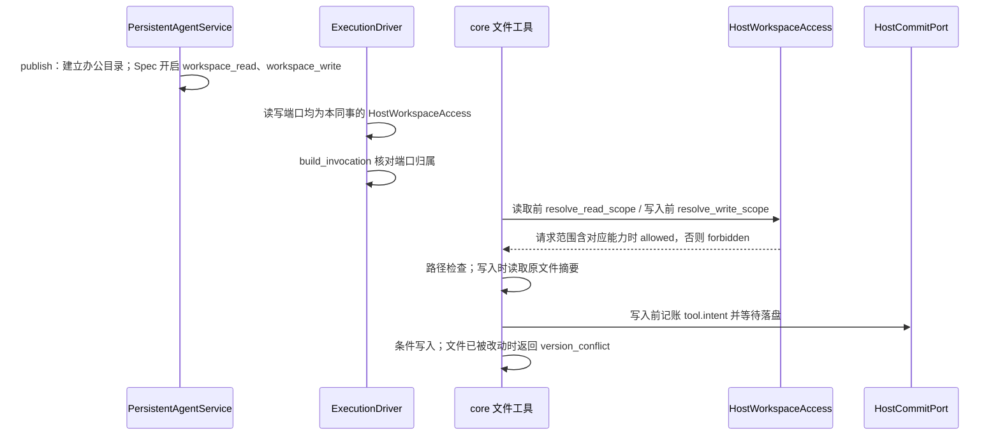
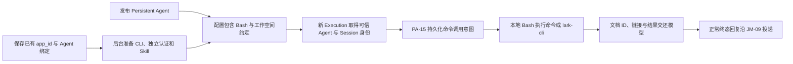

# 同事办公目录读写访问设计方案

## 1. 元信息

| 项 | 值 |
| --- | --- |
| 建档日期 | 2026-10-15 |
| 范围 | jiuwenswarm：`server/jiuwenmate/ports/workspace_access.py`、`spec_provider.py`、`service.py`、`models.py`、`execution_driver.py`、`agent_manager.py`、`web_adapter.py`；前端 `channels/web/frontend/src/features/jiuwenmate/` 与 jiuwenmate 文案 |
| 方案成熟度 | 已确认。Web 读写沿用既有规则。2026-10-21 补充飞书工作空间规则：私聊和群聊的启动、来源 scope 均授予 `workspace_read`，不授予 `workspace_write`；私聊保留既有 `workspace_knowledge_read`。同 Agent 共用工作空间，Session 中间产物隔离在 `sessions/<session_id>/`，最终交付文件放共享 `output/`。Bash 路径约定不是操作系统级隔离 |
| 计划条目 | [JM-14](../designs/jiuwenmate-development-plan.md)：同事资源选择与隔离；本文覆盖办公目录读写、资源装配及 Bash / 自动飞书 CLI 补充范围 |
| 负责人 | 常钰聪 |
| 状态 | 进行中（办公目录读写、资源装配已有实现；2026-10-20 补充 Bash 与飞书 CLI 自动准备，见第 12 节；真实飞书创建与浏览器验收未做） |
| 设计依据 | [JiuwenMate 服务端架构设计](../designs/jiuwenmate-architecture.md) 第 4.2、9.2 节；agent-core `persistent_agent/workspace/`（PA-14、PA-16）与 `execution/tool_intent_rail.py`（PA-15） |
| 关联 feature | 前置：[F_01 核心契约适配](F_01_core-contract.md)、[F_02 同事定义与配置发布](F_02_colleague-management.md)、[F_04 事件提交端口](F_04_commit-port.md)、[F_07 会话调度与执行驱动](F_07_execution-driver.md)；页面：[F_10 同事管理页面](F_10_web-colleague-management.md) |
| 验证摘要 | 文件工具历史证据见第 8 节；Bash / 自动飞书 CLI 的本轮证据与遗留见第 12.6 节 |
| Refs | 无独立 issue；需求来源为开发计划 JM-14 |

## 2. 背景、目标与范围

第 2～8 节保留最初的受控文件工具方案；第 11 节补充资源装配，第 12 节记录当前 Bash 扩展。文件工具的范围拒绝与条件写入仍有效，但不能约束新增的本地 Bash，不应将前文文件工具的隔离保证理解为所有工具的共同保证。

### 2.1 背景与问题

S1 私聊闭环要求同事能够读取用户提供的资料。此前 `spec_provider.HOST_OPEN_FEATURES` 只开放 `construction`，发布的 Spec 关闭 `enable_sys_operation`，执行端口不提供 `workspace_access`，同事没有任何文件工具。

core `9eb336b4` 已提供 PA-14：Spec 声明 `workspace_read` 且开启 `enable_sys_operation` 时，`PersistentWorkspaceReadRail` 只注册 `read_file` 与 `list_files` 两个工具。每次调用前，工具向宿主的 `workspace_access.resolve_read_scope(execution)` 取得读取范围，经 `validate_read_scope` 核对身份后，由 `resolve_read_path` 拒绝绝对路径、`..` 与越出范围的符号链接。宿主只需提供范围，不实现路径检查。

同一版本 core 也提供了 PA-16：Spec 声明 `workspace_write` 时，`PersistentWorkspaceWriteRail` 注册 `write_file` 与 `edit_file`。每次写入前，该 Rail 向宿主的 `workspace_write_access.resolve_write_scope(execution)` 取得写入范围，由 `resolve_write_path` 检查路径，并读取目标文件的内容摘要作为条件写入的前提；随后 PA-15 的 `PersistentToolIntentRail` 记账 `tool.intent` 并等待落盘，成功后才实际写入。文件在预检之后被改动时，写入返回 `version_conflict`。JiuwenSwarm 的 `HostCommitPort` 已在 `85b0e66d` 中验证：意图先落盘再产生副作用，落盘失败时副作用为零。

### 2.2 目标与关键场景

| 场景 / 触发条件 | 当前行为 | 目标行为 / 可观察变化 |
| --- | --- | --- |
| 用户在 Web 私聊中请同事查看资料 | 同事没有文件工具 | 同事用 `list_files`、`read_file` 读取自己办公目录中的文件 |
| 用户在 Web 私聊中请同事生成或修改文件 | 同事只能读取 | 同事用 `write_file`、`edit_file` 在自己办公目录中创建和修改文件；每次写入前记账 `tool.intent` |
| 两次写入针对同一文件，且文件在预检后被改动 | 不适用 | 后写入的一方得到 `version_conflict`，不覆盖他人的修改 |
| 访问其他 Session 的私有草稿 `sessions/<其他 session_id>/` | 不适用 | 读写都返回 `forbidden` |
| 模型请求办公目录之外的路径（`..`、绝对路径、指向外部的符号链接） | 不适用 | 工具返回 `forbidden`，回复中不含目录外内容与宿主路径 |
| 飞书群聊请求 | 原先文件工具均无工作空间范围 | `workspace_read` 可读当前 Session 草稿和 Agent 的共享工作空间（含 `output/`），其他 Session 草稿不可读；`workspace_write` 文件工具仍为 `forbidden` |
| 飞书私聊请求 | 原先仅读取已选知识副本 | 除保留当前发布版本的 `workspace_knowledge_read` 外，也按 `workspace_read` 读取 Agent 共享工作空间与当前 Session；其他 Session 草稿不可读，`workspace_write` 文件工具仍为 `forbidden` |
| 最终文件交付 | 文件可能留在某次执行的临时目录 | Agent 将最终文件复制或移动到工作空间 `output/`，再以 `output/<文件名>` 调用 `share_file`；宿主不自动移动文件 |
| 用户需要知道文件放在哪里 | 无入口 | 同事详情页“知识”分区显示办公目录的本机路径 |
| 删除同事 | 删除版本、Template 与窗口数据 | 同时删除其办公目录（含私有草稿） |

### 2.3 本次范围与非目标

- 本次包含：每个同事一个办公目录；读取与写入范围端口；`workspace_read`、`workspace_write` 开放与端口校验；Session 私有草稿区的隔离；发布时开启文件工具并补充路径说明；Web 运行时启动时重新发布；页面显示目录。2026-10-20 增加飞书私聊所选知识副本读取。2026-10-21 再补充：飞书私聊和群聊均获 `workspace_read`、不获 `workspace_write`；同 Agent 工作空间共享 `output/`，会话中间文件置于各自 Session 目录。
- 本次不包含：
  - 文件上传或导入：用户自行把文件放入目录（负责人确认）；
  - 飞书写操作授权：本次仍不向 Feishu 的文件工具请求授予 `workspace_write`；不改变 Web 已有写入规则；
  - Skill、MCP、插件装配：`SkillUseRail` 会同时注册 `read_file`、代码与命令工具，随 S2b；
  - 写入前的人工确认：PA-09 本轮不开发，写入依赖意图记账与条件写入（负责人确认）；
  - 引导模型使用私有草稿区：模型无法得知本会话的 `session_id`（见第 3 节）；
  - 删除会话时清理私有草稿：会话删除为软删除，窗口数据也保留；
  - 修改 agent-core。

## 3. 设计约束、假设与待决问题

- **已确认约束与依赖：**
  - core 每次读取或写入前都重新调用 `resolve_read_scope` / `resolve_write_scope`，宿主不缓存决定；`validate_read_scope` / `validate_write_scope` 要求 `agent_id`、`session_id`、`principal_ref`、`policy_revision` 与本次 Execution 一致。
  - 范围端口抛出异常时，core 按 `unknown` 拒绝且不返回原因。
  - `enable_sys_operation=True` 时，core 还会在全局资源中登记 shell 与文件系统操作（如 `execute_cmd`），但不作为本同事的能力挂载；同事的能力为 `list_files`、`read_file`、`write_file`、`edit_file`。
  - 写入 Rail 要求 SysOperation 的文件系统声明 `supports_conditional_write`；本机文件系统满足该条件，写入时自动创建父目录。
  - core 的 `read_file` 工具描述要求绝对路径，而路径检查拒绝绝对路径。
  - 构建 Agent 时，core 默认在后台探测模型是否支持图片输入，该调用不经过预算端口；`enable_read_image_multimodal=False` 可关闭。
  - 系统提示基础内容按同事版本发布、由各 Session 共用；静态发布提示不能写死某次会话路径。宿主执行入口可从可信 `ExecutionRecord.session_id` 为当前 Invocation 追加具体 Session 目录说明，不需要改变 agent-core 执行头契约。
- **负责人确认（2026-10-15）：** 只读部分为 Web 可读整个办公目录；写入部分为整个办公目录可写并另设本会话私有草稿区、只开放 Web 请求、写入不经人工确认。
- **负责人确认（2026-10-20）：** 飞书私聊可读取当前配置版本中明确选定的知识副本；飞书群聊和办公目录其他文件继续拒绝读取，飞书不开放写入。
- **负责人确认（2026-10-21）：** 上述飞书文件范围按新决策调整：同一 Agent 的飞书私聊和群聊都在 `startup_scope`、`source_scope` 授予 `workspace_read`，不授予 `workspace_write`；私聊已有 `workspace_knowledge_read` 保持不变。工作空间仍按 `namespace_id + agent_id` 唯一，不按群拆分。
- **关键假设：** Web 本地用户是全部同事的所有者，因此 Web 请求可以读写任一同事自己的办公目录。
- **待决问题：** 飞书群聊的读写授权来源（群成员、绑定者或管理员），由 S2b 确定。

## 4. 总体方案与设计取舍

### 4.1 方案概览



### 4.2 关键决策

#### D-01 授权依据为请求的访问快照与发布版本知识范围

- 选择与依据：Request 接受时冻结 `AccessSnapshot`。启动范围与来源范围都含 `workspace_read` 时，PA-14 读取工具可访问该 Agent 工作空间；core 仍排除其他 Session 的私有草稿，仅当前 `session_id` 对应目录和共享内容可读。Web 的既有读写授权不变。2026-10-21 起，Feishu 私聊与群聊均在两个 scope 中加入 `workspace_read`，不加入 `workspace_write`；私聊另保留既有 `workspace_knowledge_read`，发布版本仍固定其知识副本。文件工具授权不等于 Bash 沙箱，Bash 的边界仍是提示词约定。
- 实现体现：`HostWorkspaceAccess.resolve_read_scope`、`resolve_write_scope`、`resolve_feishu_access` 与 `ConfigSnapshot.knowledge_root`。

#### D-02 目录按命名空间与同事划分，路径检查交给 core

- 选择与依据：目录为 `<数据根>/workspaces/<namespace_id>/<agent_id>`，与数据库、Template、窗口数据分开。名称只允许字母、数字、`_`、`-`，避免由标识构成越界路径。宿主不重复实现路径检查，由 core 的 `resolve_read_path`、`resolve_write_path` 统一处理。
- 实现体现：`WorkspaceStore`。

#### D-03 端口由宿主构造并在调用前核对

- 选择与依据：Spec 声明 `workspace_read` 或 `workspace_write` 时，`build_invocation` 要求对应的 `ports.workspace_access` / `ports.workspace_write_access` 是本同事的 `HostWorkspaceAccess`，否则拒绝调用，避免以他人的范围或空端口执行。端口收到其他同事的 Execution 时抛出异常，core 按 `unknown` 拒绝。
- 实现体现：`spec_provider.build_invocation`、`ExecutionDriver`。

#### D-04 系统提示补充路径说明

- 选择与依据：core 的工具描述要求绝对路径，与路径检查相反，模型按描述调用会被拒绝。不修改 core 时，在发布的系统提示末尾追加 `WORKSPACE_PROMPT`，说明使用工作空间相对路径、修改前先读取、遇到版本冲突时重新读取。执行时再注入本次 `sessions/<session_id>/` 的用途；普通中间文件直接放该目录，Lark Slides 专用状态放其 `.lark-slides/`，最终文件复制或移动到共享 `output/`，再用 `output/<文件名>` 调用 `share_file`。不得将提示词或 Bash cwd 表述为强制隔离。
- 实现体现：`service.WORKSPACE_PROMPT`、`publish`。

#### D-05 Web 运行时启动时重新发布

- 选择与依据：旧版本 Spec 未开启文件能力。运行时首次启动前，`refresh_published` 重新发布没有未发布修改的同事；设置未变时 `publish` 沿用原版本，有未发布修改的同事保持原版本，避免把草稿发布出去。
- 实现体现：`PersistentAgentService.refresh_published`、`JiuwenMateWebAdapter._runtime`。

#### D-06 工作空间按 Agent 共享，Session 中间文件与最终文件分区

- 选择与依据：工作空间仍由 `namespace_id + agent_id` 唯一确定，多个飞书私聊 / 群聊共享同一根目录。执行入口在构建 Invocation 和解析 workspace scope 前创建 `sessions/<session_id>/`；非法 Session ID 或创建失败均失败关闭，禁止回退到 Agent 根目录。工作空间内用于授权的目录拒绝符号链接和 Windows reparse point，并在生成读写 scope 时再次验证当前 Session 路径仍位于 Agent 工作空间下，避免 `current_session_root` 特例越界。非 Lark Slides 中间文件直接放当前 Session 根目录；`.lark-slides/` 只用于 Lark Slides 专用计划、截图和恢复状态。Agent 的最终交付文件放共享 `output/`，跨 Session 可读。core 路径策略继续拒绝兄弟 Session 草稿。既有 Agent 根目录 `.lark-slides/` 等文件不自动移动或删除。
- 实现体现：`WorkspaceStore.ensure_session`、`WorkspaceStore.ensure`、`HostWorkspaceAccess._session_roots`、`ExecutionDriver`。

```text
workspaces/local/<agent_id>/
├── sessions/
│   └── <session_id>/
│       ├── <普通中间文件>
│       └── .lark-slides/       # 仅 Lark Slides 的计划、截图和恢复状态
└── output/                     # Agent 跨 Session 共享的最终文件
```

#### D-07 写入不经人工确认

- 选择与依据：PA-09 本轮不开发。`write_file`、`edit_file` 均不在 PA-15 的只读名单中，每次写入前必须先把 `tool.intent` 写入 SQLite；条件写入保证并发修改可被识别。这一组合满足 JM-14-V-03“只开放无需人工确认、且已接入意图记账的写操作”。
- 实现体现：`service.publish` 写入 `workspace_write`；core 的 `PersistentToolIntentRail`。

### 4.3 替代方案与排除理由

| 候选 / 关联决策 | 关键差异 | 拒绝原因 | 重新评估条件 |
| --- | --- | --- | --- |
| R-01 / D-01 按渠道判断授权 | 不改访问快照 | 授权分散到端口内部，且与已冻结的请求事实不一致 | 无 |
| R-02 / D-06 只允许写入私有草稿区 | 共享文件只读 | 同事产出的文件无法在其他会话中继续使用；负责人选择整个目录可写 | 无 |
| R-03 / D-04 修改 core 的工具描述 | 描述与检查一致 | 本期不修改 agent-core | core 修正描述后删除提示中的路径说明 |
| R-04 / D-04 系统提示中写入草稿目录名称 | 模型可直接使用草稿区 | 系统提示由各 Session 共用，无法写入具体 `session_id`；改写请求文本会污染用户输入 | core 执行头带出 `session_id` 后 |
| R-05 / 范围 同时装配 Skill | 能力更完整 | Skill 机制会挂载代码与命令工具 | S2b |

## 5. 详细设计

### 5.1 模块责任

- `WorkspaceStore`：`path` 校验名称并返回目录；`ensure` 逐级检查并以私有权限建立 Agent 根目录与共享 `output/`，拒绝符号链接 / Windows reparse point 并核验规范路径；`ensure_session` 校验 `session_id` 后创建私有 Session 目录；`remove` 删除目录。
- `HostWorkspaceAccess`：持有一个同事的目录；`scope` 返回 `(namespace_id, agent_id)`；生成读写 scope 前经 `WorkspaceStore.validate_session_paths` 复核当前 Session 路径未重定向且仍在 Agent 工作空间下，再按 D-01、D-06 返回 `WorkspaceReadScope` / `WorkspaceWriteScope`，`source_ref` 为 `workspace://<namespace_id>/<agent_id>`。同一实例同时作为读取端口与写入端口；飞书的 `workspace_read` 仍由 core 文件工具检查文件路径，Feishu 不获 `workspace_write`。
- `PersistentAgentService`：`publish` 建立目录，Spec 写入 `enabled_features=["construction", "workspace_read", "workspace_write"]`、`enable_sys_operation=True`、`enable_read_image_multimodal=False` 与追加路径说明的系统提示；`refresh_published` 按 D-05 重新发布；`delete_colleague` 删除目录；视图带 `workspace_dir`。
- `ExecutionDriver`：每次执行先创建该 `ExecutionContext.session_id` 对应的目录，再构造本同事的 `HostWorkspaceAccess` 和 Invocation；Bash cwd 及路径提示绑定当前 Session，并为该 Invocation 提供共享 `output/` 路径。
- 前端：`toColleague` 解析 `workspace_dir`；同事详情页“知识”分区显示目录与说明。

### 5.2 接口

`ColleagueView.workspace_dir`：办公目录的本机绝对路径，字符串。页面只显示该路径，不通过接口读取或上传文件。

## 6. 影响面与实施设计

| 实施项 | 文件 | 修改内容 | 验证产物 |
| --- | --- | --- | --- |
| I-01 | `ports/workspace_access.py` | `WorkspaceStore`、`HostWorkspaceAccess`、`WORKSPACE_READ`；写入部分新增 `WORKSPACE_WRITE`、`SESSIONS_DIR`、`resolve_write_scope` 与私有草稿根目录 | JM-14-V-01、V-02 |
| I-02 | `spec_provider.py` | 开放 `workspace_read`、`workspace_write`；`build_invocation` 核对两个端口 | JM-14-V-01、V-03 |
| I-03 | `service.py`、`models.py` | 发布、重新发布、删除与视图字段；写入部分更新能力列表与路径说明 | JM-14-V-01 |
| I-04 | `execution_driver.py`、`agent_manager.py` | 执行端口加入读取与写入范围 | JM-14-V-01 |
| I-05 | `web_adapter.py` | `WEB_ACCESS` 加入 `workspace_read`、`workspace_write`；运行时启动前重新发布 | JM-14-V-01 |
| I-06 | 前端 `types.ts`、`jiuwenmateApi.ts`、`pages/ColleagueProfilePage.tsx`、中英文文案 | 显示办公目录；写入部分更新说明文案 | — |
| I-07 | [`test_resource_scope.py`](../../../../../tests/unit_tests/server/jiuwenmate/test_resource_scope.py)、[`test_web_real_core.py`](../../../../../tests/integration_tests/jiuwenmate/test_web_real_core.py)、[`test_core_contract.py`](../../../../../tests/unit_tests/server/jiuwenmate/test_core_contract.py)、前端 `tests/jiuwenmateApi.test.mjs`；既有测试替身补充 `workspaces` 与端口 | 单测、真实 core 集成测试与前端解析测试 | — |

兼容核对：既有表结构不变；旧版本 Spec 仍可执行（未声明文件能力时不要求端口），Web 运行时启动后按 D-05 重新发布；`ExecutionDriver` 构造参数不变；个人版方法与事件不变。

## 8. 验证设计、执行记录与结论

### 8.1 验证设计与通过条件

| 验证 ID | 场景 | 验证入口 | 预期结果 | 层级 |
| --- | --- | --- | --- | --- |
| JM-14-V-01（只读部分） | Web 请求读取本同事目录；越界与无授权请求被拒绝 | `test_resource_scope.py` | 相对路径解析到本同事目录；缺少任一范围时为 `forbidden`；`..`、绝对路径、Windows 盘符、外链符号链接为 `forbidden`；其他同事的 Execution 抛出异常；非法名称被拒绝；发布建立目录、删除移除目录；重新发布跳过有未发布修改的同事；缺少或错配端口时拒绝调用 | 单测（真实 SQLite、真实 core 路径检查） |
| JM-14-V-01（执行部分） | 真实 core 执行中调用 `read_file` | `test_web_real_core.py::test_a_colleague_reads_only_its_office_directory` | 读取目录内文件时回复含文件内容；请求 `../other/secret.md` 时回复不含他人文件内容与宿主路径 | 集成（真实 core `9eb336b4`，模型为替身） |
| JM-14-V-02（Session 隔离） | 本会话访问自己的草稿；访问 `sessions/` 与其他会话的草稿 | `test_resource_scope.py::test_a_session_reaches_its_own_drafts_only` 等 | 本会话子目录可读可写；`sessions/`、其他会话子目录及其文件读写均为 `forbidden`；非法 `session_id` 抛出异常 | 单测（真实 core 路径检查） |
| JM-14-V-04（Feishu 工作空间与产物布局，2026-10-21） | 飞书私聊 / 群聊授权、Session 初始化、共享最终文件读取与产物路径 | `test_feishu_group_production_wiring.py`、`test_resource_scope.py`、`test_session_scheduler.py`、`test_bash_runtime.py`、`test_output_files.py` | 两类 Feishu Request 的启动与来源 scope 都有 `workspace_read`、都没有 `workspace_write`；私聊保留 `workspace_knowledge_read`；`output/` 跨 Session 可读，兄弟 Session 草稿不可读且写入仍 forbidden；Session 目录在 Invocation 构建前存在；Session 授权路径拒绝 symlink / reparse point；Bash 默认 cwd 为当前 Session、相对 workdir 从该目录解析且输出路径指向共享 `output/`；当时 `share_file` 的交付副本策略见 JM-09 记录；该策略后由 F_09 2026-10-21 JM-09 跟进改为直接从 `output/` 解析与投递，不再复制到宿主 `outputs/` | 单测 / 真实 core 路径检查；不等同真实飞书文件投递验收 |
| JM-14-V-02（冲突识别） | 文件在预检后被改动 | agent-core PA-16 条件写入测试 | 返回 `version_conflict`，不覆盖 | 由 core 组件测试覆盖；宿主只提供本机条件写入文件系统 |
| JM-14-V-03 | 真实 core 执行中写入、修改、越界写入 | `test_web_real_core.py::test_a_colleague_writes_and_edits_shared_files_but_not_other_sessions_drafts` | `write_file` 创建、`edit_file` 修改共享文件，结果为“定稿”；写入其他会话草稿返回 `workspace path is not writable` 且文件不存在；SQLite 中按顺序记录 `write_file`、`edit_file` 两条 `tool.intent`，目标均为该文件；回复不含宿主路径 | 集成（真实 core `9eb336b4`、真实 `HostCommitPort` 与 SQLite，模型为替身） |
| JM-14-V-03（写前屏障） | 意图落盘成功与失败 | `test_web_real_core.py` 的 PA-15 两项用例（`85b0e66d`） | 意图先落盘再产生副作用；落盘失败时副作用为零 | 集成 |

JM-14-V-01 的 Skill / MCP / 插件部分不在本次范围；V-03 中“清理一个实例不卸载其他实例的工具”随 Skill 装配验证。

### 8.2 实际执行与证据

只读部分：2026-10-15 实现，提交 `9d5b69e8`。

| 验证 ID | 命令 | 结果 | 覆盖内容 |
| --- | --- | --- | --- |
| JM-14-V-01 | `pytest tests/unit_tests/server/jiuwenmate/test_resource_scope.py tests/integration_tests/jiuwenmate/test_web_real_core.py` | 25 passed | 见 8.1 |
| — | `pytest tests/unit_tests/server/jiuwenmate tests/integration_tests/jiuwenmate tests/unit_tests/gateway/test_persistent_group_fanout.py` | 274 passed | JM-01～JM-13 不受影响 |
| — | `pytest tests/unit_tests/server tests/unit_tests/gateway tests/unit_tests/channel tests/integration_tests/jiuwenmate` | 2829 passed，1 skipped | AgentServer、Gateway 与 Web 渠道既有行为不变 |
| — | `npm run test:jiuwenmate-api`、`test:jiuwenmate-presentation`、`tests/i18nLocales.test.mjs` | 17、5、5 passed | 新增目录字段解析 |

写入部分：2026-10-15，在 `fork/huenrui_jiuwenswarm` 工作区执行，基于 `0ba83f08`，core `9eb336b4`，未提交。

| 验证 ID | 命令 | 结果 | 覆盖内容 |
| --- | --- | --- | --- |
| JM-14-V-02、V-03 | `pytest tests/unit_tests/server/jiuwenmate` | 271 passed | 写入范围、Session 隔离、端口核对与发布能力 |
| JM-14-V-03 | `pytest tests/integration_tests/jiuwenmate` | 12 passed | 真实 core 写入、修改、越界写入与写前屏障 |
| — | `pytest tests/unit_tests/server tests/unit_tests/gateway tests/unit_tests/channel tests/integration_tests/jiuwenmate` | 2867 passed，1 skipped | AgentServer、Gateway 与 Web 渠道既有行为不变 |
| — | `ruff check`（改动的文件） | 本次改动无新增问题；`execution_driver.py` 未使用的导入与 `test_web_real_core.py` 导入顺序为既有问题 | — |

2026-10-21 / JM-14-V-04 本地增量验证（Python 3.12.12，Windows）：Feishu scope 定向测试 2 passed；`test_resource_scope.py -k 'shared_output or workspace_store_ensures or publishing_creates'` 7 passed；`test_session_scheduler.py -k 'session_workspace or invocation_guides_session or group_execution_preserves_verified_bot_mention'` 4 passed；`test_bash_runtime.py` 12 passed；`test_output_files.py -k shared_workspace_output` 1 passed。验证工作空间创建 `output/`、执行前创建 Session 草稿目录、跨 Session 读取共享 `output/`、拒绝读取兄弟 Session 草稿且不授予写权限、Bash cwd / 相对工作目录 / 输出环境变量、群协作提示仍与 Session 目录提示并存，以及当时 `share_file` 从 `output/` 复制到宿主内部 `outputs/` 的实现。**交付副本策略随后由 F_09 2026-10-21 JM-09 跟进替代**：新实现直接从 `output/` 解析和投递，见该文档 §8.2；历史测试结论仅描述当时实现，不代表当前仍复制。上述均为聚焦自动化测试，不代表真实 Feishu 文件投递验收。

同日运行 `test_feishu_group_production_wiring.py`、`test_resource_scope.py`、`test_session_scheduler.py` 三个文件的整组回归：86 passed、23 failed。失败中 22 项 SessionScheduler 旧用例在当前本地 `openjiuwen` 依赖上被 `PersistentBuildContext.__init__()` 不接受 `system_prompt_addendum` 阻断；另 1 项符号链接用例因 Windows 当前进程无创建链接权限失败。此次新增的 Session 初始化和提示测试均使用替身隔离 Invocation builder 并通过；未据此修改 agent-core 或 Windows 安全策略。

随后按本计划串行运行较大范围：`uv run pytest --no-cov -q -o log_cli=false --tb=short tests/unit_tests/server/jiuwenmate tests/unit_tests/gateway/test_message_handler_mode.py tests/unit_tests/channel/test_attachment_persist.py`，519 项中 512 passed、6 failed、1 skipped。个人版消息路由与附件两个测试文件 63 项全部通过。6 项既有失败分别为：2 项 Windows POSIX 文件权限位断言、3 项旧资源装配测试创建 symlink 时 WinError 1314、1 项未发布知识页测试的既有断言 IndexError；本次 JM-14 相关调度测试通过。真实飞书文件投递仍未验证。

同日安全复核：新增 `WorkspaceStore` 目录创建与授权 scope 的 reparse-point 拒绝测试，覆盖 Windows junction / reparse point 元数据；两项回归通过。JM-08/09/14 聚焦文件组共 136 项，135 passed、1 skipped；唯一跳过项是 Windows 当前进程无创建真实 symlink 的权限，reparse-point mock 仍覆盖路径拒绝。`test_resource_scope.py` 不含该环境限制项为 41 passed；Session 调度定向测试 4 passed；个人版消息路由与附件回归 63 passed。改动文件的 `ruff check` 与 `git diff --check` 通过。上述不等同于真实 Feishu 文件发送验收。

### 8.3 验证结论

历史验证（2026-10-20 及以前）证明 Web 请求可以读写本同事办公目录、写入前意图已落盘，其他 Session 草稿与越界路径被拒绝；当时飞书群聊拒绝文件访问，飞书私聊仅读取已选知识副本。2026-10-21 的新决策将 Feishu 私聊和群聊都改为 `workspace_read`，并新增 Session 中间产物与共享 `output/` 的布局；此新范围须以本次实现后的专项测试记录为准，不能由历史测试推定已通过。真实飞书文件投递、真实模型读取、浏览器验收与联合验收仍需单独确认。

## 9. 风险与已知遗留

### 9.1 设计风险

| 风险 / 触发条件 | 影响 | 已有应对措施 | 核实方式 |
| --- | --- | --- | --- |
| 模型按 core 工具描述传入绝对路径 | 读写被拒绝 | 系统提示说明使用相对路径 | 真实模型冒烟 |
| core 全局登记 shell 与文件系统操作 | 本地 Bash 具有服务账号权限，文件工具授权不能约束它 | 新增 Bash 的提示词约定及非隔离风险见第 12 节，不再以“只有四个文件工具”作为保证 | core 升级及实际命令执行时复核 |
| 写入不经人工确认 | 模型可能覆盖共享文件 | 意图记账可追溯；条件写入防止覆盖他人的并发修改；任务失败不自动回滚 | PA-09 开放后评估 |

### 9.2 已知遗留

| 遗留项 | 性质 | 影响与现有处置 | 后续入口 |
| --- | --- | --- | --- |
| Skill、MCP、插件装配 | 已实现发布装配 | 见第 11 节。未安装的名称会拒绝发布 | 真实模型执行验收 |
| 员工知识选择 | 由 JM-22 承接 | 已发布个人上下文页面在发布时复制到办公目录，见 [F_22](F_22_employee-knowledge.md) | 真实模型读取验收 |
| Bash 并非 Session 沙箱 | 设计边界 | 当前 Session cwd、动态提示和 `JIUWENMATE_OUTPUT_DIR` 帮助模型遵守目录约定，但不能阻止 Shell / 子进程越界访问；文件工具的 workspace scope 不约束 Bash | 需要强隔离时另行设计操作系统级沙箱 |
| 删除会话时保留私有草稿 | 未实施 | 会话为软删除，草稿随会话保留；删除同事时一并删除 | 会话硬删除时评估 |
| 飞书私聊 / 群聊工作空间读取 | 2026-10-21 已实现并通过定向测试 | 两类请求均授予文件工具 `workspace_read`；当前 Session 与 Agent 共享文件可读，兄弟 Session 草稿不可读；均不授予文件工具 `workspace_write`。Bash 不是该 scope 的安全边界 | JM-14-V-04；真实 Feishu / Agent 联调仍待完成 |
| 飞书私聊所选知识读取 | 2026-10-20 实施 | 仅当前版本知识副本为 `allowed`；兼容从既有已发布 Spec 提示恢复范围；其他路径与写入为 `forbidden` | JM-22 |
| 文件导入 | 未实施 | 用户在本机放置文件 | 待评估 |
| 飞书私聊读取知识副本 | 2026-10-20 实施；2026-10-21 新增通用工作空间读取 | 已选知识副本的 `workspace_knowledge_read` 能力和发布版本范围保持不变；私聊同时获得 `workspace_read`，兼容旧发布快照及已接受请求 | 真实飞书模型联调 |

## 10. 设计演进与修订

- 2026-10-15：建档并实现最小只读配置子范围（提交 `9d5b69e8`）。
- 2026-10-15：增加办公目录写入子范围：开放 `workspace_write`，同一端口提供写入范围，`sessions/` 下按 Session 隔离；写入不经人工确认；补充真实 core 写入集成测试。
- 2026-10-16：增加 Skill / MCP / 插件发布装配，见第 11 节。

## 11. Skill、MCP 与插件装配

发布时读取 JM-02 已经保存的技能、连接器和插件名称。技能和技能市场安装记录仍向技能库与 `skills_state.json` 查询；插件包向 `plugins/plugin_packages` 下已安装的包读取其自带技能、工具和护栏。市场安装的插件在列表里用资产编号作为 `id`，包目录名在 `packageName`；员工保存包目录名。若已经保存了资产编号，发布按同目录 `hub_state.json` 的安装记录找回包目录。发布过程不安装、不卸载、不改写这些目录。MCP 仍向连接器状态查询。

- 已安装的技能和插件所含技能被复制到该同事办公目录的 `resources/skills/<内容摘要>/`。连接器附带的操作说明单独复制到 `resources/connector-skills/<内容摘要>/`，不进入该员工的技能列表。复制只包含普通文件，不跟随指向技能目录之外的符号链接。内容变化会生成新的摘要目录，已发布版本仍指向原来的副本。
- Spec 写入 `skills` 和一条 `core.skill_use` Rail。当前 Rail 的 `include_tools` 为假，因此该 Rail 不注册 bash 与 code。进入技能列表的说明由该 Rail 注入；系统提示补充相对路径，并要求回答“有哪些技能”时只报已装配技能。第 12 节的 Bash 由独立宿主 Provider 装配，已在当前工作区实施；用户选择先用提示词约束访问范围，不引入沙箱。真实飞书验收尚未完成。
- 带连接地址的连接器冻结为该同事自己的 `McpServerConfig`。`server_id` 含同事标识和配置摘要，凭据只从该连接器的凭据库写入 Spec，不读取、不修改进程环境变量。缺少凭据时发布失败，不把环境变量里的同名值当作凭据。
- 插件包里的工具和护栏按 `harness.tool.file`、`harness.rail.file` 写入 Spec，路径必须是该包内的普通文件。只有技能的插件不写工具。技能、工具、护栏都没有的包拒绝发布。
- 名称未安装，或同一技能名指向两个目录时，发布失败。删除同事只删除其办公目录，不卸载技能库或其他同事的副本。
- 已发布的个人上下文页面由 JM-22 复制到办公目录。core 的 `enabled_features` 没有技能开关，因此不新增宿主特性名。创建页不再提供示例知识名称；未发布的页面名称会拒绝发布。

验证：`tests/unit_tests/server/jiuwenmate/test_resource_assembly.py` 7 项通过。同事服务、Web 适配与办公目录范围测试在补上已安装技能夹具后通过（2026-10-16，`--no-cov`）。未做真实模型执行和浏览器验收。

## 12. Bash 与飞书 CLI 自动装配（2026-10-20，方案已确认）

### 12.1 已确认目标与现状

用户要求开放 Bash，绑定飞书渠道后自动准备 lark-cli 和配套 Skill，不另做一套受限飞书命令工具。用户先要求仅访问当前 Agent 的工作空间；在说明提示词不提供强隔离后，明确选择“先用系统提示词约束”。因此当前目标是本地 Bash、默认当前 Session 工作目录和提示词行为约定，不引入沙箱，也不再等待 Linux / WSL / Jiuwenbox 部署。2026-10-21 进一步确认：同一 Agent 的多个飞书会话共用工作空间；当前 Session 保存中间产物，共享 `output/` 保存最终交付文件。

本节记录 JM-14 的补充设计：用户已确认方案与实施计划，代码已在当前工作区实施，未提交。实际执行证据与尚未验证范围见第 12.6 节；JM-14 整项仍为进行中。本轮不改 agent-core、个人版默认行为或总体架构文档。

本次只读检查确认：

- 新版已有资源发布、独立 Invocation、PA-15 写前记账和 core Bash 工具；现有工具扩展入口可接入，不需要把飞书业务写进 agent-core。
- core 的 `LocalWorkConfig.restrict_to_sandbox` 说明的是文件操作检查，不能据此认定任意 Shell 子进程已被操作系统隔离。cwd 和提示词都不能阻止命令或脚本访问范围之外的文件。
- 本机为 Windows，当前没有 `sandbox` 配置。本次不安装 Docker / WSL、不启动 Jiuwenbox，也不把命令入口是否存在当作 Bash 已能正常运行的证据。Shell 可执行性仍需实际测试。

### 12.2 方案与取舍

采用“core Bash 工具 + 本次执行绑定的本地 Shell + 自动飞书 Skill / CLI”方式。Persistent Agent 发布配置时声明 Bash；绑定飞书后自动增加该应用的 CLI 准备和配套 Skill，不要求用户再手动选择一次连接器。未绑定飞书的 Agent 可以使用 Bash，但不借用个人版飞书认证。普通问答与飞书连接不因可选 CLI 准备失败而失效。



替代方案与取舍：暂缓真实沙箱，原因是用户选择先以提示词约束推进；这不是对等安全方案。未来需要“技术上只能访问工作空间”时再接实际隔离环境。不采用进程全局 `os.environ` 切换认证，因为它会影响并发执行与个人版；不改为独立 `feishu_create_document` 工具，因为用户已选择 Bash 加 CLI 的使用方式。

### 12.3 提示词约定与实际安全边界

给模型的系统提示明确以下行为约定：

1. 普通中间文件直接放宿主提供的当前 `sessions/<session_id>/` 目录；Lark Slides 的计划、截图和恢复状态放在当前目录下的 `.lark-slides/`。不要把中间文件放进共享最终产物目录。
2. 需要交付给用户的最终文件复制或移动到 `JIUWENMATE_OUTPUT_DIR` 指向的共享 `output/`；随后 `share_file` 使用相对路径 `output/<文件名>`。不同私聊 / 群聊属于同一个 Agent 工作空间，因此 `output/` 文件可跨会话读取；不要读取其他 Session 的草稿。
3. 优先使用相对路径，不通过绝对路径、`..`、符号链接或其他程序访问其他 Agent、个人版目录、宿主配置、数据库和群公共消息库。`JIUWENMATE_OUTPUT_DIR` 只是方便找到最终文件目录，不是额外授权或安全隔离。
4. 不读取、显示或复制认证配置、Secret、Token；不运行 CLI 的用户登录、切换应用、重置配置等身份管理命令。只使用宿主已经准备的当前 Agent 的飞书应用身份。
5. 优先使用原有 `read_file/write_file/edit_file` 完成文件操作；Bash 用于必要的脚本与 CLI。修改已有文件前先读取；不要用 Shell 绕过工具报出的授权拒绝或版本冲突，不自行安装全局依赖。
6. 创建文档与授予用户访问权分别核实，返回链接不等于用户已经能打开。不能把创建超时解释为未创建并再次提交。

以上是行为约定，不是强制安全边界。本地 Bash 具有运行服务账号的实际权限：模型、脚本及子进程仍可能越界读取或修改文件、接触其他应用认证。PA-14 的 `workspace_read` / `workspace_write` scope 只约束 core 文件工具，不约束 Bash；本方案不承诺抵御提示词注入或恶意命令。不得在页面、文档或测试报告中把它描述为“Bash 只能访问工作空间”或“Session 已被 Bash 隔离”。

每次执行默认 cwd 为当前 `sessions/<session_id>/`；`JIUWENMATE_OUTPUT_DIR` 指向同一 Agent 的共享 `output/`。cwd、该环境变量及 CLI 身份按 Invocation 绑定，不修改进程全局 cwd 或 `os.environ`。保留现有命令工具的安全检查，不把全局安全模式改成放行所有命令。后台命令只表示已启动，不能当作已完成；超时、停止、换绑与后台任务的生命周期必须在执行侧明确处理。

Bash 的本地文件变更不经过 `write_file/edit_file` 的 PA-16 条件写入；现有文件工具仍保持原保证，不能把条件写入保证扩展到任意命令。Bash 每次调用均按非只读工具进入 PA-15；这只保证调用前意图已提交，不提供跨系统事务或命令级恰好一次执行。

### 12.4 自动准备、绑定与发布

- 沿用已有 `persistent_agent_id ↔ app_id`，不新增绑定 ID、绑定表或让模型选择应用（2026-10-26 起该 Agent 为飞书连接的 IM 运行 Agent，连接登记表由 [F_02_02](F_02_02_colleague-connections.md) 引入；CLI 资料仍按该 Agent 隔离，本条其余规则不变）。准备 CLI 时由宿主读取当前唯一有效绑定，在办公目录外生成私有 `config/app-secret`，由 CLI 官方支持的 `appSecret: {"source":"file","id":"<私有文件绝对路径>"}` 引用。Secret 不进入 Spec、Skill、普通办公文件、命令参数、子进程环境或模型输入。
- 每个 Agent 的认证单独保存在 `.jiuwenswarm/jiuwenmate/runtime/<namespace_id>/<agent_id>/lark-cli/config/`；原子创建私有文件（POSIX 为 0600，Windows 使用当前用户目录的 ACL）。每次 Shell 调用指定自己的 `LARKSUITE_CLI_CONFIG_DIR` 和 `LARKSUITE_CLI_DATA_DIR`，清除继承的飞书认证环境；配置默认身份及严格身份均为 `bot`，不导入用户登录。**不调用 `config init`**，因为其 Secret 保存会按 app_id 写入操作系统共享凭据库，单独配置目录并不能隔离该副作用。依据为 CLI v1.0.94 的 [SecretRef 解析](https://github.com/larksuite/cli/blob/v1.0.94/internal/core/secret_resolve.go) 与 [配置结构](https://github.com/larksuite/cli/blob/v1.0.94/internal/core/config.go)。这避免正常调用串号，但无沙箱时仍不能阻止 Bash 主动读取其他目录。
- 复用现有连接器包 / Skill 安装能力与固定版本包清单，Persistent 所需 CLI 使用独立安装前缀和启动器，不升级或替换个人版全局二进制。安装及私有配置写入属于宿主准备步骤，不放进无副作用的工具构造 Provider，不在每次模型请求时重新安装。重复准备仍核验实际二进制版本；匹配的私有认证文件不重复改写。
- 保存绑定或渠道配置后自动通知受影响的新旧 Agent；准备途中再次换绑会重新核对，不丢失后一次通知。重启时扫描已发布同事和有效绑定，包括已解绑、有未发布草稿的同事，移除过时能力声明并保留草稿。相同资源准备幂等；失败保存脱敏状态，允许修复后重试，不声称渠道绑定失败或 CLI 已就绪。
- Bash 和飞书 Skill 的声明进入配置版本链，已接受的 Request 继续使用原发布快照；认证等运行句柄不写入 Spec。CLI 就绪后自动刷新飞书能力，不顺带发布同事的其他未发布设置；存在草稿时从已发布版本派生能力更新并保留草稿状态。
- 换绑、解绑时后续调用必须重新核对当前绑定；旧的 CLI 身份不得继续用于新调用。旧进程、后台命令及不确定的在途创建须分别处理，不能宣称解绑已经撤销外部文档。
- 创建超时或回执缺失时记录结果未知，不自动重复创建；成功时保留文档 ID / 链接，权限授予失败不能伪装成文档完全失败再重建。

### 12.5 修改范围与实施前置

| 位置 | 拟修改内容 |
| --- | --- |
| `gateway/channel_manager/web/app_web_handlers.py` 的飞书绑定入口与 AgentServer 内部交接 | 保存绑定后触发当前 Agent 的准备，不把安装失败混同为配置未保存 |
| `server/jiuwenmate/` 的资源发布与新增 CLI 运行装配模块 | 按当前绑定准备私有认证、安装状态和飞书 Skill，形成新的能力发布版本 |
| `resource_assembly.py`、`service.py` | 保持已有资源选择与草稿语义；追加 Bash 声明及自动飞书说明，消除“禁止所有命令”的过时提示，不全局启用 Skill 的兜底工具集 |
| `execution_driver.py`、`spec_provider.py` 与宿主工具 Provider | 从可信 Execution 获取 namespace / Agent / Session，创建独立 Bash 实例，注入默认 cwd 和子进程 CLI 环境；文件工具继续使用原有 HostWorkspaceAccess，不顺带开放 PowerShell / code |
| 新增宿主 Bash / CLI 运行装配模块 | 复用 core Bash，封装 Invocation 专属的 Shell 环境；准备独立 CLI 安装、认证和脱敏状态，不改变个人版通用 CLI 驱动默认值 |
| 本文、开发计划及必要 spec / 架构说明 | 方案确认后同步已确认的新边界；架构文件变更先按 docs/AGENTS.md 获得确认 |

实施不再依赖沙箱部署。代码使用 Hub 公共安装器把 `feishu` 包安装到 JiuwenMate 的 `packages/`，按包清单的固定版本将 `@larksuite/cli` 安装到私有 `cli/` 前缀；不执行包中任意安装脚本，不改个人版全局二进制。缺少 Node.js/npm、包源或应用配置时保留脱敏失败状态。中文实施计划已确认：`docs/superpowers/plans/2026-10-20-jm14-bash-feishu-cli.md`。

本轮实现入口：

- `lark_cli_runtime.FeishuCliRuntime`：读取已有唯一绑定，准备独立认证、固定版本 CLI 和 Skill；跨进程安装锁与 Agent 准备锁防重；换绑或 Secret 变化立即使旧就绪状态失效。删除同事时清理该同事认证，不卸载共享包。
- `bash_runtime`：注册 `jiuwenmate.bash` Provider，模型工具名为 `bash`；按 Invocation 注入默认办公目录与子进程环境。保留 core 命令检查和非幂等属性；不启用 Skill 的 Bash/code 兜底工具集。core 在 Provider 之后才创建默认 SysOperation 时，适配器独立创建本次 Shell；显式父配置则复制，不修改原对象。
- `PersistentAgentService.refresh_feishu_capability` 与 `PersistentAgentRepository.save_capability_version`：从已发布 Spec 派生自动资源，用当前版本和下一版本号做事务 CAS，不改用户草稿或其发布标记。相同资源复用版本；正常发布也带上已就绪的自动资源。
- Gateway 保存飞书绑定或配置后向受影响的新旧 Agent 发送内部 `jiuwenmate.feishu.prepare`，仅传 `{ "agent_id": "..." }`。AgentServer 交给 Web / 飞书入口共用的 Manager 后台准备，短请求只确认排队，不等同安装成功。准备失败不回滚已保存绑定；重启核对已发布同事，后续调用重新核对当前身份。
- 所选插件工具与 Bash 在同一宿主 Provider 内逐一构造，检查实际模型工具名，拒绝动态插件与 `bash` 重名；不静默覆盖实例或重复构造插件。原插件声明仍保存在该 Provider 的内部参数中。
- 命令输出保留在本次返回值中，超长内容截断为 20000 字符；不沿用 core Bash 的跨 Agent 临时输出文件。需要完整输出时由命令显式重定向到当前办公目录。后台进程随执行收尾清理，不把“启动成功”当作命令完成。

### 12.6 验证与遗留

以下为验证目标；实际结果单独记录，不表示已通过真实飞书验收：

- JM-14-V-01：真实构造的工具清单包含 Bash，提示词包含 Session 中间目录、共享 `output/`、凭据和禁止绕过授权约定，默认 cwd 为当前 Session；原文件工具的授权检查不变。不把模型遵守提示词当作越界攻击已被阻止。
- JM-14-V-02：并发 Invocation 的默认目录、共享输出路径、CLI 环境与身份不串用；宿主环境和 cwd 前后不变。原文件工具仍拒绝其他 Session 的草稿，但不声称 Bash 具有同等强制限制。
- JM-14-V-03：意图提交失败则无命令副作用；CLI 诊断脱敏，实例清理不卸载其他 Agent 的工具；超时或未知创建结果不自动重跑。原有个人版命令、卡片和附件测试用于兼容性检查，不修改其逻辑。
- 两个 Agent 并发创建文档分别使用自己的应用；绑定准备、换绑、解绑、重启恢复不串用身份，不改变个人版环境与认证。
- 真实飞书创建后核对文档正文、ID、链接以及请求者的实际访问权；Web 与飞书终态投递分别验证，不向群里泄露命令过程或凭据。

2026-10-20 本地证据（当前未提交代码、Python 3.12、Windows、实际 agent-core 本地依赖；模型、市场下载和认证初始化使用替身）：

- `test_lark_cli_runtime.py`：9 项通过，验证私有前缀、stdin、重复准备、Secret 轮换、解绑、歧义、换绑竞态、环境与脱敏；真实受控进程验证中文路径 `.cmd`、stdin 和取消后进程停止。
- `test_bash_runtime.py` 与 `test_bash_feishu_cli_real_core.py`：9 项通过。真实 core 工具在默认办公目录执行命令，检查并发目录 / 环境、流式调用、超时只执行一次、后台清理及原默认允许列表不变；SQLite 意图提交失败时无进程副作用，模拟 CLI 返回链接可从 Web 会话历史查回。
- `test_cli_capability_publication.py`：4 项通过，真实 SQLite 验证草稿保留、旧版本不变、资源幂等、CAS 以及正常发布保留自动资源。
- `test_feishu_cli_production_wiring.py`：保存绑定到实际 E2A 与 AgentServer 分发已验证；安装和认证使用替身。覆盖启动恢复、未绑定渠道、准备失败不撤销绑定；新增删除认证回归随最终组合命令验证。
- 调度、恢复、定时任务与停止控制 4 个既有测试文件：57 项通过。

命令前缀为 `uv run --no-sync python -u -m pytest --no-cov -q -o log_cli=false --tb=short`，追加上述 `tests/unit_tests/server/jiuwenmate/` 和 `tests/integration_tests/jiuwenmate/` 中同名文件即可复现。上述为 2026-10-20 历史证据，stdin 初始化方案已由下一节的设计修订替换，不能作为当前凭据隔离的证明；2026-10-21 结果另行记录。

2026-10-21 本轮证据（Swarm `24d695909a` 加未提交改动，Windows / Python 3.12、本地 agent-core）：

- 新增 5 个测试文件共 **41 passed**（46.37 秒）：`test_lark_cli_runtime.py` 12 项、`test_bash_runtime.py` 10 项、`test_cli_capability_publication.py` 5 项、`test_feishu_cli_production_wiring.py` 11 项、`test_bash_feishu_cli_real_core.py` 3 项。
- 独立审查后的凭据隔离、缓存版本核验、换绑重跑、启动解绑清理、新旧 Agent 通知均先观察对应测试失败，再修复并重跑；同应用 Secret 轮换与个人版渠道不触发 Persistent 准备也有覆盖。
- 真实 core 集成穿过模型工具调用、PA-15 / HostCommitPort / SQLite、Bash 子进程、终态回复与 Web 历史；受控 CLI 检查私有 SecretRef、bot 身份和中文路径启动器。外部市场、npm 安装、模型与飞书 API 仍为替身。

新增用例复现命令（仓库根目录）：

```powershell
uv run --no-sync python -u -m pytest --no-cov -q -o log_cli=false --tb=short tests/unit_tests/server/jiuwenmate/test_lark_cli_runtime.py tests/unit_tests/server/jiuwenmate/test_bash_runtime.py tests/unit_tests/server/jiuwenmate/test_cli_capability_publication.py tests/unit_tests/server/jiuwenmate/test_feishu_cli_production_wiring.py tests/integration_tests/jiuwenmate/test_bash_feishu_cli_real_core.py
```

同日完整相关回归 **686 passed、11 failed**（697 项，121.18 秒），没有将失败计为通过。命令为：

```powershell
uv run --no-sync python -u -m pytest --no-cov -q -o log_cli=false --tb=short tests/unit_tests/server/jiuwenmate tests/integration_tests/jiuwenmate tests/unit_tests/agents/test_bash_tool_safety.py tests/unit_tests/agents/test_shell_process_registry.py tests/unit_tests/gateway/test_feishu_streaming_card.py tests/unit_tests/channel/test_feishu_upload.py tests/unit_tests/gateway/test_feishu_websocket_status.py tests/unit_tests/gateway/test_feishu_im_adapter.py tests/unit_tests/gateway/test_app_web_handlers.py
```

失败与本次收尾前的回归相同，分类如下；本轮不放宽原文件工具授权或顺带改写这些既有测试：

| 未通过范围 | 数量 | 本机证据与原因 |
| --- | --- | --- |
| 同事服务 / 窗口私库的 POSIX 权限断言 | 2 | Windows 文件模式与预期 0600 / 0700 不一致；不是凭据泄露断言失败 |
| 资源副本 / 知识目录 / 办公目录的符号链接用例 | 4 | 创建链接报 Windows 1314，需要相应系统权限 |
| 未发布知识页的发布拒绝用例 | 1 | 既有服务清理无效选择，测试仍索引已移除的草稿选择，报 IndexError |
| 原文件工具的两项真实 core 集成 | 2 | 测试替换的 `publish_spec_with_test_tool` 未接受既有 `knowledge_root` 关键字；本轮 Bash 的真实意图落盘成功 / 失败链另有通过用例 |
| 个人版 Shell 注册表的两项进程清理用例 | 2 | Windows 没有测试直接启动的 Unix `sleep` 可执行文件；本轮另有跨实际 Windows 进程的超时 / 后台清理测试 |

个人版 Bash 安全检查、飞书卡片、附件、连接状态、IM 适配和 Web 配置用例已纳入上述回归，未修改其产品逻辑。`git diff --check` 通过；本地 `pyproject.toml`、`uv.lock` 的内容摘要未变，agent-core 未新增产品代码改动。以上是相关回归，不是整个项目全量测试或真实渠道验收。

未验证：真实 Hub 下载和 npm 安装、当前实际应用认证 / 创建文档、请求者可打开文档以及真实飞书终态投递。没有替用户安装真实账号认证、创建外部文档或重启服务。强隔离有意暂缓，提示词测试不能证明防越界。既有 Windows 符号链接权限、POSIX 文件模式断言和旧测试夹具不兼容等失败不计为通过；详见最终回归记录。

### 12.7 设计演进

2026-10-20：最初讨论真实沙箱，以技术手段保证只能访问工作空间；说明该方案需要隔离运行环境后，用户选择先以系统提示词约束。因此原草稿的沙箱、仅挂载当前工作空间和强 Session 隔离设计不再作为本轮方案。保留本地 Bash 的实际权限风险，后续需要强隔离时重新设计与验收，不能用提示词测试替代。

2026-10-21：一次独立只读审查指出共享凭据库副作用、准备中换绑通知丢失、配置变更与解绑恢复遗漏、二进制就绪核验不足及旧发布版本未补 Bash 的问题。核实后采用官方文件 SecretRef，不再执行共享凭据初始化；补齐新旧 Agent 通知、准备重跑、启动核对、版本检查及保留草稿的旧版本升级。取舍是额外维护办公目录外的私有凭据文件并在解绑 / 删除时清理，而不是引入宿主 Token 服务或修改个人版 CLI 驱动。

2026-10-21：补充跨飞书私聊与群聊共享的 Agent 工作空间布局。发布 / 建立工作空间时确保 `output/` 存在；每次执行在构建 Invocation 前创建 `sessions/<session_id>/`，Bash 默认 cwd 和相对工作目录以该 Session 为基准，并向当前进程提供 `JIUWENMATE_OUTPUT_DIR`。普通中间文件放 Session 根目录，`.lark-slides/` 仅作为其中的 Lark Slides 专用目录，最终文件由 Agent 复制或移动到 `output/` 后通过 `share_file` 引用 `output/<文件名>`。Feishu 私聊与群聊的 `startup_scope` / `source_scope` 均授予 `workspace_read`、不授予 `workspace_write`；私聊原有 `workspace_knowledge_read` 保持不变。授权与工作空间仍按 namespace + Agent，不按群拆分。提示词和 cwd 不是 Bash 沙箱；旧的 Agent 根目录 `.lark-slides/` 不自动迁移或删除；宿主不自动提升最终文件或清理中间文件。实现与测试状态见本节后续记录及 JM-14-V-04。

### 12.8 2026-10-23 内置系统提示词标题统一

- **确认与方案：** 用户要求内置章节统一 H1，内部小节依次下级。办公目录、命令约定、网页读取、装配资源、飞书 CLI 与本次执行目录的生成入口统一改用 H1。上下文管理正文由 agent-core 按用户确认的五部分中英文指引注入，不在宿主复制。
- **兼容边界：** 新发布在原人设之后加入 `<!-- jiuwenmate-host-guidance -->` 区域标记；旧配置按完整的宿主办公目录开头识别生成后缀，而非仅匹配标题。`refresh_builtin_tools` 只在生成区域升级已知章节，跳过其中的围栏示例，不改写人设中的同名标题，围栏状态也不从人设传入。命令章节同时识别 H1/H2 边界，防止覆盖相邻用户章节。能力刷新先处理内置章节，再替换自动飞书章节，避免首次补网页说明后，第二次刷新仅因顺序改变又生成新版本。未发布草稿和旧快照不变；不修改个人版、目录授权或文件交付。
- **先红后绿与审查：** 两个 H1/H2 刷新用例和一个实际发布仓储用例先失败，再通过。独立只读审查指出仅凭标题会覆盖同名人设、未闭合人设围栏会导致不断追加章节；新增四个回归先失败，再用生成区域标记修复。验证章节不重复、用户人设 / 相邻章节 / 围栏原文不丢失、刷新幂等、草稿不被发布和旧快照不变。两个既有发布测试同步接受人设与宿主说明之间的区域标记。
- **扩大回归：** 对 `test_bash_runtime.py`、`test_cli_capability_publication.py`、`test_resource_assembly.py`、`test_persistent_agent_service.py`、`test_session_scheduler.py` 执行 `python -m pytest <上述路径> --asyncio-mode=auto -o addopts='' -o log_cli=false -q --tb=short --show-capture=no`：最终 110 passed，5 failed。Bash / CLI 发布 / 调度三个文件独立回归 62 passed。未加 `--asyncio-mode=auto` 的首次运行另有 34 项未标记 async 测试运行失败；修正运行参数后消失，未改产品代码绕过。
- **未通过项：** `test_each_colleague_gets_its_own_skill_copy_and_deletion_keeps_the_others`、`test_selected_knowledge_pages_are_copied_and_other_pages_stay_out`、`test_installed_catalog_lists_only_regular_pages_inside_the_context_root` 报 Windows 1314；`test_public_views_never_carry_model_credentials` 的 POSIX 0600 断言在 Windows 不成立；`test_an_unpublished_knowledge_page_refuses_publication` 报既有 IndexError。与本文件已有遗留类别一致，不计为通过。真实服务、模型和飞书未启动或调用。

## 13. 2026-10-29 Session 产物目录与访问边界

> 本节记录 Session 文件布局及跨群产物检索与审批。群消息单份归档与访问关系见 [F_11 群公共记录](F_11_group-public-records.md)；跨渠道共享 Agent 的整体设计仍见 [F_02_02 钉钉共享 Agent 设计草稿](F_02_02_colleague-connections.md)。

### 13.1 目标行为

- Agent 工作空间保留 Agent 级 Skill、Resource；每个 Session 在其中有独立目录，最终产物改存到 `sessions/<session_id>/output/`，不再集中写入 Agent 根目录的 `output/`：
  ```text
  <agent_workspace>/
    skills/                    # Agent 级 Skill
    resources/                 # Agent 级 Resource
    sessions/<session_id>/     # 会话级文件
      output/                  # 本 Session 的最终产物
  ```
  当前 Session 可按现有工作流生成、读取和交付自己的文件；普通权限下的文件工具只访问当前 Session 及 Agent 级 `skills/`、`resources/`。群请求即使配置为 `full_access`，Core 文件工具仍收窄到当前 Session 和共享资产；非群的 `full_access` 继续保留原有宿主级文件权限。
- 群消息与附件仍由宿主保存在 Agent 工作空间外的共享群归档中，每个群只保存一份，路径为 `jiuwenmate/group_messages/<group_id>/`。`agents.sqlite3` 中的 `agent_group_access` 关系决定 Agent 可读取哪些群归档；不把消息复制到 Agent workspace 或各 Session。
- 输出候选和下载定位都绑定 `sessions/<session_id>/output/`；交付端重验文件大小与 SHA-256，并拒绝其他 Session 的路径。Agent 根目录旧 `output/` 保留在磁盘，不由默认文件工具或新交付解析器自动开放；非群 `full_access` 仍可按其原权限读取宿主文件。
- `search_group_messages` 可按 `content_types` 搜索消息、文件及在线文档链接；`query` 与 `keywords` 使用不区分大小写的字面 OR 匹配。产物索引仅收录群 Session 成功完成时明确引用的最终输出；草稿、旧 Agent 根 `output/` 和私聊产物不纳入群产物搜索。
- 跨群命中按“来源群 × 目标会话”分别审批。一次批准仅释放该次冻结结果；永久授权记录获准的内容类型，旧有长期授权只覆盖消息。批准后的跨 Session 文件复制到当前 Session 的 `imports/`，在线文档只释放链接，不自动授予接收方平台访问权。

### 13.2 文件工具与 Bash 边界

群请求的普通 `read_file`、`list_files`、`share_file`、文件候选校验和下载定位按当前 Session 限定。跨 Session 文件只有经所有者批准后才复制到当前 Session 的 `imports/` 供任务读取或复用；新生成的最终交付仍放在当前 Session 的 `output/`。宿主向提示词提供当前 Session 的 `sessions/<session_id>/output/` 路径，并要求 Agent 把最终文件保存在该目录、通过 `sessions/<session_id>/output/<文件名>` 交付。Bash 没有沙箱，因此此授权流程不能阻止 Shell 直接读取其他 Session 文件。

用户选择不引入 Bash 沙箱，并希望用系统提示词说明产物路径。该提示只能引导模型，不能阻止 Bash 或子进程直接读取服务账号可访问的其他 Session 文件。因此 Core 文件工具的路径限制不等于 Bash 隔离；**整体群文件保密仍不是强安全边界**。如需防止模型、脚本或提示注入绕过授权，必须后续使用 OS 级隔离，或不向群聊 Invocation 装配 Bash。不得将提示词描述成权限执行器。

### 13.3 迁移与验证要求

- 新会话按新目录布局创建。迁移不根据文件名、时间或模型生成说明推测旧共享文件来源；旧 Agent 根 `output/` 保留给所有者处理，不加入群产物索引或新文件交付解析。
- 必须验证群 A / 群 B 不能经普通文件工具枚举、读取或投递对方 Session 文件；跨群检索只返回来源仍授权且不早于 `visible_from` 的最终产物，并按来源群审批。
- 文件获批后须重验源路径、大小和 SHA-256，再复制到当前 Session；在线文档链接批准不等于平台权限授予。真实渠道和浏览器验收仍需单独记录。
- Bash 的越界读取不能用提示词测试证明已被技术阻止；若按当前选择保留 Bash，只能记录此风险，不能把相关场景写成通过了强隔离验收。

**实现记录：** `WorkspaceStore.ensure_session` 创建 Session `output/`；默认 Core 读写范围只开放 Agent 级 `skills/`、`resources/` 与当前 Session；群请求的文件工具不因 `full_access` 绕过 Session 边界；文件候选与 Gateway key 使用 Session 相对路径。旧 Agent 根 `output/` 不自动迁移。JiuwenSwarm 仅从成功完成的群 Session 最终输出建立文件／在线文档链接索引，经现有跨群审批流程释放；本轮未运行测试或静态检查，真实渠道联调未执行。Bash 仍无沙箱，不能据此声称阻止其直接读取其他 Session 文件。
