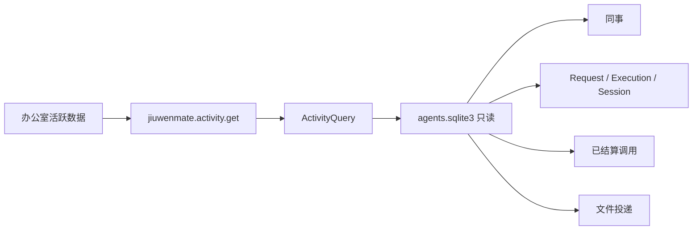

# 管理查询设计方案

## 1. 元信息

| 项 | 值 |
| --- | --- |
| 建档日期 | 2026-10-16 |
| 范围 | JiuwenMate 办公室「活跃数据」的只读查询；Web 方法 `jiuwenmate.activity.get` |
| 方案成熟度 | 已确认（2026-10-16 负责人确认本轮只做活跃数据，任务中心不做） |
| 计划条目 | [JM-16](../designs/jiuwenmate-development-plan.md) |
| 负责人 | 常钰聪 |
| 状态 | 进行中（与开发计划一致；任务中心不在本轮） |
| 设计依据 | [JiuwenMate 服务端架构设计](../designs/jiuwenmate-architecture.md) 第 4.4 节；开发计划 JM-16 |
| 关联 feature | 前置：[F_02](F_02_colleague-management.md)、[F_06](F_06_budget-port.md)、[F_09](F_09_web-and-feishu-result-delivery.md) |
| 验证摘要 | 查询测试 4 项通过；前端办公室与接口测试通过。任务中心未接入。 |
| Refs | 无独立 issue；需求来源为开发计划 JM-16 |

## 2. 背景、目标与范围

### 2.1 背景与问题

办公室「活跃数据」页签目前使用前端样例：热力图、排行榜、工作记录和群聊表都不读取同事、执行或投递记录。查询失败时若继续显示这些样例，会把虚构数字当成当前事实。

### 2.2 目标与关键场景

| 场景 / 触发条件 | 当前行为 | 目标行为 / 可观察变化 |
| --- | --- | --- |
| 打开活跃数据 | 显示样例热力图、排行榜和群聊 | 显示本命名空间同事的任务、调用、Token 和渠道 |
| 同事忽略一条消息 | 样例不区分 | 该 Request 不计入任务、回复或失败 |
| 用量未知但已按预留结算 | 样例固定 Token | 计入调用次数，Token 取结算值，不记为零 |
| 查询失败 | 仍可能看到样例 | 页签显示失败，不回退到样例数字 |
| 打开任务中心 | 样例看板 | 本轮不变 |

### 2.3 本次范围与非目标

- 本次包含：只读汇总；办公室「活跃数据」全员与个体视图；权限与现有 Web 入口相同，固定为本地命名空间。
- 本次不包含：任务中心看板；一次 Request 的多次 Execution 展开；排队、执行中、暂停、结束、发送失败的分列（JM-16-V-01）；跨群搜索；修改执行或投递状态。

## 3. 设计约束、假设与待决问题

- **已确认约束：** 查询不写库。公开结果不含设置、人设、模型凭据、办公目录路径和候选正文。`ignored` 既不是回复也不是失败。尚未开始执行的排队 Request 不是任务。
- **关键假设：** 调用次数与 Token 以 `budget_calls` 中 `status = settled` 的记录为准；未知用量在结算时已经写入 `charged_tokens`。工作时长取该 Request 最早一次 Execution 的开始时间到 Request 结束时间，未结束的记 0 分钟。日期按 UTC。
- **待决问题：** 无。

## 4. 总体方案与设计取舍

### 4.1 方案概览

### 4.2 关键决策

#### D-01 活跃数据由一次只读汇总生成

- 选择与依据：页签需要的是按日、按渠道和按群的计数，不是任务看板。在服务端一次读出并汇总，页面不再保留第二套样例数字。
- 代价与成立条件：任务中心仍用样例，直到单独开工。

#### D-02 忽略的消息不进入任何活跃计数

- 选择与依据：JM-16-V-02 规定 ignored 不计为回复，也不计为失败。它同样不计入处理任务、时长、调用归属和群产物，避免把「未回复」显示成工作量。
- 代价与成立条件：只有已经写入 Execution 且结局不是 ignored 的 Request 才算任务。

### 4.3 替代方案与排除理由

#### R-01 继续由页面用样例，后台只提供 Token 总额

- 排除理由：热力图和排行榜会继续显示虚构任务数，和「查询解释已确认事实」冲突。

## 5. 详细设计

`ActivityQuery.report(namespace_id, *, now)` 返回 `generated_at` 和 `members`。每个成员包含：

| 字段 | 口径 |
| --- | --- |
| `calls` / `tokens` | 已结算调用次数与 `charged_tokens` 之和；拒绝和未结算的预留不计入 |
| `tasks` | 至少有一次 Execution，且 `outcome` 不是 `ignored` |
| `replies` | `outcome = completed` |
| `failures` | `outcome = failed` |
| `companion_days` | 自创建日到 `now` 的 UTC 日历天数，含首尾 |
| `last_response_at` | 最近一次 `completed` 的 `updated_at`；没有则为空 |
| `days` / `hours` | 按最早 Execution 的 UTC 日期和小时累计任务数、分钟和 Token；时段热力格按任务数显示，因此不足一分钟的任务也会显示活动颜色 |
| `channels` | 按 Session 的 `channel` 汇总调用、Token、任务、回复和失败 |
| `groups` | `kind = group` 的会话；产物是该会话上状态为 `delivered` 或 `available` 的文件投递 |

群名称使用平台会话标识；没有映射时使用 `group_chat_id`。Web 方法不接受调用方传入的命名空间，只查询 `local`。

## 6. 影响面与实施设计

- 新增 `activity_query.py`、`tests/unit_tests/server/jiuwenmate/test_management_query.py`。
- `web_adapter.py` 增加运行时方法；Gateway 转发名单同步。
- 前端办公室「活跃数据」改为消费该查询；任务中心不改。
- 无旧数据迁移。查询失败不写成空成功。

## 7. 验证设计、执行记录与结论

| 验收 | 场景 | 预期 | 结果 |
| --- | --- | --- | --- |
| JM-16-V-02 | ignored、失败、已结算与未知用量 | ignored 不进入任务、回复、失败；未知用量按结算值计入 | `test_management_query.py` 4 passed |
| JM-16-V-03 | Web 查询 | 只读本地命名空间，响应不含凭据和设置 | 查询结果无设置字段；方法固定 `local`，前端不传命名空间 |
| JM-16-V-01 | 任务中心 | 本轮不验收 | 未执行 |

## 8. 风险与已知遗留

- 任务中心仍是样例页面。
- 未结束任务的时长记为 0，不把排队时间算成工作时长。
- 群没有单独的显示名称，表中使用平台会话标识。

## 9. 设计演进与修订

### 2026-10-19 时段热力图保留短任务活动

- 发现：时段格原先只使用向下取整后的执行分钟数。短于一分钟的已完成任务因此变为 0，页面没有活动颜色。
- 变化：小时汇总新增任务数和 Token；页面以任务数生成时段热力格，时长仍用于展示累计小时。
- 兼容：旧响应没有 `tasks` 时继续使用已有分钟字段。
