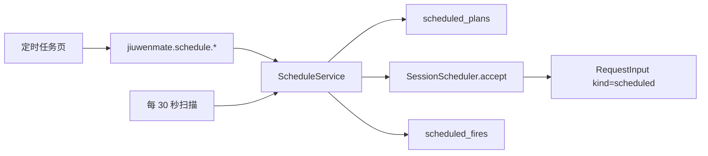

# 定时任务设计方案

## 1. 元信息

| 项 | 值 |
| --- | --- |
| 建档日期 | 2026-10-17 |
| 范围 | JiuwenMate Web 同事的定时计划：创建、启停、删除，以及到期后转为普通 `scheduled` Request |
| 方案成熟度 | 已确认（按开发计划 JM-19 的责任边界实现；本轮只做 Web） |
| 计划条目 | [JM-19](../designs/jiuwenmate-development-plan.md) |
| 负责人 | 常钰聪 |
| 状态 | 进行中（与开发计划一致；浏览器与真实模型执行未验收） |
| 设计依据 | [JiuwenMate 服务端架构设计](../designs/jiuwenmate-architecture.md) 第 10.4 节；开发计划 JM-19 |
| 关联 feature | 前置：[F_02](F_02_colleague-management.md)、[F_07](F_07_execution-driver.md)、[F_09](F_09_web-and-feishu-result-delivery.md)、[F_10](F_10_web-colleague-management.md) |
| 验证摘要 | 计划与触发测试 4 项通过。浏览器端到端和真实模型执行未执行。 |
| Refs | 无独立 issue；需求来源为开发计划 JM-19 |

## 2. 背景、目标与范围

### 2.1 背景与问题

同事详情和办公区已有「定时任务」入口，但页面只有空状态。旧版个人定时任务每次触发另开会话并自行推送，不能作为新版同事的执行路径。新版需要把到期时刻交给已有调度器，由指定同事按普通任务执行，并沿用同一套预算和 Web 投递。

### 2.2 目标与关键场景

| 场景 / 触发条件 | 当前行为 | 目标行为 / 可观察变化 |
| --- | --- | --- |
| 在定时任务页保存计划 | 无法保存 | 写入该同事的一条计划，并显示下次触发时间 |
| 到达计划时刻且同事已发布 | 无请求 | 该时刻只产生一条 `RequestInput(kind="scheduled")`，进入该同事当前的 Web 聊天窗口 |
| 服务停机期间错过若干时刻，恢复后计划仍启用 | 无补发 | 补发停机期间到期的时刻，已记录的时刻不再接受 |
| 停用后再启用，且原下次时刻已过 | 可能补发停用期间 | 跳到当前之后的下一次，不补发停用期间 |
| 同事尚未发布 | 可能写成失败并跳过 | 下次触发停在该时刻，下一轮再试 |
| 删除同事 | 计划残留 | 该同事的计划和触发记录一并删除 |

### 2.3 本次范围与非目标

- 本次包含：计划的创建、列出、启停和删除；进程内周期扫描；补发与去重；Web 详情页编辑和办公区列表。
- 本次不包含：飞书或群定时投递；复用旧版 cron 的新会话和独立推送；任务中心；知识版本装配。

## 3. 设计约束、假设与待决问题

- **已确认约束：** 计划与触发记录写在同事库 `agents.sqlite3`，不写入旧版 cron 存储。core 只执行已经接受的 `scheduled` 请求，不负责计划。一次触发对应一个 `source_ref`。默认时区为 `Asia/Shanghai`。名称不超过 80 字，执行内容不超过 4000 字。Cron 使用已有五段或七段表达式校验。
- **关键假设：** 同事已发布时，`current_snapshot` 能给出执行快照。未发布时该方法抛出 `NOT_PUBLISHED`。Web 投递已能按 `channel=web` 的路由快照送达同一会话。
- **待决问题：** 无。

## 4. 总体方案与设计取舍

### 4.1 方案概览

`AgentManager.start` 在调度器启动后开始扫描，`aclose` 取消扫描任务。删除同事时，先结束其执行，再删除其计划，然后删除同事本身。

### 4.2 关键决策

#### D-01 提醒进入该同事的聊天窗口

- 选择与依据：到期结果要出现在该员工已有的 Web 聊天里。已有会话时写入置顶会话，否则写入最近一条；还没有会话时使用 `employee:{agent_id}` 并列入聊天列表。同一同事的多次触发共用这个窗口。发生标识仍是 `schedule:{plan_id}:{utc_iso}`，不另建隐藏会话。
- 代价与成立条件：同一同事的多个计划写入同一个聊天窗口。同事还没有聊天时才新建 `employee:{agent_id}`。

#### D-02 一个到期时刻只接受一次

- 选择与依据：`source_ref` 为 `schedule:{plan_id}:{utc_iso}`。触发记录主键为命名空间、计划和该时刻。`accept_request` 对同一 `source_ref` 返回已有 Request。重启后已记录的时刻不再提交。
- 代价与成立条件：补发上限为每轮每计划 48 个时刻。超出的时刻仍保持到期，下一轮继续。

#### D-03 停用期间不欠触发

- 选择与依据：只有启用中的计划进入扫描。重新启用时，若原下次时刻已经过去，则改到当前之后的下一次，不回补。
- 代价与成立条件：停用跨越的时刻不会执行。启用期间进程关闭所错过的时刻仍会补发。

#### D-04 未发布时不推进游标

- 选择与依据：没有发布快照就不能执行。游标停在该时刻，避免把失败当成已触发。
- 代价与成立条件：同事一直不发布时，该计划每轮都会重试同一时刻。

### 4.3 替代方案与排除理由

#### R-01 复用旧版个人定时任务

- 排除理由：旧版每次触发新建会话并独立推送，和「指定同事、同一预算、JM-09 投递」不一致，也会和旧数据混在一起。

## 5. 详细设计

`ScheduleService` 持有会话仓库、调度器、快照函数和时钟。计划方法在调用线程内写库；扫描由 `AgentManager` 的异步任务调用。

| 方法 | 行为 |
| --- | --- |
| `list(namespace_id, agent_id)` | 返回该同事的计划，按创建时间排序 |
| `create(...)` | 校验名称、内容和 Cron；第一次触发取严格晚于当前的下一次 |
| `set_enabled(namespace_id, plan_id, enabled)` | 写入启停。启用且下次时刻已过时，改到下一次 |
| `delete` / `delete_agent` | 删除计划及其触发记录 |
| `sweep(limit=48)` | 为每个已到期且未记录的时刻接受一条 Request |

接受时使用固定主体 `local`，范围为 `scheduled`、工作区读和工作区写。路由快照的渠道为 `web`，目标为该同事的聊天会话键，来源消息标识为 `source_ref`，以便沿用 Web 投递。

Web 方法均固定命名空间 `local`：

| 方法 | 参数 | 响应 |
| --- | --- | --- |
| `jiuwenmate.schedule.list` | `agent_id` | `{ plans }` |
| `jiuwenmate.schedule.create` | `agent_id`、`name`、`prompt`、`cron_expr`；`timezone` 缺省为 `Asia/Shanghai` | `{ plan }` |
| `jiuwenmate.schedule.set_enabled` | `plan_id`、`enabled` | `{ plan }` |
| `jiuwenmate.schedule.delete` | `plan_id` | `{ deleted: true }` |

页面按同事设计稿组织，不直接填写 Cron。新建和编辑使用同一对话框：任务名称、描述、执行计划（周期、按间隔、单次）和可选生效周期。周期支持每天、每周和每月。同事详情列出计划卡片，可启停、立即运行、查看运行历史、编辑和删除。同事记录里的定时任务列出该同事的计划。到期提醒写入该同事的聊天窗口。空状态的「新增定时任务」进入该同事的配置页。左侧「定时任务」打开全部同事的任务表，可按执行者和状态筛选。

## 6. 影响面与实施设计

- 新增 `scheduled_requests.py` 与 `tests/unit_tests/server/jiuwenmate/test_scheduled_requests.py`。
- `AgentManager` 启动和关闭扫描，删除同事时清理计划。
- Gateway 转发名单与 `ReqMethod` 增加四个方法；`web_adapter.py` 调用 `ScheduleService`。
- 前端详情页和办公区消费上述方法。中英文文案同步。
- 不迁移旧版 cron 数据。计划表只在新版同事库中创建。

## 7. 验证设计、执行记录与结论

| 验收 | 场景 | 预期 | 结果 |
| --- | --- | --- | --- |
| JM-19-V-01 | 每小时计划在可控时钟下到期 | 每个到期时刻一条 `kind=scheduled` 的请求，且写入该同事的聊天窗口 | `test_scheduled_requests.py`：到期补发三条，来源标识不重复 |
| JM-19-V-02 | 接受路径 | 使用与私聊相同的调度接受、预算主体和 Web 路由快照 | 接受参数含 `SCHEDULE_ACCESS` 与 `channel=web`；真实模型执行未跑 |
| JM-19-V-03 | 重启、停用、未发布、删除同事 | 重启不重复；停用期间不补发；未发布停在原时刻；删除同事后计划消失 | 同文件 4 项通过。详情页静态渲染含计划表单；浏览器保存与启停未执行 |

命令：`uv run pytest tests/unit_tests/server/jiuwenmate/test_scheduled_requests.py -q --tb=short --no-cov`。

## 8. 风险与已知遗留

- 浏览器中的创建、启停和删除尚未在运行中的页面上操作确认。
- 真实模型是否按该 Request 完成回复，依赖已有 PA-05 入口和发布快照，本轮未单独联调。
- 单轮补发上限为 48。更长停机要靠后续扫描继续，不会在一轮内追完。
- 飞书定时投递不在本次范围。

## 9. 2026-10-17 设计稿对齐（已确认范围，实施中）

用户确认以 `0923AI同事` Pixso 导出图 2-8～2-12、4-12～4-15 为本轮验收依据。
现有 Cron 文本表单、简单列表不能覆盖该交互，新增如下范围（以下验证尚未执行）：

- 共用新增/编辑弹窗：名称、描述、周期/间隔/单次、生效起止时间；保留已有 Cron 计划兼容。
- 同事配置页展示卡片、开关、立即运行/历史/编辑/删除；同事工作台左侧展示任务。到期提醒进入该同事的聊天窗口。
- 全局任务页展示执行者、计划、状态、累计次数，提供搜索、执行者及状态筛选；独立历史视图展示真实执行结果与原因。
- 后端沿用 `ScheduleService`、同事 SQLite 和普通 Request 路径，扩展计划字段并迁移旧表；新增 update/run/history，list 允许省略 agent_id。
- 手动执行不改变自动执行游标；单次执行完成后不再自动触发；有效期外不产生请求。启停计划与执行结果分别记录，接收成功不能冒充运行成功。
- 验证包含三类计划、有效期、编辑、立即运行、真实 Request 历史映射、旧数据兼容以及前端入口/表单/状态和浏览器视觉检查。

选择扩展现有计划模型以保留聊天窗口投递、预算和执行语义；不另建个人版 cron 执行路径，不用前端假数据填充运行次数或结果。
