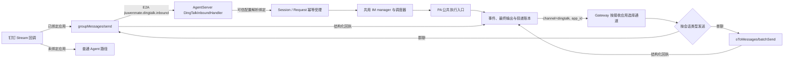

# 钉钉 JiuwenMate 单聊接入设计方案

## 1. 元信息

| 项 | 值 |
| --- | --- |
| 建档日期 | 2026-10-25 |
| 最近修订 | 2026-10-26（按用户决定修订默认应用、逐应用管理、投递分类，撤回对飞书运行路径的改动；随后三轮按用户检视修复白名单、局部保存、等待提示、绑定检查、@ 交接、设置页白名单状态、并发保存与通道重启；本次补充钉钉群聊接入；见第 10 节） |
| 范围 | Swarm 钉钉企业内部应用机器人：单聊及群聊文本受理、多应用配置与绑定、执行结果文本投递及回执；涉及 `gateway/channel_manager/im_platforms/dingtalk/`、Gateway 渠道接线、AgentServer 钉钉入站、投递账本的渠道集合及设置页面 |
| 方案成熟度 | 已确认：范围与取舍由本 session 用户于 2026-10-25、2026-10-26 明确决定（第 3 节）；平台语义仍待测试应用核实 |
| 计划条目 | [JM-21 跨群搜索与 IM 扩展](../designs/jiuwenmate-development-plan.md#jm-21-跨群搜索与-im-扩展扩展) 的“其他 IM 扩展”子范围；不改变 JM-21 整项负责人、排期或状态 |
| 负责人 | Song Haoran（本钉钉子范围）；JM-21 整项及跨群搜索仍由闫祉君负责 |
| 状态 | 单聊已提交到个人仓；群聊本地实现与回归验证完成，真实钉钉群联调待完成；与 [F_02_02](F_02_02_colleague-connections.md) 一同验收 |
| 设计依据 | [S_05 IM 单聊绑定与结果投递规约](../specs/S_05_im-direct-message-and-delivery.md)；[F_03](F_03_session-request.md) 受理与幂等；[F_07](F_07_execution-driver.md) 调度；[F_09](F_09_web-and-feishu-result-delivery.md) 投递账本 |
| 关联 feature | [F_08](F_08_feishu-group-fanout.md)（飞书入站，作为接线参照，本次不修改其运行路径）；配置聚合与“添加连接”见 [F_02_02](F_02_02_colleague-connections.md)，已替换本文 D-07 的临时检查 |
| 验证摘要 | 2026-10-26 基线 Swarm `272e7e89`、本地 core `eaf7ca383`：钉钉四组 85 项、飞书/Web/投递回归 169 项（另 1 项既有飞书失败，干净快照复现）、兼容批次 271 项、前端 111 项及构建通过；未做浏览器核对（第 8 节）。合入依赖已由 F_02_02 关闭（第 9 节） |
| Refs | 本 session 用户的实施与发布授权；钉钉实现为子仓提交 `1d6f9445`，本次作为 [PR1 !76](https://gitcode.com/huenrui_/jiuwenswarm/merge_requests/76) 提请上游审阅，与 [PR2 !77 聚合层](https://gitcode.com/huenrui_/jiuwenswarm/merge_requests/77) 配套；均为草稿；未关联 issue，合入须用户另行审批 |

本 session 负责人为 Song Haoran，仅对应本子范围的实施，不等于认领 JM-21 整项。

## 2. 背景、目标与范围

### 2.1 背景与问题

已有钉钉渠道是普通模式：Stream 收消息后进入普通 Agent，单应用平铺配置，cron 依赖顶层 `last_*`。它不经过 JiuwenMate 的可信绑定、Request 幂等、调度器和投递账本。飞书已有 JM 入站与结果投递，本特性沿用同一分工，不为钉钉另建执行或恢复链路。

### 2.2 目标与关键场景

| 场景 | 改动前 | 目标行为 |
| --- | --- | --- |
| 已绑定 JM 的钉钉应用收到单聊文本 | 走普通 Agent | 由 JM 认领，按可信绑定定位 Agent，幂等受理并执行；文本结果经原应用发回原员工 |
| 已绑定应用收到群聊文本 | 走普通 Agent | 仍由 JM 认领；明确 @ 机器人时交给绑定员工，并按原群会话回复；未明确 @ 时按员工被动 / 自适应模式判断 |
| 已绑定应用收到附件或不完整事件 | 走普通 Agent | 仍由 JM 认领后丢弃，不回落普通 Agent，不下载附件 |
| 平台重推同一 msgId | 普通链路可能再次执行 | 复用同一 Request，不重复执行或发送 |
| 设置页管理多个钉钉应用 | 只能编辑一个平铺应用 | 逐应用新增、编辑、启停、删除；删除一个应用不影响其他应用 |
| 更换普通应用的 client_id | 旧 `last_*` 继续被 cron 使用 | 换成另一个机器人时清除旧 `last_*`，轮换密钥则保留 |
| 结果投递时原应用已删除、凭据错误或 Token 服务不可达 | 不适用 | 删除或凭据被拒判 failed；不可达时等待后重试，不每秒请求 |

### 2.3 本次范围与非目标

- 本次包含：企业内部应用机器人的单聊和群聊文本入站与文本结果投递；群聊复用员工 `group_reply_mode`；`channels.dingtalk.apps[]` 多应用配置及兼容旧平铺配置；员工页面绑定、设置页逐应用管理；共用现有 IM manager 与投递账本。
- 本次不包含：附件入站、文件或媒体结果发送、用户授权 CLI、已读查询与撤回、第三方企业应用、多个普通应用及 cron 多机器人；持久 Inbox；Web 与 IM 统一并发；飞书运行路径的任何变化；配置聚合层。

## 3. 设计约束、假设与待决问题

- 已确认约束与依赖（用户决定）：
  - 2026-10-25：保留飞书式快速 Stream ACK，不新增 Inbox；不修改 agent-core，不新增执行入口、窗口格式或恢复机制；正式依赖 `680795de` 缺少 PA，本地 core 验证须注明来源。
  - 2026-10-26：隔离单位是连接；同一 Agent 不跨平台、也不跨钉钉应用复用；换 client_id 视为新连接。已绑定应用整体由 JM 接管，绑定后保留普通 `send()`，普通应用可转为 JM。普通钉钉应用最多一个；不扩展 cron 多机器人；不新增拒绝提示；首版只支持企业内部应用。删除一个应用只影响该应用及其绑定，不删除员工数据。
  - 本 PR 不改飞书运行路径；跨平台不变量的正式实现由配置聚合层的连接登记承接。
- 关键假设（待测试应用核实，不成立时影响 D-03、D-05、D-06）：重推时 msgId 不变；单聊 conversationId 在一个机器人内稳定；企业内部员工的回调带 senderStaffId；robotCode 默认等于 client_id；HTTP 401 表示请求未被处理。
- 待决问题：无影响本 PR 实现的待决项。

## 4. 总体方案与设计取舍

### 4.1 方案概览



实线表示调用方向。钉钉只新增入站适配、发送回执和配置管理；受理、调度、执行与账本复用飞书与 Web 已有组件。

### 4.2 关键决策

#### D-01 已绑定应用的入站全部由 JM 认领

- 选择与依据：`DingTalkHandler.process` 在下载、写配置和普通路由之前判断 `config.agent_id`，绑定应用的事件只交给 JM；拒绝、失败或不支持都不回落普通 Agent，避免同一消息两边执行。与飞书一致。
- 代价：附件在首版被静默丢弃，不新增提示（用户决定）；群聊文本进入 JM 路由。

#### D-02 默认应用承担没有应用身份的普通消息

- 选择与依据：cron、心跳等普通消息不带应用身份，只能发给默认应用。默认应用为唯一的普通应用；没有普通应用时，只保留此前已标记为默认的应用（例如普通应用转为 JM 后）。JM 应用不会按位置被自动提升为默认。默认应用使用旧路由键 `default`；其他应用以 client_id 为键。找不到默认应用时消息丢弃并记日志，不回退到任一实例。
- 代价：删除普通应用后，钉钉 cron 推送不再发出，直到重新配置普通应用。
- 实现体现：`_choose_default`、`DingTalkChannel.app_id`、ChannelManager 派发不对钉钉做 channel_id 回退。

#### D-03 路由冻结接收应用，投递按接收应用匹配

- 选择与依据：路由快照保存 `channel=dingtalk`、`app_id=client_id`、员工 `target_id` 和源 msgId。Gateway 用 `persistent_app_id`（即 client_id）匹配钉钉通道，因为默认应用的键是 `default`；飞书仍按原规则匹配，只排除钉钉通道，企业飞书不受影响。
- 代价：原应用被删除或停用后，其结果判 failed，不改投其他机器人。

#### D-04 设置页逐应用管理，表单不提交绑定

- 选择与依据：设置页保存 `apps[]`；每项先按 client_id 合并到已保存的应用再推导和校验，所以未提交的字段（`enabled`、应用级 API 地址、白名单、绑定、robot_code）保持原值，空密钥表示不变，默认标志由服务端推导。保存与绑定都在配置写锁内以文件中的配置为基础完成合并与写回，再用结果重启通道，避免并发保存互相覆盖或用内存旧值覆盖普通渠道写入的 `last_*`。已绑定应用的 client_id 不可修改，更换应用须在员工页面重新绑定。新增应用（含更换 client_id 后的应用）必须明确提交白名单，省略即拒绝保存；白名单格式错误时设置页同时锁定 client_id，重新填写白名单后才可更换。首次保存把旧平铺凭据迁入 `apps[]`，只保留 `last_*`、API 地址等共享键。
- 代价：不再接受旧的平铺表单载荷。

#### D-05 投递结果保守分类，避免无界重试

- 选择与依据：确定未发出才判 pending；明确拒绝、目标无效、限流或过滤判 failed；平台接受并给出句柄判 delivered；其余不确定判 unknown，不自动重发。凭据被拒判 failed；Token 服务不可达时 30 秒内不再请求；缓存 Token 收到 401 时清除并以 pending 重试一次，新 Token 仍 401 则 failed。
- 代价：限流不自动退避重试，需人工处理；401 处理依据 HTTP 语义，平台证据待联调。

#### D-06 企业内部应用的身份边界

- 选择与依据：只接受单聊或群聊文本，必须有 msgId、conversationId、senderStaffId；不回退加密 senderId。事件带 robotCode 时须与配置一致；`senderCorpId` 与 `chatbotCorpId` 都存在且不同则拒绝，因为另一企业的 staffId 在本机器人所属企业指向其他人。
- 白名单：空列表表示不限制，因此只有未设置或空值才按空列表处理。字符串、含非字符串项的列表等格式错误原样保留，应用不启动；明确提交的非法值被拒绝，其他编辑不触碰原值；设置页标出需修正，用户重新填写前不提交白名单，也不能更换 client_id。省略白名单只对已保存的应用表示“不变”，新增应用没有可保留的值，省略即拒绝，不按空列表放行。不把格式错误猜成某种取值。修订前的归一化曾把这类值变成空列表、放行所有员工（第 10 节）。

#### D-07 跨连接复用只在钉钉侧检查（临时；已由 2026-10-26 [F_02_02](F_02_02_colleague-connections.md) D-09 替代）

> 当前规则：每个钉钉应用有专属的运行 Agent，飞书和钉钉入站都核对连接登记；下列临时检查已撤回。

- 选择与依据：钉钉绑定与入站拒绝已绑定飞书的 Agent，以及已服务过群、飞书或其他钉钉应用会话的 Agent。会话事实在 AgentServer，绑定接口先经内部方法 `jiuwenmate.dingtalk.binding_check` 询问，再读取并保存配置；AgentServer 无法回答时不保存。入站检查保留为最终防线。飞书路径不做对应检查，保持原行为。
- 代价：一个已服务钉钉的 Agent 被绑定到飞书后，钉钉入站被拒，但飞书照常运行，并能读到该 Agent 原有的钉钉输出文件；停止钉钉入站不能隔离已有文件。由配置聚合层的连接登记关闭，构成合入依赖（第 9 节）。

#### D-08 群聊沿用现有群会话与员工回复模式

- 选择与依据：群消息按钉钉平台会话 ID 解析为 JiuwenMate 群身份，归档后按员工 `group_reply_mode` 决定是否创建 Request。明确 @ 当前机器人时由绑定员工受理；未明确 @ 的消息若由平台投递，则自适应模式进入既有职责参与判断、被动模式只归档。钉钉 Stream 的群机器人回调只投递 @ 到当前机器人的消息，因此真实钉钉群里未 @ 的消息不会进入该判断；自适应设置不能绕过平台的投递限制。对机器人专属的群消息回调，若 `isInAtList` / `atUsers` 与机器人身份字段缺失或不一致，以该回调已由当前绑定机器人收到作为 @ 机器人的证据，`@全体` 仍不视作对机器人的明确 @。Session 使用群身份，结果路由仍冻结钉钉应用 ID 和原平台群 ID；确认发送的回复也写入群公开记录，崩溃恢复只补归档、不重发。
- 代价与边界：本次只接收文本；钉钉的 @ 交接、附件和文件发送仍不支持。钉钉没有可用的群成员读取接口时，以当前绑定应用收到的群事件作为机器人仍在群内的证据。
- 实现体现：`DingTalkInboundEvent` 保存规范化群聊与提及字段；`DingTalkInboundHandler` 复用群目录、公开归档、员工设置和执行调度；投递载荷通过 `is_direct_message` 区分私聊和群聊。

### 4.3 替代方案与排除理由

| 候选 | 差异 | 排除原因 | 重新评估条件 |
| --- | --- | --- | --- |
| R-01 绑定 JM 的机器人只服务 JM，普通 `send()` 一律拒绝 | 以禁用发送规避选错机器人 | 用户决定与飞书一致保留普通发送；问题根因是回退规则 | 无 |
| R-02 没有普通应用时把第一个应用当默认 | 保证 cron 总有出口 | 会把消息改由另一个机器人发出 | 无 |
| R-03 保留旧平铺表单，只编辑默认应用 | 前端不改 | 旧表单会误改或清空 JM 应用；用户决定逐应用管理 | 无 |
| R-04 在飞书入站和绑定接口中同时检查跨平台复用 | 双向即时拒绝 | 改变他人负责的飞书路径；连接登记可以统一实现 | 配置聚合层交付后由登记替代 |
| R-05 Token 或应用缺失一律 pending | 实现简单 | 现有账本每轮约 1 秒认领一次，会无界重试并反复请求 Token | 账本具备退避后可再评估 |
| R-06 受理落库后再 ACK、新增持久 Inbox | 缩小丢失窗口 | 用户决定保持飞书式快速 ACK；平台重推规则未核实 | 有平台证据且飞书同步评估时 |

## 5. 详细设计

### 5.1 模块责任与关键不变量

| 模块 | 责任 |
| --- | --- |
| `im_platforms/dingtalk/configuration.py` | 配置归一化、默认应用、启动设置、合并与落盘、飞书绑定占用判断；纯函数，不访问网络 |
| `dingtalk_connect.py` | JM 认领与标准化、白名单与 robotCode 校验、路由键、结构化发送与 Token 分类 |
| `server/jiuwenmate/dingtalk_inbound.py` | 可信绑定解析、企业与历史连接检查、Session/Request 受理与路由快照 |
| `im_platforms/dingtalk/lifecycle.py` | 钉钉通道集合的串行重启：取出并停止旧实例，再按最新配置注册新实例 |
| `channel_manager.py` | 按平台与接收应用选择投递通道；钉钉普通消息不回退到任一实例 |
| `app_web_handlers.py` | 钉钉绑定、查询、读写配置；落盘后重启钉钉通道 |
| `execution_repository.py`、`delivery_service.py` | 按运行时负责的渠道集合认领与恢复投递；钉钉历史连接查询 |

关键保证（验证见第 8 节）：I-1 已绑定应用的事件不进入普通 Agent；I-2 同一 msgId 只产生一个 Request、一次执行和一次发送；I-3 结果只经原接收应用发给受理时的员工；I-4 没有应用身份的消息只发给默认应用；I-5 换成另一机器人时 `last_*` 从文件中删除；I-6 unknown 不重发，投递失败不重跑 Agent。

### 5.2 关键函数

| 符号 | 说明 |
| --- | --- |
| `dingtalk_apps(raw) -> list[dict]` | 读 `apps[]` 或旧平铺单应用；文本字段转为字符串，`allow_from` 转为列表，未设置的 `enabled` 按凭据是否齐全推导；计算默认标志 |
| `dingtalk_channel_settings(raw, *, api_base, oapi_base) -> list[dict]` | 生成要启动的通道设置；跳过停用、凭据不全和重复 client_id 的应用，普通应用只启动第一个 |
| `merge_dingtalk_config(current, changes) -> dict` | 只接受 `apps[]`；按 client_id 保留未提交的密钥、绑定和 robot_code；拒绝重复 ID、空 ID 和第二个普通应用；默认应用换成另一 client_id 或不再存在时去掉 `last_*` |
| `update_dingtalk_section(build, *, validate=None) -> dict` | 在配置写锁内读取文件中的 `channels.dingtalk`，交给 `build` 生成编辑，合并、校验后整段写回并返回结果；删除合并后不再存在的键 |
| `DingTalkChannel.app_id` / `persistent_app_id` | 路由键（默认应用为 `default`）/ 冻结路由使用的 client_id |
| `DingTalkChannel.send_persistent_result(...)` | 只发文本；分类见 5.6 |
| `allow_from_valid(app) -> bool` | 白名单是否为字符串列表；为假时应用不启动、保存被拒 |
| `ExecutionRepository.has_sessions_outside_dingtalk_app(namespace_id, agent_id, app_id) -> bool` | 已撤回（F_02_02）：原用于判断 Agent 是否已有群会话、其他平台单聊或其他钉钉应用的单聊 |

### 5.3 接口

- `channel.dingtalk.bind_agent`：`client_id`、`client_secret`、`persistent_agent_id` 必填，`robot_code` 可选。同一员工换绑时替换其原应用；绑定普通应用即把它转为 JM。拒绝已绑定飞书的员工；保存前询问 AgentServer，员工已服务其他连接时返回 `BAD_REQUEST`，无法询问时返回 `SERVICE_UNAVAILABLE`，均不保存。落盘成功但通道重启失败时返回 `CHANNEL_APPLY_FAILED`。
- `channel.dingtalk.get_bindings`：返回有效绑定的员工 ID。
- `channel.dingtalk.get_conf` / `set_conf`：读写共享键与归一化的 `apps[]`；`set_conf` 不接受平铺载荷。
- `jiuwenmate.dingtalk.inbound`：Gateway 到 AgentServer 的内部 E2A 方法，不在 Web 适配器的公开方法中。原有的 `jiuwenmate.dingtalk.binding_check` 已由 F_02_02 的 `jiuwenmate.connection.attach` 替代。
- 投递推送携带 `channel` 和 `is_direct_message`；ACK 信封使用同一渠道。

### 5.4 配置与默认应用

```yaml
channels:
  dingtalk:
    api_base: ...            # 共享，可被应用覆盖
    last_sender_id: ...      # 仅默认应用的普通 cron 身份
    apps:
      - client_id: ordinary  # 普通应用，即默认应用
        client_secret: ...
      - client_id: colleague
        client_secret: ...
        persistent_agent_id: agent-a
        robot_code: ""       # 留空沿用 client_id
```

旧平铺配置读取时视为单个默认应用；第一次通过设置页或绑定接口保存时迁入 `apps[]`。

### 5.5 身份、会话与路由

| 对象 | 取值 |
| --- | --- |
| namespace | `local` |
| Session | `ConversationRef.im_direct("dingtalk", json([client_id, conversationId]))` |
| Request `source_ref` | `dingtalk:message:` + `json([client_id, msgId])` |
| 发起人 | `dingtalk:<client_id>:<staffId>`，策略修订 `jm21-dingtalk-direct-v1`，权限与飞书单聊一致 |
| 路由快照 | `channel=dingtalk`、`app_id=client_id`、`target_id=staffId`、`source_message_id=msgId` |

### 5.6 投递结果分类

| 观察结果 | 结果 / 错误码 |
| --- | --- |
| 通道未注册但应用仍在配置中且启用 | pending `DINGTALK_APP_NOT_CONNECTED` |
| 原应用已删除或停用 | failed `DINGTALK_APP_NOT_CONFIGURED` |
| Token 服务返回 400/401/403 | failed `DINGTALK_CREDENTIAL_REJECTED` |
| Token 服务不可达或异常 | pending `DINGTALK_TOKEN_UNAVAILABLE`，30 秒内不再请求 |
| 缓存 Token 发送收到 401 | pending `DINGTALK_TOKEN_EXPIRED`，清除缓存 |
| 连接建立前失败（ConnectError / ConnectTimeout / PoolTimeout） | pending `DINGTALK_NOT_CONNECTED` |
| 带错误码的 4xx、401/403/404/413/422/429，目标在 invalid / flowControlled / filtered 名单 | failed |
| 200 且有 `processQueryKey`，目标未被拒绝 | delivered，句柄存为 `external_message_id` |
| 读超时、请求中断、5xx、408、`unknown.send.result`、无错误码的其他 4xx、成功缺少句柄 | unknown |
| 文件或 @ 交接 | failed `DINGTALK_DELIVERY_UNSUPPORTED`，Gateway 不读取文件，也不把 @ 交接退化为普通文本 |

`delivered` 表示平台接受发送，不表示已读；本地投递键不是平台幂等参数。等待提示与结果使用同一接收应用匹配；核心只为群消息做参与判断，单聊在首版不产生等待提示。

### 5.7 并发与一致性

- Stream 快速 ACK 后到受理落库前崩溃会丢失消息；不承诺恰好一次。
- 配置写入在进程与文件双重锁内完成“读文件—合并—校验—写回”，再重启通道；绑定检查等异步步骤都在读取配置之前完成。普通渠道写 `last_*` 的既有路径不变，其写入不会被设置保存覆盖。
- 通道重启串行执行：后到的重启等待前一次完成；每次先取出并停止当时注册的实例，停止完成后才读取最新配置并注册。停止旧实例不再按 channel_id 注销，因为那会同时移除等待期间注册的新实例。
- Web 与 IM 两个调度器的并发计数仍各自独立。

## 6. 影响面与实施设计

### 6.1 修改点

| 范围 | 文件 |
| --- | --- |
| 钉钉通道与配置 | `im_platforms/dingtalk/configuration.py`、`im_platforms/dingtalk/lifecycle.py`（新增）、`dingtalk_connect.py` |
| Gateway 共享接线 | `app_gateway.py` 钉钉启停（`_stop_channel` 增加不注销选项，其他渠道行为不变）、`channel_manager.py` 投递匹配与派发回退、`message_handler.py` 钉钉 E2A 与 ACK 渠道 |
| 配置接口 | `app_web_handlers.py` 钉钉绑定、查询与读写 |
| AgentServer / JM | `agent_ws_server.py` 钉钉入站与 IM 运行时启动条件、`dingtalk_inbound.py`（新增）、`execution_models.py` 路由渠道、`execution_repository.py` 与 `delivery_service.py` 渠道集合、`feishu_group_fanout.py` 中共用运行时的投递渠道与钉钉处理器接入、`web_adapter.py` 平台显示 |
| 前端 | 设置页钉钉逐应用管理（类型、校验、表单项、适配器、`DingtalkChannelForm.tsx`、弹窗、控制器、列表）、员工页面平台绑定、中英文文案 |
| 测试 | `tests/unit/channel/test_dingtalk_persistent.py`、`tests/unit_tests/server/jiuwenmate/test_dingtalk_production_wiring.py`（新增）；同步既有测试中的钉钉载荷与 IM 恢复渠道 |

共享文件需相关负责人审阅：投递账本与接线（JM-09）、IM 运行时与调度（JM-07）、Gateway 与配置接口文件的检视人。飞书侧：本 PR 只在 `feishu_group_fanout.py` 的运行时构造中加入投递渠道集合与钉钉处理器，不改变飞书入站、绑定与配置接口。

### 6.2 文档同步

契约同步 S_03；开发计划仅保留 JM-21 设计索引。

## 7. 兼容与迁移

- 未绑定的钉钉应用继续普通入口，文件处理与 cron 读取不变；cron 只发给默认应用。
- 旧平铺配置可读取；第一次保存迁入 `apps[]`。不迁移业务数据，未新增数据库表。
- 设置页不再提交平铺载荷；旧的“删除渠道清空全部应用”改为逐应用删除。
- 回滚风险：已保存 `dingtalk` 路由的 Request 无法被不认识该渠道的旧版本解析，恢复扫描会失败。发布前须声明不可回滚，或先让旧版本容忍未知渠道。

## 8. 验证设计、执行记录与结论

### 8.1 验证设计与通过条件

| 编号 | 场景 | 通过条件 |
| --- | --- | --- |
| F_21_02-V-01 | 已绑定应用的单聊、群聊、附件与不完整事件 | 单聊文本受理；其余丢弃；均不进入普通路径（I-1） |
| F_21_02-V-02 | 重复 msgId | 一个 Request、一次执行、一次发送（I-2） |
| F_21_02-V-03 | 换绑、应用删除、跨企业、跨连接复用 | 拒绝或判 failed，不改投其他机器人（I-3） |
| F_21_02-V-04 | 无默认应用、普通应用转为 JM | 没有应用身份的消息不选任意机器人；转为 JM 的默认应用继续承接（I-4） |
| F_21_02-V-05 | 配置空值、密钥轮换、更换机器人、逐应用删除 | 不抛出类型错误；`last_*` 按规则保留或从文件删除（I-5） |
| F_21_02-V-06 | 发送与 Token 各类回执 | 按 5.6 分类；unknown 不重发（I-6） |
| F_21_02-V-07 | 回归 | 普通钉钉文件与 cron、飞书 JM 与企业飞书匹配、Web、投递账本、设置页无回归 |
| F_21_02-V-08 | 白名单为字符串、数字列表、含空值或对象 | 原值保留；应用不启动；保存被拒；不放行所有员工 |
| F_21_02-V-09 | 绑定已服务其他连接的员工，或 AgentServer 不可达 | 绑定接口拒绝且不保存；AgentServer 按已有会话回答 |
| F_21_02-V-10 | 局部保存；默认应用的等待提示；@ 交接 | 原 `enabled`、应用级 API 地址保留；提示经默认应用发出；交接判不支持且不发送 |
| F_21_02-V-11 | 设置页编辑其他应用时存在格式错误的白名单 | 前端不提交该白名单，后端保留原值，应用保持不启动；重新填写后才提交 |
| F_21_02-V-12 | 两个绑定并发、普通渠道在加载后写入 `last_*` | 两个应用都保存；内存与文件一致；`last_*` 保留 |
| F_21_02-V-13 | 新增应用未提交白名单；白名单格式错误的应用更换 client_id；其他应用白名单格式错误时绑定 | 前两者拒绝保存且文件不变；绑定成功并保留原值；设置页在白名单修正前锁定 client_id |
| F_21_02-V-14 | 前一次重启仍在停止旧通道时，另一次保存触发重启 | 最终注册的应用与最新配置一致；每个创建的实例要么仍注册、要么已停止 |

### 8.2 实际执行与证据（2026-10-26）

环境：基线 Swarm `272e7e896d38d449eb7c8bc8a348647b3b503af0` 上的本地工作区，执行后提交为 `1d6f9445`；Python 3.11.17、pytest 9.0.2，解释器为本地 core `eaf7ca3832af6e596c4599223eb091cbdd95d6ef` 的 `.venv`，openjiuwen 来自该 core 源码，不是 Swarm 正式锁定依赖。补充依赖仅在 `/private/tmp/jiuwen-dingtalk-test-deps`（`dingtalk-stream 0.24.3`、`lark-oapi 1.5.5`、`ruamel.yaml 0.19.1` 等）。后端测试从独立临时目录运行，参数为 `python -B -m pytest -q --tb=short --asyncio-mode=auto -o addopts='' -o log_cli=false -p no:cacheprovider`，`JIUWENSWARM_DATA_DIR` 指向临时目录。前端使用本机 Node 24.19.0，按 `package.json` 原样执行脚本。

| 范围 | 结果 |
| --- | --- |
| `test_dingtalk_persistent.py`、`test_dingtalk_file.py`、`test_dingtalk_production_wiring.py`、`test_dingtalk_cron_routing.py` | 85 passed（含 V-01 至 V-06、V-08 至 V-14 的后端部分）；V-14 用例在去掉重启锁后失败，确认能复现被覆盖的实例 |
| `test_persistent_group_fanout.py`、`test_feishu_group_production_wiring.py`、`test_request_routing.py`、`test_output_files.py`、`test_web_adapter.py`、`test_thinking_notice.py` | 169 passed，1 failed：`test_missing_published_configuration_rejects_before_group_or_session_creation`，在 `git archive` 的干净 `272e7e89` 快照上单独复现同样失败，属既有飞书问题，未修改 |
| `test_feishu_cli_production_wiring.py`、`test_session_scheduler.py`、`test_recovery_service.py`、`tests/unit_tests/gateway/test_app_web_handlers.py` 全文件 | 271 passed（同步了一条用例的钉钉载荷为 `apps[]` 并替换落盘函数） |
| 前端 `test:settings-panel` / `test:jiuwenmate-api` / `test:jiuwenmate-profile` | 64 / 27 / 20 passed（含 V-11 的前端部分；V-13 的 client_id 锁定位于表单项，现有脚本不编译该文件，未单独覆盖） |
| `npm run build`（`tsc && vite build`） | 通过，仅既有 chunk 大小提示 |

未执行：浏览器核对（本机无可用浏览器，运行中的预览后端仍是改动前的进程）；`app_gateway.py` 中钉钉停止不注销的接线只经导入检查，未在完整 Gateway 中运行；格式化与静态检查（本仓约束禁止）；原生 PA 模型执行；跨进程真实重启；真实钉钉。接线测试使用真实 SQLite、调度器、ExecutionDriver、CommitQueue 与投递账本，PA 执行与 invocation 装配为替身，平台网络为 MockTransport。

待浏览器核对：设置页钉钉卡片显示多个应用与“已绑定员工”标签；新增应用、编辑（绑定应用的 client_id 不可改）、启停、删除；与飞书卡片对比字体、间距与窄屏布局。

### 8.3 历史记录（适用于旧基线，不作为当前结论）

- 2026-10-25，Swarm `383e0d29`、core `328ee522e`：组件 31 项、cron 10 项；共享接线后主批次 225 passed（1 项既有失败排除）、兼容批次 69 passed、前端 101 项及构建通过。该版本包含随后撤回的飞书侧检查与旧默认应用规则。
- 交接记录称在 `272e7e89`、`eaf7ca383` 上执行过钉钉四组 59 项与前端 109 项；本轮修订前的基线复测钉钉四组为 59 passed。

### 8.4 平台依据与联调条件

- 接收 SDK 为锁定的 `dingtalk-stream 0.24.3`：每条推送在独立任务中处理，`process()` 返回后发送 ACK。
- 单聊发送复用 `robot/oToMessages/batchSend`；官方 SDK 的返回模型含 `processQueryKey`、`invalidStaffIdList`、`flowControlledStaffIdList`、`filteredStaffIdList`。官方文档称 `processQueryKey` 可用于查询已读与撤回；它不等同于入站 msgId。
- 联调待确认：重推时 msgId 是否不变、Stream 重推规则、conversationId 稳定性、senderStaffId 缺失场景、robotCode 对应、企业与外部联系人边界、发送权限、401 与限流语义。测试应用与凭据不写入代码、测试、文档或日志。

## 9. 风险与已知遗留

- **合入依赖（2026-10-26 已关闭）：** D-07 的飞书侧缺口——已服务钉钉的 Agent 被绑定到飞书后，飞书可读取其原有钉钉输出文件。由 [F_02_02](F_02_02_colleague-connections.md) 的连接登记关闭，飞书入站同样拒绝；本特性与 F_02_02 一同合入上游。企业飞书暂不纳入登记，缺口见 F_02_02 第 9.2 节。
- 手工修改 YAML 的绑定只受入站检查约束，绑定接口的检查不覆盖。
- 限流与凭据错误直接 failed，账本没有退避重试。
- 快速 ACK 的丢失窗口；不支持输入无提示。
- 回滚风险见第 7 节。
- 浏览器核对、原生执行与真实钉钉未完成。

## 10. 设计演进与修订

- 2026-10-25：初版实现，包含飞书绑定与入站的跨平台检查、“无普通应用时第一个应用为默认”、旧表单编辑默认应用。
- 2026-10-26：按用户决定修订——撤回飞书运行路径与绑定接口的检查（R-04），由钉钉侧临时检查与后续连接登记承担；默认应用不再按位置提升（R-02），钉钉普通消息不回退到任一实例；设置页改为逐应用管理（R-03）；配置空值归一化与整段落盘；Token、401 与原应用删除分类（R-05）；新增企业一致性与跨钉钉应用复用检查。修订前代码的验证记录保留在 8.3。
- 2026-10-26（用户检视后）：归一化曾把格式错误的白名单变成空列表、放行所有员工（P1），改为原值保留并使应用无效；局部保存曾先归一化后补旧值，导致 `enabled` 变为假、应用级 API 地址丢失，改为先合并后推导；等待提示按路由键匹配，默认应用收不到，改为按接收应用匹配；绑定接口原先只查飞书绑定，补充询问 AgentServer 的会话检查；@ 交接原先被降级为普通文本发送，改为判不支持。合入依赖写入第 9 节。
- 2026-10-26（第二轮检视后）：设置页曾把对象、`[null]` 等白名单读成空列表，编辑其他应用时会一并保存为 `[]`、放行所有员工，改为标记需修正且在重新填写前不提交，后端只校验明确提交的白名单；绑定接口曾在等待 AgentServer 检查前读取配置、之后保存旧列表，并发绑定会互相覆盖，改为先检查、再在写锁内以文件为基础合并写回，同时避免用内存旧值覆盖普通渠道写入的 `last_*`。
- 2026-10-26（第三轮检视后）：设置页不提交格式错误的白名单，但同时更换 client_id 时后端找不到旧应用、按空列表放行所有员工（P1），改为新增应用必须明确提交白名单，设置页在白名单修正前锁定 client_id，绑定接口对其他应用只提交 client_id；钉钉重启在等待旧通道停止时，另一次重启已注册新实例，前者的清理再按 channel_id 注销全部钉钉通道，只重新注册自己的旧配置，导致文件与内存有而注册表缺失（P2），改为串行重启、停止完成后读取最新配置，并且停止旧实例时不按 channel_id 注销。
- 2026-10-26（配置聚合后）：D-07 的临时检查由 [F_02_02](F_02_02_colleague-connections.md) 的连接登记替代：钉钉绑定改为先取得应用专属的运行 Agent，绑定参数由 `persistent_agent_id` 改为 `config_id`；撤回 `jiuwenmate.dingtalk.binding_check`、`has_sessions_outside_dingtalk_app`、`has_feishu_binding` 与 `channel.dingtalk.get_bindings`；钉钉入站改为核对连接登记。第 9 节合入依赖随之关闭。验证记录见 F_02_02 第 8.2 节。


### 10.8 2026-10-26：同步上游后的冲突处理（本地，未提交）

本轮同步目标固定为上游 `1a3a384c`，包括 `be8dc5c3` 之后新增的 WeLink 可靠性和 SwarmChat 组织功能。合并保留两边的消息方法、入站入口、动态恢复渠道、失败通知的 LEFT JOIN、投递账本渠道参数及上游 WeLink 独立状态核对任务；Gateway 的共享投递入口接受 feishu、dingtalk、welink，避免专用 WeLink 发送和只读核对入口被早期渠道检查挡住。钉钉的文本/文件限制、可信路由、白名单与通道重启语义不变。

保留上游 S_03_model-refresh 与聚合层 S_04，本方 IM 规约改为 S_05 并更新引用。PR1 保留上游 WeLink 当前绑定模型，独立连接 Agent 的扩展仅在 PR2 实施，两个 PR 仍须配套交付。上游新的轮询重试、未知结果不重发、证据核对和成员失效处理原样保留。

执行使用本地 core `b203e7e85`、Python 3.11.17、既有补充依赖、临时数据目录。PR1 的当前回归为 1057 passed、7 failed、1 skipped；7 个失败节点在上游 `1a3a384c` 的干净快照逐项复现。JiuwenMate 前端 104 项与设置页 64 项通过，新增群聊/组织前端 41 项与构建通过；未对 PR1 单独运行集成集合。历史 85 项记录仍只对应原提交与环境，不用新统计覆盖。

### 10.9 2026-10-26：第四轮检视的简化（本地，未提交）

检视 PR1、PR2 当前工作区时，按用户要求删除重复或未使用的检查，行为不变：robotCode 只由 AgentServer 的 `DingTalkInboundHandler` 按 YAML 绑定核对，渠道认领入口只保留白名单；`update_dingtalk_section` 删除未被调用的 `validate` 参数；投递服务与账本删除 `channels` 参数，认领与重启后的屏蔽固定覆盖飞书、钉钉、WeLink（10.8 所述“投递账本渠道参数”随之取消）；`_handle_dingtalk_inbound` 删除 `from_payload` 已校验字段的再次检查。`send_persistent_result` 的文件 / @ 与字段检查保留：与飞书通道的同名方法一致，ChannelManager 中“不支持文件和 @”的提前判定用于在查找机器人前判为失败。验证见 [F_02_02](F_02_02_colleague-connections.md) 第 11.5 节；公共投递与 robotCode 简化已移植到钉钉独立 worktree；其临时跨平台检查仍使用 `validate`，因此回调参数保留到聚合变更再移除。最新验证见第 10.10 节与 F_02_02 第 11.6 节。

### 10.10 2026-10-26：最终独立复核

基于父仓 `1a3a384c` 的钉钉独立 worktree，使用本地 core `b203e7e85`、Python 3.11.17、既有补充依赖及临时数据目录，按 10.8 的完整后端命令重新执行：1057 passed、7 failed、1 skipped。七个失败节点与此前干净上游复现集合一致，没有新增失败；配置模板测试前后 SHA-256 一致。公共投递与 robotCode 简化已同步，独立版本仍保留实际使用中的 `validate` 回调；聚合变更再撤回临时检查并删除参数。前端本轮没有独立重跑，10.8 的 104 项、设置页 64 项及群聊/组织 41 项与构建记录保留其原适用范围。真实钉钉联调尚未完成。

用户已授权本轮子仓提交推送和对应上游 PR 合入；实际交付以[钉钉接入 !76](https://gitcode.com/huenrui_/jiuwenswarm/merge_requests/76)及[同事配置聚合 !77](https://gitcode.com/huenrui_/jiuwenswarm/merge_requests/77)为准，JM-21 整项验收状态不因此改变。

### 10.11 2026-10-26：本地钉钉群聊接入

群聊事件此前在 `DingTalkInboundEvent.from_callback` 被限制为 `conversationType="1"`，因此 `"2"` 群聊在网关已认领后被拒绝，既不创建 Request 也不回群。现已允许群文本进入 JM：归档到按平台群身份划分的公开记录；收到 @ 当前机器人的消息时交给绑定员工，Request 使用群 Session，最终答复和等待提示都通过原应用的群消息发送接口发回冻结的群 ID，确认发送的回复可恢复补写到群记录而不重发。处理器保留未 @ 消息的自适应分支供收到该类事件的平台使用，但钉钉 Stream 的群机器人回调只投递 @ 当前机器人的消息，因此真实钉钉群的未 @ 消息不会触发这条分支；群聊模式不能改变平台投递范围。群组工具把仍有效的钉钉应用绑定与当前接收的群事件作为在群证据；钉钉没有可用的成员读取接口。

本地回归命令覆盖钉钉组件、真实 SQLite / 调度器接线、群回复与幂等、等待提示、飞书群和群记录、cron 路由、确认投递后的群记录恢复，共 269 passed。真实钉钉回调字段和群消息权限尚未联调，组件测试不代表平台验收。

### 10.12 2026-10-27：机器人群回调提及字段回退

线上群消息已进入群公开记录，但没有对应的执行记录；配置为自适应，归档消息带有一个 `atUsers` 成员。问题是处理器只在 `isInAtList is True` 或 `chatbotUserId` 精确匹配时认定机器人被 @，元数据不一致时把平台已投递给机器人的回调当成 @ 其他成员并直接忽略。现以绑定机器人收到的 DingTalk Stream 群机器人回调作为 @ 机器人的依据；`@全体` 仍单独排除。新增长链路回归覆盖元数据不一致时仍创建执行并回到原群。
