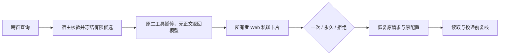

# 跨群分享审批设计方案

## 1. 元信息

| 项 | 值 |
| --- | --- |
| 建档日期 | 2026-10-28 |
| 关联计划 | [JM-21](../designs/jiuwenmate-development-plan.md#jm-21-跨群搜索与-im-扩展扩展) 分享审批子范围 |
| 负责人 | 闫祉君（沿用整项归属） |
| 状态 | 原分享审批已完成本地功能验证；多关键词查询及按来源群拆分审批已补充实现，尚未验证。较宽回归有下述未通过项，真实平台尚未验收，JM-21 保持进行中 |
| 设计 | 用户已确认的[迁移设计](../../../../../docs/superpowers/specs/2026-10-28-cross-group-sharing-migration-design.md) |

## 2. 背景与目标

Agent 具备某来源群的读取权限，不等于所有者同意向其他群或私聊提问者披露内容。保留 `search_group_messages`，在宿主向模型释放跨群候选前增加所有者审批。当前群读取继续按原规则；私聊查询群内容亦需分享授权。

## 3. 方案与取舍

审批和永久授权保存在宿主 SQLite，拒绝 Agent 可写表格和提示词充当授权事实。候选预览只向配置所有者展示，不先进入请求模型。复用原生暂停／恢复，避免批准后创建另一任务而丢失原配置或重复执行。完全访问不跳过业务审批；原 IM 提问者不能使用普通工具批准接口自批。

## 4. 实施影响与契约

新增 `GroupShareRepository`、`GroupSharingService` 和 `GuardedGroupChatPort`，在执行驱动统一注入。永久授权绑定 namespace、配置、运行 Agent、来源群与目标渠道／app／类型／ID；同查询快照可关联同原生批次多个调用。一次传入多个关键词时，宿主将 OR 合并后的去重结果冻结为一个查询快照；若实际命中多个来源群，就按来源群各建一张审批卡。一次批准仅覆盖该卡对应来源群的候选消息和接收方。待审批 15 分钟到期。冻结 JSON ≤2 MiB、正文预览总计 ≤512 KiB，超出要求缩小查询。

所有者 Web RPC `sharing.list/decide/revoke` 返回统一审批／授权快照；query 为完整对象，正文可为 null。卡片位于配置的 Web 私聊 `sharing-approvals`，与普通模型请求分开。

Core 负责安全审批异常、按 owner 定址的确认、carried_answers 持久化和等待现场结清；宿主保留来源访问、可见下界、内容修订／撤回校验和目标路由事实。异常恢复先保存失败，再结清匹配 Core 场景，最后消费审批，不能删除整个窗口。

投递失效时在发送前持久化安全替代内容，清除上传和提及，供重试／ACK／归档使用。保留新仓 channels 认领范围和 WeLink job_json／handoff_done；旧作业快照不能覆盖安全提示或重新接力。

创建原生审批失败时，启动及每两秒扫描最后一次执行的持久暂停补建，保留原来的到期时间，且无审批行的暂停仍阻止同 Session 新任务。已消费、已结束及被新执行覆盖的旧暂停不重放。已过期的冻结分享可关联原中断，仅用于恢复拒绝；不重新授予期限。Session 门禁在同一个 SQLite 读快照里检查原生行与尚未补建的暂停，避免两次读取之间丢失屏障。

投递还核对运行 Agent 与确切接收方；等待 roster 解析或保存 WeLink 作业之后、调用 Gateway 之前再次复核。公开归档缺少投递元数据时从原 Request 补齐，不把正常已批准内容误判为失效。候选审计记录保留，外发／公开归档用安全替代内容。

## 5. 验证与遗留

先迁移测试复现缺少入口，再实现契约。覆盖仓库并发／到期／撤销、来源变化、owner 鉴权、自批绕过、真实 Core 两阶段确认／重启、失败现场结清，以及正文／文件在重试和公开归档中不回流。以下只记录目标仓实际验证，旧仓统计不作为证据：

- Core：目标 Core 的 `.venv/Scripts/python.exe -m pytest -o addopts='' tests/unit_tests/harness/persistent_agent -q --tb=short --show-capture=no`，**1003 passed、10 skipped**；更宽 Core 回归的未通过项和环境限制见 Core `F_25_group-sharing-confirmation.md`。
- 宿主审批恢复：首次 32 passed、1 failed 复现并发补建时屏障丢失；将门禁两次读取置于同一读事务后，恢复仓库 12 项通过。
- 新增投递目标测试：首次 5 failed 复现同 Request 授权未在出站复核接收方；修复后服务／投递安全／真实 Core 整合 **77 passed**。
- 前端：sharing 26、API 29、切换 2、profile 24、workspace 8、i18n 6；兼容修复相关 Settings 19、RSI 15，合计 **129 passed**。`npm --ignore-scripts run build` 退出 0，保留大 chunk 提示；首次构建失败与修复证据见前端 `tests/group-sharing-results.md`。
- 真实 Core 整合使用正式执行入口、宿主 SQLite、审批 RPC 和本地模型替身，覆盖一次批准与拒绝；没有连接真实飞书／钉钉服务。
- 宿主最终组合回归：18 个模块，**500 passed、18 failed、1 skipped、1 deselected，192.82 秒**。本功能仓库／服务／所有者流程／Gateway 转发／恢复／投递安全／真实 Core 整合共 **182 项全部通过**。最终日志为本机临时目录 `new-sharing-combined-verbose-final.log`，使用 `.venv/Scripts/python.exe -m pytest`、`-o addopts='' --asyncio-mode=auto -vv --tb=short -o log_cli=false`。

组合回归没有被标记为全绿，未通过项如下：

1. 17 项现有 Feishu／DingTalk production wiring 测试在导入 `agent_ws_server.py → common/a4p/rpc.py` 时缺少 `a4p`。未修改依赖清单／锁文件或伪造该包来掩盖缺失。
2. `test_feishu_group_production_wiring.py::test_welink_gateway_reconciliation_reads_history_without_sending` 期望 WeLink 回执，但现有 `channel_manager.py::deliver_persistent_result` 仅接受 Feishu、DingTalk，返回 `INVALID_DELIVERY_CHANNEL`。该产品文件和两份 wiring 测试均与 HEAD 一致；未把 WeLink 接通扩入本功能，也未在干净 HEAD 重跑整套。
3. 排除的 1 项为 `test_web_private_chat.py::test_a_shared_file_is_listed_with_a_download_link_to_its_retained_copy`，单独组合实测失败：旧模型替身发出 `file_path='周报.md'`，现有交付契约要求 `output/<file name>`。该测试及 `output_files.py` 与 HEAD 一致，未修改。其余队列／Web 私聊／IM 审批组合为 100 passed；疑似卡住的队列恢复用例单独重跑为 1 passed。首轮大组合等待过久后终止，最终采用 verbose 重跑，未将被终止的结果算作通过。

最终独立审查子进程因账号额度中断；已由主进程复核差异和执行测试，未把自审计为已完成的独立审查。

保护范围为群搜索入口及对应请求的结果投递；不清除已披露上下文，不承诺同 OS 用户无限制 Bash 的文件隔离，不自动迁移旧仓 live 数据库。真实平台／浏览器联合验收另行记录。

## 6. 本地人工验收步骤

1. 用新代码和已构建前端自行启动服务，让 Agent 在 A、B 两个群正常接收消息，在 A 群留下可识别的测试内容。
2. 在 B 群请求查 A 群内容。B 群应只有通用等待提示，不能先出现正文或摘要。
3. 在 JiuwenMate 页面打开该 Agent 的 Web 私聊，进入“跨群分享审批”。核对提问者、来源群、接收群、完整查询及可展开正文。
4. 点“一次批准”，原请求应继续并回复 B 群；再查询不同内容或下一页应重新审批。若一次查询命中多个来源群，应出现每群一张审批卡；拒绝 A 群、批准 C 群后，只能返回 C 群消息。同事在 B 群回复“批准”不得替代所有者操作。
5. 对相同来源→接收方点“永久批准”，后续查询可直接继续；换接收群仍须审批。在该 Agent 的“权限”页面撤销长期授权后，再查询应重新审批。
6. 待审批时重启自己的服务，记录与原请求仍可恢复；等待到期后应拒绝并释放队列。修改或撤回来源消息、撤销授权时，尚未发送的内容及文件不应继续外发。

上述真实平台／浏览器步骤尚未代用户执行；本轮没有启动或重启用户服务、发送平台消息或提交 Git。

## 7. 2026-10-28 现场反馈修复

用户自行运行后的首次一次批准已提交成功，但恢复执行在预检阶段报 `current group membership unavailable`。日志和持久记录确认：Web 与 IM 使用同一个 SQLite，却各有自己的运行管理器；Web 的审批 API 和后台恢复都可能接手 IM 的已决记录。Web driver 没有飞书成员校验回调，因此在调用模型前失败。原有纯 Web 的真实 Core 测试没有覆盖这条两运行管理器链路。

增加运行管理器的 `approval_channels`：生产 Web 工厂限定 Web，生产 IM 工厂限定 Feishu／DingTalk／WeLink。所有决定仍持久保存，调度恢复前按原路由过滤；Web 批准后由原 IM 循环接续原请求。没有跳过成员核验或把校验未知当作已授权。若 IM 暂时不可用则等待其启动，不由 Web 代跑。新增双运行管理器、真实 Core、原群预检与原请求恢复的整合测试，断言 Web driver 从未被调用。

审批页原来每次五秒轮询均设置 `loading=true`，导致刷新文案、aria-busy 和批准按钮反复变化。已有结果时改为静默后台刷新；首次加载和手动刷新保持明确状态。回归测试在请求悬而未决期间检查卡片 DOM、展开内容和可操作按钮不闪动。

提问者原来直接使用入站事件的 `sender_name`，而该事件在联系人信息获取失败时回退为 open_id。卡片列表现在利用原目标群及确切接收 app 的成员可见姓名补充显示；没有可用姓名时用中英文“会话成员”占位。已有记录也按视图补充；不改冻结 scope、原身份或授权条件，不承诺能取得用户客户端的私人备注。

本轮先复现渠道归属、缺少姓名展示方法及加载闪动的失败，再实现修复。聚焦宿主回归 87 项通过；双运行管理器真实 Core 整合单独 1 项通过；前端 sharing 27、i18n 6、workspace 8 项通过，生产构建退出 0（保留既有大 chunk 提示）。最终组合为 **222 passed，140.50 秒**，覆盖分享仓库／服务／所有者流程／Gateway 转发／审批恢复／投递安全／渠道归属／普通 IM 审批／真实 Core／生产 IM 工厂，日志为本机临时目录 `sharing-live-fixes-final.log`。本次未重新运行之前受 a4p 缺失等阻碍的整仓组合，也未修改那些未通过模块。没有重启用户服务或修改用户 live 数据库；此前已经 failed 的原请求不自动复活，更新后需重新发起测试。

## 8. 2026-10-28 审批对话与长期授权展示调整

**状态：已实现并通过目标前端测试及生产构建；真实平台／浏览器联合验收未执行。**

### 8.1 目标

将当前独立收件箱样式的 `sharing-approvals` 页面改为私聊时间线：Agent 以一条带审批卡片的消息说明跨群分享请求，所有者选择“一次批准”“永久批准”或“拒绝”；选择后在同一会话中显示一条本人发出的决策记录。永久授权记录和撤销入口放在对应 Agent 的“权限”页面。

### 8.2 采用方案

- 保留独立的 `sharing-approvals` 会话及其所有者鉴权，不把审批预览放进普通聊天、IM 或模型上下文。
- 将待处理及已处理审批渲染成私聊消息时间线。Agent 消息展示来源群、提问者、目标会话、查询范围和分享摘要；精确消息正文继续折叠显示。一次、永久和拒绝按钮只在审批可操作时出现。
- 决策后由已持久化的审批状态和时间在时间线中派生本人消息，区分一次批准、永久批准和拒绝；过期请求在 Agent 审批消息中标记为过期，不伪装成本人操作。该记录不调用普通 `sendMessage`，不创建 Agent 执行。
- 将跨群分享长期授权列表及撤销操作放进对应 Agent 的“权限”页面，展示授权来源、目标范围、状态和时间；撤销继续使用现有所有者 RPC。
- 复用当前 `sharing.list / decide / revoke` 契约及 SQLite 记录，不新增数据库字段或迁移。决策消息可在刷新和重开会话后从审批记录恢复。

### 8.3 取舍

采用“审批专用消息，不触发模型”。把决策当普通聊天消息发送会新建一次 Agent 任务，与授权动作无关，并可能带来额外工具执行；只给现有审批收件箱换皮则无法形成连贯的对话记录。

### 8.4 实施影响与验证设计

前端拆分审批时间线与权限页授权列表，复用 JiuwenMate 现有聊天气泡、Agent 头像、主题和中英文资源。回归覆盖三种决定及刷新恢复、过期和不可操作状态、长期授权展示与撤销、审批按钮不调用普通聊天发送接口，以及飞书／钉钉运行会话不展示 Web 所有者审批内容。接口和后端行为无变化；通过现有前端测试和构建验证。

### 8.5 实际实现与验证

- `sharing-approvals` 保留为独立私聊会话。待处理审批显示为带 Agent 头像的消息，包含审批范围和可展开的确切候选；过期、已决定或暂不可审批时不展示决策按钮。
- 已批准／永久批准／拒绝的本人气泡只根据持久审批状态生成。它是只读审计展示，不调用普通聊天发送接口，也不创建 Agent 请求。刷新与重开会话后从现有审批记录恢复。
- 跨群分享长期授权及撤销移入对应 Agent 的“权限”页；数据读取和撤销继续使用 owner RPC，并按当前 Agent 配置 ID 查询。已撤销授权保留为历史且不能再次撤销；错误时不伪报成功。
- 实际验证：`npm run test:group-sharing` **26 项通过**；`npm run test:jiuwenmate-profile` **26 项通过**；`npm --ignore-scripts run build` **退出 0**。构建保留现有动态导入及大 chunk 提示。
- 未启动服务，未连接真实飞书／钉钉，也未执行真实浏览器联合验收。现场验收仍按第 6 节执行。

## 9. 按来源群隔离审批与拒绝

一条审批记录只对应一个实际命中消息的来源群和一个目标会话。一次搜索命中多个来源群时，宿主为每个来源群创建独立审批卡；同一查询的卡片绑定到同一个暂停现场，必须逐卡决策后才恢复工具调用。永久授权同样只为该卡对应的单个来源群和目标会话建立。

拒绝只终止该来源群在当前查询中的分享，不连带拒绝其他来源群。所有卡片决策完成后，工具只返回已批准来源群的冻结消息；被拒绝或过期来源的消息不返回，并将结果标记为不完整。没有任何来源获准且没有当前群命中时，不返回跨群消息。之后独立发起的新请求可以重新申请。

## 10. 多关键词一次查询与按来源群审批

用户反馈逐个关键词触发审批过于频繁。`search_group_messages` 保留兼容的单值 `query`，并增加最多 16 项的 `keywords`。多个关键词按大小写不敏感的字面 OR 搜索，合并排序并去重；一次查询如命中多个来源群，会按来源群拆分冻结结果并创建多张审批卡，每张卡只列一个来源群及同一个目标会话。卡片逐一决策；批准或永久授权只覆盖对应来源群，拒绝只影响对应来源群。所有决策完成后，工具只返回获准来源的结果；后续分页仍单独审批。工具暂停后重跑时继续使用首次冻结的来源群和消息集合，不把新命中追加到原审批。前端每张卡列出全部关键词，便于所有者核对。

这次批量查询改动尚未运行测试或真实平台联调；相关旧审批验证不能视为本次行为的验证结果。
